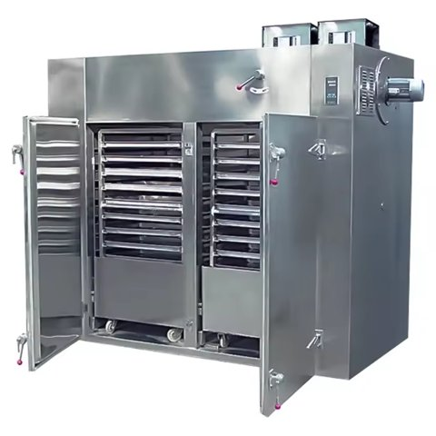

# 건조기

[전체 목록](../../../README.md) · 장비군: **건조·제습 설비**

> 자동 생성 페이지입니다. 이 폴더에 파일을 올리면 내용이 갱신됩니다.

필수 산출물 1/3 · 개발계획서 없음 · 가이던스 없음 · AASX 있음

> [!WARNING]
> **확인 필요**
>
> - AASX가 2개 — 최신본 하나만 남기거나 장비를 나누세요

## 산출물

| 구분 | 파일 | 크기 | 보기 |
|---|---|---|---|
| 개발계획서 | 아직 없음 | | |
| 가이던스 | 아직 없음 | | |
| AASX | [Dryer_v0.0.1_260930.aasx](AASX/Dryer_v0.0.1_260930.aasx) | 928 KB | [열람 페이지](gen/Dryer_v0.0.1_260930.md) |
| AASX | [SprayDryer_v0.0.1.aasx](AASX/SprayDryer_v0.0.1.aasx) | 3.0 MB | [열람 페이지](gen/SprayDryer_v0.0.1.md) |
| 시뮬레이션 | [건조기_학생안내_음성포함_v2.mp4](%EC%8B%9C%EB%AE%AC%EB%A0%88%EC%9D%B4%EC%85%98/%EA%B1%B4%EC%A1%B0%EA%B8%B0_%ED%95%99%EC%83%9D%EC%95%88%EB%82%B4_%EC%9D%8C%EC%84%B1%ED%8F%AC%ED%95%A8_v2.mp4) | 30.6 MB | 다운로드 후 재생 |
| 참고자료 | [참고링크.md](%EC%B0%B8%EA%B3%A0%EC%9E%90%EB%A3%8C/%EC%B0%B8%EA%B3%A0%EB%A7%81%ED%81%AC.md) | 5 KB | [보기](%EC%B0%B8%EA%B3%A0%EC%9E%90%EB%A3%8C/%EC%B0%B8%EA%B3%A0%EB%A7%81%ED%81%AC.md) |

## AAS 구성 — `DryerAAS`

`Dryer_v0.0.1_260930.aasx` 에서 읽은 서브모델 6개 · **[요소 전체 보기](gen/Dryer_v0.0.1_260930.md)**:

| # | 서브모델 idShort |
|:-:|---|
| 1 | Nameplate |
| 2 | HandoverDocumentation |
| 3 | TechnicalData |
| 4 | OperationalData |
| 5 | TimeSeries |
| 6 | ProcessParameters |

## AAS 구성 — `SprayDryerAAS`

`SprayDryer_v0.0.1.aasx` 에서 읽은 서브모델 6개 · **[요소 전체 보기](gen/SprayDryer_v0.0.1.md)**:

| # | 서브모델 idShort |
|:-:|---|
| 1 | Nameplate |
| 2 | HandoverDocumentation |
| 3 | TechnicalData |
| 4 | OperationalData |
| 5 | TimeSeries |
| 6 | ProcessParameters |

변경 기록 (최근 8건)

| 날짜 | 변경 | 파일 |
|---|---|---|
| 2026-11-04 | 삭제 | 건조기_가이던스(자리표시).docx |
| 2026-11-04 | 삭제 | 건조기_개발계획서(자리표시).docx |
| 2026-11-03 | 추가 | Dryer_v0.0.1_260930.aasx |
| 2026-11-03 | 추가 | SprayDryer_v0.0.1.aasx |
| 2026-11-03 | 추가 | 건조기_가이던스(자리표시).docx |
| 2026-11-03 | 추가 | 건조기_개발계획서(자리표시).docx |
| 2026-11-03 | 추가 | 건조기_학생안내_음성포함_v2.mp4 |
| 2026-11-03 | 추가 | 참고링크.md |

