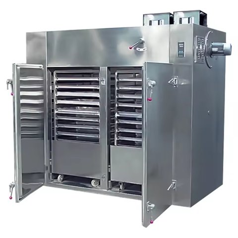

# 🧩 Dryer_v0.0.1_260930.aasx

[← 장비 페이지](../README.md) · [⤓ AASX 다운로드](../AASX/Dryer_v0.0.1_260930.aasx) · 928 KB

> 🤖 AASX 파일을 열어 자동으로 만든 열람 페이지입니다. 직접 고치지 말고 AASX를 다시 올리세요.

| 항목 | 내용 |
|---|---|
| AAS idShort | `DryerAAS` |
| AAS id | https://www.smart-factory.kr/ids/aas/DryerAAS/1/0 |
| 자산 종류 (assetKind) | Type |
| globalAssetId | urn:uuid:93561d13-0e76-5096-89ed-7f2f93d6de77 |
| 설명 | Type-level reference AAS for a fictional infrared-convection batch dryer. |
| 서브모델 | 6개 |
| 전체 요소 | 441개 |

## 서브모델 한눈에 보기

| # | 서브모델 | 요소 수 | semanticId |
|:-:|---|--:|---|
| 1 | [Nameplate](#sm-1) | 29 | https://admin-shell.io/idta/nameplate/3/0/Nameplate |
| 2 | [HandoverDocumentation](#sm-2) | 121 | 0173-1#01-AHF578#003 |
| 3 | [TechnicalData](#sm-3) | 71 | 0173-1#01-AHX837#002 |
| 4 | [OperationalData](#sm-4) | 51 | https://www.smart-factory.kr/ids/sm/DryerAAS/OperationalData/1/0 |
| 5 | [TimeSeries](#sm-5) | 109 | https://admin-shell.io/idta/TimeSeries/1/1 |
| 6 | [ProcessParameters](#sm-6) | 60 | https://admin-shell-io/idta/SubmodelTemplate/ProcessParameters/1/0 |

## 서브모델 상세

각 서브모델 이름을 누르면 펼쳐집니다. **굵은 글씨**는 하위 요소가 있는 묶음입니다.

<b>1. Nameplate</b> — 요소 29개

> Contains the nameplate information attached to the product

semanticId: `https://admin-shell.io/idta/nameplate/3/0/Nameplate`

| idShort | 종류 | 값 | semanticId |
|---|---|---|---|
| URIOfTheProduct | 속성 | urn:uuid:93561d13-0e76-5096-89ed-7f2f93d6de77 | 0112/2///61987#ABN590#002 |
| ManufacturerName | 다국어&nbsp;속성 | Example Manufacturer A | 0112/2///61987#ABA565#009 |
| ManufacturerProductDesignation | 다국어&nbsp;속성 | Infrared Convection Batch Dryer | 0112/2///61987#ABA567#009 |
| **AddressInformation** | 묶음&nbsp;(4) |  | https://admin-shell.io/zvei/nameplate/1/0/ContactInformations/Address… |
| &nbsp;&nbsp;&nbsp;└ Street | 다국어&nbsp;속성 | Example Industrial District 1 | 0173-1#02-AAO128#002 |
| &nbsp;&nbsp;&nbsp;└ Zipcode | 다국어&nbsp;속성 | 00000 | 0173-1#02-AAO129#002 |
| &nbsp;&nbsp;&nbsp;└ CityTown | 다국어&nbsp;속성 | Example City | 0173-1#02-AAO132#002 |
| &nbsp;&nbsp;&nbsp;└ NationalCode | 다국어&nbsp;속성 | ZZ | 0173-1#02-AAO134#002 |
| ManufacturerProductRoot | 다국어&nbsp;속성 | Industrial Dryer | 0112/2///61360_7#AAS011#001 |
| ManufacturerProductFamily | 다국어&nbsp;속성 | Example Batch Dryer Series | 0112/2///61987#ABP464#002 |
| ManufacturerProductType | 속성 | EX-ICD-1000 | 0112/2///61987#ABA300#008 |
| OrderCodeOfManufacturer | 속성 | EX-ICD-1000-STD | 0112/2///61987#ABA950#008 |
| ProductArticleNumberOfManufacturer | 속성 | ART-EX-ICD-1000 | 0112/2///61987#ABA581#007 |
| SerialNumber | 속성 | SN-EX-0001 | 0112/2///61987#ABA951#009 |
| YearOfConstruction | 속성 | 2026 | 0112/2///61987#ABP000#002 |
| DateOfManufacture | 속성 | 2026-01-15 | 0112/2///61987#ABB757#007 |
| HardwareVersion | 속성 | HW-EX-1.0 | 0112/2///61987#ABA926#008 |
| FirmwareVersion | 속성 | FW-EX-1.0 | 0112/2///61987#ABA302#006 |
| SoftwareVersion | 속성 | SW-EX-1.0 | 0112/2///61987#ABA601#008 |
| CountryOfOrigin | 속성 | ZZ | 0112/2///61987#ABP462#001 |
| UniqueFacilityIdentifier | 속성 | UFI-EX-DRYER-0001 | https://admin-shell.io/idta/nameplate/3/0/UniqueFacilityIdentifier |
| **Markings** | 목록&nbsp;(1) |  | 0112/2///61360_7#AAS006#001 |
| &nbsp;&nbsp;&nbsp;└ **Marking__00__** | 묶음&nbsp;(6) |  | 0112/2///61360_7#AAS009#001 |
| &nbsp;&nbsp;&nbsp;&nbsp;&nbsp;&nbsp;└ MarkingName | 속성 | ExampleCertification01 | 0112/2///61987#ABA231#009 |
| &nbsp;&nbsp;&nbsp;&nbsp;&nbsp;&nbsp;└ DesignationOfCertificateOrApproval | 속성 | CERT-EX-001 | 0112/2///61987#ABH783#003 |
| &nbsp;&nbsp;&nbsp;&nbsp;&nbsp;&nbsp;└ IssueDate | 속성 | 2026-01-15 | 0112/2///61987#ABO097#001 |
| &nbsp;&nbsp;&nbsp;&nbsp;&nbsp;&nbsp;└ ExpiryDate | 속성 | 2028-01-14 | 0112/2///61987#ABH830#002 |
| &nbsp;&nbsp;&nbsp;&nbsp;&nbsp;&nbsp;└ MarkingFile | 파일 | /aasx/files/cert/ExampleCertification01.pdf | 0112/2///61987#ABO100#002 |
| &nbsp;&nbsp;&nbsp;&nbsp;&nbsp;&nbsp;└ MarkingAdditionalText | 속성 | Fictional certification example; not a verified approval | 0112/2///61987#ABB146#007 |

<b>2. HandoverDocumentation</b> — 요소 121개

> The Submodel defines a set meta data for the handover of documentation from the manufacturer to the operator for industrial equipment

semanticId: `0173-1#01-AHF578#003`

| idShort | 종류 | 값 | semanticId |
|---|---|---|---|
| **Documents** | 목록&nbsp;(5) |  | 0173-1#02-ABI500#003 |
| &nbsp;&nbsp;&nbsp;└ **Document__00__** | 묶음&nbsp;(3) |  | 0173-1#02-ABI500#003/0173-1#01-AHF579#003 |
| &nbsp;&nbsp;&nbsp;&nbsp;&nbsp;&nbsp;└ **DocumentIds** | 목록&nbsp;(1) |  | 0173-1#02-ABI501#003 |
| &nbsp;&nbsp;&nbsp;&nbsp;&nbsp;&nbsp;&nbsp;&nbsp;&nbsp;└ **DocumentId__00__** | 묶음&nbsp;(3) |  | 0173-1#02-ABI501#003/0173-1#01-AHF580#003 |
| &nbsp;&nbsp;&nbsp;&nbsp;&nbsp;&nbsp;&nbsp;&nbsp;&nbsp;&nbsp;&nbsp;&nbsp;└ DocumentDomainId | 속성 | EXAMPLE_DRYER_DOC | 0173-1#02-ABH994#003 |
| &nbsp;&nbsp;&nbsp;&nbsp;&nbsp;&nbsp;&nbsp;&nbsp;&nbsp;&nbsp;&nbsp;&nbsp;└ DocumentIdentifier | 속성 | DOC-EX-001 | 0173-1#02-AAO099#004 |
| &nbsp;&nbsp;&nbsp;&nbsp;&nbsp;&nbsp;&nbsp;&nbsp;&nbsp;&nbsp;&nbsp;&nbsp;└ DocumentIsPrimary | 속성 | true | 0173-1#02-ABH995#003 |
| &nbsp;&nbsp;&nbsp;&nbsp;&nbsp;&nbsp;└ **DocumentClassifications** | 목록&nbsp;(1) |  | 0173-1#02-ABI502#003 |
| &nbsp;&nbsp;&nbsp;&nbsp;&nbsp;&nbsp;&nbsp;&nbsp;&nbsp;└ **DocumentClassification__00__** | 묶음&nbsp;(3) |  | 0173-1#02-ABI502#003/0173-1#01-AHF581#003 |
| &nbsp;&nbsp;&nbsp;&nbsp;&nbsp;&nbsp;&nbsp;&nbsp;&nbsp;&nbsp;&nbsp;&nbsp;└ ClassId | 속성 | 03-02 | 0173-1#02-ABH996#003 |
| &nbsp;&nbsp;&nbsp;&nbsp;&nbsp;&nbsp;&nbsp;&nbsp;&nbsp;&nbsp;&nbsp;&nbsp;└ ClassName | 다국어&nbsp;속성 | Operation | 0173-1#02-ABJ219#002 |
| &nbsp;&nbsp;&nbsp;&nbsp;&nbsp;&nbsp;&nbsp;&nbsp;&nbsp;&nbsp;&nbsp;&nbsp;└ ClassificationSystem | 속성 | VDI 2770 Blatt 1:2020 | 0173-1#02-ABH997#003 |
| &nbsp;&nbsp;&nbsp;&nbsp;&nbsp;&nbsp;└ **DocumentVersions** | 목록&nbsp;(1) |  | 0173-1#02-ABI503#003 |
| &nbsp;&nbsp;&nbsp;&nbsp;&nbsp;&nbsp;&nbsp;&nbsp;&nbsp;└ **DocumentVersion__00__** | 묶음&nbsp;(9) |  | 0173-1#02-ABI503#003/0173-1#01-AHF582#003 |
| &nbsp;&nbsp;&nbsp;&nbsp;&nbsp;&nbsp;&nbsp;&nbsp;&nbsp;&nbsp;&nbsp;&nbsp;└ **Language** | 목록&nbsp;(1) |  | 0173-1#02-AAN468#008 |
| &nbsp;&nbsp;&nbsp;&nbsp;&nbsp;&nbsp;&nbsp;&nbsp;&nbsp;&nbsp;&nbsp;&nbsp;&nbsp;&nbsp;&nbsp;└  | 속성 | en | 0173-1#02-AAN468#008 |
| &nbsp;&nbsp;&nbsp;&nbsp;&nbsp;&nbsp;&nbsp;&nbsp;&nbsp;&nbsp;&nbsp;&nbsp;└ Version | 속성 | 1.0 | 0173-1#02-AAP003#005 |
| &nbsp;&nbsp;&nbsp;&nbsp;&nbsp;&nbsp;&nbsp;&nbsp;&nbsp;&nbsp;&nbsp;&nbsp;└ Title | 다국어&nbsp;속성 | Example Operating Manual | 0173-1#02-ABG940#003 |
| &nbsp;&nbsp;&nbsp;&nbsp;&nbsp;&nbsp;&nbsp;&nbsp;&nbsp;&nbsp;&nbsp;&nbsp;└ Description | 다국어&nbsp;속성 | Fictional de-identified example document; not a manufacturer document or electr… | 0173-1#02-AAN466#004 |
| &nbsp;&nbsp;&nbsp;&nbsp;&nbsp;&nbsp;&nbsp;&nbsp;&nbsp;&nbsp;&nbsp;&nbsp;└ StatusSetDate | 속성 | 2026-01-15 | 0173-1#02-ABI000#003 |
| &nbsp;&nbsp;&nbsp;&nbsp;&nbsp;&nbsp;&nbsp;&nbsp;&nbsp;&nbsp;&nbsp;&nbsp;└ StatusValue | 속성 | Released | 0173-1#02-ABI001#003 |
| &nbsp;&nbsp;&nbsp;&nbsp;&nbsp;&nbsp;&nbsp;&nbsp;&nbsp;&nbsp;&nbsp;&nbsp;└ OrganizationShortName | 속성 | ExampleOrg | https://api.eclass-cdp.com/0173-1-02-ABI002-003 |
| &nbsp;&nbsp;&nbsp;&nbsp;&nbsp;&nbsp;&nbsp;&nbsp;&nbsp;&nbsp;&nbsp;&nbsp;└ OrganizationOfficialName | 속성 | Example Organization | 0173-1#02-ABI004#003 |
| &nbsp;&nbsp;&nbsp;&nbsp;&nbsp;&nbsp;&nbsp;&nbsp;&nbsp;&nbsp;&nbsp;&nbsp;└ **DigitalFiles** | 목록&nbsp;(1) |  | 0173-1#02-ABK126#002 |
| &nbsp;&nbsp;&nbsp;&nbsp;&nbsp;&nbsp;&nbsp;&nbsp;&nbsp;&nbsp;&nbsp;&nbsp;&nbsp;&nbsp;&nbsp;└  | 파일 | /aasx/files/documents/Example_OperatingManual_EN.pdf | 0173-1#02-ABK126#002 |
| &nbsp;&nbsp;&nbsp;└ **Document__01__** | 묶음&nbsp;(3) |  | 0173-1#02-ABI500#003/0173-1#01-AHF579#003 |
| &nbsp;&nbsp;&nbsp;&nbsp;&nbsp;&nbsp;└ **DocumentIds** | 목록&nbsp;(1) |  | 0173-1#02-ABI501#003 |
| &nbsp;&nbsp;&nbsp;&nbsp;&nbsp;&nbsp;&nbsp;&nbsp;&nbsp;└ **DocumentId__00__** | 묶음&nbsp;(3) |  | 0173-1#02-ABI501#003/0173-1#01-AHF580#003 |
| &nbsp;&nbsp;&nbsp;&nbsp;&nbsp;&nbsp;&nbsp;&nbsp;&nbsp;&nbsp;&nbsp;&nbsp;└ DocumentDomainId | 속성 | EXAMPLE_DRYER_DOC | 0173-1#02-ABH994#003 |
| &nbsp;&nbsp;&nbsp;&nbsp;&nbsp;&nbsp;&nbsp;&nbsp;&nbsp;&nbsp;&nbsp;&nbsp;└ DocumentIdentifier | 속성 | DOC-EX-002 | 0173-1#02-AAO099#004 |
| &nbsp;&nbsp;&nbsp;&nbsp;&nbsp;&nbsp;&nbsp;&nbsp;&nbsp;&nbsp;&nbsp;&nbsp;└ DocumentIsPrimary | 속성 | true | 0173-1#02-ABH995#003 |
| &nbsp;&nbsp;&nbsp;&nbsp;&nbsp;&nbsp;└ **DocumentClassifications** | 목록&nbsp;(1) |  | 0173-1#02-ABI502#003 |
| &nbsp;&nbsp;&nbsp;&nbsp;&nbsp;&nbsp;&nbsp;&nbsp;&nbsp;└ **DocumentClassification__00__** | 묶음&nbsp;(3) |  | 0173-1#02-ABI502#003/0173-1#01-AHF581#003 |
| &nbsp;&nbsp;&nbsp;&nbsp;&nbsp;&nbsp;&nbsp;&nbsp;&nbsp;&nbsp;&nbsp;&nbsp;└ ClassId | 속성 | 03-01 | 0173-1#02-ABH996#003 |
| &nbsp;&nbsp;&nbsp;&nbsp;&nbsp;&nbsp;&nbsp;&nbsp;&nbsp;&nbsp;&nbsp;&nbsp;└ ClassName | 다국어&nbsp;속성 | Commissioning, de-commissioning | 0173-1#02-ABJ219#002 |
| &nbsp;&nbsp;&nbsp;&nbsp;&nbsp;&nbsp;&nbsp;&nbsp;&nbsp;&nbsp;&nbsp;&nbsp;└ ClassificationSystem | 속성 | VDI 2770 Blatt 1:2020 | 0173-1#02-ABH997#003 |
| &nbsp;&nbsp;&nbsp;&nbsp;&nbsp;&nbsp;└ **DocumentVersions** | 목록&nbsp;(1) |  | 0173-1#02-ABI503#003 |
| &nbsp;&nbsp;&nbsp;&nbsp;&nbsp;&nbsp;&nbsp;&nbsp;&nbsp;└ **DocumentVersion__00__** | 묶음&nbsp;(9) |  | 0173-1#02-ABI503#003/0173-1#01-AHF582#003 |
| &nbsp;&nbsp;&nbsp;&nbsp;&nbsp;&nbsp;&nbsp;&nbsp;&nbsp;&nbsp;&nbsp;&nbsp;└ **Language** | 목록&nbsp;(1) |  | 0173-1#02-AAN468#008 |
| &nbsp;&nbsp;&nbsp;&nbsp;&nbsp;&nbsp;&nbsp;&nbsp;&nbsp;&nbsp;&nbsp;&nbsp;&nbsp;&nbsp;&nbsp;└  | 속성 | en | 0173-1#02-AAN468#008 |
| &nbsp;&nbsp;&nbsp;&nbsp;&nbsp;&nbsp;&nbsp;&nbsp;&nbsp;&nbsp;&nbsp;&nbsp;└ Version | 속성 | 1.0 | 0173-1#02-AAP003#005 |
| &nbsp;&nbsp;&nbsp;&nbsp;&nbsp;&nbsp;&nbsp;&nbsp;&nbsp;&nbsp;&nbsp;&nbsp;└ Title | 다국어&nbsp;속성 | Example Commissioning Guide | 0173-1#02-ABG940#003 |
| &nbsp;&nbsp;&nbsp;&nbsp;&nbsp;&nbsp;&nbsp;&nbsp;&nbsp;&nbsp;&nbsp;&nbsp;└ Description | 다국어&nbsp;속성 | Fictional de-identified example document; not a manufacturer document or electr… | 0173-1#02-AAN466#004 |
| &nbsp;&nbsp;&nbsp;&nbsp;&nbsp;&nbsp;&nbsp;&nbsp;&nbsp;&nbsp;&nbsp;&nbsp;└ StatusSetDate | 속성 | 2026-01-15 | 0173-1#02-ABI000#003 |
| &nbsp;&nbsp;&nbsp;&nbsp;&nbsp;&nbsp;&nbsp;&nbsp;&nbsp;&nbsp;&nbsp;&nbsp;└ StatusValue | 속성 | Released | 0173-1#02-ABI001#003 |
| &nbsp;&nbsp;&nbsp;&nbsp;&nbsp;&nbsp;&nbsp;&nbsp;&nbsp;&nbsp;&nbsp;&nbsp;└ OrganizationShortName | 속성 | ExampleOrg | https://api.eclass-cdp.com/0173-1-02-ABI002-003 |
| &nbsp;&nbsp;&nbsp;&nbsp;&nbsp;&nbsp;&nbsp;&nbsp;&nbsp;&nbsp;&nbsp;&nbsp;└ OrganizationOfficialName | 속성 | Example Organization | 0173-1#02-ABI004#003 |
| &nbsp;&nbsp;&nbsp;&nbsp;&nbsp;&nbsp;&nbsp;&nbsp;&nbsp;&nbsp;&nbsp;&nbsp;└ **DigitalFiles** | 목록&nbsp;(1) |  | 0173-1#02-ABK126#002 |
| &nbsp;&nbsp;&nbsp;&nbsp;&nbsp;&nbsp;&nbsp;&nbsp;&nbsp;&nbsp;&nbsp;&nbsp;&nbsp;&nbsp;&nbsp;└  | 파일 | /aasx/files/documents/Example_CommissioningGuide_EN.pdf | 0173-1#02-ABK126#002 |
| &nbsp;&nbsp;&nbsp;└ **Document__02__** | 묶음&nbsp;(3) |  | 0173-1#02-ABI500#003/0173-1#01-AHF579#003 |
| &nbsp;&nbsp;&nbsp;&nbsp;&nbsp;&nbsp;└ **DocumentIds** | 목록&nbsp;(1) |  | 0173-1#02-ABI501#003 |
| &nbsp;&nbsp;&nbsp;&nbsp;&nbsp;&nbsp;&nbsp;&nbsp;&nbsp;└ **DocumentId__00__** | 묶음&nbsp;(3) |  | 0173-1#02-ABI501#003/0173-1#01-AHF580#003 |
| &nbsp;&nbsp;&nbsp;&nbsp;&nbsp;&nbsp;&nbsp;&nbsp;&nbsp;&nbsp;&nbsp;&nbsp;└ DocumentDomainId | 속성 | EXAMPLE_DRYER_DOC | 0173-1#02-ABH994#003 |
| &nbsp;&nbsp;&nbsp;&nbsp;&nbsp;&nbsp;&nbsp;&nbsp;&nbsp;&nbsp;&nbsp;&nbsp;└ DocumentIdentifier | 속성 | DOC-EX-003 | 0173-1#02-AAO099#004 |
| &nbsp;&nbsp;&nbsp;&nbsp;&nbsp;&nbsp;&nbsp;&nbsp;&nbsp;&nbsp;&nbsp;&nbsp;└ DocumentIsPrimary | 속성 | true | 0173-1#02-ABH995#003 |
| &nbsp;&nbsp;&nbsp;&nbsp;&nbsp;&nbsp;└ **DocumentClassifications** | 목록&nbsp;(1) |  | 0173-1#02-ABI502#003 |
| &nbsp;&nbsp;&nbsp;&nbsp;&nbsp;&nbsp;&nbsp;&nbsp;&nbsp;└ **DocumentClassification__00__** | 묶음&nbsp;(3) |  | 0173-1#02-ABI502#003/0173-1#01-AHF581#003 |
| &nbsp;&nbsp;&nbsp;&nbsp;&nbsp;&nbsp;&nbsp;&nbsp;&nbsp;&nbsp;&nbsp;&nbsp;└ ClassId | 속성 | 03-03 | 0173-1#02-ABH996#003 |
| &nbsp;&nbsp;&nbsp;&nbsp;&nbsp;&nbsp;&nbsp;&nbsp;&nbsp;&nbsp;&nbsp;&nbsp;└ ClassName | 다국어&nbsp;속성 | General safety | 0173-1#02-ABJ219#002 |
| &nbsp;&nbsp;&nbsp;&nbsp;&nbsp;&nbsp;&nbsp;&nbsp;&nbsp;&nbsp;&nbsp;&nbsp;└ ClassificationSystem | 속성 | VDI 2770 Blatt 1:2020 | 0173-1#02-ABH997#003 |
| &nbsp;&nbsp;&nbsp;&nbsp;&nbsp;&nbsp;└ **DocumentVersions** | 목록&nbsp;(1) |  | 0173-1#02-ABI503#003 |
| &nbsp;&nbsp;&nbsp;&nbsp;&nbsp;&nbsp;&nbsp;&nbsp;&nbsp;└ **DocumentVersion__00__** | 묶음&nbsp;(9) |  | 0173-1#02-ABI503#003/0173-1#01-AHF582#003 |
| &nbsp;&nbsp;&nbsp;&nbsp;&nbsp;&nbsp;&nbsp;&nbsp;&nbsp;&nbsp;&nbsp;&nbsp;└ **Language** | 목록&nbsp;(1) |  | 0173-1#02-AAN468#008 |
| &nbsp;&nbsp;&nbsp;&nbsp;&nbsp;&nbsp;&nbsp;&nbsp;&nbsp;&nbsp;&nbsp;&nbsp;&nbsp;&nbsp;&nbsp;└  | 속성 | en | 0173-1#02-AAN468#008 |
| &nbsp;&nbsp;&nbsp;&nbsp;&nbsp;&nbsp;&nbsp;&nbsp;&nbsp;&nbsp;&nbsp;&nbsp;└ Version | 속성 | 1.0 | 0173-1#02-AAP003#005 |
| &nbsp;&nbsp;&nbsp;&nbsp;&nbsp;&nbsp;&nbsp;&nbsp;&nbsp;&nbsp;&nbsp;&nbsp;└ Title | 다국어&nbsp;속성 | Example Safety Guide | 0173-1#02-ABG940#003 |
| &nbsp;&nbsp;&nbsp;&nbsp;&nbsp;&nbsp;&nbsp;&nbsp;&nbsp;&nbsp;&nbsp;&nbsp;└ Description | 다국어&nbsp;속성 | Fictional de-identified example document; not a manufacturer document or electr… | 0173-1#02-AAN466#004 |
| &nbsp;&nbsp;&nbsp;&nbsp;&nbsp;&nbsp;&nbsp;&nbsp;&nbsp;&nbsp;&nbsp;&nbsp;└ StatusSetDate | 속성 | 2026-01-15 | 0173-1#02-ABI000#003 |
| &nbsp;&nbsp;&nbsp;&nbsp;&nbsp;&nbsp;&nbsp;&nbsp;&nbsp;&nbsp;&nbsp;&nbsp;└ StatusValue | 속성 | Released | 0173-1#02-ABI001#003 |
| &nbsp;&nbsp;&nbsp;&nbsp;&nbsp;&nbsp;&nbsp;&nbsp;&nbsp;&nbsp;&nbsp;&nbsp;└ OrganizationShortName | 속성 | ExampleOrg | https://api.eclass-cdp.com/0173-1-02-ABI002-003 |
| &nbsp;&nbsp;&nbsp;&nbsp;&nbsp;&nbsp;&nbsp;&nbsp;&nbsp;&nbsp;&nbsp;&nbsp;└ OrganizationOfficialName | 속성 | Example Organization | 0173-1#02-ABI004#003 |
| &nbsp;&nbsp;&nbsp;&nbsp;&nbsp;&nbsp;&nbsp;&nbsp;&nbsp;&nbsp;&nbsp;&nbsp;└ **DigitalFiles** | 목록&nbsp;(1) |  | 0173-1#02-ABK126#002 |
| &nbsp;&nbsp;&nbsp;&nbsp;&nbsp;&nbsp;&nbsp;&nbsp;&nbsp;&nbsp;&nbsp;&nbsp;&nbsp;&nbsp;&nbsp;└  | 파일 | /aasx/files/documents/Example_SafetyGuide_EN.pdf | 0173-1#02-ABK126#002 |
| &nbsp;&nbsp;&nbsp;└ **Document__03__** | 묶음&nbsp;(3) |  | 0173-1#02-ABI500#003/0173-1#01-AHF579#003 |
| &nbsp;&nbsp;&nbsp;&nbsp;&nbsp;&nbsp;└ **DocumentIds** | 목록&nbsp;(1) |  | 0173-1#02-ABI501#003 |
| &nbsp;&nbsp;&nbsp;&nbsp;&nbsp;&nbsp;&nbsp;&nbsp;&nbsp;└ **DocumentId__00__** | 묶음&nbsp;(3) |  | 0173-1#02-ABI501#003/0173-1#01-AHF580#003 |
| &nbsp;&nbsp;&nbsp;&nbsp;&nbsp;&nbsp;&nbsp;&nbsp;&nbsp;&nbsp;&nbsp;&nbsp;└ DocumentDomainId | 속성 | EXAMPLE_DRYER_DOC | 0173-1#02-ABH994#003 |
| &nbsp;&nbsp;&nbsp;&nbsp;&nbsp;&nbsp;&nbsp;&nbsp;&nbsp;&nbsp;&nbsp;&nbsp;└ DocumentIdentifier | 속성 | DOC-EX-004 | 0173-1#02-AAO099#004 |
| &nbsp;&nbsp;&nbsp;&nbsp;&nbsp;&nbsp;&nbsp;&nbsp;&nbsp;&nbsp;&nbsp;&nbsp;└ DocumentIsPrimary | 속성 | true | 0173-1#02-ABH995#003 |
| &nbsp;&nbsp;&nbsp;&nbsp;&nbsp;&nbsp;└ **DocumentClassifications** | 목록&nbsp;(1) |  | 0173-1#02-ABI502#003 |
| &nbsp;&nbsp;&nbsp;&nbsp;&nbsp;&nbsp;&nbsp;&nbsp;&nbsp;└ **DocumentClassification__00__** | 묶음&nbsp;(3) |  | 0173-1#02-ABI502#003/0173-1#01-AHF581#003 |
| &nbsp;&nbsp;&nbsp;&nbsp;&nbsp;&nbsp;&nbsp;&nbsp;&nbsp;&nbsp;&nbsp;&nbsp;└ ClassId | 속성 | 03-04 | 0173-1#02-ABH996#003 |
| &nbsp;&nbsp;&nbsp;&nbsp;&nbsp;&nbsp;&nbsp;&nbsp;&nbsp;&nbsp;&nbsp;&nbsp;└ ClassName | 다국어&nbsp;속성 | Inspection, maintenance, testing | 0173-1#02-ABJ219#002 |
| &nbsp;&nbsp;&nbsp;&nbsp;&nbsp;&nbsp;&nbsp;&nbsp;&nbsp;&nbsp;&nbsp;&nbsp;└ ClassificationSystem | 속성 | VDI 2770 Blatt 1:2020 | 0173-1#02-ABH997#003 |
| &nbsp;&nbsp;&nbsp;&nbsp;&nbsp;&nbsp;└ **DocumentVersions** | 목록&nbsp;(1) |  | 0173-1#02-ABI503#003 |
| &nbsp;&nbsp;&nbsp;&nbsp;&nbsp;&nbsp;&nbsp;&nbsp;&nbsp;└ **DocumentVersion__00__** | 묶음&nbsp;(9) |  | 0173-1#02-ABI503#003/0173-1#01-AHF582#003 |
| &nbsp;&nbsp;&nbsp;&nbsp;&nbsp;&nbsp;&nbsp;&nbsp;&nbsp;&nbsp;&nbsp;&nbsp;└ **Language** | 목록&nbsp;(1) |  | 0173-1#02-AAN468#008 |
| &nbsp;&nbsp;&nbsp;&nbsp;&nbsp;&nbsp;&nbsp;&nbsp;&nbsp;&nbsp;&nbsp;&nbsp;&nbsp;&nbsp;&nbsp;└  | 속성 | en | 0173-1#02-AAN468#008 |
| &nbsp;&nbsp;&nbsp;&nbsp;&nbsp;&nbsp;&nbsp;&nbsp;&nbsp;&nbsp;&nbsp;&nbsp;└ Version | 속성 | 1.0 | 0173-1#02-AAP003#005 |
| &nbsp;&nbsp;&nbsp;&nbsp;&nbsp;&nbsp;&nbsp;&nbsp;&nbsp;&nbsp;&nbsp;&nbsp;└ Title | 다국어&nbsp;속성 | Example Maintenance Guide | 0173-1#02-ABG940#003 |
| &nbsp;&nbsp;&nbsp;&nbsp;&nbsp;&nbsp;&nbsp;&nbsp;&nbsp;&nbsp;&nbsp;&nbsp;└ Description | 다국어&nbsp;속성 | Fictional de-identified example document; not a manufacturer document or electr… | 0173-1#02-AAN466#004 |
| &nbsp;&nbsp;&nbsp;&nbsp;&nbsp;&nbsp;&nbsp;&nbsp;&nbsp;&nbsp;&nbsp;&nbsp;└ StatusSetDate | 속성 | 2026-01-15 | 0173-1#02-ABI000#003 |
| &nbsp;&nbsp;&nbsp;&nbsp;&nbsp;&nbsp;&nbsp;&nbsp;&nbsp;&nbsp;&nbsp;&nbsp;└ StatusValue | 속성 | Released | 0173-1#02-ABI001#003 |
| &nbsp;&nbsp;&nbsp;&nbsp;&nbsp;&nbsp;&nbsp;&nbsp;&nbsp;&nbsp;&nbsp;&nbsp;└ OrganizationShortName | 속성 | ExampleOrg | https://api.eclass-cdp.com/0173-1-02-ABI002-003 |
| &nbsp;&nbsp;&nbsp;&nbsp;&nbsp;&nbsp;&nbsp;&nbsp;&nbsp;&nbsp;&nbsp;&nbsp;└ OrganizationOfficialName | 속성 | Example Organization | 0173-1#02-ABI004#003 |
| &nbsp;&nbsp;&nbsp;&nbsp;&nbsp;&nbsp;&nbsp;&nbsp;&nbsp;&nbsp;&nbsp;&nbsp;└ **DigitalFiles** | 목록&nbsp;(1) |  | 0173-1#02-ABK126#002 |
| &nbsp;&nbsp;&nbsp;&nbsp;&nbsp;&nbsp;&nbsp;&nbsp;&nbsp;&nbsp;&nbsp;&nbsp;&nbsp;&nbsp;&nbsp;└  | 파일 | /aasx/files/documents/Example_MaintenanceGuide_EN.pdf | 0173-1#02-ABK126#002 |
| &nbsp;&nbsp;&nbsp;└ **Document__04__** | 묶음&nbsp;(3) |  | 0173-1#02-ABI500#003/0173-1#01-AHF579#003 |
| &nbsp;&nbsp;&nbsp;&nbsp;&nbsp;&nbsp;└ **DocumentIds** | 목록&nbsp;(1) |  | 0173-1#02-ABI501#003 |
| &nbsp;&nbsp;&nbsp;&nbsp;&nbsp;&nbsp;&nbsp;&nbsp;&nbsp;└ **DocumentId__00__** | 묶음&nbsp;(3) |  | 0173-1#02-ABI501#003/0173-1#01-AHF580#003 |
| &nbsp;&nbsp;&nbsp;&nbsp;&nbsp;&nbsp;&nbsp;&nbsp;&nbsp;&nbsp;&nbsp;&nbsp;└ DocumentDomainId | 속성 | EXAMPLE_DRYER_DOC | 0173-1#02-ABH994#003 |
| &nbsp;&nbsp;&nbsp;&nbsp;&nbsp;&nbsp;&nbsp;&nbsp;&nbsp;&nbsp;&nbsp;&nbsp;└ DocumentIdentifier | 속성 | DOC-EX-005 | 0173-1#02-AAO099#004 |
| &nbsp;&nbsp;&nbsp;&nbsp;&nbsp;&nbsp;&nbsp;&nbsp;&nbsp;&nbsp;&nbsp;&nbsp;└ DocumentIsPrimary | 속성 | true | 0173-1#02-ABH995#003 |
| &nbsp;&nbsp;&nbsp;&nbsp;&nbsp;&nbsp;└ **DocumentClassifications** | 목록&nbsp;(1) |  | 0173-1#02-ABI502#003 |
| &nbsp;&nbsp;&nbsp;&nbsp;&nbsp;&nbsp;&nbsp;&nbsp;&nbsp;└ **DocumentClassification__00__** | 묶음&nbsp;(3) |  | 0173-1#02-ABI502#003/0173-1#01-AHF581#003 |
| &nbsp;&nbsp;&nbsp;&nbsp;&nbsp;&nbsp;&nbsp;&nbsp;&nbsp;&nbsp;&nbsp;&nbsp;└ ClassId | 속성 | 02-02 | 0173-1#02-ABH996#003 |
| &nbsp;&nbsp;&nbsp;&nbsp;&nbsp;&nbsp;&nbsp;&nbsp;&nbsp;&nbsp;&nbsp;&nbsp;└ ClassName | 다국어&nbsp;속성 | Technical specification | 0173-1#02-ABJ219#002 |
| &nbsp;&nbsp;&nbsp;&nbsp;&nbsp;&nbsp;&nbsp;&nbsp;&nbsp;&nbsp;&nbsp;&nbsp;└ ClassificationSystem | 속성 | VDI 2770 Blatt 1:2020 | 0173-1#02-ABH997#003 |
| &nbsp;&nbsp;&nbsp;&nbsp;&nbsp;&nbsp;└ **DocumentVersions** | 목록&nbsp;(1) |  | 0173-1#02-ABI503#003 |
| &nbsp;&nbsp;&nbsp;&nbsp;&nbsp;&nbsp;&nbsp;&nbsp;&nbsp;└ **DocumentVersion__00__** | 묶음&nbsp;(9) |  | 0173-1#02-ABI503#003/0173-1#01-AHF582#003 |
| &nbsp;&nbsp;&nbsp;&nbsp;&nbsp;&nbsp;&nbsp;&nbsp;&nbsp;&nbsp;&nbsp;&nbsp;└ **Language** | 목록&nbsp;(1) |  | 0173-1#02-AAN468#008 |
| &nbsp;&nbsp;&nbsp;&nbsp;&nbsp;&nbsp;&nbsp;&nbsp;&nbsp;&nbsp;&nbsp;&nbsp;&nbsp;&nbsp;&nbsp;└  | 속성 | en | 0173-1#02-AAN468#008 |
| &nbsp;&nbsp;&nbsp;&nbsp;&nbsp;&nbsp;&nbsp;&nbsp;&nbsp;&nbsp;&nbsp;&nbsp;└ Version | 속성 | 1.0 | 0173-1#02-AAP003#005 |
| &nbsp;&nbsp;&nbsp;&nbsp;&nbsp;&nbsp;&nbsp;&nbsp;&nbsp;&nbsp;&nbsp;&nbsp;└ Title | 다국어&nbsp;속성 | Example Electrical Overview | 0173-1#02-ABG940#003 |
| &nbsp;&nbsp;&nbsp;&nbsp;&nbsp;&nbsp;&nbsp;&nbsp;&nbsp;&nbsp;&nbsp;&nbsp;└ Description | 다국어&nbsp;속성 | Fictional de-identified example document; not a manufacturer document or electr… | 0173-1#02-AAN466#004 |
| &nbsp;&nbsp;&nbsp;&nbsp;&nbsp;&nbsp;&nbsp;&nbsp;&nbsp;&nbsp;&nbsp;&nbsp;└ StatusSetDate | 속성 | 2026-01-15 | 0173-1#02-ABI000#003 |
| &nbsp;&nbsp;&nbsp;&nbsp;&nbsp;&nbsp;&nbsp;&nbsp;&nbsp;&nbsp;&nbsp;&nbsp;└ StatusValue | 속성 | Released | 0173-1#02-ABI001#003 |
| &nbsp;&nbsp;&nbsp;&nbsp;&nbsp;&nbsp;&nbsp;&nbsp;&nbsp;&nbsp;&nbsp;&nbsp;└ OrganizationShortName | 속성 | ExampleOrg | https://api.eclass-cdp.com/0173-1-02-ABI002-003 |
| &nbsp;&nbsp;&nbsp;&nbsp;&nbsp;&nbsp;&nbsp;&nbsp;&nbsp;&nbsp;&nbsp;&nbsp;└ OrganizationOfficialName | 속성 | Example Organization | 0173-1#02-ABI004#003 |
| &nbsp;&nbsp;&nbsp;&nbsp;&nbsp;&nbsp;&nbsp;&nbsp;&nbsp;&nbsp;&nbsp;&nbsp;└ **DigitalFiles** | 목록&nbsp;(1) |  | 0173-1#02-ABK126#002 |
| &nbsp;&nbsp;&nbsp;&nbsp;&nbsp;&nbsp;&nbsp;&nbsp;&nbsp;&nbsp;&nbsp;&nbsp;&nbsp;&nbsp;&nbsp;└  | 파일 | /aasx/files/documents/Example_ElectricalOverview.pdf | 0173-1#02-ABK126#002 |

<b>3. TechnicalData</b> — 요소 71개

> Submodel containing technical data of the asset and associated product classificatons

semanticId: `0173-1#01-AHX837#002`

| idShort | 종류 | 값 | semanticId |
|---|---|---|---|
| **GeneralInformation** | 묶음&nbsp;(5) |  | 0173-1#02-ABK161#002/0173-1#01-AHX838#002 |
| &nbsp;&nbsp;&nbsp;└ ManufacturerName | 속성 | Example Manufacturer A | 0173-1#02-AAO677#004 |
| &nbsp;&nbsp;&nbsp;└ ManufacturerProductDesignation | 다국어&nbsp;속성 | Infrared Convection Batch Dryer | 0173-1#02-AAW338#003 |
| &nbsp;&nbsp;&nbsp;└ ManufacturerArticleNumber | 속성 | ART-EX-ICD-1000 | 0173-1#02-AAO676#005 |
| &nbsp;&nbsp;&nbsp;└ ManufacturerOrderCode | 속성 | EX-ICD-1000-STD | 0173-1#02-AAO227#004 |
| &nbsp;&nbsp;&nbsp;└ **ProductImages** | 목록&nbsp;(1) |  | 0173-1#02-ABM220#001 |
| &nbsp;&nbsp;&nbsp;&nbsp;&nbsp;&nbsp;└ **** | 묶음&nbsp;(2) |  | 0173-1#02-ABM220#001/0173-1#01-AHY911#001 |
| &nbsp;&nbsp;&nbsp;&nbsp;&nbsp;&nbsp;&nbsp;&nbsp;&nbsp;└ ImageFile | 파일 | /aasx/files/images/Example_CabinetDryer_Diagram.png | 0173-1#02-ABK291#002 |
| &nbsp;&nbsp;&nbsp;&nbsp;&nbsp;&nbsp;&nbsp;&nbsp;&nbsp;└ ImageNote | 다국어&nbsp;속성 | Code-generated neutral cabinet dryer diagram | 0173-1#02-ABL423#001 |
| **ProductClassifications** | 목록&nbsp;(1) |  | 0173-1#02-ABK162#002 |
| &nbsp;&nbsp;&nbsp;└ **** | 묶음&nbsp;(7) |  | 0173-1#02-ABK162#002/0173-1#01-AHX839#002 |
| &nbsp;&nbsp;&nbsp;&nbsp;&nbsp;&nbsp;└ ClassificationSystem | 속성 | ECLASS | 0173-1#02-ABL424#001 |
| &nbsp;&nbsp;&nbsp;&nbsp;&nbsp;&nbsp;└ ClassificationSystemVersion | 속성 | ECLASS 16.0 | 0173-1#02-AAR710#003 |
| &nbsp;&nbsp;&nbsp;&nbsp;&nbsp;&nbsp;└ ClassificationSystemUrl | 속성 | https://eclass.eu/en/eclass-standard/search-content/show?tx_eclasssearch_ecsear… | https://admin-shell.io/IDTA/TechnicalData/ProductClassifications/Prod… |
| &nbsp;&nbsp;&nbsp;&nbsp;&nbsp;&nbsp;└ ProductClassId | 속성 | 0173-1#01-AKL632#021 | 0173-1#02-ABG776#003 |
| &nbsp;&nbsp;&nbsp;&nbsp;&nbsp;&nbsp;└ ProductClassCodedName | 속성 | 36160702 | 0173-1#02-ABK128#002 |
| &nbsp;&nbsp;&nbsp;&nbsp;&nbsp;&nbsp;└ ProductClassName | 다국어&nbsp;속성 | Infrared-convection drier | 0173-1#02-ABK273#002 |
| &nbsp;&nbsp;&nbsp;&nbsp;&nbsp;&nbsp;└ ReferenceToTechnicalPropertyArea | 참조 | https://www.smart-factory.kr/ids/sm/DryerAAS/TechnicalData/2/0 / TechnicalPrope… | 0173-1#02-ABL358#002 |
| **TechnicalPropertyAreas** | 목록&nbsp;(1) |  | 0173-1#02-ABK163#002 |
| &nbsp;&nbsp;&nbsp;└ **TechnicalPropertyArea__00__** | 묶음&nbsp;(4) |  | 0173-1#02-ABL358#002/0173-1#01-AHX773#002 |
| &nbsp;&nbsp;&nbsp;&nbsp;&nbsp;&nbsp;└ **EquipmentConfiguration** | 묶음&nbsp;(2) |  | https://www.smart-factory.kr/ids/cd/EquipmentConfiguration/1/0 |
| &nbsp;&nbsp;&nbsp;&nbsp;&nbsp;&nbsp;&nbsp;&nbsp;&nbsp;└ **DryerCommonSpecifications** | 묶음&nbsp;(5) |  | https://www.smart-factory.kr/ids/cd/DryerCommonSpecifications/1/0 |
| &nbsp;&nbsp;&nbsp;&nbsp;&nbsp;&nbsp;&nbsp;&nbsp;&nbsp;&nbsp;&nbsp;&nbsp;└ ProductType | 속성 | StationaryBatchCabinetDryer | 0173-1#02-AAO057#004 |
| &nbsp;&nbsp;&nbsp;&nbsp;&nbsp;&nbsp;&nbsp;&nbsp;&nbsp;&nbsp;&nbsp;&nbsp;└ DryingMethod | 속성 | InfraredConvection | https://www.smart-factory.kr/ids/cd/DryingMethod/1/0 |
| &nbsp;&nbsp;&nbsp;&nbsp;&nbsp;&nbsp;&nbsp;&nbsp;&nbsp;&nbsp;&nbsp;&nbsp;└ SystemConfiguration | 속성 | StandaloneBatchCabinet | https://www.smart-factory.kr/ids/cd/SystemConfiguration/1/0 |
| &nbsp;&nbsp;&nbsp;&nbsp;&nbsp;&nbsp;&nbsp;&nbsp;&nbsp;&nbsp;&nbsp;&nbsp;└ InstallationType | 속성 | IndoorFloorMounted | https://www.smart-factory.kr/ids/cd/InstallationType/1/0 |
| &nbsp;&nbsp;&nbsp;&nbsp;&nbsp;&nbsp;&nbsp;&nbsp;&nbsp;&nbsp;&nbsp;&nbsp;└ ProductWeight | 속성 | 1200 | https://www.smart-factory.kr/ids/cd/ProductWeight/1/0 |
| &nbsp;&nbsp;&nbsp;&nbsp;&nbsp;&nbsp;&nbsp;&nbsp;&nbsp;└ **ChamberAndTraySpecifications** | 묶음&nbsp;(8) |  | https://www.smart-factory.kr/ids/cd/ChamberAndTraySpecifications/1/0 |
| &nbsp;&nbsp;&nbsp;&nbsp;&nbsp;&nbsp;&nbsp;&nbsp;&nbsp;&nbsp;&nbsp;&nbsp;└ ChamberVolume | 속성 | 2.5 | https://www.smart-factory.kr/ids/cd/ChamberVolume/1/0 |
| &nbsp;&nbsp;&nbsp;&nbsp;&nbsp;&nbsp;&nbsp;&nbsp;&nbsp;&nbsp;&nbsp;&nbsp;└ ChamberMaterial | 속성 | SUS304 | https://www.smart-factory.kr/ids/cd/ChamberMaterial/1/0 |
| &nbsp;&nbsp;&nbsp;&nbsp;&nbsp;&nbsp;&nbsp;&nbsp;&nbsp;&nbsp;&nbsp;&nbsp;└ BatchCapacity | 속성 | 100 | https://www.smart-factory.kr/ids/cd/BatchCapacity/1/0 |
| &nbsp;&nbsp;&nbsp;&nbsp;&nbsp;&nbsp;&nbsp;&nbsp;&nbsp;&nbsp;&nbsp;&nbsp;└ TrayLoadingSupported | 속성 | true | https://www.smart-factory.kr/ids/cd/TrayLoadingSupported/1/0 |
| &nbsp;&nbsp;&nbsp;&nbsp;&nbsp;&nbsp;&nbsp;&nbsp;&nbsp;&nbsp;&nbsp;&nbsp;└ UsableTrayWidth | 속성 | 800 | https://www.smart-factory.kr/ids/cd/UsableTrayWidth/1/0 |
| &nbsp;&nbsp;&nbsp;&nbsp;&nbsp;&nbsp;&nbsp;&nbsp;&nbsp;&nbsp;&nbsp;&nbsp;└ SupportedTrayCountRange | 범위 | 1 ~ 20 | https://www.smart-factory.kr/ids/cd/SupportedTrayCountRange/1/0 |
| &nbsp;&nbsp;&nbsp;&nbsp;&nbsp;&nbsp;&nbsp;&nbsp;&nbsp;&nbsp;&nbsp;&nbsp;└ ManualLoadingSupported | 속성 | true | https://www.smart-factory.kr/ids/cd/ManualLoadingSupported/1/0 |
| &nbsp;&nbsp;&nbsp;&nbsp;&nbsp;&nbsp;&nbsp;&nbsp;&nbsp;&nbsp;&nbsp;&nbsp;└ ManualUnloadingSupported | 속성 | true | https://www.smart-factory.kr/ids/cd/ManualUnloadingSupported/1/0 |
| &nbsp;&nbsp;&nbsp;&nbsp;&nbsp;&nbsp;└ **AirHandlingSystem** | 묶음&nbsp;(2) |  | https://www.smart-factory.kr/ids/cd/AirHandlingSystem/1/0 |
| &nbsp;&nbsp;&nbsp;&nbsp;&nbsp;&nbsp;&nbsp;&nbsp;&nbsp;└ **RecirculationAirSpecifications** | 묶음&nbsp;(6) |  | https://www.smart-factory.kr/ids/cd/RecirculationAirSpecifications/1/0 |
| &nbsp;&nbsp;&nbsp;&nbsp;&nbsp;&nbsp;&nbsp;&nbsp;&nbsp;&nbsp;&nbsp;&nbsp;└ DryingMedium | 속성 | RecirculatedHotAir | https://www.smart-factory.kr/ids/cd/DryingMedium/1/0 |
| &nbsp;&nbsp;&nbsp;&nbsp;&nbsp;&nbsp;&nbsp;&nbsp;&nbsp;&nbsp;&nbsp;&nbsp;└ InletAirTemperatureRange | 범위 | 40 ~ 180 | https://www.smart-factory.kr/ids/cd/InletAirTemperatureRange/1/0 |
| &nbsp;&nbsp;&nbsp;&nbsp;&nbsp;&nbsp;&nbsp;&nbsp;&nbsp;&nbsp;&nbsp;&nbsp;└ RecirculationAirVelocityRange | 범위 | 0.5 ~ 3.0 | https://www.smart-factory.kr/ids/cd/RecirculationAirVelocityRange/1/0 |
| &nbsp;&nbsp;&nbsp;&nbsp;&nbsp;&nbsp;&nbsp;&nbsp;&nbsp;&nbsp;&nbsp;&nbsp;└ NominalRecirculationAirflow | 속성 | 2400 | https://www.smart-factory.kr/ids/cd/NominalRecirculationAirflow/1/0 |
| &nbsp;&nbsp;&nbsp;&nbsp;&nbsp;&nbsp;&nbsp;&nbsp;&nbsp;&nbsp;&nbsp;&nbsp;└ AirflowRateRange | 범위 | 1200 ~ 3000 | https://www.smart-factory.kr/ids/cd/AirflowRateRange/1/0 |
| &nbsp;&nbsp;&nbsp;&nbsp;&nbsp;&nbsp;&nbsp;&nbsp;&nbsp;&nbsp;&nbsp;&nbsp;└ FlowControlSupported | 속성 | true | https://www.smart-factory.kr/ids/cd/FlowControlSupported/1/0 |
| &nbsp;&nbsp;&nbsp;&nbsp;&nbsp;&nbsp;&nbsp;&nbsp;&nbsp;└ **ExhaustSpecifications** | 묶음&nbsp;(6) |  | https://www.smart-factory.kr/ids/cd/ExhaustSpecifications/1/0 |
| &nbsp;&nbsp;&nbsp;&nbsp;&nbsp;&nbsp;&nbsp;&nbsp;&nbsp;&nbsp;&nbsp;&nbsp;└ ExhaustDuctMaterial | 속성 | SUS304 | https://www.smart-factory.kr/ids/cd/ExhaustDuctMaterial/1/0 |
| &nbsp;&nbsp;&nbsp;&nbsp;&nbsp;&nbsp;&nbsp;&nbsp;&nbsp;&nbsp;&nbsp;&nbsp;└ AdjustableExhaustDamperSupported | 속성 | true | https://www.smart-factory.kr/ids/cd/AdjustableExhaustDamperSupported/… |
| &nbsp;&nbsp;&nbsp;&nbsp;&nbsp;&nbsp;&nbsp;&nbsp;&nbsp;&nbsp;&nbsp;&nbsp;└ ExhaustConnectionSupported | 속성 | true | https://www.smart-factory.kr/ids/cd/ExhaustConnectionSupported/1/0 |
| &nbsp;&nbsp;&nbsp;&nbsp;&nbsp;&nbsp;&nbsp;&nbsp;&nbsp;&nbsp;&nbsp;&nbsp;└ ExhaustDuctDiameter | 속성 | 200 | https://www.smart-factory.kr/ids/cd/ExhaustDuctDiameter/1/0 |
| &nbsp;&nbsp;&nbsp;&nbsp;&nbsp;&nbsp;&nbsp;&nbsp;&nbsp;&nbsp;&nbsp;&nbsp;└ ExhaustAirFlowRange | 범위 | 150 ~ 600 | https://www.smart-factory.kr/ids/cd/ExhaustAirFlowRange/1/0 |
| &nbsp;&nbsp;&nbsp;&nbsp;&nbsp;&nbsp;&nbsp;&nbsp;&nbsp;&nbsp;&nbsp;&nbsp;└ MoistureExhaustSupported | 속성 | true | https://www.smart-factory.kr/ids/cd/MoistureExhaustSupported/1/0 |
| &nbsp;&nbsp;&nbsp;&nbsp;&nbsp;&nbsp;└ **ThermalDryingSystem** | 묶음&nbsp;(1) |  | https://www.smart-factory.kr/ids/cd/ThermalDryingSystem/1/0 |
| &nbsp;&nbsp;&nbsp;&nbsp;&nbsp;&nbsp;&nbsp;&nbsp;&nbsp;└ **HeatingSpecifications** | 묶음&nbsp;(8) |  | https://www.smart-factory.kr/ids/cd/HeatingSpecifications/1/0 |
| &nbsp;&nbsp;&nbsp;&nbsp;&nbsp;&nbsp;&nbsp;&nbsp;&nbsp;&nbsp;&nbsp;&nbsp;└ HeatingMethod | 속성 | InfraredRadiationAndForcedConvection | https://www.smart-factory.kr/ids/cd/HeatingMethod/1/0 |
| &nbsp;&nbsp;&nbsp;&nbsp;&nbsp;&nbsp;&nbsp;&nbsp;&nbsp;&nbsp;&nbsp;&nbsp;└ OperatingTemperatureRange | 범위 | 40 ~ 180 | https://www.smart-factory.kr/ids/cd/OperatingTemperatureRange/1/0 |
| &nbsp;&nbsp;&nbsp;&nbsp;&nbsp;&nbsp;&nbsp;&nbsp;&nbsp;&nbsp;&nbsp;&nbsp;└ TemperatureControlSupported | 속성 | true | https://www.smart-factory.kr/ids/cd/TemperatureControlSupported/1/0 |
| &nbsp;&nbsp;&nbsp;&nbsp;&nbsp;&nbsp;&nbsp;&nbsp;&nbsp;&nbsp;&nbsp;&nbsp;└ TemperatureUniformity | 속성 | 3 | https://www.smart-factory.kr/ids/cd/TemperatureUniformity/1/0 |
| &nbsp;&nbsp;&nbsp;&nbsp;&nbsp;&nbsp;&nbsp;&nbsp;&nbsp;&nbsp;&nbsp;&nbsp;└ InfraredHeatingSupported | 속성 | true | https://www.smart-factory.kr/ids/cd/InfraredHeatingSupported/1/0 |
| &nbsp;&nbsp;&nbsp;&nbsp;&nbsp;&nbsp;&nbsp;&nbsp;&nbsp;&nbsp;&nbsp;&nbsp;└ InfraredEmitterType | 속성 | MediumWaveQuartz | https://www.smart-factory.kr/ids/cd/InfraredEmitterType/1/0 |
| &nbsp;&nbsp;&nbsp;&nbsp;&nbsp;&nbsp;&nbsp;&nbsp;&nbsp;&nbsp;&nbsp;&nbsp;└ InstalledInfraredHeatingPower | 속성 | 18 | https://www.smart-factory.kr/ids/cd/InstalledInfraredHeatingPower/1/0 |
| &nbsp;&nbsp;&nbsp;&nbsp;&nbsp;&nbsp;&nbsp;&nbsp;&nbsp;&nbsp;&nbsp;&nbsp;└ MaximumProductSurfaceTemperature | 속성 | 160 | https://www.smart-factory.kr/ids/cd/MaximumProductSurfaceTemperature/… |
| &nbsp;&nbsp;&nbsp;&nbsp;&nbsp;&nbsp;└ **ElectricalAndSafety** | 묶음&nbsp;(1) |  | https://www.smart-factory.kr/ids/cd/ElectricalAndSafety/1/0 |
| &nbsp;&nbsp;&nbsp;&nbsp;&nbsp;&nbsp;&nbsp;&nbsp;&nbsp;└ **ElectricalRatingsAndProtection** | 묶음&nbsp;(8) |  | https://www.smart-factory.kr/ids/cd/ElectricalRatingsAndProtection/1/0 |
| &nbsp;&nbsp;&nbsp;&nbsp;&nbsp;&nbsp;&nbsp;&nbsp;&nbsp;&nbsp;&nbsp;&nbsp;└ RatedVoltage | 속성 | 380 | https://www.smart-factory.kr/ids/cd/RatedVoltage/1/0 |
| &nbsp;&nbsp;&nbsp;&nbsp;&nbsp;&nbsp;&nbsp;&nbsp;&nbsp;&nbsp;&nbsp;&nbsp;└ RatedFrequency | 속성 | 60 | https://www.smart-factory.kr/ids/cd/RatedFrequency/1/0 |
| &nbsp;&nbsp;&nbsp;&nbsp;&nbsp;&nbsp;&nbsp;&nbsp;&nbsp;&nbsp;&nbsp;&nbsp;└ PhaseCount | 속성 | 3 | https://www.smart-factory.kr/ids/cd/PhaseCount/1/0 |
| &nbsp;&nbsp;&nbsp;&nbsp;&nbsp;&nbsp;&nbsp;&nbsp;&nbsp;&nbsp;&nbsp;&nbsp;└ VoltageTolerance | 범위 | -10 ~ 10 | https://www.smart-factory.kr/ids/cd/VoltageTolerance/1/0 |
| &nbsp;&nbsp;&nbsp;&nbsp;&nbsp;&nbsp;&nbsp;&nbsp;&nbsp;&nbsp;&nbsp;&nbsp;└ RatedPower | 속성 | 25 | https://www.smart-factory.kr/ids/cd/RatedPower/1/0 |
| &nbsp;&nbsp;&nbsp;&nbsp;&nbsp;&nbsp;&nbsp;&nbsp;&nbsp;&nbsp;&nbsp;&nbsp;└ RatedAuxiliaryPowerConsumption | 속성 | 1.5 | https://www.smart-factory.kr/ids/cd/RatedAuxiliaryPowerConsumption/1/0 |
| &nbsp;&nbsp;&nbsp;&nbsp;&nbsp;&nbsp;&nbsp;&nbsp;&nbsp;&nbsp;&nbsp;&nbsp;└ OverTemperatureProtectionSupported | 속성 | true | https://www.smart-factory.kr/ids/cd/OverTemperatureProtectionSupporte… |
| &nbsp;&nbsp;&nbsp;&nbsp;&nbsp;&nbsp;&nbsp;&nbsp;&nbsp;&nbsp;&nbsp;&nbsp;└ DoorInterlockSupported | 속성 | true | https://www.smart-factory.kr/ids/cd/DoorInterlockSupported/1/0 |

<b>4. OperationalData</b> — 요소 51개

> Dynamic operating values for a fictional infrared-convection batch dryer.

semanticId: `https://www.smart-factory.kr/ids/sm/DryerAAS/OperationalData/1/0`

| idShort | 종류 | 값 | semanticId |
|---|---|---|---|
| **CurrentOperation** | 묶음&nbsp;(1) |  | https://www.smart-factory.kr/ids/cd/CurrentOperation/1/0 |
| &nbsp;&nbsp;&nbsp;└ **JobContext** | 묶음&nbsp;(10) |  | https://www.smart-factory.kr/ids/cd/JobContext/1/0 |
| &nbsp;&nbsp;&nbsp;&nbsp;&nbsp;&nbsp;└ OperatingState | 속성 | Running | https://www.smart-factory.kr/ids/cd/OperatingState/1/0 |
| &nbsp;&nbsp;&nbsp;&nbsp;&nbsp;&nbsp;└ OperationMode | 속성 | Automatic | https://www.smart-factory.kr/ids/cd/OperationMode/1/0 |
| &nbsp;&nbsp;&nbsp;&nbsp;&nbsp;&nbsp;└ AlarmStatus | 속성 | NoAlarm | https://www.smart-factory.kr/ids/cd/AlarmStatus/1/0 |
| &nbsp;&nbsp;&nbsp;&nbsp;&nbsp;&nbsp;└ AlarmCode | 속성 | NONE | https://www.smart-factory.kr/ids/cd/AlarmCode/1/0 |
| &nbsp;&nbsp;&nbsp;&nbsp;&nbsp;&nbsp;└ ActiveProcessId | 속성 | PROC-EX-0001 | https://www.smart-factory.kr/ids/cd/ActiveProcessId/1/0 |
| &nbsp;&nbsp;&nbsp;&nbsp;&nbsp;&nbsp;└ BatchId | 속성 | BATCH-EX-0001 | https://www.smart-factory.kr/ids/cd/BatchId/1/0 |
| &nbsp;&nbsp;&nbsp;&nbsp;&nbsp;&nbsp;└ RecipeId | 속성 | RCP-EX-001 | https://www.smart-factory.kr/ids/cd/RecipeId/1/0 |
| &nbsp;&nbsp;&nbsp;&nbsp;&nbsp;&nbsp;└ ProcessStartTimestamp | 속성 | 2026-01-15T03:00:00Z | https://www.smart-factory.kr/ids/cd/ProcessStartTimestamp/1/0 |
| &nbsp;&nbsp;&nbsp;&nbsp;&nbsp;&nbsp;└ ProcessProgressRate | 속성 | 60 | https://www.smart-factory.kr/ids/cd/ProcessProgressRate/1/0 |
| &nbsp;&nbsp;&nbsp;&nbsp;&nbsp;&nbsp;└ LastUpdateTimestamp | 속성 | 2026-01-15T03:20:00Z | https://www.smart-factory.kr/ids/cd/LastUpdateTimestamp/1/0 |
| **AirHandlingOperation** | 묶음&nbsp;(2) |  | https://www.smart-factory.kr/ids/cd/AirHandlingOperation/1/0 |
| &nbsp;&nbsp;&nbsp;└ **AirConditions** | 묶음&nbsp;(3) |  | https://www.smart-factory.kr/ids/cd/AirConditions/1/0 |
| &nbsp;&nbsp;&nbsp;&nbsp;&nbsp;&nbsp;└ InletAirTemperatureActual | 속성 | 112 | https://www.smart-factory.kr/ids/cd/InletAirTemperatureActual/1/0 |
| &nbsp;&nbsp;&nbsp;&nbsp;&nbsp;&nbsp;└ RecirculationAirVelocityActual | 속성 | 1.8 | https://www.smart-factory.kr/ids/cd/RecirculationAirVelocityActual/1/0 |
| &nbsp;&nbsp;&nbsp;&nbsp;&nbsp;&nbsp;└ AmbientTemperatureActual | 속성 | 25 | https://www.smart-factory.kr/ids/cd/AmbientTemperatureActual/1/0 |
| &nbsp;&nbsp;&nbsp;└ **AirflowControl** | 묶음&nbsp;(4) |  | https://www.smart-factory.kr/ids/cd/AirflowControl/1/0 |
| &nbsp;&nbsp;&nbsp;&nbsp;&nbsp;&nbsp;└ AirFlowRateActual | 속성 | 2380 | https://www.smart-factory.kr/ids/cd/AirFlowRateActual/1/0 |
| &nbsp;&nbsp;&nbsp;&nbsp;&nbsp;&nbsp;└ AirFlowRateSetpoint | 속성 | 2400 | https://www.smart-factory.kr/ids/cd/AirFlowRateSetpoint/1/0 |
| &nbsp;&nbsp;&nbsp;&nbsp;&nbsp;&nbsp;└ AirFlowRateDeviation | 속성 | -20 | https://www.smart-factory.kr/ids/cd/AirFlowRateDeviation/1/0 |
| &nbsp;&nbsp;&nbsp;&nbsp;&nbsp;&nbsp;└ FanRunState | 속성 | Running | https://www.smart-factory.kr/ids/cd/FanRunState/1/0 |
| **ThermalProcess** | 묶음&nbsp;(2) |  | https://www.smart-factory.kr/ids/cd/ThermalProcess/1/0 |
| &nbsp;&nbsp;&nbsp;└ **ChamberConditions** | 묶음&nbsp;(5) |  | https://www.smart-factory.kr/ids/cd/ChamberConditions/1/0 |
| &nbsp;&nbsp;&nbsp;&nbsp;&nbsp;&nbsp;└ ChamberTemperatureActual | 속성 | 118 | https://www.smart-factory.kr/ids/cd/ChamberTemperatureActual/1/0 |
| &nbsp;&nbsp;&nbsp;&nbsp;&nbsp;&nbsp;└ ChamberTemperatureSetpoint | 속성 | 120 | https://www.smart-factory.kr/ids/cd/ChamberTemperatureSetpoint/1/0 |
| &nbsp;&nbsp;&nbsp;&nbsp;&nbsp;&nbsp;└ ChamberTemperatureDeviation | 속성 | -2 | https://www.smart-factory.kr/ids/cd/ChamberTemperatureDeviation/1/0 |
| &nbsp;&nbsp;&nbsp;&nbsp;&nbsp;&nbsp;└ ChamberRelativeHumidityActual | 속성 | 12 | https://www.smart-factory.kr/ids/cd/ChamberRelativeHumidityActual/1/0 |
| &nbsp;&nbsp;&nbsp;&nbsp;&nbsp;&nbsp;└ ProductSurfaceTemperatureActual | 속성 | 103 | https://www.smart-factory.kr/ids/cd/ProductSurfaceTemperatureActual/1… |
| &nbsp;&nbsp;&nbsp;└ **HeatingSystemState** | 묶음&nbsp;(4) |  | https://www.smart-factory.kr/ids/cd/HeatingSystemState/1/0 |
| &nbsp;&nbsp;&nbsp;&nbsp;&nbsp;&nbsp;└ HeaterOutputActual | 속성 | 72 | https://www.smart-factory.kr/ids/cd/HeaterOutputActual/1/0 |
| &nbsp;&nbsp;&nbsp;&nbsp;&nbsp;&nbsp;└ HeatingUnitRunState | 속성 | Running | https://www.smart-factory.kr/ids/cd/HeatingUnitRunState/1/0 |
| &nbsp;&nbsp;&nbsp;&nbsp;&nbsp;&nbsp;└ InfraredHeatingUnitRunState | 속성 | Running | https://www.smart-factory.kr/ids/cd/InfraredHeatingUnitRunState/1/0 |
| &nbsp;&nbsp;&nbsp;&nbsp;&nbsp;&nbsp;└ OverTemperatureAlarmActive | 속성 | false | https://www.smart-factory.kr/ids/cd/OverTemperatureAlarmActive/1/0 |
| **ExhaustOperation** | 묶음&nbsp;(2) |  | https://www.smart-factory.kr/ids/cd/ExhaustOperation/1/0 |
| &nbsp;&nbsp;&nbsp;└ **ExhaustFlow** | 묶음&nbsp;(4) |  | https://www.smart-factory.kr/ids/cd/ExhaustFlow/1/0 |
| &nbsp;&nbsp;&nbsp;&nbsp;&nbsp;&nbsp;└ ExhaustDamperState | 속성 | Open50Percent | https://www.smart-factory.kr/ids/cd/ExhaustDamperState/1/0 |
| &nbsp;&nbsp;&nbsp;&nbsp;&nbsp;&nbsp;└ ExhaustFanRunState | 속성 | Running | https://www.smart-factory.kr/ids/cd/ExhaustFanRunState/1/0 |
| &nbsp;&nbsp;&nbsp;&nbsp;&nbsp;&nbsp;└ ExhaustAirFlowActual | 속성 | 298 | https://www.smart-factory.kr/ids/cd/ExhaustAirFlowActual/1/0 |
| &nbsp;&nbsp;&nbsp;&nbsp;&nbsp;&nbsp;└ ExhaustConnectionState | 속성 | Connected | https://www.smart-factory.kr/ids/cd/ExhaustConnectionState/1/0 |
| &nbsp;&nbsp;&nbsp;└ **MoistureRemoval** | 묶음&nbsp;(1) |  | https://www.smart-factory.kr/ids/cd/MoistureRemoval/1/0 |
| &nbsp;&nbsp;&nbsp;&nbsp;&nbsp;&nbsp;└ MoistureExhaustState | 속성 | Active | https://www.smart-factory.kr/ids/cd/MoistureExhaustState/1/0 |
| **ElectricalAndSafety** | 묶음&nbsp;(2) |  | https://www.smart-factory.kr/ids/cd/ElectricalAndSafety/1/0 |
| &nbsp;&nbsp;&nbsp;└ **EnergySupply** | 묶음&nbsp;(2) |  | https://www.smart-factory.kr/ids/cd/EnergySupply/1/0 |
| &nbsp;&nbsp;&nbsp;&nbsp;&nbsp;&nbsp;└ PowerConsumptionActual | 속성 | 19.6 | https://www.smart-factory.kr/ids/cd/PowerConsumptionActual/1/0 |
| &nbsp;&nbsp;&nbsp;&nbsp;&nbsp;&nbsp;└ ElectricalSupplyStatus | 속성 | Normal | https://www.smart-factory.kr/ids/cd/ElectricalSupplyStatus/1/0 |
| &nbsp;&nbsp;&nbsp;└ **ProtectiveInterlocks** | 묶음&nbsp;(4) |  | https://www.smart-factory.kr/ids/cd/ProtectiveInterlocks/1/0 |
| &nbsp;&nbsp;&nbsp;&nbsp;&nbsp;&nbsp;└ EmergencyStopStatus | 속성 | Released | https://www.smart-factory.kr/ids/cd/EmergencyStopStatus/1/0 |
| &nbsp;&nbsp;&nbsp;&nbsp;&nbsp;&nbsp;└ DoorInterlockStatus | 속성 | Locked | https://www.smart-factory.kr/ids/cd/DoorInterlockStatus/1/0 |
| &nbsp;&nbsp;&nbsp;&nbsp;&nbsp;&nbsp;└ SafetyCoverState | 속성 | Closed | https://www.smart-factory.kr/ids/cd/SafetyCoverState/1/0 |
| &nbsp;&nbsp;&nbsp;&nbsp;&nbsp;&nbsp;└ OperationPermittedState | 속성 | Permitted | https://www.smart-factory.kr/ids/cd/OperationPermittedState/1/0 |

<b>5. TimeSeries</b> — 요소 109개

> Contains time series data and references to time series data to discover and semantically describe them along the asset lifecycle.

semanticId: `https://admin-shell.io/idta/TimeSeries/1/1`

| idShort | 종류 | 값 | semanticId |
|---|---|---|---|
| **Metadata** | 묶음&nbsp;(3) |  | https://admin-shell.io/idta/TimeSeries/Metadata/1/1 |
| &nbsp;&nbsp;&nbsp;└ Name | 다국어&nbsp;속성 | Example cabinet dryer operation time series | https://admin-shell.io/idta/TimeSeries/Metadata/Name/1/1 |
| &nbsp;&nbsp;&nbsp;└ Description | 다국어&nbsp;속성 | Fictional records aligned with Operational Data examples | https://admin-shell.io/idta/TimeSeries/Metadata/Description/1/1 |
| &nbsp;&nbsp;&nbsp;└ **Record** | 묶음&nbsp;(33) |  | https://admin-shell.io/idta/TimeSeries/Record/1/1 |
| &nbsp;&nbsp;&nbsp;&nbsp;&nbsp;&nbsp;└ UtcTime | 속성 | 2026-01-15T03:20:00Z | https://admin-shell.io/idta/TimeSeries/UtcTime/1/1 |
| &nbsp;&nbsp;&nbsp;&nbsp;&nbsp;&nbsp;└ OperatingStateRecord | 속성 | Running | https://www.smart-factory.kr/ids/cd/OperatingState/1/0 |
| &nbsp;&nbsp;&nbsp;&nbsp;&nbsp;&nbsp;└ OperationModeRecord | 속성 | Automatic | https://www.smart-factory.kr/ids/cd/OperationMode/1/0 |
| &nbsp;&nbsp;&nbsp;&nbsp;&nbsp;&nbsp;└ AlarmStatusRecord | 속성 | NoAlarm | https://www.smart-factory.kr/ids/cd/AlarmStatus/1/0 |
| &nbsp;&nbsp;&nbsp;&nbsp;&nbsp;&nbsp;└ AlarmCodeRecord | 속성 | NONE | https://www.smart-factory.kr/ids/cd/AlarmCode/1/0 |
| &nbsp;&nbsp;&nbsp;&nbsp;&nbsp;&nbsp;└ ActiveProcessIdRecord | 속성 | PROC-EX-0001 | https://www.smart-factory.kr/ids/cd/ActiveProcessId/1/0 |
| &nbsp;&nbsp;&nbsp;&nbsp;&nbsp;&nbsp;└ BatchIdRecord | 속성 | BATCH-EX-0001 | https://www.smart-factory.kr/ids/cd/BatchId/1/0 |
| &nbsp;&nbsp;&nbsp;&nbsp;&nbsp;&nbsp;└ RecipeIdRecord | 속성 | RCP-EX-001 | https://www.smart-factory.kr/ids/cd/RecipeId/1/0 |
| &nbsp;&nbsp;&nbsp;&nbsp;&nbsp;&nbsp;└ ProcessProgressRateRecord | 속성 | 60 | https://www.smart-factory.kr/ids/cd/ProcessProgressRate/1/0 |
| &nbsp;&nbsp;&nbsp;&nbsp;&nbsp;&nbsp;└ InletAirTemperatureActualRecord | 속성 | 112 | https://www.smart-factory.kr/ids/cd/InletAirTemperatureActual/1/0 |
| &nbsp;&nbsp;&nbsp;&nbsp;&nbsp;&nbsp;└ RecirculationAirVelocityActualRecord | 속성 | 1.8 | https://www.smart-factory.kr/ids/cd/RecirculationAirVelocityActual/1/0 |
| &nbsp;&nbsp;&nbsp;&nbsp;&nbsp;&nbsp;└ AirFlowRateActualRecord | 속성 | 2380 | https://www.smart-factory.kr/ids/cd/AirFlowRateActual/1/0 |
| &nbsp;&nbsp;&nbsp;&nbsp;&nbsp;&nbsp;└ AirFlowRateSetpointRecord | 속성 | 2400 | https://www.smart-factory.kr/ids/cd/AirFlowRateSetpoint/1/0 |
| &nbsp;&nbsp;&nbsp;&nbsp;&nbsp;&nbsp;└ AirFlowRateDeviationRecord | 속성 | -20 | https://www.smart-factory.kr/ids/cd/AirFlowRateDeviation/1/0 |
| &nbsp;&nbsp;&nbsp;&nbsp;&nbsp;&nbsp;└ AmbientTemperatureActualRecord | 속성 | 25 | https://www.smart-factory.kr/ids/cd/AmbientTemperatureActual/1/0 |
| &nbsp;&nbsp;&nbsp;&nbsp;&nbsp;&nbsp;└ FanRunStateRecord | 속성 | Running | https://www.smart-factory.kr/ids/cd/FanRunState/1/0 |
| &nbsp;&nbsp;&nbsp;&nbsp;&nbsp;&nbsp;└ ChamberTemperatureActualRecord | 속성 | 118 | https://www.smart-factory.kr/ids/cd/ChamberTemperatureActual/1/0 |
| &nbsp;&nbsp;&nbsp;&nbsp;&nbsp;&nbsp;└ ChamberTemperatureSetpointRecord | 속성 | 120 | https://www.smart-factory.kr/ids/cd/ChamberTemperatureSetpoint/1/0 |
| &nbsp;&nbsp;&nbsp;&nbsp;&nbsp;&nbsp;└ ChamberTemperatureDeviationRecord | 속성 | -2 | https://www.smart-factory.kr/ids/cd/ChamberTemperatureDeviation/1/0 |
| &nbsp;&nbsp;&nbsp;&nbsp;&nbsp;&nbsp;└ ChamberRelativeHumidityActualRecord | 속성 | 12 | https://www.smart-factory.kr/ids/cd/ChamberRelativeHumidityActual/1/0 |
| &nbsp;&nbsp;&nbsp;&nbsp;&nbsp;&nbsp;└ ProductSurfaceTemperatureActualRecord | 속성 | 103 | https://www.smart-factory.kr/ids/cd/ProductSurfaceTemperatureActual/1… |
| &nbsp;&nbsp;&nbsp;&nbsp;&nbsp;&nbsp;└ HeaterOutputActualRecord | 속성 | 72 | https://www.smart-factory.kr/ids/cd/HeaterOutputActual/1/0 |
| &nbsp;&nbsp;&nbsp;&nbsp;&nbsp;&nbsp;└ HeatingUnitRunStateRecord | 속성 | Running | https://www.smart-factory.kr/ids/cd/HeatingUnitRunState/1/0 |
| &nbsp;&nbsp;&nbsp;&nbsp;&nbsp;&nbsp;└ InfraredHeatingUnitRunStateRecord | 속성 | Running | https://www.smart-factory.kr/ids/cd/InfraredHeatingUnitRunState/1/0 |
| &nbsp;&nbsp;&nbsp;&nbsp;&nbsp;&nbsp;└ OverTemperatureAlarmActiveRecord | 속성 | false | https://www.smart-factory.kr/ids/cd/OverTemperatureAlarmActive/1/0 |
| &nbsp;&nbsp;&nbsp;&nbsp;&nbsp;&nbsp;└ ExhaustDamperStateRecord | 속성 | Open50Percent | https://www.smart-factory.kr/ids/cd/ExhaustDamperState/1/0 |
| &nbsp;&nbsp;&nbsp;&nbsp;&nbsp;&nbsp;└ ExhaustFanRunStateRecord | 속성 | Running | https://www.smart-factory.kr/ids/cd/ExhaustFanRunState/1/0 |
| &nbsp;&nbsp;&nbsp;&nbsp;&nbsp;&nbsp;└ ExhaustAirFlowActualRecord | 속성 | 298 | https://www.smart-factory.kr/ids/cd/ExhaustAirFlowActual/1/0 |
| &nbsp;&nbsp;&nbsp;&nbsp;&nbsp;&nbsp;└ MoistureExhaustStateRecord | 속성 | Active | https://www.smart-factory.kr/ids/cd/MoistureExhaustState/1/0 |
| &nbsp;&nbsp;&nbsp;&nbsp;&nbsp;&nbsp;└ PowerConsumptionActualRecord | 속성 | 19.6 | https://www.smart-factory.kr/ids/cd/PowerConsumptionActual/1/0 |
| &nbsp;&nbsp;&nbsp;&nbsp;&nbsp;&nbsp;└ ElectricalSupplyStatusRecord | 속성 | Normal | https://www.smart-factory.kr/ids/cd/ElectricalSupplyStatus/1/0 |
| &nbsp;&nbsp;&nbsp;&nbsp;&nbsp;&nbsp;└ DoorInterlockStatusRecord | 속성 | Locked | https://www.smart-factory.kr/ids/cd/DoorInterlockStatus/1/0 |
| &nbsp;&nbsp;&nbsp;&nbsp;&nbsp;&nbsp;└ OperationPermittedStateRecord | 속성 | Permitted | https://www.smart-factory.kr/ids/cd/OperationPermittedState/1/0 |
| **Segments** | 묶음&nbsp;(3) |  | https://admin-shell.io/idta/TimeSeries/Segments/1/1 |
| &nbsp;&nbsp;&nbsp;└ **ExternalSegment** | 묶음&nbsp;(11) |  | https://admin-shell.io/idta/TimeSeries/Segments/ExternalSegment/1/1 |
| &nbsp;&nbsp;&nbsp;&nbsp;&nbsp;&nbsp;└ Name | 다국어&nbsp;속성 | Example cabinet dryer 외부 파일 segment | https://admin-shell.io/idta/TimeSeries/Segment/Name/1/1 |
| &nbsp;&nbsp;&nbsp;&nbsp;&nbsp;&nbsp;└ Description | 다국어&nbsp;속성 | Three-record fictional excerpt at one-second intervals | https://admin-shell.io/idta/TimeSeries/Segment/Description/1/1 |
| &nbsp;&nbsp;&nbsp;&nbsp;&nbsp;&nbsp;└ RecordCount | 속성 | 3 | https://admin-shell.io/idta/TimeSeries/Segment/RecordCount/1/1 |
| &nbsp;&nbsp;&nbsp;&nbsp;&nbsp;&nbsp;└ StartTime | 속성 | 2026-01-15T03:19:58Z | https://admin-shell.io/idta/TimeSeries/Segment/StartTime/1/1 |
| &nbsp;&nbsp;&nbsp;&nbsp;&nbsp;&nbsp;└ EndTime | 속성 | 2026-01-15T03:20:00Z | https://admin-shell.io/idta/TimeSeries/Segment/EndTime/1/1 |
| &nbsp;&nbsp;&nbsp;&nbsp;&nbsp;&nbsp;└ Duration | 속성 | PT2S | https://admin-shell.io/idta/TimeSeries/Segment/Duration/1/1 |
| &nbsp;&nbsp;&nbsp;&nbsp;&nbsp;&nbsp;└ SamplingInterval | 속성 | 1 | https://admin-shell.io/idta/TimeSeries/Segment/SamplingInterval/1/1 |
| &nbsp;&nbsp;&nbsp;&nbsp;&nbsp;&nbsp;└ SamplingRate | 속성 | 1 | https://admin-shell.io/idta/TimeSeries/Segment/SamplingRate/1/1 |
| &nbsp;&nbsp;&nbsp;&nbsp;&nbsp;&nbsp;└ State | 속성 | completed | https://admin-shell.io/idta/TimeSeries/Segment/State/1/1 |
| &nbsp;&nbsp;&nbsp;&nbsp;&nbsp;&nbsp;└ LastUpdate | 속성 | 2026-01-15T03:20:05Z | https://admin-shell.io/idta/TimeSeries/Segment/LastUpdate/1/1 |
| &nbsp;&nbsp;&nbsp;&nbsp;&nbsp;&nbsp;└ File | 파일 | /aasx/files/timeseries/EX_ICD_1000_20260115.csv | https://admin-shell.io/idta/TimeSeries/File/1/1 |
| &nbsp;&nbsp;&nbsp;└ **LinkedSegment** | 묶음&nbsp;(12) |  | https://admin-shell.io/idta/TimeSeries/Segments/LinkedSegment/1/1 |
| &nbsp;&nbsp;&nbsp;&nbsp;&nbsp;&nbsp;└ Name | 다국어&nbsp;속성 | Example cabinet dryer 연결 segment | https://admin-shell.io/idta/TimeSeries/Segment/Name/1/1 |
| &nbsp;&nbsp;&nbsp;&nbsp;&nbsp;&nbsp;└ Description | 다국어&nbsp;속성 | One-hour fictional example at one-second intervals | https://admin-shell.io/idta/TimeSeries/Segment/Description/1/1 |
| &nbsp;&nbsp;&nbsp;&nbsp;&nbsp;&nbsp;└ RecordCount | 속성 | 3600 | https://admin-shell.io/idta/TimeSeries/Segment/RecordCount/1/1 |
| &nbsp;&nbsp;&nbsp;&nbsp;&nbsp;&nbsp;└ StartTime | 속성 | 2026-01-15T03:00:00Z | https://admin-shell.io/idta/TimeSeries/Segment/StartTime/1/1 |
| &nbsp;&nbsp;&nbsp;&nbsp;&nbsp;&nbsp;└ EndTime | 속성 | 2026-01-15T03:59:59Z | https://admin-shell.io/idta/TimeSeries/Segment/EndTime/1/1 |
| &nbsp;&nbsp;&nbsp;&nbsp;&nbsp;&nbsp;└ Duration | 속성 | PT1H | https://admin-shell.io/idta/TimeSeries/Segment/Duration/1/1 |
| &nbsp;&nbsp;&nbsp;&nbsp;&nbsp;&nbsp;└ SamplingInterval | 속성 | 1 | https://admin-shell.io/idta/TimeSeries/Segment/SamplingInterval/1/1 |
| &nbsp;&nbsp;&nbsp;&nbsp;&nbsp;&nbsp;└ SamplingRate | 속성 | 1 | https://admin-shell.io/idta/TimeSeries/Segment/SamplingRate/1/1 |
| &nbsp;&nbsp;&nbsp;&nbsp;&nbsp;&nbsp;└ State | 속성 | completed | https://admin-shell.io/idta/TimeSeries/Segment/State/1/1 |
| &nbsp;&nbsp;&nbsp;&nbsp;&nbsp;&nbsp;└ LastUpdate | 속성 | 2026-01-15T04:00:05Z | https://admin-shell.io/idta/TimeSeries/Segment/LastUpdate/1/1 |
| &nbsp;&nbsp;&nbsp;&nbsp;&nbsp;&nbsp;└ Endpoint | 속성 | https://historian.invalid/api/timeseries | https://admin-shell.io/idta/TimeSeries/Endpoint/1/1 |
| &nbsp;&nbsp;&nbsp;&nbsp;&nbsp;&nbsp;└ Query | 속성 | assetId=EX-ICD-1000&from=2026-01-15T03:00:00Z&to=2026-01-15T04:00:00Z | https://admin-shell.io/idta/TimeSeries/Query/1/1 |
| &nbsp;&nbsp;&nbsp;└ **InternalSegment** | 묶음&nbsp;(11) |  | https://admin-shell.io/idta/TimeSeries/Segments/InternalSegment/1/1 |
| &nbsp;&nbsp;&nbsp;&nbsp;&nbsp;&nbsp;└ Name | 다국어&nbsp;속성 | Example cabinet dryer 내부 segment | https://admin-shell.io/idta/TimeSeries/Segment/Name/1/1 |
| &nbsp;&nbsp;&nbsp;&nbsp;&nbsp;&nbsp;└ Description | 다국어&nbsp;속성 | Single-record fictional internal example | https://admin-shell.io/idta/TimeSeries/Segment/Description/1/1 |
| &nbsp;&nbsp;&nbsp;&nbsp;&nbsp;&nbsp;└ RecordCount | 속성 | 1 | https://admin-shell.io/idta/TimeSeries/Segment/RecordCount/1/1 |
| &nbsp;&nbsp;&nbsp;&nbsp;&nbsp;&nbsp;└ StartTime | 속성 | 2026-01-15T03:20:00Z | https://admin-shell.io/idta/TimeSeries/Segment/StartTime/1/1 |
| &nbsp;&nbsp;&nbsp;&nbsp;&nbsp;&nbsp;└ EndTime | 속성 | 2026-01-15T03:20:00Z | https://admin-shell.io/idta/TimeSeries/Segment/EndTime/1/1 |
| &nbsp;&nbsp;&nbsp;&nbsp;&nbsp;&nbsp;└ Duration | 속성 | PT0S | https://admin-shell.io/idta/TimeSeries/Segment/Duration/1/1 |
| &nbsp;&nbsp;&nbsp;&nbsp;&nbsp;&nbsp;└ SamplingInterval | 속성 | 1 | https://admin-shell.io/idta/TimeSeries/Segment/SamplingInterval/1/1 |
| &nbsp;&nbsp;&nbsp;&nbsp;&nbsp;&nbsp;└ SamplingRate | 속성 | 1 | https://admin-shell.io/idta/TimeSeries/Segment/SamplingRate/1/1 |
| &nbsp;&nbsp;&nbsp;&nbsp;&nbsp;&nbsp;└ State | 속성 | completed | https://admin-shell.io/idta/TimeSeries/Segment/State/1/1 |
| &nbsp;&nbsp;&nbsp;&nbsp;&nbsp;&nbsp;└ LastUpdate | 속성 | 2026-01-15T03:20:05Z | https://admin-shell.io/idta/TimeSeries/Segment/LastUpdate/1/1 |
| &nbsp;&nbsp;&nbsp;&nbsp;&nbsp;&nbsp;└ **Records** | 묶음&nbsp;(1) |  | https://admin-shell.io/idta/TimeSeries/Records/1/1 |
| &nbsp;&nbsp;&nbsp;&nbsp;&nbsp;&nbsp;&nbsp;&nbsp;&nbsp;└ **Record__00__** | 묶음&nbsp;(33) |  | https://admin-shell.io/idta/TimeSeries/Record/1/1 |
| &nbsp;&nbsp;&nbsp;&nbsp;&nbsp;&nbsp;&nbsp;&nbsp;&nbsp;&nbsp;&nbsp;&nbsp;└ UtcTime | 속성 | 2026-01-15T03:20:00Z | https://admin-shell.io/idta/TimeSeries/UtcTime/1/1 |
| &nbsp;&nbsp;&nbsp;&nbsp;&nbsp;&nbsp;&nbsp;&nbsp;&nbsp;&nbsp;&nbsp;&nbsp;└ OperatingStateRecord | 속성 | Running | https://www.smart-factory.kr/ids/cd/OperatingState/1/0 |
| &nbsp;&nbsp;&nbsp;&nbsp;&nbsp;&nbsp;&nbsp;&nbsp;&nbsp;&nbsp;&nbsp;&nbsp;└ OperationModeRecord | 속성 | Automatic | https://www.smart-factory.kr/ids/cd/OperationMode/1/0 |
| &nbsp;&nbsp;&nbsp;&nbsp;&nbsp;&nbsp;&nbsp;&nbsp;&nbsp;&nbsp;&nbsp;&nbsp;└ AlarmStatusRecord | 속성 | NoAlarm | https://www.smart-factory.kr/ids/cd/AlarmStatus/1/0 |
| &nbsp;&nbsp;&nbsp;&nbsp;&nbsp;&nbsp;&nbsp;&nbsp;&nbsp;&nbsp;&nbsp;&nbsp;└ AlarmCodeRecord | 속성 | NONE | https://www.smart-factory.kr/ids/cd/AlarmCode/1/0 |
| &nbsp;&nbsp;&nbsp;&nbsp;&nbsp;&nbsp;&nbsp;&nbsp;&nbsp;&nbsp;&nbsp;&nbsp;└ ActiveProcessIdRecord | 속성 | PROC-EX-0001 | https://www.smart-factory.kr/ids/cd/ActiveProcessId/1/0 |
| &nbsp;&nbsp;&nbsp;&nbsp;&nbsp;&nbsp;&nbsp;&nbsp;&nbsp;&nbsp;&nbsp;&nbsp;└ BatchIdRecord | 속성 | BATCH-EX-0001 | https://www.smart-factory.kr/ids/cd/BatchId/1/0 |
| &nbsp;&nbsp;&nbsp;&nbsp;&nbsp;&nbsp;&nbsp;&nbsp;&nbsp;&nbsp;&nbsp;&nbsp;└ RecipeIdRecord | 속성 | RCP-EX-001 | https://www.smart-factory.kr/ids/cd/RecipeId/1/0 |
| &nbsp;&nbsp;&nbsp;&nbsp;&nbsp;&nbsp;&nbsp;&nbsp;&nbsp;&nbsp;&nbsp;&nbsp;└ ProcessProgressRateRecord | 속성 | 60 | https://www.smart-factory.kr/ids/cd/ProcessProgressRate/1/0 |
| &nbsp;&nbsp;&nbsp;&nbsp;&nbsp;&nbsp;&nbsp;&nbsp;&nbsp;&nbsp;&nbsp;&nbsp;└ InletAirTemperatureActualRecord | 속성 | 112 | https://www.smart-factory.kr/ids/cd/InletAirTemperatureActual/1/0 |
| &nbsp;&nbsp;&nbsp;&nbsp;&nbsp;&nbsp;&nbsp;&nbsp;&nbsp;&nbsp;&nbsp;&nbsp;└ RecirculationAirVelocityActualRecord | 속성 | 1.8 | https://www.smart-factory.kr/ids/cd/RecirculationAirVelocityActual/1/0 |
| &nbsp;&nbsp;&nbsp;&nbsp;&nbsp;&nbsp;&nbsp;&nbsp;&nbsp;&nbsp;&nbsp;&nbsp;└ AirFlowRateActualRecord | 속성 | 2380 | https://www.smart-factory.kr/ids/cd/AirFlowRateActual/1/0 |
| &nbsp;&nbsp;&nbsp;&nbsp;&nbsp;&nbsp;&nbsp;&nbsp;&nbsp;&nbsp;&nbsp;&nbsp;└ AirFlowRateSetpointRecord | 속성 | 2400 | https://www.smart-factory.kr/ids/cd/AirFlowRateSetpoint/1/0 |
| &nbsp;&nbsp;&nbsp;&nbsp;&nbsp;&nbsp;&nbsp;&nbsp;&nbsp;&nbsp;&nbsp;&nbsp;└ AirFlowRateDeviationRecord | 속성 | -20 | https://www.smart-factory.kr/ids/cd/AirFlowRateDeviation/1/0 |
| &nbsp;&nbsp;&nbsp;&nbsp;&nbsp;&nbsp;&nbsp;&nbsp;&nbsp;&nbsp;&nbsp;&nbsp;└ AmbientTemperatureActualRecord | 속성 | 25 | https://www.smart-factory.kr/ids/cd/AmbientTemperatureActual/1/0 |
| &nbsp;&nbsp;&nbsp;&nbsp;&nbsp;&nbsp;&nbsp;&nbsp;&nbsp;&nbsp;&nbsp;&nbsp;└ FanRunStateRecord | 속성 | Running | https://www.smart-factory.kr/ids/cd/FanRunState/1/0 |
| &nbsp;&nbsp;&nbsp;&nbsp;&nbsp;&nbsp;&nbsp;&nbsp;&nbsp;&nbsp;&nbsp;&nbsp;└ ChamberTemperatureActualRecord | 속성 | 118 | https://www.smart-factory.kr/ids/cd/ChamberTemperatureActual/1/0 |
| &nbsp;&nbsp;&nbsp;&nbsp;&nbsp;&nbsp;&nbsp;&nbsp;&nbsp;&nbsp;&nbsp;&nbsp;└ ChamberTemperatureSetpointRecord | 속성 | 120 | https://www.smart-factory.kr/ids/cd/ChamberTemperatureSetpoint/1/0 |
| &nbsp;&nbsp;&nbsp;&nbsp;&nbsp;&nbsp;&nbsp;&nbsp;&nbsp;&nbsp;&nbsp;&nbsp;└ ChamberTemperatureDeviationRecord | 속성 | -2 | https://www.smart-factory.kr/ids/cd/ChamberTemperatureDeviation/1/0 |
| &nbsp;&nbsp;&nbsp;&nbsp;&nbsp;&nbsp;&nbsp;&nbsp;&nbsp;&nbsp;&nbsp;&nbsp;└ ChamberRelativeHumidityActualRecord | 속성 | 12 | https://www.smart-factory.kr/ids/cd/ChamberRelativeHumidityActual/1/0 |
| &nbsp;&nbsp;&nbsp;&nbsp;&nbsp;&nbsp;&nbsp;&nbsp;&nbsp;&nbsp;&nbsp;&nbsp;└ ProductSurfaceTemperatureActualRecord | 속성 | 103 | https://www.smart-factory.kr/ids/cd/ProductSurfaceTemperatureActual/1… |
| &nbsp;&nbsp;&nbsp;&nbsp;&nbsp;&nbsp;&nbsp;&nbsp;&nbsp;&nbsp;&nbsp;&nbsp;└ HeaterOutputActualRecord | 속성 | 72 | https://www.smart-factory.kr/ids/cd/HeaterOutputActual/1/0 |
| &nbsp;&nbsp;&nbsp;&nbsp;&nbsp;&nbsp;&nbsp;&nbsp;&nbsp;&nbsp;&nbsp;&nbsp;└ HeatingUnitRunStateRecord | 속성 | Running | https://www.smart-factory.kr/ids/cd/HeatingUnitRunState/1/0 |
| &nbsp;&nbsp;&nbsp;&nbsp;&nbsp;&nbsp;&nbsp;&nbsp;&nbsp;&nbsp;&nbsp;&nbsp;└ InfraredHeatingUnitRunStateRecord | 속성 | Running | https://www.smart-factory.kr/ids/cd/InfraredHeatingUnitRunState/1/0 |
| &nbsp;&nbsp;&nbsp;&nbsp;&nbsp;&nbsp;&nbsp;&nbsp;&nbsp;&nbsp;&nbsp;&nbsp;└ OverTemperatureAlarmActiveRecord | 속성 | false | https://www.smart-factory.kr/ids/cd/OverTemperatureAlarmActive/1/0 |
| &nbsp;&nbsp;&nbsp;&nbsp;&nbsp;&nbsp;&nbsp;&nbsp;&nbsp;&nbsp;&nbsp;&nbsp;└ ExhaustDamperStateRecord | 속성 | Open50Percent | https://www.smart-factory.kr/ids/cd/ExhaustDamperState/1/0 |
| &nbsp;&nbsp;&nbsp;&nbsp;&nbsp;&nbsp;&nbsp;&nbsp;&nbsp;&nbsp;&nbsp;&nbsp;└ ExhaustFanRunStateRecord | 속성 | Running | https://www.smart-factory.kr/ids/cd/ExhaustFanRunState/1/0 |
| &nbsp;&nbsp;&nbsp;&nbsp;&nbsp;&nbsp;&nbsp;&nbsp;&nbsp;&nbsp;&nbsp;&nbsp;└ ExhaustAirFlowActualRecord | 속성 | 298 | https://www.smart-factory.kr/ids/cd/ExhaustAirFlowActual/1/0 |
| &nbsp;&nbsp;&nbsp;&nbsp;&nbsp;&nbsp;&nbsp;&nbsp;&nbsp;&nbsp;&nbsp;&nbsp;└ MoistureExhaustStateRecord | 속성 | Active | https://www.smart-factory.kr/ids/cd/MoistureExhaustState/1/0 |
| &nbsp;&nbsp;&nbsp;&nbsp;&nbsp;&nbsp;&nbsp;&nbsp;&nbsp;&nbsp;&nbsp;&nbsp;└ PowerConsumptionActualRecord | 속성 | 19.6 | https://www.smart-factory.kr/ids/cd/PowerConsumptionActual/1/0 |
| &nbsp;&nbsp;&nbsp;&nbsp;&nbsp;&nbsp;&nbsp;&nbsp;&nbsp;&nbsp;&nbsp;&nbsp;└ ElectricalSupplyStatusRecord | 속성 | Normal | https://www.smart-factory.kr/ids/cd/ElectricalSupplyStatus/1/0 |
| &nbsp;&nbsp;&nbsp;&nbsp;&nbsp;&nbsp;&nbsp;&nbsp;&nbsp;&nbsp;&nbsp;&nbsp;└ DoorInterlockStatusRecord | 속성 | Locked | https://www.smart-factory.kr/ids/cd/DoorInterlockStatus/1/0 |
| &nbsp;&nbsp;&nbsp;&nbsp;&nbsp;&nbsp;&nbsp;&nbsp;&nbsp;&nbsp;&nbsp;&nbsp;└ OperationPermittedStateRecord | 속성 | Permitted | https://www.smart-factory.kr/ids/cd/OperationPermittedState/1/0 |

<b>6. ProcessParameters</b> — 요소 60개

> The Submodel provides all the necessary parameters in a structured form that are required for the manufacture of any product

semanticId: `https://admin-shell-io/idta/SubmodelTemplate/ProcessParameters/1/0`

| idShort | 종류 | 값 | semanticId |
|---|---|---|---|
| **Processes** | 묶음&nbsp;(1) |  | https://admin-shell.io/idta/ProcessParameters/Processes/1/0 |
| &nbsp;&nbsp;&nbsp;└ **Process__00__** | 묶음&nbsp;(8) |  | https://admin-shell.io/idta/ProcessParameters/Process/1/0 |
| &nbsp;&nbsp;&nbsp;&nbsp;&nbsp;&nbsp;└ ProcessId | 속성 | PROC-EX-0001 | https://admin-shell.io/idta/ProcessParameters/ProcessId/1/0 |
| &nbsp;&nbsp;&nbsp;&nbsp;&nbsp;&nbsp;└ ProcessName | 속성 | BatchDrying | https://admin-shell.io/idta/ProcessParameters/ProcessName/1/0 |
| &nbsp;&nbsp;&nbsp;&nbsp;&nbsp;&nbsp;└ ProcessDescription | 다국어&nbsp;속성 | Drying a 50 kg example material batch | https://admin-shell.io/idta/ProcessParameters/ProcessDescription/1/0 |
| &nbsp;&nbsp;&nbsp;&nbsp;&nbsp;&nbsp;└ PlannedProcessTime | 속성 | PT45M | https://admin-shell.io/idta/ProcessParameters/PlannedProcessTime/1/0 |
| &nbsp;&nbsp;&nbsp;&nbsp;&nbsp;&nbsp;└ **ProductParameters** | 묶음&nbsp;(7) |  | https://admin-shell.io/idta/ProcessParameters/ProductParameters/1/0 |
| &nbsp;&nbsp;&nbsp;&nbsp;&nbsp;&nbsp;&nbsp;&nbsp;&nbsp;└ MaterialType | 속성 | ExampleTextileFabric | https://www.smart-factory.kr/ids/cd/MaterialType/1/0 |
| &nbsp;&nbsp;&nbsp;&nbsp;&nbsp;&nbsp;&nbsp;&nbsp;&nbsp;└ ProductLotId | 속성 | LOT-EX-0001 | 0173-1#02-AAO235#004 |
| &nbsp;&nbsp;&nbsp;&nbsp;&nbsp;&nbsp;&nbsp;&nbsp;&nbsp;└ BatchMass | 속성 | 50 | https://www.smart-factory.kr/ids/cd/BatchMass/1/0 |
| &nbsp;&nbsp;&nbsp;&nbsp;&nbsp;&nbsp;&nbsp;&nbsp;&nbsp;└ MaterialThickness | 속성 | 2.0 | https://www.smart-factory.kr/ids/cd/MaterialThickness/1/0 |
| &nbsp;&nbsp;&nbsp;&nbsp;&nbsp;&nbsp;&nbsp;&nbsp;&nbsp;└ InitialMoistureContent | 속성 | 18 | https://www.smart-factory.kr/ids/cd/InitialMoistureContent/1/0 |
| &nbsp;&nbsp;&nbsp;&nbsp;&nbsp;&nbsp;&nbsp;&nbsp;&nbsp;└ TargetMoistureContent | 속성 | 5 | https://www.smart-factory.kr/ids/cd/TargetMoistureContent/1/0 |
| &nbsp;&nbsp;&nbsp;&nbsp;&nbsp;&nbsp;&nbsp;&nbsp;&nbsp;└ ProductLoadingPattern | 속성 | SingleLayerTrayLoading | https://www.smart-factory.kr/ids/cd/ProductLoadingPattern/1/0 |
| &nbsp;&nbsp;&nbsp;&nbsp;&nbsp;&nbsp;└ **ProcessParameters** | 묶음&nbsp;(18) |  | https://admin-shell.io/idta/ProcessParameters/ProcessParameters/1/0 |
| &nbsp;&nbsp;&nbsp;&nbsp;&nbsp;&nbsp;&nbsp;&nbsp;&nbsp;└ DryingRecipeId | 속성 | RCP-EX-001 | https://www.smart-factory.kr/ids/cd/DryingRecipeId/1/0 |
| &nbsp;&nbsp;&nbsp;&nbsp;&nbsp;&nbsp;&nbsp;&nbsp;&nbsp;└ DryingMode | 속성 | StandardBatch | https://www.smart-factory.kr/ids/cd/DryingMode/1/0 |
| &nbsp;&nbsp;&nbsp;&nbsp;&nbsp;&nbsp;&nbsp;&nbsp;&nbsp;└ **ProcessStepSequence** | 목록&nbsp;(3) |  | https://www.smart-factory.kr/ids/cd/ProcessStepSequence/1/0 |
| &nbsp;&nbsp;&nbsp;&nbsp;&nbsp;&nbsp;&nbsp;&nbsp;&nbsp;&nbsp;&nbsp;&nbsp;└ **Step__00__** | 묶음&nbsp;(2) |  | https://www.smart-factory.kr/ids/cd/ProcessStep/1/0 |
| &nbsp;&nbsp;&nbsp;&nbsp;&nbsp;&nbsp;&nbsp;&nbsp;&nbsp;&nbsp;&nbsp;&nbsp;&nbsp;&nbsp;&nbsp;└ StepName | 속성 | Preheat | https://www.smart-factory.kr/ids/cd/StepName/1/0 |
| &nbsp;&nbsp;&nbsp;&nbsp;&nbsp;&nbsp;&nbsp;&nbsp;&nbsp;&nbsp;&nbsp;&nbsp;&nbsp;&nbsp;&nbsp;└ PlannedDuration | 속성 | PT10M | https://www.smart-factory.kr/ids/cd/PlannedDuration/1/0 |
| &nbsp;&nbsp;&nbsp;&nbsp;&nbsp;&nbsp;&nbsp;&nbsp;&nbsp;&nbsp;&nbsp;&nbsp;└ **Step__01__** | 묶음&nbsp;(2) |  | https://www.smart-factory.kr/ids/cd/ProcessStep/1/0 |
| &nbsp;&nbsp;&nbsp;&nbsp;&nbsp;&nbsp;&nbsp;&nbsp;&nbsp;&nbsp;&nbsp;&nbsp;&nbsp;&nbsp;&nbsp;└ StepName | 속성 | Dry | https://www.smart-factory.kr/ids/cd/StepName/1/0 |
| &nbsp;&nbsp;&nbsp;&nbsp;&nbsp;&nbsp;&nbsp;&nbsp;&nbsp;&nbsp;&nbsp;&nbsp;&nbsp;&nbsp;&nbsp;└ PlannedDuration | 속성 | PT30M | https://www.smart-factory.kr/ids/cd/PlannedDuration/1/0 |
| &nbsp;&nbsp;&nbsp;&nbsp;&nbsp;&nbsp;&nbsp;&nbsp;&nbsp;&nbsp;&nbsp;&nbsp;└ **Step__02__** | 묶음&nbsp;(2) |  | https://www.smart-factory.kr/ids/cd/ProcessStep/1/0 |
| &nbsp;&nbsp;&nbsp;&nbsp;&nbsp;&nbsp;&nbsp;&nbsp;&nbsp;&nbsp;&nbsp;&nbsp;&nbsp;&nbsp;&nbsp;└ StepName | 속성 | Cool | https://www.smart-factory.kr/ids/cd/StepName/1/0 |
| &nbsp;&nbsp;&nbsp;&nbsp;&nbsp;&nbsp;&nbsp;&nbsp;&nbsp;&nbsp;&nbsp;&nbsp;&nbsp;&nbsp;&nbsp;└ PlannedDuration | 속성 | PT5M | https://www.smart-factory.kr/ids/cd/PlannedDuration/1/0 |
| &nbsp;&nbsp;&nbsp;&nbsp;&nbsp;&nbsp;&nbsp;&nbsp;&nbsp;└ **TargetFinalCondition** | 묶음&nbsp;(3) |  | https://www.smart-factory.kr/ids/cd/TargetFinalCondition/1/0 |
| &nbsp;&nbsp;&nbsp;&nbsp;&nbsp;&nbsp;&nbsp;&nbsp;&nbsp;&nbsp;&nbsp;&nbsp;└ Operator | 속성 | LessThanOrEqual | https://www.smart-factory.kr/ids/cd/Operator/1/0 |
| &nbsp;&nbsp;&nbsp;&nbsp;&nbsp;&nbsp;&nbsp;&nbsp;&nbsp;&nbsp;&nbsp;&nbsp;└ Limit | 속성 | 5 | https://www.smart-factory.kr/ids/cd/Limit/1/0 |
| &nbsp;&nbsp;&nbsp;&nbsp;&nbsp;&nbsp;&nbsp;&nbsp;&nbsp;&nbsp;&nbsp;&nbsp;└ HoldDuration | 속성 | PT2M | https://www.smart-factory.kr/ids/cd/HoldDuration/1/0 |
| &nbsp;&nbsp;&nbsp;&nbsp;&nbsp;&nbsp;&nbsp;&nbsp;&nbsp;└ AirFlowRateSetpoint | 속성 | 2400 | https://www.smart-factory.kr/ids/cd/AirFlowRateSetpoint/1/0 |
| &nbsp;&nbsp;&nbsp;&nbsp;&nbsp;&nbsp;&nbsp;&nbsp;&nbsp;└ RecirculationAirVelocitySetpoint | 속성 | 1.8 | https://www.smart-factory.kr/ids/cd/RecirculationAirVelocitySetpoint/… |
| &nbsp;&nbsp;&nbsp;&nbsp;&nbsp;&nbsp;&nbsp;&nbsp;&nbsp;└ InletAirTemperatureSetpoint | 속성 | 112 | https://www.smart-factory.kr/ids/cd/InletAirTemperatureSetpoint/1/0 |
| &nbsp;&nbsp;&nbsp;&nbsp;&nbsp;&nbsp;&nbsp;&nbsp;&nbsp;└ AirflowControlMode | 속성 | Automatic | https://www.smart-factory.kr/ids/cd/AirflowControlMode/1/0 |
| &nbsp;&nbsp;&nbsp;&nbsp;&nbsp;&nbsp;&nbsp;&nbsp;&nbsp;└ RecirculationAirRequired | 속성 | true | https://www.smart-factory.kr/ids/cd/RecirculationAirRequired/1/0 |
| &nbsp;&nbsp;&nbsp;&nbsp;&nbsp;&nbsp;&nbsp;&nbsp;&nbsp;└ ChamberTemperatureSetpoint | 속성 | 120 | https://www.smart-factory.kr/ids/cd/ChamberTemperatureSetpoint/1/0 |
| &nbsp;&nbsp;&nbsp;&nbsp;&nbsp;&nbsp;&nbsp;&nbsp;&nbsp;└ TemperatureRampRate | 속성 | 2 | https://www.smart-factory.kr/ids/cd/TemperatureRampRate/1/0 |
| &nbsp;&nbsp;&nbsp;&nbsp;&nbsp;&nbsp;&nbsp;&nbsp;&nbsp;└ TargetRelativeHumidity | 속성 | 15 | https://www.smart-factory.kr/ids/cd/TargetRelativeHumidity/1/0 |
| &nbsp;&nbsp;&nbsp;&nbsp;&nbsp;&nbsp;&nbsp;&nbsp;&nbsp;└ MaximumProductSurfaceTemperatureSetpoint | 속성 | 105 | https://www.smart-factory.kr/ids/cd/MaximumProductSurfaceTemperatureS… |
| &nbsp;&nbsp;&nbsp;&nbsp;&nbsp;&nbsp;&nbsp;&nbsp;&nbsp;└ HeaterOutputLimit | 속성 | 80 | https://www.smart-factory.kr/ids/cd/HeaterOutputLimit/1/0 |
| &nbsp;&nbsp;&nbsp;&nbsp;&nbsp;&nbsp;&nbsp;&nbsp;&nbsp;└ ExhaustAirFlowSetpoint | 속성 | 300 | https://www.smart-factory.kr/ids/cd/ExhaustAirFlowSetpoint/1/0 |
| &nbsp;&nbsp;&nbsp;&nbsp;&nbsp;&nbsp;&nbsp;&nbsp;&nbsp;└ ExhaustDamperMode | 속성 | Automatic | https://www.smart-factory.kr/ids/cd/ExhaustDamperMode/1/0 |
| &nbsp;&nbsp;&nbsp;&nbsp;&nbsp;&nbsp;&nbsp;&nbsp;&nbsp;└ MoistureExhaustMode | 속성 | Enabled | https://www.smart-factory.kr/ids/cd/MoistureExhaustMode/1/0 |
| &nbsp;&nbsp;&nbsp;&nbsp;&nbsp;&nbsp;&nbsp;&nbsp;&nbsp;└ TrayLoadingMode | 속성 | Manual | https://www.smart-factory.kr/ids/cd/TrayLoadingMode/1/0 |
| &nbsp;&nbsp;&nbsp;&nbsp;&nbsp;&nbsp;└ **ResourceParameters** | 묶음&nbsp;(8) |  | https://admin-shell.io/idta/ProcessParameters/ResourceParameters/1/0 |
| &nbsp;&nbsp;&nbsp;&nbsp;&nbsp;&nbsp;&nbsp;&nbsp;&nbsp;└ RequiredTemperatureSensor | 속성 | ChamberAir; range=40..180 °C; accuracy=±1 °C; samplingPeriod=PT1S | https://www.smart-factory.kr/ids/cd/RequiredTemperatureSensor/1/0 |
| &nbsp;&nbsp;&nbsp;&nbsp;&nbsp;&nbsp;&nbsp;&nbsp;&nbsp;└ RequiredAirVelocitySensor | 속성 | RecirculationAir; range=0.5..3.0 m/s; accuracy=±0.1 m/s; samplingPeriod=PT1S | https://www.smart-factory.kr/ids/cd/RequiredAirVelocitySensor/1/0 |
| &nbsp;&nbsp;&nbsp;&nbsp;&nbsp;&nbsp;&nbsp;&nbsp;&nbsp;└ RequiredProductTemperatureSensor | 속성 | ProductSurface; range=20..160 °C; accuracy=±2 °C; samplingPeriod=PT1S | https://www.smart-factory.kr/ids/cd/RequiredProductTemperatureSensor/… |
| &nbsp;&nbsp;&nbsp;&nbsp;&nbsp;&nbsp;&nbsp;&nbsp;&nbsp;└ RequiredHumiditySensor | 속성 | ChamberRelativeHumidity; range=5..95 %RH; accuracy=±3 %RH; samplingPeriod=PT1S | https://www.smart-factory.kr/ids/cd/RequiredHumiditySensor/1/0 |
| &nbsp;&nbsp;&nbsp;&nbsp;&nbsp;&nbsp;&nbsp;&nbsp;&nbsp;└ RequiredFan | 속성 | RecirculationFan; variableSpeed=true; airflowRange=1200..3000 m³/h | https://www.smart-factory.kr/ids/cd/RequiredFan/1/0 |
| &nbsp;&nbsp;&nbsp;&nbsp;&nbsp;&nbsp;&nbsp;&nbsp;&nbsp;└ RequiredTrayRack | 속성 | TrayRack; trayCount=1..20; usableTrayWidth=800 mm; loadingMode=Manual | https://www.smart-factory.kr/ids/cd/RequiredTrayRack/1/0 |
| &nbsp;&nbsp;&nbsp;&nbsp;&nbsp;&nbsp;&nbsp;&nbsp;&nbsp;└ RequiredExhaustDamper | 속성 | ModulatingDamper; ductDiameter=200 mm; positionFeedback=true | https://www.smart-factory.kr/ids/cd/RequiredExhaustDamper/1/0 |
| &nbsp;&nbsp;&nbsp;&nbsp;&nbsp;&nbsp;&nbsp;&nbsp;&nbsp;└ RequiredExhaustFan | 속성 | ExhaustFan; variableSpeed=true; airflowRange=150..600 m³/h | https://www.smart-factory.kr/ids/cd/RequiredExhaustFan/1/0 |
| &nbsp;&nbsp;&nbsp;&nbsp;&nbsp;&nbsp;└ **ProcessBoM** | 묶음&nbsp;(1) |  | https://admin-shell.io/idta/ProcessParameters/ProcessBoM/1/0 |
| &nbsp;&nbsp;&nbsp;&nbsp;&nbsp;&nbsp;&nbsp;&nbsp;&nbsp;└ **WorkpieceBatch__00__** | 묶음&nbsp;(4) |  | https://www.smart-factory.kr/ids/cd/WorkpieceBatch__00__/1/0 |
| &nbsp;&nbsp;&nbsp;&nbsp;&nbsp;&nbsp;&nbsp;&nbsp;&nbsp;&nbsp;&nbsp;&nbsp;└ WorkpieceBatchId | 속성 | BATCH-EX-0001 | https://www.smart-factory.kr/ids/cd/WorkpieceBatchId/1/0 |
| &nbsp;&nbsp;&nbsp;&nbsp;&nbsp;&nbsp;&nbsp;&nbsp;&nbsp;&nbsp;&nbsp;&nbsp;└ MaterialType | 속성 | ExampleTextileFabric | https://www.smart-factory.kr/ids/cd/MaterialType/1/0 |
| &nbsp;&nbsp;&nbsp;&nbsp;&nbsp;&nbsp;&nbsp;&nbsp;&nbsp;&nbsp;&nbsp;&nbsp;└ BatchMass | 속성 | 50 | https://www.smart-factory.kr/ids/cd/BatchMass/1/0 |
| &nbsp;&nbsp;&nbsp;&nbsp;&nbsp;&nbsp;&nbsp;&nbsp;&nbsp;&nbsp;&nbsp;&nbsp;└ ProcessInputRole | 속성 | DryingInput | https://www.smart-factory.kr/ids/cd/ProcessInputRole/1/0 |

