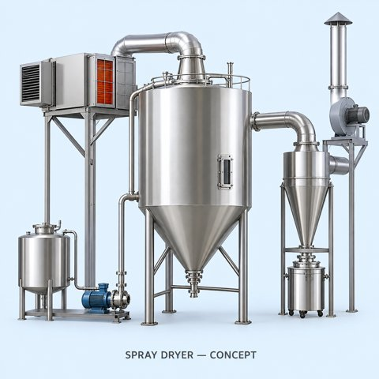

# 🧩 SprayDryer_v0.0.1.aasx

[← 장비 페이지](../README.md) · [⤓ AASX 다운로드](../AASX/SprayDryer_v0.0.1.aasx) · 3.0 MB

> 🤖 AASX 파일을 열어 자동으로 만든 열람 페이지입니다. 직접 고치지 말고 AASX를 다시 올리세요.

| 항목 | 내용 |
|---|---|
| AAS idShort | `SprayDryerAAS` |
| AAS id | https://www.smart-factory.kr/ids/aas/SprayDryerAAS/1/0 |
| 자산 종류 (assetKind) | Type |
| globalAssetId | urn:uuid:93561d13-0e76-5096-89ed-7f2f93d6de77 |
| 설명 | 분무건조기 유형 참조모델임. 명판 식별정보·사양·레시피·운전값·시계열을 가상 예시로 완성함. 실제 청강화학 설비 정보가 아님. 카디널리티 외 Qualifier는 제거했으며 예시 출처와 가정은 첨부 안내서 및 근거 JSON에 기록함. |
| 서브모델 | 6개 |
| 전체 요소 | 364개 |

## 서브모델 한눈에 보기

| # | 서브모델 | 요소 수 | semanticId |
|:-:|---|--:|---|
| 1 | [Nameplate](#sm-1) | 26 | https://admin-shell.io/idta/nameplate/3/0/Nameplate |
| 2 | [HandoverDocumentation](#sm-2) | 25 | 0173-1#01-AHF578#003 |
| 3 | [TechnicalData](#sm-3) | 69 | 0173-1#01-AHX837#002 |
| 4 | [OperationalData](#sm-4) | 51 | https://www.smart-factory.kr/ids/sm/SprayDryerAAS/OperationalData/1/0 |
| 5 | [TimeSeries](#sm-5) | 129 | https://admin-shell.io/idta/TimeSeries/1/1 |
| 6 | [ProcessParameters](#sm-6) | 64 | https://admin-shell-io/idta/SubmodelTemplate/ProcessParameters/1/0 |

## 서브모델 상세

각 서브모델 이름을 누르면 펼쳐집니다. **굵은 글씨**는 하위 요소가 있는 묶음입니다.

<b>1. Nameplate</b> — 요소 26개

> Contains the nameplate information attached to the product

semanticId: `https://admin-shell.io/idta/nameplate/3/0/Nameplate`

| idShort | 종류 | 값 | semanticId |
|---|---|---|---|
| URIOfTheProduct | 속성 | urn:uuid:93561d13-0e76-5096-89ed-7f2f93d6de77 | 0112/2///61987#ABN590#002 |
| ManufacturerName | 다국어&nbsp;속성 | Example Spray Dryer Engineering Co., Ltd. (fictional) | 0112/2///61987#ABA565#009 |
| ManufacturerProductDesignation | 다국어&nbsp;속성 | Spray Dryer | 0112/2///61987#ABA567#009 |
| **AddressInformation** | 묶음&nbsp;(4) |  | https://admin-shell.io/zvei/nameplate/1/0/ContactInformations/Address… |
| &nbsp;&nbsp;&nbsp;└ Street | 다국어&nbsp;속성 | 100 Example-ro (fictional address) | 0173-1#02-AAO128#002 |
| &nbsp;&nbsp;&nbsp;└ Zipcode | 다국어&nbsp;속성 | 12345 | 0173-1#02-AAO129#002 |
| &nbsp;&nbsp;&nbsp;└ CityTown | 다국어&nbsp;속성 | Example-si (fictional city) | 0173-1#02-AAO132#002 |
| &nbsp;&nbsp;&nbsp;└ NationalCode | 다국어&nbsp;속성 | KR | 0173-1#02-AAO134#002 |
| ManufacturerProductRoot | 다국어&nbsp;속성 | Industrial Dryer | 0112/2///61360_7#AAS011#001 |
| ManufacturerProductFamily | 다국어&nbsp;속성 | Spray Dryer | 0112/2///61987#ABP464#002 |
| ManufacturerProductType | 속성 | EX-SD05-E9 | 0112/2///61987#ABA300#008 |
| OrderCodeOfManufacturer | 속성 | EX-SD05-E9-380V60 | 0112/2///61987#ABA950#008 |
| ProductArticleNumberOfManufacturer | 속성 | EX-SD05-001 | 0112/2///61987#ABA581#007 |
| SerialNumber | 속성 | EX-SD05-2026-001 | 0112/2///61987#ABA951#009 |
| YearOfConstruction | 속성 | 2026 | 0112/2///61987#ABP000#002 |
| DateOfManufacture | 속성 | 2026-09-01 | 0112/2///61987#ABB757#007 |
| HardwareVersion | 속성 | 1.0 | 0112/2///61987#ABA926#008 |
| FirmwareVersion | 속성 | 1.0.0 | 0112/2///61987#ABA302#006 |
| SoftwareVersion | 속성 | 1.0.0 | 0112/2///61987#ABA601#008 |
| CountryOfOrigin | 속성 | KR | 0112/2///61987#ABP462#001 |
| UniqueFacilityIdentifier | 속성 | urn:example:facility:spray-dryer-demo-01 | https://admin-shell.io/idta/nameplate/3/0/UniqueFacilityIdentifier |
| **Markings** | 목록&nbsp;(1) |  | 0112/2///61360_7#AAS006#001 |
| &nbsp;&nbsp;&nbsp;└ **** | 묶음&nbsp;(3) |  | 0112/2///61360_7#AAS009#001 |
| &nbsp;&nbsp;&nbsp;&nbsp;&nbsp;&nbsp;└ MarkingName | 속성 | DEMO UNIT - NOT CERTIFIED | 0112/2///61987#ABA231#009 |
| &nbsp;&nbsp;&nbsp;&nbsp;&nbsp;&nbsp;└ MarkingFile | 파일 | /aasx/files/images/Example_Demo_Marking.svg | 0112/2///61987#ABO100#002 |
| &nbsp;&nbsp;&nbsp;&nbsp;&nbsp;&nbsp;└ MarkingAdditionalText | 속성 | Fictional reference-model identification only; no CE, KC or other conformity cl… | 0112/2///61987#ABB146#007 |

<b>2. HandoverDocumentation</b> — 요소 25개

> The Submodel defines a set meta data for the handover of documentation from the manufacturer to the operator for industrial equipment

semanticId: `0173-1#01-AHF578#003`

| idShort | 종류 | 값 | semanticId |
|---|---|---|---|
| **Documents** | 목록&nbsp;(1) |  | 0173-1#02-ABI500#003 |
| &nbsp;&nbsp;&nbsp;└ **** | 묶음&nbsp;(3) |  | 0173-1#02-ABI500#003/0173-1#01-AHF579#003 |
| &nbsp;&nbsp;&nbsp;&nbsp;&nbsp;&nbsp;└ **DocumentIds** | 목록&nbsp;(1) |  | 0173-1#02-ABI501#003 |
| &nbsp;&nbsp;&nbsp;&nbsp;&nbsp;&nbsp;&nbsp;&nbsp;&nbsp;└ **** | 묶음&nbsp;(3) |  | 0173-1#02-ABI501#003/0173-1#01-AHF580#003 |
| &nbsp;&nbsp;&nbsp;&nbsp;&nbsp;&nbsp;&nbsp;&nbsp;&nbsp;&nbsp;&nbsp;&nbsp;└ DocumentDomainId | 속성 | SprayDryerReferenceModel | 0173-1#02-ABH994#003 |
| &nbsp;&nbsp;&nbsp;&nbsp;&nbsp;&nbsp;&nbsp;&nbsp;&nbsp;&nbsp;&nbsp;&nbsp;└ DocumentIdentifier | 속성 | SprayDryer-ModelGuide-261022 | 0173-1#02-AAO099#004 |
| &nbsp;&nbsp;&nbsp;&nbsp;&nbsp;&nbsp;&nbsp;&nbsp;&nbsp;&nbsp;&nbsp;&nbsp;└ DocumentIsPrimary | 속성 | true | 0173-1#02-ABH995#003 |
| &nbsp;&nbsp;&nbsp;&nbsp;&nbsp;&nbsp;└ **DocumentClassifications** | 목록&nbsp;(1) |  | 0173-1#02-ABI502#003 |
| &nbsp;&nbsp;&nbsp;&nbsp;&nbsp;&nbsp;&nbsp;&nbsp;&nbsp;└ **** | 묶음&nbsp;(3) |  | 0173-1#02-ABI502#003/0173-1#01-AHF581#003 |
| &nbsp;&nbsp;&nbsp;&nbsp;&nbsp;&nbsp;&nbsp;&nbsp;&nbsp;&nbsp;&nbsp;&nbsp;└ ClassId | 속성 | 02-01 | 0173-1#02-ABH996#003 |
| &nbsp;&nbsp;&nbsp;&nbsp;&nbsp;&nbsp;&nbsp;&nbsp;&nbsp;&nbsp;&nbsp;&nbsp;└ ClassName | 다국어&nbsp;속성 | Technical specification | 0173-1#02-ABJ219#002 |
| &nbsp;&nbsp;&nbsp;&nbsp;&nbsp;&nbsp;&nbsp;&nbsp;&nbsp;&nbsp;&nbsp;&nbsp;└ ClassificationSystem | 속성 | VDI 2770 Blatt 1:2020 | 0173-1#02-ABH997#003 |
| &nbsp;&nbsp;&nbsp;&nbsp;&nbsp;&nbsp;└ **DocumentVersions** | 목록&nbsp;(1) |  | 0173-1#02-ABI503#003 |
| &nbsp;&nbsp;&nbsp;&nbsp;&nbsp;&nbsp;&nbsp;&nbsp;&nbsp;└ **** | 묶음&nbsp;(9) |  | 0173-1#02-ABI503#003/0173-1#01-AHF582#003 |
| &nbsp;&nbsp;&nbsp;&nbsp;&nbsp;&nbsp;&nbsp;&nbsp;&nbsp;&nbsp;&nbsp;&nbsp;└ **Language** | 목록&nbsp;(1) |  | 0173-1#02-AAN468#008 |
| &nbsp;&nbsp;&nbsp;&nbsp;&nbsp;&nbsp;&nbsp;&nbsp;&nbsp;&nbsp;&nbsp;&nbsp;&nbsp;&nbsp;&nbsp;└  | 속성 | ko | 0173-1#02-AAN468#008 |
| &nbsp;&nbsp;&nbsp;&nbsp;&nbsp;&nbsp;&nbsp;&nbsp;&nbsp;&nbsp;&nbsp;&nbsp;└ Version | 속성 | 0.0.1 | 0173-1#02-AAP003#005 |
| &nbsp;&nbsp;&nbsp;&nbsp;&nbsp;&nbsp;&nbsp;&nbsp;&nbsp;&nbsp;&nbsp;&nbsp;└ Title | 다국어&nbsp;속성 | Spray Dryer Reference Model and Acquisition Guide | 0173-1#02-ABG940#003 |
| &nbsp;&nbsp;&nbsp;&nbsp;&nbsp;&nbsp;&nbsp;&nbsp;&nbsp;&nbsp;&nbsp;&nbsp;└ Description | 다국어&nbsp;속성 | Reference model guide and change record; not a manufacturer operation or safety… | 0173-1#02-AAN466#004 |
| &nbsp;&nbsp;&nbsp;&nbsp;&nbsp;&nbsp;&nbsp;&nbsp;&nbsp;&nbsp;&nbsp;&nbsp;└ StatusSetDate | 속성 | 2026-10-22 | 0173-1#02-ABI000#003 |
| &nbsp;&nbsp;&nbsp;&nbsp;&nbsp;&nbsp;&nbsp;&nbsp;&nbsp;&nbsp;&nbsp;&nbsp;└ StatusValue | 속성 | Draft | 0173-1#02-ABI001#003 |
| &nbsp;&nbsp;&nbsp;&nbsp;&nbsp;&nbsp;&nbsp;&nbsp;&nbsp;&nbsp;&nbsp;&nbsp;└ OrganizationShortName | 속성 | Project reference model | https://api.eclass-cdp.com/0173-1-02-ABI002-003 |
| &nbsp;&nbsp;&nbsp;&nbsp;&nbsp;&nbsp;&nbsp;&nbsp;&nbsp;&nbsp;&nbsp;&nbsp;└ OrganizationOfficialName | 속성 | Project reference model | 0173-1#02-ABI004#003 |
| &nbsp;&nbsp;&nbsp;&nbsp;&nbsp;&nbsp;&nbsp;&nbsp;&nbsp;&nbsp;&nbsp;&nbsp;└ **DigitalFiles** | 목록&nbsp;(1) |  | 0173-1#02-ABK126#002 |
| &nbsp;&nbsp;&nbsp;&nbsp;&nbsp;&nbsp;&nbsp;&nbsp;&nbsp;&nbsp;&nbsp;&nbsp;&nbsp;&nbsp;&nbsp;└  | 파일 | /aasx/files/documents/SprayDryer_ModelGuide.html | 0173-1#02-ABK126#002 |

<b>3. TechnicalData</b> — 요소 69개

> Submodel containing technical data of the asset and associated product classificatons

semanticId: `0173-1#01-AHX837#002`

| idShort | 종류 | 값 | semanticId |
|---|---|---|---|
| **GeneralInformation** | 묶음&nbsp;(5) |  | 0173-1#02-ABK161#002/0173-1#01-AHX838#002 |
| &nbsp;&nbsp;&nbsp;└ ManufacturerName | 속성 | Example Spray Dryer Engineering Co., Ltd. (fictional) | 0173-1#02-AAO677#004 |
| &nbsp;&nbsp;&nbsp;└ ManufacturerProductDesignation | 다국어&nbsp;속성 | Spray Dryer | 0173-1#02-AAW338#003 |
| &nbsp;&nbsp;&nbsp;└ ManufacturerArticleNumber | 속성 | EX-SD05-001 | 0173-1#02-AAO676#005 |
| &nbsp;&nbsp;&nbsp;└ ManufacturerOrderCode | 속성 | EX-SD05-E9-380V60 | 0173-1#02-AAO227#004 |
| &nbsp;&nbsp;&nbsp;└ **ProductImages** | 목록&nbsp;(1) |  | 0173-1#02-ABM220#001 |
| &nbsp;&nbsp;&nbsp;&nbsp;&nbsp;&nbsp;└ **** | 묶음&nbsp;(2) |  | 0173-1#02-ABM220#001/0173-1#01-AHY911#001 |
| &nbsp;&nbsp;&nbsp;&nbsp;&nbsp;&nbsp;&nbsp;&nbsp;&nbsp;└ ImageFile | 파일 | /aasx/files/images/SprayDryer_Concept.png | 0173-1#02-ABK291#002 |
| &nbsp;&nbsp;&nbsp;&nbsp;&nbsp;&nbsp;&nbsp;&nbsp;&nbsp;└ ImageNote | 다국어&nbsp;속성 | AI-generated generic spray dryer concept; not a photograph or verified equipmen… | 0173-1#02-ABL423#001 |
| **ProductClassifications** | 목록&nbsp;(1) |  | 0173-1#02-ABK162#002 |
| &nbsp;&nbsp;&nbsp;└ **** | 묶음&nbsp;(7) |  | 0173-1#02-ABK162#002/0173-1#01-AHX839#002 |
| &nbsp;&nbsp;&nbsp;&nbsp;&nbsp;&nbsp;└ ClassificationSystem | 속성 | ECLASS | 0173-1#02-ABL424#001 |
| &nbsp;&nbsp;&nbsp;&nbsp;&nbsp;&nbsp;└ ClassificationSystemVersion | 속성 | ECLASS 16.0 | 0173-1#02-AAR710#003 |
| &nbsp;&nbsp;&nbsp;&nbsp;&nbsp;&nbsp;└ ClassificationSystemUrl | 속성 | https://eclass.eu/ | https://admin-shell.io/IDTA/TechnicalData/ProductClassifications/Prod… |
| &nbsp;&nbsp;&nbsp;&nbsp;&nbsp;&nbsp;└ ProductClassId | 속성 | 0173-1#01-AKL608#021 | 0173-1#02-ABG776#003 |
| &nbsp;&nbsp;&nbsp;&nbsp;&nbsp;&nbsp;└ ProductClassCodedName | 속성 | 36160301 | 0173-1#02-ABK128#002 |
| &nbsp;&nbsp;&nbsp;&nbsp;&nbsp;&nbsp;└ ProductClassName | 다국어&nbsp;속성 | Spray drier | 0173-1#02-ABK273#002 |
| &nbsp;&nbsp;&nbsp;&nbsp;&nbsp;&nbsp;└ ReferenceToTechnicalPropertyArea | 참조 | https://www.smart-factory.kr/ids/sm/SprayDryerAAS/TechnicalData/2/0 / Technical… | 0173-1#02-ABL358#002 |
| **TechnicalPropertyAreas** | 목록&nbsp;(1) |  | 0173-1#02-ABK163#002 |
| &nbsp;&nbsp;&nbsp;└ **** | 묶음&nbsp;(4) |  | 0173-1#02-ABL358#002/0173-1#01-AHX773#002 |
| &nbsp;&nbsp;&nbsp;&nbsp;&nbsp;&nbsp;└ **EquipmentConfiguration** | 묶음&nbsp;(4) |  | https://www.smart-factory.kr/ids/cd/EquipmentConfiguration/1/0 |
| &nbsp;&nbsp;&nbsp;&nbsp;&nbsp;&nbsp;&nbsp;&nbsp;&nbsp;└ **DryerCommonSpecifications** | 묶음&nbsp;(5) |  | https://www.smart-factory.kr/ids/cd/DryerCommonSpecifications/1/0 |
| &nbsp;&nbsp;&nbsp;&nbsp;&nbsp;&nbsp;&nbsp;&nbsp;&nbsp;&nbsp;&nbsp;&nbsp;└ ProductType | 속성 | SprayDryer | 0173-1#02-AAO057#004 |
| &nbsp;&nbsp;&nbsp;&nbsp;&nbsp;&nbsp;&nbsp;&nbsp;&nbsp;&nbsp;&nbsp;&nbsp;└ DryingMethod | 속성 | SprayDrying | https://www.smart-factory.kr/ids/cd/DryingMethod/1/0 |
| &nbsp;&nbsp;&nbsp;&nbsp;&nbsp;&nbsp;&nbsp;&nbsp;&nbsp;&nbsp;&nbsp;&nbsp;└ SystemConfiguration | 속성 | OpenCycleCoCurrentSingleStage | https://www.smart-factory.kr/ids/cd/SystemConfiguration/1/0 |
| &nbsp;&nbsp;&nbsp;&nbsp;&nbsp;&nbsp;&nbsp;&nbsp;&nbsp;&nbsp;&nbsp;&nbsp;└ InstallationType | 속성 | StationaryPilotSkid | https://www.smart-factory.kr/ids/cd/InstallationType/1/0 |
| &nbsp;&nbsp;&nbsp;&nbsp;&nbsp;&nbsp;&nbsp;&nbsp;&nbsp;&nbsp;&nbsp;&nbsp;└ ProductWeight | 속성 | 350.0 | https://www.smart-factory.kr/ids/cd/ProductWeight/1/0 |
| &nbsp;&nbsp;&nbsp;&nbsp;&nbsp;&nbsp;&nbsp;&nbsp;&nbsp;└ **DryingChamberSpecifications** | 묶음&nbsp;(3) |  | https://www.smart-factory.kr/ids/cd/DryingChamberSpecifications/1/0 |
| &nbsp;&nbsp;&nbsp;&nbsp;&nbsp;&nbsp;&nbsp;&nbsp;&nbsp;&nbsp;&nbsp;&nbsp;└ ChamberVolume | 속성 | 0.494277 | https://www.smart-factory.kr/ids/cd/ChamberVolume/1/0 |
| &nbsp;&nbsp;&nbsp;&nbsp;&nbsp;&nbsp;&nbsp;&nbsp;&nbsp;&nbsp;&nbsp;&nbsp;└ ChamberMaterial | 속성 | StainlessSteel316L | https://www.smart-factory.kr/ids/cd/ChamberMaterial/1/0 |
| &nbsp;&nbsp;&nbsp;&nbsp;&nbsp;&nbsp;&nbsp;&nbsp;&nbsp;&nbsp;&nbsp;&nbsp;└ FlowArrangement | 속성 | CoCurrent | https://www.smart-factory.kr/ids/cd/FlowArrangement/1/0 |
| &nbsp;&nbsp;&nbsp;&nbsp;&nbsp;&nbsp;&nbsp;&nbsp;&nbsp;└ **FeedAndAtomizationSpecifications** | 묶음&nbsp;(6) |  | https://www.smart-factory.kr/ids/cd/FeedAndAtomizationSpecifications/… |
| &nbsp;&nbsp;&nbsp;&nbsp;&nbsp;&nbsp;&nbsp;&nbsp;&nbsp;&nbsp;&nbsp;&nbsp;└ AtomizationMethod | 속성 | TwoFluidNozzle | https://www.smart-factory.kr/ids/cd/AtomizationMethod/1/0 |
| &nbsp;&nbsp;&nbsp;&nbsp;&nbsp;&nbsp;&nbsp;&nbsp;&nbsp;&nbsp;&nbsp;&nbsp;└ FeedSupplyMethod | 속성 | MeteringPumpContinuousFeed | https://www.smart-factory.kr/ids/cd/FeedSupplyMethod/1/0 |
| &nbsp;&nbsp;&nbsp;&nbsp;&nbsp;&nbsp;&nbsp;&nbsp;&nbsp;&nbsp;&nbsp;&nbsp;└ MinFeedFlowRate | 속성 | 0.5 | https://www.smart-factory.kr/ids/cd/MinFeedFlowRate/1/0 |
| &nbsp;&nbsp;&nbsp;&nbsp;&nbsp;&nbsp;&nbsp;&nbsp;&nbsp;&nbsp;&nbsp;&nbsp;└ MaxFeedFlowRate | 속성 | 6.0 | https://www.smart-factory.kr/ids/cd/MaxFeedFlowRate/1/0 |
| &nbsp;&nbsp;&nbsp;&nbsp;&nbsp;&nbsp;&nbsp;&nbsp;&nbsp;&nbsp;&nbsp;&nbsp;└ RatedWaterEvaporationCapacity | 속성 | 4.5 | https://www.smart-factory.kr/ids/cd/RatedWaterEvaporationCapacity/1/0 |
| &nbsp;&nbsp;&nbsp;&nbsp;&nbsp;&nbsp;&nbsp;&nbsp;&nbsp;&nbsp;&nbsp;&nbsp;└ EvaporationCapacityReferenceConditions | 속성 | Engineering example: water test; inlet 200 degC; outlet 80 degC; dry process ai… | https://www.smart-factory.kr/ids/cd/EvaporationCapacityReferenceCondi… |
| &nbsp;&nbsp;&nbsp;&nbsp;&nbsp;&nbsp;&nbsp;&nbsp;&nbsp;└ **PowderRecoverySpecifications** | 묶음&nbsp;(2) |  | https://www.smart-factory.kr/ids/cd/PowderRecoverySpecifications/1/0 |
| &nbsp;&nbsp;&nbsp;&nbsp;&nbsp;&nbsp;&nbsp;&nbsp;&nbsp;&nbsp;&nbsp;&nbsp;└ PowderSeparationMethod | 속성 | CycloneWithFinalFilter | https://www.smart-factory.kr/ids/cd/PowderSeparationMethod/1/0 |
| &nbsp;&nbsp;&nbsp;&nbsp;&nbsp;&nbsp;&nbsp;&nbsp;&nbsp;&nbsp;&nbsp;&nbsp;└ PowderDischargeMethod | 속성 | SealedCollectionVessel | https://www.smart-factory.kr/ids/cd/PowderDischargeMethod/1/0 |
| &nbsp;&nbsp;&nbsp;&nbsp;&nbsp;&nbsp;└ **AirHandlingSystem** | 묶음&nbsp;(2) |  | https://www.smart-factory.kr/ids/cd/AirHandlingSystem/1/0 |
| &nbsp;&nbsp;&nbsp;&nbsp;&nbsp;&nbsp;&nbsp;&nbsp;&nbsp;└ **DryingGasSpecifications** | 묶음&nbsp;(6) |  | https://www.smart-factory.kr/ids/cd/DryingGasSpecifications/1/0 |
| &nbsp;&nbsp;&nbsp;&nbsp;&nbsp;&nbsp;&nbsp;&nbsp;&nbsp;&nbsp;&nbsp;&nbsp;└ DryingMedium | 속성 | Air | https://www.smart-factory.kr/ids/cd/DryingMedium/1/0 |
| &nbsp;&nbsp;&nbsp;&nbsp;&nbsp;&nbsp;&nbsp;&nbsp;&nbsp;&nbsp;&nbsp;&nbsp;└ GasRecirculationSupported | 속성 | false | https://www.smart-factory.kr/ids/cd/GasRecirculationSupported/1/0 |
| &nbsp;&nbsp;&nbsp;&nbsp;&nbsp;&nbsp;&nbsp;&nbsp;&nbsp;&nbsp;&nbsp;&nbsp;└ MinInletAirOperatingTemperature | 속성 | 100.0 | https://www.smart-factory.kr/ids/cd/MinInletAirOperatingTemperature/1… |
| &nbsp;&nbsp;&nbsp;&nbsp;&nbsp;&nbsp;&nbsp;&nbsp;&nbsp;&nbsp;&nbsp;&nbsp;└ MaxInletAirOperatingTemperature | 속성 | 220.0 | https://www.smart-factory.kr/ids/cd/MaxInletAirOperatingTemperature/1… |
| &nbsp;&nbsp;&nbsp;&nbsp;&nbsp;&nbsp;&nbsp;&nbsp;&nbsp;&nbsp;&nbsp;&nbsp;└ MinDryingGasFlowRate | 속성 | 90.0 | https://www.smart-factory.kr/ids/cd/MinDryingGasFlowRate/1/0 |
| &nbsp;&nbsp;&nbsp;&nbsp;&nbsp;&nbsp;&nbsp;&nbsp;&nbsp;&nbsp;&nbsp;&nbsp;└ MaxDryingGasFlowRate | 속성 | 150.0 | https://www.smart-factory.kr/ids/cd/MaxDryingGasFlowRate/1/0 |
| &nbsp;&nbsp;&nbsp;&nbsp;&nbsp;&nbsp;&nbsp;&nbsp;&nbsp;└ **ExhaustSpecifications** | 묶음&nbsp;(5) |  | https://www.smart-factory.kr/ids/cd/ExhaustSpecifications/1/0 |
| &nbsp;&nbsp;&nbsp;&nbsp;&nbsp;&nbsp;&nbsp;&nbsp;&nbsp;&nbsp;&nbsp;&nbsp;└ ExhaustDuctMaterial | 속성 | StainlessSteel304 | https://www.smart-factory.kr/ids/cd/ExhaustDuctMaterial/1/0 |
| &nbsp;&nbsp;&nbsp;&nbsp;&nbsp;&nbsp;&nbsp;&nbsp;&nbsp;&nbsp;&nbsp;&nbsp;└ ExhaustDuctDiameter | 속성 | 80.0 | https://www.smart-factory.kr/ids/cd/ExhaustDuctDiameter/1/0 |
| &nbsp;&nbsp;&nbsp;&nbsp;&nbsp;&nbsp;&nbsp;&nbsp;&nbsp;&nbsp;&nbsp;&nbsp;└ MinExhaustAirFlow | 속성 | 80.0 | https://www.smart-factory.kr/ids/cd/MinExhaustAirFlow/1/0 |
| &nbsp;&nbsp;&nbsp;&nbsp;&nbsp;&nbsp;&nbsp;&nbsp;&nbsp;&nbsp;&nbsp;&nbsp;└ MaxExhaustAirFlow | 속성 | 150.0 | https://www.smart-factory.kr/ids/cd/MaxExhaustAirFlow/1/0 |
| &nbsp;&nbsp;&nbsp;&nbsp;&nbsp;&nbsp;&nbsp;&nbsp;&nbsp;&nbsp;&nbsp;&nbsp;└ OutletInverterDrivenEquipment | 속성 | ExhaustFan | https://www.smart-factory.kr/ids/cd/OutletInverterDrivenEquipment/1/0 |
| &nbsp;&nbsp;&nbsp;&nbsp;&nbsp;&nbsp;└ **ThermalDryingSystem** | 묶음&nbsp;(1) |  | https://www.smart-factory.kr/ids/cd/ThermalDryingSystem/1/0 |
| &nbsp;&nbsp;&nbsp;&nbsp;&nbsp;&nbsp;&nbsp;&nbsp;&nbsp;└ **HeatingSpecifications** | 묶음&nbsp;(5) |  | https://www.smart-factory.kr/ids/cd/HeatingSpecifications/1/0 |
| &nbsp;&nbsp;&nbsp;&nbsp;&nbsp;&nbsp;&nbsp;&nbsp;&nbsp;&nbsp;&nbsp;&nbsp;└ HeatingMethod | 속성 | ElectricalResistanceAirHeating | https://www.smart-factory.kr/ids/cd/HeatingMethod/1/0 |
| &nbsp;&nbsp;&nbsp;&nbsp;&nbsp;&nbsp;&nbsp;&nbsp;&nbsp;&nbsp;&nbsp;&nbsp;└ InstalledHeatingPower | 속성 | 9.0 | https://www.smart-factory.kr/ids/cd/InstalledHeatingPower/1/0 |
| &nbsp;&nbsp;&nbsp;&nbsp;&nbsp;&nbsp;&nbsp;&nbsp;&nbsp;&nbsp;&nbsp;&nbsp;└ MonitoredHeaterChannelCount | 속성 | 3 | https://www.smart-factory.kr/ids/cd/MonitoredHeaterChannelCount/1/0 |
| &nbsp;&nbsp;&nbsp;&nbsp;&nbsp;&nbsp;&nbsp;&nbsp;&nbsp;&nbsp;&nbsp;&nbsp;└ TemperatureControlSupported | 속성 | true | https://www.smart-factory.kr/ids/cd/TemperatureControlSupported/1/0 |
| &nbsp;&nbsp;&nbsp;&nbsp;&nbsp;&nbsp;&nbsp;&nbsp;&nbsp;&nbsp;&nbsp;&nbsp;└ SCRDeviceDescription | 속성 | Example assumption only: thyristor power controller for three enabled 3 kW heat… | https://www.smart-factory.kr/ids/cd/SCRDeviceDescription/1/0 |
| &nbsp;&nbsp;&nbsp;&nbsp;&nbsp;&nbsp;└ **ElectricalAndSafety** | 묶음&nbsp;(1) |  | https://www.smart-factory.kr/ids/cd/ElectricalAndSafety/1/0 |
| &nbsp;&nbsp;&nbsp;&nbsp;&nbsp;&nbsp;&nbsp;&nbsp;&nbsp;└ **ElectricalRatingsAndProtection** | 묶음&nbsp;(5) |  | https://www.smart-factory.kr/ids/cd/ElectricalRatingsAndProtection/1/0 |
| &nbsp;&nbsp;&nbsp;&nbsp;&nbsp;&nbsp;&nbsp;&nbsp;&nbsp;&nbsp;&nbsp;&nbsp;└ RatedVoltage | 속성 | 380.0 | https://www.smart-factory.kr/ids/cd/RatedVoltage/1/0 |
| &nbsp;&nbsp;&nbsp;&nbsp;&nbsp;&nbsp;&nbsp;&nbsp;&nbsp;&nbsp;&nbsp;&nbsp;└ RatedFrequency | 속성 | 60.0 | https://www.smart-factory.kr/ids/cd/RatedFrequency/1/0 |
| &nbsp;&nbsp;&nbsp;&nbsp;&nbsp;&nbsp;&nbsp;&nbsp;&nbsp;&nbsp;&nbsp;&nbsp;└ PhaseCount | 속성 | 3 | https://www.smart-factory.kr/ids/cd/PhaseCount/1/0 |
| &nbsp;&nbsp;&nbsp;&nbsp;&nbsp;&nbsp;&nbsp;&nbsp;&nbsp;&nbsp;&nbsp;&nbsp;└ RatedPower | 속성 | 12.0 | https://www.smart-factory.kr/ids/cd/RatedPower/1/0 |
| &nbsp;&nbsp;&nbsp;&nbsp;&nbsp;&nbsp;&nbsp;&nbsp;&nbsp;&nbsp;&nbsp;&nbsp;└ OverTemperatureProtectionSupported | 속성 | true | https://www.smart-factory.kr/ids/cd/OverTemperatureProtectionSupporte… |

<b>4. OperationalData</b> — 요소 51개

> 분무건조기 정상 운전의 모의 데이터임. 수집 예정 20개 신호, 작업 맥락 및 선택 모니터링 항목을 모두 예시값으로 채웠으며 실제 PLC 수집값이 아님.

semanticId: `https://www.smart-factory.kr/ids/sm/SprayDryerAAS/OperationalData/1/0`

| idShort | 종류 | 값 | semanticId |
|---|---|---|---|
| **CurrentOperation** | 묶음&nbsp;(1) |  | https://www.smart-factory.kr/ids/cd/CurrentOperation/1/0 |
| &nbsp;&nbsp;&nbsp;└ **JobContext** | 묶음&nbsp;(11) |  | https://www.smart-factory.kr/ids/cd/JobContext/1/0 |
| &nbsp;&nbsp;&nbsp;&nbsp;&nbsp;&nbsp;└ OperationRunningActive | 속성 | true | https://www.smart-factory.kr/ids/cd/OperationRunningActive/1/0 |
| &nbsp;&nbsp;&nbsp;&nbsp;&nbsp;&nbsp;└ OperationStoppedActive | 속성 | false | https://www.smart-factory.kr/ids/cd/OperationStoppedActive/1/0 |
| &nbsp;&nbsp;&nbsp;&nbsp;&nbsp;&nbsp;└ OperatingState | 속성 | Running | https://www.smart-factory.kr/ids/cd/OperatingState/1/0 |
| &nbsp;&nbsp;&nbsp;&nbsp;&nbsp;&nbsp;└ OperationMode | 속성 | Automatic | https://www.smart-factory.kr/ids/cd/OperationMode/1/0 |
| &nbsp;&nbsp;&nbsp;&nbsp;&nbsp;&nbsp;└ AlarmStatus | 속성 | Normal | https://www.smart-factory.kr/ids/cd/AlarmStatus/1/0 |
| &nbsp;&nbsp;&nbsp;&nbsp;&nbsp;&nbsp;└ AlarmCode | 속성 | None | https://www.smart-factory.kr/ids/cd/AlarmCode/1/0 |
| &nbsp;&nbsp;&nbsp;&nbsp;&nbsp;&nbsp;└ ActiveProcessId | 속성 | SprayDryingProcessTemplate | https://www.smart-factory.kr/ids/cd/ActiveProcessId/1/0 |
| &nbsp;&nbsp;&nbsp;&nbsp;&nbsp;&nbsp;└ BatchId | 속성 | EXAMPLE-BATCH-001 | https://www.smart-factory.kr/ids/cd/BatchId/1/0 |
| &nbsp;&nbsp;&nbsp;&nbsp;&nbsp;&nbsp;└ RecipeId | 속성 | EXAMPLE-AQUEOUS-001 | https://www.smart-factory.kr/ids/cd/RecipeId/1/0 |
| &nbsp;&nbsp;&nbsp;&nbsp;&nbsp;&nbsp;└ ProcessStartTimestamp | 속성 | 2026-10-22T00:25:00Z | https://www.smart-factory.kr/ids/cd/ProcessStartTimestamp/1/0 |
| &nbsp;&nbsp;&nbsp;&nbsp;&nbsp;&nbsp;└ LastUpdateTimestamp | 속성 | 2026-10-22T01:30:00Z | https://www.smart-factory.kr/ids/cd/LastUpdateTimestamp/1/0 |
| **AirHandlingOperation** | 묶음&nbsp;(1) |  | https://www.smart-factory.kr/ids/cd/AirHandlingOperation/1/0 |
| &nbsp;&nbsp;&nbsp;└ **AirConditions** | 묶음&nbsp;(8) |  | https://www.smart-factory.kr/ids/cd/AirConditions/1/0 |
| &nbsp;&nbsp;&nbsp;&nbsp;&nbsp;&nbsp;└ InletAirTemperatureActual | 속성 | 179.6 | https://www.smart-factory.kr/ids/cd/InletAirTemperatureActual/1/0 |
| &nbsp;&nbsp;&nbsp;&nbsp;&nbsp;&nbsp;└ InletAirTemperatureSetpointActual | 속성 | 180.0 | https://www.smart-factory.kr/ids/cd/InletAirTemperatureSetpointActual… |
| &nbsp;&nbsp;&nbsp;&nbsp;&nbsp;&nbsp;└ InletAirTemperatureAlarmH | 속성 | 190.0 | https://www.smart-factory.kr/ids/cd/InletAirTemperatureAlarmH/1/0 |
| &nbsp;&nbsp;&nbsp;&nbsp;&nbsp;&nbsp;└ InletAirTemperatureAlarmL | 속성 | 160.0 | https://www.smart-factory.kr/ids/cd/InletAirTemperatureAlarmL/1/0 |
| &nbsp;&nbsp;&nbsp;&nbsp;&nbsp;&nbsp;└ OutletAirTemperatureActual | 속성 | 89.4 | https://www.smart-factory.kr/ids/cd/OutletAirTemperatureActual/1/0 |
| &nbsp;&nbsp;&nbsp;&nbsp;&nbsp;&nbsp;└ OutletAirTemperatureSetpoint | 속성 | 90.0 | https://www.smart-factory.kr/ids/cd/OutletAirTemperatureSetpoint/1/0 |
| &nbsp;&nbsp;&nbsp;&nbsp;&nbsp;&nbsp;└ OutletAirTemperatureAlarmH | 속성 | 100.0 | https://www.smart-factory.kr/ids/cd/OutletAirTemperatureAlarmH/1/0 |
| &nbsp;&nbsp;&nbsp;&nbsp;&nbsp;&nbsp;└ OutletAirTemperatureAlarmL | 속성 | 75.0 | https://www.smart-factory.kr/ids/cd/OutletAirTemperatureAlarmL/1/0 |
| **ThermalProcess** | 묶음&nbsp;(1) |  | https://www.smart-factory.kr/ids/cd/ThermalProcess/1/0 |
| &nbsp;&nbsp;&nbsp;└ **HeatingSystemState** | 묶음&nbsp;(8) |  | https://www.smart-factory.kr/ids/cd/HeatingSystemState/1/0 |
| &nbsp;&nbsp;&nbsp;&nbsp;&nbsp;&nbsp;└ Heater1RunningActive | 속성 | true | https://www.smart-factory.kr/ids/cd/Heater1RunningActive/1/0 |
| &nbsp;&nbsp;&nbsp;&nbsp;&nbsp;&nbsp;└ Heater1StoppedActive | 속성 | false | https://www.smart-factory.kr/ids/cd/Heater1StoppedActive/1/0 |
| &nbsp;&nbsp;&nbsp;&nbsp;&nbsp;&nbsp;└ Heater2RunningActive | 속성 | true | https://www.smart-factory.kr/ids/cd/Heater2RunningActive/1/0 |
| &nbsp;&nbsp;&nbsp;&nbsp;&nbsp;&nbsp;└ Heater2StoppedActive | 속성 | false | https://www.smart-factory.kr/ids/cd/Heater2StoppedActive/1/0 |
| &nbsp;&nbsp;&nbsp;&nbsp;&nbsp;&nbsp;└ Heater3RunningActive | 속성 | true | https://www.smart-factory.kr/ids/cd/Heater3RunningActive/1/0 |
| &nbsp;&nbsp;&nbsp;&nbsp;&nbsp;&nbsp;└ Heater3StoppedActive | 속성 | false | https://www.smart-factory.kr/ids/cd/Heater3StoppedActive/1/0 |
| &nbsp;&nbsp;&nbsp;&nbsp;&nbsp;&nbsp;└ SCRRunningActive | 속성 | true | https://www.smart-factory.kr/ids/cd/SCRRunningActive/1/0 |
| &nbsp;&nbsp;&nbsp;&nbsp;&nbsp;&nbsp;└ SCRStoppedActive | 속성 | false | https://www.smart-factory.kr/ids/cd/SCRStoppedActive/1/0 |
| **ExhaustOperation** | 묶음&nbsp;(1) |  | https://www.smart-factory.kr/ids/cd/ExhaustOperation/1/0 |
| &nbsp;&nbsp;&nbsp;└ **ExhaustFlow** | 묶음&nbsp;(2) |  | https://www.smart-factory.kr/ids/cd/ExhaustFlow/1/0 |
| &nbsp;&nbsp;&nbsp;&nbsp;&nbsp;&nbsp;└ OutletInverterActualValue | 속성 | 45.0 | https://www.smart-factory.kr/ids/cd/OutletInverterActualValue/1/0 |
| &nbsp;&nbsp;&nbsp;&nbsp;&nbsp;&nbsp;└ OutletInverterSetpoint | 속성 | 45.0 | https://www.smart-factory.kr/ids/cd/OutletInverterSetpoint/1/0 |
| **OptionalMonitoring** | 묶음&nbsp;(13) |  | https://www.smart-factory.kr/ids/cd/OptionalMonitoring/1/0 |
| &nbsp;&nbsp;&nbsp;└ ChamberTemperatureActual | 속성 | 105.0 | https://www.smart-factory.kr/ids/cd/ChamberTemperatureActual/1/0 |
| &nbsp;&nbsp;&nbsp;└ ChamberRelativeHumidityActual | 속성 | 4.2 | https://www.smart-factory.kr/ids/cd/ChamberRelativeHumidityActual/1/0 |
| &nbsp;&nbsp;&nbsp;└ AmbientTemperatureActual | 속성 | 25.0 | https://www.smart-factory.kr/ids/cd/AmbientTemperatureActual/1/0 |
| &nbsp;&nbsp;&nbsp;└ AirFlowRateActual | 속성 | 130.03 | https://www.smart-factory.kr/ids/cd/AirFlowRateActual/1/0 |
| &nbsp;&nbsp;&nbsp;└ RecirculationAirVelocityActual | 속성 | 0.0 | https://www.smart-factory.kr/ids/cd/RecirculationAirVelocityActual/1/0 |
| &nbsp;&nbsp;&nbsp;└ ExhaustAirFlowActual | 속성 | 109.47 | https://www.smart-factory.kr/ids/cd/ExhaustAirFlowActual/1/0 |
| &nbsp;&nbsp;&nbsp;└ HeaterOutputActual | 속성 | 52.0 | https://www.smart-factory.kr/ids/cd/HeaterOutputActual/1/0 |
| &nbsp;&nbsp;&nbsp;└ PowerConsumptionActual | 속성 | 5.6 | https://www.smart-factory.kr/ids/cd/PowerConsumptionActual/1/0 |
| &nbsp;&nbsp;&nbsp;└ ProcessProgressRate | 속성 | 22.807 | https://www.smart-factory.kr/ids/cd/ProcessProgressRate/1/0 |
| &nbsp;&nbsp;&nbsp;└ EmergencyStopStatus | 속성 | Released | https://www.smart-factory.kr/ids/cd/EmergencyStopStatus/1/0 |
| &nbsp;&nbsp;&nbsp;└ DoorInterlockStatus | 속성 | ClosedAndLocked | https://www.smart-factory.kr/ids/cd/DoorInterlockStatus/1/0 |
| &nbsp;&nbsp;&nbsp;└ SafetyCoverState | 속성 | Closed | https://www.smart-factory.kr/ids/cd/SafetyCoverState/1/0 |
| &nbsp;&nbsp;&nbsp;└ OperationPermittedState | 속성 | Permitted | https://www.smart-factory.kr/ids/cd/OperationPermittedState/1/0 |

<b>5. TimeSeries</b> — 요소 129개

> 1초 간격의 모의 데이터 3개를 External/Internal/Linked 방식으로 표현한 예시임. Metadata 필드에도 예시값을 입력함. Linked 주소는 가상 주소이며 실측 레코드는 없음.

semanticId: `https://admin-shell.io/idta/TimeSeries/1/1`

| idShort | 종류 | 값 | semanticId |
|---|---|---|---|
| **Metadata** | 묶음&nbsp;(3) |  | https://admin-shell.io/idta/TimeSeries/Metadata/1/1 |
| &nbsp;&nbsp;&nbsp;└ Name | 다국어&nbsp;속성 | Spray dryer planned acquisition time series | https://admin-shell.io/idta/TimeSeries/Metadata/Name/1/1 |
| &nbsp;&nbsp;&nbsp;└ Description | 다국어&nbsp;속성 | Fully populated example with three synthetic records. Metadata has illustrative… | https://admin-shell.io/idta/TimeSeries/Metadata/Description/1/1 |
| &nbsp;&nbsp;&nbsp;└ **Record** | 묶음&nbsp;(21) |  | https://admin-shell.io/idta/TimeSeries/Record/1/1 |
| &nbsp;&nbsp;&nbsp;&nbsp;&nbsp;&nbsp;└ UtcTime | 속성 | 2026-10-22T01:30:00Z | https://admin-shell.io/idta/TimeSeries/UtcTime/1/1 |
| &nbsp;&nbsp;&nbsp;&nbsp;&nbsp;&nbsp;└ OperationRunningActiveRecord | 속성 | true | https://www.smart-factory.kr/ids/cd/OperationRunningActive/1/0 |
| &nbsp;&nbsp;&nbsp;&nbsp;&nbsp;&nbsp;└ OperationStoppedActiveRecord | 속성 | false | https://www.smart-factory.kr/ids/cd/OperationStoppedActive/1/0 |
| &nbsp;&nbsp;&nbsp;&nbsp;&nbsp;&nbsp;└ Heater1RunningActiveRecord | 속성 | true | https://www.smart-factory.kr/ids/cd/Heater1RunningActive/1/0 |
| &nbsp;&nbsp;&nbsp;&nbsp;&nbsp;&nbsp;└ Heater1StoppedActiveRecord | 속성 | false | https://www.smart-factory.kr/ids/cd/Heater1StoppedActive/1/0 |
| &nbsp;&nbsp;&nbsp;&nbsp;&nbsp;&nbsp;└ Heater2RunningActiveRecord | 속성 | true | https://www.smart-factory.kr/ids/cd/Heater2RunningActive/1/0 |
| &nbsp;&nbsp;&nbsp;&nbsp;&nbsp;&nbsp;└ Heater2StoppedActiveRecord | 속성 | false | https://www.smart-factory.kr/ids/cd/Heater2StoppedActive/1/0 |
| &nbsp;&nbsp;&nbsp;&nbsp;&nbsp;&nbsp;└ Heater3RunningActiveRecord | 속성 | true | https://www.smart-factory.kr/ids/cd/Heater3RunningActive/1/0 |
| &nbsp;&nbsp;&nbsp;&nbsp;&nbsp;&nbsp;└ Heater3StoppedActiveRecord | 속성 | false | https://www.smart-factory.kr/ids/cd/Heater3StoppedActive/1/0 |
| &nbsp;&nbsp;&nbsp;&nbsp;&nbsp;&nbsp;└ SCRRunningActiveRecord | 속성 | true | https://www.smart-factory.kr/ids/cd/SCRRunningActive/1/0 |
| &nbsp;&nbsp;&nbsp;&nbsp;&nbsp;&nbsp;└ SCRStoppedActiveRecord | 속성 | false | https://www.smart-factory.kr/ids/cd/SCRStoppedActive/1/0 |
| &nbsp;&nbsp;&nbsp;&nbsp;&nbsp;&nbsp;└ InletAirTemperatureActualRecord | 속성 | 179.6 | https://www.smart-factory.kr/ids/cd/InletAirTemperatureActual/1/0 |
| &nbsp;&nbsp;&nbsp;&nbsp;&nbsp;&nbsp;└ InletAirTemperatureSetpointActualRecord | 속성 | 180.0 | https://www.smart-factory.kr/ids/cd/InletAirTemperatureSetpointActual… |
| &nbsp;&nbsp;&nbsp;&nbsp;&nbsp;&nbsp;└ InletAirTemperatureAlarmHRecord | 속성 | 190.0 | https://www.smart-factory.kr/ids/cd/InletAirTemperatureAlarmH/1/0 |
| &nbsp;&nbsp;&nbsp;&nbsp;&nbsp;&nbsp;└ InletAirTemperatureAlarmLRecord | 속성 | 160.0 | https://www.smart-factory.kr/ids/cd/InletAirTemperatureAlarmL/1/0 |
| &nbsp;&nbsp;&nbsp;&nbsp;&nbsp;&nbsp;└ OutletAirTemperatureActualRecord | 속성 | 89.4 | https://www.smart-factory.kr/ids/cd/OutletAirTemperatureActual/1/0 |
| &nbsp;&nbsp;&nbsp;&nbsp;&nbsp;&nbsp;└ OutletAirTemperatureSetpointRecord | 속성 | 90.0 | https://www.smart-factory.kr/ids/cd/OutletAirTemperatureSetpoint/1/0 |
| &nbsp;&nbsp;&nbsp;&nbsp;&nbsp;&nbsp;└ OutletAirTemperatureAlarmHRecord | 속성 | 100.0 | https://www.smart-factory.kr/ids/cd/OutletAirTemperatureAlarmH/1/0 |
| &nbsp;&nbsp;&nbsp;&nbsp;&nbsp;&nbsp;└ OutletAirTemperatureAlarmLRecord | 속성 | 75.0 | https://www.smart-factory.kr/ids/cd/OutletAirTemperatureAlarmL/1/0 |
| &nbsp;&nbsp;&nbsp;&nbsp;&nbsp;&nbsp;└ OutletInverterActualValueRecord | 속성 | 45.0 | https://www.smart-factory.kr/ids/cd/OutletInverterActualValue/1/0 |
| &nbsp;&nbsp;&nbsp;&nbsp;&nbsp;&nbsp;└ OutletInverterSetpointRecord | 속성 | 45.0 | https://www.smart-factory.kr/ids/cd/OutletInverterSetpoint/1/0 |
| **Segments** | 묶음&nbsp;(3) |  | https://admin-shell.io/idta/TimeSeries/Segments/1/1 |
| &nbsp;&nbsp;&nbsp;└ **ExternalSegment** | 묶음&nbsp;(11) |  | https://admin-shell.io/idta/TimeSeries/Segments/ExternalSegment/1/1 |
| &nbsp;&nbsp;&nbsp;&nbsp;&nbsp;&nbsp;└ Name | 다국어&nbsp;속성 | Spray dryer ExternalSegment - synthetic example | https://admin-shell.io/idta/TimeSeries/Segment/Name/1/1 |
| &nbsp;&nbsp;&nbsp;&nbsp;&nbsp;&nbsp;└ Description | 다국어&nbsp;속성 | Three synthetic records at 1 Hz. The segments show alternative representations … | https://admin-shell.io/idta/TimeSeries/Segment/Description/1/1 |
| &nbsp;&nbsp;&nbsp;&nbsp;&nbsp;&nbsp;└ RecordCount | 속성 | 3 | https://admin-shell.io/idta/TimeSeries/Segment/RecordCount/1/1 |
| &nbsp;&nbsp;&nbsp;&nbsp;&nbsp;&nbsp;└ StartTime | 속성 | 2026-10-22T01:29:58Z | https://admin-shell.io/idta/TimeSeries/Segment/StartTime/1/1 |
| &nbsp;&nbsp;&nbsp;&nbsp;&nbsp;&nbsp;└ EndTime | 속성 | 2026-10-22T01:30:00Z | https://admin-shell.io/idta/TimeSeries/Segment/EndTime/1/1 |
| &nbsp;&nbsp;&nbsp;&nbsp;&nbsp;&nbsp;└ Duration | 속성 | PT2S | https://admin-shell.io/idta/TimeSeries/Segment/Duration/1/1 |
| &nbsp;&nbsp;&nbsp;&nbsp;&nbsp;&nbsp;└ SamplingInterval | 속성 | 1 | https://admin-shell.io/idta/TimeSeries/Segment/SamplingInterval/1/1 |
| &nbsp;&nbsp;&nbsp;&nbsp;&nbsp;&nbsp;└ SamplingRate | 속성 | 1 | https://admin-shell.io/idta/TimeSeries/Segment/SamplingRate/1/1 |
| &nbsp;&nbsp;&nbsp;&nbsp;&nbsp;&nbsp;└ State | 속성 | completed | https://admin-shell.io/idta/TimeSeries/Segment/State/1/1 |
| &nbsp;&nbsp;&nbsp;&nbsp;&nbsp;&nbsp;└ LastUpdate | 속성 | 2026-10-22T01:30:00Z | https://admin-shell.io/idta/TimeSeries/Segment/LastUpdate/1/1 |
| &nbsp;&nbsp;&nbsp;&nbsp;&nbsp;&nbsp;└ File | 파일 | /aasx/files/timeseries/SprayDryer_CollectionSchema.csv | https://admin-shell.io/idta/TimeSeries/File/1/1 |
| &nbsp;&nbsp;&nbsp;└ **LinkedSegment** | 묶음&nbsp;(12) |  | https://admin-shell.io/idta/TimeSeries/Segments/LinkedSegment/1/1 |
| &nbsp;&nbsp;&nbsp;&nbsp;&nbsp;&nbsp;└ Name | 다국어&nbsp;속성 | Spray dryer LinkedSegment - synthetic example | https://admin-shell.io/idta/TimeSeries/Segment/Name/1/1 |
| &nbsp;&nbsp;&nbsp;&nbsp;&nbsp;&nbsp;└ Description | 다국어&nbsp;속성 | Three synthetic records at 1 Hz. The segments show alternative representations … | https://admin-shell.io/idta/TimeSeries/Segment/Description/1/1 |
| &nbsp;&nbsp;&nbsp;&nbsp;&nbsp;&nbsp;└ RecordCount | 속성 | 3 | https://admin-shell.io/idta/TimeSeries/Segment/RecordCount/1/1 |
| &nbsp;&nbsp;&nbsp;&nbsp;&nbsp;&nbsp;└ StartTime | 속성 | 2026-10-22T01:29:58Z | https://admin-shell.io/idta/TimeSeries/Segment/StartTime/1/1 |
| &nbsp;&nbsp;&nbsp;&nbsp;&nbsp;&nbsp;└ EndTime | 속성 | 2026-10-22T01:30:00Z | https://admin-shell.io/idta/TimeSeries/Segment/EndTime/1/1 |
| &nbsp;&nbsp;&nbsp;&nbsp;&nbsp;&nbsp;└ Duration | 속성 | PT2S | https://admin-shell.io/idta/TimeSeries/Segment/Duration/1/1 |
| &nbsp;&nbsp;&nbsp;&nbsp;&nbsp;&nbsp;└ SamplingInterval | 속성 | 1 | https://admin-shell.io/idta/TimeSeries/Segment/SamplingInterval/1/1 |
| &nbsp;&nbsp;&nbsp;&nbsp;&nbsp;&nbsp;└ SamplingRate | 속성 | 1 | https://admin-shell.io/idta/TimeSeries/Segment/SamplingRate/1/1 |
| &nbsp;&nbsp;&nbsp;&nbsp;&nbsp;&nbsp;└ State | 속성 | completed | https://admin-shell.io/idta/TimeSeries/Segment/State/1/1 |
| &nbsp;&nbsp;&nbsp;&nbsp;&nbsp;&nbsp;└ LastUpdate | 속성 | 2026-10-22T01:30:00Z | https://admin-shell.io/idta/TimeSeries/Segment/LastUpdate/1/1 |
| &nbsp;&nbsp;&nbsp;&nbsp;&nbsp;&nbsp;└ Endpoint | 속성 | https://historian.example.com/api/v1/timeseries | https://admin-shell.io/idta/TimeSeries/Endpoint/1/1 |
| &nbsp;&nbsp;&nbsp;&nbsp;&nbsp;&nbsp;└ Query | 속성 | asset=EX-SD05-E9&start=2026-10-22T01:29:58Z&end=2026-10-22T01:30:00Z | https://admin-shell.io/idta/TimeSeries/Query/1/1 |
| &nbsp;&nbsp;&nbsp;└ **InternalSegment** | 묶음&nbsp;(11) |  | https://admin-shell.io/idta/TimeSeries/Segments/InternalSegment/1/1 |
| &nbsp;&nbsp;&nbsp;&nbsp;&nbsp;&nbsp;└ Name | 다국어&nbsp;속성 | Spray dryer InternalSegment - synthetic example | https://admin-shell.io/idta/TimeSeries/Segment/Name/1/1 |
| &nbsp;&nbsp;&nbsp;&nbsp;&nbsp;&nbsp;└ Description | 다국어&nbsp;속성 | Three synthetic records at 1 Hz. The segments show alternative representations … | https://admin-shell.io/idta/TimeSeries/Segment/Description/1/1 |
| &nbsp;&nbsp;&nbsp;&nbsp;&nbsp;&nbsp;└ RecordCount | 속성 | 3 | https://admin-shell.io/idta/TimeSeries/Segment/RecordCount/1/1 |
| &nbsp;&nbsp;&nbsp;&nbsp;&nbsp;&nbsp;└ StartTime | 속성 | 2026-10-22T01:29:58Z | https://admin-shell.io/idta/TimeSeries/Segment/StartTime/1/1 |
| &nbsp;&nbsp;&nbsp;&nbsp;&nbsp;&nbsp;└ EndTime | 속성 | 2026-10-22T01:30:00Z | https://admin-shell.io/idta/TimeSeries/Segment/EndTime/1/1 |
| &nbsp;&nbsp;&nbsp;&nbsp;&nbsp;&nbsp;└ Duration | 속성 | PT2S | https://admin-shell.io/idta/TimeSeries/Segment/Duration/1/1 |
| &nbsp;&nbsp;&nbsp;&nbsp;&nbsp;&nbsp;└ SamplingInterval | 속성 | 1 | https://admin-shell.io/idta/TimeSeries/Segment/SamplingInterval/1/1 |
| &nbsp;&nbsp;&nbsp;&nbsp;&nbsp;&nbsp;└ SamplingRate | 속성 | 1 | https://admin-shell.io/idta/TimeSeries/Segment/SamplingRate/1/1 |
| &nbsp;&nbsp;&nbsp;&nbsp;&nbsp;&nbsp;└ State | 속성 | completed | https://admin-shell.io/idta/TimeSeries/Segment/State/1/1 |
| &nbsp;&nbsp;&nbsp;&nbsp;&nbsp;&nbsp;└ LastUpdate | 속성 | 2026-10-22T01:30:00Z | https://admin-shell.io/idta/TimeSeries/Segment/LastUpdate/1/1 |
| &nbsp;&nbsp;&nbsp;&nbsp;&nbsp;&nbsp;└ **Records** | 묶음&nbsp;(3) |  | https://admin-shell.io/idta/TimeSeries/Records/1/1 |
| &nbsp;&nbsp;&nbsp;&nbsp;&nbsp;&nbsp;&nbsp;&nbsp;&nbsp;└ **Record__00__** | 묶음&nbsp;(21) |  | https://admin-shell.io/idta/TimeSeries/Record/1/1 |
| &nbsp;&nbsp;&nbsp;&nbsp;&nbsp;&nbsp;&nbsp;&nbsp;&nbsp;&nbsp;&nbsp;&nbsp;└ UtcTime | 속성 | 2026-10-22T01:29:58Z | https://admin-shell.io/idta/TimeSeries/UtcTime/1/1 |
| &nbsp;&nbsp;&nbsp;&nbsp;&nbsp;&nbsp;&nbsp;&nbsp;&nbsp;&nbsp;&nbsp;&nbsp;└ OperationRunningActiveRecord | 속성 | true | https://www.smart-factory.kr/ids/cd/OperationRunningActive/1/0 |
| &nbsp;&nbsp;&nbsp;&nbsp;&nbsp;&nbsp;&nbsp;&nbsp;&nbsp;&nbsp;&nbsp;&nbsp;└ OperationStoppedActiveRecord | 속성 | false | https://www.smart-factory.kr/ids/cd/OperationStoppedActive/1/0 |
| &nbsp;&nbsp;&nbsp;&nbsp;&nbsp;&nbsp;&nbsp;&nbsp;&nbsp;&nbsp;&nbsp;&nbsp;└ Heater1RunningActiveRecord | 속성 | true | https://www.smart-factory.kr/ids/cd/Heater1RunningActive/1/0 |
| &nbsp;&nbsp;&nbsp;&nbsp;&nbsp;&nbsp;&nbsp;&nbsp;&nbsp;&nbsp;&nbsp;&nbsp;└ Heater1StoppedActiveRecord | 속성 | false | https://www.smart-factory.kr/ids/cd/Heater1StoppedActive/1/0 |
| &nbsp;&nbsp;&nbsp;&nbsp;&nbsp;&nbsp;&nbsp;&nbsp;&nbsp;&nbsp;&nbsp;&nbsp;└ Heater2RunningActiveRecord | 속성 | true | https://www.smart-factory.kr/ids/cd/Heater2RunningActive/1/0 |
| &nbsp;&nbsp;&nbsp;&nbsp;&nbsp;&nbsp;&nbsp;&nbsp;&nbsp;&nbsp;&nbsp;&nbsp;└ Heater2StoppedActiveRecord | 속성 | false | https://www.smart-factory.kr/ids/cd/Heater2StoppedActive/1/0 |
| &nbsp;&nbsp;&nbsp;&nbsp;&nbsp;&nbsp;&nbsp;&nbsp;&nbsp;&nbsp;&nbsp;&nbsp;└ Heater3RunningActiveRecord | 속성 | true | https://www.smart-factory.kr/ids/cd/Heater3RunningActive/1/0 |
| &nbsp;&nbsp;&nbsp;&nbsp;&nbsp;&nbsp;&nbsp;&nbsp;&nbsp;&nbsp;&nbsp;&nbsp;└ Heater3StoppedActiveRecord | 속성 | false | https://www.smart-factory.kr/ids/cd/Heater3StoppedActive/1/0 |
| &nbsp;&nbsp;&nbsp;&nbsp;&nbsp;&nbsp;&nbsp;&nbsp;&nbsp;&nbsp;&nbsp;&nbsp;└ SCRRunningActiveRecord | 속성 | true | https://www.smart-factory.kr/ids/cd/SCRRunningActive/1/0 |
| &nbsp;&nbsp;&nbsp;&nbsp;&nbsp;&nbsp;&nbsp;&nbsp;&nbsp;&nbsp;&nbsp;&nbsp;└ SCRStoppedActiveRecord | 속성 | false | https://www.smart-factory.kr/ids/cd/SCRStoppedActive/1/0 |
| &nbsp;&nbsp;&nbsp;&nbsp;&nbsp;&nbsp;&nbsp;&nbsp;&nbsp;&nbsp;&nbsp;&nbsp;└ InletAirTemperatureActualRecord | 속성 | 179.4 | https://www.smart-factory.kr/ids/cd/InletAirTemperatureActual/1/0 |
| &nbsp;&nbsp;&nbsp;&nbsp;&nbsp;&nbsp;&nbsp;&nbsp;&nbsp;&nbsp;&nbsp;&nbsp;└ InletAirTemperatureSetpointActualRecord | 속성 | 180.0 | https://www.smart-factory.kr/ids/cd/InletAirTemperatureSetpointActual… |
| &nbsp;&nbsp;&nbsp;&nbsp;&nbsp;&nbsp;&nbsp;&nbsp;&nbsp;&nbsp;&nbsp;&nbsp;└ InletAirTemperatureAlarmHRecord | 속성 | 190.0 | https://www.smart-factory.kr/ids/cd/InletAirTemperatureAlarmH/1/0 |
| &nbsp;&nbsp;&nbsp;&nbsp;&nbsp;&nbsp;&nbsp;&nbsp;&nbsp;&nbsp;&nbsp;&nbsp;└ InletAirTemperatureAlarmLRecord | 속성 | 160.0 | https://www.smart-factory.kr/ids/cd/InletAirTemperatureAlarmL/1/0 |
| &nbsp;&nbsp;&nbsp;&nbsp;&nbsp;&nbsp;&nbsp;&nbsp;&nbsp;&nbsp;&nbsp;&nbsp;└ OutletAirTemperatureActualRecord | 속성 | 89.2 | https://www.smart-factory.kr/ids/cd/OutletAirTemperatureActual/1/0 |
| &nbsp;&nbsp;&nbsp;&nbsp;&nbsp;&nbsp;&nbsp;&nbsp;&nbsp;&nbsp;&nbsp;&nbsp;└ OutletAirTemperatureSetpointRecord | 속성 | 90.0 | https://www.smart-factory.kr/ids/cd/OutletAirTemperatureSetpoint/1/0 |
| &nbsp;&nbsp;&nbsp;&nbsp;&nbsp;&nbsp;&nbsp;&nbsp;&nbsp;&nbsp;&nbsp;&nbsp;└ OutletAirTemperatureAlarmHRecord | 속성 | 100.0 | https://www.smart-factory.kr/ids/cd/OutletAirTemperatureAlarmH/1/0 |
| &nbsp;&nbsp;&nbsp;&nbsp;&nbsp;&nbsp;&nbsp;&nbsp;&nbsp;&nbsp;&nbsp;&nbsp;└ OutletAirTemperatureAlarmLRecord | 속성 | 75.0 | https://www.smart-factory.kr/ids/cd/OutletAirTemperatureAlarmL/1/0 |
| &nbsp;&nbsp;&nbsp;&nbsp;&nbsp;&nbsp;&nbsp;&nbsp;&nbsp;&nbsp;&nbsp;&nbsp;└ OutletInverterActualValueRecord | 속성 | 45.0 | https://www.smart-factory.kr/ids/cd/OutletInverterActualValue/1/0 |
| &nbsp;&nbsp;&nbsp;&nbsp;&nbsp;&nbsp;&nbsp;&nbsp;&nbsp;&nbsp;&nbsp;&nbsp;└ OutletInverterSetpointRecord | 속성 | 45.0 | https://www.smart-factory.kr/ids/cd/OutletInverterSetpoint/1/0 |
| &nbsp;&nbsp;&nbsp;&nbsp;&nbsp;&nbsp;&nbsp;&nbsp;&nbsp;└ **Record__01__** | 묶음&nbsp;(21) |  | https://admin-shell.io/idta/TimeSeries/Record/1/1 |
| &nbsp;&nbsp;&nbsp;&nbsp;&nbsp;&nbsp;&nbsp;&nbsp;&nbsp;&nbsp;&nbsp;&nbsp;└ UtcTime | 속성 | 2026-10-22T01:29:59Z | https://admin-shell.io/idta/TimeSeries/UtcTime/1/1 |
| &nbsp;&nbsp;&nbsp;&nbsp;&nbsp;&nbsp;&nbsp;&nbsp;&nbsp;&nbsp;&nbsp;&nbsp;└ OperationRunningActiveRecord | 속성 | true | https://www.smart-factory.kr/ids/cd/OperationRunningActive/1/0 |
| &nbsp;&nbsp;&nbsp;&nbsp;&nbsp;&nbsp;&nbsp;&nbsp;&nbsp;&nbsp;&nbsp;&nbsp;└ OperationStoppedActiveRecord | 속성 | false | https://www.smart-factory.kr/ids/cd/OperationStoppedActive/1/0 |
| &nbsp;&nbsp;&nbsp;&nbsp;&nbsp;&nbsp;&nbsp;&nbsp;&nbsp;&nbsp;&nbsp;&nbsp;└ Heater1RunningActiveRecord | 속성 | true | https://www.smart-factory.kr/ids/cd/Heater1RunningActive/1/0 |
| &nbsp;&nbsp;&nbsp;&nbsp;&nbsp;&nbsp;&nbsp;&nbsp;&nbsp;&nbsp;&nbsp;&nbsp;└ Heater1StoppedActiveRecord | 속성 | false | https://www.smart-factory.kr/ids/cd/Heater1StoppedActive/1/0 |
| &nbsp;&nbsp;&nbsp;&nbsp;&nbsp;&nbsp;&nbsp;&nbsp;&nbsp;&nbsp;&nbsp;&nbsp;└ Heater2RunningActiveRecord | 속성 | true | https://www.smart-factory.kr/ids/cd/Heater2RunningActive/1/0 |
| &nbsp;&nbsp;&nbsp;&nbsp;&nbsp;&nbsp;&nbsp;&nbsp;&nbsp;&nbsp;&nbsp;&nbsp;└ Heater2StoppedActiveRecord | 속성 | false | https://www.smart-factory.kr/ids/cd/Heater2StoppedActive/1/0 |
| &nbsp;&nbsp;&nbsp;&nbsp;&nbsp;&nbsp;&nbsp;&nbsp;&nbsp;&nbsp;&nbsp;&nbsp;└ Heater3RunningActiveRecord | 속성 | true | https://www.smart-factory.kr/ids/cd/Heater3RunningActive/1/0 |
| &nbsp;&nbsp;&nbsp;&nbsp;&nbsp;&nbsp;&nbsp;&nbsp;&nbsp;&nbsp;&nbsp;&nbsp;└ Heater3StoppedActiveRecord | 속성 | false | https://www.smart-factory.kr/ids/cd/Heater3StoppedActive/1/0 |
| &nbsp;&nbsp;&nbsp;&nbsp;&nbsp;&nbsp;&nbsp;&nbsp;&nbsp;&nbsp;&nbsp;&nbsp;└ SCRRunningActiveRecord | 속성 | true | https://www.smart-factory.kr/ids/cd/SCRRunningActive/1/0 |
| &nbsp;&nbsp;&nbsp;&nbsp;&nbsp;&nbsp;&nbsp;&nbsp;&nbsp;&nbsp;&nbsp;&nbsp;└ SCRStoppedActiveRecord | 속성 | false | https://www.smart-factory.kr/ids/cd/SCRStoppedActive/1/0 |
| &nbsp;&nbsp;&nbsp;&nbsp;&nbsp;&nbsp;&nbsp;&nbsp;&nbsp;&nbsp;&nbsp;&nbsp;└ InletAirTemperatureActualRecord | 속성 | 179.5 | https://www.smart-factory.kr/ids/cd/InletAirTemperatureActual/1/0 |
| &nbsp;&nbsp;&nbsp;&nbsp;&nbsp;&nbsp;&nbsp;&nbsp;&nbsp;&nbsp;&nbsp;&nbsp;└ InletAirTemperatureSetpointActualRecord | 속성 | 180.0 | https://www.smart-factory.kr/ids/cd/InletAirTemperatureSetpointActual… |
| &nbsp;&nbsp;&nbsp;&nbsp;&nbsp;&nbsp;&nbsp;&nbsp;&nbsp;&nbsp;&nbsp;&nbsp;└ InletAirTemperatureAlarmHRecord | 속성 | 190.0 | https://www.smart-factory.kr/ids/cd/InletAirTemperatureAlarmH/1/0 |
| &nbsp;&nbsp;&nbsp;&nbsp;&nbsp;&nbsp;&nbsp;&nbsp;&nbsp;&nbsp;&nbsp;&nbsp;└ InletAirTemperatureAlarmLRecord | 속성 | 160.0 | https://www.smart-factory.kr/ids/cd/InletAirTemperatureAlarmL/1/0 |
| &nbsp;&nbsp;&nbsp;&nbsp;&nbsp;&nbsp;&nbsp;&nbsp;&nbsp;&nbsp;&nbsp;&nbsp;└ OutletAirTemperatureActualRecord | 속성 | 89.3 | https://www.smart-factory.kr/ids/cd/OutletAirTemperatureActual/1/0 |
| &nbsp;&nbsp;&nbsp;&nbsp;&nbsp;&nbsp;&nbsp;&nbsp;&nbsp;&nbsp;&nbsp;&nbsp;└ OutletAirTemperatureSetpointRecord | 속성 | 90.0 | https://www.smart-factory.kr/ids/cd/OutletAirTemperatureSetpoint/1/0 |
| &nbsp;&nbsp;&nbsp;&nbsp;&nbsp;&nbsp;&nbsp;&nbsp;&nbsp;&nbsp;&nbsp;&nbsp;└ OutletAirTemperatureAlarmHRecord | 속성 | 100.0 | https://www.smart-factory.kr/ids/cd/OutletAirTemperatureAlarmH/1/0 |
| &nbsp;&nbsp;&nbsp;&nbsp;&nbsp;&nbsp;&nbsp;&nbsp;&nbsp;&nbsp;&nbsp;&nbsp;└ OutletAirTemperatureAlarmLRecord | 속성 | 75.0 | https://www.smart-factory.kr/ids/cd/OutletAirTemperatureAlarmL/1/0 |
| &nbsp;&nbsp;&nbsp;&nbsp;&nbsp;&nbsp;&nbsp;&nbsp;&nbsp;&nbsp;&nbsp;&nbsp;└ OutletInverterActualValueRecord | 속성 | 45.0 | https://www.smart-factory.kr/ids/cd/OutletInverterActualValue/1/0 |
| &nbsp;&nbsp;&nbsp;&nbsp;&nbsp;&nbsp;&nbsp;&nbsp;&nbsp;&nbsp;&nbsp;&nbsp;└ OutletInverterSetpointRecord | 속성 | 45.0 | https://www.smart-factory.kr/ids/cd/OutletInverterSetpoint/1/0 |
| &nbsp;&nbsp;&nbsp;&nbsp;&nbsp;&nbsp;&nbsp;&nbsp;&nbsp;└ **Record__02__** | 묶음&nbsp;(21) |  | https://admin-shell.io/idta/TimeSeries/Record/1/1 |
| &nbsp;&nbsp;&nbsp;&nbsp;&nbsp;&nbsp;&nbsp;&nbsp;&nbsp;&nbsp;&nbsp;&nbsp;└ UtcTime | 속성 | 2026-10-22T01:30:00Z | https://admin-shell.io/idta/TimeSeries/UtcTime/1/1 |
| &nbsp;&nbsp;&nbsp;&nbsp;&nbsp;&nbsp;&nbsp;&nbsp;&nbsp;&nbsp;&nbsp;&nbsp;└ OperationRunningActiveRecord | 속성 | true | https://www.smart-factory.kr/ids/cd/OperationRunningActive/1/0 |
| &nbsp;&nbsp;&nbsp;&nbsp;&nbsp;&nbsp;&nbsp;&nbsp;&nbsp;&nbsp;&nbsp;&nbsp;└ OperationStoppedActiveRecord | 속성 | false | https://www.smart-factory.kr/ids/cd/OperationStoppedActive/1/0 |
| &nbsp;&nbsp;&nbsp;&nbsp;&nbsp;&nbsp;&nbsp;&nbsp;&nbsp;&nbsp;&nbsp;&nbsp;└ Heater1RunningActiveRecord | 속성 | true | https://www.smart-factory.kr/ids/cd/Heater1RunningActive/1/0 |
| &nbsp;&nbsp;&nbsp;&nbsp;&nbsp;&nbsp;&nbsp;&nbsp;&nbsp;&nbsp;&nbsp;&nbsp;└ Heater1StoppedActiveRecord | 속성 | false | https://www.smart-factory.kr/ids/cd/Heater1StoppedActive/1/0 |
| &nbsp;&nbsp;&nbsp;&nbsp;&nbsp;&nbsp;&nbsp;&nbsp;&nbsp;&nbsp;&nbsp;&nbsp;└ Heater2RunningActiveRecord | 속성 | true | https://www.smart-factory.kr/ids/cd/Heater2RunningActive/1/0 |
| &nbsp;&nbsp;&nbsp;&nbsp;&nbsp;&nbsp;&nbsp;&nbsp;&nbsp;&nbsp;&nbsp;&nbsp;└ Heater2StoppedActiveRecord | 속성 | false | https://www.smart-factory.kr/ids/cd/Heater2StoppedActive/1/0 |
| &nbsp;&nbsp;&nbsp;&nbsp;&nbsp;&nbsp;&nbsp;&nbsp;&nbsp;&nbsp;&nbsp;&nbsp;└ Heater3RunningActiveRecord | 속성 | true | https://www.smart-factory.kr/ids/cd/Heater3RunningActive/1/0 |
| &nbsp;&nbsp;&nbsp;&nbsp;&nbsp;&nbsp;&nbsp;&nbsp;&nbsp;&nbsp;&nbsp;&nbsp;└ Heater3StoppedActiveRecord | 속성 | false | https://www.smart-factory.kr/ids/cd/Heater3StoppedActive/1/0 |
| &nbsp;&nbsp;&nbsp;&nbsp;&nbsp;&nbsp;&nbsp;&nbsp;&nbsp;&nbsp;&nbsp;&nbsp;└ SCRRunningActiveRecord | 속성 | true | https://www.smart-factory.kr/ids/cd/SCRRunningActive/1/0 |
| &nbsp;&nbsp;&nbsp;&nbsp;&nbsp;&nbsp;&nbsp;&nbsp;&nbsp;&nbsp;&nbsp;&nbsp;└ SCRStoppedActiveRecord | 속성 | false | https://www.smart-factory.kr/ids/cd/SCRStoppedActive/1/0 |
| &nbsp;&nbsp;&nbsp;&nbsp;&nbsp;&nbsp;&nbsp;&nbsp;&nbsp;&nbsp;&nbsp;&nbsp;└ InletAirTemperatureActualRecord | 속성 | 179.6 | https://www.smart-factory.kr/ids/cd/InletAirTemperatureActual/1/0 |
| &nbsp;&nbsp;&nbsp;&nbsp;&nbsp;&nbsp;&nbsp;&nbsp;&nbsp;&nbsp;&nbsp;&nbsp;└ InletAirTemperatureSetpointActualRecord | 속성 | 180.0 | https://www.smart-factory.kr/ids/cd/InletAirTemperatureSetpointActual… |
| &nbsp;&nbsp;&nbsp;&nbsp;&nbsp;&nbsp;&nbsp;&nbsp;&nbsp;&nbsp;&nbsp;&nbsp;└ InletAirTemperatureAlarmHRecord | 속성 | 190.0 | https://www.smart-factory.kr/ids/cd/InletAirTemperatureAlarmH/1/0 |
| &nbsp;&nbsp;&nbsp;&nbsp;&nbsp;&nbsp;&nbsp;&nbsp;&nbsp;&nbsp;&nbsp;&nbsp;└ InletAirTemperatureAlarmLRecord | 속성 | 160.0 | https://www.smart-factory.kr/ids/cd/InletAirTemperatureAlarmL/1/0 |
| &nbsp;&nbsp;&nbsp;&nbsp;&nbsp;&nbsp;&nbsp;&nbsp;&nbsp;&nbsp;&nbsp;&nbsp;└ OutletAirTemperatureActualRecord | 속성 | 89.4 | https://www.smart-factory.kr/ids/cd/OutletAirTemperatureActual/1/0 |
| &nbsp;&nbsp;&nbsp;&nbsp;&nbsp;&nbsp;&nbsp;&nbsp;&nbsp;&nbsp;&nbsp;&nbsp;└ OutletAirTemperatureSetpointRecord | 속성 | 90.0 | https://www.smart-factory.kr/ids/cd/OutletAirTemperatureSetpoint/1/0 |
| &nbsp;&nbsp;&nbsp;&nbsp;&nbsp;&nbsp;&nbsp;&nbsp;&nbsp;&nbsp;&nbsp;&nbsp;└ OutletAirTemperatureAlarmHRecord | 속성 | 100.0 | https://www.smart-factory.kr/ids/cd/OutletAirTemperatureAlarmH/1/0 |
| &nbsp;&nbsp;&nbsp;&nbsp;&nbsp;&nbsp;&nbsp;&nbsp;&nbsp;&nbsp;&nbsp;&nbsp;└ OutletAirTemperatureAlarmLRecord | 속성 | 75.0 | https://www.smart-factory.kr/ids/cd/OutletAirTemperatureAlarmL/1/0 |
| &nbsp;&nbsp;&nbsp;&nbsp;&nbsp;&nbsp;&nbsp;&nbsp;&nbsp;&nbsp;&nbsp;&nbsp;└ OutletInverterActualValueRecord | 속성 | 45.0 | https://www.smart-factory.kr/ids/cd/OutletInverterActualValue/1/0 |
| &nbsp;&nbsp;&nbsp;&nbsp;&nbsp;&nbsp;&nbsp;&nbsp;&nbsp;&nbsp;&nbsp;&nbsp;└ OutletInverterSetpointRecord | 속성 | 45.0 | https://www.smart-factory.kr/ids/cd/OutletInverterSetpoint/1/0 |

<b>6. ProcessParameters</b> — 요소 64개

> 소형 분무건조기 정상 운전의 예시 레시피임. 실제 원료 화학종을 특정하지 않고 고형분 35%, 밀도 1.10 kg/L의 열적으로 적합한 수계 슬러리를 가정함. 모든 값은 예시이며 실제 공정 검증값이 아님.

semanticId: `https://admin-shell-io/idta/SubmodelTemplate/ProcessParameters/1/0`

| idShort | 종류 | 값 | semanticId |
|---|---|---|---|
| **Processes** | 묶음&nbsp;(1) |  | https://admin-shell.io/idta/ProcessParameters/Processes/1/0 |
| &nbsp;&nbsp;&nbsp;└ **Process__00__** | 묶음&nbsp;(8) |  | https://admin-shell.io/idta/ProcessParameters/Process/1/0 |
| &nbsp;&nbsp;&nbsp;&nbsp;&nbsp;&nbsp;└ ProcessId | 속성 | SprayDryingProcessTemplate | https://admin-shell.io/idta/ProcessParameters/ProcessId/1/0 |
| &nbsp;&nbsp;&nbsp;&nbsp;&nbsp;&nbsp;└ ProcessName | 속성 | SprayDrying | https://admin-shell.io/idta/ProcessParameters/ProcessName/1/0 |
| &nbsp;&nbsp;&nbsp;&nbsp;&nbsp;&nbsp;└ ProcessDescription | 다국어&nbsp;속성 | 액상 원료 공급, 분무, 가열 가스에 의한 건조 및 분말 회수 공정임. 실제 원료와 세부 장치 구성은 확인 필요함. | https://admin-shell.io/idta/ProcessParameters/ProcessDescription/1/0 |
| &nbsp;&nbsp;&nbsp;&nbsp;&nbsp;&nbsp;└ PlannedProcessTime | 속성 | PT4H45M | https://admin-shell.io/idta/ProcessParameters/PlannedProcessTime/1/0 |
| &nbsp;&nbsp;&nbsp;&nbsp;&nbsp;&nbsp;└ **ProductParameters** | 묶음&nbsp;(9) |  | https://www.smart-factory.kr/ids/cd/ProductParameters/1/0 |
| &nbsp;&nbsp;&nbsp;&nbsp;&nbsp;&nbsp;&nbsp;&nbsp;&nbsp;└ MaterialType | 속성 | ExampleAqueousSlurry_35wtPercentSolids | https://www.smart-factory.kr/ids/cd/MaterialType/1/0 |
| &nbsp;&nbsp;&nbsp;&nbsp;&nbsp;&nbsp;&nbsp;&nbsp;&nbsp;└ FeedPhysicalForm | 속성 | LiquidFeed | https://www.smart-factory.kr/ids/cd/FeedPhysicalForm/1/0 |
| &nbsp;&nbsp;&nbsp;&nbsp;&nbsp;&nbsp;&nbsp;&nbsp;&nbsp;└ ProductLotId | 속성 | EXAMPLE-FEED-001 | 0173-1#02-AAO235#004 |
| &nbsp;&nbsp;&nbsp;&nbsp;&nbsp;&nbsp;&nbsp;&nbsp;&nbsp;└ FeedBatchMass | 속성 | 19.8 | https://www.smart-factory.kr/ids/cd/FeedBatchMass/1/0 |
| &nbsp;&nbsp;&nbsp;&nbsp;&nbsp;&nbsp;&nbsp;&nbsp;&nbsp;└ FeedSolidsMassFraction | 속성 | 35.0 | https://www.smart-factory.kr/ids/cd/FeedSolidsMassFraction/1/0 |
| &nbsp;&nbsp;&nbsp;&nbsp;&nbsp;&nbsp;&nbsp;&nbsp;&nbsp;└ InitialMoistureContent | 속성 | 65.0 | https://www.smart-factory.kr/ids/cd/InitialMoistureContent/1/0 |
| &nbsp;&nbsp;&nbsp;&nbsp;&nbsp;&nbsp;&nbsp;&nbsp;&nbsp;└ TargetMoistureContent | 속성 | 2.0 | https://www.smart-factory.kr/ids/cd/TargetMoistureContent/1/0 |
| &nbsp;&nbsp;&nbsp;&nbsp;&nbsp;&nbsp;&nbsp;&nbsp;&nbsp;└ RecoveredProductForm | 속성 | Powder | https://www.smart-factory.kr/ids/cd/RecoveredProductForm/1/0 |
| &nbsp;&nbsp;&nbsp;&nbsp;&nbsp;&nbsp;&nbsp;&nbsp;&nbsp;└ FeedSupplyMethod | 속성 | MeteringPumpContinuousFeed | https://www.smart-factory.kr/ids/cd/FeedSupplyMethod/1/0 |
| &nbsp;&nbsp;&nbsp;&nbsp;&nbsp;&nbsp;└ **ProcessParameters** | 묶음&nbsp;(11) |  | https://www.smart-factory.kr/ids/cd/ProcessParameters/1/0 |
| &nbsp;&nbsp;&nbsp;&nbsp;&nbsp;&nbsp;&nbsp;&nbsp;&nbsp;└ DryingRecipeId | 속성 | EXAMPLE-AQUEOUS-001 | https://www.smart-factory.kr/ids/cd/DryingRecipeId/1/0 |
| &nbsp;&nbsp;&nbsp;&nbsp;&nbsp;&nbsp;&nbsp;&nbsp;&nbsp;└ DryingMode | 속성 | SprayDrying | https://www.smart-factory.kr/ids/cd/DryingMode/1/0 |
| &nbsp;&nbsp;&nbsp;&nbsp;&nbsp;&nbsp;&nbsp;&nbsp;&nbsp;└ **ProcessStepSequence** | 묶음&nbsp;(4) |  | https://www.smart-factory.kr/ids/cd/ProcessStepSequence/1/0 |
| &nbsp;&nbsp;&nbsp;&nbsp;&nbsp;&nbsp;&nbsp;&nbsp;&nbsp;&nbsp;&nbsp;&nbsp;└ **Step__00__** | 묶음&nbsp;(2) |  | https://www.smart-factory.kr/ids/cd/Step__00__/1/0 |
| &nbsp;&nbsp;&nbsp;&nbsp;&nbsp;&nbsp;&nbsp;&nbsp;&nbsp;&nbsp;&nbsp;&nbsp;&nbsp;&nbsp;&nbsp;└ StepName | 속성 | Prepare | https://www.smart-factory.kr/ids/cd/StepName/1/0 |
| &nbsp;&nbsp;&nbsp;&nbsp;&nbsp;&nbsp;&nbsp;&nbsp;&nbsp;&nbsp;&nbsp;&nbsp;&nbsp;&nbsp;&nbsp;└ PlannedDuration | 속성 | PT15M | https://www.smart-factory.kr/ids/cd/PlannedDuration/1/0 |
| &nbsp;&nbsp;&nbsp;&nbsp;&nbsp;&nbsp;&nbsp;&nbsp;&nbsp;&nbsp;&nbsp;&nbsp;└ **Step__01__** | 묶음&nbsp;(2) |  | https://www.smart-factory.kr/ids/cd/Step__01__/1/0 |
| &nbsp;&nbsp;&nbsp;&nbsp;&nbsp;&nbsp;&nbsp;&nbsp;&nbsp;&nbsp;&nbsp;&nbsp;&nbsp;&nbsp;&nbsp;└ StepName | 속성 | EstablishDryingConditions | https://www.smart-factory.kr/ids/cd/StepName/1/0 |
| &nbsp;&nbsp;&nbsp;&nbsp;&nbsp;&nbsp;&nbsp;&nbsp;&nbsp;&nbsp;&nbsp;&nbsp;&nbsp;&nbsp;&nbsp;└ PlannedDuration | 속성 | PT20M | https://www.smart-factory.kr/ids/cd/PlannedDuration/1/0 |
| &nbsp;&nbsp;&nbsp;&nbsp;&nbsp;&nbsp;&nbsp;&nbsp;&nbsp;&nbsp;&nbsp;&nbsp;└ **Step__02__** | 묶음&nbsp;(2) |  | https://www.smart-factory.kr/ids/cd/Step__02__/1/0 |
| &nbsp;&nbsp;&nbsp;&nbsp;&nbsp;&nbsp;&nbsp;&nbsp;&nbsp;&nbsp;&nbsp;&nbsp;&nbsp;&nbsp;&nbsp;└ StepName | 속성 | FeedAtomizeDryAndRecover | https://www.smart-factory.kr/ids/cd/StepName/1/0 |
| &nbsp;&nbsp;&nbsp;&nbsp;&nbsp;&nbsp;&nbsp;&nbsp;&nbsp;&nbsp;&nbsp;&nbsp;&nbsp;&nbsp;&nbsp;└ PlannedDuration | 속성 | PT4H | https://www.smart-factory.kr/ids/cd/PlannedDuration/1/0 |
| &nbsp;&nbsp;&nbsp;&nbsp;&nbsp;&nbsp;&nbsp;&nbsp;&nbsp;&nbsp;&nbsp;&nbsp;└ **Step__03__** | 묶음&nbsp;(2) |  | https://www.smart-factory.kr/ids/cd/Step__03__/1/0 |
| &nbsp;&nbsp;&nbsp;&nbsp;&nbsp;&nbsp;&nbsp;&nbsp;&nbsp;&nbsp;&nbsp;&nbsp;&nbsp;&nbsp;&nbsp;└ StepName | 속성 | FinishAndClean | https://www.smart-factory.kr/ids/cd/StepName/1/0 |
| &nbsp;&nbsp;&nbsp;&nbsp;&nbsp;&nbsp;&nbsp;&nbsp;&nbsp;&nbsp;&nbsp;&nbsp;&nbsp;&nbsp;&nbsp;└ PlannedDuration | 속성 | PT10M | https://www.smart-factory.kr/ids/cd/PlannedDuration/1/0 |
| &nbsp;&nbsp;&nbsp;&nbsp;&nbsp;&nbsp;&nbsp;&nbsp;&nbsp;└ **TargetFinalCondition** | 묶음&nbsp;(3) |  | https://www.smart-factory.kr/ids/cd/TargetFinalCondition/1/0 |
| &nbsp;&nbsp;&nbsp;&nbsp;&nbsp;&nbsp;&nbsp;&nbsp;&nbsp;&nbsp;&nbsp;&nbsp;└ Operator | 속성 | LessThanOrEqual | https://www.smart-factory.kr/ids/cd/Operator/1/0 |
| &nbsp;&nbsp;&nbsp;&nbsp;&nbsp;&nbsp;&nbsp;&nbsp;&nbsp;&nbsp;&nbsp;&nbsp;└ Limit | 속성 | 2.0 | https://www.smart-factory.kr/ids/cd/Limit/1/0 |
| &nbsp;&nbsp;&nbsp;&nbsp;&nbsp;&nbsp;&nbsp;&nbsp;&nbsp;&nbsp;&nbsp;&nbsp;└ MoistureVerificationMethod | 속성 | OfflineKarlFischerTitration_MethodRequiresMaterialValidation | https://www.smart-factory.kr/ids/cd/MoistureVerificationMethod/1/0 |
| &nbsp;&nbsp;&nbsp;&nbsp;&nbsp;&nbsp;&nbsp;&nbsp;&nbsp;└ FeedFlowRateSetpoint | 속성 | 4.5 | https://www.smart-factory.kr/ids/cd/FeedFlowRateSetpoint/1/0 |
| &nbsp;&nbsp;&nbsp;&nbsp;&nbsp;&nbsp;&nbsp;&nbsp;&nbsp;└ InletAirTemperatureSetpoint | 속성 | 180.0 | https://www.smart-factory.kr/ids/cd/InletAirTemperatureSetpoint/1/0 |
| &nbsp;&nbsp;&nbsp;&nbsp;&nbsp;&nbsp;&nbsp;&nbsp;&nbsp;└ OutletAirTemperatureRecipeSetpoint | 속성 | 90.0 | https://www.smart-factory.kr/ids/cd/OutletAirTemperatureRecipeSetpoin… |
| &nbsp;&nbsp;&nbsp;&nbsp;&nbsp;&nbsp;&nbsp;&nbsp;&nbsp;└ OutletInverterFrequencySetpoint | 속성 | 45.0 | https://www.smart-factory.kr/ids/cd/OutletInverterFrequencySetpoint/1… |
| &nbsp;&nbsp;&nbsp;&nbsp;&nbsp;&nbsp;&nbsp;&nbsp;&nbsp;└ DryingGasFlowRateSetpoint | 속성 | 130.03 | https://www.smart-factory.kr/ids/cd/DryingGasFlowRateSetpoint/1/0 |
| &nbsp;&nbsp;&nbsp;&nbsp;&nbsp;&nbsp;&nbsp;&nbsp;&nbsp;└ AtomizationPressureSetpoint | 속성 | 3.0 | https://www.smart-factory.kr/ids/cd/AtomizationPressureSetpoint/1/0 |
| &nbsp;&nbsp;&nbsp;&nbsp;&nbsp;&nbsp;&nbsp;&nbsp;&nbsp;└ AtomizerSpeedSetpoint | 속성 | 0.0 | https://www.smart-factory.kr/ids/cd/AtomizerSpeedSetpoint/1/0 |
| &nbsp;&nbsp;&nbsp;&nbsp;&nbsp;&nbsp;└ **ResourceParameters** | 묶음&nbsp;(7) |  | https://www.smart-factory.kr/ids/cd/ResourceParameters/1/0 |
| &nbsp;&nbsp;&nbsp;&nbsp;&nbsp;&nbsp;&nbsp;&nbsp;&nbsp;└ RequiredFeedSystem | 속성 | Metering pump 0.5-6.0 L/h; agitated feed vessel 25 L (example) | https://www.smart-factory.kr/ids/cd/RequiredFeedSystem/1/0 |
| &nbsp;&nbsp;&nbsp;&nbsp;&nbsp;&nbsp;&nbsp;&nbsp;&nbsp;└ RequiredAtomizer | 속성 | Co-current two-fluid nozzle; 3.0 bar gauge atomizing air (example) | https://www.smart-factory.kr/ids/cd/RequiredAtomizer/1/0 |
| &nbsp;&nbsp;&nbsp;&nbsp;&nbsp;&nbsp;&nbsp;&nbsp;&nbsp;└ RequiredHeater | 속성 | Three 3 kW electric heater banks; total 9 kW; modulated power (example) | https://www.smart-factory.kr/ids/cd/RequiredHeater/1/0 |
| &nbsp;&nbsp;&nbsp;&nbsp;&nbsp;&nbsp;&nbsp;&nbsp;&nbsp;└ RequiredInletTemperatureSensor | 속성 | Pt100 RTD with suitable transmitter; example inlet range 0-250 degC | https://www.smart-factory.kr/ids/cd/RequiredInletTemperatureSensor/1/0 |
| &nbsp;&nbsp;&nbsp;&nbsp;&nbsp;&nbsp;&nbsp;&nbsp;&nbsp;└ RequiredOutletTemperatureSensor | 속성 | Pt100 RTD with suitable transmitter; example outlet range 0-150 degC | https://www.smart-factory.kr/ids/cd/RequiredOutletTemperatureSensor/1… |
| &nbsp;&nbsp;&nbsp;&nbsp;&nbsp;&nbsp;&nbsp;&nbsp;&nbsp;└ RequiredExhaustSystem | 속성 | Inverter-driven exhaust fan; about 109 m3/h at outlet conditions (example) | https://www.smart-factory.kr/ids/cd/RequiredExhaustSystem/1/0 |
| &nbsp;&nbsp;&nbsp;&nbsp;&nbsp;&nbsp;&nbsp;&nbsp;&nbsp;└ RequiredPowderCollector | 속성 | Cyclone and final filter; sealed collection vessel (example) | https://www.smart-factory.kr/ids/cd/RequiredPowderCollector/1/0 |
| &nbsp;&nbsp;&nbsp;&nbsp;&nbsp;&nbsp;└ **ProcessBoM** | 묶음&nbsp;(2) |  | https://www.smart-factory.kr/ids/cd/ProcessBoM/1/0 |
| &nbsp;&nbsp;&nbsp;&nbsp;&nbsp;&nbsp;&nbsp;&nbsp;&nbsp;└ **FeedMaterial__00__** | 묶음&nbsp;(5) |  | https://www.smart-factory.kr/ids/cd/FeedMaterial__00__/1/0 |
| &nbsp;&nbsp;&nbsp;&nbsp;&nbsp;&nbsp;&nbsp;&nbsp;&nbsp;&nbsp;&nbsp;&nbsp;└ MaterialType | 속성 | ExampleAqueousSlurry_35wtPercentSolids | https://www.smart-factory.kr/ids/cd/MaterialType/1/0 |
| &nbsp;&nbsp;&nbsp;&nbsp;&nbsp;&nbsp;&nbsp;&nbsp;&nbsp;&nbsp;&nbsp;&nbsp;└ MaterialLotId | 속성 | EXAMPLE-FEED-001 | https://www.smart-factory.kr/ids/cd/MaterialLotId/1/0 |
| &nbsp;&nbsp;&nbsp;&nbsp;&nbsp;&nbsp;&nbsp;&nbsp;&nbsp;&nbsp;&nbsp;&nbsp;└ MaterialMass | 속성 | 19.8 | https://www.smart-factory.kr/ids/cd/MaterialMass/1/0 |
| &nbsp;&nbsp;&nbsp;&nbsp;&nbsp;&nbsp;&nbsp;&nbsp;&nbsp;&nbsp;&nbsp;&nbsp;└ ProcessMaterialRole | 속성 | ProcessInput | https://www.smart-factory.kr/ids/cd/ProcessMaterialRole/1/0 |
| &nbsp;&nbsp;&nbsp;&nbsp;&nbsp;&nbsp;&nbsp;&nbsp;&nbsp;&nbsp;&nbsp;&nbsp;└ PhysicalForm | 속성 | LiquidFeed | https://www.smart-factory.kr/ids/cd/PhysicalForm/1/0 |
| &nbsp;&nbsp;&nbsp;&nbsp;&nbsp;&nbsp;&nbsp;&nbsp;&nbsp;└ **RecoveredPowder__00__** | 묶음&nbsp;(5) |  | https://www.smart-factory.kr/ids/cd/RecoveredPowder__00__/1/0 |
| &nbsp;&nbsp;&nbsp;&nbsp;&nbsp;&nbsp;&nbsp;&nbsp;&nbsp;&nbsp;&nbsp;&nbsp;└ MaterialType | 속성 | ExampleSprayDriedPowder | https://www.smart-factory.kr/ids/cd/MaterialType/1/0 |
| &nbsp;&nbsp;&nbsp;&nbsp;&nbsp;&nbsp;&nbsp;&nbsp;&nbsp;&nbsp;&nbsp;&nbsp;└ MaterialLotId | 속성 | EXAMPLE-POWDER-001 | https://www.smart-factory.kr/ids/cd/MaterialLotId/1/0 |
| &nbsp;&nbsp;&nbsp;&nbsp;&nbsp;&nbsp;&nbsp;&nbsp;&nbsp;&nbsp;&nbsp;&nbsp;└ MaterialMass | 속성 | 6.717857 | https://www.smart-factory.kr/ids/cd/MaterialMass/1/0 |
| &nbsp;&nbsp;&nbsp;&nbsp;&nbsp;&nbsp;&nbsp;&nbsp;&nbsp;&nbsp;&nbsp;&nbsp;└ ProcessMaterialRole | 속성 | ProcessOutput | https://www.smart-factory.kr/ids/cd/ProcessMaterialRole/1/0 |
| &nbsp;&nbsp;&nbsp;&nbsp;&nbsp;&nbsp;&nbsp;&nbsp;&nbsp;&nbsp;&nbsp;&nbsp;└ PhysicalForm | 속성 | Powder | https://www.smart-factory.kr/ids/cd/PhysicalForm/1/0 |

