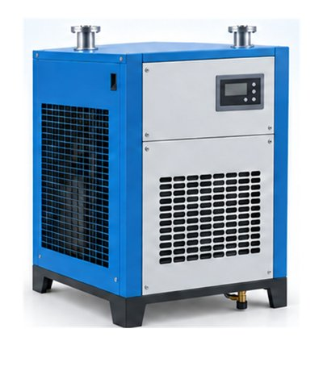

# 에어드라이어

[전체 목록](../../../README.md) · 장비군: **건조·제습 설비**

> 자동 생성 페이지입니다. 이 폴더에 파일을 올리면 내용이 갱신됩니다.

필수 산출물 1/3 · 개발계획서 없음 · 가이던스 없음 · AASX 있음

> [!WARNING]
> **확인 필요**
>
> - AASX 파일 이름 규칙 위반: `AirDryer_V0.0.1.aasx` (예: `AirDryer_v0.0.1.aasx`)

## 산출물

| 구분 | 파일 | 크기 | 보기 |
|---|---|---|---|
| 개발계획서 | 아직 없음 | | |
| 가이던스 | 아직 없음 | | |
| AASX | [AirDryer_V0.0.1.aasx](AASX/AirDryer_V0.0.1.aasx) | 8.6 MB | [열람 페이지](gen/AirDryer_V0.0.1.md) |

## AAS 구성 — `AirDryer`

`AirDryer_V0.0.1.aasx` 에서 읽은 서브모델 8개 · **[요소 전체 보기](gen/AirDryer_V0.0.1.md)**:

| # | 서브모델 idShort |
|:-:|---|
| 1 | DigitalNameplate |
| 2 | HandoverDocumentation |
| 3 | TechnicalData |
| 4 | OperationalData |
| 5 | ProcessParameters |
| 6 | PredictiveMaintenance |
| 7 | TimeSeries |
| 8 | ProcessVariablesForManufacturingKPICalculation |
