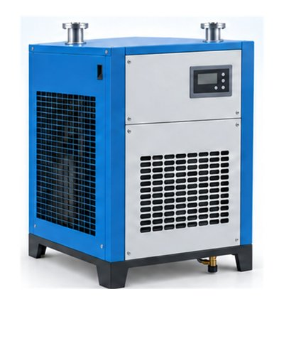

# 🧩 AirDryer_V0.0.1.aasx

[← 장비 페이지](../README.md) · [⤓ AASX 다운로드](../AASX/AirDryer_V0.0.1.aasx) · 8.6 MB

> 🤖 AASX 파일을 열어 자동으로 만든 열람 페이지입니다. 직접 고치지 말고 AASX를 다시 올리세요.

| 항목 | 내용 |
|---|---|
| AAS idShort | `AirDryer` |
| AAS id | https://www.smart-factory.kr/ids/aas/AirDryer/1/1 |
| 자산 종류 (assetKind) | Type |
| globalAssetId | https://www.smart-factory.kr/ids/asset/AirDryer/1/0 |
| 설명 | 압축공기 후처리 설비인 에어드라이어의 식별정보, 문서, 기술사양, 운전데이터, 공정 파라미터, 예지보전, 시계열 및 KPI 계산 변수를 통합한 Type 자산관리쉘이다. 냉동식과 흡착식을 서로 다른 대안 장비 유형으로 다루며, 8개 서브모델을 통해 설계·운영·유지보수와 제조데이터 연계를 지원한다. 포함된 수치와 이력은 참조모델 활용을 위한 예시이며 특정 제… |
| 서브모델 | 8개 |
| 전체 요소 | 258개 |

## 서브모델 한눈에 보기

| # | 서브모델 | 요소 수 | semanticId |
|:-:|---|--:|---|
| 1 | [DigitalNameplate](#sm-1) | 30 | https://admin-shell.io/idta/nameplate/3/0/Nameplate |
| 2 | [HandoverDocumentation](#sm-2) | 28 | 0173-1#01-AHF578#003 |
| 3 | [TechnicalData](#sm-3) | 52 | 0173-1#01-AHX837#002 |
| 4 | [OperationalData](#sm-4) | 23 | https://www.smart-factory.kr/ids/sm/AirDryer/OperationalData/1/1 |
| 5 | [ProcessParameters](#sm-5) | 35 | https://admin-shell-io/idta/SubmodelTemplate/ProcessParameters/1/0 |
| 6 | [PredictiveMaintenance](#sm-6) | 29 | https://admin-shell.io/idta/SubmodelTemplate/PredictiveMaintenance/1/0 |
| 7 | [TimeSeries](#sm-7) | 25 | https://admin-shell.io/idta/TimeSeries/1/1 |
| 8 | [ProcessVariablesForManufacturingKPICalculation](#sm-8) | 36 | https://admin-shell.io/idta/SubmodelTemplate/ProcessVariablesForManufacturingKPICalculati… |

## 서브모델 상세

각 서브모델 이름을 누르면 펼쳐집니다. **굵은 글씨**는 하위 요소가 있는 묶음입니다.

<b>1. DigitalNameplate</b> — 요소 30개

> 에어드라이어의 제품 식별과 인수·연계를 위한 명판 정보를 제공한다. 제조사, 제품명·형식, 주문·제조·버전 정보, 제조자 주소, 표시 및 로고를 IDTA Digital Nameplate 3.0.1 구조로 표현한다. Submodel id는 KOSMO 형식, semanticId는 IDTA 원본 IRI를 사용한다.

semanticId: `https://admin-shell.io/idta/nameplate/3/0/Nameplate`

| idShort | 종류 | 값 | semanticId |
|---|---|---|---|
| URIOfTheProduct | 속성 | https://www.smart-factory.kr/ids/asset/AirDryer/1/0 | 0112/2///61987#ABN590#002 |
| ManufacturerName | 다국어 속성 | ExampleCompany Co., Ltd. | 0112/2///61987#ABA565#009 |
| ManufacturerProductDesignation | 다국어 속성 | Compressed Air Dryer | 0112/2///61987#ABA567#009 |
| **AddressInformation** | 묶음 (4) |  | https://admin-shell.io/zvei/nameplate/1/0/ContactInformations/Address… |
| &nbsp;&nbsp;&nbsp;└ Street | 다국어 속성 | Example Street 100 | 0173-1#02-AAO128#002 |
| &nbsp;&nbsp;&nbsp;└ Zipcode | 다국어 속성 | 00000 | 0173-1#02-AAO129#002 |
| &nbsp;&nbsp;&nbsp;└ CityTown | 다국어 속성 | Example City | 0173-1#02-AAO132#002 |
| &nbsp;&nbsp;&nbsp;└ NationalCode | 다국어 속성 | KR | 0173-1#02-AAO134#002 |
| ManufacturerProductRoot | 다국어 속성 | Compressed air treatment equipment | 0112/2///61360_7#AAS011#001 |
| ManufacturerProductFamily | 다국어 속성 | Air Dryer | 0112/2///61987#ABP464#002 |
| ManufacturerProductType | 속성 | AD-105 | 0112/2///61987#ABA300#008 |
| OrderCodeOfManufacturer | 속성 | AD-105-STD | 0112/2///61987#ABA950#008 |
| ProductArticleNumberOfManufacturer | 속성 | ART-AD-105 | 0112/2///61987#ABA581#007 |
| SerialNumber | 속성 | EXAMPLE-AD-0001 | 0112/2///61987#ABA951#009 |
| YearOfConstruction | 속성 | 2026 | 0112/2///61987#ABP000#002 |
| DateOfManufacture | 속성 | 2026-01-01 | 0112/2///61987#ABB757#007 |
| HardwareVersion | 속성 | 1.0.0 | 0112/2///61987#ABA926#008 |
| FirmwareVersion | 속성 | 1.0.0 | 0112/2///61987#ABA302#006 |
| SoftwareVersion | 속성 | 1.0.0 | 0112/2///61987#ABA601#008 |
| CountryOfOrigin | 속성 | KR | 0112/2///61987#ABP462#001 |
| UniqueFacilityIdentifier | 속성 | EXAMPLE-FACILITY-001 | https://admin-shell.io/idta/nameplate/3/0/UniqueFacilityIdentifier |
| CompanyLogo | 파일 | /aasx/files/images/manufacturer_logo.png | 0112/2///61987#ABP463#001 |
| **Markings** | 목록 (1) |  | 0112/2///61360_7#AAS006#001 |
| &nbsp;&nbsp;&nbsp;└ **Marking__00__** | 묶음 (6) |  | 0112/2///61360_7#AAS009#001 |
| &nbsp;&nbsp;&nbsp;&nbsp;&nbsp;&nbsp;└ MarkingName | 속성 | EXAMPLE — no certification claimed | 0112/2///61987#ABA231#009 |
| &nbsp;&nbsp;&nbsp;&nbsp;&nbsp;&nbsp;└ DesignationOfCertificateOrApproval | 속성 | EXAMPLE-NOT-A-CERTIFICATE | 0112/2///61987#ABH783#003 |
| &nbsp;&nbsp;&nbsp;&nbsp;&nbsp;&nbsp;└ IssueDate | 속성 | 2026-01-01 | 0112/2///61987#ABO097#001 |
| &nbsp;&nbsp;&nbsp;&nbsp;&nbsp;&nbsp;└ ExpiryDate | 속성 | 2026-12-31 | 0112/2///61987#ABH830#002 |
| &nbsp;&nbsp;&nbsp;&nbsp;&nbsp;&nbsp;└ MarkingFile | 파일 | /aasx/files/documents/ExampleMarking.html | 0112/2///61987#ABO100#002 |
| &nbsp;&nbsp;&nbsp;&nbsp;&nbsp;&nbsp;└ MarkingAdditionalText | 속성 | Illustrative metadata only. Replace with an applicable, verified certificate. | 0112/2///61987#ABB146#007 |

<b>2. HandoverDocumentation</b> — 요소 28개

> 에어드라이어의 설치·운전·정비·안전 문서를 문서 및 버전 메타데이터와 파일 참조로 인계한다. IDTA Handover Documentation의 문서·버전 체인을 유지하여 문서 분류, 제목, 버전, 상태와 실제 첨부파일의 관계를 명확히 한다.

semanticId: `0173-1#01-AHF578#003`

| idShort | 종류 | 값 | semanticId |
|---|---|---|---|
| **Documents** | 목록 (1) |  | 0173-1#02-ABI500#003 |
| &nbsp;&nbsp;&nbsp;└ **Document__00__** | 묶음 (3) |  | 0173-1#02-ABI500#003/0173-1#01-AHF579#003 |
| &nbsp;&nbsp;&nbsp;&nbsp;&nbsp;&nbsp;└ **DocumentIds** | 목록 (1) |  | 0173-1#02-ABI501#003 |
| &nbsp;&nbsp;&nbsp;&nbsp;&nbsp;&nbsp;&nbsp;&nbsp;&nbsp;└ **DocumentId__00__** | 묶음 (3) |  | 0173-1#02-ABI501#003/0173-1#01-AHF580#003 |
| &nbsp;&nbsp;&nbsp;&nbsp;&nbsp;&nbsp;&nbsp;&nbsp;&nbsp;&nbsp;&nbsp;&nbsp;└ DocumentDomainId | 속성 | ExampleCompany | 0173-1#02-ABH994#003 |
| &nbsp;&nbsp;&nbsp;&nbsp;&nbsp;&nbsp;&nbsp;&nbsp;&nbsp;&nbsp;&nbsp;&nbsp;└ DocumentIdentifier | 속성 | AD-105-OM-001 | 0173-1#02-AAO099#004 |
| &nbsp;&nbsp;&nbsp;&nbsp;&nbsp;&nbsp;&nbsp;&nbsp;&nbsp;&nbsp;&nbsp;&nbsp;└ DocumentIsPrimary | 속성 | true | 0173-1#02-ABH995#003 |
| &nbsp;&nbsp;&nbsp;&nbsp;&nbsp;&nbsp;└ **DocumentClassifications** | 목록 (1) |  | 0173-1#02-ABI502#003 |
| &nbsp;&nbsp;&nbsp;&nbsp;&nbsp;&nbsp;&nbsp;&nbsp;&nbsp;└ **DocumentClassification__00__** | 묶음 (3) |  | 0173-1#02-ABI502#003/0173-1#01-AHF581#003 |
| &nbsp;&nbsp;&nbsp;&nbsp;&nbsp;&nbsp;&nbsp;&nbsp;&nbsp;&nbsp;&nbsp;&nbsp;└ ClassId | 속성 | 03-02 | 0173-1#02-ABH996#003 |
| &nbsp;&nbsp;&nbsp;&nbsp;&nbsp;&nbsp;&nbsp;&nbsp;&nbsp;&nbsp;&nbsp;&nbsp;└ ClassName | 다국어 속성 | Operation | 0173-1#02-ABJ219#002 |
| &nbsp;&nbsp;&nbsp;&nbsp;&nbsp;&nbsp;&nbsp;&nbsp;&nbsp;&nbsp;&nbsp;&nbsp;└ ClassificationSystem | 속성 | VDI 2770 Blatt 1:2020 | 0173-1#02-ABH997#003 |
| &nbsp;&nbsp;&nbsp;&nbsp;&nbsp;&nbsp;└ **DocumentVersions** | 목록 (1) |  | 0173-1#02-ABI503#003 |
| &nbsp;&nbsp;&nbsp;&nbsp;&nbsp;&nbsp;&nbsp;&nbsp;&nbsp;└ **DocumentVersion__00__** | 묶음 (12) |  | 0173-1#02-ABI503#003/0173-1#01-AHF582#003 |
| &nbsp;&nbsp;&nbsp;&nbsp;&nbsp;&nbsp;&nbsp;&nbsp;&nbsp;&nbsp;&nbsp;&nbsp;└ **Language** | 목록 (1) |  | 0173-1#02-AAN468#008 |
| &nbsp;&nbsp;&nbsp;&nbsp;&nbsp;&nbsp;&nbsp;&nbsp;&nbsp;&nbsp;&nbsp;&nbsp;&nbsp;&nbsp;&nbsp;└ Language__00__ | 속성 | ko | 0173-1#02-AAN468#008 |
| &nbsp;&nbsp;&nbsp;&nbsp;&nbsp;&nbsp;&nbsp;&nbsp;&nbsp;&nbsp;&nbsp;&nbsp;└ Version | 속성 | 1.0 | 0173-1#02-AAP003#005 |
| &nbsp;&nbsp;&nbsp;&nbsp;&nbsp;&nbsp;&nbsp;&nbsp;&nbsp;&nbsp;&nbsp;&nbsp;└ Title | 다국어 속성 | Air Dryer Operating Manual — Reference Example | 0173-1#02-ABG940#003 |
| &nbsp;&nbsp;&nbsp;&nbsp;&nbsp;&nbsp;&nbsp;&nbsp;&nbsp;&nbsp;&nbsp;&nbsp;└ Subtitle | 다국어 속성 | 냉동식·흡착식 에어드라이어 참조모델 운영 설명 예시 | 0173-1#02-ABH998#003 |
| &nbsp;&nbsp;&nbsp;&nbsp;&nbsp;&nbsp;&nbsp;&nbsp;&nbsp;&nbsp;&nbsp;&nbsp;└ Description | 다국어 속성 | 최종 개발계획서의 공정 흐름, 운전값, 적용 조건을 설명하는 참조모델 예시 문서. 제조사 정식 운전·정비 지침이 아님. | 0173-1#02-AAN466#004 |
| &nbsp;&nbsp;&nbsp;&nbsp;&nbsp;&nbsp;&nbsp;&nbsp;&nbsp;&nbsp;&nbsp;&nbsp;└ KeyWords | 다국어 속성 | Air dryer; refrigerated; desiccant; pressure dew point | 0173-1#02-ABH999#003 |
| &nbsp;&nbsp;&nbsp;&nbsp;&nbsp;&nbsp;&nbsp;&nbsp;&nbsp;&nbsp;&nbsp;&nbsp;└ StatusSetDate | 속성 | 2026-09-05 | 0173-1#02-ABI000#003 |
| &nbsp;&nbsp;&nbsp;&nbsp;&nbsp;&nbsp;&nbsp;&nbsp;&nbsp;&nbsp;&nbsp;&nbsp;└ StatusValue | 속성 | Example | 0173-1#02-ABI001#003 |
| &nbsp;&nbsp;&nbsp;&nbsp;&nbsp;&nbsp;&nbsp;&nbsp;&nbsp;&nbsp;&nbsp;&nbsp;└ OrganizationShortName | 속성 | ExampleCompany | https://api.eclass-cdp.com/0173-1-02-ABI002-003 |
| &nbsp;&nbsp;&nbsp;&nbsp;&nbsp;&nbsp;&nbsp;&nbsp;&nbsp;&nbsp;&nbsp;&nbsp;└ OrganizationOfficialName | 속성 | ExampleCompany Co., Ltd. | 0173-1#02-ABI004#003 |
| &nbsp;&nbsp;&nbsp;&nbsp;&nbsp;&nbsp;&nbsp;&nbsp;&nbsp;&nbsp;&nbsp;&nbsp;└ **DigitalFiles** | 목록 (1) |  | 0173-1#02-ABK126#002 |
| &nbsp;&nbsp;&nbsp;&nbsp;&nbsp;&nbsp;&nbsp;&nbsp;&nbsp;&nbsp;&nbsp;&nbsp;&nbsp;&nbsp;&nbsp;└ DigitalFile__00__ | 파일 | /aasx/files/documents/AirDryer_OperatingManual_Example.html | 0173-1#02-ABK126#002 |
| &nbsp;&nbsp;&nbsp;&nbsp;&nbsp;&nbsp;&nbsp;&nbsp;&nbsp;&nbsp;&nbsp;&nbsp;└ PreviewFile | 파일 | /aasx/files/images/AIRDRYER_ProductImage.jpg | 0173-1#02-ABK127#002 |

<b>3. TechnicalData</b> — 요소 52개

> 에어드라이어의 형식 선정과 설계 검토에 필요한 정적 기술사양을 제공한다. IDTA Technical Data의 GeneralInformation, ProductClassifications, TechnicalPropertyAreas 구조 안에서 건조 방식, 처리 성능, 냉동·흡착 계통, 설치, 전기, 기계·환경 사양을 구분한다.

semanticId: `0173-1#01-AHX837#002`

| idShort | 종류 | 값 | semanticId |
|---|---|---|---|
| **GeneralInformation** | 묶음 (6) |  | 0173-1#02-ABK161#002/0173-1#01-AHX838#002 |
| &nbsp;&nbsp;&nbsp;└ ManufacturerName | 속성 | ExampleCompany Co., Ltd. | 0173-1#02-AAO677#004 |
| &nbsp;&nbsp;&nbsp;└ CompanyLogo | 파일 | /aasx/files/images/manufacturer_logo.png | 0173-1#02-ABI776#002 |
| &nbsp;&nbsp;&nbsp;└ ManufacturerProductDesignation | 다국어 속성 | Compressed Air Dryer | 0173-1#02-AAW338#003 |
| &nbsp;&nbsp;&nbsp;└ ManufacturerArticleNumber | 속성 | ART-AD-105 | 0173-1#02-AAO676#005 |
| &nbsp;&nbsp;&nbsp;└ ManufacturerOrderCode | 속성 | AD-105-STD | 0173-1#02-AAO227#004 |
| &nbsp;&nbsp;&nbsp;└ **ProductImages** | 목록 (1) |  | 0173-1#02-ABM220#001 |
| &nbsp;&nbsp;&nbsp;&nbsp;&nbsp;&nbsp;└ **ProductImage__00__** | 묶음 (2) |  | 0173-1#02-ABM220#001/0173-1#01-AHY911#001 |
| &nbsp;&nbsp;&nbsp;&nbsp;&nbsp;&nbsp;&nbsp;&nbsp;&nbsp;└ ImageFile | 파일 | /aasx/files/images/AIRDRYER_ProductImage.jpg | 0173-1#02-ABK291#002 |
| &nbsp;&nbsp;&nbsp;&nbsp;&nbsp;&nbsp;&nbsp;&nbsp;&nbsp;└ ImageNote | 다국어 속성 | Refrigerated compressed air dryer overview | 0173-1#02-ABL423#001 |
| **ProductClassifications** | 목록 (1) |  | 0173-1#02-ABK162#002 |
| &nbsp;&nbsp;&nbsp;└ **ProductClassification__00__** | 묶음 (7) |  | 0173-1#02-ABK162#002/0173-1#01-AHX839#002 |
| &nbsp;&nbsp;&nbsp;&nbsp;&nbsp;&nbsp;└ ClassificationSystem | 속성 | ECLASS | 0173-1#02-ABL424#001 |
| &nbsp;&nbsp;&nbsp;&nbsp;&nbsp;&nbsp;└ ClassificationSystemVersion | 속성 | 16.0 | 0173-1#02-AAR710#003 |
| &nbsp;&nbsp;&nbsp;&nbsp;&nbsp;&nbsp;└ ClassificationSystemUrl | 속성 | https://eclass.eu | https://admin-shell.io/IDTA/TechnicalData/ProductClassifications/Prod… |
| &nbsp;&nbsp;&nbsp;&nbsp;&nbsp;&nbsp;└ ProductClassId | 속성 | 0173-1#01-BAA112#019 | 0173-1#02-ABG776#003 |
| &nbsp;&nbsp;&nbsp;&nbsp;&nbsp;&nbsp;└ ProductClassCodedName | 속성 | 36-53-03-01 | 0173-1#02-ABK128#002 |
| &nbsp;&nbsp;&nbsp;&nbsp;&nbsp;&nbsp;└ ProductClassName | 다국어 속성 | Cold dryer (compressed air technology) | 0173-1#02-ABK273#002 |
| &nbsp;&nbsp;&nbsp;&nbsp;&nbsp;&nbsp;└ ReferenceToTechnicalPropertyArea | 참조 | https://www.smart-factory.kr/ids/sm/AirDryer/TechnicalData/1/1 / TechnicalPrope… | 0173-1#02-ABL358#002 |
| **TechnicalPropertyAreas** | 목록 (1) |  | 0173-1#02-ABK163#002 |
| &nbsp;&nbsp;&nbsp;└ **TechnicalPropertyArea__00__** | 묶음 (2) |  | 0173-1#02-ABL358#002/0173-1#01-AHX773#002 |
| &nbsp;&nbsp;&nbsp;&nbsp;&nbsp;&nbsp;└ **AirTreatmentSpecification** | 묶음 (3) |  | https://www.smart-factory.kr/ids/cd/AirTreatmentSpecification/1/0 |
| &nbsp;&nbsp;&nbsp;&nbsp;&nbsp;&nbsp;&nbsp;&nbsp;&nbsp;└ **GeneralSpecification** | 묶음 (3) |  | https://www.smart-factory.kr/ids/cd/GeneralSpecification/1/0 |
| &nbsp;&nbsp;&nbsp;&nbsp;&nbsp;&nbsp;&nbsp;&nbsp;&nbsp;&nbsp;&nbsp;&nbsp;└ DryerType | 속성 | Refrigerated (냉동식) | https://www.smart-factory.kr/ids/cd/DryerType/1/0 |
| &nbsp;&nbsp;&nbsp;&nbsp;&nbsp;&nbsp;&nbsp;&nbsp;&nbsp;&nbsp;&nbsp;&nbsp;└ CoolingMethod | 속성 | Air-cooled (공랭식) | https://www.smart-factory.kr/ids/cd/CoolingMethod/1/0 |
| &nbsp;&nbsp;&nbsp;&nbsp;&nbsp;&nbsp;&nbsp;&nbsp;&nbsp;&nbsp;&nbsp;&nbsp;└ ConnectionNominalDiameter | 속성 | DN40 (Rc 1½) | https://www.smart-factory.kr/ids/cd/ConnectionNominalDiameter/1/0 |
| &nbsp;&nbsp;&nbsp;&nbsp;&nbsp;&nbsp;&nbsp;&nbsp;&nbsp;└ **ProcessingPerformance** | 묶음 (7) |  | https://www.smart-factory.kr/ids/cd/ProcessingPerformance/1/0 |
| &nbsp;&nbsp;&nbsp;&nbsp;&nbsp;&nbsp;&nbsp;&nbsp;&nbsp;&nbsp;&nbsp;&nbsp;└ RatedAirFlowCapacity | 속성 | 10.5 | 0173-1#02-AAC859#009 |
| &nbsp;&nbsp;&nbsp;&nbsp;&nbsp;&nbsp;&nbsp;&nbsp;&nbsp;&nbsp;&nbsp;&nbsp;└ RatedWorkingPressure | 속성 | 7 | 0112/2///61987#ABB359#004 |
| &nbsp;&nbsp;&nbsp;&nbsp;&nbsp;&nbsp;&nbsp;&nbsp;&nbsp;&nbsp;&nbsp;&nbsp;└ MaxWorkingPressure | 속성 | 1.0 | 0173-1#02-AAG905#008 |
| &nbsp;&nbsp;&nbsp;&nbsp;&nbsp;&nbsp;&nbsp;&nbsp;&nbsp;&nbsp;&nbsp;&nbsp;└ PressureDewPoint | 속성 | 3 | 0112/2///61987#ABA625#004 |
| &nbsp;&nbsp;&nbsp;&nbsp;&nbsp;&nbsp;&nbsp;&nbsp;&nbsp;&nbsp;&nbsp;&nbsp;└ CompressedAirQualityClass | 속성 | ISO 8573-1 Class 4 | https://www.smart-factory.kr/ids/cd/CompressedAirQualityClass/1/0 |
| &nbsp;&nbsp;&nbsp;&nbsp;&nbsp;&nbsp;&nbsp;&nbsp;&nbsp;&nbsp;&nbsp;&nbsp;└ PressureDrop | 속성 | 0.02 | https://www.smart-factory.kr/ids/cd/PressureDrop/1/0 |
| &nbsp;&nbsp;&nbsp;&nbsp;&nbsp;&nbsp;&nbsp;&nbsp;&nbsp;&nbsp;&nbsp;&nbsp;└ MaxInletAirTemperature | 속성 | 45 | https://www.smart-factory.kr/ids/cd/MaxInletAirTemperature/1/0 |
| &nbsp;&nbsp;&nbsp;&nbsp;&nbsp;&nbsp;&nbsp;&nbsp;&nbsp;└ **RefrigerationAndAdsorptionSystem** | 묶음 (5) |  | https://www.smart-factory.kr/ids/cd/RefrigerationAndAdsorptionSystem/… |
| &nbsp;&nbsp;&nbsp;&nbsp;&nbsp;&nbsp;&nbsp;&nbsp;&nbsp;&nbsp;&nbsp;&nbsp;└ RefrigerantType | 속성 | R134a | 0173-1#02-AAY808#004 |
| &nbsp;&nbsp;&nbsp;&nbsp;&nbsp;&nbsp;&nbsp;&nbsp;&nbsp;&nbsp;&nbsp;&nbsp;└ RefrigerationCapacity | 속성 | 3.6 | https://www.smart-factory.kr/ids/cd/RefrigerationCapacity/1/0 |
| &nbsp;&nbsp;&nbsp;&nbsp;&nbsp;&nbsp;&nbsp;&nbsp;&nbsp;&nbsp;&nbsp;&nbsp;└ DesiccantType | 속성 | Activated alumina | https://www.smart-factory.kr/ids/cd/DesiccantType/1/0 |
| &nbsp;&nbsp;&nbsp;&nbsp;&nbsp;&nbsp;&nbsp;&nbsp;&nbsp;&nbsp;&nbsp;&nbsp;└ PurgeAirRate | 속성 | 15 | https://www.smart-factory.kr/ids/cd/PurgeAirRate/1/0 |
| &nbsp;&nbsp;&nbsp;&nbsp;&nbsp;&nbsp;&nbsp;&nbsp;&nbsp;&nbsp;&nbsp;&nbsp;└ CondensateDrainType | 속성 | Electronic auto drain (timer-controlled) | https://www.smart-factory.kr/ids/cd/CondensateDrainType/1/0 |
| &nbsp;&nbsp;&nbsp;&nbsp;&nbsp;&nbsp;└ **InstallationSpecification** | 묶음 (2) |  | https://www.smart-factory.kr/ids/cd/InstallationSpecification/1/0 |
| &nbsp;&nbsp;&nbsp;&nbsp;&nbsp;&nbsp;&nbsp;&nbsp;&nbsp;└ **ElectricalSpecification** | 묶음 (3) |  | https://www.smart-factory.kr/ids/cd/ElectricalSpecification/1/0 |
| &nbsp;&nbsp;&nbsp;&nbsp;&nbsp;&nbsp;&nbsp;&nbsp;&nbsp;&nbsp;&nbsp;&nbsp;└ RatedVoltage | 속성 | 220 | 0173-1#02-BAH005#008 |
| &nbsp;&nbsp;&nbsp;&nbsp;&nbsp;&nbsp;&nbsp;&nbsp;&nbsp;&nbsp;&nbsp;&nbsp;└ MaxInputPower | 속성 | 1.9 | https://www.smart-factory.kr/ids/cd/MaxInputPower/1/0 |
| &nbsp;&nbsp;&nbsp;&nbsp;&nbsp;&nbsp;&nbsp;&nbsp;&nbsp;&nbsp;&nbsp;&nbsp;└ ProtectionClassIP | 속성 | IP54 | 0173-1#02-BAG975#017 |
| &nbsp;&nbsp;&nbsp;&nbsp;&nbsp;&nbsp;&nbsp;&nbsp;&nbsp;└ **MechanicalAndEnvironmental** | 묶음 (6) |  | https://www.smart-factory.kr/ids/cd/MechanicalAndEnvironmental/1/0 |
| &nbsp;&nbsp;&nbsp;&nbsp;&nbsp;&nbsp;&nbsp;&nbsp;&nbsp;&nbsp;&nbsp;&nbsp;└ Length | 속성 | 620 | 0173-1#02-ABE774#004 |
| &nbsp;&nbsp;&nbsp;&nbsp;&nbsp;&nbsp;&nbsp;&nbsp;&nbsp;&nbsp;&nbsp;&nbsp;└ Width | 속성 | 480 | 0173-1#02-AAG933#006 |
| &nbsp;&nbsp;&nbsp;&nbsp;&nbsp;&nbsp;&nbsp;&nbsp;&nbsp;&nbsp;&nbsp;&nbsp;└ Height | 속성 | 760 | 0173-1#02-BAE355#008 |
| &nbsp;&nbsp;&nbsp;&nbsp;&nbsp;&nbsp;&nbsp;&nbsp;&nbsp;&nbsp;&nbsp;&nbsp;└ DeadWeight | 속성 | 92 | 0173-1#02-BAD875#010 |
| &nbsp;&nbsp;&nbsp;&nbsp;&nbsp;&nbsp;&nbsp;&nbsp;&nbsp;&nbsp;&nbsp;&nbsp;└ NoiseLevel | 속성 | 65 | 0173-1#02-ABA650#004 |
| &nbsp;&nbsp;&nbsp;&nbsp;&nbsp;&nbsp;&nbsp;&nbsp;&nbsp;&nbsp;&nbsp;&nbsp;└ AmbientTemperatureRange | 범위 | 2 ~ 43 | https://www.smart-factory.kr/ids/cd/AmbientTemperatureRange/1/0 |

<b>4. OperationalData</b> — 요소 23개

> 에어드라이어의 현재 운전 상태와 계측·정비 정보를 모니터링 및 이상 진단에 사용할 수 있도록 제공한다. OperatingData에는 RuntimeStatus와 MeasuredValues를, MaintenanceData에는 Alarms와 Counters를 배치한다. 포함된 값은 Type 참조모델의 활용을 보여 주는 예시값이며 실제 설비 이력이 아니다.

semanticId: `https://www.smart-factory.kr/ids/sm/AirDryer/OperationalData/1/1`

| idShort | 종류 | 값 | semanticId |
|---|---|---|---|
| **OperatingData** | 묶음 (2) |  | https://www.smart-factory.kr/ids/cd/OperatingData/1/0 |
| &nbsp;&nbsp;&nbsp;└ **RuntimeStatus** | 묶음 (4) |  | https://www.smart-factory.kr/ids/cd/RuntimeStatus/1/0 |
| &nbsp;&nbsp;&nbsp;&nbsp;&nbsp;&nbsp;└ DryerOperationState | 속성 | Run | https://www.smart-factory.kr/ids/cd/DryerOperationState/1/0 |
| &nbsp;&nbsp;&nbsp;&nbsp;&nbsp;&nbsp;└ DryerOperationMode | 속성 | Auto | https://www.smart-factory.kr/ids/cd/DryerOperationMode/1/0 |
| &nbsp;&nbsp;&nbsp;&nbsp;&nbsp;&nbsp;└ TowerState | 속성 | Tower-A adsorbing | https://www.smart-factory.kr/ids/cd/TowerState/1/0 |
| &nbsp;&nbsp;&nbsp;&nbsp;&nbsp;&nbsp;└ CurrentRecipeId | 속성 | AD-RCP-002 | https://www.smart-factory.kr/ids/cd/CurrentRecipeId/1/0 |
| &nbsp;&nbsp;&nbsp;└ **MeasuredValues** | 묶음 (5) |  | https://www.smart-factory.kr/ids/cd/MeasuredValues/1/0 |
| &nbsp;&nbsp;&nbsp;&nbsp;&nbsp;&nbsp;└ MeasuredPressureDewPoint | 속성 | 3.2 | 0112/2///61987#ABA625#004 |
| &nbsp;&nbsp;&nbsp;&nbsp;&nbsp;&nbsp;└ MeasuredInletAirTemp | 속성 | 38.5 | https://www.smart-factory.kr/ids/cd/MeasuredInletAirTemp/1/0 |
| &nbsp;&nbsp;&nbsp;&nbsp;&nbsp;&nbsp;└ MeasuredWorkingPressure | 속성 | 6.8 | 0112/2///61987#ABB182#004 |
| &nbsp;&nbsp;&nbsp;&nbsp;&nbsp;&nbsp;└ MeasuredAirFlow | 속성 | 588 | 0112/2///61987#ABB292#005 |
| &nbsp;&nbsp;&nbsp;&nbsp;&nbsp;&nbsp;└ MeasuredPressureDrop | 속성 | 0.021 | 0173-1#02-ABC542#004 |
| **MaintenanceData** | 묶음 (2) |  | https://www.smart-factory.kr/ids/cd/MaintenanceData/1/0 |
| &nbsp;&nbsp;&nbsp;└ **Alarms** | 묶음 (4) |  | https://www.smart-factory.kr/ids/cd/Alarms/1/0 |
| &nbsp;&nbsp;&nbsp;&nbsp;&nbsp;&nbsp;└ DryerAlarmCode | 속성 | E-PDP-HIGH | https://www.smart-factory.kr/ids/cd/DryerAlarmCode/1/0 |
| &nbsp;&nbsp;&nbsp;&nbsp;&nbsp;&nbsp;└ DryerAlarmText | 다국어 속성 | Outlet dew point increased: check refrigeration capacity or condensate drain | https://www.smart-factory.kr/ids/cd/DryerAlarmText/1/0 |
| &nbsp;&nbsp;&nbsp;&nbsp;&nbsp;&nbsp;└ DryerAlarmSeverity | 속성 | Warning | https://www.smart-factory.kr/ids/cd/DryerAlarmSeverity/1/0 |
| &nbsp;&nbsp;&nbsp;&nbsp;&nbsp;&nbsp;└ LastAlarmTimestamp | 속성 | 2026-06-18T10:58:42Z | https://www.smart-factory.kr/ids/cd/LastAlarmTimestamp/1/0 |
| &nbsp;&nbsp;&nbsp;└ **Counters** | 묶음 (4) |  | https://www.smart-factory.kr/ids/cd/Counters/1/0 |
| &nbsp;&nbsp;&nbsp;&nbsp;&nbsp;&nbsp;└ CumulativeOperatingHours | 속성 | 18600 | 0112/2///61987#ABN639#001 |
| &nbsp;&nbsp;&nbsp;&nbsp;&nbsp;&nbsp;└ CumulativeProcessedAir | 속성 | 9800000 | https://www.smart-factory.kr/ids/cd/CumulativeProcessedAir/1/0 |
| &nbsp;&nbsp;&nbsp;&nbsp;&nbsp;&nbsp;└ DrainDischargeCount | 속성 | 558000 | https://www.smart-factory.kr/ids/cd/DrainDischargeCount/1/0 |
| &nbsp;&nbsp;&nbsp;&nbsp;&nbsp;&nbsp;└ MaintenanceCycleCount | 속성 | 5 | https://www.smart-factory.kr/ids/cd/MaintenanceCycleCount/1/0 |

<b>5. ProcessParameters</b> — 요소 35개

> 에어드라이어 공정의 제품·공정·자원 파라미터를 IDTA Processes/Process 구조로 제공한다. 냉동식의 냉각·응축·드레인 조건과 흡착식의 흡착·재생 조건을 유형별로 구분하며, Process__00__과 Process__01__은 연속 공정이 아니라 서로 다른 장비 유형의 대안 예시다.

semanticId: `https://admin-shell-io/idta/SubmodelTemplate/ProcessParameters/1/0`

| idShort | 종류 | 값 | semanticId |
|---|---|---|---|
| **Processes** | 묶음 (2) |  | https://admin-shell.io/idta/ProcessParameters/Processes/1/0 |
| &nbsp;&nbsp;&nbsp;└ **Process__00__** | 묶음 (8) |  | https://admin-shell.io/idta/ProcessParameters/Process/1/0 |
| &nbsp;&nbsp;&nbsp;&nbsp;&nbsp;&nbsp;└ ProcessId | 속성 | AD-DRY-001 | https://admin-shell.io/idta/ProcessParameters/ProcessId/1/0 |
| &nbsp;&nbsp;&nbsp;&nbsp;&nbsp;&nbsp;└ ProcessName | 속성 | Air Drying (Cooling-Dehumidification) | https://admin-shell.io/idta/ProcessParameters/ProcessName/1/0 |
| &nbsp;&nbsp;&nbsp;&nbsp;&nbsp;&nbsp;└ ProcessDescription | 다국어 속성 | Compressed air cooling and dehumidification to lower dew point | https://admin-shell.io/idta/ProcessParameters/ProcessDescription/1/0 |
| &nbsp;&nbsp;&nbsp;&nbsp;&nbsp;&nbsp;└ PlannedProcessTime | 속성 | PT24H | https://admin-shell.io/idta/ProcessParameters/PlannedProcessTime/1/0 |
| &nbsp;&nbsp;&nbsp;&nbsp;&nbsp;&nbsp;└ **ProductParameters** | 묶음 (3) |  | https://admin-shell.io/idta/ProcessParameters/ProductParameters/1/0 |
| &nbsp;&nbsp;&nbsp;&nbsp;&nbsp;&nbsp;&nbsp;&nbsp;&nbsp;└ InletAirMedium | 속성 | Compressed air | https://www.smart-factory.kr/ids/cd/InletAirMedium/1/0 |
| &nbsp;&nbsp;&nbsp;&nbsp;&nbsp;&nbsp;&nbsp;&nbsp;&nbsp;└ InletAirTempTarget | 속성 | 35 | https://www.smart-factory.kr/ids/cd/InletAirTempTarget/1/0 |
| &nbsp;&nbsp;&nbsp;&nbsp;&nbsp;&nbsp;&nbsp;&nbsp;&nbsp;└ OutletQualityClassTarget | 속성 | Class 4 | https://www.smart-factory.kr/ids/cd/OutletQualityClassTarget/1/0 |
| &nbsp;&nbsp;&nbsp;&nbsp;&nbsp;&nbsp;└ **ProcessParameters** | 묶음 (4) |  | https://admin-shell.io/idta/ProcessParameters/ProcessParameters/1/0 |
| &nbsp;&nbsp;&nbsp;&nbsp;&nbsp;&nbsp;&nbsp;&nbsp;&nbsp;└ TargetPressureDewPointSetpoint | 속성 | 3 | https://www.smart-factory.kr/ids/cd/TargetPressureDewPointSetpoint/1/0 |
| &nbsp;&nbsp;&nbsp;&nbsp;&nbsp;&nbsp;&nbsp;&nbsp;&nbsp;└ EvaporatingTemperatureSetpoint | 속성 | 0 | https://www.smart-factory.kr/ids/cd/EvaporatingTemperatureSetpoint/1/0 |
| &nbsp;&nbsp;&nbsp;&nbsp;&nbsp;&nbsp;&nbsp;&nbsp;&nbsp;└ HotGasBypassPressureSetpoint | 속성 | 0.19 | https://www.smart-factory.kr/ids/cd/HotGasBypassPressureSetpoint/1/0 |
| &nbsp;&nbsp;&nbsp;&nbsp;&nbsp;&nbsp;&nbsp;&nbsp;&nbsp;└ DrainDischargeIntervalSetpoint | 속성 | 120 | https://www.smart-factory.kr/ids/cd/DrainDischargeIntervalSetpoint/1/0 |
| &nbsp;&nbsp;&nbsp;&nbsp;&nbsp;&nbsp;└ **ResourceParameters** | 묶음 (4) |  | https://admin-shell.io/idta/ProcessParameters/ResourceParameters/1/0 |
| &nbsp;&nbsp;&nbsp;&nbsp;&nbsp;&nbsp;&nbsp;&nbsp;&nbsp;└ ProcessRefrigerantType | 속성 | R134a | 0173-1#02-AAY808#004 |
| &nbsp;&nbsp;&nbsp;&nbsp;&nbsp;&nbsp;&nbsp;&nbsp;&nbsp;└ ProcessDrainType | 속성 | Electronic auto drain (timer-controlled) | https://www.smart-factory.kr/ids/cd/ProcessDrainType/1/0 |
| &nbsp;&nbsp;&nbsp;&nbsp;&nbsp;&nbsp;&nbsp;&nbsp;&nbsp;└ PrefilterElement | 속성 | 라인 전처리 필터 | https://www.smart-factory.kr/ids/cd/PrefilterElement/1/0 |
| &nbsp;&nbsp;&nbsp;&nbsp;&nbsp;&nbsp;&nbsp;&nbsp;&nbsp;└ Refrigerant | 속성 | R134a 냉매 | https://www.smart-factory.kr/ids/cd/Refrigerant/1/0 |
| &nbsp;&nbsp;&nbsp;&nbsp;&nbsp;&nbsp;└ **ProcessBoM** | 묶음 (2) |  | https://admin-shell.io/idta/ProcessParameters/ProcessBoM/1/0 |
| &nbsp;&nbsp;&nbsp;&nbsp;&nbsp;&nbsp;&nbsp;&nbsp;&nbsp;└ InputAirMaterialCode | 속성 | CA-IN-001 | https://www.smart-factory.kr/ids/cd/InputAirMaterialCode/1/0 |
| &nbsp;&nbsp;&nbsp;&nbsp;&nbsp;&nbsp;&nbsp;&nbsp;&nbsp;└ PlannedInputAirVolume | 속성 | 1440 | https://www.smart-factory.kr/ids/cd/PlannedInputAirVolume/1/0 |
| &nbsp;&nbsp;&nbsp;└ **Process__01__** | 묶음 (8) |  | https://admin-shell.io/idta/ProcessParameters/Process/1/0 |
| &nbsp;&nbsp;&nbsp;&nbsp;&nbsp;&nbsp;└ ProcessId | 속성 | AD-REG-002 | https://admin-shell.io/idta/ProcessParameters/ProcessId/1/0 |
| &nbsp;&nbsp;&nbsp;&nbsp;&nbsp;&nbsp;└ ProcessName | 속성 | Adsorption-Regeneration | https://admin-shell.io/idta/ProcessParameters/ProcessName/1/0 |
| &nbsp;&nbsp;&nbsp;&nbsp;&nbsp;&nbsp;└ ProcessDescription | 다국어 속성 | Twin-tower desiccant adsorption and purge regeneration | https://admin-shell.io/idta/ProcessParameters/ProcessDescription/1/0 |
| &nbsp;&nbsp;&nbsp;&nbsp;&nbsp;&nbsp;└ PlannedProcessTime | 속성 | PT5M | https://admin-shell.io/idta/ProcessParameters/PlannedProcessTime/1/0 |
| &nbsp;&nbsp;&nbsp;&nbsp;&nbsp;&nbsp;└ **ProcessParameters** | 묶음 (3) |  | https://admin-shell.io/idta/ProcessParameters/ProcessParameters/1/0 |
| &nbsp;&nbsp;&nbsp;&nbsp;&nbsp;&nbsp;&nbsp;&nbsp;&nbsp;└ TargetPressureDewPointSetpoint | 속성 | -40 | https://www.smart-factory.kr/ids/cd/TargetPressureDewPointSetpoint/1/0 |
| &nbsp;&nbsp;&nbsp;&nbsp;&nbsp;&nbsp;&nbsp;&nbsp;&nbsp;└ TowerSwitchoverIntervalSetpoint | 속성 | 300 | https://www.smart-factory.kr/ids/cd/TowerSwitchoverIntervalSetpoint/1… |
| &nbsp;&nbsp;&nbsp;&nbsp;&nbsp;&nbsp;&nbsp;&nbsp;&nbsp;└ PurgeAirRateSetpoint | 속성 | 15 | https://www.smart-factory.kr/ids/cd/PurgeAirRateSetpoint/1/0 |
| &nbsp;&nbsp;&nbsp;&nbsp;&nbsp;&nbsp;└ ProductParameters | 묶음 |  | https://admin-shell.io/idta/ProcessParameters/ProductParameters/1/0 |
| &nbsp;&nbsp;&nbsp;&nbsp;&nbsp;&nbsp;└ ResourceParameters | 묶음 |  | https://admin-shell.io/idta/ProcessParameters/ResourceParameters/1/0 |
| &nbsp;&nbsp;&nbsp;&nbsp;&nbsp;&nbsp;└ ProcessBoM | 묶음 |  | https://admin-shell.io/idta/ProcessParameters/ProcessBoM/1/0 |

<b>6. PredictiveMaintenance</b> — 요소 29개

> 냉매 압축기·응축기 팬·드레인 밸브 또는 흡착제·절환밸브의 상태 기반 정비를 위해 잔여수명 예측, 상태지표와 사전알람 정보를 제공한다. IDTA Predictive Maintenance 계층을 유지하면서 에어드라이어 정비 맥락을 연결하며, 예측값은 구조 활용을 위한 예시로 실제 수명 보증을 의미하지 않는다.

semanticId: `https://admin-shell.io/idta/SubmodelTemplate/PredictiveMaintenance/1/0`

| idShort | 종류 | 값 | semanticId |
|---|---|---|---|
| **RemainingUsefulLifePrediction** | 묶음 (7) |  | https://admin-shell.io/idta/PredictiveMaintenance/RemainingUsefulLife… |
| &nbsp;&nbsp;&nbsp;└ **RemainingUsefulLifetime** | 엔티티 (6) |  | https://admin-shell.io/idta/PredictiveMaintenance/RemainingUsefulLife… |
| &nbsp;&nbsp;&nbsp;&nbsp;&nbsp;&nbsp;└ IndicationType | 속성 | operating hours | https://admin-shell.io/idta/PredictiveMaintenance/IndicationType/1/0 |
| &nbsp;&nbsp;&nbsp;&nbsp;&nbsp;&nbsp;└ DurationValue | 속성 | 52000 | https://admin-shell.io/idta/PredictiveMaintenance/DurationValue/1/0 |
| &nbsp;&nbsp;&nbsp;&nbsp;&nbsp;&nbsp;└ EngineeringUnit | 속성 | hour | https://admin-shell.io/idta/PredictiveMaintenance/EngineeringUnit/1/0 |
| &nbsp;&nbsp;&nbsp;&nbsp;&nbsp;&nbsp;└ StartValue | 속성 | 18600 | https://admin-shell.io/idta/PredictiveMaintenance/StartValue/1/0 |
| &nbsp;&nbsp;&nbsp;&nbsp;&nbsp;&nbsp;└ StartDateTime | 속성 | 2026-06-18T11:00:00Z | https://admin-shell.io/idta/PredictiveMaintenance/StartDateTime/1/0 |
| &nbsp;&nbsp;&nbsp;&nbsp;&nbsp;&nbsp;└ Description | 속성 | 2026-06-18T11:00:00Z, 누적 운전시간 18,600 hour를 기준으로 냉동식 건조부의 통합 정비·교체 시점까지 남은 운전시간 … | https://admin-shell.io/idta/PredictiveMaintenance/Description/1/0 |
| &nbsp;&nbsp;&nbsp;└ RemainingUsfulLifeDateTime | 속성 | 2032-05-24T03:00:00Z | https://admin-shell.io/idta/PredictiveMaintenance/RemainingUsfulLifeD… |
| &nbsp;&nbsp;&nbsp;└ ConfidenceInterval | 범위 | 48000 ~ 56000 | https://admin-shell.io/idta/PredictiveMaintenance/ConfidenceInterval/… |
| &nbsp;&nbsp;&nbsp;└ **ListRULBoundaryConditions** | 목록 (1) |  | https://admin-shell.io/idta/PredictiveMaintenance/ListRULBoundaryCond… |
| &nbsp;&nbsp;&nbsp;&nbsp;&nbsp;&nbsp;└ **RULCondition** | 묶음 (7) |  | https://admin-shell.io/idta/PredictiveMaintenance/RULCondition/1/0 |
| &nbsp;&nbsp;&nbsp;&nbsp;&nbsp;&nbsp;&nbsp;&nbsp;&nbsp;└ ConditionName | 속성 | PressureDewPoint | https://admin-shell.io/idta/PredictiveMaintenance/ConditionName/1/0 |
| &nbsp;&nbsp;&nbsp;&nbsp;&nbsp;&nbsp;&nbsp;&nbsp;&nbsp;└ IsBoundaryConditionUsedInModel | 속성 | true | https://admin-shell.io/idta/PredictiveMaintenance/IsBoundaryCondition… |
| &nbsp;&nbsp;&nbsp;&nbsp;&nbsp;&nbsp;&nbsp;&nbsp;&nbsp;└ BoundaryValueRange | 속성 | 10 | https://admin-shell.io/idta/PredictiveMaintenance/BoundaryValueRange/… |
| &nbsp;&nbsp;&nbsp;&nbsp;&nbsp;&nbsp;&nbsp;&nbsp;&nbsp;└ BoundaryEngineeringUnit | 속성 | ℃ | https://admin-shell.io/idta/PredictiveMaintenance/BoundaryEngineering… |
| &nbsp;&nbsp;&nbsp;&nbsp;&nbsp;&nbsp;&nbsp;&nbsp;&nbsp;└ MeanValue | 속성 | 3.2 | https://admin-shell.io/idta/PredictiveMaintenance/MeanValue/1/0 |
| &nbsp;&nbsp;&nbsp;&nbsp;&nbsp;&nbsp;&nbsp;&nbsp;&nbsp;└ Standarddeviation | 속성 | 1.1 | https://admin-shell.io/idta/PredictiveMaintenance/Standarddeviation/1… |
| &nbsp;&nbsp;&nbsp;&nbsp;&nbsp;&nbsp;&nbsp;&nbsp;&nbsp;└ BoundaryDescription | 속성 | 현재 구현한 대표 경계조건은 냉동식 건조부의 출구 압력노점. 본 예시에서 예측 적용 조건은 압력노점 10 ℃ 이하이며, BoundaryValu… | https://admin-shell.io/idta/PredictiveMaintenance/BoundaryDescription… |
| &nbsp;&nbsp;&nbsp;└ **PredictionModelInformation** | 묶음 (2) |  | https://admin-shell.io/idta/PredictiveMaintenance/PredictionModelInfo… |
| &nbsp;&nbsp;&nbsp;&nbsp;&nbsp;&nbsp;└ ModelType | 속성 | ModelTypeDataDriven | https://admin-shell.io/idta/PredictiveMaintenance/ModelType/1/0 |
| &nbsp;&nbsp;&nbsp;&nbsp;&nbsp;&nbsp;└ ModelDescription | 속성 | 냉동식 건조부의 통합 RUL 결과를 전달하는 데이터 기반 모델의 설명 예. (현재 참조모델에는 출구 압력노점 경계조건 1건을 표현하며, RUL… | https://admin-shell.io/idta/PredictiveMaintenance/ModelDescription/1/0 |
| &nbsp;&nbsp;&nbsp;└ **ListPreAlerts** | 목록 (1) |  | https://admin-shell.io/idta/PredictiveMaintenance/ListPreAlerts/1/0 |
| &nbsp;&nbsp;&nbsp;&nbsp;&nbsp;&nbsp;└ **PreAlert** | 묶음 (2) |  | https://admin-shell.io/idta/PredictiveMaintenance/PreAlerts/1/0 |
| &nbsp;&nbsp;&nbsp;&nbsp;&nbsp;&nbsp;&nbsp;&nbsp;&nbsp;└ PreAlertMessage | 속성 | 냉동식 에어드라이어 마모부품 열화 진행: 냉매 압축기·응축기 팬·전자식 드레인 점검 및 정비 계획 수립 요망 | https://admin-shell.io/idta/PredictiveMaintenance/PreAlertMessage/1/0 |
| &nbsp;&nbsp;&nbsp;&nbsp;&nbsp;&nbsp;&nbsp;&nbsp;&nbsp;└ PreAlertValue | 속성 | 4000 | https://admin-shell.io/idta/PredictiveMaintenance/PreAlertValue/1/0 |
| &nbsp;&nbsp;&nbsp;└ **AlertAfterExceedingRemainingUsableLife** | 묶음 (2) |  | https://admin-shell.io/idta/PredictiveMaintenance/AlertAfterExceeding… |
| &nbsp;&nbsp;&nbsp;&nbsp;&nbsp;&nbsp;└ AlertMessage | 속성 | 마모부품 수명 초과: 출구 노점 상승 위험, 즉시 정비/교체 필요 | https://admin-shell.io/idta/PredictiveMaintenance/AlertMessage/1/0 |
| &nbsp;&nbsp;&nbsp;&nbsp;&nbsp;&nbsp;└ MaintenanceRequired | 속성 | false | https://admin-shell.io/idta/PredictiveMaintenance/MaintenanceRequired… |

<b>7. TimeSeries</b> — 요소 25개

> 출구 압력노점, 입구 공기온도, 사용압력과 압력손실의 시계열을 메타데이터·세그먼트·레코드 구조로 제공한다. IDTA Time Series Data의 내부 세그먼트 구조를 유지하며, 포함된 1초 간격 레코드는 데이터 연결 방식을 보여 주는 대표 예시다.

semanticId: `https://admin-shell.io/idta/TimeSeries/1/1`

| idShort | 종류 | 값 | semanticId |
|---|---|---|---|
| **Metadata** | 묶음 (3) |  | https://admin-shell.io/idta/TimeSeries/Metadata/1/1 |
| &nbsp;&nbsp;&nbsp;└ Name | 다국어 속성 | Air dryer operating time series data | https://admin-shell.io/idta/TimeSeries/Metadata/Name/1/1 |
| &nbsp;&nbsp;&nbsp;└ Description | 다국어 속성 | Time series records for pressure dew point, inlet air temperature, working pres… | https://admin-shell.io/idta/TimeSeries/Metadata/Description/1/1 |
| &nbsp;&nbsp;&nbsp;└ **Record** | 묶음 (5) |  | https://admin-shell.io/idta/TimeSeries/Record/1/1 |
| &nbsp;&nbsp;&nbsp;&nbsp;&nbsp;&nbsp;└ Time | 속성 | 0 | https://admin-shell.io/idta/TimeSeries/RelativePointInTime/1/1 |
| &nbsp;&nbsp;&nbsp;&nbsp;&nbsp;&nbsp;└ PressureDewPoint | 속성 | 3.2 | 0112/2///61987#ABA625#004 |
| &nbsp;&nbsp;&nbsp;&nbsp;&nbsp;&nbsp;└ InletAirTemperature | 속성 | 38.5 | https://www.smart-factory.kr/ids/cd/MeasuredInletAirTemp/1/0 |
| &nbsp;&nbsp;&nbsp;&nbsp;&nbsp;&nbsp;└ WorkingPressure | 속성 | 6.8 | 0112/2///61987#ABB182#004 |
| &nbsp;&nbsp;&nbsp;&nbsp;&nbsp;&nbsp;└ PressureDrop | 속성 | 0.021 | 0173-1#02-ABC542#004 |
| **Segments** | 묶음 (1) |  | https://admin-shell.io/idta/TimeSeries/Segments/1/1 |
| &nbsp;&nbsp;&nbsp;└ **InternalSegment** | 묶음 (8) |  | https://admin-shell.io/idta/TimeSeries/Segments/InternalSegment/1/1 |
| &nbsp;&nbsp;&nbsp;&nbsp;&nbsp;&nbsp;└ Name | 다국어 속성 | Air dryer monitoring segment #1 | https://admin-shell.io/idta/TimeSeries/Segment/Name/1/1 |
| &nbsp;&nbsp;&nbsp;&nbsp;&nbsp;&nbsp;└ RecordCount | 속성 | 1 | https://admin-shell.io/idta/TimeSeries/Segment/RecordCount/1/1 |
| &nbsp;&nbsp;&nbsp;&nbsp;&nbsp;&nbsp;└ SamplingRate | 속성 | 1 | https://admin-shell.io/idta/TimeSeries/Segment/SamplingRate/1/1 |
| &nbsp;&nbsp;&nbsp;&nbsp;&nbsp;&nbsp;└ SamplingInterval | 속성 | 1 | https://admin-shell.io/idta/TimeSeries/Segment/SamplingInterval/1/1 |
| &nbsp;&nbsp;&nbsp;&nbsp;&nbsp;&nbsp;└ StartTime | 속성 | 2026-06-18T11:00:00Z | https://admin-shell.io/idta/TimeSeries/Segment/StartTime/1/1 |
| &nbsp;&nbsp;&nbsp;&nbsp;&nbsp;&nbsp;└ EndTime | 속성 | 2026-06-18T11:00:00Z | https://admin-shell.io/idta/TimeSeries/Segment/EndTime/1/1 |
| &nbsp;&nbsp;&nbsp;&nbsp;&nbsp;&nbsp;└ State | 속성 | completed | https://admin-shell.io/idta/TimeSeries/Segment/State/1/1 |
| &nbsp;&nbsp;&nbsp;&nbsp;&nbsp;&nbsp;└ **Records** | 묶음 (1) |  | https://admin-shell.io/idta/TimeSeries/Records/1/1 |
| &nbsp;&nbsp;&nbsp;&nbsp;&nbsp;&nbsp;&nbsp;&nbsp;&nbsp;└ **Record** | 묶음 (5) |  | https://admin-shell.io/idta/TimeSeries/Record/1/1 |
| &nbsp;&nbsp;&nbsp;&nbsp;&nbsp;&nbsp;&nbsp;&nbsp;&nbsp;&nbsp;&nbsp;&nbsp;└ Time | 속성 | 0 | https://admin-shell.io/idta/TimeSeries/RelativePointInTime/1/1 |
| &nbsp;&nbsp;&nbsp;&nbsp;&nbsp;&nbsp;&nbsp;&nbsp;&nbsp;&nbsp;&nbsp;&nbsp;└ PressureDewPoint | 속성 | 3.2 | 0112/2///61987#ABA625#004 |
| &nbsp;&nbsp;&nbsp;&nbsp;&nbsp;&nbsp;&nbsp;&nbsp;&nbsp;&nbsp;&nbsp;&nbsp;└ InletAirTemperature | 속성 | 38.5 | https://www.smart-factory.kr/ids/cd/MeasuredInletAirTemp/1/0 |
| &nbsp;&nbsp;&nbsp;&nbsp;&nbsp;&nbsp;&nbsp;&nbsp;&nbsp;&nbsp;&nbsp;&nbsp;└ WorkingPressure | 속성 | 6.8 | 0112/2///61987#ABB182#004 |
| &nbsp;&nbsp;&nbsp;&nbsp;&nbsp;&nbsp;&nbsp;&nbsp;&nbsp;&nbsp;&nbsp;&nbsp;└ PressureDrop | 속성 | 0.021 | 0173-1#02-ABC542#004 |

<b>8. ProcessVariablesForManufacturingKPICalculation</b> — 요소 36개

> 제조 KPI 계산에 필요한 시간·수량 변수를 IDTA 구조로 제공한다. 계획가동시간, 실제생산시간, 단위 처리·가동시간, 계획 런타임, 인력 작업·출석시간, 생산수량과 양품수량을 동일 집계기간 기준으로 표현하며, 현재 값은 24시간 활용 예시이고 산출 KPI 자체가 아니다.

semanticId: `https://admin-shell.io/idta/SubmodelTemplate/ProcessVariablesForManufacturingKPICalculation/1/0`

| idShort | 종류 | 값 | semanticId |
|---|---|---|---|
| **PlannedBusyTime** | 묶음 (3) |  | http://www.w3id.org/hsu-aut/ISO22400-2#PlannedBusyTime |
| &nbsp;&nbsp;&nbsp;└ key | 속성 | PBT | https://admin-shell.io/idta/ProcessVariablesForManufacturingKPICalcul… |
| &nbsp;&nbsp;&nbsp;└ currentValue | 속성 | PT24H | https://admin-shell.io/idta/ProcessVariablesForManufacturingKPICalcul… |
| &nbsp;&nbsp;&nbsp;└ comment | 다국어 속성 | Planned busy time assigned to compressed air dryer operation | https://admin-shell.io/idta/ProcessVariablesForManufacturingKPICalcul… |
| **ActualProductionTime** | 묶음 (3) |  | http://www.w3id.org/hsu-aut/ISO22400-2#ActualProductionTime |
| &nbsp;&nbsp;&nbsp;└ key | 속성 | APT | https://admin-shell.io/idta/ProcessVariablesForManufacturingKPICalcul… |
| &nbsp;&nbsp;&nbsp;└ currentValue | 속성 | PT22H | https://admin-shell.io/idta/ProcessVariablesForManufacturingKPICalcul… |
| &nbsp;&nbsp;&nbsp;└ comment | 다국어 속성 | Actual drying operation time during which the air dryer removes moisture from c… | https://admin-shell.io/idta/ProcessVariablesForManufacturingKPICalcul… |
| **ActualUnitProcessingTime** | 묶음 (3) |  | http://www.w3id.org/hsu-aut/ISO22400-2#ActualUnitProcessingTime |
| &nbsp;&nbsp;&nbsp;└ key | 속성 | AUPT | https://admin-shell.io/idta/ProcessVariablesForManufacturingKPICalcul… |
| &nbsp;&nbsp;&nbsp;└ currentValue | 속성 | PT22H30M | https://admin-shell.io/idta/ProcessVariablesForManufacturingKPICalcul… |
| &nbsp;&nbsp;&nbsp;└ comment | 다국어 속성 | Actual production time plus actual unit setup time; regeneration concurrent wit… | https://admin-shell.io/idta/ProcessVariablesForManufacturingKPICalcul… |
| **ActualUnitBusyTime** | 묶음 (3) |  | http://www.w3id.org/hsu-aut/ISO22400-2#ActualUnitBusyTime |
| &nbsp;&nbsp;&nbsp;└ key | 속성 | AUBT | https://admin-shell.io/idta/ProcessVariablesForManufacturingKPICalcul… |
| &nbsp;&nbsp;&nbsp;└ currentValue | 속성 | PT23H | https://admin-shell.io/idta/ProcessVariablesForManufacturingKPICalcul… |
| &nbsp;&nbsp;&nbsp;└ comment | 다국어 속성 | Actual occupied time of the air dryer assigned to compressed air treatment for … | https://admin-shell.io/idta/ProcessVariablesForManufacturingKPICalcul… |
| **PlannedRuntimePerItem** | 묶음 (3) |  | http://www.w3id.org/hsu-aut/ISO22400-2#PlannedRuntimePerUnit |
| &nbsp;&nbsp;&nbsp;└ key | 속성 | PRI | https://admin-shell.io/idta/ProcessVariablesForManufacturingKPICalcul… |
| &nbsp;&nbsp;&nbsp;└ currentValue | 속성 | PT1M | https://admin-shell.io/idta/ProcessVariablesForManufacturingKPICalcul… |
| &nbsp;&nbsp;&nbsp;└ comment | 다국어 속성 | Planned runtime per 1 m3 (ANR) of processed air; the example plan uses 1 minute… | https://admin-shell.io/idta/ProcessVariablesForManufacturingKPICalcul… |
| **ActualPersonnelWorkTime** | 묶음 (3) |  | http://www.w3id.org/hsu-aut/ISO22400-2#ActualPersonnelWorkTime |
| &nbsp;&nbsp;&nbsp;└ key | 속성 | APWT | https://admin-shell.io/idta/ProcessVariablesForManufacturingKPICalcul… |
| &nbsp;&nbsp;&nbsp;└ currentValue | 속성 | PT1H | https://admin-shell.io/idta/ProcessVariablesForManufacturingKPICalcul… |
| &nbsp;&nbsp;&nbsp;└ comment | 다국어 속성 | Operator work time for inspection, drain check, filter check and desiccant cond… | https://admin-shell.io/idta/ProcessVariablesForManufacturingKPICalcul… |
| **ActualPersonnelAttendanceTime** | 묶음 (3) |  | http://www.w3id.org/hsu-aut/ISO22400-2#ActualPersonnelAttendanceTime |
| &nbsp;&nbsp;&nbsp;└ key | 속성 | APAT | https://admin-shell.io/idta/ProcessVariablesForManufacturingKPICalcul… |
| &nbsp;&nbsp;&nbsp;└ currentValue | 속성 | PT8H | https://admin-shell.io/idta/ProcessVariablesForManufacturingKPICalcul… |
| &nbsp;&nbsp;&nbsp;└ comment | 다국어 속성 | Operator attendance time assigned to compressed air dryer operation and inspect… | https://admin-shell.io/idta/ProcessVariablesForManufacturingKPICalcul… |
| **ProducedQuantity** | 묶음 (3) |  | http://www.w3id.org/hsu-aut/ISO22400-2#ProducedQuantity |
| &nbsp;&nbsp;&nbsp;└ key | 속성 | PQ | https://admin-shell.io/idta/ProcessVariablesForManufacturingKPICalcul… |
| &nbsp;&nbsp;&nbsp;└ currentValue | 속성 | 1320 | https://admin-shell.io/idta/ProcessVariablesForManufacturingKPICalcul… |
| &nbsp;&nbsp;&nbsp;└ comment | 다국어 속성 | Total valid compressed-air volume processed during the defined aggregation peri… | https://admin-shell.io/idta/ProcessVariablesForManufacturingKPICalcul… |
| **GoodQuantity** | 묶음 (3) |  | http://www.w3id.org/hsu-aut/ISO22400-2#GoodQuantity |
| &nbsp;&nbsp;&nbsp;└ key | 속성 | GQ | https://admin-shell.io/idta/ProcessVariablesForManufacturingKPICalcul… |
| &nbsp;&nbsp;&nbsp;└ currentValue | 속성 | 1280 | https://admin-shell.io/idta/ProcessVariablesForManufacturingKPICalcul… |
| &nbsp;&nbsp;&nbsp;└ comment | 다국어 속성 | Part of ProducedQuantity meeting the outlet pressure-dew-point target during th… | https://admin-shell.io/idta/ProcessVariablesForManufacturingKPICalcul… |

