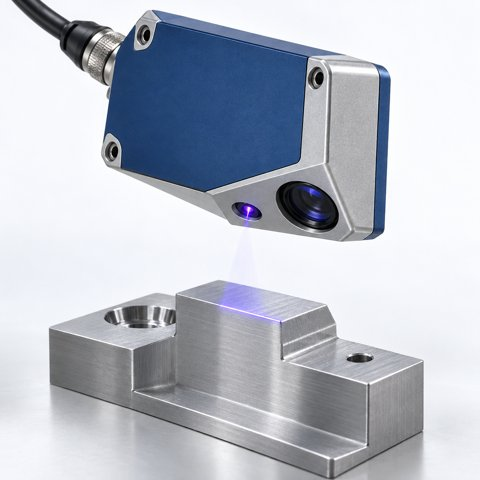

# 🧩 LaserMeasuringInstrument_AAS_V0.0.1.aasx

[← 장비 페이지](../README.md) · [⤓ AASX 다운로드](../AASX/LaserMeasuringInstrument_AAS_V0.0.1.aasx) · 2.4 MB

> 🤖 AASX 파일을 열어 자동으로 만든 열람 페이지입니다. 직접 고치지 말고 AASX를 다시 올리세요.

| 항목 | 내용 |
|---|---|
| AAS idShort | `LaserDisplacementSensorAAS` |
| AAS id | https://www.smart-factory.kr/ids/aas/LaserDisplacementSensorAAS/1/0 |
| 자산 종류 (assetKind) | Type |
| globalAssetId | https://www.smart-factory.kr/ids/asset/LaserDisplacementSensor/EX-LM-100/1/0 |
| 설명 | 레이저 삼각측량 기반 비접촉 변위·거리·프로파일 측정기의 형식 참조모델이며 실제 자산 식별정보는 예시값입니다. |
| 서브모델 | 7개 |
| 전체 요소 | 341개 |

## 서브모델 한눈에 보기

| # | 서브모델 | 요소 수 | semanticId |
|:-:|---|--:|---|
| 1 | [Nameplate](#sm-1) | 40 | https://admin-shell.io/idta/nameplate/3/0/Nameplate |
| 2 | [HandoverDocumentation](#sm-2) | 102 | 0173-1#01-AHF578#003 |
| 3 | [TechnicalData](#sm-3) | 65 | 0173-1#01-AHX837#002 |
| 4 | [OperationalData](#sm-4) | 22 | https://www.smart-factory.kr/ids/sm/LaserDisplacementSensorAAS/OperationalData/1/0 |
| 5 | [TimeSeries](#sm-5) | 66 | https://admin-shell.io/idta/TimeSeries/1/1 |
| 6 | [Reliability](#sm-6) | 15 | https://admin-shell.io/idta/iec62683/1/0/Reliability |
| 7 | [PredictiveMaintenance](#sm-7) | 31 | https://admin-shell.io/idta/SubmodelTemplate/PredictiveMaintenance/1/0 |

## 서브모델 상세

각 서브모델 이름을 누르면 펼쳐집니다. **굵은 글씨**는 하위 요소가 있는 묶음입니다.

<b>1. Nameplate</b> — 요소 40개

> 레이저 측정기의 식별 및 명판 정보

semanticId: `https://admin-shell.io/idta/nameplate/3/0/Nameplate`

| idShort | 종류 | 값 | semanticId |
|---|---|---|---|
| URIOfTheProduct | 속성 | https://www.smart-factory.kr/ids/asset/LaserDisplacementSensor/EX-LM-100/1/0 | 0112/2///61987#ABN590#002 |
| ManufacturerName | 다국어 속성 | Example Manufacturer Co., Ltd. | 0112/2///61987#ABA565#009 |
| ManufacturerProductDesignation | 다국어 속성 | Laser Displacement Sensor | 0112/2///61987#ABA567#009 |
| ManufacturerProductRoot | 다국어 속성 | Laser Measuring Instrument | 0112/2///61360_7#AAS011#001 |
| ManufacturerProductFamily | 다국어 속성 | Laser Sensor Series | 0112/2///61987#ABP464#002 |
| ManufacturerProductType | 속성 | EX-LM-100 | 0112/2///61987#ABA300#008 |
| OrderCodeOfManufacturer | 속성 | EX-LM-100 | 0112/2///61987#ABA950#008 |
| ProductArticleNumberOfManufacturer | 속성 | ART-EX-LM-100 | 0112/2///61987#ABA581#007 |
| SerialNumber | 속성 | SN-LM-2026-0071 | 0112/2///61987#ABA951#009 |
| YearOfConstruction | 속성 | 2026 | 0112/2///61987#ABP000#002 |
| DateOfManufacture | 속성 | 2026-01-22 | 0112/2///61987#ABB757#007 |
| HardwareVersion | 속성 | HW 2.0 | 0112/2///61987#ABA926#008 |
| FirmwareVersion | 속성 | FW 3.1.0 | 0112/2///61987#ABA302#006 |
| SoftwareVersion | 속성 | LMC v2.0 | 0112/2///61987#ABA601#008 |
| CountryOfOrigin | 속성 | KR | 0112/2///61987#ABP462#001 |
| UniqueFacilityIdentifier | 속성 | EXAMPLE-FACILITY-001 | https://admin-shell.io/idta/nameplate/3/0/UniqueFacilityIdentifier |
| **AddressInformation** | 묶음 (4) |  | https://admin-shell.io/zvei/nameplate/1/0/ContactInformations/Address… |
| &nbsp;&nbsp;&nbsp;└ Street | 다국어 속성 | 123 Industrial-ro | 0173-1#02-AAO128#002 |
| &nbsp;&nbsp;&nbsp;└ Zipcode | 다국어 속성 | 12345 | 0173-1#02-AAO129#002 |
| &nbsp;&nbsp;&nbsp;└ CityTown | 다국어 속성 | Changwon | 0173-1#02-AAO132#002 |
| &nbsp;&nbsp;&nbsp;└ NationalCode | 다국어 속성 | KR | 0173-1#02-AAO134#002 |
| **Markings** | 목록 (1) |  | 0112/2///61360_7#AAS006#001 |
| &nbsp;&nbsp;&nbsp;└ **** | 묶음 (6) |  | 0112/2///61360_7#AAS009#001 |
| &nbsp;&nbsp;&nbsp;&nbsp;&nbsp;&nbsp;└ DesignationOfCertificateOrApproval | 속성 | EXAMPLE-NOT-A-CERTIFICATE | 0112/2///61987#ABH783#003 |
| &nbsp;&nbsp;&nbsp;&nbsp;&nbsp;&nbsp;└ IssueDate | 속성 | 2026-01-18 | 0112/2///61987#ABO097#001 |
| &nbsp;&nbsp;&nbsp;&nbsp;&nbsp;&nbsp;└ ExpiryDate | 속성 | 2031-01-17 | 0112/2///61987#ABH830#002 |
| &nbsp;&nbsp;&nbsp;&nbsp;&nbsp;&nbsp;└ MarkingAdditionalText | 속성 | Illustrative marking record only; no actual CE or laser-safety certification is… | 0112/2///61987#ABB146#007 |
| &nbsp;&nbsp;&nbsp;&nbsp;&nbsp;&nbsp;└ MarkingName | 속성 | CE | 0112/2///61987#ABA231#009 |
| &nbsp;&nbsp;&nbsp;&nbsp;&nbsp;&nbsp;└ MarkingFile | 파일 | /aasx/files/images/CE_Marking_Example.png | 0112/2///61987#ABO100#002 |
| CompanyLogo | 파일 | /aasx/files/images/ExampleManufacturerLogo.png | 0112/2///61987#ABP463#001 |
| **AssetSpecificProperties** | 묶음 (4) |  | 0173-1#02-ABI218#003/0173-1#01-AGZ672#004 |
| &nbsp;&nbsp;&nbsp;└ LaserMeasurementPrinciple | 속성 | Optical triangulation | https://www.smart-factory.kr/ids/cd/LaserMeasurementPrinciple/1/0 |
| &nbsp;&nbsp;&nbsp;└ LaserApplicationDescription | 다국어 속성 | 대상 표면의 비접촉 변위 및 프로파일 측정 | https://www.smart-factory.kr/ids/cd/LaserApplicationDescription/1/0 |
| &nbsp;&nbsp;&nbsp;└ LaserApplicationExampleDocument | 파일 | /aasx/files/documents/LaserSafetyConformityExample.txt | https://www.smart-factory.kr/ids/cd/LaserApplicationExampleDocument/1… |
| &nbsp;&nbsp;&nbsp;└ **GuidelineSpecificProperties** | 목록 (1) |  | 0173-1#02-ABI219#003/0173-1#01-AHD205#004 |
| &nbsp;&nbsp;&nbsp;&nbsp;&nbsp;&nbsp;└ **** | 묶음 (4) |  | 0173-1#01-AHD205#004 |
| &nbsp;&nbsp;&nbsp;&nbsp;&nbsp;&nbsp;&nbsp;&nbsp;&nbsp;└ GuidelineForConformityDeclaration | 속성 | IEC 60825-1:2014 | 0173-1#02-AAO856#002 |
| &nbsp;&nbsp;&nbsp;&nbsp;&nbsp;&nbsp;&nbsp;&nbsp;&nbsp;└ LaserSafetyClass | 속성 | Class 2M (example only) | https://www.smart-factory.kr/ids/cd/LaserSafetyClass/1/0 |
| &nbsp;&nbsp;&nbsp;&nbsp;&nbsp;&nbsp;&nbsp;&nbsp;&nbsp;└ LaserSafetyExampleDocument | 파일 | /aasx/files/documents/LaserSafetyConformityExample.txt | https://www.smart-factory.kr/ids/cd/LaserSafetyExampleDocument/1/0 |
| &nbsp;&nbsp;&nbsp;&nbsp;&nbsp;&nbsp;&nbsp;&nbsp;&nbsp;└ LaserConformityScope | 다국어 속성 | 예시 정보이며 실제 사용 전 제조사 적합성 선언 확인이 필요합니다. | https://www.smart-factory.kr/ids/cd/LaserConformityScope/1/0 |

<b>2. HandoverDocumentation</b> — 요소 102개

> 레이저 측정기 인계 문서

semanticId: `0173-1#01-AHF578#003`

| idShort | 종류 | 값 | semanticId |
|---|---|---|---|
| **Documents** | 목록 (3) |  | 0173-1#02-ABI500#003 |
| &nbsp;&nbsp;&nbsp;└ **** | 묶음 (4) |  | 0173-1#02-ABI500#003/0173-1#01-AHF579#003 |
| &nbsp;&nbsp;&nbsp;&nbsp;&nbsp;&nbsp;└ **DocumentIds** | 목록 (1) |  | 0173-1#02-ABI501#003 |
| &nbsp;&nbsp;&nbsp;&nbsp;&nbsp;&nbsp;&nbsp;&nbsp;&nbsp;└ **** | 묶음 (3) |  | 0173-1#02-ABI501#003/0173-1#01-AHF580#003 |
| &nbsp;&nbsp;&nbsp;&nbsp;&nbsp;&nbsp;&nbsp;&nbsp;&nbsp;&nbsp;&nbsp;&nbsp;└ DocumentDomainId | 속성 | EQ07_EXAMPLE_DOC | 0173-1#02-ABH994#003 |
| &nbsp;&nbsp;&nbsp;&nbsp;&nbsp;&nbsp;&nbsp;&nbsp;&nbsp;&nbsp;&nbsp;&nbsp;└ DocumentIdentifier | 속성 | EX-LM-MANUAL-KO | 0173-1#02-AAO099#004 |
| &nbsp;&nbsp;&nbsp;&nbsp;&nbsp;&nbsp;&nbsp;&nbsp;&nbsp;&nbsp;&nbsp;&nbsp;└ DocumentIsPrimary | 속성 | true | 0173-1#02-ABH995#003 |
| &nbsp;&nbsp;&nbsp;&nbsp;&nbsp;&nbsp;└ **DocumentClassifications** | 목록 (1) |  | 0173-1#02-ABI502#003 |
| &nbsp;&nbsp;&nbsp;&nbsp;&nbsp;&nbsp;&nbsp;&nbsp;&nbsp;└ **** | 묶음 (3) |  | 0173-1#02-ABI502#003/0173-1#01-AHF581#003 |
| &nbsp;&nbsp;&nbsp;&nbsp;&nbsp;&nbsp;&nbsp;&nbsp;&nbsp;&nbsp;&nbsp;&nbsp;└ ClassId | 속성 | 03-02 | 0173-1#02-ABH996#003 |
| &nbsp;&nbsp;&nbsp;&nbsp;&nbsp;&nbsp;&nbsp;&nbsp;&nbsp;&nbsp;&nbsp;&nbsp;└ ClassificationSystem | 속성 | VDI 2770 Blatt 1:2020 | 0173-1#02-ABH997#003 |
| &nbsp;&nbsp;&nbsp;&nbsp;&nbsp;&nbsp;&nbsp;&nbsp;&nbsp;&nbsp;&nbsp;&nbsp;└ ClassName | 다국어 속성 | 운전 | 0173-1#02-ABJ219#002 |
| &nbsp;&nbsp;&nbsp;&nbsp;&nbsp;&nbsp;└ **DocumentVersions** | 목록 (1) |  | 0173-1#02-ABI503#003 |
| &nbsp;&nbsp;&nbsp;&nbsp;&nbsp;&nbsp;&nbsp;&nbsp;&nbsp;└ **** | 묶음 (15) |  | 0173-1#02-ABI503#003/0173-1#01-AHF582#003 |
| &nbsp;&nbsp;&nbsp;&nbsp;&nbsp;&nbsp;&nbsp;&nbsp;&nbsp;&nbsp;&nbsp;&nbsp;└ **Language** | 목록 (1) |  | 0173-1#02-AAN468#008 |
| &nbsp;&nbsp;&nbsp;&nbsp;&nbsp;&nbsp;&nbsp;&nbsp;&nbsp;&nbsp;&nbsp;&nbsp;&nbsp;&nbsp;&nbsp;└  | 속성 | ko | 0173-1#02-AAN468#008 |
| &nbsp;&nbsp;&nbsp;&nbsp;&nbsp;&nbsp;&nbsp;&nbsp;&nbsp;&nbsp;&nbsp;&nbsp;└ Version | 속성 | 1.0 | 0173-1#02-AAP003#005 |
| &nbsp;&nbsp;&nbsp;&nbsp;&nbsp;&nbsp;&nbsp;&nbsp;&nbsp;&nbsp;&nbsp;&nbsp;└ StatusSetDate | 속성 | 2026-09-20 | 0173-1#02-ABI000#003 |
| &nbsp;&nbsp;&nbsp;&nbsp;&nbsp;&nbsp;&nbsp;&nbsp;&nbsp;&nbsp;&nbsp;&nbsp;└ StatusValue | 속성 | Released (synthetic example) | 0173-1#02-ABI001#003 |
| &nbsp;&nbsp;&nbsp;&nbsp;&nbsp;&nbsp;&nbsp;&nbsp;&nbsp;&nbsp;&nbsp;&nbsp;└ OrganizationShortName | 속성 | ExampleManufacturer | https://api.eclass-cdp.com/0173-1-02-ABI002-003 |
| &nbsp;&nbsp;&nbsp;&nbsp;&nbsp;&nbsp;&nbsp;&nbsp;&nbsp;&nbsp;&nbsp;&nbsp;└ OrganizationOfficialName | 속성 | Example Manufacturer Co., Ltd. | 0173-1#02-ABI004#003 |
| &nbsp;&nbsp;&nbsp;&nbsp;&nbsp;&nbsp;&nbsp;&nbsp;&nbsp;&nbsp;&nbsp;&nbsp;└ Title | 다국어 속성 | 레이저 측정기 예시 사용설명서 | 0173-1#02-ABG940#003 |
| &nbsp;&nbsp;&nbsp;&nbsp;&nbsp;&nbsp;&nbsp;&nbsp;&nbsp;&nbsp;&nbsp;&nbsp;└ Description | 다국어 속성 | EX-LM-100용 합성 예시 문서입니다. 실제 제조사의 운전·안전 설명서가 아닙니다. | 0173-1#02-AAN466#004 |
| &nbsp;&nbsp;&nbsp;&nbsp;&nbsp;&nbsp;&nbsp;&nbsp;&nbsp;&nbsp;&nbsp;&nbsp;└ KeyWords | 다국어 속성 | laser displacement sensor, triangulation, calibration, laser safety, measurement | 0173-1#02-ABH999#003 |
| &nbsp;&nbsp;&nbsp;&nbsp;&nbsp;&nbsp;&nbsp;&nbsp;&nbsp;&nbsp;&nbsp;&nbsp;└ **DigitalFiles** | 목록 (1) |  | 0173-1#02-ABK126#002 |
| &nbsp;&nbsp;&nbsp;&nbsp;&nbsp;&nbsp;&nbsp;&nbsp;&nbsp;&nbsp;&nbsp;&nbsp;&nbsp;&nbsp;&nbsp;└  | 파일 | /aasx/files/documents/ExampleManual_ko.txt | 0173-1#02-ABK126#002 |
| &nbsp;&nbsp;&nbsp;&nbsp;&nbsp;&nbsp;&nbsp;&nbsp;&nbsp;&nbsp;&nbsp;&nbsp;└ Subtitle | 다국어 속성 | 설치·측정 예시 및 보전 정보의 적용 한계 | 0173-1#02-ABH998#003 |
| &nbsp;&nbsp;&nbsp;&nbsp;&nbsp;&nbsp;&nbsp;&nbsp;&nbsp;&nbsp;&nbsp;&nbsp;└ **RefersToEntities** | 목록 (1) |  | 0173-1#02-ABK288#002 |
| &nbsp;&nbsp;&nbsp;&nbsp;&nbsp;&nbsp;&nbsp;&nbsp;&nbsp;&nbsp;&nbsp;&nbsp;&nbsp;&nbsp;&nbsp;└  | 참조 | https://www.smart-factory.kr/ids/sm/LaserDisplacementSensorAAS/HandoverDocument… | 0173-1#02-ABK288#002 |
| &nbsp;&nbsp;&nbsp;&nbsp;&nbsp;&nbsp;&nbsp;&nbsp;&nbsp;&nbsp;&nbsp;&nbsp;└ **BasedOnReferences** | 목록 (1) |  | 0173-1#02-ABK289#002 |
| &nbsp;&nbsp;&nbsp;&nbsp;&nbsp;&nbsp;&nbsp;&nbsp;&nbsp;&nbsp;&nbsp;&nbsp;&nbsp;&nbsp;&nbsp;└  | 참조 | https://www.smart-factory.kr/ids/sm/LaserDisplacementSensorAAS/HandoverDocument… | 0173-1#02-ABK289#002 |
| &nbsp;&nbsp;&nbsp;&nbsp;&nbsp;&nbsp;&nbsp;&nbsp;&nbsp;&nbsp;&nbsp;&nbsp;└ **TranslationOfEntities** | 목록 (1) |  | 0173-1#02-ABK290#002 |
| &nbsp;&nbsp;&nbsp;&nbsp;&nbsp;&nbsp;&nbsp;&nbsp;&nbsp;&nbsp;&nbsp;&nbsp;&nbsp;&nbsp;&nbsp;└  | 참조 | https://www.smart-factory.kr/ids/sm/LaserDisplacementSensorAAS/HandoverDocument… | 0173-1#02-ABK290#002 |
| &nbsp;&nbsp;&nbsp;&nbsp;&nbsp;&nbsp;&nbsp;&nbsp;&nbsp;&nbsp;&nbsp;&nbsp;└ PreviewFile | 파일 | /aasx/files/documents/ExampleDocumentPreview_0.png | 0173-1#02-ABK127#002 |
| &nbsp;&nbsp;&nbsp;&nbsp;&nbsp;&nbsp;└ **DocumentedEntities** | 목록 (1) |  | https://admin-shell.io/vdi/2770/1/0/Document/DocumentedEntities |
| &nbsp;&nbsp;&nbsp;&nbsp;&nbsp;&nbsp;&nbsp;&nbsp;&nbsp;└  | 참조 | https://www.smart-factory.kr/ids/sm/LaserDisplacementSensorAAS/HandoverDocument… | https://admin-shell.io/vdi/2770/1/0/Document/DocumentedEntity |
| &nbsp;&nbsp;&nbsp;└ **** | 묶음 (4) |  | 0173-1#02-ABI500#003/0173-1#01-AHF579#003 |
| &nbsp;&nbsp;&nbsp;&nbsp;&nbsp;&nbsp;└ **DocumentIds** | 목록 (1) |  | 0173-1#02-ABI501#003 |
| &nbsp;&nbsp;&nbsp;&nbsp;&nbsp;&nbsp;&nbsp;&nbsp;&nbsp;└ **** | 묶음 (3) |  | 0173-1#02-ABI501#003/0173-1#01-AHF580#003 |
| &nbsp;&nbsp;&nbsp;&nbsp;&nbsp;&nbsp;&nbsp;&nbsp;&nbsp;&nbsp;&nbsp;&nbsp;└ DocumentDomainId | 속성 | EQ07_EXAMPLE_DOC | 0173-1#02-ABH994#003 |
| &nbsp;&nbsp;&nbsp;&nbsp;&nbsp;&nbsp;&nbsp;&nbsp;&nbsp;&nbsp;&nbsp;&nbsp;└ DocumentIdentifier | 속성 | EX-LM-MANUAL-EN | 0173-1#02-AAO099#004 |
| &nbsp;&nbsp;&nbsp;&nbsp;&nbsp;&nbsp;&nbsp;&nbsp;&nbsp;&nbsp;&nbsp;&nbsp;└ DocumentIsPrimary | 속성 | true | 0173-1#02-ABH995#003 |
| &nbsp;&nbsp;&nbsp;&nbsp;&nbsp;&nbsp;└ **DocumentClassifications** | 목록 (1) |  | 0173-1#02-ABI502#003 |
| &nbsp;&nbsp;&nbsp;&nbsp;&nbsp;&nbsp;&nbsp;&nbsp;&nbsp;└ **** | 묶음 (3) |  | 0173-1#02-ABI502#003/0173-1#01-AHF581#003 |
| &nbsp;&nbsp;&nbsp;&nbsp;&nbsp;&nbsp;&nbsp;&nbsp;&nbsp;&nbsp;&nbsp;&nbsp;└ ClassId | 속성 | 03-02 | 0173-1#02-ABH996#003 |
| &nbsp;&nbsp;&nbsp;&nbsp;&nbsp;&nbsp;&nbsp;&nbsp;&nbsp;&nbsp;&nbsp;&nbsp;└ ClassificationSystem | 속성 | VDI 2770 Blatt 1:2020 | 0173-1#02-ABH997#003 |
| &nbsp;&nbsp;&nbsp;&nbsp;&nbsp;&nbsp;&nbsp;&nbsp;&nbsp;&nbsp;&nbsp;&nbsp;└ ClassName | 다국어 속성 | 운전 | 0173-1#02-ABJ219#002 |
| &nbsp;&nbsp;&nbsp;&nbsp;&nbsp;&nbsp;└ **DocumentVersions** | 목록 (1) |  | 0173-1#02-ABI503#003 |
| &nbsp;&nbsp;&nbsp;&nbsp;&nbsp;&nbsp;&nbsp;&nbsp;&nbsp;└ **** | 묶음 (14) |  | 0173-1#02-ABI503#003/0173-1#01-AHF582#003 |
| &nbsp;&nbsp;&nbsp;&nbsp;&nbsp;&nbsp;&nbsp;&nbsp;&nbsp;&nbsp;&nbsp;&nbsp;└ **Language** | 목록 (1) |  | 0173-1#02-AAN468#008 |
| &nbsp;&nbsp;&nbsp;&nbsp;&nbsp;&nbsp;&nbsp;&nbsp;&nbsp;&nbsp;&nbsp;&nbsp;&nbsp;&nbsp;&nbsp;└  | 속성 | en | 0173-1#02-AAN468#008 |
| &nbsp;&nbsp;&nbsp;&nbsp;&nbsp;&nbsp;&nbsp;&nbsp;&nbsp;&nbsp;&nbsp;&nbsp;└ Version | 속성 | 1.0 | 0173-1#02-AAP003#005 |
| &nbsp;&nbsp;&nbsp;&nbsp;&nbsp;&nbsp;&nbsp;&nbsp;&nbsp;&nbsp;&nbsp;&nbsp;└ StatusSetDate | 속성 | 2026-09-20 | 0173-1#02-ABI000#003 |
| &nbsp;&nbsp;&nbsp;&nbsp;&nbsp;&nbsp;&nbsp;&nbsp;&nbsp;&nbsp;&nbsp;&nbsp;└ StatusValue | 속성 | Released (synthetic example) | 0173-1#02-ABI001#003 |
| &nbsp;&nbsp;&nbsp;&nbsp;&nbsp;&nbsp;&nbsp;&nbsp;&nbsp;&nbsp;&nbsp;&nbsp;└ OrganizationShortName | 속성 | ExampleManufacturer | https://api.eclass-cdp.com/0173-1-02-ABI002-003 |
| &nbsp;&nbsp;&nbsp;&nbsp;&nbsp;&nbsp;&nbsp;&nbsp;&nbsp;&nbsp;&nbsp;&nbsp;└ OrganizationOfficialName | 속성 | Example Manufacturer Co., Ltd. | 0173-1#02-ABI004#003 |
| &nbsp;&nbsp;&nbsp;&nbsp;&nbsp;&nbsp;&nbsp;&nbsp;&nbsp;&nbsp;&nbsp;&nbsp;└ Title | 다국어 속성 | 레이저 측정기 예시 사용설명서 영문 원문 | 0173-1#02-ABG940#003 |
| &nbsp;&nbsp;&nbsp;&nbsp;&nbsp;&nbsp;&nbsp;&nbsp;&nbsp;&nbsp;&nbsp;&nbsp;└ Description | 다국어 속성 | EX-LM-100용 합성 예시 문서입니다. 실제 제조사의 운전·안전 설명서가 아닙니다. | 0173-1#02-AAN466#004 |
| &nbsp;&nbsp;&nbsp;&nbsp;&nbsp;&nbsp;&nbsp;&nbsp;&nbsp;&nbsp;&nbsp;&nbsp;└ KeyWords | 다국어 속성 | laser displacement sensor, triangulation, calibration, laser safety, measurement | 0173-1#02-ABH999#003 |
| &nbsp;&nbsp;&nbsp;&nbsp;&nbsp;&nbsp;&nbsp;&nbsp;&nbsp;&nbsp;&nbsp;&nbsp;└ **DigitalFiles** | 목록 (1) |  | 0173-1#02-ABK126#002 |
| &nbsp;&nbsp;&nbsp;&nbsp;&nbsp;&nbsp;&nbsp;&nbsp;&nbsp;&nbsp;&nbsp;&nbsp;&nbsp;&nbsp;&nbsp;└  | 파일 | /aasx/files/documents/ExampleManual_en.txt | 0173-1#02-ABK126#002 |
| &nbsp;&nbsp;&nbsp;&nbsp;&nbsp;&nbsp;&nbsp;&nbsp;&nbsp;&nbsp;&nbsp;&nbsp;└ Subtitle | 다국어 속성 | 설치·측정 예시 및 보전 정보의 적용 한계 | 0173-1#02-ABH998#003 |
| &nbsp;&nbsp;&nbsp;&nbsp;&nbsp;&nbsp;&nbsp;&nbsp;&nbsp;&nbsp;&nbsp;&nbsp;└ **RefersToEntities** | 목록 (1) |  | 0173-1#02-ABK288#002 |
| &nbsp;&nbsp;&nbsp;&nbsp;&nbsp;&nbsp;&nbsp;&nbsp;&nbsp;&nbsp;&nbsp;&nbsp;&nbsp;&nbsp;&nbsp;└  | 참조 | https://www.smart-factory.kr/ids/sm/LaserDisplacementSensorAAS/HandoverDocument… | 0173-1#02-ABK288#002 |
| &nbsp;&nbsp;&nbsp;&nbsp;&nbsp;&nbsp;&nbsp;&nbsp;&nbsp;&nbsp;&nbsp;&nbsp;└ **BasedOnReferences** | 목록 (1) |  | 0173-1#02-ABK289#002 |
| &nbsp;&nbsp;&nbsp;&nbsp;&nbsp;&nbsp;&nbsp;&nbsp;&nbsp;&nbsp;&nbsp;&nbsp;&nbsp;&nbsp;&nbsp;└  | 참조 | https://www.smart-factory.kr/ids/sm/LaserDisplacementSensorAAS/HandoverDocument… | 0173-1#02-ABK289#002 |
| &nbsp;&nbsp;&nbsp;&nbsp;&nbsp;&nbsp;&nbsp;&nbsp;&nbsp;&nbsp;&nbsp;&nbsp;└ PreviewFile | 파일 | /aasx/files/documents/ExampleDocumentPreview_1.png | 0173-1#02-ABK127#002 |
| &nbsp;&nbsp;&nbsp;&nbsp;&nbsp;&nbsp;└ **DocumentedEntities** | 목록 (1) |  | https://admin-shell.io/vdi/2770/1/0/Document/DocumentedEntities |
| &nbsp;&nbsp;&nbsp;&nbsp;&nbsp;&nbsp;&nbsp;&nbsp;&nbsp;└  | 참조 | https://www.smart-factory.kr/ids/sm/LaserDisplacementSensorAAS/HandoverDocument… | https://admin-shell.io/vdi/2770/1/0/Document/DocumentedEntity |
| &nbsp;&nbsp;&nbsp;└ **** | 묶음 (4) |  | 0173-1#02-ABI500#003/0173-1#01-AHF579#003 |
| &nbsp;&nbsp;&nbsp;&nbsp;&nbsp;&nbsp;└ **DocumentIds** | 목록 (1) |  | 0173-1#02-ABI501#003 |
| &nbsp;&nbsp;&nbsp;&nbsp;&nbsp;&nbsp;&nbsp;&nbsp;&nbsp;└ **** | 묶음 (3) |  | 0173-1#02-ABI501#003/0173-1#01-AHF580#003 |
| &nbsp;&nbsp;&nbsp;&nbsp;&nbsp;&nbsp;&nbsp;&nbsp;&nbsp;&nbsp;&nbsp;&nbsp;└ DocumentDomainId | 속성 | EQ07_EXAMPLE_DOC | 0173-1#02-ABH994#003 |
| &nbsp;&nbsp;&nbsp;&nbsp;&nbsp;&nbsp;&nbsp;&nbsp;&nbsp;&nbsp;&nbsp;&nbsp;└ DocumentIdentifier | 속성 | EX-LM-SPEC | 0173-1#02-AAO099#004 |
| &nbsp;&nbsp;&nbsp;&nbsp;&nbsp;&nbsp;&nbsp;&nbsp;&nbsp;&nbsp;&nbsp;&nbsp;└ DocumentIsPrimary | 속성 | true | 0173-1#02-ABH995#003 |
| &nbsp;&nbsp;&nbsp;&nbsp;&nbsp;&nbsp;└ **DocumentClassifications** | 목록 (1) |  | 0173-1#02-ABI502#003 |
| &nbsp;&nbsp;&nbsp;&nbsp;&nbsp;&nbsp;&nbsp;&nbsp;&nbsp;└ **** | 묶음 (3) |  | 0173-1#02-ABI502#003/0173-1#01-AHF581#003 |
| &nbsp;&nbsp;&nbsp;&nbsp;&nbsp;&nbsp;&nbsp;&nbsp;&nbsp;&nbsp;&nbsp;&nbsp;└ ClassId | 속성 | 02-01 | 0173-1#02-ABH996#003 |
| &nbsp;&nbsp;&nbsp;&nbsp;&nbsp;&nbsp;&nbsp;&nbsp;&nbsp;&nbsp;&nbsp;&nbsp;└ ClassificationSystem | 속성 | VDI 2770 Blatt 1:2020 | 0173-1#02-ABH997#003 |
| &nbsp;&nbsp;&nbsp;&nbsp;&nbsp;&nbsp;&nbsp;&nbsp;&nbsp;&nbsp;&nbsp;&nbsp;└ ClassName | 다국어 속성 | 기술 사양 | 0173-1#02-ABJ219#002 |
| &nbsp;&nbsp;&nbsp;&nbsp;&nbsp;&nbsp;└ **DocumentVersions** | 목록 (1) |  | 0173-1#02-ABI503#003 |
| &nbsp;&nbsp;&nbsp;&nbsp;&nbsp;&nbsp;&nbsp;&nbsp;&nbsp;└ **** | 묶음 (13) |  | 0173-1#02-ABI503#003/0173-1#01-AHF582#003 |
| &nbsp;&nbsp;&nbsp;&nbsp;&nbsp;&nbsp;&nbsp;&nbsp;&nbsp;&nbsp;&nbsp;&nbsp;└ **Language** | 목록 (1) |  | 0173-1#02-AAN468#008 |
| &nbsp;&nbsp;&nbsp;&nbsp;&nbsp;&nbsp;&nbsp;&nbsp;&nbsp;&nbsp;&nbsp;&nbsp;&nbsp;&nbsp;&nbsp;└  | 속성 | en | 0173-1#02-AAN468#008 |
| &nbsp;&nbsp;&nbsp;&nbsp;&nbsp;&nbsp;&nbsp;&nbsp;&nbsp;&nbsp;&nbsp;&nbsp;└ Version | 속성 | 1.0 | 0173-1#02-AAP003#005 |
| &nbsp;&nbsp;&nbsp;&nbsp;&nbsp;&nbsp;&nbsp;&nbsp;&nbsp;&nbsp;&nbsp;&nbsp;└ StatusSetDate | 속성 | 2026-09-20 | 0173-1#02-ABI000#003 |
| &nbsp;&nbsp;&nbsp;&nbsp;&nbsp;&nbsp;&nbsp;&nbsp;&nbsp;&nbsp;&nbsp;&nbsp;└ StatusValue | 속성 | Released (synthetic example) | 0173-1#02-ABI001#003 |
| &nbsp;&nbsp;&nbsp;&nbsp;&nbsp;&nbsp;&nbsp;&nbsp;&nbsp;&nbsp;&nbsp;&nbsp;└ OrganizationShortName | 속성 | ExampleManufacturer | https://api.eclass-cdp.com/0173-1-02-ABI002-003 |
| &nbsp;&nbsp;&nbsp;&nbsp;&nbsp;&nbsp;&nbsp;&nbsp;&nbsp;&nbsp;&nbsp;&nbsp;└ OrganizationOfficialName | 속성 | Example Manufacturer Co., Ltd. | 0173-1#02-ABI004#003 |
| &nbsp;&nbsp;&nbsp;&nbsp;&nbsp;&nbsp;&nbsp;&nbsp;&nbsp;&nbsp;&nbsp;&nbsp;└ Title | 다국어 속성 | 레이저 측정기 예시 요구사양 | 0173-1#02-ABG940#003 |
| &nbsp;&nbsp;&nbsp;&nbsp;&nbsp;&nbsp;&nbsp;&nbsp;&nbsp;&nbsp;&nbsp;&nbsp;└ Description | 다국어 속성 | EX-LM-100용 합성 예시 문서입니다. 실제 제조사의 운전·안전 설명서가 아닙니다. | 0173-1#02-AAN466#004 |
| &nbsp;&nbsp;&nbsp;&nbsp;&nbsp;&nbsp;&nbsp;&nbsp;&nbsp;&nbsp;&nbsp;&nbsp;└ KeyWords | 다국어 속성 | laser displacement sensor, triangulation, calibration, laser safety, measurement | 0173-1#02-ABH999#003 |
| &nbsp;&nbsp;&nbsp;&nbsp;&nbsp;&nbsp;&nbsp;&nbsp;&nbsp;&nbsp;&nbsp;&nbsp;└ **DigitalFiles** | 목록 (1) |  | 0173-1#02-ABK126#002 |
| &nbsp;&nbsp;&nbsp;&nbsp;&nbsp;&nbsp;&nbsp;&nbsp;&nbsp;&nbsp;&nbsp;&nbsp;&nbsp;&nbsp;&nbsp;└  | 파일 | /aasx/files/documents/ExampleSpecification_en.txt | 0173-1#02-ABK126#002 |
| &nbsp;&nbsp;&nbsp;&nbsp;&nbsp;&nbsp;&nbsp;&nbsp;&nbsp;&nbsp;&nbsp;&nbsp;└ Subtitle | 다국어 속성 | 설치·측정 예시 및 보전 정보의 적용 한계 | 0173-1#02-ABH998#003 |
| &nbsp;&nbsp;&nbsp;&nbsp;&nbsp;&nbsp;&nbsp;&nbsp;&nbsp;&nbsp;&nbsp;&nbsp;└ **RefersToEntities** | 목록 (1) |  | 0173-1#02-ABK288#002 |
| &nbsp;&nbsp;&nbsp;&nbsp;&nbsp;&nbsp;&nbsp;&nbsp;&nbsp;&nbsp;&nbsp;&nbsp;&nbsp;&nbsp;&nbsp;└  | 참조 | https://www.smart-factory.kr/ids/sm/LaserDisplacementSensorAAS/HandoverDocument… | 0173-1#02-ABK288#002 |
| &nbsp;&nbsp;&nbsp;&nbsp;&nbsp;&nbsp;&nbsp;&nbsp;&nbsp;&nbsp;&nbsp;&nbsp;└ PreviewFile | 파일 | /aasx/files/documents/ExampleDocumentPreview_2.png | 0173-1#02-ABK127#002 |
| &nbsp;&nbsp;&nbsp;&nbsp;&nbsp;&nbsp;└ **DocumentedEntities** | 목록 (1) |  | https://admin-shell.io/vdi/2770/1/0/Document/DocumentedEntities |
| &nbsp;&nbsp;&nbsp;&nbsp;&nbsp;&nbsp;&nbsp;&nbsp;&nbsp;└  | 참조 | https://www.smart-factory.kr/ids/sm/LaserDisplacementSensorAAS/HandoverDocument… | https://admin-shell.io/vdi/2770/1/0/Document/DocumentedEntity |
| **Entities** | 목록 (1) |  | https://admin-shell.io/vdi/2770/1/0/EntitiesForDocumentation |
| &nbsp;&nbsp;&nbsp;└  | 엔티티 |  | https://admin-shell.io/vdi/2770/1/0/EntityForDocumentation |

<b>3. TechnicalData</b> — 요소 65개

> 레이저 측정기의 정적 기술 사양

semanticId: `0173-1#01-AHX837#002`

| idShort | 종류 | 값 | semanticId |
|---|---|---|---|
| **GeneralInformation** | 묶음 (6) |  | 0173-1#02-ABK161#002/0173-1#01-AHX838#002 |
| &nbsp;&nbsp;&nbsp;└ ManufacturerName | 속성 | Example Manufacturer Co., Ltd. | 0173-1#02-AAO677#004 |
| &nbsp;&nbsp;&nbsp;└ ManufacturerArticleNumber | 속성 | ART-EX-LM-100 | 0173-1#02-AAO676#005 |
| &nbsp;&nbsp;&nbsp;└ ManufacturerOrderCode | 속성 | EX-LM-100 | 0173-1#02-AAO227#004 |
| &nbsp;&nbsp;&nbsp;└ ManufacturerProductDesignation | 다국어 속성 | Laser Displacement Sensor | 0173-1#02-AAW338#003 |
| &nbsp;&nbsp;&nbsp;└ **ProductImages** | 목록 (1) |  | 0173-1#02-ABM220#001 |
| &nbsp;&nbsp;&nbsp;&nbsp;&nbsp;&nbsp;└ **** | 묶음 (2) |  | 0173-1#02-ABM220#001/0173-1#01-AHY911#001 |
| &nbsp;&nbsp;&nbsp;&nbsp;&nbsp;&nbsp;&nbsp;&nbsp;&nbsp;└ ImageFile | 파일 | /aasx/Thumbnail.png | 0173-1#02-ABK291#002 |
| &nbsp;&nbsp;&nbsp;&nbsp;&nbsp;&nbsp;&nbsp;&nbsp;&nbsp;└ ImageNote | 다국어 속성 | 삼각측량식 레이저 센서와 측정 대상을 보여주는 AI 생성 예시 이미지이며 실제 제품 사진이나 인증 자료가 아니다. | 0173-1#02-ABL423#001 |
| &nbsp;&nbsp;&nbsp;└ CompanyLogo | 파일 | /aasx/files/images/ExampleManufacturerLogo.png | 0173-1#02-ABI776#002 |
| **ProductClassifications** | 목록 (1) |  | 0173-1#02-ABK162#002 |
| &nbsp;&nbsp;&nbsp;└ **** | 묶음 (7) |  | 0173-1#02-ABK162#002/0173-1#01-AHX839#002 |
| &nbsp;&nbsp;&nbsp;&nbsp;&nbsp;&nbsp;└ ClassificationSystem | 속성 | ECLASS | 0173-1#02-ABL424#001 |
| &nbsp;&nbsp;&nbsp;&nbsp;&nbsp;&nbsp;└ ClassificationSystemVersion | 속성 | 16.0 | 0173-1#02-AAR710#003 |
| &nbsp;&nbsp;&nbsp;&nbsp;&nbsp;&nbsp;└ ClassificationSystemUrl | 속성 | https://eclass.eu | https://admin-shell.io/IDTA/TechnicalData/ProductClassifications/Prod… |
| &nbsp;&nbsp;&nbsp;&nbsp;&nbsp;&nbsp;└ ProductClassId | 속성 | 0173-1#01-AGZ394#023 | 0173-1#02-ABG776#003 |
| &nbsp;&nbsp;&nbsp;&nbsp;&nbsp;&nbsp;└ ProductClassCodedName | 속성 | 27-27-09-16 | 0173-1#02-ABK128#002 |
| &nbsp;&nbsp;&nbsp;&nbsp;&nbsp;&nbsp;└ ProductClassName | 다국어 속성 | 광학 거리 센서 | 0173-1#02-ABK273#002 |
| &nbsp;&nbsp;&nbsp;&nbsp;&nbsp;&nbsp;└ ReferenceToTechnicalPropertyArea | 참조 | https://www.smart-factory.kr/ids/sm/LaserDisplacementSensorAAS/TechnicalData/2/… | 0173-1#02-ABL358#002 |
| **TechnicalPropertyAreas** | 목록 (3) |  | 0173-1#02-ABK163#002 |
| &nbsp;&nbsp;&nbsp;└ **** | 묶음 (1) |  | 0173-1#02-ABL358#002/0173-1#01-AHX773#002 |
| &nbsp;&nbsp;&nbsp;&nbsp;&nbsp;&nbsp;└ **PerformanceSpecification** | 묶음 (2) |  | https://www.smart-factory.kr/ids/cd/PerformanceSpecification/1/0 |
| &nbsp;&nbsp;&nbsp;&nbsp;&nbsp;&nbsp;&nbsp;&nbsp;&nbsp;└ **MeasurementCapability** | 묶음 (4) |  | https://www.smart-factory.kr/ids/cd/MeasurementCapability/1/0 |
| &nbsp;&nbsp;&nbsp;&nbsp;&nbsp;&nbsp;&nbsp;&nbsp;&nbsp;&nbsp;&nbsp;&nbsp;└ MeasuringRange | 범위 | 20 ~ 60 | https://www.smart-factory.kr/ids/cd/MeasuringRange/1/0 |
| &nbsp;&nbsp;&nbsp;&nbsp;&nbsp;&nbsp;&nbsp;&nbsp;&nbsp;&nbsp;&nbsp;&nbsp;└ LinearityAccuracy | 속성 | 0.02 | https://www.smart-factory.kr/ids/cd/LinearityAccuracy/1/0 |
| &nbsp;&nbsp;&nbsp;&nbsp;&nbsp;&nbsp;&nbsp;&nbsp;&nbsp;&nbsp;&nbsp;&nbsp;└ Repeatability | 속성 | 0.3 µm (Z), 2 µm (X) | https://www.smart-factory.kr/ids/cd/Repeatability/1/0 |
| &nbsp;&nbsp;&nbsp;&nbsp;&nbsp;&nbsp;&nbsp;&nbsp;&nbsp;&nbsp;&nbsp;&nbsp;└ ZResolution | 속성 | 0.2 | https://www.smart-factory.kr/ids/cd/ZResolution/1/0 |
| &nbsp;&nbsp;&nbsp;&nbsp;&nbsp;&nbsp;&nbsp;&nbsp;&nbsp;└ **AcquisitionPerformance** | 묶음 (2) |  | https://www.smart-factory.kr/ids/cd/AcquisitionPerformance/1/0 |
| &nbsp;&nbsp;&nbsp;&nbsp;&nbsp;&nbsp;&nbsp;&nbsp;&nbsp;&nbsp;&nbsp;&nbsp;└ ProfileRate | 속성 | 6000 | https://www.smart-factory.kr/ids/cd/ProfileRate/1/0 |
| &nbsp;&nbsp;&nbsp;&nbsp;&nbsp;&nbsp;&nbsp;&nbsp;&nbsp;&nbsp;&nbsp;&nbsp;└ SamplingRate | 속성 | 40000 | https://www.smart-factory.kr/ids/cd/SamplingRate/1/0 |
| &nbsp;&nbsp;&nbsp;└ **** | 묶음 (1) |  | 0173-1#02-ABL358#002/0173-1#01-AHX773#002 |
| &nbsp;&nbsp;&nbsp;&nbsp;&nbsp;&nbsp;└ **OpticalSpecification** | 묶음 (2) |  | https://www.smart-factory.kr/ids/cd/OpticalSpecification/1/0 |
| &nbsp;&nbsp;&nbsp;&nbsp;&nbsp;&nbsp;&nbsp;&nbsp;&nbsp;└ **LaserEmissionCharacteristics** | 묶음 (5) |  | https://www.smart-factory.kr/ids/cd/LaserEmissionCharacteristics/1/0 |
| &nbsp;&nbsp;&nbsp;&nbsp;&nbsp;&nbsp;&nbsp;&nbsp;&nbsp;&nbsp;&nbsp;&nbsp;└ MeasurementPrinciple | 속성 | Laser triangulation | https://www.smart-factory.kr/ids/cd/MeasurementPrinciple/1/0 |
| &nbsp;&nbsp;&nbsp;&nbsp;&nbsp;&nbsp;&nbsp;&nbsp;&nbsp;&nbsp;&nbsp;&nbsp;└ LaserWavelength | 속성 | 405 | 0173-1#02-AAZ225#004 |
| &nbsp;&nbsp;&nbsp;&nbsp;&nbsp;&nbsp;&nbsp;&nbsp;&nbsp;&nbsp;&nbsp;&nbsp;└ LaserClass | 속성 | Class 2M (IEC 60825-1) | 0173-1#02-BAF573#011 |
| &nbsp;&nbsp;&nbsp;&nbsp;&nbsp;&nbsp;&nbsp;&nbsp;&nbsp;&nbsp;&nbsp;&nbsp;└ LaserOutputPower | 속성 | < 8 mW | https://www.smart-factory.kr/ids/cd/LaserOutputPower/1/0 |
| &nbsp;&nbsp;&nbsp;&nbsp;&nbsp;&nbsp;&nbsp;&nbsp;&nbsp;&nbsp;&nbsp;&nbsp;└ LaserSpotSize | 속성 | Projected line thickness 25 µm and line width 20 mm at the 40 mm reference dist… | https://www.smart-factory.kr/ids/cd/LaserSpotSize/1/0 |
| &nbsp;&nbsp;&nbsp;&nbsp;&nbsp;&nbsp;&nbsp;&nbsp;&nbsp;└ **ProfileGeometry** | 묶음 (3) |  | https://www.smart-factory.kr/ids/cd/ProfileGeometry/1/0 |
| &nbsp;&nbsp;&nbsp;&nbsp;&nbsp;&nbsp;&nbsp;&nbsp;&nbsp;&nbsp;&nbsp;&nbsp;└ ProfileWidthX | 범위 | 7 ~ 32 | https://www.smart-factory.kr/ids/cd/ProfileWidthX/1/0 |
| &nbsp;&nbsp;&nbsp;&nbsp;&nbsp;&nbsp;&nbsp;&nbsp;&nbsp;&nbsp;&nbsp;&nbsp;└ StandoffDistance | 속성 | 40 | https://www.smart-factory.kr/ids/cd/StandoffDistance/1/0 |
| &nbsp;&nbsp;&nbsp;&nbsp;&nbsp;&nbsp;&nbsp;&nbsp;&nbsp;&nbsp;&nbsp;&nbsp;└ ProfilePoints | 속성 | 3200 | https://www.smart-factory.kr/ids/cd/ProfilePoints/1/0 |
| &nbsp;&nbsp;&nbsp;└ **** | 묶음 (1) |  | 0173-1#02-ABL358#002/0173-1#01-AHX773#002 |
| &nbsp;&nbsp;&nbsp;&nbsp;&nbsp;&nbsp;└ **MechanicalAndEnvironmentalSpecification** | 묶음 (2) |  | https://www.smart-factory.kr/ids/cd/MechanicalAndEnvironmentalSpecifi… |
| &nbsp;&nbsp;&nbsp;&nbsp;&nbsp;&nbsp;&nbsp;&nbsp;&nbsp;└ **MechanicalCharacteristics** | 묶음 (4) |  | https://www.smart-factory.kr/ids/cd/MechanicalCharacteristics/1/0 |
| &nbsp;&nbsp;&nbsp;&nbsp;&nbsp;&nbsp;&nbsp;&nbsp;&nbsp;&nbsp;&nbsp;&nbsp;└ LaserSensorHousingLength | 속성 | 80 | https://www.smart-factory.kr/ids/cd/LaserSensorHousingLength/1/0 |
| &nbsp;&nbsp;&nbsp;&nbsp;&nbsp;&nbsp;&nbsp;&nbsp;&nbsp;&nbsp;&nbsp;&nbsp;└ LaserSensorHousingWidth | 속성 | 60 | https://www.smart-factory.kr/ids/cd/LaserSensorHousingWidth/1/0 |
| &nbsp;&nbsp;&nbsp;&nbsp;&nbsp;&nbsp;&nbsp;&nbsp;&nbsp;&nbsp;&nbsp;&nbsp;└ LaserSensorHousingHeight | 속성 | 30 | https://www.smart-factory.kr/ids/cd/LaserSensorHousingHeight/1/0 |
| &nbsp;&nbsp;&nbsp;&nbsp;&nbsp;&nbsp;&nbsp;&nbsp;&nbsp;&nbsp;&nbsp;&nbsp;└ LaserSensorMass | 속성 | 0.25 | https://www.smart-factory.kr/ids/cd/LaserSensorMass/1/0 |
| &nbsp;&nbsp;&nbsp;&nbsp;&nbsp;&nbsp;&nbsp;&nbsp;&nbsp;└ **EnvironmentalProtection** | 묶음 (2) |  | https://www.smart-factory.kr/ids/cd/EnvironmentalProtection/1/0 |
| &nbsp;&nbsp;&nbsp;&nbsp;&nbsp;&nbsp;&nbsp;&nbsp;&nbsp;&nbsp;&nbsp;&nbsp;└ IngressProtection | 속성 | IP67 | 0173-1#02-BAG975#017 |
| &nbsp;&nbsp;&nbsp;&nbsp;&nbsp;&nbsp;&nbsp;&nbsp;&nbsp;&nbsp;&nbsp;&nbsp;└ OperatingTemperature | 범위 | 0 ~ 45 | https://www.smart-factory.kr/ids/cd/OperatingTemperature/1/0 |
| **FurtherInformation** | 묶음 (2) |  | 0173-1#02-ABK164#002 |
| &nbsp;&nbsp;&nbsp;└ TextStatement | 다국어 속성 | 삼각측량식 측정 헤드의 합성 예시입니다. 정격·신뢰성·보전 데이터는 실제 제품의 검증된 수치가 아닙니다. | 0173-1#02-ABK134#002 |
| &nbsp;&nbsp;&nbsp;└ ValidDate | 속성 | 2026-09-20 | 0173-1#02-ABL775#001 |
| **SpecificDescriptions** | 목록 (1) |  | 0173-1#02-ABM221#001 |
| &nbsp;&nbsp;&nbsp;└ **** | 묶음 (1) |  | 0173-1#02-ABM221#001/0173-1#01-AHY912#001 |
| &nbsp;&nbsp;&nbsp;&nbsp;&nbsp;&nbsp;└ **LaserApplicationGuidance** | 묶음 (2) |  | https://www.smart-factory.kr/ids/cd/LaserApplicationGuidance/1/0 |
| &nbsp;&nbsp;&nbsp;&nbsp;&nbsp;&nbsp;&nbsp;&nbsp;&nbsp;└ **InstallationAndCalibration** | 묶음 (3) |  | https://www.smart-factory.kr/ids/cd/InstallationAndCalibration/1/0 |
| &nbsp;&nbsp;&nbsp;&nbsp;&nbsp;&nbsp;&nbsp;&nbsp;&nbsp;&nbsp;&nbsp;&nbsp;└ ReferenceTarget | 속성 | Diffuse ceramic reference surface | https://www.smart-factory.kr/ids/cd/ReferenceTarget/1/0 |
| &nbsp;&nbsp;&nbsp;&nbsp;&nbsp;&nbsp;&nbsp;&nbsp;&nbsp;&nbsp;&nbsp;&nbsp;└ WarmUpTime | 속성 | 20 | https://www.smart-factory.kr/ids/cd/WarmUpTime/1/0 |
| &nbsp;&nbsp;&nbsp;&nbsp;&nbsp;&nbsp;&nbsp;&nbsp;&nbsp;&nbsp;&nbsp;&nbsp;└ MountingInstruction | 속성 | Rigid vibration-isolated mounting; reference target at 40 mm. | https://www.smart-factory.kr/ids/cd/MountingInstruction/1/0 |
| &nbsp;&nbsp;&nbsp;&nbsp;&nbsp;&nbsp;&nbsp;&nbsp;&nbsp;└ **DataAcquisitionGuidance** | 묶음 (2) |  | https://www.smart-factory.kr/ids/cd/DataAcquisitionGuidance/1/0 |
| &nbsp;&nbsp;&nbsp;&nbsp;&nbsp;&nbsp;&nbsp;&nbsp;&nbsp;&nbsp;&nbsp;&nbsp;└ LoggingInterval | 속성 | 1 | https://www.smart-factory.kr/ids/cd/LoggingInterval/1/0 |
| &nbsp;&nbsp;&nbsp;&nbsp;&nbsp;&nbsp;&nbsp;&nbsp;&nbsp;&nbsp;&nbsp;&nbsp;└ ExampleDataNotice | 속성 | Synthetic examples only; not manufacturer specifications, test evidence or cert… | https://www.smart-factory.kr/ids/cd/ExampleDataNotice/1/0 |

<b>4. OperationalData</b> — 요소 22개

> 레이저 측정기의 현재 운전 상태와 계측값

semanticId: `https://www.smart-factory.kr/ids/sm/LaserDisplacementSensorAAS/OperationalData/1/0`

| idShort | 종류 | 값 | semanticId |
|---|---|---|---|
| **LaserMeasurementOperationData** | 묶음 (4) |  | https://www.smart-factory.kr/ids/cd/LaserMeasurementOperationData/1/0 |
| &nbsp;&nbsp;&nbsp;└ **OperationState** | 묶음 (4) |  | https://www.smart-factory.kr/ids/cd/OperationState/1/0 |
| &nbsp;&nbsp;&nbsp;&nbsp;&nbsp;&nbsp;└ LaserSensorOperationState | 속성 | Run | https://www.smart-factory.kr/ids/cd/LaserSensorOperationState/1/0 |
| &nbsp;&nbsp;&nbsp;&nbsp;&nbsp;&nbsp;└ LaserSensorOperationMode | 속성 | Continuous | https://www.smart-factory.kr/ids/cd/LaserSensorOperationMode/1/0 |
| &nbsp;&nbsp;&nbsp;&nbsp;&nbsp;&nbsp;└ LaserEmissionState | 속성 | On | https://www.smart-factory.kr/ids/cd/LaserEmissionState/1/0 |
| &nbsp;&nbsp;&nbsp;&nbsp;&nbsp;&nbsp;└ CurrentMeasurementRecipeId | 속성 | LM-RCP-003 | https://www.smart-factory.kr/ids/cd/CurrentMeasurementRecipeId/1/0 |
| &nbsp;&nbsp;&nbsp;└ **MeasurementMonitoring** | 묶음 (5) |  | https://www.smart-factory.kr/ids/cd/MeasurementMonitoring/1/0 |
| &nbsp;&nbsp;&nbsp;&nbsp;&nbsp;&nbsp;└ MeasuredDistanceValue | 속성 | 39.842 | https://www.smart-factory.kr/ids/cd/MeasuredDistanceValue/1/0 |
| &nbsp;&nbsp;&nbsp;&nbsp;&nbsp;&nbsp;└ MeasuredSignalIntensity | 속성 | 1850 | https://www.smart-factory.kr/ids/cd/MeasuredSignalIntensity/1/0 |
| &nbsp;&nbsp;&nbsp;&nbsp;&nbsp;&nbsp;└ MeasuredSensorTemperature | 속성 | 38.4 | https://www.smart-factory.kr/ids/cd/MeasuredSensorTemperature/1/0 |
| &nbsp;&nbsp;&nbsp;&nbsp;&nbsp;&nbsp;└ CurrentCalibrationDrift | 속성 | 1.8 | https://www.smart-factory.kr/ids/cd/CurrentCalibrationDrift/1/0 |
| &nbsp;&nbsp;&nbsp;&nbsp;&nbsp;&nbsp;└ ValidMeasurementFlag | 속성 | true | https://www.smart-factory.kr/ids/cd/ValidMeasurementFlag/1/0 |
| &nbsp;&nbsp;&nbsp;└ **AlarmMonitoring** | 묶음 (4) |  | https://www.smart-factory.kr/ids/cd/AlarmMonitoring/1/0 |
| &nbsp;&nbsp;&nbsp;&nbsp;&nbsp;&nbsp;└ LaserSensorAlarmCode | 속성 | W-DRIFT-HIGH | https://www.smart-factory.kr/ids/cd/LaserSensorAlarmCode/1/0 |
| &nbsp;&nbsp;&nbsp;&nbsp;&nbsp;&nbsp;└ LaserSensorAlarmText | 다국어 속성 | 이전 드리프트 경고 이력입니다. 09:30 재교정 후 현재 드리프트는 1.8 µm로 한계 5 µm 이내입니다. | https://www.smart-factory.kr/ids/cd/LaserSensorAlarmText/1/0 |
| &nbsp;&nbsp;&nbsp;&nbsp;&nbsp;&nbsp;└ LaserSensorAlarmSeverity | 속성 | Warning | https://www.smart-factory.kr/ids/cd/LaserSensorAlarmSeverity/1/0 |
| &nbsp;&nbsp;&nbsp;&nbsp;&nbsp;&nbsp;└ LastAlarmTimestamp | 속성 | 2026-09-20T09:00:00+09:00 | https://www.smart-factory.kr/ids/cd/LastAlarmTimestamp/1/0 |
| &nbsp;&nbsp;&nbsp;└ **LifetimeCounters** | 묶음 (4) |  | https://www.smart-factory.kr/ids/cd/LifetimeCounters/1/0 |
| &nbsp;&nbsp;&nbsp;&nbsp;&nbsp;&nbsp;└ CumulativeOperatingHours | 속성 | 2180 | https://www.smart-factory.kr/ids/cd/CumulativeOperatingHours/1/0 |
| &nbsp;&nbsp;&nbsp;&nbsp;&nbsp;&nbsp;└ CumulativeLaserOnHours | 속성 | 1950 | https://www.smart-factory.kr/ids/cd/CumulativeLaserOnHours/1/0 |
| &nbsp;&nbsp;&nbsp;&nbsp;&nbsp;&nbsp;└ CumulativeMeasurementCount | 속성 | 158000000 | https://www.smart-factory.kr/ids/cd/CumulativeMeasurementCount/1/0 |
| &nbsp;&nbsp;&nbsp;&nbsp;&nbsp;&nbsp;└ CalibrationCount | 속성 | 2 | https://www.smart-factory.kr/ids/cd/CalibrationCount/1/0 |

<b>5. TimeSeries</b> — 요소 66개

> 레이저 측정값의 시계열 구조와 대표 레코드

semanticId: `https://admin-shell.io/idta/TimeSeries/1/1`

| idShort | 종류 | 값 | semanticId |
|---|---|---|---|
| **Metadata** | 묶음 (3) |  | https://admin-shell.io/idta/TimeSeries/Metadata/1/1 |
| &nbsp;&nbsp;&nbsp;└ Name | 다국어 속성 | 레이저 측정 시계열 데이터 | https://admin-shell.io/idta/TimeSeries/Metadata/Name/1/1 |
| &nbsp;&nbsp;&nbsp;└ Description | 다국어 속성 | 측정값·신호강도·센서 온도·유효측정 플래그의 시계열 기록 | https://admin-shell.io/idta/TimeSeries/Metadata/Description/1/1 |
| &nbsp;&nbsp;&nbsp;└ **Record** | 묶음 (5) |  | https://admin-shell.io/idta/TimeSeries/Record/1/1 |
| &nbsp;&nbsp;&nbsp;&nbsp;&nbsp;&nbsp;└ Time | 속성 | 0 | https://admin-shell.io/idta/TimeSeries/RelativePointInTime/1/1 |
| &nbsp;&nbsp;&nbsp;&nbsp;&nbsp;&nbsp;└ MeasuredDistanceValue | 속성 | 39.840 | https://www.smart-factory.kr/ids/cd/MeasuredValueStream/1/0 |
| &nbsp;&nbsp;&nbsp;&nbsp;&nbsp;&nbsp;└ MeasuredSignalIntensity | 속성 | 1845 | https://www.smart-factory.kr/ids/cd/SignalIntensity/1/0 |
| &nbsp;&nbsp;&nbsp;&nbsp;&nbsp;&nbsp;└ MeasuredSensorTemperature | 속성 | 38.2 | https://www.smart-factory.kr/ids/cd/SensorTemperature/1/0 |
| &nbsp;&nbsp;&nbsp;&nbsp;&nbsp;&nbsp;└ ValidMeasurementFlag | 속성 | true | https://www.smart-factory.kr/ids/cd/ValidMeasurementFlag/1/0 |
| **Segments** | 묶음 (3) |  | https://admin-shell.io/idta/TimeSeries/Segments/1/1 |
| &nbsp;&nbsp;&nbsp;└ **InternalSegment** | 묶음 (11) |  | https://admin-shell.io/idta/TimeSeries/Segments/InternalSegment/1/1 |
| &nbsp;&nbsp;&nbsp;&nbsp;&nbsp;&nbsp;└ Name | 다국어 속성 | 레이저 측정 InternalSegment | https://admin-shell.io/idta/TimeSeries/Segment/Name/1/1 |
| &nbsp;&nbsp;&nbsp;&nbsp;&nbsp;&nbsp;└ RecordCount | 속성 | 3 | https://admin-shell.io/idta/TimeSeries/Segment/RecordCount/1/1 |
| &nbsp;&nbsp;&nbsp;&nbsp;&nbsp;&nbsp;└ SamplingRate | 속성 | 1 | https://admin-shell.io/idta/TimeSeries/Segment/SamplingRate/1/1 |
| &nbsp;&nbsp;&nbsp;&nbsp;&nbsp;&nbsp;└ SamplingInterval | 속성 | 1 | https://admin-shell.io/idta/TimeSeries/Segment/SamplingInterval/1/1 |
| &nbsp;&nbsp;&nbsp;&nbsp;&nbsp;&nbsp;└ StartTime | 속성 | 2026-09-20T10:00:00+09:00 | https://admin-shell.io/idta/TimeSeries/Segment/StartTime/1/1 |
| &nbsp;&nbsp;&nbsp;&nbsp;&nbsp;&nbsp;└ EndTime | 속성 | 2026-09-20T10:00:02+09:00 | https://admin-shell.io/idta/TimeSeries/Segment/EndTime/1/1 |
| &nbsp;&nbsp;&nbsp;&nbsp;&nbsp;&nbsp;└ State | 속성 | completed | https://admin-shell.io/idta/TimeSeries/Segment/State/1/1 |
| &nbsp;&nbsp;&nbsp;&nbsp;&nbsp;&nbsp;└ **Records** | 묶음 (3) |  | https://admin-shell.io/idta/TimeSeries/Records/1/1 |
| &nbsp;&nbsp;&nbsp;&nbsp;&nbsp;&nbsp;&nbsp;&nbsp;&nbsp;└ **Record0** | 묶음 (5) |  | https://admin-shell.io/idta/TimeSeries/Record/1/1 |
| &nbsp;&nbsp;&nbsp;&nbsp;&nbsp;&nbsp;&nbsp;&nbsp;&nbsp;&nbsp;&nbsp;&nbsp;└ Time | 속성 | 0 | https://admin-shell.io/idta/TimeSeries/RelativePointInTime/1/1 |
| &nbsp;&nbsp;&nbsp;&nbsp;&nbsp;&nbsp;&nbsp;&nbsp;&nbsp;&nbsp;&nbsp;&nbsp;└ MeasuredDistanceValue | 속성 | 39.840 | https://www.smart-factory.kr/ids/cd/MeasuredValueStream/1/0 |
| &nbsp;&nbsp;&nbsp;&nbsp;&nbsp;&nbsp;&nbsp;&nbsp;&nbsp;&nbsp;&nbsp;&nbsp;└ MeasuredSignalIntensity | 속성 | 1845 | https://www.smart-factory.kr/ids/cd/SignalIntensity/1/0 |
| &nbsp;&nbsp;&nbsp;&nbsp;&nbsp;&nbsp;&nbsp;&nbsp;&nbsp;&nbsp;&nbsp;&nbsp;└ MeasuredSensorTemperature | 속성 | 38.2 | https://www.smart-factory.kr/ids/cd/SensorTemperature/1/0 |
| &nbsp;&nbsp;&nbsp;&nbsp;&nbsp;&nbsp;&nbsp;&nbsp;&nbsp;&nbsp;&nbsp;&nbsp;└ ValidMeasurementFlag | 속성 | true | https://www.smart-factory.kr/ids/cd/ValidMeasurementFlag/1/0 |
| &nbsp;&nbsp;&nbsp;&nbsp;&nbsp;&nbsp;&nbsp;&nbsp;&nbsp;└ **Record1** | 묶음 (5) |  | https://admin-shell.io/idta/TimeSeries/Record/1/1 |
| &nbsp;&nbsp;&nbsp;&nbsp;&nbsp;&nbsp;&nbsp;&nbsp;&nbsp;&nbsp;&nbsp;&nbsp;└ Time | 속성 | 1 | https://admin-shell.io/idta/TimeSeries/RelativePointInTime/1/1 |
| &nbsp;&nbsp;&nbsp;&nbsp;&nbsp;&nbsp;&nbsp;&nbsp;&nbsp;&nbsp;&nbsp;&nbsp;└ MeasuredDistanceValue | 속성 | 39.841 | https://www.smart-factory.kr/ids/cd/MeasuredValueStream/1/0 |
| &nbsp;&nbsp;&nbsp;&nbsp;&nbsp;&nbsp;&nbsp;&nbsp;&nbsp;&nbsp;&nbsp;&nbsp;└ MeasuredSignalIntensity | 속성 | 1848 | https://www.smart-factory.kr/ids/cd/SignalIntensity/1/0 |
| &nbsp;&nbsp;&nbsp;&nbsp;&nbsp;&nbsp;&nbsp;&nbsp;&nbsp;&nbsp;&nbsp;&nbsp;└ MeasuredSensorTemperature | 속성 | 38.3 | https://www.smart-factory.kr/ids/cd/SensorTemperature/1/0 |
| &nbsp;&nbsp;&nbsp;&nbsp;&nbsp;&nbsp;&nbsp;&nbsp;&nbsp;&nbsp;&nbsp;&nbsp;└ ValidMeasurementFlag | 속성 | true | https://www.smart-factory.kr/ids/cd/ValidMeasurementFlag/1/0 |
| &nbsp;&nbsp;&nbsp;&nbsp;&nbsp;&nbsp;&nbsp;&nbsp;&nbsp;└ **Record2** | 묶음 (5) |  | https://admin-shell.io/idta/TimeSeries/Record/1/1 |
| &nbsp;&nbsp;&nbsp;&nbsp;&nbsp;&nbsp;&nbsp;&nbsp;&nbsp;&nbsp;&nbsp;&nbsp;└ Time | 속성 | 2 | https://admin-shell.io/idta/TimeSeries/RelativePointInTime/1/1 |
| &nbsp;&nbsp;&nbsp;&nbsp;&nbsp;&nbsp;&nbsp;&nbsp;&nbsp;&nbsp;&nbsp;&nbsp;└ MeasuredDistanceValue | 속성 | 39.842 | https://www.smart-factory.kr/ids/cd/MeasuredValueStream/1/0 |
| &nbsp;&nbsp;&nbsp;&nbsp;&nbsp;&nbsp;&nbsp;&nbsp;&nbsp;&nbsp;&nbsp;&nbsp;└ MeasuredSignalIntensity | 속성 | 1850 | https://www.smart-factory.kr/ids/cd/SignalIntensity/1/0 |
| &nbsp;&nbsp;&nbsp;&nbsp;&nbsp;&nbsp;&nbsp;&nbsp;&nbsp;&nbsp;&nbsp;&nbsp;└ MeasuredSensorTemperature | 속성 | 38.4 | https://www.smart-factory.kr/ids/cd/SensorTemperature/1/0 |
| &nbsp;&nbsp;&nbsp;&nbsp;&nbsp;&nbsp;&nbsp;&nbsp;&nbsp;&nbsp;&nbsp;&nbsp;└ ValidMeasurementFlag | 속성 | true | https://www.smart-factory.kr/ids/cd/ValidMeasurementFlag/1/0 |
| &nbsp;&nbsp;&nbsp;&nbsp;&nbsp;&nbsp;└ Description | 다국어 속성 | 동일 합성 데이터 3건의 대체 표현입니다. 기록 주기는 1초이며 상대시간은 세그먼트 시작 기준 초입니다. | https://admin-shell.io/idta/TimeSeries/Segment/Description/1/1 |
| &nbsp;&nbsp;&nbsp;&nbsp;&nbsp;&nbsp;└ Duration | 속성 | PT2S | https://admin-shell.io/idta/TimeSeries/Segment/Duration/1/1 |
| &nbsp;&nbsp;&nbsp;&nbsp;&nbsp;&nbsp;└ LastUpdate | 속성 | 2026-09-20T10:00:02+09:00 | https://admin-shell.io/idta/TimeSeries/Segment/LastUpdate/1/1 |
| &nbsp;&nbsp;&nbsp;└ **ExternalSegment** | 묶음 (12) |  | https://admin-shell.io/idta/TimeSeries/Segments/ExternalSegment/1/1 |
| &nbsp;&nbsp;&nbsp;&nbsp;&nbsp;&nbsp;└ Name | 다국어 속성 | 레이저 측정 ExternalSegment | https://admin-shell.io/idta/TimeSeries/Segment/Name/1/1 |
| &nbsp;&nbsp;&nbsp;&nbsp;&nbsp;&nbsp;└ Description | 다국어 속성 | 동일 합성 데이터 3건의 대체 표현입니다. 기록 주기는 1초이며 상대시간은 세그먼트 시작 기준 초입니다. | https://admin-shell.io/idta/TimeSeries/Segment/Description/1/1 |
| &nbsp;&nbsp;&nbsp;&nbsp;&nbsp;&nbsp;└ RecordCount | 속성 | 3 | https://admin-shell.io/idta/TimeSeries/Segment/RecordCount/1/1 |
| &nbsp;&nbsp;&nbsp;&nbsp;&nbsp;&nbsp;└ StartTime | 속성 | 2026-09-20T10:00:00+09:00 | https://admin-shell.io/idta/TimeSeries/Segment/StartTime/1/1 |
| &nbsp;&nbsp;&nbsp;&nbsp;&nbsp;&nbsp;└ EndTime | 속성 | 2026-09-20T10:00:02+09:00 | https://admin-shell.io/idta/TimeSeries/Segment/EndTime/1/1 |
| &nbsp;&nbsp;&nbsp;&nbsp;&nbsp;&nbsp;└ Duration | 속성 | PT2S | https://admin-shell.io/idta/TimeSeries/Segment/Duration/1/1 |
| &nbsp;&nbsp;&nbsp;&nbsp;&nbsp;&nbsp;└ SamplingInterval | 속성 | 1 | https://admin-shell.io/idta/TimeSeries/Segment/SamplingInterval/1/1 |
| &nbsp;&nbsp;&nbsp;&nbsp;&nbsp;&nbsp;└ SamplingRate | 속성 | 1 | https://admin-shell.io/idta/TimeSeries/Segment/SamplingRate/1/1 |
| &nbsp;&nbsp;&nbsp;&nbsp;&nbsp;&nbsp;└ State | 속성 | completed | https://admin-shell.io/idta/TimeSeries/Segment/State/1/1 |
| &nbsp;&nbsp;&nbsp;&nbsp;&nbsp;&nbsp;└ LastUpdate | 속성 | 2026-09-20T10:00:02+09:00 | https://admin-shell.io/idta/TimeSeries/Segment/LastUpdate/1/1 |
| &nbsp;&nbsp;&nbsp;&nbsp;&nbsp;&nbsp;└ File | 파일 | /aasx/files/timeseries/LaserDisplacementExternalSegment.csv | https://admin-shell.io/idta/TimeSeries/File/1/1 |
| &nbsp;&nbsp;&nbsp;&nbsp;&nbsp;&nbsp;└ Blob | 바이너리 | text/csv | https://admin-shell.io/idta/TimeSeries/Blob/1/1 |
| &nbsp;&nbsp;&nbsp;└ **LinkedSegment** | 묶음 (12) |  | https://admin-shell.io/idta/TimeSeries/Segments/LinkedSegment/1/1 |
| &nbsp;&nbsp;&nbsp;&nbsp;&nbsp;&nbsp;└ Name | 다국어 속성 | 레이저 측정 LinkedSegment | https://admin-shell.io/idta/TimeSeries/Segment/Name/1/1 |
| &nbsp;&nbsp;&nbsp;&nbsp;&nbsp;&nbsp;└ Description | 다국어 속성 | 동일 합성 데이터 3건의 대체 표현입니다. 기록 주기는 1초이며 상대시간은 세그먼트 시작 기준 초입니다. | https://admin-shell.io/idta/TimeSeries/Segment/Description/1/1 |
| &nbsp;&nbsp;&nbsp;&nbsp;&nbsp;&nbsp;└ RecordCount | 속성 | 3 | https://admin-shell.io/idta/TimeSeries/Segment/RecordCount/1/1 |
| &nbsp;&nbsp;&nbsp;&nbsp;&nbsp;&nbsp;└ StartTime | 속성 | 2026-09-20T10:00:00+09:00 | https://admin-shell.io/idta/TimeSeries/Segment/StartTime/1/1 |
| &nbsp;&nbsp;&nbsp;&nbsp;&nbsp;&nbsp;└ EndTime | 속성 | 2026-09-20T10:00:02+09:00 | https://admin-shell.io/idta/TimeSeries/Segment/EndTime/1/1 |
| &nbsp;&nbsp;&nbsp;&nbsp;&nbsp;&nbsp;└ Duration | 속성 | PT2S | https://admin-shell.io/idta/TimeSeries/Segment/Duration/1/1 |
| &nbsp;&nbsp;&nbsp;&nbsp;&nbsp;&nbsp;└ SamplingInterval | 속성 | 1 | https://admin-shell.io/idta/TimeSeries/Segment/SamplingInterval/1/1 |
| &nbsp;&nbsp;&nbsp;&nbsp;&nbsp;&nbsp;└ SamplingRate | 속성 | 1 | https://admin-shell.io/idta/TimeSeries/Segment/SamplingRate/1/1 |
| &nbsp;&nbsp;&nbsp;&nbsp;&nbsp;&nbsp;└ State | 속성 | completed | https://admin-shell.io/idta/TimeSeries/Segment/State/1/1 |
| &nbsp;&nbsp;&nbsp;&nbsp;&nbsp;&nbsp;└ LastUpdate | 속성 | 2026-09-20T10:00:02+09:00 | https://admin-shell.io/idta/TimeSeries/Segment/LastUpdate/1/1 |
| &nbsp;&nbsp;&nbsp;&nbsp;&nbsp;&nbsp;└ Endpoint | 속성 | /aasx/files/timeseries/LaserDisplacementExternalSegment.csv | https://admin-shell.io/idta/TimeSeries/Endpoint/1/1 |
| &nbsp;&nbsp;&nbsp;&nbsp;&nbsp;&nbsp;└ Query | 속성 | CSV data rows 0 through 2 (header excluded); packaged-file example, not a live … | https://admin-shell.io/idta/TimeSeries/Query/1/1 |

<b>6. Reliability</b> — 요소 15개

> 레이저 측정기의 신뢰성 특성과 유효 운전 조건

semanticId: `https://admin-shell.io/idta/iec62683/1/0/Reliability`

| idShort | 종류 | 값 | semanticId |
|---|---|---|---|
| NumberOfReliabilitySets | 속성 | 1 | 0112/2///62683#ACE006#001 |
| **OperatingConditionsOfReliabilityCharacteristics** | 묶음 (9) |  | 0112/2///62683#ACG071#001 |
| &nbsp;&nbsp;&nbsp;└ TypeOfVoltage | 속성 | DC | 0112/2///61987#ABA969#007 |
| &nbsp;&nbsp;&nbsp;└ RatedVoltage | 속성 | 24 | 0112/2///61987#ABA588#004 |
| &nbsp;&nbsp;&nbsp;└ OtherOperatingConditions | 속성 | Synthetic reliability example: DC 24 V; ambient 0-45 degC; 40 mm reference dist… | 0112/2///62683#ACE070#001 |
| &nbsp;&nbsp;&nbsp;└ UsefulLifeInTimeInterval | 속성 | 10 | 0112/2///62683#ACE054#001 |
| &nbsp;&nbsp;&nbsp;└ MinimumRatedVoltage | 속성 | 21.6 | 0112/2///61987#ABD461#004 |
| &nbsp;&nbsp;&nbsp;└ MaximumRatedVoltage | 속성 | 26.4 | 0112/2///61987#ABD462#004 |
| &nbsp;&nbsp;&nbsp;└ RatedOperationalCurrent | 속성 | 100 | https://admin-shell.io/idta/FunctionalSafety/RatedOperationalCurrent/… |
| &nbsp;&nbsp;&nbsp;└ TypeOfInterlockingDevice | 속성 | Not applicable: measurement-only sensor, not a safety interlocking device | 0112/2///62683#ACE053#001 |
| &nbsp;&nbsp;&nbsp;└ UsefulLifeInNumberOfOperations | 속성 | 1000000000 | 0112/2///62683#ACE055#001 |
| **ReliabilityCharacteristics** | 묶음 (3) |  | 0112/2///62683#ACG080#001 |
| &nbsp;&nbsp;&nbsp;└ MTTF | 속성 | 15 | 0112/2///62683#ACE061#001 |
| &nbsp;&nbsp;&nbsp;└ MTBF | 속성 | 15 | 0112/2///62683#ACE062#001 |
| &nbsp;&nbsp;&nbsp;└ B10 | 속성 | 800000000 | https://admin-shell.io/idta/Reliability/B10/1/0 |

<b>7. PredictiveMaintenance</b> — 요소 31개

> 교정 드리프트 기반 잔여수명 및 예지보전 정보

semanticId: `https://admin-shell.io/idta/SubmodelTemplate/PredictiveMaintenance/1/0`

| idShort | 종류 | 값 | semanticId |
|---|---|---|---|
| **RemainingUsefulLifePrediction** | 묶음 (7) |  | https://admin-shell.io/idta/PredictiveMaintenance/RemainingUsefulLife… |
| &nbsp;&nbsp;&nbsp;└ **RemainingUsefulLifetime** | 엔티티 (6) |  | https://admin-shell.io/idta/PredictiveMaintenance/RemainingUsefulLife… |
| &nbsp;&nbsp;&nbsp;&nbsp;&nbsp;&nbsp;└ IndicationType | 속성 | Time | https://admin-shell.io/idta/PredictiveMaintenance/IndicationType/1/0 |
| &nbsp;&nbsp;&nbsp;&nbsp;&nbsp;&nbsp;└ DurationValue | 속성 | 1250 | https://admin-shell.io/idta/PredictiveMaintenance/DurationValue/1/0 |
| &nbsp;&nbsp;&nbsp;&nbsp;&nbsp;&nbsp;└ EngineeringUnit | 속성 | h | https://admin-shell.io/idta/PredictiveMaintenance/EngineeringUnit/1/0 |
| &nbsp;&nbsp;&nbsp;&nbsp;&nbsp;&nbsp;└ StartDateTime | 속성 | 2026-09-20T10:00:02+09:00 | https://admin-shell.io/idta/PredictiveMaintenance/StartDateTime/1/0 |
| &nbsp;&nbsp;&nbsp;&nbsp;&nbsp;&nbsp;└ StartValue | 속성 | 2180 | https://admin-shell.io/idta/PredictiveMaintenance/StartValue/1/0 |
| &nbsp;&nbsp;&nbsp;&nbsp;&nbsp;&nbsp;└ Description | 속성 | Synthetic remaining operating time for the laser measuring head. StartValue is … | https://admin-shell.io/idta/PredictiveMaintenance/Description/1/0 |
| &nbsp;&nbsp;&nbsp;└ RemainingUsfulLifeDateTime | 속성 | 2026-11-11T12:00:02+09:00 | https://admin-shell.io/idta/PredictiveMaintenance/RemainingUsfulLifeD… |
| &nbsp;&nbsp;&nbsp;└ ConfidenceInterval | 범위 | 1000 ~ 1500 | https://admin-shell.io/idta/PredictiveMaintenance/ConfidenceInterval/… |
| &nbsp;&nbsp;&nbsp;└ **ListRULBoundaryConditions** | 목록 (1) |  | https://admin-shell.io/idta/PredictiveMaintenance/ListRULBoundaryCond… |
| &nbsp;&nbsp;&nbsp;&nbsp;&nbsp;&nbsp;└ **** | 묶음 (9) |  | https://admin-shell.io/idta/PredictiveMaintenance/RULCondition/1/0 |
| &nbsp;&nbsp;&nbsp;&nbsp;&nbsp;&nbsp;&nbsp;&nbsp;&nbsp;└ ConditionName | 속성 | Absolute calibration drift | https://admin-shell.io/idta/PredictiveMaintenance/ConditionName/1/0 |
| &nbsp;&nbsp;&nbsp;&nbsp;&nbsp;&nbsp;&nbsp;&nbsp;&nbsp;└ IsBoundaryConditionUsedInModel | 속성 | true | https://admin-shell.io/idta/PredictiveMaintenance/IsBoundaryCondition… |
| &nbsp;&nbsp;&nbsp;&nbsp;&nbsp;&nbsp;&nbsp;&nbsp;&nbsp;└ BoundaryValueRange | 속성 | 5 | https://admin-shell.io/idta/PredictiveMaintenance/BoundaryValueRange/… |
| &nbsp;&nbsp;&nbsp;&nbsp;&nbsp;&nbsp;&nbsp;&nbsp;&nbsp;└ BoundaryEngineeringUnit | 속성 | µm | https://admin-shell.io/idta/PredictiveMaintenance/BoundaryEngineering… |
| &nbsp;&nbsp;&nbsp;&nbsp;&nbsp;&nbsp;&nbsp;&nbsp;&nbsp;└ DriftInfoAIModel | 범위 | 0 ~ 0 | https://admin-shell.io/idta/PredictiveMaintenance/DriftInfoAIModel/1/0 |
| &nbsp;&nbsp;&nbsp;&nbsp;&nbsp;&nbsp;&nbsp;&nbsp;&nbsp;└ MeanValue | 속성 | 1.8 | https://admin-shell.io/idta/PredictiveMaintenance/MeanValue/1/0 |
| &nbsp;&nbsp;&nbsp;&nbsp;&nbsp;&nbsp;&nbsp;&nbsp;&nbsp;└ Standarddeviation | 속성 | 0.6 | https://admin-shell.io/idta/PredictiveMaintenance/Standarddeviation/1… |
| &nbsp;&nbsp;&nbsp;&nbsp;&nbsp;&nbsp;&nbsp;&nbsp;&nbsp;└ Skewness | 속성 | 0.2 | https://admin-shell.io/idta/PredictiveMaintenance/Skewness/1/0 |
| &nbsp;&nbsp;&nbsp;&nbsp;&nbsp;&nbsp;&nbsp;&nbsp;&nbsp;└ BoundaryDescription | 속성 | Illustrative absolute calibration-drift limit 5 micrometres. Current example is… | https://admin-shell.io/idta/PredictiveMaintenance/BoundaryDescription… |
| &nbsp;&nbsp;&nbsp;└ **PredictionModelInformation** | 묶음 (2) |  | https://admin-shell.io/idta/PredictiveMaintenance/PredictionModelInfo… |
| &nbsp;&nbsp;&nbsp;&nbsp;&nbsp;&nbsp;└ ModelType | 속성 | physical based methods | https://admin-shell.io/idta/PredictiveMaintenance/ModelType/1/0 |
| &nbsp;&nbsp;&nbsp;&nbsp;&nbsp;&nbsp;└ ModelDescription | 속성 | Illustrative deterministic wear-budget model: 3430 operating hours minus accumu… | https://admin-shell.io/idta/PredictiveMaintenance/ModelDescription/1/0 |
| &nbsp;&nbsp;&nbsp;└ **ListPreAlerts** | 목록 (1) |  | https://admin-shell.io/idta/PredictiveMaintenance/ListPreAlerts/1/0 |
| &nbsp;&nbsp;&nbsp;&nbsp;&nbsp;&nbsp;└ **** | 묶음 (2) |  | https://admin-shell.io/idta/PredictiveMaintenance/PreAlerts/1/0 |
| &nbsp;&nbsp;&nbsp;&nbsp;&nbsp;&nbsp;&nbsp;&nbsp;&nbsp;└ PreAlertMessage | 속성 | If remaining operating time is at most 200 h, schedule inspection and calibrati… | https://admin-shell.io/idta/PredictiveMaintenance/PreAlertMessage/1/0 |
| &nbsp;&nbsp;&nbsp;&nbsp;&nbsp;&nbsp;&nbsp;&nbsp;&nbsp;└ PreAlertValue | 속성 | 200 | https://admin-shell.io/idta/PredictiveMaintenance/PreAlertValue/1/0 |
| &nbsp;&nbsp;&nbsp;└ **AlertAfterExceedingRemainingUsableLife** | 묶음 (2) |  | https://admin-shell.io/idta/PredictiveMaintenance/AlertAfterExceeding… |
| &nbsp;&nbsp;&nbsp;&nbsp;&nbsp;&nbsp;└ AlertMessage | 속성 | On exhaustion of the remaining operating time, inspect the optical head and rec… | https://admin-shell.io/idta/PredictiveMaintenance/AlertMessage/1/0 |
| &nbsp;&nbsp;&nbsp;&nbsp;&nbsp;&nbsp;└ MaintenanceRequired | 속성 | false | https://admin-shell.io/idta/PredictiveMaintenance/MaintenanceRequired… |

