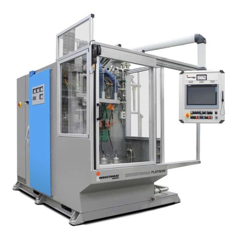

# InductionHardeningMachine_v0.0.1_260930.aasx

[장비 페이지](../README.md) · [AASX 다운로드](../AASX/InductionHardeningMachine_v0.0.1_260930.aasx) · 883 KB

> AASX 파일을 열어 자동으로 만든 열람 페이지입니다. 직접 고치지 말고 AASX를 다시 올리세요.

| 항목 | 내용 |
|---|---|
| AAS idShort | `InductionHardeningMachineAAS` |
| AAS id | https://www.smart-factory.kr/ids/aas/InductionHardeningMachineAAS/1/0 |
| 자산 종류 (assetKind) | Type |
| globalAssetId | https://www.smart-factory.kr/ids/asset/InductionHardeningMachine/1/0 |
| 서브모델 | 7개 |
| 전체 요소 | 489개 |

## 서브모델 한눈에 보기

| # | 서브모델 | 요소 수 | semanticId |
|:-:|---|--:|---|
| 1 | [Nameplate](#sm-1) | 19 | https://admin-shell.io/idta/nameplate/3/0/Nameplate |
| 2 | [HandoverDocumentation](#sm-2) | 111 | 0173-1#01-AHF578#003 |
| 3 | [TechnicalData](#sm-3) | 121 | 0173-1#01-AHX837#002 |
| 4 | [OperationalData](#sm-4) | 59 | https://www.smart-factory.kr/ids/sm/InductionHardeningMachineAAS/OperationalData/1/0 |
| 5 | [TimeSeries](#sm-5) | 75 | https://admin-shell.io/idta/TimeSeries/1/1 |
| 6 | [ProcessParameters](#sm-6) | 43 | https://admin-shell-io/idta/SubmodelTemplate/ProcessParameters/1/0 |
| 7 | [PredictiveMaintenance](#sm-7) | 61 | https://admin-shell.io/idta/SubmodelTemplate/PredictiveMaintenance/1/0 |

## 서브모델 상세

각 서브모델 이름을 누르면 펼쳐집니다. **굵은 글씨**는 하위 요소가 있는 묶음입니다.

<b>1. Nameplate</b> — 요소 19개

> Contains the nameplate information attached to the product

semanticId: `https://admin-shell.io/idta/nameplate/3/0/Nameplate`

| idShort | 종류 | 값 | semanticId |
|---|---|---|---|
| URIOfTheProduct | 속성 | https://www.smart-factory.kr/ids/asset/InductionHardeningMachine/1/0 | 0112/2///61987#ABN590#002 |
| ManufacturerName | 다국어&nbsp;속성 | ExampleCompany | 0112/2///61987#ABA565#009 |
| ManufacturerProductDesignation | 다국어&nbsp;속성 | ExampleCompany High-Frequency Induction Hardening Machine | 0112/2///61987#ABA567#009 |
| AddressInformation | 묶음 |  | https://admin-shell.io/zvei/nameplate/1/0/ContactInformations/Address… |
| ManufacturerProductType | 속성 | IH-500 | 0112/2///61987#ABA300#008 |
| OrderCodeOfManufacturer | 속성 | IH-500-ORD | 0112/2///61987#ABA950#008 |
| ProductArticleNumberOfManufacturer | 속성 | IH-500-ART | 0112/2///61987#ABA581#007 |
| SerialNumber | 속성 | IH-SN-2026-0001 | 0112/2///61987#ABA951#009 |
| YearOfConstruction | 속성 | 2026 | 0112/2///61987#ABP000#002 |
| HardwareVersion | 속성 | HW-1.0 | 0112/2///61987#ABA926#008 |
| FirmwareVersion | 속성 | FW-1.0 | 0112/2///61987#ABA302#006 |
| SoftwareVersion | 속성 | SW-1.0 | 0112/2///61987#ABA601#008 |
| CountryOfOrigin | 속성 | KR | 0112/2///61987#ABP462#001 |
| CompanyLogo | 파일 | /aasx/files/logo/CompanyLogo.png | 0112/2///61987#ABP463#001 |
| **Markings** | 목록&nbsp;(1) |  | 0112/2///61360_7#AAS006#001 |
| &nbsp;&nbsp;&nbsp;└ **** | 묶음&nbsp;(3) |  | 0112/2///61360_7#AAS009#001 |
| &nbsp;&nbsp;&nbsp;&nbsp;&nbsp;&nbsp;└ MarkingName | 속성 | CE | 0112/2///61987#ABA231#009 |
| &nbsp;&nbsp;&nbsp;&nbsp;&nbsp;&nbsp;└ DesignationOfCertificateOrApproval | 속성 | CE Declaration of Conformity | 0112/2///61987#ABH783#003 |
| &nbsp;&nbsp;&nbsp;&nbsp;&nbsp;&nbsp;└ IssueDate | 속성 | 2026-06-01 | 0112/2///61987#ABO097#001 |

<b>2. HandoverDocumentation</b> — 요소 111개

> The Submodel defines a set meta data for the handover of documentation from the manufacturer to the operator for industrial equipment

semanticId: `0173-1#01-AHF578#003`

| idShort | 종류 | 값 | semanticId |
|---|---|---|---|
| **Documents** | 목록&nbsp;(5) |  | 0173-1#02-ABI500#003 |
| &nbsp;&nbsp;&nbsp;└ **** | 묶음&nbsp;(3) |  | 0173-1#02-ABI500#003/0173-1#01-AHF579#003 |
| &nbsp;&nbsp;&nbsp;&nbsp;&nbsp;&nbsp;└ **DocumentIds** | 목록&nbsp;(1) |  | 0173-1#02-ABI501#003 |
| &nbsp;&nbsp;&nbsp;&nbsp;&nbsp;&nbsp;&nbsp;&nbsp;&nbsp;└ **** | 묶음&nbsp;(2) |  | 0173-1#02-ABI501#003/0173-1#01-AHF580#003 |
| &nbsp;&nbsp;&nbsp;&nbsp;&nbsp;&nbsp;&nbsp;&nbsp;&nbsp;&nbsp;&nbsp;&nbsp;└ DocumentDomainId | 속성 | InductionHardeningMachine | 0173-1#02-ABH994#003 |
| &nbsp;&nbsp;&nbsp;&nbsp;&nbsp;&nbsp;&nbsp;&nbsp;&nbsp;&nbsp;&nbsp;&nbsp;└ DocumentIdentifier | 속성 | IH-OM-001 | 0173-1#02-AAO099#004 |
| &nbsp;&nbsp;&nbsp;&nbsp;&nbsp;&nbsp;└ **DocumentClassifications** | 목록&nbsp;(1) |  | 0173-1#02-ABI502#003 |
| &nbsp;&nbsp;&nbsp;&nbsp;&nbsp;&nbsp;&nbsp;&nbsp;&nbsp;└ **** | 묶음&nbsp;(3) |  | 0173-1#02-ABI502#003/0173-1#01-AHF581#003 |
| &nbsp;&nbsp;&nbsp;&nbsp;&nbsp;&nbsp;&nbsp;&nbsp;&nbsp;&nbsp;&nbsp;&nbsp;└ ClassId | 속성 | 03-02 | 0173-1#02-ABH996#003 |
| &nbsp;&nbsp;&nbsp;&nbsp;&nbsp;&nbsp;&nbsp;&nbsp;&nbsp;&nbsp;&nbsp;&nbsp;└ ClassName | 다국어&nbsp;속성 | Operation | 0173-1#02-ABJ219#002 |
| &nbsp;&nbsp;&nbsp;&nbsp;&nbsp;&nbsp;&nbsp;&nbsp;&nbsp;&nbsp;&nbsp;&nbsp;└ ClassificationSystem | 속성 | VDI 2770 Blatt 1:2020 | 0173-1#02-ABH997#003 |
| &nbsp;&nbsp;&nbsp;&nbsp;&nbsp;&nbsp;└ **DocumentVersions** | 목록&nbsp;(1) |  | 0173-1#02-ABI503#003 |
| &nbsp;&nbsp;&nbsp;&nbsp;&nbsp;&nbsp;&nbsp;&nbsp;&nbsp;└ **** | 묶음&nbsp;(8) |  | 0173-1#02-ABI503#003/0173-1#01-AHF582#003 |
| &nbsp;&nbsp;&nbsp;&nbsp;&nbsp;&nbsp;&nbsp;&nbsp;&nbsp;&nbsp;&nbsp;&nbsp;└ **Language** | 목록&nbsp;(1) |  | 0173-1#02-AAN468#008 |
| &nbsp;&nbsp;&nbsp;&nbsp;&nbsp;&nbsp;&nbsp;&nbsp;&nbsp;&nbsp;&nbsp;&nbsp;&nbsp;&nbsp;&nbsp;└  | 속성 | en | 0173-1#02-AAN468#008 |
| &nbsp;&nbsp;&nbsp;&nbsp;&nbsp;&nbsp;&nbsp;&nbsp;&nbsp;&nbsp;&nbsp;&nbsp;└ Version | 속성 | 1.0 | 0173-1#02-AAP003#005 |
| &nbsp;&nbsp;&nbsp;&nbsp;&nbsp;&nbsp;&nbsp;&nbsp;&nbsp;&nbsp;&nbsp;&nbsp;└ Title | 다국어&nbsp;속성 | Example Operating Manual | 0173-1#02-ABG940#003 |
| &nbsp;&nbsp;&nbsp;&nbsp;&nbsp;&nbsp;&nbsp;&nbsp;&nbsp;&nbsp;&nbsp;&nbsp;└ StatusSetDate | 속성 | 2026-06-01 | 0173-1#02-ABI000#003 |
| &nbsp;&nbsp;&nbsp;&nbsp;&nbsp;&nbsp;&nbsp;&nbsp;&nbsp;&nbsp;&nbsp;&nbsp;└ StatusValue | 속성 | Released | 0173-1#02-ABI001#003 |
| &nbsp;&nbsp;&nbsp;&nbsp;&nbsp;&nbsp;&nbsp;&nbsp;&nbsp;&nbsp;&nbsp;&nbsp;└ OrganizationShortName | 속성 | ExampleCompany | https://api.eclass-cdp.com/0173-1-02-ABI002-003 |
| &nbsp;&nbsp;&nbsp;&nbsp;&nbsp;&nbsp;&nbsp;&nbsp;&nbsp;&nbsp;&nbsp;&nbsp;└ OrganizationOfficialName | 속성 | ExampleCompany Co., Ltd. | 0173-1#02-ABI004#003 |
| &nbsp;&nbsp;&nbsp;&nbsp;&nbsp;&nbsp;&nbsp;&nbsp;&nbsp;&nbsp;&nbsp;&nbsp;└ **DigitalFiles** | 목록&nbsp;(1) |  | 0173-1#02-ABK126#002 |
| &nbsp;&nbsp;&nbsp;&nbsp;&nbsp;&nbsp;&nbsp;&nbsp;&nbsp;&nbsp;&nbsp;&nbsp;&nbsp;&nbsp;&nbsp;└  | 파일 | /aasx/files/documents/IH_OperatingManual_EN.pdf | 0173-1#02-ABK126#002 |
| &nbsp;&nbsp;&nbsp;└ **** | 묶음&nbsp;(3) |  | 0173-1#02-ABI500#003/0173-1#01-AHF579#003 |
| &nbsp;&nbsp;&nbsp;&nbsp;&nbsp;&nbsp;└ **DocumentIds** | 목록&nbsp;(1) |  | 0173-1#02-ABI501#003 |
| &nbsp;&nbsp;&nbsp;&nbsp;&nbsp;&nbsp;&nbsp;&nbsp;&nbsp;└ **** | 묶음&nbsp;(2) |  | 0173-1#02-ABI501#003/0173-1#01-AHF580#003 |
| &nbsp;&nbsp;&nbsp;&nbsp;&nbsp;&nbsp;&nbsp;&nbsp;&nbsp;&nbsp;&nbsp;&nbsp;└ DocumentDomainId | 속성 | InductionHardeningMachine | 0173-1#02-ABH994#003 |
| &nbsp;&nbsp;&nbsp;&nbsp;&nbsp;&nbsp;&nbsp;&nbsp;&nbsp;&nbsp;&nbsp;&nbsp;└ DocumentIdentifier | 속성 | IH-CM-001 | 0173-1#02-AAO099#004 |
| &nbsp;&nbsp;&nbsp;&nbsp;&nbsp;&nbsp;└ **DocumentClassifications** | 목록&nbsp;(1) |  | 0173-1#02-ABI502#003 |
| &nbsp;&nbsp;&nbsp;&nbsp;&nbsp;&nbsp;&nbsp;&nbsp;&nbsp;└ **** | 묶음&nbsp;(3) |  | 0173-1#02-ABI502#003/0173-1#01-AHF581#003 |
| &nbsp;&nbsp;&nbsp;&nbsp;&nbsp;&nbsp;&nbsp;&nbsp;&nbsp;&nbsp;&nbsp;&nbsp;└ ClassId | 속성 | 03-01 | 0173-1#02-ABH996#003 |
| &nbsp;&nbsp;&nbsp;&nbsp;&nbsp;&nbsp;&nbsp;&nbsp;&nbsp;&nbsp;&nbsp;&nbsp;└ ClassName | 다국어&nbsp;속성 | Commissioning, de-commissioning | 0173-1#02-ABJ219#002 |
| &nbsp;&nbsp;&nbsp;&nbsp;&nbsp;&nbsp;&nbsp;&nbsp;&nbsp;&nbsp;&nbsp;&nbsp;└ ClassificationSystem | 속성 | VDI 2770 Blatt 1:2020 | 0173-1#02-ABH997#003 |
| &nbsp;&nbsp;&nbsp;&nbsp;&nbsp;&nbsp;└ **DocumentVersions** | 목록&nbsp;(1) |  | 0173-1#02-ABI503#003 |
| &nbsp;&nbsp;&nbsp;&nbsp;&nbsp;&nbsp;&nbsp;&nbsp;&nbsp;└ **** | 묶음&nbsp;(8) |  | 0173-1#02-ABI503#003/0173-1#01-AHF582#003 |
| &nbsp;&nbsp;&nbsp;&nbsp;&nbsp;&nbsp;&nbsp;&nbsp;&nbsp;&nbsp;&nbsp;&nbsp;└ **Language** | 목록&nbsp;(1) |  | 0173-1#02-AAN468#008 |
| &nbsp;&nbsp;&nbsp;&nbsp;&nbsp;&nbsp;&nbsp;&nbsp;&nbsp;&nbsp;&nbsp;&nbsp;&nbsp;&nbsp;&nbsp;└  | 속성 | en | 0173-1#02-AAN468#008 |
| &nbsp;&nbsp;&nbsp;&nbsp;&nbsp;&nbsp;&nbsp;&nbsp;&nbsp;&nbsp;&nbsp;&nbsp;└ Version | 속성 | 1.0 | 0173-1#02-AAP003#005 |
| &nbsp;&nbsp;&nbsp;&nbsp;&nbsp;&nbsp;&nbsp;&nbsp;&nbsp;&nbsp;&nbsp;&nbsp;└ Title | 다국어&nbsp;속성 | Example Commissioning Guide | 0173-1#02-ABG940#003 |
| &nbsp;&nbsp;&nbsp;&nbsp;&nbsp;&nbsp;&nbsp;&nbsp;&nbsp;&nbsp;&nbsp;&nbsp;└ StatusSetDate | 속성 | 2026-06-01 | 0173-1#02-ABI000#003 |
| &nbsp;&nbsp;&nbsp;&nbsp;&nbsp;&nbsp;&nbsp;&nbsp;&nbsp;&nbsp;&nbsp;&nbsp;└ StatusValue | 속성 | Released | 0173-1#02-ABI001#003 |
| &nbsp;&nbsp;&nbsp;&nbsp;&nbsp;&nbsp;&nbsp;&nbsp;&nbsp;&nbsp;&nbsp;&nbsp;└ OrganizationShortName | 속성 | ExampleCompany | https://api.eclass-cdp.com/0173-1-02-ABI002-003 |
| &nbsp;&nbsp;&nbsp;&nbsp;&nbsp;&nbsp;&nbsp;&nbsp;&nbsp;&nbsp;&nbsp;&nbsp;└ OrganizationOfficialName | 속성 | ExampleCompany Co., Ltd. | 0173-1#02-ABI004#003 |
| &nbsp;&nbsp;&nbsp;&nbsp;&nbsp;&nbsp;&nbsp;&nbsp;&nbsp;&nbsp;&nbsp;&nbsp;└ **DigitalFiles** | 목록&nbsp;(1) |  | 0173-1#02-ABK126#002 |
| &nbsp;&nbsp;&nbsp;&nbsp;&nbsp;&nbsp;&nbsp;&nbsp;&nbsp;&nbsp;&nbsp;&nbsp;&nbsp;&nbsp;&nbsp;└  | 파일 | /aasx/files/documents/IH_CommissioningGuide_EN.pdf | 0173-1#02-ABK126#002 |
| &nbsp;&nbsp;&nbsp;└ **** | 묶음&nbsp;(3) |  | 0173-1#02-ABI500#003/0173-1#01-AHF579#003 |
| &nbsp;&nbsp;&nbsp;&nbsp;&nbsp;&nbsp;└ **DocumentIds** | 목록&nbsp;(1) |  | 0173-1#02-ABI501#003 |
| &nbsp;&nbsp;&nbsp;&nbsp;&nbsp;&nbsp;&nbsp;&nbsp;&nbsp;└ **** | 묶음&nbsp;(2) |  | 0173-1#02-ABI501#003/0173-1#01-AHF580#003 |
| &nbsp;&nbsp;&nbsp;&nbsp;&nbsp;&nbsp;&nbsp;&nbsp;&nbsp;&nbsp;&nbsp;&nbsp;└ DocumentDomainId | 속성 | InductionHardeningMachine | 0173-1#02-ABH994#003 |
| &nbsp;&nbsp;&nbsp;&nbsp;&nbsp;&nbsp;&nbsp;&nbsp;&nbsp;&nbsp;&nbsp;&nbsp;└ DocumentIdentifier | 속성 | IH-SF-001 | 0173-1#02-AAO099#004 |
| &nbsp;&nbsp;&nbsp;&nbsp;&nbsp;&nbsp;└ **DocumentClassifications** | 목록&nbsp;(1) |  | 0173-1#02-ABI502#003 |
| &nbsp;&nbsp;&nbsp;&nbsp;&nbsp;&nbsp;&nbsp;&nbsp;&nbsp;└ **** | 묶음&nbsp;(3) |  | 0173-1#02-ABI502#003/0173-1#01-AHF581#003 |
| &nbsp;&nbsp;&nbsp;&nbsp;&nbsp;&nbsp;&nbsp;&nbsp;&nbsp;&nbsp;&nbsp;&nbsp;└ ClassId | 속성 | 03-03 | 0173-1#02-ABH996#003 |
| &nbsp;&nbsp;&nbsp;&nbsp;&nbsp;&nbsp;&nbsp;&nbsp;&nbsp;&nbsp;&nbsp;&nbsp;└ ClassName | 다국어&nbsp;속성 | General safety | 0173-1#02-ABJ219#002 |
| &nbsp;&nbsp;&nbsp;&nbsp;&nbsp;&nbsp;&nbsp;&nbsp;&nbsp;&nbsp;&nbsp;&nbsp;└ ClassificationSystem | 속성 | VDI 2770 Blatt 1:2020 | 0173-1#02-ABH997#003 |
| &nbsp;&nbsp;&nbsp;&nbsp;&nbsp;&nbsp;└ **DocumentVersions** | 목록&nbsp;(1) |  | 0173-1#02-ABI503#003 |
| &nbsp;&nbsp;&nbsp;&nbsp;&nbsp;&nbsp;&nbsp;&nbsp;&nbsp;└ **** | 묶음&nbsp;(8) |  | 0173-1#02-ABI503#003/0173-1#01-AHF582#003 |
| &nbsp;&nbsp;&nbsp;&nbsp;&nbsp;&nbsp;&nbsp;&nbsp;&nbsp;&nbsp;&nbsp;&nbsp;└ **Language** | 목록&nbsp;(1) |  | 0173-1#02-AAN468#008 |
| &nbsp;&nbsp;&nbsp;&nbsp;&nbsp;&nbsp;&nbsp;&nbsp;&nbsp;&nbsp;&nbsp;&nbsp;&nbsp;&nbsp;&nbsp;└  | 속성 | en | 0173-1#02-AAN468#008 |
| &nbsp;&nbsp;&nbsp;&nbsp;&nbsp;&nbsp;&nbsp;&nbsp;&nbsp;&nbsp;&nbsp;&nbsp;└ Version | 속성 | 1.0 | 0173-1#02-AAP003#005 |
| &nbsp;&nbsp;&nbsp;&nbsp;&nbsp;&nbsp;&nbsp;&nbsp;&nbsp;&nbsp;&nbsp;&nbsp;└ Title | 다국어&nbsp;속성 | Example Safety Guide | 0173-1#02-ABG940#003 |
| &nbsp;&nbsp;&nbsp;&nbsp;&nbsp;&nbsp;&nbsp;&nbsp;&nbsp;&nbsp;&nbsp;&nbsp;└ StatusSetDate | 속성 | 2026-06-01 | 0173-1#02-ABI000#003 |
| &nbsp;&nbsp;&nbsp;&nbsp;&nbsp;&nbsp;&nbsp;&nbsp;&nbsp;&nbsp;&nbsp;&nbsp;└ StatusValue | 속성 | Released | 0173-1#02-ABI001#003 |
| &nbsp;&nbsp;&nbsp;&nbsp;&nbsp;&nbsp;&nbsp;&nbsp;&nbsp;&nbsp;&nbsp;&nbsp;└ OrganizationShortName | 속성 | ExampleCompany | https://api.eclass-cdp.com/0173-1-02-ABI002-003 |
| &nbsp;&nbsp;&nbsp;&nbsp;&nbsp;&nbsp;&nbsp;&nbsp;&nbsp;&nbsp;&nbsp;&nbsp;└ OrganizationOfficialName | 속성 | ExampleCompany Co., Ltd. | 0173-1#02-ABI004#003 |
| &nbsp;&nbsp;&nbsp;&nbsp;&nbsp;&nbsp;&nbsp;&nbsp;&nbsp;&nbsp;&nbsp;&nbsp;└ **DigitalFiles** | 목록&nbsp;(1) |  | 0173-1#02-ABK126#002 |
| &nbsp;&nbsp;&nbsp;&nbsp;&nbsp;&nbsp;&nbsp;&nbsp;&nbsp;&nbsp;&nbsp;&nbsp;&nbsp;&nbsp;&nbsp;└  | 파일 | /aasx/files/documents/IH_SafetyGuide_EN.pdf | 0173-1#02-ABK126#002 |
| &nbsp;&nbsp;&nbsp;└ **** | 묶음&nbsp;(3) |  | 0173-1#02-ABI500#003/0173-1#01-AHF579#003 |
| &nbsp;&nbsp;&nbsp;&nbsp;&nbsp;&nbsp;└ **DocumentIds** | 목록&nbsp;(1) |  | 0173-1#02-ABI501#003 |
| &nbsp;&nbsp;&nbsp;&nbsp;&nbsp;&nbsp;&nbsp;&nbsp;&nbsp;└ **** | 묶음&nbsp;(2) |  | 0173-1#02-ABI501#003/0173-1#01-AHF580#003 |
| &nbsp;&nbsp;&nbsp;&nbsp;&nbsp;&nbsp;&nbsp;&nbsp;&nbsp;&nbsp;&nbsp;&nbsp;└ DocumentDomainId | 속성 | InductionHardeningMachine | 0173-1#02-ABH994#003 |
| &nbsp;&nbsp;&nbsp;&nbsp;&nbsp;&nbsp;&nbsp;&nbsp;&nbsp;&nbsp;&nbsp;&nbsp;└ DocumentIdentifier | 속성 | IH-MT-001 | 0173-1#02-AAO099#004 |
| &nbsp;&nbsp;&nbsp;&nbsp;&nbsp;&nbsp;└ **DocumentClassifications** | 목록&nbsp;(1) |  | 0173-1#02-ABI502#003 |
| &nbsp;&nbsp;&nbsp;&nbsp;&nbsp;&nbsp;&nbsp;&nbsp;&nbsp;└ **** | 묶음&nbsp;(3) |  | 0173-1#02-ABI502#003/0173-1#01-AHF581#003 |
| &nbsp;&nbsp;&nbsp;&nbsp;&nbsp;&nbsp;&nbsp;&nbsp;&nbsp;&nbsp;&nbsp;&nbsp;└ ClassId | 속성 | 03-04 | 0173-1#02-ABH996#003 |
| &nbsp;&nbsp;&nbsp;&nbsp;&nbsp;&nbsp;&nbsp;&nbsp;&nbsp;&nbsp;&nbsp;&nbsp;└ ClassName | 다국어&nbsp;속성 | Inspection, maintenance, testing | 0173-1#02-ABJ219#002 |
| &nbsp;&nbsp;&nbsp;&nbsp;&nbsp;&nbsp;&nbsp;&nbsp;&nbsp;&nbsp;&nbsp;&nbsp;└ ClassificationSystem | 속성 | VDI 2770 Blatt 1:2020 | 0173-1#02-ABH997#003 |
| &nbsp;&nbsp;&nbsp;&nbsp;&nbsp;&nbsp;└ **DocumentVersions** | 목록&nbsp;(1) |  | 0173-1#02-ABI503#003 |
| &nbsp;&nbsp;&nbsp;&nbsp;&nbsp;&nbsp;&nbsp;&nbsp;&nbsp;└ **** | 묶음&nbsp;(8) |  | 0173-1#02-ABI503#003/0173-1#01-AHF582#003 |
| &nbsp;&nbsp;&nbsp;&nbsp;&nbsp;&nbsp;&nbsp;&nbsp;&nbsp;&nbsp;&nbsp;&nbsp;└ **Language** | 목록&nbsp;(1) |  | 0173-1#02-AAN468#008 |
| &nbsp;&nbsp;&nbsp;&nbsp;&nbsp;&nbsp;&nbsp;&nbsp;&nbsp;&nbsp;&nbsp;&nbsp;&nbsp;&nbsp;&nbsp;└  | 속성 | en | 0173-1#02-AAN468#008 |
| &nbsp;&nbsp;&nbsp;&nbsp;&nbsp;&nbsp;&nbsp;&nbsp;&nbsp;&nbsp;&nbsp;&nbsp;└ Version | 속성 | 1.0 | 0173-1#02-AAP003#005 |
| &nbsp;&nbsp;&nbsp;&nbsp;&nbsp;&nbsp;&nbsp;&nbsp;&nbsp;&nbsp;&nbsp;&nbsp;└ Title | 다국어&nbsp;속성 | Example Maintenance Guide | 0173-1#02-ABG940#003 |
| &nbsp;&nbsp;&nbsp;&nbsp;&nbsp;&nbsp;&nbsp;&nbsp;&nbsp;&nbsp;&nbsp;&nbsp;└ StatusSetDate | 속성 | 2026-06-01 | 0173-1#02-ABI000#003 |
| &nbsp;&nbsp;&nbsp;&nbsp;&nbsp;&nbsp;&nbsp;&nbsp;&nbsp;&nbsp;&nbsp;&nbsp;└ StatusValue | 속성 | Released | 0173-1#02-ABI001#003 |
| &nbsp;&nbsp;&nbsp;&nbsp;&nbsp;&nbsp;&nbsp;&nbsp;&nbsp;&nbsp;&nbsp;&nbsp;└ OrganizationShortName | 속성 | ExampleCompany | https://api.eclass-cdp.com/0173-1-02-ABI002-003 |
| &nbsp;&nbsp;&nbsp;&nbsp;&nbsp;&nbsp;&nbsp;&nbsp;&nbsp;&nbsp;&nbsp;&nbsp;└ OrganizationOfficialName | 속성 | ExampleCompany Co., Ltd. | 0173-1#02-ABI004#003 |
| &nbsp;&nbsp;&nbsp;&nbsp;&nbsp;&nbsp;&nbsp;&nbsp;&nbsp;&nbsp;&nbsp;&nbsp;└ **DigitalFiles** | 목록&nbsp;(1) |  | 0173-1#02-ABK126#002 |
| &nbsp;&nbsp;&nbsp;&nbsp;&nbsp;&nbsp;&nbsp;&nbsp;&nbsp;&nbsp;&nbsp;&nbsp;&nbsp;&nbsp;&nbsp;└  | 파일 | /aasx/files/documents/IH_MaintenanceGuide_EN.pdf | 0173-1#02-ABK126#002 |
| &nbsp;&nbsp;&nbsp;└ **** | 묶음&nbsp;(3) |  | 0173-1#02-ABI500#003/0173-1#01-AHF579#003 |
| &nbsp;&nbsp;&nbsp;&nbsp;&nbsp;&nbsp;└ **DocumentIds** | 목록&nbsp;(1) |  | 0173-1#02-ABI501#003 |
| &nbsp;&nbsp;&nbsp;&nbsp;&nbsp;&nbsp;&nbsp;&nbsp;&nbsp;└ **** | 묶음&nbsp;(2) |  | 0173-1#02-ABI501#003/0173-1#01-AHF580#003 |
| &nbsp;&nbsp;&nbsp;&nbsp;&nbsp;&nbsp;&nbsp;&nbsp;&nbsp;&nbsp;&nbsp;&nbsp;└ DocumentDomainId | 속성 | InductionHardeningMachine | 0173-1#02-ABH994#003 |
| &nbsp;&nbsp;&nbsp;&nbsp;&nbsp;&nbsp;&nbsp;&nbsp;&nbsp;&nbsp;&nbsp;&nbsp;└ DocumentIdentifier | 속성 | IH-CE-001 | 0173-1#02-AAO099#004 |
| &nbsp;&nbsp;&nbsp;&nbsp;&nbsp;&nbsp;└ **DocumentClassifications** | 목록&nbsp;(1) |  | 0173-1#02-ABI502#003 |
| &nbsp;&nbsp;&nbsp;&nbsp;&nbsp;&nbsp;&nbsp;&nbsp;&nbsp;└ **** | 묶음&nbsp;(3) |  | 0173-1#02-ABI502#003/0173-1#01-AHF581#003 |
| &nbsp;&nbsp;&nbsp;&nbsp;&nbsp;&nbsp;&nbsp;&nbsp;&nbsp;&nbsp;&nbsp;&nbsp;└ ClassId | 속성 | 02-04 | 0173-1#02-ABH996#003 |
| &nbsp;&nbsp;&nbsp;&nbsp;&nbsp;&nbsp;&nbsp;&nbsp;&nbsp;&nbsp;&nbsp;&nbsp;└ ClassName | 다국어&nbsp;속성 | Certificates, declarations | 0173-1#02-ABJ219#002 |
| &nbsp;&nbsp;&nbsp;&nbsp;&nbsp;&nbsp;&nbsp;&nbsp;&nbsp;&nbsp;&nbsp;&nbsp;└ ClassificationSystem | 속성 | VDI 2770 Blatt 1:2020 | 0173-1#02-ABH997#003 |
| &nbsp;&nbsp;&nbsp;&nbsp;&nbsp;&nbsp;└ **DocumentVersions** | 목록&nbsp;(1) |  | 0173-1#02-ABI503#003 |
| &nbsp;&nbsp;&nbsp;&nbsp;&nbsp;&nbsp;&nbsp;&nbsp;&nbsp;└ **** | 묶음&nbsp;(8) |  | 0173-1#02-ABI503#003/0173-1#01-AHF582#003 |
| &nbsp;&nbsp;&nbsp;&nbsp;&nbsp;&nbsp;&nbsp;&nbsp;&nbsp;&nbsp;&nbsp;&nbsp;└ **Language** | 목록&nbsp;(1) |  | 0173-1#02-AAN468#008 |
| &nbsp;&nbsp;&nbsp;&nbsp;&nbsp;&nbsp;&nbsp;&nbsp;&nbsp;&nbsp;&nbsp;&nbsp;&nbsp;&nbsp;&nbsp;└  | 속성 | en | 0173-1#02-AAN468#008 |
| &nbsp;&nbsp;&nbsp;&nbsp;&nbsp;&nbsp;&nbsp;&nbsp;&nbsp;&nbsp;&nbsp;&nbsp;└ Version | 속성 | 1.0 | 0173-1#02-AAP003#005 |
| &nbsp;&nbsp;&nbsp;&nbsp;&nbsp;&nbsp;&nbsp;&nbsp;&nbsp;&nbsp;&nbsp;&nbsp;└ Title | 다국어&nbsp;속성 | Example Certificate of Conformity | 0173-1#02-ABG940#003 |
| &nbsp;&nbsp;&nbsp;&nbsp;&nbsp;&nbsp;&nbsp;&nbsp;&nbsp;&nbsp;&nbsp;&nbsp;└ StatusSetDate | 속성 | 2026-06-01 | 0173-1#02-ABI000#003 |
| &nbsp;&nbsp;&nbsp;&nbsp;&nbsp;&nbsp;&nbsp;&nbsp;&nbsp;&nbsp;&nbsp;&nbsp;└ StatusValue | 속성 | Released | 0173-1#02-ABI001#003 |
| &nbsp;&nbsp;&nbsp;&nbsp;&nbsp;&nbsp;&nbsp;&nbsp;&nbsp;&nbsp;&nbsp;&nbsp;└ OrganizationShortName | 속성 | ExampleCompany | https://api.eclass-cdp.com/0173-1-02-ABI002-003 |
| &nbsp;&nbsp;&nbsp;&nbsp;&nbsp;&nbsp;&nbsp;&nbsp;&nbsp;&nbsp;&nbsp;&nbsp;└ OrganizationOfficialName | 속성 | ExampleCompany Co., Ltd. | 0173-1#02-ABI004#003 |
| &nbsp;&nbsp;&nbsp;&nbsp;&nbsp;&nbsp;&nbsp;&nbsp;&nbsp;&nbsp;&nbsp;&nbsp;└ **DigitalFiles** | 목록&nbsp;(1) |  | 0173-1#02-ABK126#002 |
| &nbsp;&nbsp;&nbsp;&nbsp;&nbsp;&nbsp;&nbsp;&nbsp;&nbsp;&nbsp;&nbsp;&nbsp;&nbsp;&nbsp;&nbsp;└  | 파일 | /aasx/files/documents/IH_CertificateOfConformity_EN.pdf | 0173-1#02-ABK126#002 |

<b>3. TechnicalData</b> — 요소 121개

> Submodel containing technical data of the asset and associated product classificatons

semanticId: `0173-1#01-AHX837#002`

| idShort | 종류 | 값 | semanticId |
|---|---|---|---|
| **GeneralInformation** | 묶음&nbsp;(6) |  | 0173-1#02-ABK161#002/0173-1#01-AHX838#002 |
| &nbsp;&nbsp;&nbsp;└ ManufacturerName | 속성 | ExampleCompany | 0173-1#02-AAO677#004 |
| &nbsp;&nbsp;&nbsp;└ CompanyLogo | 파일 | /aasx/files/logo/CompanyLogo.png | 0173-1#02-ABI776#002 |
| &nbsp;&nbsp;&nbsp;└ ManufacturerProductDesignation | 다국어&nbsp;속성 | ExampleCompany High-Frequency Induction Hardening Machine | 0173-1#02-AAW338#003 |
| &nbsp;&nbsp;&nbsp;└ ManufacturerArticleNumber | 속성 | IH-500-ART | 0173-1#02-AAO676#005 |
| &nbsp;&nbsp;&nbsp;└ ManufacturerOrderCode | 속성 | IH-500-ORD | 0173-1#02-AAO227#004 |
| &nbsp;&nbsp;&nbsp;└ **ProductImages** | 목록&nbsp;(1) |  | 0173-1#02-ABM220#001 |
| &nbsp;&nbsp;&nbsp;&nbsp;&nbsp;&nbsp;└ **** | 묶음&nbsp;(2) |  | 0173-1#02-ABM220#001/0173-1#01-AHY911#001 |
| &nbsp;&nbsp;&nbsp;&nbsp;&nbsp;&nbsp;&nbsp;&nbsp;&nbsp;└ ImageFile | 파일 | /aasx/files/images/InductionHardeningMachine_ProductImage.jpg | 0173-1#02-ABK291#002 |
| &nbsp;&nbsp;&nbsp;&nbsp;&nbsp;&nbsp;&nbsp;&nbsp;&nbsp;└ ImageNote | 다국어&nbsp;속성 | Side view of ExampleCompany high-frequency induction hardening machine | 0173-1#02-ABL423#001 |
| **ProductClassifications** | 목록&nbsp;(1) |  | 0173-1#02-ABK162#002 |
| &nbsp;&nbsp;&nbsp;└ **** | 묶음&nbsp;(5) |  | 0173-1#02-ABK162#002/0173-1#01-AHX839#002 |
| &nbsp;&nbsp;&nbsp;&nbsp;&nbsp;&nbsp;└ ClassificationSystem | 속성 | ECLASS | 0173-1#02-ABL424#001 |
| &nbsp;&nbsp;&nbsp;&nbsp;&nbsp;&nbsp;└ ClassificationSystemVersion | 속성 | 16.0 | 0173-1#02-AAR710#003 |
| &nbsp;&nbsp;&nbsp;&nbsp;&nbsp;&nbsp;└ ProductClassId | 속성 | 0173-1#01-AKK972#010 | 0173-1#02-ABG776#003 |
| &nbsp;&nbsp;&nbsp;&nbsp;&nbsp;&nbsp;└ ProductClassCodedName | 속성 | 33-13-00-00 | 0173-1#02-ABK128#002 |
| &nbsp;&nbsp;&nbsp;&nbsp;&nbsp;&nbsp;└ ProductClassName | 다국어&nbsp;속성 | Industrial thermoprocessing equipment (complete) | 0173-1#02-ABK273#002 |
| **TechnicalPropertyAreas** | 목록&nbsp;(7) |  | 0173-1#02-ABK163#002 |
| &nbsp;&nbsp;&nbsp;└ **** | 묶음&nbsp;(1) |  | 0173-1#02-ABL358#002/0173-1#01-AHX773#002 |
| &nbsp;&nbsp;&nbsp;&nbsp;&nbsp;&nbsp;└ **InductionHardeningCommonSpecifications** | 묶음&nbsp;(2) |  | https://www.smart-factory.kr/ids/cd/InductionHardeningCommonSpecifica… |
| &nbsp;&nbsp;&nbsp;&nbsp;&nbsp;&nbsp;&nbsp;&nbsp;&nbsp;└ **ProcessAndMachineTypeSpecifications** | 묶음&nbsp;(4) |  | https://www.smart-factory.kr/ids/cd/ProcessAndMachineTypeSpecificatio… |
| &nbsp;&nbsp;&nbsp;&nbsp;&nbsp;&nbsp;&nbsp;&nbsp;&nbsp;&nbsp;&nbsp;&nbsp;└ HeatTreatmentProcessType | 속성 | Surface induction hardening | https://www.smart-factory.kr/ids/cd/HeatTreatmentProcessType/1/0 |
| &nbsp;&nbsp;&nbsp;&nbsp;&nbsp;&nbsp;&nbsp;&nbsp;&nbsp;&nbsp;&nbsp;&nbsp;└ MachineType | 속성 | Vertical scanning induction hardening machine | https://www.smart-factory.kr/ids/cd/MachineType/1/0 |
| &nbsp;&nbsp;&nbsp;&nbsp;&nbsp;&nbsp;&nbsp;&nbsp;&nbsp;&nbsp;&nbsp;&nbsp;└ HardeningMethod | 속성 | Scanning (progressive) hardening | https://www.smart-factory.kr/ids/cd/HardeningMethod/1/0 |
| &nbsp;&nbsp;&nbsp;&nbsp;&nbsp;&nbsp;&nbsp;&nbsp;&nbsp;&nbsp;&nbsp;&nbsp;└ WorkpieceType | 속성 | Shafts, gears, bearing races and camshafts | https://www.smart-factory.kr/ids/cd/WorkpieceType/1/0 |
| &nbsp;&nbsp;&nbsp;&nbsp;&nbsp;&nbsp;&nbsp;&nbsp;&nbsp;└ **MachineConfigurationSpecifications** | 묶음&nbsp;(3) |  | https://www.smart-factory.kr/ids/cd/MachineConfigurationSpecification… |
| &nbsp;&nbsp;&nbsp;&nbsp;&nbsp;&nbsp;&nbsp;&nbsp;&nbsp;&nbsp;&nbsp;&nbsp;└ SystemConfiguration | 속성 | Solid-state HF power supply with vertical scanner, rotating work spindle, integ… | https://www.smart-factory.kr/ids/cd/SystemConfiguration/1/0 |
| &nbsp;&nbsp;&nbsp;&nbsp;&nbsp;&nbsp;&nbsp;&nbsp;&nbsp;&nbsp;&nbsp;&nbsp;└ InstallationType | 속성 | Floor-mounted enclosed hardening cell | https://www.smart-factory.kr/ids/cd/InstallationType/1/0 |
| &nbsp;&nbsp;&nbsp;&nbsp;&nbsp;&nbsp;&nbsp;&nbsp;&nbsp;&nbsp;&nbsp;&nbsp;└ DeadWeight | 속성 | 4200 | 0173-1#02-ABD800#002 |
| &nbsp;&nbsp;&nbsp;└ **** | 묶음&nbsp;(1) |  | 0173-1#02-ABL358#002/0173-1#01-AHX773#002 |
| &nbsp;&nbsp;&nbsp;&nbsp;&nbsp;&nbsp;└ **HeatingCapacityAndProductionSpecifications** | 묶음&nbsp;(2) |  | https://www.smart-factory.kr/ids/cd/HeatingCapacityAndProductionSpeci… |
| &nbsp;&nbsp;&nbsp;&nbsp;&nbsp;&nbsp;&nbsp;&nbsp;&nbsp;└ **WorkpieceCapacityLimits** | 묶음&nbsp;(3) |  | https://www.smart-factory.kr/ids/cd/WorkpieceCapacityLimits/1/0 |
| &nbsp;&nbsp;&nbsp;&nbsp;&nbsp;&nbsp;&nbsp;&nbsp;&nbsp;&nbsp;&nbsp;&nbsp;└ MaxWorkpieceDiameter | 속성 | 150 | https://www.smart-factory.kr/ids/cd/MaxWorkpieceDiameter/1/0 |
| &nbsp;&nbsp;&nbsp;&nbsp;&nbsp;&nbsp;&nbsp;&nbsp;&nbsp;&nbsp;&nbsp;&nbsp;└ MaxWorkpieceLength | 속성 | 1000 | https://www.smart-factory.kr/ids/cd/MaxWorkpieceLength/1/0 |
| &nbsp;&nbsp;&nbsp;&nbsp;&nbsp;&nbsp;&nbsp;&nbsp;&nbsp;&nbsp;&nbsp;&nbsp;└ MaxWorkpieceWeight | 속성 | 80 | https://www.smart-factory.kr/ids/cd/MaxWorkpieceWeight/1/0 |
| &nbsp;&nbsp;&nbsp;&nbsp;&nbsp;&nbsp;&nbsp;&nbsp;&nbsp;└ **ThroughputAndQualityTargets** | 묶음&nbsp;(5) |  | https://www.smart-factory.kr/ids/cd/ThroughputAndQualityTargets/1/0 |
| &nbsp;&nbsp;&nbsp;&nbsp;&nbsp;&nbsp;&nbsp;&nbsp;&nbsp;&nbsp;&nbsp;&nbsp;└ ProductionCapacity | 속성 | 60 | https://www.smart-factory.kr/ids/cd/ProductionCapacity/1/0 |
| &nbsp;&nbsp;&nbsp;&nbsp;&nbsp;&nbsp;&nbsp;&nbsp;&nbsp;&nbsp;&nbsp;&nbsp;└ CycleTimePerPart | 속성 | PT50S | https://www.smart-factory.kr/ids/cd/CycleTimePerPart/1/0 |
| &nbsp;&nbsp;&nbsp;&nbsp;&nbsp;&nbsp;&nbsp;&nbsp;&nbsp;&nbsp;&nbsp;&nbsp;└ TargetCaseDepth | 속성 | 2.5 | https://www.smart-factory.kr/ids/cd/TargetCaseDepth/1/0 |
| &nbsp;&nbsp;&nbsp;&nbsp;&nbsp;&nbsp;&nbsp;&nbsp;&nbsp;&nbsp;&nbsp;&nbsp;└ TargetSurfaceHardness | 속성 | 58 | https://www.smart-factory.kr/ids/cd/TargetSurfaceHardness/1/0 |
| &nbsp;&nbsp;&nbsp;&nbsp;&nbsp;&nbsp;&nbsp;&nbsp;&nbsp;&nbsp;&nbsp;&nbsp;└ CaseDepthRange | 범위 | 0.5 ~ 5 | https://www.smart-factory.kr/ids/cd/CaseDepthRange/1/0 |
| &nbsp;&nbsp;&nbsp;└ **** | 묶음&nbsp;(1) |  | 0173-1#02-ABL358#002/0173-1#01-AHX773#002 |
| &nbsp;&nbsp;&nbsp;&nbsp;&nbsp;&nbsp;└ **InductionPowerAndTemperatureSpecifications** | 묶음&nbsp;(2) |  | https://www.smart-factory.kr/ids/cd/InductionPowerAndTemperatureSpeci… |
| &nbsp;&nbsp;&nbsp;&nbsp;&nbsp;&nbsp;&nbsp;&nbsp;&nbsp;└ **InductionPowerSupplyRatings** | 묶음&nbsp;(6) |  | https://www.smart-factory.kr/ids/cd/InductionPowerSupplyRatings/1/0 |
| &nbsp;&nbsp;&nbsp;&nbsp;&nbsp;&nbsp;&nbsp;&nbsp;&nbsp;&nbsp;&nbsp;&nbsp;└ PowerSupplyType | 속성 | Solid-state IGBT inverter (high-frequency) | https://www.smart-factory.kr/ids/cd/PowerSupplyType/1/0 |
| &nbsp;&nbsp;&nbsp;&nbsp;&nbsp;&nbsp;&nbsp;&nbsp;&nbsp;&nbsp;&nbsp;&nbsp;└ RatedOutputPower | 속성 | 250 | https://www.smart-factory.kr/ids/cd/RatedOutputPower/1/0 |
| &nbsp;&nbsp;&nbsp;&nbsp;&nbsp;&nbsp;&nbsp;&nbsp;&nbsp;&nbsp;&nbsp;&nbsp;└ OscillationFrequency | 속성 | 200 | https://www.smart-factory.kr/ids/cd/OscillationFrequency/1/0 |
| &nbsp;&nbsp;&nbsp;&nbsp;&nbsp;&nbsp;&nbsp;&nbsp;&nbsp;&nbsp;&nbsp;&nbsp;└ FrequencyRange | 범위 | 100 ~ 400 | https://www.smart-factory.kr/ids/cd/FrequencyRange/1/0 |
| &nbsp;&nbsp;&nbsp;&nbsp;&nbsp;&nbsp;&nbsp;&nbsp;&nbsp;&nbsp;&nbsp;&nbsp;└ MaxOutputPower | 속성 | 300 | https://www.smart-factory.kr/ids/cd/MaxOutputPower/1/0 |
| &nbsp;&nbsp;&nbsp;&nbsp;&nbsp;&nbsp;&nbsp;&nbsp;&nbsp;&nbsp;&nbsp;&nbsp;└ PowerConversionEfficiency | 속성 | 90 | https://www.smart-factory.kr/ids/cd/PowerConversionEfficiency/1/0 |
| &nbsp;&nbsp;&nbsp;&nbsp;&nbsp;&nbsp;&nbsp;&nbsp;&nbsp;└ **HeatingTemperatureSpecifications** | 묶음&nbsp;(3) |  | https://www.smart-factory.kr/ids/cd/HeatingTemperatureSpecifications/… |
| &nbsp;&nbsp;&nbsp;&nbsp;&nbsp;&nbsp;&nbsp;&nbsp;&nbsp;&nbsp;&nbsp;&nbsp;└ HeatingTemperature | 속성 | 950 | https://www.smart-factory.kr/ids/cd/HeatingTemperature/1/0 |
| &nbsp;&nbsp;&nbsp;&nbsp;&nbsp;&nbsp;&nbsp;&nbsp;&nbsp;&nbsp;&nbsp;&nbsp;└ HardeningTemperatureRange | 범위 | 850 ~ 1000 | https://www.smart-factory.kr/ids/cd/HardeningTemperatureRange/1/0 |
| &nbsp;&nbsp;&nbsp;&nbsp;&nbsp;&nbsp;&nbsp;&nbsp;&nbsp;&nbsp;&nbsp;&nbsp;└ HeatingTimePerCycle | 속성 | PT8S | https://www.smart-factory.kr/ids/cd/HeatingTimePerCycle/1/0 |
| &nbsp;&nbsp;&nbsp;└ **** | 묶음&nbsp;(1) |  | 0173-1#02-ABL358#002/0173-1#01-AHX773#002 |
| &nbsp;&nbsp;&nbsp;&nbsp;&nbsp;&nbsp;└ **StructureAndDimensionSpecifications** | 묶음&nbsp;(2) |  | https://www.smart-factory.kr/ids/cd/StructureAndDimensionSpecificatio… |
| &nbsp;&nbsp;&nbsp;&nbsp;&nbsp;&nbsp;&nbsp;&nbsp;&nbsp;└ **InductionAndScanMechanismSpecifications** | 묶음&nbsp;(8) |  | https://www.smart-factory.kr/ids/cd/InductionAndScanMechanismSpecific… |
| &nbsp;&nbsp;&nbsp;&nbsp;&nbsp;&nbsp;&nbsp;&nbsp;&nbsp;&nbsp;&nbsp;&nbsp;└ FrameType | 속성 | Welded steel column frame with linear scan axis | https://www.smart-factory.kr/ids/cd/FrameType/1/0 |
| &nbsp;&nbsp;&nbsp;&nbsp;&nbsp;&nbsp;&nbsp;&nbsp;&nbsp;&nbsp;&nbsp;&nbsp;└ InductorType | 속성 | Single-turn encircling copper inductor (quick-change) | https://www.smart-factory.kr/ids/cd/InductorType/1/0 |
| &nbsp;&nbsp;&nbsp;&nbsp;&nbsp;&nbsp;&nbsp;&nbsp;&nbsp;&nbsp;&nbsp;&nbsp;└ CouplingGap | 속성 | 2 | https://www.smart-factory.kr/ids/cd/CouplingGap/1/0 |
| &nbsp;&nbsp;&nbsp;&nbsp;&nbsp;&nbsp;&nbsp;&nbsp;&nbsp;&nbsp;&nbsp;&nbsp;└ ScanAxisTravel | 속성 | 1200 | https://www.smart-factory.kr/ids/cd/ScanAxisTravel/1/0 |
| &nbsp;&nbsp;&nbsp;&nbsp;&nbsp;&nbsp;&nbsp;&nbsp;&nbsp;&nbsp;&nbsp;&nbsp;└ ScanSpeedRange | 범위 | 2 ~ 30 | https://www.smart-factory.kr/ids/cd/ScanSpeedRange/1/0 |
| &nbsp;&nbsp;&nbsp;&nbsp;&nbsp;&nbsp;&nbsp;&nbsp;&nbsp;&nbsp;&nbsp;&nbsp;└ WorkRotationSpeedRange | 범위 | 50 ~ 500 | https://www.smart-factory.kr/ids/cd/WorkRotationSpeedRange/1/0 |
| &nbsp;&nbsp;&nbsp;&nbsp;&nbsp;&nbsp;&nbsp;&nbsp;&nbsp;&nbsp;&nbsp;&nbsp;└ WorkholdingType | 속성 | Motorized chuck with tailstock center | https://www.smart-factory.kr/ids/cd/WorkholdingType/1/0 |
| &nbsp;&nbsp;&nbsp;&nbsp;&nbsp;&nbsp;&nbsp;&nbsp;&nbsp;&nbsp;&nbsp;&nbsp;└ NumberOfStations | 속성 | 1 | https://www.smart-factory.kr/ids/cd/NumberOfStations/1/0 |
| &nbsp;&nbsp;&nbsp;&nbsp;&nbsp;&nbsp;&nbsp;&nbsp;&nbsp;└ **OverallDimensionSpecifications** | 묶음&nbsp;(4) |  | https://www.smart-factory.kr/ids/cd/OverallDimensionSpecifications/1/0 |
| &nbsp;&nbsp;&nbsp;&nbsp;&nbsp;&nbsp;&nbsp;&nbsp;&nbsp;&nbsp;&nbsp;&nbsp;└ DimensionsHeight | 속성 | 3200 | 0173-1#02-BAA020#007 |
| &nbsp;&nbsp;&nbsp;&nbsp;&nbsp;&nbsp;&nbsp;&nbsp;&nbsp;&nbsp;&nbsp;&nbsp;└ DimensionsWidth | 속성 | 2000 | 0173-1#02-BAA019#004 |
| &nbsp;&nbsp;&nbsp;&nbsp;&nbsp;&nbsp;&nbsp;&nbsp;&nbsp;&nbsp;&nbsp;&nbsp;└ DimensionsDepth | 속성 | 1800 | 0173-1#02-BAA018#008 |
| &nbsp;&nbsp;&nbsp;&nbsp;&nbsp;&nbsp;&nbsp;&nbsp;&nbsp;&nbsp;&nbsp;&nbsp;└ SoundPowerLevel | 속성 | 80 | https://www.smart-factory.kr/ids/cd/SoundPowerLevel/1/0 |
| &nbsp;&nbsp;&nbsp;└ **** | 묶음&nbsp;(1) |  | 0173-1#02-ABL358#002/0173-1#01-AHX773#002 |
| &nbsp;&nbsp;&nbsp;&nbsp;&nbsp;&nbsp;└ **QuenchingAndCoolingSpecifications** | 묶음&nbsp;(2) |  | https://www.smart-factory.kr/ids/cd/QuenchingAndCoolingSpecifications… |
| &nbsp;&nbsp;&nbsp;&nbsp;&nbsp;&nbsp;&nbsp;&nbsp;&nbsp;└ **QuenchMediumSpecifications** | 묶음&nbsp;(6) |  | https://www.smart-factory.kr/ids/cd/QuenchMediumSpecifications/1/0 |
| &nbsp;&nbsp;&nbsp;&nbsp;&nbsp;&nbsp;&nbsp;&nbsp;&nbsp;&nbsp;&nbsp;&nbsp;└ QuenchingMethod | 속성 | Integrated spray quench ring | https://www.smart-factory.kr/ids/cd/QuenchingMethod/1/0 |
| &nbsp;&nbsp;&nbsp;&nbsp;&nbsp;&nbsp;&nbsp;&nbsp;&nbsp;&nbsp;&nbsp;&nbsp;└ QuenchMediumType | 속성 | Polymer quenchant (PAG) water solution | https://www.smart-factory.kr/ids/cd/QuenchMediumType/1/0 |
| &nbsp;&nbsp;&nbsp;&nbsp;&nbsp;&nbsp;&nbsp;&nbsp;&nbsp;&nbsp;&nbsp;&nbsp;└ QuenchConcentration | 속성 | 8 | https://www.smart-factory.kr/ids/cd/QuenchConcentration/1/0 |
| &nbsp;&nbsp;&nbsp;&nbsp;&nbsp;&nbsp;&nbsp;&nbsp;&nbsp;&nbsp;&nbsp;&nbsp;└ QuenchFlowRate | 속성 | 120 | https://www.smart-factory.kr/ids/cd/QuenchFlowRate/1/0 |
| &nbsp;&nbsp;&nbsp;&nbsp;&nbsp;&nbsp;&nbsp;&nbsp;&nbsp;&nbsp;&nbsp;&nbsp;└ QuenchPressure | 속성 | 3 | https://www.smart-factory.kr/ids/cd/QuenchPressure/1/0 |
| &nbsp;&nbsp;&nbsp;&nbsp;&nbsp;&nbsp;&nbsp;&nbsp;&nbsp;&nbsp;&nbsp;&nbsp;└ QuenchTemperatureRange | 범위 | 25 ~ 40 | https://www.smart-factory.kr/ids/cd/QuenchTemperatureRange/1/0 |
| &nbsp;&nbsp;&nbsp;&nbsp;&nbsp;&nbsp;&nbsp;&nbsp;&nbsp;└ **CoilCoolingSpecifications** | 묶음&nbsp;(3) |  | https://www.smart-factory.kr/ids/cd/CoilCoolingSpecifications/1/0 |
| &nbsp;&nbsp;&nbsp;&nbsp;&nbsp;&nbsp;&nbsp;&nbsp;&nbsp;&nbsp;&nbsp;&nbsp;└ CoilCoolingMethod | 속성 | Closed-loop deionized water cooling | https://www.smart-factory.kr/ids/cd/CoilCoolingMethod/1/0 |
| &nbsp;&nbsp;&nbsp;&nbsp;&nbsp;&nbsp;&nbsp;&nbsp;&nbsp;&nbsp;&nbsp;&nbsp;└ CoolingWaterFlowRate | 속성 | 80 | https://www.smart-factory.kr/ids/cd/CoolingWaterFlowRate/1/0 |
| &nbsp;&nbsp;&nbsp;&nbsp;&nbsp;&nbsp;&nbsp;&nbsp;&nbsp;&nbsp;&nbsp;&nbsp;└ HeatExchangerType | 속성 | Water-to-water plate heat exchanger | https://www.smart-factory.kr/ids/cd/HeatExchangerType/1/0 |
| &nbsp;&nbsp;&nbsp;└ **** | 묶음&nbsp;(1) |  | 0173-1#02-ABL358#002/0173-1#01-AHX773#002 |
| &nbsp;&nbsp;&nbsp;&nbsp;&nbsp;&nbsp;└ **ElectricalAndSafetySpecifications** | 묶음&nbsp;(2) |  | https://www.smart-factory.kr/ids/cd/ElectricalAndSafetySpecifications… |
| &nbsp;&nbsp;&nbsp;&nbsp;&nbsp;&nbsp;&nbsp;&nbsp;&nbsp;└ **MainsPowerSupplyRatings** | 묶음&nbsp;(7) |  | https://www.smart-factory.kr/ids/cd/MainsPowerSupplyRatings/1/0 |
| &nbsp;&nbsp;&nbsp;&nbsp;&nbsp;&nbsp;&nbsp;&nbsp;&nbsp;&nbsp;&nbsp;&nbsp;└ RatedVoltage | 범위 | 380 ~ 415 | 0173-1#02-ABM190#001 |
| &nbsp;&nbsp;&nbsp;&nbsp;&nbsp;&nbsp;&nbsp;&nbsp;&nbsp;&nbsp;&nbsp;&nbsp;└ PowerSupplyPhase | 속성 | 3-phase | https://www.smart-factory.kr/ids/cd/PowerSupplyPhase/1/0 |
| &nbsp;&nbsp;&nbsp;&nbsp;&nbsp;&nbsp;&nbsp;&nbsp;&nbsp;&nbsp;&nbsp;&nbsp;└ PowerSupplyFrequency | 속성 | 50/60 Hz | https://www.smart-factory.kr/ids/cd/PowerSupplyFrequency/1/0 |
| &nbsp;&nbsp;&nbsp;&nbsp;&nbsp;&nbsp;&nbsp;&nbsp;&nbsp;&nbsp;&nbsp;&nbsp;└ RatedPower | 속성 | 280 | https://www.smart-factory.kr/ids/cd/RatedPower/1/0 |
| &nbsp;&nbsp;&nbsp;&nbsp;&nbsp;&nbsp;&nbsp;&nbsp;&nbsp;&nbsp;&nbsp;&nbsp;└ MaxRunningCurrent | 속성 | 480 | https://www.smart-factory.kr/ids/cd/MaxRunningCurrent/1/0 |
| &nbsp;&nbsp;&nbsp;&nbsp;&nbsp;&nbsp;&nbsp;&nbsp;&nbsp;&nbsp;&nbsp;&nbsp;└ LeakageBreakerCapacity | 속성 | 630 | https://www.smart-factory.kr/ids/cd/LeakageBreakerCapacity/1/0 |
| &nbsp;&nbsp;&nbsp;&nbsp;&nbsp;&nbsp;&nbsp;&nbsp;&nbsp;&nbsp;&nbsp;&nbsp;└ GroundingRequired | 속성 | true | https://www.smart-factory.kr/ids/cd/GroundingRequired/1/0 |
| &nbsp;&nbsp;&nbsp;&nbsp;&nbsp;&nbsp;&nbsp;&nbsp;&nbsp;└ **SafetyFunctionAndInterlockSpecifications** | 묶음&nbsp;(9) |  | https://www.smart-factory.kr/ids/cd/SafetyFunctionAndInterlockSpecifi… |
| &nbsp;&nbsp;&nbsp;&nbsp;&nbsp;&nbsp;&nbsp;&nbsp;&nbsp;&nbsp;&nbsp;&nbsp;└ SupportedSafetyFunctions | 속성 | Emergency stop, door interlock, over-temperature cutout, coil water-flow/pressu… | https://www.smart-factory.kr/ids/cd/SupportedSafetyFunctions/1/0 |
| &nbsp;&nbsp;&nbsp;&nbsp;&nbsp;&nbsp;&nbsp;&nbsp;&nbsp;&nbsp;&nbsp;&nbsp;└ DoorInterlockSupported | 속성 | true | https://www.smart-factory.kr/ids/cd/DoorInterlockSupported/1/0 |
| &nbsp;&nbsp;&nbsp;&nbsp;&nbsp;&nbsp;&nbsp;&nbsp;&nbsp;&nbsp;&nbsp;&nbsp;└ OverTemperatureProtectionSupported | 속성 | true | https://www.smart-factory.kr/ids/cd/OverTemperatureProtectionSupporte… |
| &nbsp;&nbsp;&nbsp;&nbsp;&nbsp;&nbsp;&nbsp;&nbsp;&nbsp;&nbsp;&nbsp;&nbsp;└ EmergencyStopSupported | 속성 | true | https://www.smart-factory.kr/ids/cd/EmergencyStopSupported/1/0 |
| &nbsp;&nbsp;&nbsp;&nbsp;&nbsp;&nbsp;&nbsp;&nbsp;&nbsp;&nbsp;&nbsp;&nbsp;└ IPRating | 속성 | IP54 | https://www.smart-factory.kr/ids/cd/IPRating/1/0 |
| &nbsp;&nbsp;&nbsp;&nbsp;&nbsp;&nbsp;&nbsp;&nbsp;&nbsp;&nbsp;&nbsp;&nbsp;└ HighFrequencyShieldingSupported | 속성 | true | https://www.smart-factory.kr/ids/cd/HighFrequencyShieldingSupported/1… |
| &nbsp;&nbsp;&nbsp;&nbsp;&nbsp;&nbsp;&nbsp;&nbsp;&nbsp;&nbsp;&nbsp;&nbsp;└ CoilCoolingInterlockSupported | 속성 | true | https://www.smart-factory.kr/ids/cd/CoilCoolingInterlockSupported/1/0 |
| &nbsp;&nbsp;&nbsp;&nbsp;&nbsp;&nbsp;&nbsp;&nbsp;&nbsp;&nbsp;&nbsp;&nbsp;└ QuenchFlowInterlockSupported | 속성 | true | https://www.smart-factory.kr/ids/cd/QuenchFlowInterlockSupported/1/0 |
| &nbsp;&nbsp;&nbsp;&nbsp;&nbsp;&nbsp;&nbsp;&nbsp;&nbsp;&nbsp;&nbsp;&nbsp;└ GroundFaultProtectionSupported | 속성 | true | https://www.smart-factory.kr/ids/cd/GroundFaultProtectionSupported/1/0 |
| &nbsp;&nbsp;&nbsp;└ **** | 묶음&nbsp;(1) |  | 0173-1#02-ABL358#002/0173-1#01-AHX773#002 |
| &nbsp;&nbsp;&nbsp;&nbsp;&nbsp;&nbsp;└ **ControlAndCommunicationSystem** | 묶음&nbsp;(2) |  | https://www.smart-factory.kr/ids/cd/ControlAndCommunicationSystem/1/0 |
| &nbsp;&nbsp;&nbsp;&nbsp;&nbsp;&nbsp;&nbsp;&nbsp;&nbsp;└ **ControlSystemSpecifications** | 묶음&nbsp;(8) |  | https://www.smart-factory.kr/ids/cd/ControlSystemSpecifications/1/0 |
| &nbsp;&nbsp;&nbsp;&nbsp;&nbsp;&nbsp;&nbsp;&nbsp;&nbsp;&nbsp;&nbsp;&nbsp;└ ControllerType | 속성 | PLC-based induction hardening controller | https://www.smart-factory.kr/ids/cd/ControllerType/1/0 |
| &nbsp;&nbsp;&nbsp;&nbsp;&nbsp;&nbsp;&nbsp;&nbsp;&nbsp;&nbsp;&nbsp;&nbsp;└ HMIType | 속성 | 10-inch touch panel HMI | https://www.smart-factory.kr/ids/cd/HMIType/1/0 |
| &nbsp;&nbsp;&nbsp;&nbsp;&nbsp;&nbsp;&nbsp;&nbsp;&nbsp;&nbsp;&nbsp;&nbsp;└ TemperatureMeasurementMethod | 속성 | Infrared pyrometer with optional thermocouple verification | https://www.smart-factory.kr/ids/cd/TemperatureMeasurementMethod/1/0 |
| &nbsp;&nbsp;&nbsp;&nbsp;&nbsp;&nbsp;&nbsp;&nbsp;&nbsp;&nbsp;&nbsp;&nbsp;└ PowerControlMethod | 속성 | Closed-loop inverter power control | https://www.smart-factory.kr/ids/cd/PowerControlMethod/1/0 |
| &nbsp;&nbsp;&nbsp;&nbsp;&nbsp;&nbsp;&nbsp;&nbsp;&nbsp;&nbsp;&nbsp;&nbsp;└ FrequencyControlMethod | 속성 | Recipe-based frequency setting with inverter control | https://www.smart-factory.kr/ids/cd/FrequencyControlMethod/1/0 |
| &nbsp;&nbsp;&nbsp;&nbsp;&nbsp;&nbsp;&nbsp;&nbsp;&nbsp;&nbsp;&nbsp;&nbsp;└ ScanAxisControlMethod | 속성 | Servo axis control | https://www.smart-factory.kr/ids/cd/ScanAxisControlMethod/1/0 |
| &nbsp;&nbsp;&nbsp;&nbsp;&nbsp;&nbsp;&nbsp;&nbsp;&nbsp;&nbsp;&nbsp;&nbsp;└ PartRotationControlMethod | 속성 | Servo spindle speed control | https://www.smart-factory.kr/ids/cd/PartRotationControlMethod/1/0 |
| &nbsp;&nbsp;&nbsp;&nbsp;&nbsp;&nbsp;&nbsp;&nbsp;&nbsp;&nbsp;&nbsp;&nbsp;└ RecipeManagementSupported | 속성 | true | https://www.smart-factory.kr/ids/cd/RecipeManagementSupported/1/0 |
| &nbsp;&nbsp;&nbsp;&nbsp;&nbsp;&nbsp;&nbsp;&nbsp;&nbsp;└ **CommunicationAndDataSpecifications** | 묶음&nbsp;(6) |  | https://www.smart-factory.kr/ids/cd/CommunicationAndDataSpecification… |
| &nbsp;&nbsp;&nbsp;&nbsp;&nbsp;&nbsp;&nbsp;&nbsp;&nbsp;&nbsp;&nbsp;&nbsp;└ SupportedCommunicationProtocol | 속성 | OPC UA, Modbus TCP, EtherNet/IP | https://www.smart-factory.kr/ids/cd/SupportedCommunicationProtocol/1/0 |
| &nbsp;&nbsp;&nbsp;&nbsp;&nbsp;&nbsp;&nbsp;&nbsp;&nbsp;&nbsp;&nbsp;&nbsp;└ CommunicationInterface | 속성 | Industrial Ethernet, RS-485 | 0173-1#02-AAQ596#005 |
| &nbsp;&nbsp;&nbsp;&nbsp;&nbsp;&nbsp;&nbsp;&nbsp;&nbsp;&nbsp;&nbsp;&nbsp;└ DataAcquisitionInterface | 속성 | PLC tag interface and SCADA historian interface | https://www.smart-factory.kr/ids/cd/DataAcquisitionInterface/1/0 |
| &nbsp;&nbsp;&nbsp;&nbsp;&nbsp;&nbsp;&nbsp;&nbsp;&nbsp;&nbsp;&nbsp;&nbsp;└ RemoteMonitoringSupported | 속성 | true | https://www.smart-factory.kr/ids/cd/RemoteMonitoringSupported/1/0 |
| &nbsp;&nbsp;&nbsp;&nbsp;&nbsp;&nbsp;&nbsp;&nbsp;&nbsp;&nbsp;&nbsp;&nbsp;└ DataLoggingSupported | 속성 | true | https://www.smart-factory.kr/ids/cd/DataLoggingSupported/1/0 |
| &nbsp;&nbsp;&nbsp;&nbsp;&nbsp;&nbsp;&nbsp;&nbsp;&nbsp;&nbsp;&nbsp;&nbsp;└ AlarmHistoryStorageSupported | 속성 | true | https://www.smart-factory.kr/ids/cd/AlarmHistoryStorageSupported/1/0 |

<b>4. OperationalData</b> — 요소 59개

semanticId: `https://www.smart-factory.kr/ids/sm/InductionHardeningMachineAAS/OperationalData/1/0`

| idShort | 종류 | 값 | semanticId |
|---|---|---|---|
| **DeviceOperationSystem** | 묶음&nbsp;(1) |  | https://www.smart-factory.kr/ids/cd/DeviceOperationSystem/1/0 |
| &nbsp;&nbsp;&nbsp;└ **DeviceOperationMonitoring** | 묶음&nbsp;(10) |  | https://www.smart-factory.kr/ids/cd/DeviceOperationMonitoring/1/0 |
| &nbsp;&nbsp;&nbsp;&nbsp;&nbsp;&nbsp;└ DeviceRunState | 속성 | Running | https://www.smart-factory.kr/ids/cd/DeviceRunState/1/0 |
| &nbsp;&nbsp;&nbsp;&nbsp;&nbsp;&nbsp;└ InductionHardeningOperationMode | 속성 | Scanning hardening | https://www.smart-factory.kr/ids/cd/InductionHardeningOperationMode/1… |
| &nbsp;&nbsp;&nbsp;&nbsp;&nbsp;&nbsp;└ ActiveProcessId | 속성 | IH-P-001 | https://www.smart-factory.kr/ids/cd/ActiveProcessId/1/0 |
| &nbsp;&nbsp;&nbsp;&nbsp;&nbsp;&nbsp;└ HardeningPhase | 속성 | Heating | https://www.smart-factory.kr/ids/cd/HardeningPhase/1/0 |
| &nbsp;&nbsp;&nbsp;&nbsp;&nbsp;&nbsp;└ HardeningRunState | 속성 | Running | https://www.smart-factory.kr/ids/cd/HardeningRunState/1/0 |
| &nbsp;&nbsp;&nbsp;&nbsp;&nbsp;&nbsp;└ CurrentPartId | 속성 | PART-2026-0617-03 | https://www.smart-factory.kr/ids/cd/CurrentPartId/1/0 |
| &nbsp;&nbsp;&nbsp;&nbsp;&nbsp;&nbsp;└ CumulativePartCount | 속성 | 84500 | https://www.smart-factory.kr/ids/cd/CumulativePartCount/1/0 |
| &nbsp;&nbsp;&nbsp;&nbsp;&nbsp;&nbsp;└ CumulativeOperatingHours | 속성 | 18600 | https://www.smart-factory.kr/ids/cd/CumulativeOperatingHours/1/0 |
| &nbsp;&nbsp;&nbsp;&nbsp;&nbsp;&nbsp;└ OperationStartTimestamp | 속성 | 2026-06-17T08:00:00Z | https://www.smart-factory.kr/ids/cd/OperationStartTimestamp/1/0 |
| &nbsp;&nbsp;&nbsp;&nbsp;&nbsp;&nbsp;└ LastUpdateTimestamp | 속성 | 2026-06-17T08:20:30Z | https://www.smart-factory.kr/ids/cd/LastUpdateTimestamp/1/0 |
| **HeatingAndPowerSystem** | 묶음&nbsp;(1) |  | https://www.smart-factory.kr/ids/cd/HeatingAndPowerSystem/1/0 |
| &nbsp;&nbsp;&nbsp;└ **HeatingAndPowerMonitoring** | 묶음&nbsp;(15) |  | https://www.smart-factory.kr/ids/cd/HeatingAndPowerMonitoring/1/0 |
| &nbsp;&nbsp;&nbsp;&nbsp;&nbsp;&nbsp;└ InductionPowerActual | 속성 | 220 | https://www.smart-factory.kr/ids/cd/InductionPowerActual/1/0 |
| &nbsp;&nbsp;&nbsp;&nbsp;&nbsp;&nbsp;└ OscillationFrequencyActual | 속성 | 205 | https://www.smart-factory.kr/ids/cd/OscillationFrequencyActual/1/0 |
| &nbsp;&nbsp;&nbsp;&nbsp;&nbsp;&nbsp;└ OutputPowerRatioActual | 속성 | 88 | https://www.smart-factory.kr/ids/cd/OutputPowerRatioActual/1/0 |
| &nbsp;&nbsp;&nbsp;&nbsp;&nbsp;&nbsp;└ SurfaceTemperatureActual | 속성 | 955 | https://www.smart-factory.kr/ids/cd/SurfaceTemperatureActual/1/0 |
| &nbsp;&nbsp;&nbsp;&nbsp;&nbsp;&nbsp;└ HeatingTimeElapsed | 속성 | PT6S | https://www.smart-factory.kr/ids/cd/HeatingTimeElapsed/1/0 |
| &nbsp;&nbsp;&nbsp;&nbsp;&nbsp;&nbsp;└ CoilCurrentActual | 속성 | 1850 | https://www.smart-factory.kr/ids/cd/CoilCurrentActual/1/0 |
| &nbsp;&nbsp;&nbsp;&nbsp;&nbsp;&nbsp;└ DCLinkVoltageActual | 속성 | 540 | https://www.smart-factory.kr/ids/cd/DCLinkVoltageActual/1/0 |
| &nbsp;&nbsp;&nbsp;&nbsp;&nbsp;&nbsp;└ ScanPositionActual | 속성 | 620 | https://www.smart-factory.kr/ids/cd/ScanPositionActual/1/0 |
| &nbsp;&nbsp;&nbsp;&nbsp;&nbsp;&nbsp;└ ScanSpeedActual | 속성 | 12 | https://www.smart-factory.kr/ids/cd/ScanSpeedActual/1/0 |
| &nbsp;&nbsp;&nbsp;&nbsp;&nbsp;&nbsp;└ WorkRotationSpeedActual | 속성 | 300 | https://www.smart-factory.kr/ids/cd/WorkRotationSpeedActual/1/0 |
| &nbsp;&nbsp;&nbsp;&nbsp;&nbsp;&nbsp;└ EstimatedCaseDepth | 속성 | 2.4 | https://www.smart-factory.kr/ids/cd/EstimatedCaseDepth/1/0 |
| &nbsp;&nbsp;&nbsp;&nbsp;&nbsp;&nbsp;└ InverterIGBTTemperatureActual | 속성 | 68.0 | https://www.smart-factory.kr/ids/cd/InverterIGBTTemperatureActual/1/0 |
| &nbsp;&nbsp;&nbsp;&nbsp;&nbsp;&nbsp;└ HardeningThroughputRate | 속성 | 60 | https://www.smart-factory.kr/ids/cd/HardeningThroughputRate/1/0 |
| &nbsp;&nbsp;&nbsp;&nbsp;&nbsp;&nbsp;└ CaseDepthConformityIndex | 속성 | 0.96 | https://www.smart-factory.kr/ids/cd/CaseDepthConformityIndex/1/0 |
| &nbsp;&nbsp;&nbsp;&nbsp;&nbsp;&nbsp;└ SurfaceHardnessCpk | 속성 | 1.42 | https://www.smart-factory.kr/ids/cd/SurfaceHardnessCpk/1/0 |
| **QuenchAndCoolingSystem** | 묶음&nbsp;(1) |  | https://www.smart-factory.kr/ids/cd/QuenchAndCoolingSystem/1/0 |
| &nbsp;&nbsp;&nbsp;└ **QuenchAndCoolingMonitoring** | 묶음&nbsp;(11) |  | https://www.smart-factory.kr/ids/cd/QuenchAndCoolingMonitoring/1/0 |
| &nbsp;&nbsp;&nbsp;&nbsp;&nbsp;&nbsp;└ QuenchFlowActual | 속성 | 118 | https://www.smart-factory.kr/ids/cd/QuenchFlowActual/1/0 |
| &nbsp;&nbsp;&nbsp;&nbsp;&nbsp;&nbsp;└ QuenchPumpRunState | 속성 | Running | https://www.smart-factory.kr/ids/cd/QuenchPumpRunState/1/0 |
| &nbsp;&nbsp;&nbsp;&nbsp;&nbsp;&nbsp;└ QuenchMediumTemperatureActual | 속성 | 32 | https://www.smart-factory.kr/ids/cd/QuenchMediumTemperatureActual/1/0 |
| &nbsp;&nbsp;&nbsp;&nbsp;&nbsp;&nbsp;└ QuenchConcentrationActual | 속성 | 8 | https://www.smart-factory.kr/ids/cd/QuenchConcentrationActual/1/0 |
| &nbsp;&nbsp;&nbsp;&nbsp;&nbsp;&nbsp;└ QuenchPressureActual | 속성 | 2.9 | https://www.smart-factory.kr/ids/cd/QuenchPressureActual/1/0 |
| &nbsp;&nbsp;&nbsp;&nbsp;&nbsp;&nbsp;└ CoilCoolingWaterFlowActual | 속성 | 78 | https://www.smart-factory.kr/ids/cd/CoilCoolingWaterFlowActual/1/0 |
| &nbsp;&nbsp;&nbsp;&nbsp;&nbsp;&nbsp;└ CoilCoolingWaterTemperatureActual | 속성 | 34 | https://www.smart-factory.kr/ids/cd/CoilCoolingWaterTemperatureActual… |
| &nbsp;&nbsp;&nbsp;&nbsp;&nbsp;&nbsp;└ CoolingWaterPressureActual | 속성 | 4 | https://www.smart-factory.kr/ids/cd/CoolingWaterPressureActual/1/0 |
| &nbsp;&nbsp;&nbsp;&nbsp;&nbsp;&nbsp;└ QuenchPumpVibrationRMS | 속성 | 2.5 | https://www.smart-factory.kr/ids/cd/QuenchPumpVibrationRMS/1/0 |
| &nbsp;&nbsp;&nbsp;&nbsp;&nbsp;&nbsp;└ CoilCoolingWaterTempRiseActual | 속성 | 6.5 | https://www.smart-factory.kr/ids/cd/CoilCoolingWaterTempRiseActual/1/0 |
| &nbsp;&nbsp;&nbsp;&nbsp;&nbsp;&nbsp;└ CoolingWaterConductivityActual | 속성 | 2.2 | https://www.smart-factory.kr/ids/cd/CoolingWaterConductivityActual/1/0 |
| **ProtectionAndSafetyStateSystem** | 묶음&nbsp;(1) |  | https://www.smart-factory.kr/ids/cd/ProtectionAndSafetyStateSystem/1/0 |
| &nbsp;&nbsp;&nbsp;└ **ProtectionAndSafetyStateMonitoring** | 묶음&nbsp;(7) |  | https://www.smart-factory.kr/ids/cd/ProtectionAndSafetyStateMonitorin… |
| &nbsp;&nbsp;&nbsp;&nbsp;&nbsp;&nbsp;└ OverTemperatureAlarmStatus | 속성 | Normal | https://www.smart-factory.kr/ids/cd/OverTemperatureAlarmStatus/1/0 |
| &nbsp;&nbsp;&nbsp;&nbsp;&nbsp;&nbsp;└ CoilWaterFlowAlarmStatus | 속성 | Normal | https://www.smart-factory.kr/ids/cd/CoilWaterFlowAlarmStatus/1/0 |
| &nbsp;&nbsp;&nbsp;&nbsp;&nbsp;&nbsp;└ QuenchFlowAlarmStatus | 속성 | Normal | https://www.smart-factory.kr/ids/cd/QuenchFlowAlarmStatus/1/0 |
| &nbsp;&nbsp;&nbsp;&nbsp;&nbsp;&nbsp;└ DoorInterlockStatus | 속성 | Locked | https://www.smart-factory.kr/ids/cd/DoorInterlockStatus/1/0 |
| &nbsp;&nbsp;&nbsp;&nbsp;&nbsp;&nbsp;└ ArcDetectionStatus | 속성 | Normal | https://www.smart-factory.kr/ids/cd/ArcDetectionStatus/1/0 |
| &nbsp;&nbsp;&nbsp;&nbsp;&nbsp;&nbsp;└ ProtectionStopStatus | 속성 | Released | https://www.smart-factory.kr/ids/cd/ProtectionStopStatus/1/0 |
| &nbsp;&nbsp;&nbsp;&nbsp;&nbsp;&nbsp;└ HardeningAlarmStatus | 속성 | None | https://www.smart-factory.kr/ids/cd/HardeningAlarmStatus/1/0 |
| **ElectricalAndSafetyConditionSystem** | 묶음&nbsp;(1) |  | https://www.smart-factory.kr/ids/cd/ElectricalAndSafetyConditionSyste… |
| &nbsp;&nbsp;&nbsp;└ **ElectricalAndSafetyConditionMonitoring** | 묶음&nbsp;(6) |  | https://www.smart-factory.kr/ids/cd/ElectricalAndSafetyConditionMonit… |
| &nbsp;&nbsp;&nbsp;&nbsp;&nbsp;&nbsp;└ PowerConsumptionActual | 속성 | 232000 | https://www.smart-factory.kr/ids/cd/PowerConsumptionActual/1/0 |
| &nbsp;&nbsp;&nbsp;&nbsp;&nbsp;&nbsp;└ ElectricalSupplyStatus | 속성 | Normal | https://www.smart-factory.kr/ids/cd/ElectricalSupplyStatus/1/0 |
| &nbsp;&nbsp;&nbsp;&nbsp;&nbsp;&nbsp;└ EmergencyStopStatus | 속성 | Released | https://www.smart-factory.kr/ids/cd/EmergencyStopStatus/1/0 |
| &nbsp;&nbsp;&nbsp;&nbsp;&nbsp;&nbsp;└ GuardInterlockStatus | 속성 | Locked | https://www.smart-factory.kr/ids/cd/GuardInterlockStatus/1/0 |
| &nbsp;&nbsp;&nbsp;&nbsp;&nbsp;&nbsp;└ SafetyCoverState | 속성 | Closed | https://www.smart-factory.kr/ids/cd/SafetyCoverState/1/0 |
| &nbsp;&nbsp;&nbsp;&nbsp;&nbsp;&nbsp;└ OperationPermittedState | 속성 | Permitted | https://www.smart-factory.kr/ids/cd/OperationPermittedState/1/0 |

<b>5. TimeSeries</b> — 요소 75개

> Contains time series data and references to time series data to discover and semantically describe them along the asset lifecycle.

semanticId: `https://admin-shell.io/idta/TimeSeries/1/1`

| idShort | 종류 | 값 | semanticId |
|---|---|---|---|
| **Metadata** | 묶음&nbsp;(3) |  | https://admin-shell.io/idta/TimeSeries/Metadata/1/1 |
| &nbsp;&nbsp;&nbsp;└ Name | 다국어&nbsp;속성 | Induction hardening operation time series@en | https://admin-shell.io/idta/TimeSeries/Metadata/Name/1/1 |
| &nbsp;&nbsp;&nbsp;└ Description | 다국어&nbsp;속성 | Time series data for high-frequency induction hardening operation values@en | https://admin-shell.io/idta/TimeSeries/Metadata/Description/1/1 |
| &nbsp;&nbsp;&nbsp;└ **Record** | 묶음&nbsp;(1) |  | https://admin-shell.io/idta/TimeSeries/Record/1/1 |
| &nbsp;&nbsp;&nbsp;&nbsp;&nbsp;&nbsp;└ Time | 속성 | 30 | https://admin-shell.io/idta/TimeSeries/RelativePointInTime/1/1 |
| **Segments** | 묶음&nbsp;(3) |  | https://admin-shell.io/idta/TimeSeries/Segments/1/1 |
| &nbsp;&nbsp;&nbsp;└ **ExternalSegment** | 묶음&nbsp;(11) |  | https://admin-shell.io/idta/TimeSeries/Segments/ExternalSegment/1/1 |
| &nbsp;&nbsp;&nbsp;&nbsp;&nbsp;&nbsp;└ Name | 다국어&nbsp;속성 | Induction hardening historian file data@en | https://admin-shell.io/idta/TimeSeries/Segment/Name/1/1 |
| &nbsp;&nbsp;&nbsp;&nbsp;&nbsp;&nbsp;└ Description | 다국어&nbsp;속성 | Induction hardening time series data stored in external CSV file@en | https://admin-shell.io/idta/TimeSeries/Segment/Description/1/1 |
| &nbsp;&nbsp;&nbsp;&nbsp;&nbsp;&nbsp;└ RecordCount | 속성 | 86400 | https://admin-shell.io/idta/TimeSeries/Segment/RecordCount/1/1 |
| &nbsp;&nbsp;&nbsp;&nbsp;&nbsp;&nbsp;└ StartTime | 속성 | 2026-06-17T00:00:00Z | https://admin-shell.io/idta/TimeSeries/Segment/StartTime/1/1 |
| &nbsp;&nbsp;&nbsp;&nbsp;&nbsp;&nbsp;└ EndTime | 속성 | 2026-06-17T23:59:59Z | https://admin-shell.io/idta/TimeSeries/Segment/EndTime/1/1 |
| &nbsp;&nbsp;&nbsp;&nbsp;&nbsp;&nbsp;└ Duration | 속성 | PT24H | https://admin-shell.io/idta/TimeSeries/Segment/Duration/1/1 |
| &nbsp;&nbsp;&nbsp;&nbsp;&nbsp;&nbsp;└ SamplingInterval | 속성 | 1 | https://admin-shell.io/idta/TimeSeries/Segment/SamplingInterval/1/1 |
| &nbsp;&nbsp;&nbsp;&nbsp;&nbsp;&nbsp;└ SamplingRate | 속성 | 1 | https://admin-shell.io/idta/TimeSeries/Segment/SamplingRate/1/1 |
| &nbsp;&nbsp;&nbsp;&nbsp;&nbsp;&nbsp;└ State | 속성 | completed | https://admin-shell.io/idta/TimeSeries/Segment/State/1/1 |
| &nbsp;&nbsp;&nbsp;&nbsp;&nbsp;&nbsp;└ LastUpdate | 속성 | 2026-06-18T00:00:05Z | https://admin-shell.io/idta/TimeSeries/Segment/LastUpdate/1/1 |
| &nbsp;&nbsp;&nbsp;&nbsp;&nbsp;&nbsp;└ File | 파일 | /aasx/files/timeseries/IH_TS_20260617.csv | https://admin-shell.io/idta/TimeSeries/File/1/1 |
| &nbsp;&nbsp;&nbsp;└ **LinkedSegment** | 묶음&nbsp;(12) |  | https://admin-shell.io/idta/TimeSeries/Segments/LinkedSegment/1/1 |
| &nbsp;&nbsp;&nbsp;&nbsp;&nbsp;&nbsp;└ Name | 다국어&nbsp;속성 | Induction hardening historian API data@en | https://admin-shell.io/idta/TimeSeries/Segment/Name/1/1 |
| &nbsp;&nbsp;&nbsp;&nbsp;&nbsp;&nbsp;└ Description | 다국어&nbsp;속성 | Induction hardening time series data queried from external historian API@en | https://admin-shell.io/idta/TimeSeries/Segment/Description/1/1 |
| &nbsp;&nbsp;&nbsp;&nbsp;&nbsp;&nbsp;└ RecordCount | 속성 | 86400 | https://admin-shell.io/idta/TimeSeries/Segment/RecordCount/1/1 |
| &nbsp;&nbsp;&nbsp;&nbsp;&nbsp;&nbsp;└ StartTime | 속성 | 2026-06-17T00:00:00Z | https://admin-shell.io/idta/TimeSeries/Segment/StartTime/1/1 |
| &nbsp;&nbsp;&nbsp;&nbsp;&nbsp;&nbsp;└ EndTime | 속성 | 2026-06-17T23:59:59Z | https://admin-shell.io/idta/TimeSeries/Segment/EndTime/1/1 |
| &nbsp;&nbsp;&nbsp;&nbsp;&nbsp;&nbsp;└ Duration | 속성 | PT24H | https://admin-shell.io/idta/TimeSeries/Segment/Duration/1/1 |
| &nbsp;&nbsp;&nbsp;&nbsp;&nbsp;&nbsp;└ SamplingInterval | 속성 | 1 | https://admin-shell.io/idta/TimeSeries/Segment/SamplingInterval/1/1 |
| &nbsp;&nbsp;&nbsp;&nbsp;&nbsp;&nbsp;└ SamplingRate | 속성 | 1 | https://admin-shell.io/idta/TimeSeries/Segment/SamplingRate/1/1 |
| &nbsp;&nbsp;&nbsp;&nbsp;&nbsp;&nbsp;└ State | 속성 | completed | https://admin-shell.io/idta/TimeSeries/Segment/State/1/1 |
| &nbsp;&nbsp;&nbsp;&nbsp;&nbsp;&nbsp;└ LastUpdate | 속성 | 2026-06-18T00:00:05Z | https://admin-shell.io/idta/TimeSeries/Segment/LastUpdate/1/1 |
| &nbsp;&nbsp;&nbsp;&nbsp;&nbsp;&nbsp;└ Endpoint | 속성 | https://historian.example.com/api/timeseries | https://admin-shell.io/idta/TimeSeries/Endpoint/1/1 |
| &nbsp;&nbsp;&nbsp;&nbsp;&nbsp;&nbsp;└ Query | 속성 | assetId=IH-SN-2026-0001&from=2026-06-17T00:00:00Z&to=2026-06-18T00:00:00Z | https://admin-shell.io/idta/TimeSeries/Query/1/1 |
| &nbsp;&nbsp;&nbsp;└ **InternalSegment** | 묶음&nbsp;(11) |  | https://admin-shell.io/idta/TimeSeries/Segments/InternalSegment/1/1 |
| &nbsp;&nbsp;&nbsp;&nbsp;&nbsp;&nbsp;└ Name | 다국어&nbsp;속성 | Recent induction hardening operation data@en | https://admin-shell.io/idta/TimeSeries/Segment/Name/1/1 |
| &nbsp;&nbsp;&nbsp;&nbsp;&nbsp;&nbsp;└ Description | 다국어&nbsp;속성 | Recent induction hardening operation records stored directly in AAS@en | https://admin-shell.io/idta/TimeSeries/Segment/Description/1/1 |
| &nbsp;&nbsp;&nbsp;&nbsp;&nbsp;&nbsp;└ RecordCount | 속성 | 60 | https://admin-shell.io/idta/TimeSeries/Segment/RecordCount/1/1 |
| &nbsp;&nbsp;&nbsp;&nbsp;&nbsp;&nbsp;└ StartTime | 속성 | 2026-06-17T08:15:00Z | https://admin-shell.io/idta/TimeSeries/Segment/StartTime/1/1 |
| &nbsp;&nbsp;&nbsp;&nbsp;&nbsp;&nbsp;└ EndTime | 속성 | 2026-06-17T08:15:59Z | https://admin-shell.io/idta/TimeSeries/Segment/EndTime/1/1 |
| &nbsp;&nbsp;&nbsp;&nbsp;&nbsp;&nbsp;└ Duration | 속성 | PT1M | https://admin-shell.io/idta/TimeSeries/Segment/Duration/1/1 |
| &nbsp;&nbsp;&nbsp;&nbsp;&nbsp;&nbsp;└ SamplingInterval | 속성 | 1 | https://admin-shell.io/idta/TimeSeries/Segment/SamplingInterval/1/1 |
| &nbsp;&nbsp;&nbsp;&nbsp;&nbsp;&nbsp;└ SamplingRate | 속성 | 1 | https://admin-shell.io/idta/TimeSeries/Segment/SamplingRate/1/1 |
| &nbsp;&nbsp;&nbsp;&nbsp;&nbsp;&nbsp;└ State | 속성 | completed | https://admin-shell.io/idta/TimeSeries/Segment/State/1/1 |
| &nbsp;&nbsp;&nbsp;&nbsp;&nbsp;&nbsp;└ LastUpdate | 속성 | 2026-06-17T08:16:00Z | https://admin-shell.io/idta/TimeSeries/Segment/LastUpdate/1/1 |
| &nbsp;&nbsp;&nbsp;&nbsp;&nbsp;&nbsp;└ **Records** | 묶음&nbsp;(1) |  | https://admin-shell.io/idta/TimeSeries/Records/1/1 |
| &nbsp;&nbsp;&nbsp;&nbsp;&nbsp;&nbsp;&nbsp;&nbsp;&nbsp;└ **Record01** | 묶음&nbsp;(31) |  | https://admin-shell.io/idta/TimeSeries/Record/1/1 |
| &nbsp;&nbsp;&nbsp;&nbsp;&nbsp;&nbsp;&nbsp;&nbsp;&nbsp;&nbsp;&nbsp;&nbsp;└ Time | 속성 | 30 | https://admin-shell.io/idta/TimeSeries/RelativePointInTime/1/1 |
| &nbsp;&nbsp;&nbsp;&nbsp;&nbsp;&nbsp;&nbsp;&nbsp;&nbsp;&nbsp;&nbsp;&nbsp;└ DeviceRunState | 속성 | Running | https://www.smart-factory.kr/ids/cd/DeviceRunState/1/0 |
| &nbsp;&nbsp;&nbsp;&nbsp;&nbsp;&nbsp;&nbsp;&nbsp;&nbsp;&nbsp;&nbsp;&nbsp;└ OperationMode | 속성 | Scanning hardening | https://www.smart-factory.kr/ids/cd/OperationMode/1/0 |
| &nbsp;&nbsp;&nbsp;&nbsp;&nbsp;&nbsp;&nbsp;&nbsp;&nbsp;&nbsp;&nbsp;&nbsp;└ HardeningPhase | 속성 | Heating | https://www.smart-factory.kr/ids/cd/HardeningPhase/1/0 |
| &nbsp;&nbsp;&nbsp;&nbsp;&nbsp;&nbsp;&nbsp;&nbsp;&nbsp;&nbsp;&nbsp;&nbsp;└ HardeningRunState | 속성 | Running | https://www.smart-factory.kr/ids/cd/HardeningRunState/1/0 |
| &nbsp;&nbsp;&nbsp;&nbsp;&nbsp;&nbsp;&nbsp;&nbsp;&nbsp;&nbsp;&nbsp;&nbsp;└ InductionPowerActual | 속성 | 220 | https://www.smart-factory.kr/ids/cd/InductionPowerActual/1/0 |
| &nbsp;&nbsp;&nbsp;&nbsp;&nbsp;&nbsp;&nbsp;&nbsp;&nbsp;&nbsp;&nbsp;&nbsp;└ OscillationFrequencyActual | 속성 | 205 | https://www.smart-factory.kr/ids/cd/OscillationFrequencyActual/1/0 |
| &nbsp;&nbsp;&nbsp;&nbsp;&nbsp;&nbsp;&nbsp;&nbsp;&nbsp;&nbsp;&nbsp;&nbsp;└ SurfaceTemperatureActual | 속성 | 955 | https://www.smart-factory.kr/ids/cd/SurfaceTemperatureActual/1/0 |
| &nbsp;&nbsp;&nbsp;&nbsp;&nbsp;&nbsp;&nbsp;&nbsp;&nbsp;&nbsp;&nbsp;&nbsp;└ CoilCurrentActual | 속성 | 1850 | https://www.smart-factory.kr/ids/cd/CoilCurrentActual/1/0 |
| &nbsp;&nbsp;&nbsp;&nbsp;&nbsp;&nbsp;&nbsp;&nbsp;&nbsp;&nbsp;&nbsp;&nbsp;└ ScanPositionActual | 속성 | 620 | https://www.smart-factory.kr/ids/cd/ScanPositionActual/1/0 |
| &nbsp;&nbsp;&nbsp;&nbsp;&nbsp;&nbsp;&nbsp;&nbsp;&nbsp;&nbsp;&nbsp;&nbsp;└ ScanSpeedActual | 속성 | 12 | https://www.smart-factory.kr/ids/cd/ScanSpeedActual/1/0 |
| &nbsp;&nbsp;&nbsp;&nbsp;&nbsp;&nbsp;&nbsp;&nbsp;&nbsp;&nbsp;&nbsp;&nbsp;└ WorkRotationSpeedActual | 속성 | 300 | https://www.smart-factory.kr/ids/cd/WorkRotationSpeedActual/1/0 |
| &nbsp;&nbsp;&nbsp;&nbsp;&nbsp;&nbsp;&nbsp;&nbsp;&nbsp;&nbsp;&nbsp;&nbsp;└ EstimatedCaseDepth | 속성 | 2.4 | https://www.smart-factory.kr/ids/cd/EstimatedCaseDepth/1/0 |
| &nbsp;&nbsp;&nbsp;&nbsp;&nbsp;&nbsp;&nbsp;&nbsp;&nbsp;&nbsp;&nbsp;&nbsp;└ QuenchFlowActual | 속성 | 118 | https://www.smart-factory.kr/ids/cd/QuenchFlowActual/1/0 |
| &nbsp;&nbsp;&nbsp;&nbsp;&nbsp;&nbsp;&nbsp;&nbsp;&nbsp;&nbsp;&nbsp;&nbsp;└ QuenchMediumTemperatureActual | 속성 | 32 | https://www.smart-factory.kr/ids/cd/QuenchMediumTemperatureActual/1/0 |
| &nbsp;&nbsp;&nbsp;&nbsp;&nbsp;&nbsp;&nbsp;&nbsp;&nbsp;&nbsp;&nbsp;&nbsp;└ QuenchConcentrationActual | 속성 | 8 | https://www.smart-factory.kr/ids/cd/QuenchConcentrationActual/1/0 |
| &nbsp;&nbsp;&nbsp;&nbsp;&nbsp;&nbsp;&nbsp;&nbsp;&nbsp;&nbsp;&nbsp;&nbsp;└ CoilCoolingWaterFlowActual | 속성 | 78 | https://www.smart-factory.kr/ids/cd/CoilCoolingWaterFlowActual/1/0 |
| &nbsp;&nbsp;&nbsp;&nbsp;&nbsp;&nbsp;&nbsp;&nbsp;&nbsp;&nbsp;&nbsp;&nbsp;└ CoilCoolingWaterTemperatureActual | 속성 | 34 | https://www.smart-factory.kr/ids/cd/CoilCoolingWaterTemperatureActual… |
| &nbsp;&nbsp;&nbsp;&nbsp;&nbsp;&nbsp;&nbsp;&nbsp;&nbsp;&nbsp;&nbsp;&nbsp;└ PowerConsumptionActual | 속성 | 232 | https://www.smart-factory.kr/ids/cd/PowerConsumptionActual/1/0 |
| &nbsp;&nbsp;&nbsp;&nbsp;&nbsp;&nbsp;&nbsp;&nbsp;&nbsp;&nbsp;&nbsp;&nbsp;└ ElectricalSupplyStatus | 속성 | Normal | https://www.smart-factory.kr/ids/cd/ElectricalSupplyStatus/1/0 |
| &nbsp;&nbsp;&nbsp;&nbsp;&nbsp;&nbsp;&nbsp;&nbsp;&nbsp;&nbsp;&nbsp;&nbsp;└ EmergencyStopStatus | 속성 | Released | https://www.smart-factory.kr/ids/cd/EmergencyStopStatus/1/0 |
| &nbsp;&nbsp;&nbsp;&nbsp;&nbsp;&nbsp;&nbsp;&nbsp;&nbsp;&nbsp;&nbsp;&nbsp;└ DoorInterlockStatus | 속성 | Locked | https://www.smart-factory.kr/ids/cd/DoorInterlockStatus/1/0 |
| &nbsp;&nbsp;&nbsp;&nbsp;&nbsp;&nbsp;&nbsp;&nbsp;&nbsp;&nbsp;&nbsp;&nbsp;└ OverTemperatureAlarmStatus | 속성 | Normal | https://www.smart-factory.kr/ids/cd/OverTemperatureAlarmStatus/1/0 |
| &nbsp;&nbsp;&nbsp;&nbsp;&nbsp;&nbsp;&nbsp;&nbsp;&nbsp;&nbsp;&nbsp;&nbsp;└ CoilWaterFlowAlarmStatus | 속성 | Normal | https://www.smart-factory.kr/ids/cd/CoilWaterFlowAlarmStatus/1/0 |
| &nbsp;&nbsp;&nbsp;&nbsp;&nbsp;&nbsp;&nbsp;&nbsp;&nbsp;&nbsp;&nbsp;&nbsp;└ ProtectionStopStatus | 속성 | Released | https://www.smart-factory.kr/ids/cd/ProtectionStopStatus/1/0 |
| &nbsp;&nbsp;&nbsp;&nbsp;&nbsp;&nbsp;&nbsp;&nbsp;&nbsp;&nbsp;&nbsp;&nbsp;└ OperationPermittedState | 속성 | Permitted | https://www.smart-factory.kr/ids/cd/OperationPermittedState/1/0 |
| &nbsp;&nbsp;&nbsp;&nbsp;&nbsp;&nbsp;&nbsp;&nbsp;&nbsp;&nbsp;&nbsp;&nbsp;└ HardeningAlarmStatus | 속성 | None | https://www.smart-factory.kr/ids/cd/HardeningAlarmStatus/1/0 |
| &nbsp;&nbsp;&nbsp;&nbsp;&nbsp;&nbsp;&nbsp;&nbsp;&nbsp;&nbsp;&nbsp;&nbsp;└ InverterIGBTTemperatureActual | 속성 | 68.0 | https://www.smart-factory.kr/ids/cd/InverterIGBTTemperatureActual/1/0 |
| &nbsp;&nbsp;&nbsp;&nbsp;&nbsp;&nbsp;&nbsp;&nbsp;&nbsp;&nbsp;&nbsp;&nbsp;└ QuenchPumpVibrationRMS | 속성 | 2.5 | https://www.smart-factory.kr/ids/cd/QuenchPumpVibrationRMS/1/0 |
| &nbsp;&nbsp;&nbsp;&nbsp;&nbsp;&nbsp;&nbsp;&nbsp;&nbsp;&nbsp;&nbsp;&nbsp;└ CoilCoolingWaterTempRiseActual | 속성 | 6.5 | https://www.smart-factory.kr/ids/cd/CoilCoolingWaterTempRiseActual/1/0 |
| &nbsp;&nbsp;&nbsp;&nbsp;&nbsp;&nbsp;&nbsp;&nbsp;&nbsp;&nbsp;&nbsp;&nbsp;└ CoolingWaterConductivityActual | 속성 | 2.2 | https://www.smart-factory.kr/ids/cd/CoolingWaterConductivityActual/1/0 |

<b>6. ProcessParameters</b> — 요소 43개

> The Submodel provides all the necessary parameters in a structured form that are required for the manufacture of any product

semanticId: `https://admin-shell-io/idta/SubmodelTemplate/ProcessParameters/1/0`

| idShort | 종류 | 값 | semanticId |
|---|---|---|---|
| **Processes** | 묶음&nbsp;(1) |  | https://admin-shell.io/idta/ProcessParameters/Processes/1/0 |
| &nbsp;&nbsp;&nbsp;└ **Process__00__** | 묶음&nbsp;(8) |  | https://admin-shell.io/idta/ProcessParameters/Process/1/0 |
| &nbsp;&nbsp;&nbsp;&nbsp;&nbsp;&nbsp;└ ProcessId | 속성 | IH-P-001 | https://admin-shell.io/idta/ProcessParameters/ProcessId/1/0 |
| &nbsp;&nbsp;&nbsp;&nbsp;&nbsp;&nbsp;└ ProcessName | 속성 | Induction surface hardening | https://admin-shell.io/idta/ProcessParameters/ProcessName/1/0 |
| &nbsp;&nbsp;&nbsp;&nbsp;&nbsp;&nbsp;└ ProcessDescription | 다국어&nbsp;속성 | Process parameters for high-frequency induction surface hardening operation@en | https://admin-shell.io/idta/ProcessParameters/ProcessDescription/1/0 |
| &nbsp;&nbsp;&nbsp;&nbsp;&nbsp;&nbsp;└ PlannedProcessTime | 속성 | PT8H | https://admin-shell.io/idta/ProcessParameters/PlannedProcessTime/1/0 |
| &nbsp;&nbsp;&nbsp;&nbsp;&nbsp;&nbsp;└ **ProductParameters** | 묶음&nbsp;(7) |  | https://admin-shell.io/idta/ProcessParameters/ProductParameters/1/0 |
| &nbsp;&nbsp;&nbsp;&nbsp;&nbsp;&nbsp;&nbsp;&nbsp;&nbsp;└ MaterialType | 속성 | Medium-carbon alloy steel (SCM440) | https://www.smart-factory.kr/ids/cd/MaterialType/1/0 |
| &nbsp;&nbsp;&nbsp;&nbsp;&nbsp;&nbsp;&nbsp;&nbsp;&nbsp;└ PartType | 속성 | Drive shaft | https://www.smart-factory.kr/ids/cd/PartType/1/0 |
| &nbsp;&nbsp;&nbsp;&nbsp;&nbsp;&nbsp;&nbsp;&nbsp;&nbsp;└ PartOuterDiameter | 속성 | 60 | https://www.smart-factory.kr/ids/cd/PartOuterDiameter/1/0 |
| &nbsp;&nbsp;&nbsp;&nbsp;&nbsp;&nbsp;&nbsp;&nbsp;&nbsp;└ PartHardeningLength | 속성 | 400 | https://www.smart-factory.kr/ids/cd/PartHardeningLength/1/0 |
| &nbsp;&nbsp;&nbsp;&nbsp;&nbsp;&nbsp;&nbsp;&nbsp;&nbsp;└ InitialSurfaceHardness | 속성 | 22 | https://www.smart-factory.kr/ids/cd/InitialSurfaceHardness/1/0 |
| &nbsp;&nbsp;&nbsp;&nbsp;&nbsp;&nbsp;&nbsp;&nbsp;&nbsp;└ TargetCaseDepth | 속성 | 2.5 | https://www.smart-factory.kr/ids/cd/TargetCaseDepth/1/0 |
| &nbsp;&nbsp;&nbsp;&nbsp;&nbsp;&nbsp;&nbsp;&nbsp;&nbsp;└ TargetSurfaceHardness | 속성 | 58 | https://www.smart-factory.kr/ids/cd/TargetSurfaceHardness/1/0 |
| &nbsp;&nbsp;&nbsp;&nbsp;&nbsp;&nbsp;└ **ProcessParameters** | 묶음&nbsp;(15) |  | https://admin-shell.io/idta/ProcessParameters/ProcessParameters/1/0 |
| &nbsp;&nbsp;&nbsp;&nbsp;&nbsp;&nbsp;&nbsp;&nbsp;&nbsp;└ OperationRecipeId | 속성 | RECIPE-IH-001 | https://www.smart-factory.kr/ids/cd/OperationRecipeId/1/0 |
| &nbsp;&nbsp;&nbsp;&nbsp;&nbsp;&nbsp;&nbsp;&nbsp;&nbsp;└ OperationMode | 속성 | Scanning hardening | https://www.smart-factory.kr/ids/cd/OperationMode/1/0 |
| &nbsp;&nbsp;&nbsp;&nbsp;&nbsp;&nbsp;&nbsp;&nbsp;&nbsp;└ ProcessStepSequence | 속성 | Preheat-Scan-Quench-Temper | https://www.smart-factory.kr/ids/cd/ProcessStepSequence/1/0 |
| &nbsp;&nbsp;&nbsp;&nbsp;&nbsp;&nbsp;&nbsp;&nbsp;&nbsp;└ TargetHeatingTemperature | 속성 | 950 | https://www.smart-factory.kr/ids/cd/TargetHeatingTemperature/1/0 |
| &nbsp;&nbsp;&nbsp;&nbsp;&nbsp;&nbsp;&nbsp;&nbsp;&nbsp;└ OutputPowerSetpoint | 속성 | 250 | https://www.smart-factory.kr/ids/cd/OutputPowerSetpoint/1/0 |
| &nbsp;&nbsp;&nbsp;&nbsp;&nbsp;&nbsp;&nbsp;&nbsp;&nbsp;└ OscillationFrequencySetpoint | 속성 | 200 | https://www.smart-factory.kr/ids/cd/OscillationFrequencySetpoint/1/0 |
| &nbsp;&nbsp;&nbsp;&nbsp;&nbsp;&nbsp;&nbsp;&nbsp;&nbsp;└ ScanSpeedSetpoint | 속성 | 12 | https://www.smart-factory.kr/ids/cd/ScanSpeedSetpoint/1/0 |
| &nbsp;&nbsp;&nbsp;&nbsp;&nbsp;&nbsp;&nbsp;&nbsp;&nbsp;└ WorkRotationSpeedSetpoint | 속성 | 300 | https://www.smart-factory.kr/ids/cd/WorkRotationSpeedSetpoint/1/0 |
| &nbsp;&nbsp;&nbsp;&nbsp;&nbsp;&nbsp;&nbsp;&nbsp;&nbsp;└ CouplingGapSetpoint | 속성 | 2 | https://www.smart-factory.kr/ids/cd/CouplingGapSetpoint/1/0 |
| &nbsp;&nbsp;&nbsp;&nbsp;&nbsp;&nbsp;&nbsp;&nbsp;&nbsp;└ QuenchFlowSetpoint | 속성 | 120 | https://www.smart-factory.kr/ids/cd/QuenchFlowSetpoint/1/0 |
| &nbsp;&nbsp;&nbsp;&nbsp;&nbsp;&nbsp;&nbsp;&nbsp;&nbsp;└ QuenchDelayTime | 속성 | PT0.5S | https://www.smart-factory.kr/ids/cd/QuenchDelayTime/1/0 |
| &nbsp;&nbsp;&nbsp;&nbsp;&nbsp;&nbsp;&nbsp;&nbsp;&nbsp;└ QuenchDuration | 속성 | PT12S | https://www.smart-factory.kr/ids/cd/QuenchDuration/1/0 |
| &nbsp;&nbsp;&nbsp;&nbsp;&nbsp;&nbsp;&nbsp;&nbsp;&nbsp;└ MaxSurfaceTemperatureLimit | 속성 | 1020 | https://www.smart-factory.kr/ids/cd/MaxSurfaceTemperatureLimit/1/0 |
| &nbsp;&nbsp;&nbsp;&nbsp;&nbsp;&nbsp;&nbsp;&nbsp;&nbsp;└ TemperingTemperatureSetpoint | 속성 | 180 | https://www.smart-factory.kr/ids/cd/TemperingTemperatureSetpoint/1/0 |
| &nbsp;&nbsp;&nbsp;&nbsp;&nbsp;&nbsp;&nbsp;&nbsp;&nbsp;└ CaseDepthTolerance | 속성 | 0.3 | https://www.smart-factory.kr/ids/cd/CaseDepthTolerance/1/0 |
| &nbsp;&nbsp;&nbsp;&nbsp;&nbsp;&nbsp;└ **ResourceParameters** | 묶음&nbsp;(7) |  | https://admin-shell.io/idta/ProcessParameters/ResourceParameters/1/0 |
| &nbsp;&nbsp;&nbsp;&nbsp;&nbsp;&nbsp;&nbsp;&nbsp;&nbsp;└ RequiredInductor | 속성 | Inductor01 | https://www.smart-factory.kr/ids/cd/RequiredInductor/1/0 |
| &nbsp;&nbsp;&nbsp;&nbsp;&nbsp;&nbsp;&nbsp;&nbsp;&nbsp;└ RequiredPowerSupply | 속성 | HFPowerSupply01 | https://www.smart-factory.kr/ids/cd/RequiredPowerSupply/1/0 |
| &nbsp;&nbsp;&nbsp;&nbsp;&nbsp;&nbsp;&nbsp;&nbsp;&nbsp;└ RequiredPyrometer | 속성 | Pyrometer01 | https://www.smart-factory.kr/ids/cd/RequiredPyrometer/1/0 |
| &nbsp;&nbsp;&nbsp;&nbsp;&nbsp;&nbsp;&nbsp;&nbsp;&nbsp;└ RequiredQuenchPump | 속성 | QuenchPump01 | https://www.smart-factory.kr/ids/cd/RequiredQuenchPump/1/0 |
| &nbsp;&nbsp;&nbsp;&nbsp;&nbsp;&nbsp;&nbsp;&nbsp;&nbsp;└ RequiredScanAxis | 속성 | ScanAxis01 | https://www.smart-factory.kr/ids/cd/RequiredScanAxis/1/0 |
| &nbsp;&nbsp;&nbsp;&nbsp;&nbsp;&nbsp;&nbsp;&nbsp;&nbsp;└ RequiredWorkSpindle | 속성 | WorkSpindle01 | https://www.smart-factory.kr/ids/cd/RequiredWorkSpindle/1/0 |
| &nbsp;&nbsp;&nbsp;&nbsp;&nbsp;&nbsp;&nbsp;&nbsp;&nbsp;└ RequiredCoilCoolingUnit | 속성 | CoilCoolingUnit01 | https://www.smart-factory.kr/ids/cd/RequiredCoilCoolingUnit/1/0 |
| &nbsp;&nbsp;&nbsp;&nbsp;&nbsp;&nbsp;└ **ProcessBoM** | 묶음&nbsp;(4) |  | https://admin-shell.io/idta/ProcessParameters/ProcessBoM/1/0 |
| &nbsp;&nbsp;&nbsp;&nbsp;&nbsp;&nbsp;&nbsp;&nbsp;&nbsp;└ InductorConsumable | 속성 | INDUCTOR-CU-001 | https://www.smart-factory.kr/ids/cd/InductorConsumable/1/0 |
| &nbsp;&nbsp;&nbsp;&nbsp;&nbsp;&nbsp;&nbsp;&nbsp;&nbsp;└ QuenchantConsumable | 속성 | QUENCHANT-PAG-001 | https://www.smart-factory.kr/ids/cd/QuenchantConsumable/1/0 |
| &nbsp;&nbsp;&nbsp;&nbsp;&nbsp;&nbsp;&nbsp;&nbsp;&nbsp;└ CoolingWaterConsumable | 속성 | DIWATER-001 | https://www.smart-factory.kr/ids/cd/CoolingWaterConsumable/1/0 |
| &nbsp;&nbsp;&nbsp;&nbsp;&nbsp;&nbsp;&nbsp;&nbsp;&nbsp;└ CoilContactConsumable | 속성 | COIL-CONTACT-001 | https://www.smart-factory.kr/ids/cd/CoilContactConsumable/1/0 |

<b>7. PredictiveMaintenance</b> — 요소 61개

> The Submodel Predictive Maintenance is a collection of properties to provide information for predictive maintenance use cases. It is intended to use this submodel in sub-systems of production lines to describe predictive maintenance relevant topics for the sub-system, as well as to use this submode…

semanticId: `https://admin-shell.io/idta/SubmodelTemplate/PredictiveMaintenance/1/0`

| idShort | 종류 | 값 | semanticId |
|---|---|---|---|
| **RemainingUsefulLifePrediction** | 묶음&nbsp;(7) |  | https://admin-shell.io/idta/PredictiveMaintenance/RemainingUsefulLife… |
| &nbsp;&nbsp;&nbsp;└ **RemainingUsefulLifetime** | 엔티티&nbsp;(6) |  | https://admin-shell.io/idta/PredictiveMaintenance/RemainingUsefulLife… |
| &nbsp;&nbsp;&nbsp;&nbsp;&nbsp;&nbsp;└ IndicationType | 속성 | operating hours | https://admin-shell.io/idta/PredictiveMaintenance/IndicationType/1/0 |
| &nbsp;&nbsp;&nbsp;&nbsp;&nbsp;&nbsp;└ DurationValue | 속성 | 6500 | https://admin-shell.io/idta/PredictiveMaintenance/DurationValue/1/0 |
| &nbsp;&nbsp;&nbsp;&nbsp;&nbsp;&nbsp;└ EngineeringUnit | 속성 | h | https://admin-shell.io/idta/PredictiveMaintenance/EngineeringUnit/1/0 |
| &nbsp;&nbsp;&nbsp;&nbsp;&nbsp;&nbsp;└ StartValue | 속성 | 6500 | https://admin-shell.io/idta/PredictiveMaintenance/StartValue/1/0 |
| &nbsp;&nbsp;&nbsp;&nbsp;&nbsp;&nbsp;└ StartDateTime | 속성 | 2026-06-26T09:00:00+09:00 | https://admin-shell.io/idta/PredictiveMaintenance/StartDateTime/1/0 |
| &nbsp;&nbsp;&nbsp;&nbsp;&nbsp;&nbsp;└ Description | 속성 | The representative prediction target is the induction coil (inductor). The rema… | https://admin-shell.io/idta/PredictiveMaintenance/Description/1/0 |
| &nbsp;&nbsp;&nbsp;└ RemainingUsfulLifeDateTime | 속성 | 2027-03-01T09:00:00+09:00 | https://admin-shell.io/idta/PredictiveMaintenance/RemainingUsfulLifeD… |
| &nbsp;&nbsp;&nbsp;└ ConfidenceInterval | 범위 | 5600 ~ 7400 | https://admin-shell.io/idta/PredictiveMaintenance/ConfidenceInterval/… |
| &nbsp;&nbsp;&nbsp;└ **ListRULBoundaryConditions** | 목록&nbsp;(4) |  | https://admin-shell.io/idta/PredictiveMaintenance/ListRULBoundaryCond… |
| &nbsp;&nbsp;&nbsp;&nbsp;&nbsp;&nbsp;└ **** | 묶음&nbsp;(9) |  | https://admin-shell.io/idta/PredictiveMaintenance/RULCondition/1/0 |
| &nbsp;&nbsp;&nbsp;&nbsp;&nbsp;&nbsp;&nbsp;&nbsp;&nbsp;└ ConditionName | 속성 | InverterIGBTTemperatureActual | https://admin-shell.io/idta/PredictiveMaintenance/ConditionName/1/0 |
| &nbsp;&nbsp;&nbsp;&nbsp;&nbsp;&nbsp;&nbsp;&nbsp;&nbsp;└ IsBoundaryConditionUsedInModel | 속성 | true | https://admin-shell.io/idta/PredictiveMaintenance/IsBoundaryCondition… |
| &nbsp;&nbsp;&nbsp;&nbsp;&nbsp;&nbsp;&nbsp;&nbsp;&nbsp;└ BoundaryValueRange | 속성 | 95.0 | https://admin-shell.io/idta/PredictiveMaintenance/BoundaryValueRange/… |
| &nbsp;&nbsp;&nbsp;&nbsp;&nbsp;&nbsp;&nbsp;&nbsp;&nbsp;└ BoundaryEngineeringUnit | 속성 | °C | https://admin-shell.io/idta/PredictiveMaintenance/BoundaryEngineering… |
| &nbsp;&nbsp;&nbsp;&nbsp;&nbsp;&nbsp;&nbsp;&nbsp;&nbsp;└ DriftInfoAIModel | 범위 | 0 ~ 0.08 | https://admin-shell.io/idta/PredictiveMaintenance/DriftInfoAIModel/1/0 |
| &nbsp;&nbsp;&nbsp;&nbsp;&nbsp;&nbsp;&nbsp;&nbsp;&nbsp;└ MeanValue | 속성 | 68.0 | https://admin-shell.io/idta/PredictiveMaintenance/MeanValue/1/0 |
| &nbsp;&nbsp;&nbsp;&nbsp;&nbsp;&nbsp;&nbsp;&nbsp;&nbsp;└ Standarddeviation | 속성 | 8.5 | https://admin-shell.io/idta/PredictiveMaintenance/Standarddeviation/1… |
| &nbsp;&nbsp;&nbsp;&nbsp;&nbsp;&nbsp;&nbsp;&nbsp;&nbsp;└ Skewness | 속성 | 0.6 | https://admin-shell.io/idta/PredictiveMaintenance/Skewness/1/0 |
| &nbsp;&nbsp;&nbsp;&nbsp;&nbsp;&nbsp;&nbsp;&nbsp;&nbsp;└ BoundaryDescription | 속성 | IGBT module junction-temperature band within which the RUL model stays valid; a… | https://admin-shell.io/idta/PredictiveMaintenance/BoundaryDescription… |
| &nbsp;&nbsp;&nbsp;&nbsp;&nbsp;&nbsp;└ **** | 묶음&nbsp;(9) |  | https://admin-shell.io/idta/PredictiveMaintenance/RULCondition/1/0 |
| &nbsp;&nbsp;&nbsp;&nbsp;&nbsp;&nbsp;&nbsp;&nbsp;&nbsp;└ ConditionName | 속성 | QuenchPumpVibrationRMS | https://admin-shell.io/idta/PredictiveMaintenance/ConditionName/1/0 |
| &nbsp;&nbsp;&nbsp;&nbsp;&nbsp;&nbsp;&nbsp;&nbsp;&nbsp;└ IsBoundaryConditionUsedInModel | 속성 | true | https://admin-shell.io/idta/PredictiveMaintenance/IsBoundaryCondition… |
| &nbsp;&nbsp;&nbsp;&nbsp;&nbsp;&nbsp;&nbsp;&nbsp;&nbsp;└ BoundaryValueRange | 속성 | 7.1 | https://admin-shell.io/idta/PredictiveMaintenance/BoundaryValueRange/… |
| &nbsp;&nbsp;&nbsp;&nbsp;&nbsp;&nbsp;&nbsp;&nbsp;&nbsp;└ BoundaryEngineeringUnit | 속성 | mm/s | https://admin-shell.io/idta/PredictiveMaintenance/BoundaryEngineering… |
| &nbsp;&nbsp;&nbsp;&nbsp;&nbsp;&nbsp;&nbsp;&nbsp;&nbsp;└ DriftInfoAIModel | 범위 | 0 ~ 0.10 | https://admin-shell.io/idta/PredictiveMaintenance/DriftInfoAIModel/1/0 |
| &nbsp;&nbsp;&nbsp;&nbsp;&nbsp;&nbsp;&nbsp;&nbsp;&nbsp;└ MeanValue | 속성 | 2.5 | https://admin-shell.io/idta/PredictiveMaintenance/MeanValue/1/0 |
| &nbsp;&nbsp;&nbsp;&nbsp;&nbsp;&nbsp;&nbsp;&nbsp;&nbsp;└ Standarddeviation | 속성 | 0.7 | https://admin-shell.io/idta/PredictiveMaintenance/Standarddeviation/1… |
| &nbsp;&nbsp;&nbsp;&nbsp;&nbsp;&nbsp;&nbsp;&nbsp;&nbsp;└ Skewness | 속성 | 0.9 | https://admin-shell.io/idta/PredictiveMaintenance/Skewness/1/0 |
| &nbsp;&nbsp;&nbsp;&nbsp;&nbsp;&nbsp;&nbsp;&nbsp;&nbsp;└ BoundaryDescription | 속성 | Quench pump vibration velocity RMS range (ISO 10816 zones A-C) over which impel… | https://admin-shell.io/idta/PredictiveMaintenance/BoundaryDescription… |
| &nbsp;&nbsp;&nbsp;&nbsp;&nbsp;&nbsp;└ **** | 묶음&nbsp;(9) |  | https://admin-shell.io/idta/PredictiveMaintenance/RULCondition/1/0 |
| &nbsp;&nbsp;&nbsp;&nbsp;&nbsp;&nbsp;&nbsp;&nbsp;&nbsp;└ ConditionName | 속성 | CoilCoolingWaterTempRiseActual | https://admin-shell.io/idta/PredictiveMaintenance/ConditionName/1/0 |
| &nbsp;&nbsp;&nbsp;&nbsp;&nbsp;&nbsp;&nbsp;&nbsp;&nbsp;└ IsBoundaryConditionUsedInModel | 속성 | true | https://admin-shell.io/idta/PredictiveMaintenance/IsBoundaryCondition… |
| &nbsp;&nbsp;&nbsp;&nbsp;&nbsp;&nbsp;&nbsp;&nbsp;&nbsp;└ BoundaryValueRange | 속성 | 12.0 | https://admin-shell.io/idta/PredictiveMaintenance/BoundaryValueRange/… |
| &nbsp;&nbsp;&nbsp;&nbsp;&nbsp;&nbsp;&nbsp;&nbsp;&nbsp;└ BoundaryEngineeringUnit | 속성 | °C | https://admin-shell.io/idta/PredictiveMaintenance/BoundaryEngineering… |
| &nbsp;&nbsp;&nbsp;&nbsp;&nbsp;&nbsp;&nbsp;&nbsp;&nbsp;└ DriftInfoAIModel | 범위 | 0 ~ 0.07 | https://admin-shell.io/idta/PredictiveMaintenance/DriftInfoAIModel/1/0 |
| &nbsp;&nbsp;&nbsp;&nbsp;&nbsp;&nbsp;&nbsp;&nbsp;&nbsp;└ MeanValue | 속성 | 6.5 | https://admin-shell.io/idta/PredictiveMaintenance/MeanValue/1/0 |
| &nbsp;&nbsp;&nbsp;&nbsp;&nbsp;&nbsp;&nbsp;&nbsp;&nbsp;└ Standarddeviation | 속성 | 1.4 | https://admin-shell.io/idta/PredictiveMaintenance/Standarddeviation/1… |
| &nbsp;&nbsp;&nbsp;&nbsp;&nbsp;&nbsp;&nbsp;&nbsp;&nbsp;└ Skewness | 속성 | 0.5 | https://admin-shell.io/idta/PredictiveMaintenance/Skewness/1/0 |
| &nbsp;&nbsp;&nbsp;&nbsp;&nbsp;&nbsp;&nbsp;&nbsp;&nbsp;└ BoundaryDescription | 속성 | Coil cooling-water inlet/outlet temperature-rise band; a sustained increase ref… | https://admin-shell.io/idta/PredictiveMaintenance/BoundaryDescription… |
| &nbsp;&nbsp;&nbsp;&nbsp;&nbsp;&nbsp;└ **** | 묶음&nbsp;(9) |  | https://admin-shell.io/idta/PredictiveMaintenance/RULCondition/1/0 |
| &nbsp;&nbsp;&nbsp;&nbsp;&nbsp;&nbsp;&nbsp;&nbsp;&nbsp;└ ConditionName | 속성 | CoolingWaterConductivityActual | https://admin-shell.io/idta/PredictiveMaintenance/ConditionName/1/0 |
| &nbsp;&nbsp;&nbsp;&nbsp;&nbsp;&nbsp;&nbsp;&nbsp;&nbsp;└ IsBoundaryConditionUsedInModel | 속성 | false | https://admin-shell.io/idta/PredictiveMaintenance/IsBoundaryCondition… |
| &nbsp;&nbsp;&nbsp;&nbsp;&nbsp;&nbsp;&nbsp;&nbsp;&nbsp;└ BoundaryValueRange | 속성 | 5.0 | https://admin-shell.io/idta/PredictiveMaintenance/BoundaryValueRange/… |
| &nbsp;&nbsp;&nbsp;&nbsp;&nbsp;&nbsp;&nbsp;&nbsp;&nbsp;└ BoundaryEngineeringUnit | 속성 | μS/cm | https://admin-shell.io/idta/PredictiveMaintenance/BoundaryEngineering… |
| &nbsp;&nbsp;&nbsp;&nbsp;&nbsp;&nbsp;&nbsp;&nbsp;&nbsp;└ DriftInfoAIModel | 범위 | 0 ~ 0.05 | https://admin-shell.io/idta/PredictiveMaintenance/DriftInfoAIModel/1/0 |
| &nbsp;&nbsp;&nbsp;&nbsp;&nbsp;&nbsp;&nbsp;&nbsp;&nbsp;└ MeanValue | 속성 | 2.2 | https://admin-shell.io/idta/PredictiveMaintenance/MeanValue/1/0 |
| &nbsp;&nbsp;&nbsp;&nbsp;&nbsp;&nbsp;&nbsp;&nbsp;&nbsp;└ Standarddeviation | 속성 | 0.6 | https://admin-shell.io/idta/PredictiveMaintenance/Standarddeviation/1… |
| &nbsp;&nbsp;&nbsp;&nbsp;&nbsp;&nbsp;&nbsp;&nbsp;&nbsp;└ Skewness | 속성 | 0.8 | https://admin-shell.io/idta/PredictiveMaintenance/Skewness/1/0 |
| &nbsp;&nbsp;&nbsp;&nbsp;&nbsp;&nbsp;&nbsp;&nbsp;&nbsp;└ BoundaryDescription | 속성 | Deionized cooling-water conductivity window used as an alarm guard; persistent … | https://admin-shell.io/idta/PredictiveMaintenance/BoundaryDescription… |
| &nbsp;&nbsp;&nbsp;└ **PredictionModelInformation** | 묶음&nbsp;(2) |  | https://admin-shell.io/idta/PredictiveMaintenance/PredictionModelInfo… |
| &nbsp;&nbsp;&nbsp;&nbsp;&nbsp;&nbsp;└ ModelType | 속성 | ModelTypeHybrid | https://admin-shell.io/idta/PredictiveMaintenance/ModelType/1/0 |
| &nbsp;&nbsp;&nbsp;&nbsp;&nbsp;&nbsp;└ ModelDescription | 속성 | Hybrid RUL model combining a physics-based coil copper-erosion and IGBT thermal… | https://admin-shell.io/idta/PredictiveMaintenance/ModelDescription/1/0 |
| &nbsp;&nbsp;&nbsp;└ **ListPreAlerts** | 목록&nbsp;(1) |  | https://admin-shell.io/idta/PredictiveMaintenance/ListPreAlerts/1/0 |
| &nbsp;&nbsp;&nbsp;&nbsp;&nbsp;&nbsp;└ **** | 묶음&nbsp;(2) |  | https://admin-shell.io/idta/PredictiveMaintenance/PreAlerts/1/0 |
| &nbsp;&nbsp;&nbsp;&nbsp;&nbsp;&nbsp;&nbsp;&nbsp;&nbsp;└ PreAlertMessage | 속성 | Pre-alert: predicted remaining useful life of the induction hardening machine h… | https://admin-shell.io/idta/PredictiveMaintenance/PreAlertMessage/1/0 |
| &nbsp;&nbsp;&nbsp;&nbsp;&nbsp;&nbsp;&nbsp;&nbsp;&nbsp;└ PreAlertValue | 속성 | 800 | https://admin-shell.io/idta/PredictiveMaintenance/PreAlertValue/1/0 |
| &nbsp;&nbsp;&nbsp;└ **AlertAfterExceedingRemainingUsableLife** | 묶음&nbsp;(2) |  | https://admin-shell.io/idta/PredictiveMaintenance/AlertAfterExceeding… |
| &nbsp;&nbsp;&nbsp;&nbsp;&nbsp;&nbsp;└ AlertMessage | 속성 | Alert: the induction hardening machine has reached the end of its remaining usa… | https://admin-shell.io/idta/PredictiveMaintenance/AlertMessage/1/0 |
| &nbsp;&nbsp;&nbsp;&nbsp;&nbsp;&nbsp;└ MaintenanceRequired | 속성 | false | https://admin-shell.io/idta/PredictiveMaintenance/MaintenanceRequired… |

