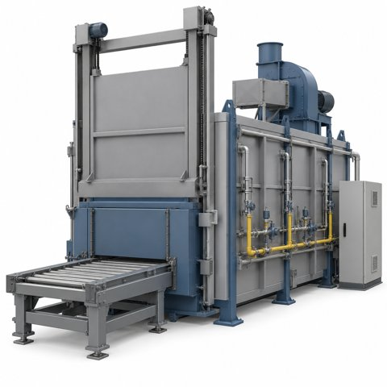

# 🧩 BatchHeatTreatmentFurnace_v0.0.1_260930.aasx

[← 장비 페이지](../README.md) · [⤓ AASX 다운로드](../AASX/BatchHeatTreatmentFurnace_v0.0.1_260930.aasx) · 3.2 MB

> 🤖 AASX 파일을 열어 자동으로 만든 열람 페이지입니다. 직접 고치지 말고 AASX를 다시 올리세요.

| 항목 | 내용 |
|---|---|
| AAS idShort | `BatchHeatTreatmentFurnace` |
| AAS id | https://www.smart-factory.kr/ids/aas/BatchHeatTreatmentFurnace/0/0 |
| 자산 종류 (assetKind) | Type |
| globalAssetId | https://www.smart-factory.kr/ids/asset/BatchHeatTreatmentFurnace/0/0 |
| 설명 | 배치형 열처리로 타입 참조모델. 제품 인증이나 실제 측정 데이터가 아닌 예시입니다. |
| 서브모델 | 8개 |
| 전체 요소 | 567개 |

## 서브모델 한눈에 보기

| # | 서브모델 | 요소 수 | semanticId |
|:-:|---|--:|---|
| 1 | [Nameplate](#sm-1) | 15 | https://admin-shell.io/idta/nameplate/3/0/Nameplate |
| 2 | [HandoverDocumentation](#sm-2) | 73 | 0173-1#01-AHF578#003 |
| 3 | [TechnicalData](#sm-3) | 104 | 0173-1#01-AHX837#002 |
| 4 | [OperationalData](#sm-4) | 59 | https://www.smart-factory.kr/ids/sm/BatchHeatTreatmentFurnace/OperationalData/1/0 |
| 5 | [TimeSeries](#sm-5) | 122 | https://admin-shell.io/idta/TimeSeries/1/1 |
| 6 | [ProcessParameters](#sm-6) | 55 | https://admin-shell-io/idta/SubmodelTemplate/ProcessParameters/1/0 |
| 7 | [PredictiveMaintenance](#sm-7) | 79 | https://admin-shell.io/idta/SubmodelTemplate/PredictiveMaintenance/1/0 |
| 8 | [ProcessVariablesForManufacturingKPICalculation](#sm-8) | 60 | https://admin-shell.io/idta/SubmodelTemplate/ProcessVariablesForManufacturingKPICalculati… |

## 서브모델 상세

각 서브모델 이름을 누르면 펼쳐집니다. **굵은 글씨**는 하위 요소가 있는 묶음입니다.

<b>1. Nameplate</b> — 요소 15개

> 제품 명판(제조사와 제품을 식별하는 표기)의 정보를 담는 서브모델임. 제조사·제품명·제품 유형·주문 코드 등을 확인할 때 사용하는 정보임.

semanticId: `https://admin-shell.io/idta/nameplate/3/0/Nameplate`

| idShort | 종류 | 값 | semanticId |
|---|---|---|---|
| URIOfTheProduct | 속성 | https://www.smart-factory.kr/ids/asset/BatchHeatTreatmentFurnace/0/0 | 0112/2///61987#ABN590#002 |
| ManufacturerName | 다국어 속성 | ExampleCompany | 0112/2///61987#ABA565#009 |
| ManufacturerProductDesignation | 다국어 속성 | ExampleCompany Batch Atmosphere Heat Treatment Furnace | 0112/2///61987#ABA567#009 |
| **AddressInformation** | 묶음 (5) |  | https://admin-shell.io/zvei/nameplate/1/0/ContactInformations/Address… |
| &nbsp;&nbsp;&nbsp;└ Company | 다국어 속성 | ExampleCompany | 0173-1#02-AAW001#001 |
| &nbsp;&nbsp;&nbsp;└ NationalCode | 다국어 속성 | KR | 0173-1#02-AAO134#002 |
| &nbsp;&nbsp;&nbsp;└ CityTown | 다국어 속성 | Example City | 0173-1#02-AAO132#002 |
| &nbsp;&nbsp;&nbsp;└ Street | 다국어 속성 | Example Industrial Road | 0173-1#02-AAO128#002 |
| &nbsp;&nbsp;&nbsp;└ Zipcode | 다국어 속성 | 00000 | 0173-1#02-AAO129#002 |
| ManufacturerProductRoot | 다국어 속성 | Heat treatment furnace | 0112/2///61360_7#AAS011#001 |
| ManufacturerProductFamily | 다국어 속성 | Batch atmosphere furnace | 0112/2///61987#ABP464#002 |
| ManufacturerProductType | 속성 | BHF-1200 | 0112/2///61987#ABA300#008 |
| OrderCodeOfManufacturer | 속성 | BHF-1200-ORD | 0112/2///61987#ABA950#008 |
| ProductArticleNumberOfManufacturer | 속성 | BHF-1200-ART | 0112/2///61987#ABA581#007 |
| CompanyLogo | 파일 | /aasx/files/logo/CompanyLogo.svg | 0112/2///61987#ABP463#001 |

<b>2. HandoverDocumentation</b> — 요소 73개

> 산업 장비 제조사가 운영자에게 문서를 인계할 때 필요한 문서 식별·분류·버전 정보를 담는 서브모델임.

semanticId: `0173-1#01-AHF578#003`

| idShort | 종류 | 값 | semanticId |
|---|---|---|---|
| **Documents** | 목록 (3) |  | 0173-1#02-ABI500#003 |
| &nbsp;&nbsp;&nbsp;└ **** | 묶음 (3) |  | 0173-1#02-ABI500#003/0173-1#01-AHF579#003 |
| &nbsp;&nbsp;&nbsp;&nbsp;&nbsp;&nbsp;└ **DocumentIds** | 목록 (1) |  | 0173-1#02-ABI501#003 |
| &nbsp;&nbsp;&nbsp;&nbsp;&nbsp;&nbsp;&nbsp;&nbsp;&nbsp;└ **** | 묶음 (3) |  | 0173-1#02-ABI501#003/0173-1#01-AHF580#003 |
| &nbsp;&nbsp;&nbsp;&nbsp;&nbsp;&nbsp;&nbsp;&nbsp;&nbsp;&nbsp;&nbsp;&nbsp;└ DocumentDomainId | 속성 | https://example.com/bhf/documents | 0173-1#02-ABH994#003 |
| &nbsp;&nbsp;&nbsp;&nbsp;&nbsp;&nbsp;&nbsp;&nbsp;&nbsp;&nbsp;&nbsp;&nbsp;└ DocumentIdentifier | 속성 | BHF-TD-001 | 0173-1#02-AAO099#004 |
| &nbsp;&nbsp;&nbsp;&nbsp;&nbsp;&nbsp;&nbsp;&nbsp;&nbsp;&nbsp;&nbsp;&nbsp;└ DocumentIsPrimary | 속성 | true | 0173-1#02-ABH995#003 |
| &nbsp;&nbsp;&nbsp;&nbsp;&nbsp;&nbsp;└ **DocumentClassifications** | 목록 (1) |  | 0173-1#02-ABI502#003 |
| &nbsp;&nbsp;&nbsp;&nbsp;&nbsp;&nbsp;&nbsp;&nbsp;&nbsp;└ **** | 묶음 (3) |  | 0173-1#02-ABI502#003/0173-1#01-AHF581#003 |
| &nbsp;&nbsp;&nbsp;&nbsp;&nbsp;&nbsp;&nbsp;&nbsp;&nbsp;&nbsp;&nbsp;&nbsp;└ ClassId | 속성 | TD | 0173-1#02-ABH996#003 |
| &nbsp;&nbsp;&nbsp;&nbsp;&nbsp;&nbsp;&nbsp;&nbsp;&nbsp;&nbsp;&nbsp;&nbsp;└ ClassName | 다국어 속성 | Technical specification | 0173-1#02-ABJ219#002 |
| &nbsp;&nbsp;&nbsp;&nbsp;&nbsp;&nbsp;&nbsp;&nbsp;&nbsp;&nbsp;&nbsp;&nbsp;└ ClassificationSystem | 속성 | BHF reference document types (project-specific) | 0173-1#02-ABH997#003 |
| &nbsp;&nbsp;&nbsp;&nbsp;&nbsp;&nbsp;└ **DocumentVersions** | 목록 (1) |  | 0173-1#02-ABI503#003 |
| &nbsp;&nbsp;&nbsp;&nbsp;&nbsp;&nbsp;&nbsp;&nbsp;&nbsp;└ **** | 묶음 (9) |  | 0173-1#02-ABI503#003/0173-1#01-AHF582#003 |
| &nbsp;&nbsp;&nbsp;&nbsp;&nbsp;&nbsp;&nbsp;&nbsp;&nbsp;&nbsp;&nbsp;&nbsp;└ **Language** | 목록 (1) |  | 0173-1#02-AAN468#008 |
| &nbsp;&nbsp;&nbsp;&nbsp;&nbsp;&nbsp;&nbsp;&nbsp;&nbsp;&nbsp;&nbsp;&nbsp;&nbsp;&nbsp;&nbsp;└  | 속성 | en | 0173-1#02-AAN468#008 |
| &nbsp;&nbsp;&nbsp;&nbsp;&nbsp;&nbsp;&nbsp;&nbsp;&nbsp;&nbsp;&nbsp;&nbsp;└ Version | 속성 | 0.0.1 | 0173-1#02-AAP003#005 |
| &nbsp;&nbsp;&nbsp;&nbsp;&nbsp;&nbsp;&nbsp;&nbsp;&nbsp;&nbsp;&nbsp;&nbsp;└ Title | 다국어 속성 | Technical specification | 0173-1#02-ABG940#003 |
| &nbsp;&nbsp;&nbsp;&nbsp;&nbsp;&nbsp;&nbsp;&nbsp;&nbsp;&nbsp;&nbsp;&nbsp;└ Description | 다국어 속성 | Illustrative reference-model documentation for a batch atmosphere heat treatmen… | 0173-1#02-AAN466#004 |
| &nbsp;&nbsp;&nbsp;&nbsp;&nbsp;&nbsp;&nbsp;&nbsp;&nbsp;&nbsp;&nbsp;&nbsp;└ StatusSetDate | 속성 | 2026-09-14 | 0173-1#02-ABI000#003 |
| &nbsp;&nbsp;&nbsp;&nbsp;&nbsp;&nbsp;&nbsp;&nbsp;&nbsp;&nbsp;&nbsp;&nbsp;└ StatusValue | 속성 | InReview | 0173-1#02-ABI001#003 |
| &nbsp;&nbsp;&nbsp;&nbsp;&nbsp;&nbsp;&nbsp;&nbsp;&nbsp;&nbsp;&nbsp;&nbsp;└ OrganizationShortName | 속성 | ExampleCompany | https://api.eclass-cdp.com/0173-1-02-ABI002-003 |
| &nbsp;&nbsp;&nbsp;&nbsp;&nbsp;&nbsp;&nbsp;&nbsp;&nbsp;&nbsp;&nbsp;&nbsp;└ OrganizationOfficialName | 속성 | ExampleCompany (fictional example) | 0173-1#02-ABI004#003 |
| &nbsp;&nbsp;&nbsp;&nbsp;&nbsp;&nbsp;&nbsp;&nbsp;&nbsp;&nbsp;&nbsp;&nbsp;└ **DigitalFiles** | 목록 (1) |  | 0173-1#02-ABK126#002 |
| &nbsp;&nbsp;&nbsp;&nbsp;&nbsp;&nbsp;&nbsp;&nbsp;&nbsp;&nbsp;&nbsp;&nbsp;&nbsp;&nbsp;&nbsp;└  | 파일 | /aasx/files/BHF_TechnicalSpecification.html | 0173-1#02-ABK126#002 |
| &nbsp;&nbsp;&nbsp;└ **** | 묶음 (3) |  | 0173-1#02-ABI500#003/0173-1#01-AHF579#003 |
| &nbsp;&nbsp;&nbsp;&nbsp;&nbsp;&nbsp;└ **DocumentIds** | 목록 (1) |  | 0173-1#02-ABI501#003 |
| &nbsp;&nbsp;&nbsp;&nbsp;&nbsp;&nbsp;&nbsp;&nbsp;&nbsp;└ **** | 묶음 (3) |  | 0173-1#02-ABI501#003/0173-1#01-AHF580#003 |
| &nbsp;&nbsp;&nbsp;&nbsp;&nbsp;&nbsp;&nbsp;&nbsp;&nbsp;&nbsp;&nbsp;&nbsp;└ DocumentDomainId | 속성 | https://example.com/bhf/documents | 0173-1#02-ABH994#003 |
| &nbsp;&nbsp;&nbsp;&nbsp;&nbsp;&nbsp;&nbsp;&nbsp;&nbsp;&nbsp;&nbsp;&nbsp;└ DocumentIdentifier | 속성 | BHF-GUIDE-001 | 0173-1#02-AAO099#004 |
| &nbsp;&nbsp;&nbsp;&nbsp;&nbsp;&nbsp;&nbsp;&nbsp;&nbsp;&nbsp;&nbsp;&nbsp;└ DocumentIsPrimary | 속성 | true | 0173-1#02-ABH995#003 |
| &nbsp;&nbsp;&nbsp;&nbsp;&nbsp;&nbsp;└ **DocumentClassifications** | 목록 (1) |  | 0173-1#02-ABI502#003 |
| &nbsp;&nbsp;&nbsp;&nbsp;&nbsp;&nbsp;&nbsp;&nbsp;&nbsp;└ **** | 묶음 (3) |  | 0173-1#02-ABI502#003/0173-1#01-AHF581#003 |
| &nbsp;&nbsp;&nbsp;&nbsp;&nbsp;&nbsp;&nbsp;&nbsp;&nbsp;&nbsp;&nbsp;&nbsp;└ ClassId | 속성 | GUIDE | 0173-1#02-ABH996#003 |
| &nbsp;&nbsp;&nbsp;&nbsp;&nbsp;&nbsp;&nbsp;&nbsp;&nbsp;&nbsp;&nbsp;&nbsp;└ ClassName | 다국어 속성 | AAS reference model guidance | 0173-1#02-ABJ219#002 |
| &nbsp;&nbsp;&nbsp;&nbsp;&nbsp;&nbsp;&nbsp;&nbsp;&nbsp;&nbsp;&nbsp;&nbsp;└ ClassificationSystem | 속성 | BHF reference document types (project-specific) | 0173-1#02-ABH997#003 |
| &nbsp;&nbsp;&nbsp;&nbsp;&nbsp;&nbsp;└ **DocumentVersions** | 목록 (1) |  | 0173-1#02-ABI503#003 |
| &nbsp;&nbsp;&nbsp;&nbsp;&nbsp;&nbsp;&nbsp;&nbsp;&nbsp;└ **** | 묶음 (9) |  | 0173-1#02-ABI503#003/0173-1#01-AHF582#003 |
| &nbsp;&nbsp;&nbsp;&nbsp;&nbsp;&nbsp;&nbsp;&nbsp;&nbsp;&nbsp;&nbsp;&nbsp;└ **Language** | 목록 (1) |  | 0173-1#02-AAN468#008 |
| &nbsp;&nbsp;&nbsp;&nbsp;&nbsp;&nbsp;&nbsp;&nbsp;&nbsp;&nbsp;&nbsp;&nbsp;&nbsp;&nbsp;&nbsp;└  | 속성 | en | 0173-1#02-AAN468#008 |
| &nbsp;&nbsp;&nbsp;&nbsp;&nbsp;&nbsp;&nbsp;&nbsp;&nbsp;&nbsp;&nbsp;&nbsp;└ Version | 속성 | 0.0.1 | 0173-1#02-AAP003#005 |
| &nbsp;&nbsp;&nbsp;&nbsp;&nbsp;&nbsp;&nbsp;&nbsp;&nbsp;&nbsp;&nbsp;&nbsp;└ Title | 다국어 속성 | AAS reference model guidance | 0173-1#02-ABG940#003 |
| &nbsp;&nbsp;&nbsp;&nbsp;&nbsp;&nbsp;&nbsp;&nbsp;&nbsp;&nbsp;&nbsp;&nbsp;└ Description | 다국어 속성 | Illustrative reference-model documentation for a batch atmosphere heat treatmen… | 0173-1#02-AAN466#004 |
| &nbsp;&nbsp;&nbsp;&nbsp;&nbsp;&nbsp;&nbsp;&nbsp;&nbsp;&nbsp;&nbsp;&nbsp;└ StatusSetDate | 속성 | 2026-09-14 | 0173-1#02-ABI000#003 |
| &nbsp;&nbsp;&nbsp;&nbsp;&nbsp;&nbsp;&nbsp;&nbsp;&nbsp;&nbsp;&nbsp;&nbsp;└ StatusValue | 속성 | InReview | 0173-1#02-ABI001#003 |
| &nbsp;&nbsp;&nbsp;&nbsp;&nbsp;&nbsp;&nbsp;&nbsp;&nbsp;&nbsp;&nbsp;&nbsp;└ OrganizationShortName | 속성 | ExampleCompany | https://api.eclass-cdp.com/0173-1-02-ABI002-003 |
| &nbsp;&nbsp;&nbsp;&nbsp;&nbsp;&nbsp;&nbsp;&nbsp;&nbsp;&nbsp;&nbsp;&nbsp;└ OrganizationOfficialName | 속성 | ExampleCompany (fictional example) | 0173-1#02-ABI004#003 |
| &nbsp;&nbsp;&nbsp;&nbsp;&nbsp;&nbsp;&nbsp;&nbsp;&nbsp;&nbsp;&nbsp;&nbsp;└ **DigitalFiles** | 목록 (1) |  | 0173-1#02-ABK126#002 |
| &nbsp;&nbsp;&nbsp;&nbsp;&nbsp;&nbsp;&nbsp;&nbsp;&nbsp;&nbsp;&nbsp;&nbsp;&nbsp;&nbsp;&nbsp;└  | 파일 | /aasx/files/BHF_Guidance.html | 0173-1#02-ABK126#002 |
| &nbsp;&nbsp;&nbsp;└ **** | 묶음 (3) |  | 0173-1#02-ABI500#003/0173-1#01-AHF579#003 |
| &nbsp;&nbsp;&nbsp;&nbsp;&nbsp;&nbsp;└ **DocumentIds** | 목록 (1) |  | 0173-1#02-ABI501#003 |
| &nbsp;&nbsp;&nbsp;&nbsp;&nbsp;&nbsp;&nbsp;&nbsp;&nbsp;└ **** | 묶음 (3) |  | 0173-1#02-ABI501#003/0173-1#01-AHF580#003 |
| &nbsp;&nbsp;&nbsp;&nbsp;&nbsp;&nbsp;&nbsp;&nbsp;&nbsp;&nbsp;&nbsp;&nbsp;└ DocumentDomainId | 속성 | https://example.com/bhf/documents | 0173-1#02-ABH994#003 |
| &nbsp;&nbsp;&nbsp;&nbsp;&nbsp;&nbsp;&nbsp;&nbsp;&nbsp;&nbsp;&nbsp;&nbsp;└ DocumentIdentifier | 속성 | BHF-MAINT-001 | 0173-1#02-AAO099#004 |
| &nbsp;&nbsp;&nbsp;&nbsp;&nbsp;&nbsp;&nbsp;&nbsp;&nbsp;&nbsp;&nbsp;&nbsp;└ DocumentIsPrimary | 속성 | true | 0173-1#02-ABH995#003 |
| &nbsp;&nbsp;&nbsp;&nbsp;&nbsp;&nbsp;└ **DocumentClassifications** | 목록 (1) |  | 0173-1#02-ABI502#003 |
| &nbsp;&nbsp;&nbsp;&nbsp;&nbsp;&nbsp;&nbsp;&nbsp;&nbsp;└ **** | 묶음 (3) |  | 0173-1#02-ABI502#003/0173-1#01-AHF581#003 |
| &nbsp;&nbsp;&nbsp;&nbsp;&nbsp;&nbsp;&nbsp;&nbsp;&nbsp;&nbsp;&nbsp;&nbsp;└ ClassId | 속성 | MAINT | 0173-1#02-ABH996#003 |
| &nbsp;&nbsp;&nbsp;&nbsp;&nbsp;&nbsp;&nbsp;&nbsp;&nbsp;&nbsp;&nbsp;&nbsp;└ ClassName | 다국어 속성 | Predictive maintenance example | 0173-1#02-ABJ219#002 |
| &nbsp;&nbsp;&nbsp;&nbsp;&nbsp;&nbsp;&nbsp;&nbsp;&nbsp;&nbsp;&nbsp;&nbsp;└ ClassificationSystem | 속성 | BHF reference document types (project-specific) | 0173-1#02-ABH997#003 |
| &nbsp;&nbsp;&nbsp;&nbsp;&nbsp;&nbsp;└ **DocumentVersions** | 목록 (1) |  | 0173-1#02-ABI503#003 |
| &nbsp;&nbsp;&nbsp;&nbsp;&nbsp;&nbsp;&nbsp;&nbsp;&nbsp;└ **** | 묶음 (9) |  | 0173-1#02-ABI503#003/0173-1#01-AHF582#003 |
| &nbsp;&nbsp;&nbsp;&nbsp;&nbsp;&nbsp;&nbsp;&nbsp;&nbsp;&nbsp;&nbsp;&nbsp;└ **Language** | 목록 (1) |  | 0173-1#02-AAN468#008 |
| &nbsp;&nbsp;&nbsp;&nbsp;&nbsp;&nbsp;&nbsp;&nbsp;&nbsp;&nbsp;&nbsp;&nbsp;&nbsp;&nbsp;&nbsp;└  | 속성 | en | 0173-1#02-AAN468#008 |
| &nbsp;&nbsp;&nbsp;&nbsp;&nbsp;&nbsp;&nbsp;&nbsp;&nbsp;&nbsp;&nbsp;&nbsp;└ Version | 속성 | 0.0.1 | 0173-1#02-AAP003#005 |
| &nbsp;&nbsp;&nbsp;&nbsp;&nbsp;&nbsp;&nbsp;&nbsp;&nbsp;&nbsp;&nbsp;&nbsp;└ Title | 다국어 속성 | Predictive maintenance example | 0173-1#02-ABG940#003 |
| &nbsp;&nbsp;&nbsp;&nbsp;&nbsp;&nbsp;&nbsp;&nbsp;&nbsp;&nbsp;&nbsp;&nbsp;└ Description | 다국어 속성 | Illustrative reference-model documentation for a batch atmosphere heat treatmen… | 0173-1#02-AAN466#004 |
| &nbsp;&nbsp;&nbsp;&nbsp;&nbsp;&nbsp;&nbsp;&nbsp;&nbsp;&nbsp;&nbsp;&nbsp;└ StatusSetDate | 속성 | 2026-09-14 | 0173-1#02-ABI000#003 |
| &nbsp;&nbsp;&nbsp;&nbsp;&nbsp;&nbsp;&nbsp;&nbsp;&nbsp;&nbsp;&nbsp;&nbsp;└ StatusValue | 속성 | InReview | 0173-1#02-ABI001#003 |
| &nbsp;&nbsp;&nbsp;&nbsp;&nbsp;&nbsp;&nbsp;&nbsp;&nbsp;&nbsp;&nbsp;&nbsp;└ OrganizationShortName | 속성 | ExampleCompany | https://api.eclass-cdp.com/0173-1-02-ABI002-003 |
| &nbsp;&nbsp;&nbsp;&nbsp;&nbsp;&nbsp;&nbsp;&nbsp;&nbsp;&nbsp;&nbsp;&nbsp;└ OrganizationOfficialName | 속성 | ExampleCompany (fictional example) | 0173-1#02-ABI004#003 |
| &nbsp;&nbsp;&nbsp;&nbsp;&nbsp;&nbsp;&nbsp;&nbsp;&nbsp;&nbsp;&nbsp;&nbsp;└ **DigitalFiles** | 목록 (1) |  | 0173-1#02-ABK126#002 |
| &nbsp;&nbsp;&nbsp;&nbsp;&nbsp;&nbsp;&nbsp;&nbsp;&nbsp;&nbsp;&nbsp;&nbsp;&nbsp;&nbsp;&nbsp;└  | 파일 | /aasx/files/BHF_MaintenanceExample.html | 0173-1#02-ABK126#002 |

<b>3. TechnicalData</b> — 요소 104개

> 장비의 기술 사양과 관련 제품 분류를 담는 서브모델임. 처리 능력·온도·가스·챔버 치수·전원·안전 기능의 사양을 확인할 때 사용하는 정보임.

semanticId: `0173-1#01-AHX837#002`

| idShort | 종류 | 값 | semanticId |
|---|---|---|---|
| **GeneralInformation** | 묶음 (6) |  | 0173-1#02-ABK161#002/0173-1#01-AHX838#002 |
| &nbsp;&nbsp;&nbsp;└ ManufacturerName | 속성 | ExampleCompany | 0173-1#02-AAO677#004 |
| &nbsp;&nbsp;&nbsp;└ CompanyLogo | 파일 | /aasx/files/logo/CompanyLogo.svg | 0173-1#02-ABI776#002 |
| &nbsp;&nbsp;&nbsp;└ ManufacturerProductDesignation | 다국어 속성 | ExampleCompany Batch Atmosphere Heat Treatment Furnace | 0173-1#02-AAW338#003 |
| &nbsp;&nbsp;&nbsp;└ ManufacturerArticleNumber | 속성 | BHF-1200-ART | 0173-1#02-AAO676#005 |
| &nbsp;&nbsp;&nbsp;└ ManufacturerOrderCode | 속성 | BHF-1200-ORD | 0173-1#02-AAO227#004 |
| &nbsp;&nbsp;&nbsp;└ **ProductImages** | 목록 (1) |  | 0173-1#02-ABM220#001 |
| &nbsp;&nbsp;&nbsp;&nbsp;&nbsp;&nbsp;└ **** | 묶음 (2) |  | 0173-1#02-ABM220#001/0173-1#01-AHY911#001 |
| &nbsp;&nbsp;&nbsp;&nbsp;&nbsp;&nbsp;&nbsp;&nbsp;&nbsp;└ ImageFile | 파일 | /aasx/files/images/BATCHFURNACE_ProductImage.png | 0173-1#02-ABK291#002 |
| &nbsp;&nbsp;&nbsp;&nbsp;&nbsp;&nbsp;&nbsp;&nbsp;&nbsp;└ ImageNote | 다국어 속성 | Side view of ExampleCompany batch Chamber furnace | 0173-1#02-ABL423#001 |
| **ProductClassifications** | 목록 (1) |  | 0173-1#02-ABK162#002 |
| &nbsp;&nbsp;&nbsp;└ **** | 묶음 (6) |  | 0173-1#02-ABK162#002/0173-1#01-AHX839#002 |
| &nbsp;&nbsp;&nbsp;&nbsp;&nbsp;&nbsp;└ ClassificationSystem | 속성 | ECLASS | 0173-1#02-ABL424#001 |
| &nbsp;&nbsp;&nbsp;&nbsp;&nbsp;&nbsp;└ ClassificationSystemVersion | 속성 | 16.0 | 0173-1#02-AAR710#003 |
| &nbsp;&nbsp;&nbsp;&nbsp;&nbsp;&nbsp;└ ClassificationSystemUrl | 속성 | https://eclass.eu/en/eclass-standard/search-content | https://admin-shell.io/IDTA/TechnicalData/ProductClassifications/Prod… |
| &nbsp;&nbsp;&nbsp;&nbsp;&nbsp;&nbsp;└ ProductClassId | 속성 | 0173-1#01-AKL340#010 | 0173-1#02-ABG776#003 |
| &nbsp;&nbsp;&nbsp;&nbsp;&nbsp;&nbsp;└ ProductClassCodedName | 속성 | 36-08-01-00 | 0173-1#02-ABK128#002 |
| &nbsp;&nbsp;&nbsp;&nbsp;&nbsp;&nbsp;└ ProductClassName | 다국어 속성 | Chamber furnace | 0173-1#02-ABK273#002 |
| **TechnicalPropertyAreas** | 목록 (6) |  | 0173-1#02-ABK163#002 |
| &nbsp;&nbsp;&nbsp;└ **** | 묶음 (1) |  | 0173-1#02-ABL358#002/0173-1#01-AHX773#002 |
| &nbsp;&nbsp;&nbsp;&nbsp;&nbsp;&nbsp;└ **FurnaceCommonSystem** | 묶음 (2) |  | https://www.smart-factory.kr/ids/cd/FurnaceCommonSystem/1/0 |
| &nbsp;&nbsp;&nbsp;&nbsp;&nbsp;&nbsp;&nbsp;&nbsp;&nbsp;└ **ProcessAndMaterialSpecifications** | 묶음 (4) |  | https://www.smart-factory.kr/ids/cd/ProcessAndMaterialSpecifications/… |
| &nbsp;&nbsp;&nbsp;&nbsp;&nbsp;&nbsp;&nbsp;&nbsp;&nbsp;&nbsp;&nbsp;&nbsp;└ HeatTreatmentProcessType | 속성 | Carburizing / hardening / tempering (batch atmosphere) | https://www.smart-factory.kr/ids/cd/HeatTreatmentProcessType/1/0 |
| &nbsp;&nbsp;&nbsp;&nbsp;&nbsp;&nbsp;&nbsp;&nbsp;&nbsp;&nbsp;&nbsp;&nbsp;└ FurnaceType | 속성 | Sealed quench batch furnace (integral quench) | https://www.smart-factory.kr/ids/cd/FurnaceType/1/0 |
| &nbsp;&nbsp;&nbsp;&nbsp;&nbsp;&nbsp;&nbsp;&nbsp;&nbsp;&nbsp;&nbsp;&nbsp;└ OperationType | 속성 | Batch | https://www.smart-factory.kr/ids/cd/OperationType/1/0 |
| &nbsp;&nbsp;&nbsp;&nbsp;&nbsp;&nbsp;&nbsp;&nbsp;&nbsp;&nbsp;&nbsp;&nbsp;└ WorkpieceMaterialType | 속성 | Alloy and carbon steel parts (gears, shafts, fasteners) | https://www.smart-factory.kr/ids/cd/WorkpieceMaterialType/1/0 |
| &nbsp;&nbsp;&nbsp;&nbsp;&nbsp;&nbsp;&nbsp;&nbsp;&nbsp;└ **InstallationSpecifications** | 묶음 (3) |  | https://www.smart-factory.kr/ids/cd/InstallationSpecifications/1/0 |
| &nbsp;&nbsp;&nbsp;&nbsp;&nbsp;&nbsp;&nbsp;&nbsp;&nbsp;&nbsp;&nbsp;&nbsp;└ SystemConfiguration | 속성 | Batch atmosphere furnace with recirculation fan, controlled endothermic atmosph… | https://www.smart-factory.kr/ids/cd/SystemConfiguration/1/0 |
| &nbsp;&nbsp;&nbsp;&nbsp;&nbsp;&nbsp;&nbsp;&nbsp;&nbsp;&nbsp;&nbsp;&nbsp;└ InstallationType | 속성 | Floor-mounted refractory-lined chamber with front charge door and quench vestib… | https://www.smart-factory.kr/ids/cd/InstallationType/1/0 |
| &nbsp;&nbsp;&nbsp;&nbsp;&nbsp;&nbsp;&nbsp;&nbsp;&nbsp;&nbsp;&nbsp;&nbsp;└ NetWeight | 속성 | 38000 | https://www.smart-factory.kr/ids/cd/NetWeight/1/0 |
| &nbsp;&nbsp;&nbsp;└ **** | 묶음 (1) |  | 0173-1#02-ABL358#002/0173-1#01-AHX773#002 |
| &nbsp;&nbsp;&nbsp;&nbsp;&nbsp;&nbsp;└ **HeatTreatmentCapacityAndProductionSystem** | 묶음 (2) |  | https://www.smart-factory.kr/ids/cd/HeatTreatmentCapacityAndProductio… |
| &nbsp;&nbsp;&nbsp;&nbsp;&nbsp;&nbsp;&nbsp;&nbsp;&nbsp;└ **LoadAndCycleSpecifications** | 묶음 (4) |  | https://www.smart-factory.kr/ids/cd/LoadAndCycleSpecifications/1/0 |
| &nbsp;&nbsp;&nbsp;&nbsp;&nbsp;&nbsp;&nbsp;&nbsp;&nbsp;&nbsp;&nbsp;&nbsp;└ MaxChargeWeightPerBatch | 속성 | 1500 | https://www.smart-factory.kr/ids/cd/MaxChargeWeightPerBatch/1/0 |
| &nbsp;&nbsp;&nbsp;&nbsp;&nbsp;&nbsp;&nbsp;&nbsp;&nbsp;&nbsp;&nbsp;&nbsp;└ ProductionCapacity | 속성 | 4.5 | https://www.smart-factory.kr/ids/cd/ProductionCapacity/1/0 |
| &nbsp;&nbsp;&nbsp;&nbsp;&nbsp;&nbsp;&nbsp;&nbsp;&nbsp;&nbsp;&nbsp;&nbsp;└ CyclesPerDay | 속성 | 3 | https://www.smart-factory.kr/ids/cd/CyclesPerDay/1/0 |
| &nbsp;&nbsp;&nbsp;&nbsp;&nbsp;&nbsp;&nbsp;&nbsp;&nbsp;&nbsp;&nbsp;&nbsp;└ BatchCycleTime | 속성 | PT6H | https://www.smart-factory.kr/ids/cd/BatchCycleTime/1/0 |
| &nbsp;&nbsp;&nbsp;&nbsp;&nbsp;&nbsp;&nbsp;&nbsp;&nbsp;└ **ProductQualitySpecifications** | 묶음 (3) |  | https://www.smart-factory.kr/ids/cd/ProductQualitySpecifications/1/0 |
| &nbsp;&nbsp;&nbsp;&nbsp;&nbsp;&nbsp;&nbsp;&nbsp;&nbsp;&nbsp;&nbsp;&nbsp;└ TargetEffectiveCaseDepth | 속성 | 0.8 | https://www.smart-factory.kr/ids/cd/TargetEffectiveCaseDepth/1/0 |
| &nbsp;&nbsp;&nbsp;&nbsp;&nbsp;&nbsp;&nbsp;&nbsp;&nbsp;&nbsp;&nbsp;&nbsp;└ TargetSurfaceHardness | 범위 | 58 ~ 62 | https://www.smart-factory.kr/ids/cd/TargetSurfaceHardness/1/0 |
| &nbsp;&nbsp;&nbsp;&nbsp;&nbsp;&nbsp;&nbsp;&nbsp;&nbsp;&nbsp;&nbsp;&nbsp;└ ApplicableWorkpieceRange | 속성 | Gears, shafts, bearings, fasteners, tooling steels | https://www.smart-factory.kr/ids/cd/ApplicableWorkpieceRange/1/0 |
| &nbsp;&nbsp;&nbsp;└ **** | 묶음 (1) |  | 0173-1#02-ABL358#002/0173-1#01-AHX773#002 |
| &nbsp;&nbsp;&nbsp;&nbsp;&nbsp;&nbsp;└ **TemperatureAndAtmosphereSystem** | 묶음 (2) |  | https://www.smart-factory.kr/ids/cd/TemperatureAndAtmosphereSystem/1/0 |
| &nbsp;&nbsp;&nbsp;&nbsp;&nbsp;&nbsp;&nbsp;&nbsp;&nbsp;└ **AtmosphereSpecifications** | 묶음 (5) |  | https://www.smart-factory.kr/ids/cd/AtmosphereSpecifications/1/0 |
| &nbsp;&nbsp;&nbsp;&nbsp;&nbsp;&nbsp;&nbsp;&nbsp;&nbsp;&nbsp;&nbsp;&nbsp;└ FurnaceAtmosphereType | 속성 | Endothermic gas (RX gas) with nitrogen carrier | https://www.smart-factory.kr/ids/cd/FurnaceAtmosphereType/1/0 |
| &nbsp;&nbsp;&nbsp;&nbsp;&nbsp;&nbsp;&nbsp;&nbsp;&nbsp;&nbsp;&nbsp;&nbsp;└ TargetCarbonPotential | 속성 | 0.90 | https://www.smart-factory.kr/ids/cd/TargetCarbonPotential/1/0 |
| &nbsp;&nbsp;&nbsp;&nbsp;&nbsp;&nbsp;&nbsp;&nbsp;&nbsp;&nbsp;&nbsp;&nbsp;└ CarbonPotentialRange | 범위 | 0.20 ~ 1.20 | https://www.smart-factory.kr/ids/cd/CarbonPotentialRange/1/0 |
| &nbsp;&nbsp;&nbsp;&nbsp;&nbsp;&nbsp;&nbsp;&nbsp;&nbsp;&nbsp;&nbsp;&nbsp;└ AtmosphereGasFlowRate | 속성 | 20 | https://www.smart-factory.kr/ids/cd/AtmosphereGasFlowRate/1/0 |
| &nbsp;&nbsp;&nbsp;&nbsp;&nbsp;&nbsp;&nbsp;&nbsp;&nbsp;&nbsp;&nbsp;&nbsp;└ AtmosphereControlType | 속성 | Carbon potential control via oxygen (lambda) probe | https://www.smart-factory.kr/ids/cd/AtmosphereControlType/1/0 |
| &nbsp;&nbsp;&nbsp;&nbsp;&nbsp;&nbsp;&nbsp;&nbsp;&nbsp;└ **ThermalSpecifications** | 묶음 (4) |  | https://www.smart-factory.kr/ids/cd/ThermalSpecifications/1/0 |
| &nbsp;&nbsp;&nbsp;&nbsp;&nbsp;&nbsp;&nbsp;&nbsp;&nbsp;&nbsp;&nbsp;&nbsp;└ MaxOperatingTemperature | 속성 | 1000 | https://www.smart-factory.kr/ids/cd/MaxOperatingTemperature/1/0 |
| &nbsp;&nbsp;&nbsp;&nbsp;&nbsp;&nbsp;&nbsp;&nbsp;&nbsp;&nbsp;&nbsp;&nbsp;└ OperatingTemperatureRange | 범위 | 150 ~ 1000 | https://www.smart-factory.kr/ids/cd/OperatingTemperatureRange/1/0 |
| &nbsp;&nbsp;&nbsp;&nbsp;&nbsp;&nbsp;&nbsp;&nbsp;&nbsp;&nbsp;&nbsp;&nbsp;└ TemperatureUniformity | 속성 | 6 | https://www.smart-factory.kr/ids/cd/TemperatureUniformity/1/0 |
| &nbsp;&nbsp;&nbsp;&nbsp;&nbsp;&nbsp;&nbsp;&nbsp;&nbsp;&nbsp;&nbsp;&nbsp;└ FurnaceTemperatureUniformityClass | 속성 | AMS 2750G Class 2 | https://www.smart-factory.kr/ids/cd/FurnaceTemperatureUniformityClass… |
| &nbsp;&nbsp;&nbsp;└ **** | 묶음 (1) |  | 0173-1#02-ABL358#002/0173-1#01-AHX773#002 |
| &nbsp;&nbsp;&nbsp;&nbsp;&nbsp;&nbsp;└ **ChamberAndDimensionSystem** | 묶음 (3) |  | https://www.smart-factory.kr/ids/cd/ChamberAndDimensionSystem/1/0 |
| &nbsp;&nbsp;&nbsp;&nbsp;&nbsp;&nbsp;&nbsp;&nbsp;&nbsp;└ **ChamberConstructionSpecifications** | 묶음 (3) |  | https://www.smart-factory.kr/ids/cd/ChamberConstructionSpecifications… |
| &nbsp;&nbsp;&nbsp;&nbsp;&nbsp;&nbsp;&nbsp;&nbsp;&nbsp;&nbsp;&nbsp;&nbsp;└ ChamberType | 속성 | Rectangular refractory-lined batch heating chamber | https://www.smart-factory.kr/ids/cd/ChamberType/1/0 |
| &nbsp;&nbsp;&nbsp;&nbsp;&nbsp;&nbsp;&nbsp;&nbsp;&nbsp;&nbsp;&nbsp;&nbsp;└ ChamberLiningMaterial | 속성 | Ceramic fiber and firebrick lining with heat-resistant alloy retort | https://www.smart-factory.kr/ids/cd/ChamberLiningMaterial/1/0 |
| &nbsp;&nbsp;&nbsp;&nbsp;&nbsp;&nbsp;&nbsp;&nbsp;&nbsp;&nbsp;&nbsp;&nbsp;└ FurnaceDoorType | 속성 | Vertical-lift atmosphere-sealed front door | https://www.smart-factory.kr/ids/cd/FurnaceDoorType/1/0 |
| &nbsp;&nbsp;&nbsp;&nbsp;&nbsp;&nbsp;&nbsp;&nbsp;&nbsp;└ **WorkingEnvelopeSpecifications** | 묶음 (4) |  | https://www.smart-factory.kr/ids/cd/WorkingEnvelopeSpecifications/1/0 |
| &nbsp;&nbsp;&nbsp;&nbsp;&nbsp;&nbsp;&nbsp;&nbsp;&nbsp;&nbsp;&nbsp;&nbsp;└ UsableChamberVolume | 속성 | 0.72 | https://www.smart-factory.kr/ids/cd/UsableChamberVolume/1/0 |
| &nbsp;&nbsp;&nbsp;&nbsp;&nbsp;&nbsp;&nbsp;&nbsp;&nbsp;&nbsp;&nbsp;&nbsp;└ WorkZoneLength | 속성 | 1200 | https://www.smart-factory.kr/ids/cd/WorkZoneLength/1/0 |
| &nbsp;&nbsp;&nbsp;&nbsp;&nbsp;&nbsp;&nbsp;&nbsp;&nbsp;&nbsp;&nbsp;&nbsp;└ WorkZoneWidth | 속성 | 800 | https://www.smart-factory.kr/ids/cd/WorkZoneWidth/1/0 |
| &nbsp;&nbsp;&nbsp;&nbsp;&nbsp;&nbsp;&nbsp;&nbsp;&nbsp;&nbsp;&nbsp;&nbsp;└ WorkZoneHeight | 속성 | 750 | https://www.smart-factory.kr/ids/cd/WorkZoneHeight/1/0 |
| &nbsp;&nbsp;&nbsp;&nbsp;&nbsp;&nbsp;&nbsp;&nbsp;&nbsp;└ **InstallationEnvelopeSpecifications** | 묶음 (4) |  | https://www.smart-factory.kr/ids/cd/InstallationEnvelopeSpecification… |
| &nbsp;&nbsp;&nbsp;&nbsp;&nbsp;&nbsp;&nbsp;&nbsp;&nbsp;&nbsp;&nbsp;&nbsp;└ DimensionsHeight | 속성 | 3200 | https://www.smart-factory.kr/ids/cd/DimensionsHeight/1/0 |
| &nbsp;&nbsp;&nbsp;&nbsp;&nbsp;&nbsp;&nbsp;&nbsp;&nbsp;&nbsp;&nbsp;&nbsp;└ DimensionsWidth | 속성 | 2600 | https://www.smart-factory.kr/ids/cd/DimensionsWidth/1/0 |
| &nbsp;&nbsp;&nbsp;&nbsp;&nbsp;&nbsp;&nbsp;&nbsp;&nbsp;&nbsp;&nbsp;&nbsp;└ DimensionsDepth | 속성 | 5200 | https://www.smart-factory.kr/ids/cd/DimensionsDepth/1/0 |
| &nbsp;&nbsp;&nbsp;&nbsp;&nbsp;&nbsp;&nbsp;&nbsp;&nbsp;&nbsp;&nbsp;&nbsp;└ SoundPowerLevel | 속성 | 76 | https://www.smart-factory.kr/ids/cd/SoundPowerLevel/1/0 |
| &nbsp;&nbsp;&nbsp;└ **** | 묶음 (1) |  | 0173-1#02-ABL358#002/0173-1#01-AHX773#002 |
| &nbsp;&nbsp;&nbsp;&nbsp;&nbsp;&nbsp;└ **HeatingAndQuenchingSystem** | 묶음 (2) |  | https://www.smart-factory.kr/ids/cd/HeatingAndQuenchingSystem/1/0 |
| &nbsp;&nbsp;&nbsp;&nbsp;&nbsp;&nbsp;&nbsp;&nbsp;&nbsp;└ **HeatingSpecifications** | 묶음 (5) |  | https://www.smart-factory.kr/ids/cd/HeatingSpecifications/1/0 |
| &nbsp;&nbsp;&nbsp;&nbsp;&nbsp;&nbsp;&nbsp;&nbsp;&nbsp;&nbsp;&nbsp;&nbsp;└ HeatingMethod | 속성 | Gas-fired radiant tube heating (electric resistance heating optional) | https://www.smart-factory.kr/ids/cd/HeatingMethod/1/0 |
| &nbsp;&nbsp;&nbsp;&nbsp;&nbsp;&nbsp;&nbsp;&nbsp;&nbsp;&nbsp;&nbsp;&nbsp;└ HeatingPowerRating | 속성 | 300 | https://www.smart-factory.kr/ids/cd/HeatingPowerRating/1/0 |
| &nbsp;&nbsp;&nbsp;&nbsp;&nbsp;&nbsp;&nbsp;&nbsp;&nbsp;&nbsp;&nbsp;&nbsp;└ HeatingZoneCount | 속성 | 3 | https://www.smart-factory.kr/ids/cd/HeatingZoneCount/1/0 |
| &nbsp;&nbsp;&nbsp;&nbsp;&nbsp;&nbsp;&nbsp;&nbsp;&nbsp;&nbsp;&nbsp;&nbsp;└ AtmosphereCirculationFanType | 속성 | Top-mounted high-temperature recirculation fan | https://www.smart-factory.kr/ids/cd/AtmosphereCirculationFanType/1/0 |
| &nbsp;&nbsp;&nbsp;&nbsp;&nbsp;&nbsp;&nbsp;&nbsp;&nbsp;&nbsp;&nbsp;&nbsp;└ CirculationFanFlowRate | 속성 | 12000 | https://www.smart-factory.kr/ids/cd/CirculationFanFlowRate/1/0 |
| &nbsp;&nbsp;&nbsp;&nbsp;&nbsp;&nbsp;&nbsp;&nbsp;&nbsp;└ **QuenchingSpecifications** | 묶음 (5) |  | https://www.smart-factory.kr/ids/cd/QuenchingSpecifications/1/0 |
| &nbsp;&nbsp;&nbsp;&nbsp;&nbsp;&nbsp;&nbsp;&nbsp;&nbsp;&nbsp;&nbsp;&nbsp;└ QuenchType | 속성 | Integral agitated oil quench | https://www.smart-factory.kr/ids/cd/QuenchType/1/0 |
| &nbsp;&nbsp;&nbsp;&nbsp;&nbsp;&nbsp;&nbsp;&nbsp;&nbsp;&nbsp;&nbsp;&nbsp;└ QuenchMedium | 속성 | Fast quench oil | https://www.smart-factory.kr/ids/cd/QuenchMedium/1/0 |
| &nbsp;&nbsp;&nbsp;&nbsp;&nbsp;&nbsp;&nbsp;&nbsp;&nbsp;&nbsp;&nbsp;&nbsp;└ QuenchTankCapacity | 속성 | 8000 | https://www.smart-factory.kr/ids/cd/QuenchTankCapacity/1/0 |
| &nbsp;&nbsp;&nbsp;&nbsp;&nbsp;&nbsp;&nbsp;&nbsp;&nbsp;&nbsp;&nbsp;&nbsp;└ QuenchOilTemperatureRange | 범위 | 60 ~ 120 | https://www.smart-factory.kr/ids/cd/QuenchOilTemperatureRange/1/0 |
| &nbsp;&nbsp;&nbsp;&nbsp;&nbsp;&nbsp;&nbsp;&nbsp;&nbsp;&nbsp;&nbsp;&nbsp;└ ChargeLoadingMethod | 속성 | Front charge car with load table | https://www.smart-factory.kr/ids/cd/ChargeLoadingMethod/1/0 |
| &nbsp;&nbsp;&nbsp;└ **** | 묶음 (1) |  | 0173-1#02-ABL358#002/0173-1#01-AHX773#002 |
| &nbsp;&nbsp;&nbsp;&nbsp;&nbsp;&nbsp;└ **ElectricalAndSafetySystem** | 묶음 (2) |  | https://www.smart-factory.kr/ids/cd/ElectricalAndSafetySystem/1/0 |
| &nbsp;&nbsp;&nbsp;&nbsp;&nbsp;&nbsp;&nbsp;&nbsp;&nbsp;└ **PowerSupplySpecifications** | 묶음 (6) |  | https://www.smart-factory.kr/ids/cd/PowerSupplySpecifications/1/0 |
| &nbsp;&nbsp;&nbsp;&nbsp;&nbsp;&nbsp;&nbsp;&nbsp;&nbsp;&nbsp;&nbsp;&nbsp;└ RatedVoltage | 범위 | 380 ~ 415 | https://www.smart-factory.kr/ids/cd/RatedVoltage/1/0 |
| &nbsp;&nbsp;&nbsp;&nbsp;&nbsp;&nbsp;&nbsp;&nbsp;&nbsp;&nbsp;&nbsp;&nbsp;└ PowerSupplyPhase | 속성 | 3-phase | https://www.smart-factory.kr/ids/cd/PowerSupplyPhase/1/0 |
| &nbsp;&nbsp;&nbsp;&nbsp;&nbsp;&nbsp;&nbsp;&nbsp;&nbsp;&nbsp;&nbsp;&nbsp;└ PowerSupplyFrequency | 속성 | 50/60 | https://www.smart-factory.kr/ids/cd/PowerSupplyFrequency/1/0 |
| &nbsp;&nbsp;&nbsp;&nbsp;&nbsp;&nbsp;&nbsp;&nbsp;&nbsp;&nbsp;&nbsp;&nbsp;└ RatedPower | 속성 | 320 | https://www.smart-factory.kr/ids/cd/RatedPower/1/0 |
| &nbsp;&nbsp;&nbsp;&nbsp;&nbsp;&nbsp;&nbsp;&nbsp;&nbsp;&nbsp;&nbsp;&nbsp;└ MaxRunningCurrent | 속성 | 520 | https://www.smart-factory.kr/ids/cd/MaxRunningCurrent/1/0 |
| &nbsp;&nbsp;&nbsp;&nbsp;&nbsp;&nbsp;&nbsp;&nbsp;&nbsp;&nbsp;&nbsp;&nbsp;└ LeakageBreakerCapacity | 속성 | 630 | https://www.smart-factory.kr/ids/cd/LeakageBreakerCapacity/1/0 |
| &nbsp;&nbsp;&nbsp;&nbsp;&nbsp;&nbsp;&nbsp;&nbsp;&nbsp;└ **SafetySpecifications** | 묶음 (7) |  | https://www.smart-factory.kr/ids/cd/SafetySpecifications/1/0 |
| &nbsp;&nbsp;&nbsp;&nbsp;&nbsp;&nbsp;&nbsp;&nbsp;&nbsp;&nbsp;&nbsp;&nbsp;└ SupportedSafetyFunctions | 속성 | Emergency stop, over-temperature cutout, atmosphere burn-off pilot, door interl… | https://www.smart-factory.kr/ids/cd/SupportedSafetyFunctions/1/0 |
| &nbsp;&nbsp;&nbsp;&nbsp;&nbsp;&nbsp;&nbsp;&nbsp;&nbsp;&nbsp;&nbsp;&nbsp;└ AtmosphereBurnOffSupported | 속성 | true | https://www.smart-factory.kr/ids/cd/AtmosphereBurnOffSupported/1/0 |
| &nbsp;&nbsp;&nbsp;&nbsp;&nbsp;&nbsp;&nbsp;&nbsp;&nbsp;&nbsp;&nbsp;&nbsp;└ DoorInterlockSupported | 속성 | true | https://www.smart-factory.kr/ids/cd/DoorInterlockSupported/1/0 |
| &nbsp;&nbsp;&nbsp;&nbsp;&nbsp;&nbsp;&nbsp;&nbsp;&nbsp;&nbsp;&nbsp;&nbsp;└ EmergencyStopSupported | 속성 | true | https://www.smart-factory.kr/ids/cd/EmergencyStopSupported/1/0 |
| &nbsp;&nbsp;&nbsp;&nbsp;&nbsp;&nbsp;&nbsp;&nbsp;&nbsp;&nbsp;&nbsp;&nbsp;└ OverTemperatureProtectionSupported | 속성 | true | https://www.smart-factory.kr/ids/cd/OverTemperatureProtectionSupporte… |
| &nbsp;&nbsp;&nbsp;&nbsp;&nbsp;&nbsp;&nbsp;&nbsp;&nbsp;&nbsp;&nbsp;&nbsp;└ IPRating | 속성 | IP54 | https://www.smart-factory.kr/ids/cd/IPRating/1/0 |
| &nbsp;&nbsp;&nbsp;&nbsp;&nbsp;&nbsp;&nbsp;&nbsp;&nbsp;&nbsp;&nbsp;&nbsp;└ GroundingRequired | 속성 | true | https://www.smart-factory.kr/ids/cd/GroundingRequired/1/0 |
| **FurtherInformation** | 묶음 (2) |  | 0173-1#02-ABK164#002 |
| &nbsp;&nbsp;&nbsp;└ TextStatement | 다국어 속성 | Reference model examples only. Values do not certify a real furnace or prescrib… | 0173-1#02-ABK134#002 |
| &nbsp;&nbsp;&nbsp;└ ValidDate | 속성 | 2026-09-14 | 0173-1#02-ABL775#001 |

<b>4. OperationalData</b> — 요소 59개

> 배치형 분위기 열처리로의 제어기에서 읽거나 계산한 현재 운전·감시 값을 담는 서브모델임. 이 참조모델의 값은 실제 장비의 측정값이 아닌 예시임.

semanticId: `https://www.smart-factory.kr/ids/sm/BatchHeatTreatmentFurnace/OperationalData/1/0`

| idShort | 종류 | 값 | semanticId |
|---|---|---|---|
| **DeviceOperationSystem** | 묶음 (2) |  | https://www.smart-factory.kr/ids/cd/DeviceOperationSystem/1/0 |
| &nbsp;&nbsp;&nbsp;└ **OperatingStateMonitoring** | 묶음 (4) |  | https://www.smart-factory.kr/ids/cd/OperatingStateMonitoring/1/0 |
| &nbsp;&nbsp;&nbsp;&nbsp;&nbsp;&nbsp;└ DeviceRunState | 속성 | Running | https://www.smart-factory.kr/ids/cd/DeviceRunState/1/0 |
| &nbsp;&nbsp;&nbsp;&nbsp;&nbsp;&nbsp;└ OperationMode | 속성 | Batch heat treatment | https://www.smart-factory.kr/ids/cd/OperationMode/1/0 |
| &nbsp;&nbsp;&nbsp;&nbsp;&nbsp;&nbsp;└ HeatTreatmentPhase | 속성 | Carburizing soak | https://www.smart-factory.kr/ids/cd/HeatTreatmentPhase/1/0 |
| &nbsp;&nbsp;&nbsp;&nbsp;&nbsp;&nbsp;└ HeatTreatmentRunState | 속성 | Running | https://www.smart-factory.kr/ids/cd/HeatTreatmentRunState/1/0 |
| &nbsp;&nbsp;&nbsp;└ **BatchAndHistoryMonitoring** | 묶음 (7) |  | https://www.smart-factory.kr/ids/cd/BatchAndHistoryMonitoring/1/0 |
| &nbsp;&nbsp;&nbsp;&nbsp;&nbsp;&nbsp;└ ActiveProcessId | 속성 | BHF-P-001 | https://www.smart-factory.kr/ids/cd/ActiveProcessId/1/0 |
| &nbsp;&nbsp;&nbsp;&nbsp;&nbsp;&nbsp;└ CurrentBatchId | 속성 | BATCH-2026-0617-03 | https://www.smart-factory.kr/ids/cd/CurrentBatchId/1/0 |
| &nbsp;&nbsp;&nbsp;&nbsp;&nbsp;&nbsp;└ CurrentRecipeId | 속성 | RECIPE-BHF-001 | https://www.smart-factory.kr/ids/cd/CurrentRecipeId/1/0 |
| &nbsp;&nbsp;&nbsp;&nbsp;&nbsp;&nbsp;└ CumulativeBatchCount | 속성 | 1280 | https://www.smart-factory.kr/ids/cd/CumulativeBatchCount/1/0 |
| &nbsp;&nbsp;&nbsp;&nbsp;&nbsp;&nbsp;└ CumulativeOperatingHours | 속성 | 24800 | https://www.smart-factory.kr/ids/cd/CumulativeOperatingHours/1/0 |
| &nbsp;&nbsp;&nbsp;&nbsp;&nbsp;&nbsp;└ OperationStartTimestamp | 속성 | 2026-06-17T04:00:00Z | https://www.smart-factory.kr/ids/cd/OperationStartTimestamp/1/0 |
| &nbsp;&nbsp;&nbsp;&nbsp;&nbsp;&nbsp;└ LastUpdateTimestamp | 속성 | 2026-06-17T08:20:30Z | https://www.smart-factory.kr/ids/cd/LastUpdateTimestamp/1/0 |
| **HeatTreatmentProcessSystem** | 묶음 (2) |  | https://www.smart-factory.kr/ids/cd/HeatTreatmentProcessSystem/1/0 |
| &nbsp;&nbsp;&nbsp;└ **TemperatureMonitoring** | 묶음 (7) |  | https://www.smart-factory.kr/ids/cd/TemperatureMonitoring/1/0 |
| &nbsp;&nbsp;&nbsp;&nbsp;&nbsp;&nbsp;└ FurnaceTemperatureActual | 속성 | 928 | https://www.smart-factory.kr/ids/cd/FurnaceTemperatureActual/1/0 |
| &nbsp;&nbsp;&nbsp;&nbsp;&nbsp;&nbsp;└ FurnaceTemperatureSetpoint | 속성 | 930 | https://www.smart-factory.kr/ids/cd/FurnaceTemperatureSetpoint/1/0 |
| &nbsp;&nbsp;&nbsp;&nbsp;&nbsp;&nbsp;└ Zone1TemperatureActual | 속성 | 926 | https://www.smart-factory.kr/ids/cd/Zone1TemperatureActual/1/0 |
| &nbsp;&nbsp;&nbsp;&nbsp;&nbsp;&nbsp;└ Zone2TemperatureActual | 속성 | 930 | https://www.smart-factory.kr/ids/cd/Zone2TemperatureActual/1/0 |
| &nbsp;&nbsp;&nbsp;&nbsp;&nbsp;&nbsp;└ Zone3TemperatureActual | 속성 | 929 | https://www.smart-factory.kr/ids/cd/Zone3TemperatureActual/1/0 |
| &nbsp;&nbsp;&nbsp;&nbsp;&nbsp;&nbsp;└ TemperatureDeviationActual | 속성 | 4 | https://www.smart-factory.kr/ids/cd/TemperatureDeviationActual/1/0 |
| &nbsp;&nbsp;&nbsp;&nbsp;&nbsp;&nbsp;└ HeatUpRateActual | 속성 | 6 | https://www.smart-factory.kr/ids/cd/HeatUpRateActual/1/0 |
| &nbsp;&nbsp;&nbsp;└ **ProcessProgressAndQualityMonitoring** | 묶음 (5) |  | https://www.smart-factory.kr/ids/cd/ProcessProgressAndQualityMonitori… |
| &nbsp;&nbsp;&nbsp;&nbsp;&nbsp;&nbsp;└ SoakingTimeElapsed | 속성 | PT1H30M | https://www.smart-factory.kr/ids/cd/SoakingTimeElapsed/1/0 |
| &nbsp;&nbsp;&nbsp;&nbsp;&nbsp;&nbsp;└ CurrentProcessStep | 속성 | Carburizing | https://www.smart-factory.kr/ids/cd/CurrentProcessStep/1/0 |
| &nbsp;&nbsp;&nbsp;&nbsp;&nbsp;&nbsp;└ HeatTreatmentThroughputRate | 속성 | 12 | https://www.smart-factory.kr/ids/cd/HeatTreatmentThroughputRate/1/0 |
| &nbsp;&nbsp;&nbsp;&nbsp;&nbsp;&nbsp;└ HardnessConformityIndex | 속성 | 0.96 | https://www.smart-factory.kr/ids/cd/HardnessConformityIndex/1/0 |
| &nbsp;&nbsp;&nbsp;&nbsp;&nbsp;&nbsp;└ RejectPartRate | 속성 | 1.5 | https://www.smart-factory.kr/ids/cd/RejectPartRate/1/0 |
| **AtmosphereAndQuenchSystem** | 묶음 (2) |  | https://www.smart-factory.kr/ids/cd/AtmosphereAndQuenchSystem/1/0 |
| &nbsp;&nbsp;&nbsp;└ **AtmosphereMonitoring** | 묶음 (6) |  | https://www.smart-factory.kr/ids/cd/AtmosphereMonitoring/1/0 |
| &nbsp;&nbsp;&nbsp;&nbsp;&nbsp;&nbsp;└ CarbonPotentialActual | 속성 | 0.88 | https://www.smart-factory.kr/ids/cd/CarbonPotentialActual/1/0 |
| &nbsp;&nbsp;&nbsp;&nbsp;&nbsp;&nbsp;└ OxygenProbeVoltage | 속성 | 1120 | https://www.smart-factory.kr/ids/cd/OxygenProbeVoltage/1/0 |
| &nbsp;&nbsp;&nbsp;&nbsp;&nbsp;&nbsp;└ AtmosphereGasFlowActual | 속성 | 18 | https://www.smart-factory.kr/ids/cd/AtmosphereGasFlowActual/1/0 |
| &nbsp;&nbsp;&nbsp;&nbsp;&nbsp;&nbsp;└ AtmospherePressureActual | 속성 | 3 | https://www.smart-factory.kr/ids/cd/AtmospherePressureActual/1/0 |
| &nbsp;&nbsp;&nbsp;&nbsp;&nbsp;&nbsp;└ RecirculationFanRunState | 속성 | Running | https://www.smart-factory.kr/ids/cd/RecirculationFanRunState/1/0 |
| &nbsp;&nbsp;&nbsp;&nbsp;&nbsp;&nbsp;└ RecirculationFanCurrentActual | 속성 | 42 | https://www.smart-factory.kr/ids/cd/RecirculationFanCurrentActual/1/0 |
| &nbsp;&nbsp;&nbsp;└ **QuenchAndChargeMonitoring** | 묶음 (3) |  | https://www.smart-factory.kr/ids/cd/QuenchAndChargeMonitoring/1/0 |
| &nbsp;&nbsp;&nbsp;&nbsp;&nbsp;&nbsp;└ QuenchOilTemperatureActual | 속성 | 80 | https://www.smart-factory.kr/ids/cd/QuenchOilTemperatureActual/1/0 |
| &nbsp;&nbsp;&nbsp;&nbsp;&nbsp;&nbsp;└ QuenchAgitatorRunState | 속성 | Stopped | https://www.smart-factory.kr/ids/cd/QuenchAgitatorRunState/1/0 |
| &nbsp;&nbsp;&nbsp;&nbsp;&nbsp;&nbsp;└ ChargeWeightActual | 속성 | 1450 | https://www.smart-factory.kr/ids/cd/ChargeWeightActual/1/0 |
| **ProtectionAndSafetyStateSystem** | 묶음 (2) |  | https://www.smart-factory.kr/ids/cd/ProtectionAndSafetyStateSystem/1/0 |
| &nbsp;&nbsp;&nbsp;└ **ThermalAndAtmosphereProtectionMonitoring** | 묶음 (4) |  | https://www.smart-factory.kr/ids/cd/ThermalAndAtmosphereProtectionMon… |
| &nbsp;&nbsp;&nbsp;&nbsp;&nbsp;&nbsp;└ OverTemperatureAlarmStatus | 속성 | Normal | https://www.smart-factory.kr/ids/cd/OverTemperatureAlarmStatus/1/0 |
| &nbsp;&nbsp;&nbsp;&nbsp;&nbsp;&nbsp;└ AtmosphereFlowAlarmStatus | 속성 | Normal | https://www.smart-factory.kr/ids/cd/AtmosphereFlowAlarmStatus/1/0 |
| &nbsp;&nbsp;&nbsp;&nbsp;&nbsp;&nbsp;└ BurnOffFlameStatus | 속성 | Ignited | https://www.smart-factory.kr/ids/cd/BurnOffFlameStatus/1/0 |
| &nbsp;&nbsp;&nbsp;&nbsp;&nbsp;&nbsp;└ FurnaceAlarmStatus | 속성 | None | https://www.smart-factory.kr/ids/cd/FurnaceAlarmStatus/1/0 |
| &nbsp;&nbsp;&nbsp;└ **AccessAndStopProtectionMonitoring** | 묶음 (2) |  | https://www.smart-factory.kr/ids/cd/AccessAndStopProtectionMonitoring… |
| &nbsp;&nbsp;&nbsp;&nbsp;&nbsp;&nbsp;└ DoorInterlockStatus | 속성 | Locked | https://www.smart-factory.kr/ids/cd/DoorInterlockStatus/1/0 |
| &nbsp;&nbsp;&nbsp;&nbsp;&nbsp;&nbsp;└ ProtectionStopStatus | 속성 | Released | https://www.smart-factory.kr/ids/cd/ProtectionStopStatus/1/0 |
| **ElectricalAndSafetyConditionSystem** | 묶음 (2) |  | https://www.smart-factory.kr/ids/cd/ElectricalAndSafetyConditionSyste… |
| &nbsp;&nbsp;&nbsp;└ **PowerSupplyMonitoring** | 묶음 (2) |  | https://www.smart-factory.kr/ids/cd/PowerSupplyMonitoring/1/0 |
| &nbsp;&nbsp;&nbsp;&nbsp;&nbsp;&nbsp;└ PowerConsumptionActual | 속성 | 245000 | https://www.smart-factory.kr/ids/cd/PowerConsumptionActual/1/0 |
| &nbsp;&nbsp;&nbsp;&nbsp;&nbsp;&nbsp;└ ElectricalSupplyStatus | 속성 | Normal | https://www.smart-factory.kr/ids/cd/ElectricalSupplyStatus/1/0 |
| &nbsp;&nbsp;&nbsp;└ **AccessAndOperationSafetyMonitoring** | 묶음 (4) |  | https://www.smart-factory.kr/ids/cd/AccessAndOperationSafetyMonitorin… |
| &nbsp;&nbsp;&nbsp;&nbsp;&nbsp;&nbsp;└ EmergencyStopStatus | 속성 | Released | https://www.smart-factory.kr/ids/cd/EmergencyStopStatus/1/0 |
| &nbsp;&nbsp;&nbsp;&nbsp;&nbsp;&nbsp;└ GuardInterlockStatus | 속성 | Locked | https://www.smart-factory.kr/ids/cd/GuardInterlockStatus/1/0 |
| &nbsp;&nbsp;&nbsp;&nbsp;&nbsp;&nbsp;└ SafetyCoverState | 속성 | Closed | https://www.smart-factory.kr/ids/cd/SafetyCoverState/1/0 |
| &nbsp;&nbsp;&nbsp;&nbsp;&nbsp;&nbsp;└ OperationPermittedState | 속성 | Permitted | https://www.smart-factory.kr/ids/cd/OperationPermittedState/1/0 |

<b>5. TimeSeries</b> — 요소 122개

> 시간 순서로 기록되는 운전 데이터를 담는 서브모델임. 기록 구조와 함께 외부 파일·외부 조회 서비스·AAS 내부 저장 방식의 시계열을 찾고 해석하는 데 사용하는 정보임.

semanticId: `https://admin-shell.io/idta/TimeSeries/1/1`

| idShort | 종류 | 값 | semanticId |
|---|---|---|---|
| **Metadata** | 묶음 (3) |  | https://admin-shell.io/idta/TimeSeries/Metadata/1/1 |
| &nbsp;&nbsp;&nbsp;└ Name | 다국어 속성 | Batch heat treatment furnace operation time series | https://admin-shell.io/idta/TimeSeries/Metadata/Name/1/1 |
| &nbsp;&nbsp;&nbsp;└ Description | 다국어 속성 | Time series data for batch heat treatment furnace operation values | https://admin-shell.io/idta/TimeSeries/Metadata/Description/1/1 |
| &nbsp;&nbsp;&nbsp;└ **Record** | 묶음 (6) |  | https://admin-shell.io/idta/TimeSeries/Record/1/1 |
| &nbsp;&nbsp;&nbsp;&nbsp;&nbsp;&nbsp;└ Time | 속성 | 2026-06-17T08:15:30Z | https://www.smart-factory.kr/ids/cd/UtcTime/1/1 |
| &nbsp;&nbsp;&nbsp;&nbsp;&nbsp;&nbsp;└ **RecordDeviceOperationSystem** | 묶음 (1) |  | https://www.smart-factory.kr/ids/cd/RecordDeviceOperationSystem/1/0 |
| &nbsp;&nbsp;&nbsp;&nbsp;&nbsp;&nbsp;&nbsp;&nbsp;&nbsp;└ **RecordOperatingStateMonitoring** | 묶음 (4) |  | https://www.smart-factory.kr/ids/cd/RecordOperatingStateMonitoring/1/0 |
| &nbsp;&nbsp;&nbsp;&nbsp;&nbsp;&nbsp;&nbsp;&nbsp;&nbsp;&nbsp;&nbsp;&nbsp;└ DeviceRunState | 속성 | Running | https://www.smart-factory.kr/ids/cd/DeviceRunState/1/0 |
| &nbsp;&nbsp;&nbsp;&nbsp;&nbsp;&nbsp;&nbsp;&nbsp;&nbsp;&nbsp;&nbsp;&nbsp;└ OperationMode | 속성 | Batch heat treatment | https://www.smart-factory.kr/ids/cd/OperationMode/1/0 |
| &nbsp;&nbsp;&nbsp;&nbsp;&nbsp;&nbsp;&nbsp;&nbsp;&nbsp;&nbsp;&nbsp;&nbsp;└ HeatTreatmentPhase | 속성 | Carburizing soak | https://www.smart-factory.kr/ids/cd/HeatTreatmentPhase/1/0 |
| &nbsp;&nbsp;&nbsp;&nbsp;&nbsp;&nbsp;&nbsp;&nbsp;&nbsp;&nbsp;&nbsp;&nbsp;└ HeatTreatmentRunState | 속성 | Running | https://www.smart-factory.kr/ids/cd/HeatTreatmentRunState/1/0 |
| &nbsp;&nbsp;&nbsp;&nbsp;&nbsp;&nbsp;└ **RecordHeatTreatmentProcessSystem** | 묶음 (1) |  | https://www.smart-factory.kr/ids/cd/RecordHeatTreatmentProcessSystem/… |
| &nbsp;&nbsp;&nbsp;&nbsp;&nbsp;&nbsp;&nbsp;&nbsp;&nbsp;└ **RecordTemperatureMonitoring** | 묶음 (7) |  | https://www.smart-factory.kr/ids/cd/RecordTemperatureMonitoring/1/0 |
| &nbsp;&nbsp;&nbsp;&nbsp;&nbsp;&nbsp;&nbsp;&nbsp;&nbsp;&nbsp;&nbsp;&nbsp;└ FurnaceTemperatureActual | 속성 | 928 | https://www.smart-factory.kr/ids/cd/FurnaceTemperatureActual/1/0 |
| &nbsp;&nbsp;&nbsp;&nbsp;&nbsp;&nbsp;&nbsp;&nbsp;&nbsp;&nbsp;&nbsp;&nbsp;└ FurnaceTemperatureSetpoint | 속성 | 930 | https://www.smart-factory.kr/ids/cd/FurnaceTemperatureSetpoint/1/0 |
| &nbsp;&nbsp;&nbsp;&nbsp;&nbsp;&nbsp;&nbsp;&nbsp;&nbsp;&nbsp;&nbsp;&nbsp;└ Zone1TemperatureActual | 속성 | 926 | https://www.smart-factory.kr/ids/cd/Zone1TemperatureActual/1/0 |
| &nbsp;&nbsp;&nbsp;&nbsp;&nbsp;&nbsp;&nbsp;&nbsp;&nbsp;&nbsp;&nbsp;&nbsp;└ Zone2TemperatureActual | 속성 | 930 | https://www.smart-factory.kr/ids/cd/Zone2TemperatureActual/1/0 |
| &nbsp;&nbsp;&nbsp;&nbsp;&nbsp;&nbsp;&nbsp;&nbsp;&nbsp;&nbsp;&nbsp;&nbsp;└ Zone3TemperatureActual | 속성 | 929 | https://www.smart-factory.kr/ids/cd/Zone3TemperatureActual/1/0 |
| &nbsp;&nbsp;&nbsp;&nbsp;&nbsp;&nbsp;&nbsp;&nbsp;&nbsp;&nbsp;&nbsp;&nbsp;└ TemperatureDeviationActual | 속성 | 4 | https://www.smart-factory.kr/ids/cd/TemperatureDeviationActual/1/0 |
| &nbsp;&nbsp;&nbsp;&nbsp;&nbsp;&nbsp;&nbsp;&nbsp;&nbsp;&nbsp;&nbsp;&nbsp;└ HeatUpRateActual | 속성 | 6 | https://www.smart-factory.kr/ids/cd/HeatUpRateActual/1/0 |
| &nbsp;&nbsp;&nbsp;&nbsp;&nbsp;&nbsp;└ **RecordAtmosphereAndQuenchSystem** | 묶음 (2) |  | https://www.smart-factory.kr/ids/cd/RecordAtmosphereAndQuenchSystem/1… |
| &nbsp;&nbsp;&nbsp;&nbsp;&nbsp;&nbsp;&nbsp;&nbsp;&nbsp;└ **RecordAtmosphereMonitoring** | 묶음 (4) |  | https://www.smart-factory.kr/ids/cd/RecordAtmosphereMonitoring/1/0 |
| &nbsp;&nbsp;&nbsp;&nbsp;&nbsp;&nbsp;&nbsp;&nbsp;&nbsp;&nbsp;&nbsp;&nbsp;└ CarbonPotentialActual | 속성 | 0.88 | https://www.smart-factory.kr/ids/cd/CarbonPotentialActual/1/0 |
| &nbsp;&nbsp;&nbsp;&nbsp;&nbsp;&nbsp;&nbsp;&nbsp;&nbsp;&nbsp;&nbsp;&nbsp;└ OxygenProbeVoltage | 속성 | 1120 | https://www.smart-factory.kr/ids/cd/OxygenProbeVoltage/1/0 |
| &nbsp;&nbsp;&nbsp;&nbsp;&nbsp;&nbsp;&nbsp;&nbsp;&nbsp;&nbsp;&nbsp;&nbsp;└ AtmosphereGasFlowActual | 속성 | 18 | https://www.smart-factory.kr/ids/cd/AtmosphereGasFlowActual/1/0 |
| &nbsp;&nbsp;&nbsp;&nbsp;&nbsp;&nbsp;&nbsp;&nbsp;&nbsp;&nbsp;&nbsp;&nbsp;└ RecirculationFanCurrentActual | 속성 | 42 | https://www.smart-factory.kr/ids/cd/RecirculationFanCurrentActual/1/0 |
| &nbsp;&nbsp;&nbsp;&nbsp;&nbsp;&nbsp;&nbsp;&nbsp;&nbsp;└ **RecordQuenchAndChargeMonitoring** | 묶음 (2) |  | https://www.smart-factory.kr/ids/cd/RecordQuenchAndChargeMonitoring/1… |
| &nbsp;&nbsp;&nbsp;&nbsp;&nbsp;&nbsp;&nbsp;&nbsp;&nbsp;&nbsp;&nbsp;&nbsp;└ QuenchOilTemperatureActual | 속성 | 80 | https://www.smart-factory.kr/ids/cd/QuenchOilTemperatureActual/1/0 |
| &nbsp;&nbsp;&nbsp;&nbsp;&nbsp;&nbsp;&nbsp;&nbsp;&nbsp;&nbsp;&nbsp;&nbsp;└ ChargeWeightActual | 속성 | 1450 | https://www.smart-factory.kr/ids/cd/ChargeWeightActual/1/0 |
| &nbsp;&nbsp;&nbsp;&nbsp;&nbsp;&nbsp;└ **RecordProtectionAndSafetyStateSystem** | 묶음 (2) |  | https://www.smart-factory.kr/ids/cd/RecordProtectionAndSafetyStateSys… |
| &nbsp;&nbsp;&nbsp;&nbsp;&nbsp;&nbsp;&nbsp;&nbsp;&nbsp;└ **RecordThermalAndAtmosphereProtectionMonitoring** | 묶음 (2) |  | https://www.smart-factory.kr/ids/cd/RecordThermalAndAtmosphereProtect… |
| &nbsp;&nbsp;&nbsp;&nbsp;&nbsp;&nbsp;&nbsp;&nbsp;&nbsp;&nbsp;&nbsp;&nbsp;└ OverTemperatureAlarmStatus | 속성 | Normal | https://www.smart-factory.kr/ids/cd/OverTemperatureAlarmStatus/1/0 |
| &nbsp;&nbsp;&nbsp;&nbsp;&nbsp;&nbsp;&nbsp;&nbsp;&nbsp;&nbsp;&nbsp;&nbsp;└ FurnaceAlarmStatus | 속성 | None | https://www.smart-factory.kr/ids/cd/FurnaceAlarmStatus/1/0 |
| &nbsp;&nbsp;&nbsp;&nbsp;&nbsp;&nbsp;&nbsp;&nbsp;&nbsp;└ **RecordAccessAndStopProtectionMonitoring** | 묶음 (2) |  | https://www.smart-factory.kr/ids/cd/RecordAccessAndStopProtectionMoni… |
| &nbsp;&nbsp;&nbsp;&nbsp;&nbsp;&nbsp;&nbsp;&nbsp;&nbsp;&nbsp;&nbsp;&nbsp;└ DoorInterlockStatus | 속성 | Locked | https://www.smart-factory.kr/ids/cd/DoorInterlockStatus/1/0 |
| &nbsp;&nbsp;&nbsp;&nbsp;&nbsp;&nbsp;&nbsp;&nbsp;&nbsp;&nbsp;&nbsp;&nbsp;└ ProtectionStopStatus | 속성 | Released | https://www.smart-factory.kr/ids/cd/ProtectionStopStatus/1/0 |
| &nbsp;&nbsp;&nbsp;&nbsp;&nbsp;&nbsp;└ **RecordElectricalAndSafetyConditionSystem** | 묶음 (2) |  | https://www.smart-factory.kr/ids/cd/RecordElectricalAndSafetyConditio… |
| &nbsp;&nbsp;&nbsp;&nbsp;&nbsp;&nbsp;&nbsp;&nbsp;&nbsp;└ **RecordPowerSupplyMonitoring** | 묶음 (2) |  | https://www.smart-factory.kr/ids/cd/RecordPowerSupplyMonitoring/1/0 |
| &nbsp;&nbsp;&nbsp;&nbsp;&nbsp;&nbsp;&nbsp;&nbsp;&nbsp;&nbsp;&nbsp;&nbsp;└ PowerConsumptionActual | 속성 | 245000 | https://www.smart-factory.kr/ids/cd/PowerConsumptionActual/1/0 |
| &nbsp;&nbsp;&nbsp;&nbsp;&nbsp;&nbsp;&nbsp;&nbsp;&nbsp;&nbsp;&nbsp;&nbsp;└ ElectricalSupplyStatus | 속성 | Normal | https://www.smart-factory.kr/ids/cd/ElectricalSupplyStatus/1/0 |
| &nbsp;&nbsp;&nbsp;&nbsp;&nbsp;&nbsp;&nbsp;&nbsp;&nbsp;└ **RecordAccessAndOperationSafetyMonitoring** | 묶음 (2) |  | https://www.smart-factory.kr/ids/cd/RecordAccessAndOperationSafetyMon… |
| &nbsp;&nbsp;&nbsp;&nbsp;&nbsp;&nbsp;&nbsp;&nbsp;&nbsp;&nbsp;&nbsp;&nbsp;└ EmergencyStopStatus | 속성 | Released | https://www.smart-factory.kr/ids/cd/EmergencyStopStatus/1/0 |
| &nbsp;&nbsp;&nbsp;&nbsp;&nbsp;&nbsp;&nbsp;&nbsp;&nbsp;&nbsp;&nbsp;&nbsp;└ OperationPermittedState | 속성 | Permitted | https://www.smart-factory.kr/ids/cd/OperationPermittedState/1/0 |
| **Segments** | 묶음 (3) |  | https://admin-shell.io/idta/TimeSeries/Segments/1/1 |
| &nbsp;&nbsp;&nbsp;└ **ExternalSegment** | 묶음 (12) |  | https://admin-shell.io/idta/TimeSeries/Segments/ExternalSegment/1/1 |
| &nbsp;&nbsp;&nbsp;&nbsp;&nbsp;&nbsp;└ Name | 다국어 속성 | Furnace historian file data | https://admin-shell.io/idta/TimeSeries/Segment/Name/1/1 |
| &nbsp;&nbsp;&nbsp;&nbsp;&nbsp;&nbsp;└ Description | 다국어 속성 | Furnace time series data stored in external CSV file | https://admin-shell.io/idta/TimeSeries/Segment/Description/1/1 |
| &nbsp;&nbsp;&nbsp;&nbsp;&nbsp;&nbsp;└ RecordCount | 속성 | 86400 | https://admin-shell.io/idta/TimeSeries/Segment/RecordCount/1/1 |
| &nbsp;&nbsp;&nbsp;&nbsp;&nbsp;&nbsp;└ StartTime | 속성 | 2026-06-17T00:00:00Z | https://admin-shell.io/idta/TimeSeries/Segment/StartTime/1/1 |
| &nbsp;&nbsp;&nbsp;&nbsp;&nbsp;&nbsp;└ EndTime | 속성 | 2026-06-17T23:59:59Z | https://admin-shell.io/idta/TimeSeries/Segment/EndTime/1/1 |
| &nbsp;&nbsp;&nbsp;&nbsp;&nbsp;&nbsp;└ Duration | 속성 | PT24H | https://admin-shell.io/idta/TimeSeries/Segment/Duration/1/1 |
| &nbsp;&nbsp;&nbsp;&nbsp;&nbsp;&nbsp;└ SamplingInterval | 속성 | 1 | https://admin-shell.io/idta/TimeSeries/Segment/SamplingInterval/1/1 |
| &nbsp;&nbsp;&nbsp;&nbsp;&nbsp;&nbsp;└ SamplingRate | 속성 | 1 | https://admin-shell.io/idta/TimeSeries/Segment/SamplingRate/1/1 |
| &nbsp;&nbsp;&nbsp;&nbsp;&nbsp;&nbsp;└ State | 속성 | completed | https://admin-shell.io/idta/TimeSeries/Segment/State/1/1 |
| &nbsp;&nbsp;&nbsp;&nbsp;&nbsp;&nbsp;└ LastUpdate | 속성 | 2026-06-18T00:00:05Z | https://admin-shell.io/idta/TimeSeries/Segment/LastUpdate/1/1 |
| &nbsp;&nbsp;&nbsp;&nbsp;&nbsp;&nbsp;└ File | 파일 | /aasx/files/timeseries/BHF_TS_20260617.csv | https://admin-shell.io/idta/TimeSeries/File/1/1 |
| &nbsp;&nbsp;&nbsp;&nbsp;&nbsp;&nbsp;└ Blob | 바이너리 | application/gzip | https://admin-shell.io/idta/TimeSeries/Blob/1/1 |
| &nbsp;&nbsp;&nbsp;└ **LinkedSegment** | 묶음 (12) |  | https://admin-shell.io/idta/TimeSeries/Segments/LinkedSegment/1/1 |
| &nbsp;&nbsp;&nbsp;&nbsp;&nbsp;&nbsp;└ Name | 다국어 속성 | Furnace historian API data | https://admin-shell.io/idta/TimeSeries/Segment/Name/1/1 |
| &nbsp;&nbsp;&nbsp;&nbsp;&nbsp;&nbsp;└ Description | 다국어 속성 | Furnace time series data queried from external historian API | https://admin-shell.io/idta/TimeSeries/Segment/Description/1/1 |
| &nbsp;&nbsp;&nbsp;&nbsp;&nbsp;&nbsp;└ RecordCount | 속성 | 86400 | https://admin-shell.io/idta/TimeSeries/Segment/RecordCount/1/1 |
| &nbsp;&nbsp;&nbsp;&nbsp;&nbsp;&nbsp;└ StartTime | 속성 | 2026-06-17T00:00:00Z | https://admin-shell.io/idta/TimeSeries/Segment/StartTime/1/1 |
| &nbsp;&nbsp;&nbsp;&nbsp;&nbsp;&nbsp;└ EndTime | 속성 | 2026-06-17T23:59:59Z | https://admin-shell.io/idta/TimeSeries/Segment/EndTime/1/1 |
| &nbsp;&nbsp;&nbsp;&nbsp;&nbsp;&nbsp;└ Duration | 속성 | PT24H | https://admin-shell.io/idta/TimeSeries/Segment/Duration/1/1 |
| &nbsp;&nbsp;&nbsp;&nbsp;&nbsp;&nbsp;└ SamplingInterval | 속성 | 1 | https://admin-shell.io/idta/TimeSeries/Segment/SamplingInterval/1/1 |
| &nbsp;&nbsp;&nbsp;&nbsp;&nbsp;&nbsp;└ SamplingRate | 속성 | 1 | https://admin-shell.io/idta/TimeSeries/Segment/SamplingRate/1/1 |
| &nbsp;&nbsp;&nbsp;&nbsp;&nbsp;&nbsp;└ State | 속성 | completed | https://admin-shell.io/idta/TimeSeries/Segment/State/1/1 |
| &nbsp;&nbsp;&nbsp;&nbsp;&nbsp;&nbsp;└ LastUpdate | 속성 | 2026-06-18T00:00:05Z | https://admin-shell.io/idta/TimeSeries/Segment/LastUpdate/1/1 |
| &nbsp;&nbsp;&nbsp;&nbsp;&nbsp;&nbsp;└ Endpoint | 속성 | https://historian.example.com/api/timeseries | https://admin-shell.io/idta/TimeSeries/Endpoint/1/1 |
| &nbsp;&nbsp;&nbsp;&nbsp;&nbsp;&nbsp;└ Query | 속성 | assetId=BHF-SN-2026-0001&from=2026-06-17T00:00:00Z&to=2026-06-18T00:00:00Z | https://admin-shell.io/idta/TimeSeries/Query/1/1 |
| &nbsp;&nbsp;&nbsp;└ **InternalSegment** | 묶음 (11) |  | https://admin-shell.io/idta/TimeSeries/Segments/InternalSegment/1/1 |
| &nbsp;&nbsp;&nbsp;&nbsp;&nbsp;&nbsp;└ Name | 다국어 속성 | Recent furnace operation data | https://admin-shell.io/idta/TimeSeries/Segment/Name/1/1 |
| &nbsp;&nbsp;&nbsp;&nbsp;&nbsp;&nbsp;└ Description | 다국어 속성 | Recent furnace operation records stored directly in AAS | https://admin-shell.io/idta/TimeSeries/Segment/Description/1/1 |
| &nbsp;&nbsp;&nbsp;&nbsp;&nbsp;&nbsp;└ RecordCount | 속성 | 1 | https://admin-shell.io/idta/TimeSeries/Segment/RecordCount/1/1 |
| &nbsp;&nbsp;&nbsp;&nbsp;&nbsp;&nbsp;└ StartTime | 속성 | 2026-06-17T08:15:00Z | https://admin-shell.io/idta/TimeSeries/Segment/StartTime/1/1 |
| &nbsp;&nbsp;&nbsp;&nbsp;&nbsp;&nbsp;└ EndTime | 속성 | 2026-06-17T08:15:00Z | https://admin-shell.io/idta/TimeSeries/Segment/EndTime/1/1 |
| &nbsp;&nbsp;&nbsp;&nbsp;&nbsp;&nbsp;└ Duration | 속성 | PT1S | https://admin-shell.io/idta/TimeSeries/Segment/Duration/1/1 |
| &nbsp;&nbsp;&nbsp;&nbsp;&nbsp;&nbsp;└ SamplingInterval | 속성 | 1 | https://admin-shell.io/idta/TimeSeries/Segment/SamplingInterval/1/1 |
| &nbsp;&nbsp;&nbsp;&nbsp;&nbsp;&nbsp;└ SamplingRate | 속성 | 1 | https://admin-shell.io/idta/TimeSeries/Segment/SamplingRate/1/1 |
| &nbsp;&nbsp;&nbsp;&nbsp;&nbsp;&nbsp;└ State | 속성 | completed | https://admin-shell.io/idta/TimeSeries/Segment/State/1/1 |
| &nbsp;&nbsp;&nbsp;&nbsp;&nbsp;&nbsp;└ LastUpdate | 속성 | 2026-06-17T08:15:01Z | https://admin-shell.io/idta/TimeSeries/Segment/LastUpdate/1/1 |
| &nbsp;&nbsp;&nbsp;&nbsp;&nbsp;&nbsp;└ **Records** | 묶음 (1) |  | https://admin-shell.io/idta/TimeSeries/Records/1/1 |
| &nbsp;&nbsp;&nbsp;&nbsp;&nbsp;&nbsp;&nbsp;&nbsp;&nbsp;└ **Record00000** | 묶음 (6) |  | https://admin-shell.io/idta/TimeSeries/Record/1/1 |
| &nbsp;&nbsp;&nbsp;&nbsp;&nbsp;&nbsp;&nbsp;&nbsp;&nbsp;&nbsp;&nbsp;&nbsp;└ Time | 속성 | 2026-06-17T08:15:00Z | https://www.smart-factory.kr/ids/cd/UtcTime/1/1 |
| &nbsp;&nbsp;&nbsp;&nbsp;&nbsp;&nbsp;&nbsp;&nbsp;&nbsp;&nbsp;&nbsp;&nbsp;└ **RecordDeviceOperationSystem** | 묶음 (1) |  | https://www.smart-factory.kr/ids/cd/RecordDeviceOperationSystem/1/0 |
| &nbsp;&nbsp;&nbsp;&nbsp;&nbsp;&nbsp;&nbsp;&nbsp;&nbsp;&nbsp;&nbsp;&nbsp;&nbsp;&nbsp;&nbsp;└ **RecordOperatingStateMonitoring** | 묶음 (4) |  | https://www.smart-factory.kr/ids/cd/RecordOperatingStateMonitoring/1/0 |
| &nbsp;&nbsp;&nbsp;&nbsp;&nbsp;&nbsp;&nbsp;&nbsp;&nbsp;&nbsp;&nbsp;&nbsp;&nbsp;&nbsp;&nbsp;&nbsp;&nbsp;&nbsp;└ DeviceRunState | 속성 | Running | https://www.smart-factory.kr/ids/cd/DeviceRunState/1/0 |
| &nbsp;&nbsp;&nbsp;&nbsp;&nbsp;&nbsp;&nbsp;&nbsp;&nbsp;&nbsp;&nbsp;&nbsp;&nbsp;&nbsp;&nbsp;&nbsp;&nbsp;&nbsp;└ OperationMode | 속성 | Batch heat treatment | https://www.smart-factory.kr/ids/cd/OperationMode/1/0 |
| &nbsp;&nbsp;&nbsp;&nbsp;&nbsp;&nbsp;&nbsp;&nbsp;&nbsp;&nbsp;&nbsp;&nbsp;&nbsp;&nbsp;&nbsp;&nbsp;&nbsp;&nbsp;└ HeatTreatmentPhase | 속성 | Carburizing soak | https://www.smart-factory.kr/ids/cd/HeatTreatmentPhase/1/0 |
| &nbsp;&nbsp;&nbsp;&nbsp;&nbsp;&nbsp;&nbsp;&nbsp;&nbsp;&nbsp;&nbsp;&nbsp;&nbsp;&nbsp;&nbsp;&nbsp;&nbsp;&nbsp;└ HeatTreatmentRunState | 속성 | Running | https://www.smart-factory.kr/ids/cd/HeatTreatmentRunState/1/0 |
| &nbsp;&nbsp;&nbsp;&nbsp;&nbsp;&nbsp;&nbsp;&nbsp;&nbsp;&nbsp;&nbsp;&nbsp;└ **RecordHeatTreatmentProcessSystem** | 묶음 (1) |  | https://www.smart-factory.kr/ids/cd/RecordHeatTreatmentProcessSystem/… |
| &nbsp;&nbsp;&nbsp;&nbsp;&nbsp;&nbsp;&nbsp;&nbsp;&nbsp;&nbsp;&nbsp;&nbsp;&nbsp;&nbsp;&nbsp;└ **RecordTemperatureMonitoring** | 묶음 (7) |  | https://www.smart-factory.kr/ids/cd/RecordTemperatureMonitoring/1/0 |
| &nbsp;&nbsp;&nbsp;&nbsp;&nbsp;&nbsp;&nbsp;&nbsp;&nbsp;&nbsp;&nbsp;&nbsp;&nbsp;&nbsp;&nbsp;&nbsp;&nbsp;&nbsp;└ FurnaceTemperatureActual | 속성 | 928 | https://www.smart-factory.kr/ids/cd/FurnaceTemperatureActual/1/0 |
| &nbsp;&nbsp;&nbsp;&nbsp;&nbsp;&nbsp;&nbsp;&nbsp;&nbsp;&nbsp;&nbsp;&nbsp;&nbsp;&nbsp;&nbsp;&nbsp;&nbsp;&nbsp;└ FurnaceTemperatureSetpoint | 속성 | 930 | https://www.smart-factory.kr/ids/cd/FurnaceTemperatureSetpoint/1/0 |
| &nbsp;&nbsp;&nbsp;&nbsp;&nbsp;&nbsp;&nbsp;&nbsp;&nbsp;&nbsp;&nbsp;&nbsp;&nbsp;&nbsp;&nbsp;&nbsp;&nbsp;&nbsp;└ Zone1TemperatureActual | 속성 | 926 | https://www.smart-factory.kr/ids/cd/Zone1TemperatureActual/1/0 |
| &nbsp;&nbsp;&nbsp;&nbsp;&nbsp;&nbsp;&nbsp;&nbsp;&nbsp;&nbsp;&nbsp;&nbsp;&nbsp;&nbsp;&nbsp;&nbsp;&nbsp;&nbsp;└ Zone2TemperatureActual | 속성 | 930 | https://www.smart-factory.kr/ids/cd/Zone2TemperatureActual/1/0 |
| &nbsp;&nbsp;&nbsp;&nbsp;&nbsp;&nbsp;&nbsp;&nbsp;&nbsp;&nbsp;&nbsp;&nbsp;&nbsp;&nbsp;&nbsp;&nbsp;&nbsp;&nbsp;└ Zone3TemperatureActual | 속성 | 929 | https://www.smart-factory.kr/ids/cd/Zone3TemperatureActual/1/0 |
| &nbsp;&nbsp;&nbsp;&nbsp;&nbsp;&nbsp;&nbsp;&nbsp;&nbsp;&nbsp;&nbsp;&nbsp;&nbsp;&nbsp;&nbsp;&nbsp;&nbsp;&nbsp;└ TemperatureDeviationActual | 속성 | 4 | https://www.smart-factory.kr/ids/cd/TemperatureDeviationActual/1/0 |
| &nbsp;&nbsp;&nbsp;&nbsp;&nbsp;&nbsp;&nbsp;&nbsp;&nbsp;&nbsp;&nbsp;&nbsp;&nbsp;&nbsp;&nbsp;&nbsp;&nbsp;&nbsp;└ HeatUpRateActual | 속성 | 6 | https://www.smart-factory.kr/ids/cd/HeatUpRateActual/1/0 |
| &nbsp;&nbsp;&nbsp;&nbsp;&nbsp;&nbsp;&nbsp;&nbsp;&nbsp;&nbsp;&nbsp;&nbsp;└ **RecordAtmosphereAndQuenchSystem** | 묶음 (2) |  | https://www.smart-factory.kr/ids/cd/RecordAtmosphereAndQuenchSystem/1… |
| &nbsp;&nbsp;&nbsp;&nbsp;&nbsp;&nbsp;&nbsp;&nbsp;&nbsp;&nbsp;&nbsp;&nbsp;&nbsp;&nbsp;&nbsp;└ **RecordAtmosphereMonitoring** | 묶음 (4) |  | https://www.smart-factory.kr/ids/cd/RecordAtmosphereMonitoring/1/0 |
| &nbsp;&nbsp;&nbsp;&nbsp;&nbsp;&nbsp;&nbsp;&nbsp;&nbsp;&nbsp;&nbsp;&nbsp;&nbsp;&nbsp;&nbsp;&nbsp;&nbsp;&nbsp;└ CarbonPotentialActual | 속성 | 0.88 | https://www.smart-factory.kr/ids/cd/CarbonPotentialActual/1/0 |
| &nbsp;&nbsp;&nbsp;&nbsp;&nbsp;&nbsp;&nbsp;&nbsp;&nbsp;&nbsp;&nbsp;&nbsp;&nbsp;&nbsp;&nbsp;&nbsp;&nbsp;&nbsp;└ OxygenProbeVoltage | 속성 | 1120 | https://www.smart-factory.kr/ids/cd/OxygenProbeVoltage/1/0 |
| &nbsp;&nbsp;&nbsp;&nbsp;&nbsp;&nbsp;&nbsp;&nbsp;&nbsp;&nbsp;&nbsp;&nbsp;&nbsp;&nbsp;&nbsp;&nbsp;&nbsp;&nbsp;└ AtmosphereGasFlowActual | 속성 | 18 | https://www.smart-factory.kr/ids/cd/AtmosphereGasFlowActual/1/0 |
| &nbsp;&nbsp;&nbsp;&nbsp;&nbsp;&nbsp;&nbsp;&nbsp;&nbsp;&nbsp;&nbsp;&nbsp;&nbsp;&nbsp;&nbsp;&nbsp;&nbsp;&nbsp;└ RecirculationFanCurrentActual | 속성 | 42 | https://www.smart-factory.kr/ids/cd/RecirculationFanCurrentActual/1/0 |
| &nbsp;&nbsp;&nbsp;&nbsp;&nbsp;&nbsp;&nbsp;&nbsp;&nbsp;&nbsp;&nbsp;&nbsp;&nbsp;&nbsp;&nbsp;└ **RecordQuenchAndChargeMonitoring** | 묶음 (2) |  | https://www.smart-factory.kr/ids/cd/RecordQuenchAndChargeMonitoring/1… |
| &nbsp;&nbsp;&nbsp;&nbsp;&nbsp;&nbsp;&nbsp;&nbsp;&nbsp;&nbsp;&nbsp;&nbsp;&nbsp;&nbsp;&nbsp;&nbsp;&nbsp;&nbsp;└ QuenchOilTemperatureActual | 속성 | 80 | https://www.smart-factory.kr/ids/cd/QuenchOilTemperatureActual/1/0 |
| &nbsp;&nbsp;&nbsp;&nbsp;&nbsp;&nbsp;&nbsp;&nbsp;&nbsp;&nbsp;&nbsp;&nbsp;&nbsp;&nbsp;&nbsp;&nbsp;&nbsp;&nbsp;└ ChargeWeightActual | 속성 | 1450 | https://www.smart-factory.kr/ids/cd/ChargeWeightActual/1/0 |
| &nbsp;&nbsp;&nbsp;&nbsp;&nbsp;&nbsp;&nbsp;&nbsp;&nbsp;&nbsp;&nbsp;&nbsp;└ **RecordProtectionAndSafetyStateSystem** | 묶음 (2) |  | https://www.smart-factory.kr/ids/cd/RecordProtectionAndSafetyStateSys… |
| &nbsp;&nbsp;&nbsp;&nbsp;&nbsp;&nbsp;&nbsp;&nbsp;&nbsp;&nbsp;&nbsp;&nbsp;&nbsp;&nbsp;&nbsp;└ **RecordThermalAndAtmosphereProtectionMonitoring** | 묶음 (2) |  | https://www.smart-factory.kr/ids/cd/RecordThermalAndAtmosphereProtect… |
| &nbsp;&nbsp;&nbsp;&nbsp;&nbsp;&nbsp;&nbsp;&nbsp;&nbsp;&nbsp;&nbsp;&nbsp;&nbsp;&nbsp;&nbsp;&nbsp;&nbsp;&nbsp;└ OverTemperatureAlarmStatus | 속성 | Normal | https://www.smart-factory.kr/ids/cd/OverTemperatureAlarmStatus/1/0 |
| &nbsp;&nbsp;&nbsp;&nbsp;&nbsp;&nbsp;&nbsp;&nbsp;&nbsp;&nbsp;&nbsp;&nbsp;&nbsp;&nbsp;&nbsp;&nbsp;&nbsp;&nbsp;└ FurnaceAlarmStatus | 속성 | None | https://www.smart-factory.kr/ids/cd/FurnaceAlarmStatus/1/0 |
| &nbsp;&nbsp;&nbsp;&nbsp;&nbsp;&nbsp;&nbsp;&nbsp;&nbsp;&nbsp;&nbsp;&nbsp;&nbsp;&nbsp;&nbsp;└ **RecordAccessAndStopProtectionMonitoring** | 묶음 (2) |  | https://www.smart-factory.kr/ids/cd/RecordAccessAndStopProtectionMoni… |
| &nbsp;&nbsp;&nbsp;&nbsp;&nbsp;&nbsp;&nbsp;&nbsp;&nbsp;&nbsp;&nbsp;&nbsp;&nbsp;&nbsp;&nbsp;&nbsp;&nbsp;&nbsp;└ DoorInterlockStatus | 속성 | Locked | https://www.smart-factory.kr/ids/cd/DoorInterlockStatus/1/0 |
| &nbsp;&nbsp;&nbsp;&nbsp;&nbsp;&nbsp;&nbsp;&nbsp;&nbsp;&nbsp;&nbsp;&nbsp;&nbsp;&nbsp;&nbsp;&nbsp;&nbsp;&nbsp;└ ProtectionStopStatus | 속성 | Released | https://www.smart-factory.kr/ids/cd/ProtectionStopStatus/1/0 |
| &nbsp;&nbsp;&nbsp;&nbsp;&nbsp;&nbsp;&nbsp;&nbsp;&nbsp;&nbsp;&nbsp;&nbsp;└ **RecordElectricalAndSafetyConditionSystem** | 묶음 (2) |  | https://www.smart-factory.kr/ids/cd/RecordElectricalAndSafetyConditio… |
| &nbsp;&nbsp;&nbsp;&nbsp;&nbsp;&nbsp;&nbsp;&nbsp;&nbsp;&nbsp;&nbsp;&nbsp;&nbsp;&nbsp;&nbsp;└ **RecordPowerSupplyMonitoring** | 묶음 (2) |  | https://www.smart-factory.kr/ids/cd/RecordPowerSupplyMonitoring/1/0 |
| &nbsp;&nbsp;&nbsp;&nbsp;&nbsp;&nbsp;&nbsp;&nbsp;&nbsp;&nbsp;&nbsp;&nbsp;&nbsp;&nbsp;&nbsp;&nbsp;&nbsp;&nbsp;└ PowerConsumptionActual | 속성 | 245000 | https://www.smart-factory.kr/ids/cd/PowerConsumptionActual/1/0 |
| &nbsp;&nbsp;&nbsp;&nbsp;&nbsp;&nbsp;&nbsp;&nbsp;&nbsp;&nbsp;&nbsp;&nbsp;&nbsp;&nbsp;&nbsp;&nbsp;&nbsp;&nbsp;└ ElectricalSupplyStatus | 속성 | Normal | https://www.smart-factory.kr/ids/cd/ElectricalSupplyStatus/1/0 |
| &nbsp;&nbsp;&nbsp;&nbsp;&nbsp;&nbsp;&nbsp;&nbsp;&nbsp;&nbsp;&nbsp;&nbsp;&nbsp;&nbsp;&nbsp;└ **RecordAccessAndOperationSafetyMonitoring** | 묶음 (2) |  | https://www.smart-factory.kr/ids/cd/RecordAccessAndOperationSafetyMon… |
| &nbsp;&nbsp;&nbsp;&nbsp;&nbsp;&nbsp;&nbsp;&nbsp;&nbsp;&nbsp;&nbsp;&nbsp;&nbsp;&nbsp;&nbsp;&nbsp;&nbsp;&nbsp;└ EmergencyStopStatus | 속성 | Released | https://www.smart-factory.kr/ids/cd/EmergencyStopStatus/1/0 |
| &nbsp;&nbsp;&nbsp;&nbsp;&nbsp;&nbsp;&nbsp;&nbsp;&nbsp;&nbsp;&nbsp;&nbsp;&nbsp;&nbsp;&nbsp;&nbsp;&nbsp;&nbsp;└ OperationPermittedState | 속성 | Permitted | https://www.smart-factory.kr/ids/cd/OperationPermittedState/1/0 |

<b>6. ProcessParameters</b> — 요소 55개

> 제품 제조에 필요한 공정 조건을 구조적으로 정리하는 서브모델임.

semanticId: `https://admin-shell-io/idta/SubmodelTemplate/ProcessParameters/1/0`

| idShort | 종류 | 값 | semanticId |
|---|---|---|---|
| **Processes** | 묶음 (1) |  | https://admin-shell.io/idta/ProcessParameters/Processes/1/0 |
| &nbsp;&nbsp;&nbsp;└ **Process__00__** | 묶음 (8) |  | https://admin-shell.io/idta/ProcessParameters/Process/1/0 |
| &nbsp;&nbsp;&nbsp;&nbsp;&nbsp;&nbsp;└ ProcessId | 속성 | BHF-P-001 | https://admin-shell.io/idta/ProcessParameters/ProcessId/1/0 |
| &nbsp;&nbsp;&nbsp;&nbsp;&nbsp;&nbsp;└ ProcessName | 속성 | Batch atmosphere carburizing and quenching | https://admin-shell.io/idta/ProcessParameters/ProcessName/1/0 |
| &nbsp;&nbsp;&nbsp;&nbsp;&nbsp;&nbsp;└ ProcessDescription | 다국어 속성 | Process parameters for batch atmosphere heat treatment furnace carburizing-hard… | https://admin-shell.io/idta/ProcessParameters/ProcessDescription/1/0 |
| &nbsp;&nbsp;&nbsp;&nbsp;&nbsp;&nbsp;└ PlannedProcessTime | 속성 | PT6H | https://admin-shell.io/idta/ProcessParameters/PlannedProcessTime/1/0 |
| &nbsp;&nbsp;&nbsp;&nbsp;&nbsp;&nbsp;└ **ProductParameters** | 묶음 (1) |  | https://admin-shell.io/idta/ProcessParameters/ProductParameters/1/0 |
| &nbsp;&nbsp;&nbsp;&nbsp;&nbsp;&nbsp;&nbsp;&nbsp;&nbsp;└ **WorkpieceRequirements** | 묶음 (2) |  | https://www.smart-factory.kr/ids/cd/WorkpieceRequirements/1/0 |
| &nbsp;&nbsp;&nbsp;&nbsp;&nbsp;&nbsp;&nbsp;&nbsp;&nbsp;&nbsp;&nbsp;&nbsp;└ **MaterialRequirements** | 묶음 (2) |  | https://www.smart-factory.kr/ids/cd/MaterialRequirements/1/0 |
| &nbsp;&nbsp;&nbsp;&nbsp;&nbsp;&nbsp;&nbsp;&nbsp;&nbsp;&nbsp;&nbsp;&nbsp;&nbsp;&nbsp;&nbsp;└ WorkpieceMaterial | 속성 | Alloy steel (SCM420 / 20MnCr5) | https://www.smart-factory.kr/ids/cd/WorkpieceMaterial/1/0 |
| &nbsp;&nbsp;&nbsp;&nbsp;&nbsp;&nbsp;&nbsp;&nbsp;&nbsp;&nbsp;&nbsp;&nbsp;&nbsp;&nbsp;&nbsp;└ WorkpieceType | 속성 | Automotive transmission gears | https://www.smart-factory.kr/ids/cd/WorkpieceType/1/0 |
| &nbsp;&nbsp;&nbsp;&nbsp;&nbsp;&nbsp;&nbsp;&nbsp;&nbsp;&nbsp;&nbsp;&nbsp;└ **LoadAndQualityTargets** | 묶음 (4) |  | https://www.smart-factory.kr/ids/cd/LoadAndQualityTargets/1/0 |
| &nbsp;&nbsp;&nbsp;&nbsp;&nbsp;&nbsp;&nbsp;&nbsp;&nbsp;&nbsp;&nbsp;&nbsp;&nbsp;&nbsp;&nbsp;└ ChargeWeightTarget | 속성 | 1500 | https://www.smart-factory.kr/ids/cd/ChargeWeightTarget/1/0 |
| &nbsp;&nbsp;&nbsp;&nbsp;&nbsp;&nbsp;&nbsp;&nbsp;&nbsp;&nbsp;&nbsp;&nbsp;&nbsp;&nbsp;&nbsp;└ TargetSurfaceHardness | 속성 | 60 | https://www.smart-factory.kr/ids/cd/TargetSurfaceHardness/1/0 |
| &nbsp;&nbsp;&nbsp;&nbsp;&nbsp;&nbsp;&nbsp;&nbsp;&nbsp;&nbsp;&nbsp;&nbsp;&nbsp;&nbsp;&nbsp;└ TargetEffectiveCaseDepth | 속성 | 0.8 | https://www.smart-factory.kr/ids/cd/TargetEffectiveCaseDepth/1/0 |
| &nbsp;&nbsp;&nbsp;&nbsp;&nbsp;&nbsp;&nbsp;&nbsp;&nbsp;&nbsp;&nbsp;&nbsp;&nbsp;&nbsp;&nbsp;└ TargetProductionQuantity | 속성 | 480 | https://www.smart-factory.kr/ids/cd/TargetProductionQuantity/1/0 |
| &nbsp;&nbsp;&nbsp;&nbsp;&nbsp;&nbsp;└ **ProcessParameters** | 묶음 (2) |  | https://admin-shell.io/idta/ProcessParameters/ProcessParameters/1/0 |
| &nbsp;&nbsp;&nbsp;&nbsp;&nbsp;&nbsp;&nbsp;&nbsp;&nbsp;└ **ThermalRecipe** | 묶음 (2) |  | https://www.smart-factory.kr/ids/cd/ThermalRecipe/1/0 |
| &nbsp;&nbsp;&nbsp;&nbsp;&nbsp;&nbsp;&nbsp;&nbsp;&nbsp;&nbsp;&nbsp;&nbsp;└ **SequenceAndTemperatureTargets** | 묶음 (8) |  | https://www.smart-factory.kr/ids/cd/SequenceAndTemperatureTargets/1/0 |
| &nbsp;&nbsp;&nbsp;&nbsp;&nbsp;&nbsp;&nbsp;&nbsp;&nbsp;&nbsp;&nbsp;&nbsp;&nbsp;&nbsp;&nbsp;└ OperationRecipeId | 속성 | RECIPE-BHF-001 | https://www.smart-factory.kr/ids/cd/OperationRecipeId/1/0 |
| &nbsp;&nbsp;&nbsp;&nbsp;&nbsp;&nbsp;&nbsp;&nbsp;&nbsp;&nbsp;&nbsp;&nbsp;&nbsp;&nbsp;&nbsp;└ OperationMode | 속성 | Batch heat treatment | https://www.smart-factory.kr/ids/cd/OperationMode/1/0 |
| &nbsp;&nbsp;&nbsp;&nbsp;&nbsp;&nbsp;&nbsp;&nbsp;&nbsp;&nbsp;&nbsp;&nbsp;&nbsp;&nbsp;&nbsp;└ ProcessStepSequence | 속성 | Charge-Purge-HeatUp-Carburize-Diffuse-Quench-Temper | https://www.smart-factory.kr/ids/cd/ProcessStepSequence/1/0 |
| &nbsp;&nbsp;&nbsp;&nbsp;&nbsp;&nbsp;&nbsp;&nbsp;&nbsp;&nbsp;&nbsp;&nbsp;&nbsp;&nbsp;&nbsp;└ SoakingTemperatureSetpoint | 속성 | 930 | https://www.smart-factory.kr/ids/cd/SoakingTemperatureSetpoint/1/0 |
| &nbsp;&nbsp;&nbsp;&nbsp;&nbsp;&nbsp;&nbsp;&nbsp;&nbsp;&nbsp;&nbsp;&nbsp;&nbsp;&nbsp;&nbsp;└ SoakingTimeSetpoint | 속성 | PT2H | https://www.smart-factory.kr/ids/cd/SoakingTimeSetpoint/1/0 |
| &nbsp;&nbsp;&nbsp;&nbsp;&nbsp;&nbsp;&nbsp;&nbsp;&nbsp;&nbsp;&nbsp;&nbsp;&nbsp;&nbsp;&nbsp;└ HeatUpRateSetpoint | 속성 | 8 | https://www.smart-factory.kr/ids/cd/HeatUpRateSetpoint/1/0 |
| &nbsp;&nbsp;&nbsp;&nbsp;&nbsp;&nbsp;&nbsp;&nbsp;&nbsp;&nbsp;&nbsp;&nbsp;&nbsp;&nbsp;&nbsp;└ TemperingTemperatureSetpoint | 속성 | 180 | https://www.smart-factory.kr/ids/cd/TemperingTemperatureSetpoint/1/0 |
| &nbsp;&nbsp;&nbsp;&nbsp;&nbsp;&nbsp;&nbsp;&nbsp;&nbsp;&nbsp;&nbsp;&nbsp;&nbsp;&nbsp;&nbsp;└ TemperingTimeSetpoint | 속성 | PT2H | https://www.smart-factory.kr/ids/cd/TemperingTimeSetpoint/1/0 |
| &nbsp;&nbsp;&nbsp;&nbsp;&nbsp;&nbsp;&nbsp;&nbsp;&nbsp;&nbsp;&nbsp;&nbsp;└ **AtmosphereQuenchAndProtectionTargets** | 묶음 (6) |  | https://www.smart-factory.kr/ids/cd/AtmosphereQuenchAndProtectionTarg… |
| &nbsp;&nbsp;&nbsp;&nbsp;&nbsp;&nbsp;&nbsp;&nbsp;&nbsp;&nbsp;&nbsp;&nbsp;&nbsp;&nbsp;&nbsp;└ CarbonPotentialSetpoint | 속성 | 0.90 | https://www.smart-factory.kr/ids/cd/CarbonPotentialSetpoint/1/0 |
| &nbsp;&nbsp;&nbsp;&nbsp;&nbsp;&nbsp;&nbsp;&nbsp;&nbsp;&nbsp;&nbsp;&nbsp;&nbsp;&nbsp;&nbsp;└ AtmosphereGasFlowSetpoint | 속성 | 20 | https://www.smart-factory.kr/ids/cd/AtmosphereGasFlowSetpoint/1/0 |
| &nbsp;&nbsp;&nbsp;&nbsp;&nbsp;&nbsp;&nbsp;&nbsp;&nbsp;&nbsp;&nbsp;&nbsp;&nbsp;&nbsp;&nbsp;└ QuenchOilTemperatureSetpoint | 속성 | 80 | https://www.smart-factory.kr/ids/cd/QuenchOilTemperatureSetpoint/1/0 |
| &nbsp;&nbsp;&nbsp;&nbsp;&nbsp;&nbsp;&nbsp;&nbsp;&nbsp;&nbsp;&nbsp;&nbsp;&nbsp;&nbsp;&nbsp;└ QuenchDelaySetpoint | 속성 | PT30S | https://www.smart-factory.kr/ids/cd/QuenchDelaySetpoint/1/0 |
| &nbsp;&nbsp;&nbsp;&nbsp;&nbsp;&nbsp;&nbsp;&nbsp;&nbsp;&nbsp;&nbsp;&nbsp;&nbsp;&nbsp;&nbsp;└ QuenchTimeSetpoint | 속성 | PT10M | https://www.smart-factory.kr/ids/cd/QuenchTimeSetpoint/1/0 |
| &nbsp;&nbsp;&nbsp;&nbsp;&nbsp;&nbsp;&nbsp;&nbsp;&nbsp;&nbsp;&nbsp;&nbsp;&nbsp;&nbsp;&nbsp;└ OverTemperatureAlarmThreshold | 속성 | 970 | https://www.smart-factory.kr/ids/cd/OverTemperatureAlarmThreshold/1/0 |
| &nbsp;&nbsp;&nbsp;&nbsp;&nbsp;&nbsp;&nbsp;&nbsp;&nbsp;└ **AtmosphereConsumables** | 묶음 (2) |  | https://www.smart-factory.kr/ids/cd/AtmosphereConsumables/1/0 |
| &nbsp;&nbsp;&nbsp;&nbsp;&nbsp;&nbsp;&nbsp;&nbsp;&nbsp;&nbsp;&nbsp;&nbsp;└ **AtmosphereFormationGases** | 묶음 (2) |  | https://www.smart-factory.kr/ids/cd/AtmosphereFormationGases/1/0 |
| &nbsp;&nbsp;&nbsp;&nbsp;&nbsp;&nbsp;&nbsp;&nbsp;&nbsp;&nbsp;&nbsp;&nbsp;&nbsp;&nbsp;&nbsp;└ EndothermicGasConsumable | 속성 | ENDOGAS-RX-001 | https://www.smart-factory.kr/ids/cd/EndothermicGasConsumable/1/0 |
| &nbsp;&nbsp;&nbsp;&nbsp;&nbsp;&nbsp;&nbsp;&nbsp;&nbsp;&nbsp;&nbsp;&nbsp;&nbsp;&nbsp;&nbsp;└ EnrichingGasConsumable | 속성 | PROPANE-ENRICH-001 | https://www.smart-factory.kr/ids/cd/EnrichingGasConsumable/1/0 |
| &nbsp;&nbsp;&nbsp;&nbsp;&nbsp;&nbsp;&nbsp;&nbsp;&nbsp;&nbsp;&nbsp;&nbsp;└ **PurgeGases** | 묶음 (1) |  | https://www.smart-factory.kr/ids/cd/PurgeGases/1/0 |
| &nbsp;&nbsp;&nbsp;&nbsp;&nbsp;&nbsp;&nbsp;&nbsp;&nbsp;&nbsp;&nbsp;&nbsp;&nbsp;&nbsp;&nbsp;└ NitrogenPurgeUtility | 속성 | NITROGEN-001 | https://www.smart-factory.kr/ids/cd/NitrogenPurgeUtility/1/0 |
| &nbsp;&nbsp;&nbsp;&nbsp;&nbsp;&nbsp;└ **ResourceParameters** | 묶음 (1) |  | https://admin-shell.io/idta/ProcessParameters/ResourceParameters/1/0 |
| &nbsp;&nbsp;&nbsp;&nbsp;&nbsp;&nbsp;&nbsp;&nbsp;&nbsp;└ **FurnaceResourceRequirements** | 묶음 (2) |  | https://www.smart-factory.kr/ids/cd/FurnaceResourceRequirements/1/0 |
| &nbsp;&nbsp;&nbsp;&nbsp;&nbsp;&nbsp;&nbsp;&nbsp;&nbsp;&nbsp;&nbsp;&nbsp;└ **MeasurementResources** | 묶음 (3) |  | https://www.smart-factory.kr/ids/cd/MeasurementResources/1/0 |
| &nbsp;&nbsp;&nbsp;&nbsp;&nbsp;&nbsp;&nbsp;&nbsp;&nbsp;&nbsp;&nbsp;&nbsp;&nbsp;&nbsp;&nbsp;└ RequiredTemperatureSensor | 속성 | Thermocouple01 | https://www.smart-factory.kr/ids/cd/RequiredTemperatureSensor/1/0 |
| &nbsp;&nbsp;&nbsp;&nbsp;&nbsp;&nbsp;&nbsp;&nbsp;&nbsp;&nbsp;&nbsp;&nbsp;&nbsp;&nbsp;&nbsp;└ RequiredCarbonProbe | 속성 | OxygenProbe01 | https://www.smart-factory.kr/ids/cd/RequiredCarbonProbe/1/0 |
| &nbsp;&nbsp;&nbsp;&nbsp;&nbsp;&nbsp;&nbsp;&nbsp;&nbsp;&nbsp;&nbsp;&nbsp;&nbsp;&nbsp;&nbsp;└ RequiredAtmosphereFlowSensor | 속성 | FlowSensor01 | https://www.smart-factory.kr/ids/cd/RequiredAtmosphereFlowSensor/1/0 |
| &nbsp;&nbsp;&nbsp;&nbsp;&nbsp;&nbsp;&nbsp;&nbsp;&nbsp;&nbsp;&nbsp;&nbsp;└ **ActuationResources** | 묶음 (4) |  | https://www.smart-factory.kr/ids/cd/ActuationResources/1/0 |
| &nbsp;&nbsp;&nbsp;&nbsp;&nbsp;&nbsp;&nbsp;&nbsp;&nbsp;&nbsp;&nbsp;&nbsp;&nbsp;&nbsp;&nbsp;└ RequiredRecirculationFan | 속성 | RecirculationFan01 | https://www.smart-factory.kr/ids/cd/RequiredRecirculationFan/1/0 |
| &nbsp;&nbsp;&nbsp;&nbsp;&nbsp;&nbsp;&nbsp;&nbsp;&nbsp;&nbsp;&nbsp;&nbsp;&nbsp;&nbsp;&nbsp;└ RequiredHeatingSystem | 속성 | HeatingSystem01 | https://www.smart-factory.kr/ids/cd/RequiredHeatingSystem/1/0 |
| &nbsp;&nbsp;&nbsp;&nbsp;&nbsp;&nbsp;&nbsp;&nbsp;&nbsp;&nbsp;&nbsp;&nbsp;&nbsp;&nbsp;&nbsp;└ RequiredQuenchSystem | 속성 | QuenchSystem01 | https://www.smart-factory.kr/ids/cd/RequiredQuenchSystem/1/0 |
| &nbsp;&nbsp;&nbsp;&nbsp;&nbsp;&nbsp;&nbsp;&nbsp;&nbsp;&nbsp;&nbsp;&nbsp;&nbsp;&nbsp;&nbsp;└ RequiredChargeCar | 속성 | ChargeCar01 | https://www.smart-factory.kr/ids/cd/RequiredChargeCar/1/0 |
| &nbsp;&nbsp;&nbsp;&nbsp;&nbsp;&nbsp;└ **ProcessBoM** | 묶음 (1) |  | https://admin-shell.io/idta/ProcessParameters/ProcessBoM/1/0 |
| &nbsp;&nbsp;&nbsp;&nbsp;&nbsp;&nbsp;&nbsp;&nbsp;&nbsp;└ **BatchMaterialInputs** | 묶음 (1) |  | https://www.smart-factory.kr/ids/cd/BatchMaterialInputs/1/0 |
| &nbsp;&nbsp;&nbsp;&nbsp;&nbsp;&nbsp;&nbsp;&nbsp;&nbsp;&nbsp;&nbsp;&nbsp;└ **WorkpieceInputs** | 묶음 (1) |  | https://www.smart-factory.kr/ids/cd/WorkpieceInputs/1/0 |
| &nbsp;&nbsp;&nbsp;&nbsp;&nbsp;&nbsp;&nbsp;&nbsp;&nbsp;&nbsp;&nbsp;&nbsp;&nbsp;&nbsp;&nbsp;└ WorkpieceMaterialInput | 속성 | STEEL-SCM420-001 | https://www.smart-factory.kr/ids/cd/WorkpieceMaterialInput/1/0 |

<b>7. PredictiveMaintenance</b> — 요소 79개

> 예지보전(상태를 예측해 미리 정비하는 방식)에 필요한 정보를 제공하는 서브모델임. 생산라인의 하위 장치와 예지보전 소프트웨어에서 남은 수명·예측 적용 조건·모델·알림을 설명하는 데 사용함.

semanticId: `https://admin-shell.io/idta/SubmodelTemplate/PredictiveMaintenance/1/0`

| idShort | 종류 | 값 | semanticId |
|---|---|---|---|
| **RemainingUsefulLifePrediction** | 묶음 (7) |  | https://admin-shell.io/idta/PredictiveMaintenance/RemainingUsefulLife… |
| &nbsp;&nbsp;&nbsp;└ **RemainingUsefulLifetime** | 엔티티 (6) |  | https://admin-shell.io/idta/PredictiveMaintenance/RemainingUsefulLife… |
| &nbsp;&nbsp;&nbsp;&nbsp;&nbsp;&nbsp;└ IndicationType | 속성 | operating hours | https://admin-shell.io/idta/PredictiveMaintenance/IndicationType/1/0 |
| &nbsp;&nbsp;&nbsp;&nbsp;&nbsp;&nbsp;└ DurationValue | 속성 | 9000 | https://admin-shell.io/idta/PredictiveMaintenance/DurationValue/1/0 |
| &nbsp;&nbsp;&nbsp;&nbsp;&nbsp;&nbsp;└ EngineeringUnit | 속성 | h | https://admin-shell.io/idta/PredictiveMaintenance/EngineeringUnit/1/0 |
| &nbsp;&nbsp;&nbsp;&nbsp;&nbsp;&nbsp;└ StartValue | 속성 | 24800 | https://admin-shell.io/idta/PredictiveMaintenance/StartValue/1/0 |
| &nbsp;&nbsp;&nbsp;&nbsp;&nbsp;&nbsp;└ StartDateTime | 속성 | 2026-06-26T09:00:00+09:00 | https://admin-shell.io/idta/PredictiveMaintenance/StartDateTime/1/0 |
| &nbsp;&nbsp;&nbsp;&nbsp;&nbsp;&nbsp;└ Description | 속성 | 대표 예측 대상은 배치형열처리로의 순환팬 베어링과 발열체임. 잔여수명 예측 시작시점의 누적 열처리로 운전시간은 24800 h이고, 순환팬 베어… | https://admin-shell.io/idta/PredictiveMaintenance/Description/1/0 |
| &nbsp;&nbsp;&nbsp;└ RemainingUsfulLifeDateTime | 속성 | 2027-07-06T09:00:00+09:00 | https://admin-shell.io/idta/PredictiveMaintenance/RemainingUsfulLifeD… |
| &nbsp;&nbsp;&nbsp;└ ConfidenceInterval | 범위 | 7800 ~ 10200 | https://admin-shell.io/idta/PredictiveMaintenance/ConfidenceInterval/… |
| &nbsp;&nbsp;&nbsp;└ **ListRULBoundaryConditions** | 목록 (7) |  | https://admin-shell.io/idta/PredictiveMaintenance/ListRULBoundaryCond… |
| &nbsp;&nbsp;&nbsp;&nbsp;&nbsp;&nbsp;└ **** | 묶음 (9) |  | https://admin-shell.io/idta/PredictiveMaintenance/RULCondition/1/0 |
| &nbsp;&nbsp;&nbsp;&nbsp;&nbsp;&nbsp;&nbsp;&nbsp;&nbsp;└ ConditionName | 속성 | HeatingElementCurrentActual | https://admin-shell.io/idta/PredictiveMaintenance/ConditionName/1/0 |
| &nbsp;&nbsp;&nbsp;&nbsp;&nbsp;&nbsp;&nbsp;&nbsp;&nbsp;└ IsBoundaryConditionUsedInModel | 속성 | true | https://admin-shell.io/idta/PredictiveMaintenance/IsBoundaryCondition… |
| &nbsp;&nbsp;&nbsp;&nbsp;&nbsp;&nbsp;&nbsp;&nbsp;&nbsp;└ BoundaryValueRange | 속성 | 320.0 | https://admin-shell.io/idta/PredictiveMaintenance/BoundaryValueRange/… |
| &nbsp;&nbsp;&nbsp;&nbsp;&nbsp;&nbsp;&nbsp;&nbsp;&nbsp;└ BoundaryEngineeringUnit | 속성 | A | https://admin-shell.io/idta/PredictiveMaintenance/BoundaryEngineering… |
| &nbsp;&nbsp;&nbsp;&nbsp;&nbsp;&nbsp;&nbsp;&nbsp;&nbsp;└ DriftInfoAIModel | 범위 | 0.07 ~ 0.07 | https://admin-shell.io/idta/PredictiveMaintenance/DriftInfoAIModel/1/0 |
| &nbsp;&nbsp;&nbsp;&nbsp;&nbsp;&nbsp;&nbsp;&nbsp;&nbsp;└ MeanValue | 속성 | 250.0 | https://admin-shell.io/idta/PredictiveMaintenance/MeanValue/1/0 |
| &nbsp;&nbsp;&nbsp;&nbsp;&nbsp;&nbsp;&nbsp;&nbsp;&nbsp;└ Standarddeviation | 속성 | 22.0 | https://admin-shell.io/idta/PredictiveMaintenance/Standarddeviation/1… |
| &nbsp;&nbsp;&nbsp;&nbsp;&nbsp;&nbsp;&nbsp;&nbsp;&nbsp;└ Skewness | 속성 | -0.40 | https://admin-shell.io/idta/PredictiveMaintenance/Skewness/1/0 |
| &nbsp;&nbsp;&nbsp;&nbsp;&nbsp;&nbsp;&nbsp;&nbsp;&nbsp;└ BoundaryDescription | 속성 | Heating-element load-current band within which the RUL model stays valid; a sus… | https://admin-shell.io/idta/PredictiveMaintenance/BoundaryDescription… |
| &nbsp;&nbsp;&nbsp;&nbsp;&nbsp;&nbsp;└ **** | 묶음 (9) |  | https://admin-shell.io/idta/PredictiveMaintenance/RULCondition/1/0 |
| &nbsp;&nbsp;&nbsp;&nbsp;&nbsp;&nbsp;&nbsp;&nbsp;&nbsp;└ ConditionName | 속성 | FanBearingVibrationRMS | https://admin-shell.io/idta/PredictiveMaintenance/ConditionName/1/0 |
| &nbsp;&nbsp;&nbsp;&nbsp;&nbsp;&nbsp;&nbsp;&nbsp;&nbsp;└ IsBoundaryConditionUsedInModel | 속성 | true | https://admin-shell.io/idta/PredictiveMaintenance/IsBoundaryCondition… |
| &nbsp;&nbsp;&nbsp;&nbsp;&nbsp;&nbsp;&nbsp;&nbsp;&nbsp;└ BoundaryValueRange | 속성 | 7.1 | https://admin-shell.io/idta/PredictiveMaintenance/BoundaryValueRange/… |
| &nbsp;&nbsp;&nbsp;&nbsp;&nbsp;&nbsp;&nbsp;&nbsp;&nbsp;└ BoundaryEngineeringUnit | 속성 | mm/s | https://admin-shell.io/idta/PredictiveMaintenance/BoundaryEngineering… |
| &nbsp;&nbsp;&nbsp;&nbsp;&nbsp;&nbsp;&nbsp;&nbsp;&nbsp;└ DriftInfoAIModel | 범위 | 0.10 ~ 0.10 | https://admin-shell.io/idta/PredictiveMaintenance/DriftInfoAIModel/1/0 |
| &nbsp;&nbsp;&nbsp;&nbsp;&nbsp;&nbsp;&nbsp;&nbsp;&nbsp;└ MeanValue | 속성 | 2.8 | https://admin-shell.io/idta/PredictiveMaintenance/MeanValue/1/0 |
| &nbsp;&nbsp;&nbsp;&nbsp;&nbsp;&nbsp;&nbsp;&nbsp;&nbsp;└ Standarddeviation | 속성 | 0.8 | https://admin-shell.io/idta/PredictiveMaintenance/Standarddeviation/1… |
| &nbsp;&nbsp;&nbsp;&nbsp;&nbsp;&nbsp;&nbsp;&nbsp;&nbsp;└ Skewness | 속성 | 0.9 | https://admin-shell.io/idta/PredictiveMaintenance/Skewness/1/0 |
| &nbsp;&nbsp;&nbsp;&nbsp;&nbsp;&nbsp;&nbsp;&nbsp;&nbsp;└ BoundaryDescription | 속성 | Recirculation-fan bearing vibration velocity RMS range (ISO 10816 zones A-C) ov… | https://admin-shell.io/idta/PredictiveMaintenance/BoundaryDescription… |
| &nbsp;&nbsp;&nbsp;&nbsp;&nbsp;&nbsp;└ **** | 묶음 (9) |  | https://admin-shell.io/idta/PredictiveMaintenance/RULCondition/1/0 |
| &nbsp;&nbsp;&nbsp;&nbsp;&nbsp;&nbsp;&nbsp;&nbsp;&nbsp;└ ConditionName | 속성 | RetortWallThicknessActual | https://admin-shell.io/idta/PredictiveMaintenance/ConditionName/1/0 |
| &nbsp;&nbsp;&nbsp;&nbsp;&nbsp;&nbsp;&nbsp;&nbsp;&nbsp;└ IsBoundaryConditionUsedInModel | 속성 | true | https://admin-shell.io/idta/PredictiveMaintenance/IsBoundaryCondition… |
| &nbsp;&nbsp;&nbsp;&nbsp;&nbsp;&nbsp;&nbsp;&nbsp;&nbsp;└ BoundaryValueRange | 속성 | 10.0 | https://admin-shell.io/idta/PredictiveMaintenance/BoundaryValueRange/… |
| &nbsp;&nbsp;&nbsp;&nbsp;&nbsp;&nbsp;&nbsp;&nbsp;&nbsp;└ BoundaryEngineeringUnit | 속성 | mm | https://admin-shell.io/idta/PredictiveMaintenance/BoundaryEngineering… |
| &nbsp;&nbsp;&nbsp;&nbsp;&nbsp;&nbsp;&nbsp;&nbsp;&nbsp;└ DriftInfoAIModel | 범위 | 0.05 ~ 0.05 | https://admin-shell.io/idta/PredictiveMaintenance/DriftInfoAIModel/1/0 |
| &nbsp;&nbsp;&nbsp;&nbsp;&nbsp;&nbsp;&nbsp;&nbsp;&nbsp;└ MeanValue | 속성 | 8.5 | https://admin-shell.io/idta/PredictiveMaintenance/MeanValue/1/0 |
| &nbsp;&nbsp;&nbsp;&nbsp;&nbsp;&nbsp;&nbsp;&nbsp;&nbsp;└ Standarddeviation | 속성 | 0.6 | https://admin-shell.io/idta/PredictiveMaintenance/Standarddeviation/1… |
| &nbsp;&nbsp;&nbsp;&nbsp;&nbsp;&nbsp;&nbsp;&nbsp;&nbsp;└ Skewness | 속성 | -0.5 | https://admin-shell.io/idta/PredictiveMaintenance/Skewness/1/0 |
| &nbsp;&nbsp;&nbsp;&nbsp;&nbsp;&nbsp;&nbsp;&nbsp;&nbsp;└ BoundaryDescription | 속성 | Residual alloy retort/muffle (and radiant-tube) wall-thickness band; a sustaine… | https://admin-shell.io/idta/PredictiveMaintenance/BoundaryDescription… |
| &nbsp;&nbsp;&nbsp;&nbsp;&nbsp;&nbsp;└ **** | 묶음 (9) |  | https://admin-shell.io/idta/PredictiveMaintenance/RULCondition/1/0 |
| &nbsp;&nbsp;&nbsp;&nbsp;&nbsp;&nbsp;&nbsp;&nbsp;&nbsp;└ ConditionName | 속성 | BearingTemperatureActual | https://admin-shell.io/idta/PredictiveMaintenance/ConditionName/1/0 |
| &nbsp;&nbsp;&nbsp;&nbsp;&nbsp;&nbsp;&nbsp;&nbsp;&nbsp;└ IsBoundaryConditionUsedInModel | 속성 | false | https://admin-shell.io/idta/PredictiveMaintenance/IsBoundaryCondition… |
| &nbsp;&nbsp;&nbsp;&nbsp;&nbsp;&nbsp;&nbsp;&nbsp;&nbsp;└ BoundaryValueRange | 속성 | 90.0 | https://admin-shell.io/idta/PredictiveMaintenance/BoundaryValueRange/… |
| &nbsp;&nbsp;&nbsp;&nbsp;&nbsp;&nbsp;&nbsp;&nbsp;&nbsp;└ BoundaryEngineeringUnit | 속성 | °C | https://admin-shell.io/idta/PredictiveMaintenance/BoundaryEngineering… |
| &nbsp;&nbsp;&nbsp;&nbsp;&nbsp;&nbsp;&nbsp;&nbsp;&nbsp;└ DriftInfoAIModel | 범위 | 0.06 ~ 0.06 | https://admin-shell.io/idta/PredictiveMaintenance/DriftInfoAIModel/1/0 |
| &nbsp;&nbsp;&nbsp;&nbsp;&nbsp;&nbsp;&nbsp;&nbsp;&nbsp;└ MeanValue | 속성 | 55.0 | https://admin-shell.io/idta/PredictiveMaintenance/MeanValue/1/0 |
| &nbsp;&nbsp;&nbsp;&nbsp;&nbsp;&nbsp;&nbsp;&nbsp;&nbsp;└ Standarddeviation | 속성 | 7.0 | https://admin-shell.io/idta/PredictiveMaintenance/Standarddeviation/1… |
| &nbsp;&nbsp;&nbsp;&nbsp;&nbsp;&nbsp;&nbsp;&nbsp;&nbsp;└ Skewness | 속성 | 0.7 | https://admin-shell.io/idta/PredictiveMaintenance/Skewness/1/0 |
| &nbsp;&nbsp;&nbsp;&nbsp;&nbsp;&nbsp;&nbsp;&nbsp;&nbsp;└ BoundaryDescription | 속성 | Fan bearing temperature window used as an alarm guard; persistent excursions ab… | https://admin-shell.io/idta/PredictiveMaintenance/BoundaryDescription… |
| &nbsp;&nbsp;&nbsp;&nbsp;&nbsp;&nbsp;└ **** | 묶음 (5) |  | https://admin-shell.io/idta/PredictiveMaintenance/RULCondition/1/0 |
| &nbsp;&nbsp;&nbsp;&nbsp;&nbsp;&nbsp;&nbsp;&nbsp;&nbsp;└ ConditionName | 속성 | RefractoryDegradationLoadIndex | https://admin-shell.io/idta/PredictiveMaintenance/ConditionName/1/0 |
| &nbsp;&nbsp;&nbsp;&nbsp;&nbsp;&nbsp;&nbsp;&nbsp;&nbsp;└ IsBoundaryConditionUsedInModel | 속성 | true | https://admin-shell.io/idta/PredictiveMaintenance/IsBoundaryCondition… |
| &nbsp;&nbsp;&nbsp;&nbsp;&nbsp;&nbsp;&nbsp;&nbsp;&nbsp;└ BoundaryValueRange | 속성 | 1.0 | https://admin-shell.io/idta/PredictiveMaintenance/BoundaryValueRange/… |
| &nbsp;&nbsp;&nbsp;&nbsp;&nbsp;&nbsp;&nbsp;&nbsp;&nbsp;└ BoundaryEngineeringUnit | 속성 | 1 | https://admin-shell.io/idta/PredictiveMaintenance/BoundaryEngineering… |
| &nbsp;&nbsp;&nbsp;&nbsp;&nbsp;&nbsp;&nbsp;&nbsp;&nbsp;└ BoundaryDescription | 속성 | 누적 부하·열화 진행을 종합한 지수. 예시 관측값 0.58. Valid interval: [0.0, 1.0] 1. Upper-bound sto… | https://admin-shell.io/idta/PredictiveMaintenance/BoundaryDescription… |
| &nbsp;&nbsp;&nbsp;&nbsp;&nbsp;&nbsp;└ **** | 묶음 (5) |  | https://admin-shell.io/idta/PredictiveMaintenance/RULCondition/1/0 |
| &nbsp;&nbsp;&nbsp;&nbsp;&nbsp;&nbsp;&nbsp;&nbsp;&nbsp;└ ConditionName | 속성 | HeatingElementOxidationFactor | https://admin-shell.io/idta/PredictiveMaintenance/ConditionName/1/0 |
| &nbsp;&nbsp;&nbsp;&nbsp;&nbsp;&nbsp;&nbsp;&nbsp;&nbsp;└ IsBoundaryConditionUsedInModel | 속성 | true | https://admin-shell.io/idta/PredictiveMaintenance/IsBoundaryCondition… |
| &nbsp;&nbsp;&nbsp;&nbsp;&nbsp;&nbsp;&nbsp;&nbsp;&nbsp;└ BoundaryValueRange | 속성 | 1.5 | https://admin-shell.io/idta/PredictiveMaintenance/BoundaryValueRange/… |
| &nbsp;&nbsp;&nbsp;&nbsp;&nbsp;&nbsp;&nbsp;&nbsp;&nbsp;└ BoundaryEngineeringUnit | 속성 | 1 | https://admin-shell.io/idta/PredictiveMaintenance/BoundaryEngineering… |
| &nbsp;&nbsp;&nbsp;&nbsp;&nbsp;&nbsp;&nbsp;&nbsp;&nbsp;└ BoundaryDescription | 속성 | 마모·부하 변동에 따른 보정 계수. 예시 관측값 1.18. Valid interval: [1.0, 1.5] 1. Upper-bound stor… | https://admin-shell.io/idta/PredictiveMaintenance/BoundaryDescription… |
| &nbsp;&nbsp;&nbsp;&nbsp;&nbsp;&nbsp;└ **** | 묶음 (5) |  | https://admin-shell.io/idta/PredictiveMaintenance/RULCondition/1/0 |
| &nbsp;&nbsp;&nbsp;&nbsp;&nbsp;&nbsp;&nbsp;&nbsp;&nbsp;└ ConditionName | 속성 | ThermalLoadCorrectionFactor | https://admin-shell.io/idta/PredictiveMaintenance/ConditionName/1/0 |
| &nbsp;&nbsp;&nbsp;&nbsp;&nbsp;&nbsp;&nbsp;&nbsp;&nbsp;└ IsBoundaryConditionUsedInModel | 속성 | true | https://admin-shell.io/idta/PredictiveMaintenance/IsBoundaryCondition… |
| &nbsp;&nbsp;&nbsp;&nbsp;&nbsp;&nbsp;&nbsp;&nbsp;&nbsp;└ BoundaryValueRange | 속성 | 1.5 | https://admin-shell.io/idta/PredictiveMaintenance/BoundaryValueRange/… |
| &nbsp;&nbsp;&nbsp;&nbsp;&nbsp;&nbsp;&nbsp;&nbsp;&nbsp;└ BoundaryEngineeringUnit | 속성 | 1 | https://admin-shell.io/idta/PredictiveMaintenance/BoundaryEngineering… |
| &nbsp;&nbsp;&nbsp;&nbsp;&nbsp;&nbsp;&nbsp;&nbsp;&nbsp;└ BoundaryDescription | 속성 | 마모·부하 변동에 따른 보정 계수. 예시 관측값 1.10. Valid interval: [1.0, 1.5] 1. Upper-bound stor… | https://admin-shell.io/idta/PredictiveMaintenance/BoundaryDescription… |
| &nbsp;&nbsp;&nbsp;└ **PredictionModelInformation** | 묶음 (2) |  | https://admin-shell.io/idta/PredictiveMaintenance/PredictionModelInfo… |
| &nbsp;&nbsp;&nbsp;&nbsp;&nbsp;&nbsp;└ ModelType | 속성 | ModelTypeHybrid | https://admin-shell.io/idta/PredictiveMaintenance/ModelType/1/0 |
| &nbsp;&nbsp;&nbsp;&nbsp;&nbsp;&nbsp;└ ModelDescription | 속성 | Hybrid RUL model combining a physics-based element-oxidation and fan-bearing fa… | https://admin-shell.io/idta/PredictiveMaintenance/ModelDescription/1/0 |
| &nbsp;&nbsp;&nbsp;└ **ListPreAlerts** | 목록 (1) |  | https://admin-shell.io/idta/PredictiveMaintenance/ListPreAlerts/1/0 |
| &nbsp;&nbsp;&nbsp;&nbsp;&nbsp;&nbsp;└ **** | 묶음 (2) |  | https://admin-shell.io/idta/PredictiveMaintenance/PreAlerts/1/0 |
| &nbsp;&nbsp;&nbsp;&nbsp;&nbsp;&nbsp;&nbsp;&nbsp;&nbsp;└ PreAlertMessage | 속성 | Pre-alert: predicted remaining useful life of the furnace recirculation fan / h… | https://admin-shell.io/idta/PredictiveMaintenance/PreAlertMessage/1/0 |
| &nbsp;&nbsp;&nbsp;&nbsp;&nbsp;&nbsp;&nbsp;&nbsp;&nbsp;└ PreAlertValue | 속성 | 1200 | https://admin-shell.io/idta/PredictiveMaintenance/PreAlertValue/1/0 |
| &nbsp;&nbsp;&nbsp;└ **AlertAfterExceedingRemainingUsableLife** | 묶음 (2) |  | https://admin-shell.io/idta/PredictiveMaintenance/AlertAfterExceeding… |
| &nbsp;&nbsp;&nbsp;&nbsp;&nbsp;&nbsp;└ AlertMessage | 속성 | Alert: the furnace has reached the end of its remaining usable life. Stop heat … | https://admin-shell.io/idta/PredictiveMaintenance/AlertMessage/1/0 |
| &nbsp;&nbsp;&nbsp;&nbsp;&nbsp;&nbsp;└ MaintenanceRequired | 속성 | false | https://admin-shell.io/idta/PredictiveMaintenance/MaintenanceRequired… |

<b>8. ProcessVariablesForManufacturingKPICalculation</b> — 요소 60개

> 제조 KPI(생산 성과를 나타내는 지표)를 계산할 때 사용하는 공정 변수들을 정리한 서브모델임.

semanticId: `https://admin-shell.io/idta/SubmodelTemplate/ProcessVariablesForManufacturingKPICalculation/1/0`

| idShort | 종류 | 값 | semanticId |
|---|---|---|---|
| **PlannedBusyTime** | 묶음 (3) |  | http://www.w3id.org/hsu-aut/ISO22400-2#PlannedBusyTime |
| &nbsp;&nbsp;&nbsp;└ key | 속성 | PBT | https://admin-shell.io/idta/ProcessVariablesForManufacturingKPICalcul… |
| &nbsp;&nbsp;&nbsp;└ currentValue | 속성 | PT22H | https://admin-shell.io/idta/ProcessVariablesForManufacturingKPICalcul… |
| &nbsp;&nbsp;&nbsp;└ comment | 다국어 속성 | Planned busy time per shift Illustrative reporting-period value; do not sum ove… | https://admin-shell.io/idta/ProcessVariablesForManufacturingKPICalcul… |
| **ActualUnitBusyTime** | 묶음 (3) |  | http://www.w3id.org/hsu-aut/ISO22400-2#ActualUnitBusyTime |
| &nbsp;&nbsp;&nbsp;└ key | 속성 | AUBT | https://admin-shell.io/idta/ProcessVariablesForManufacturingKPICalcul… |
| &nbsp;&nbsp;&nbsp;└ currentValue | 속성 | PT21H30M | https://admin-shell.io/idta/ProcessVariablesForManufacturingKPICalcul… |
| &nbsp;&nbsp;&nbsp;└ comment | 다국어 속성 | Actual unit busy time Illustrative reporting-period value; do not sum overlappi… | https://admin-shell.io/idta/ProcessVariablesForManufacturingKPICalcul… |
| **ActualProductionTime** | 묶음 (3) |  | http://www.w3id.org/hsu-aut/ISO22400-2#ActualProductionTime |
| &nbsp;&nbsp;&nbsp;└ key | 속성 | APT | https://admin-shell.io/idta/ProcessVariablesForManufacturingKPICalcul… |
| &nbsp;&nbsp;&nbsp;└ currentValue | 속성 | PT20H48M | https://admin-shell.io/idta/ProcessVariablesForManufacturingKPICalcul… |
| &nbsp;&nbsp;&nbsp;└ comment | 다국어 속성 | Actual production time Illustrative reporting-period value; do not sum overlapp… | https://admin-shell.io/idta/ProcessVariablesForManufacturingKPICalcul… |
| **ActualUnitProcessingTime** | 묶음 (3) |  | http://www.w3id.org/hsu-aut/ISO22400-2#ActualUnitProcessingTime |
| &nbsp;&nbsp;&nbsp;└ key | 속성 | AUPT | https://admin-shell.io/idta/ProcessVariablesForManufacturingKPICalcul… |
| &nbsp;&nbsp;&nbsp;└ currentValue | 속성 | PT20H30M | https://admin-shell.io/idta/ProcessVariablesForManufacturingKPICalcul… |
| &nbsp;&nbsp;&nbsp;└ comment | 다국어 속성 | Actual unit processing time Illustrative reporting-period value; do not sum ove… | https://admin-shell.io/idta/ProcessVariablesForManufacturingKPICalcul… |
| **ActualUnitSetupTime** | 묶음 (3) |  | http://www.w3id.org/hsu-aut/ISO22400-2#ActualSetupTime |
| &nbsp;&nbsp;&nbsp;└ key | 속성 | AUST | https://admin-shell.io/idta/ProcessVariablesForManufacturingKPICalcul… |
| &nbsp;&nbsp;&nbsp;└ currentValue | 속성 | PT48M | https://admin-shell.io/idta/ProcessVariablesForManufacturingKPICalcul… |
| &nbsp;&nbsp;&nbsp;└ comment | 다국어 속성 | Actual unit setup time (charge loading & atmosphere purge) Illustrative reporti… | https://admin-shell.io/idta/ProcessVariablesForManufacturingKPICalcul… |
| **ActualUnitDownTime** | 묶음 (3) |  | http://www.w3id.org/hsu-aut/ISO22400-2#ActualUnitDownTime |
| &nbsp;&nbsp;&nbsp;└ key | 속성 | ADOT | https://admin-shell.io/idta/ProcessVariablesForManufacturingKPICalcul… |
| &nbsp;&nbsp;&nbsp;└ currentValue | 속성 | PT54M | https://admin-shell.io/idta/ProcessVariablesForManufacturingKPICalcul… |
| &nbsp;&nbsp;&nbsp;└ comment | 다국어 속성 | Actual unit down time Illustrative reporting-period value; do not sum overlappi… | https://admin-shell.io/idta/ProcessVariablesForManufacturingKPICalcul… |
| **ActualUnitDelayTime** | 묶음 (3) |  | http://www.w3id.org/hsu-aut/ISO22400-2#ActualUnitDelayTime |
| &nbsp;&nbsp;&nbsp;└ key | 속성 | ADET | https://admin-shell.io/idta/ProcessVariablesForManufacturingKPICalcul… |
| &nbsp;&nbsp;&nbsp;└ currentValue | 속성 | PT24M | https://admin-shell.io/idta/ProcessVariablesForManufacturingKPICalcul… |
| &nbsp;&nbsp;&nbsp;└ comment | 다국어 속성 | Actual unit delay time Illustrative reporting-period value; do not sum overlapp… | https://admin-shell.io/idta/ProcessVariablesForManufacturingKPICalcul… |
| **ActualOrderExecutionTime** | 묶음 (3) |  | http://www.w3id.org/hsu-aut/ISO22400-2#ActualOrderExecutionTime |
| &nbsp;&nbsp;&nbsp;└ key | 속성 | AOET | https://admin-shell.io/idta/ProcessVariablesForManufacturingKPICalcul… |
| &nbsp;&nbsp;&nbsp;└ currentValue | 속성 | PT21H | https://admin-shell.io/idta/ProcessVariablesForManufacturingKPICalcul… |
| &nbsp;&nbsp;&nbsp;└ comment | 다국어 속성 | Actual order execution time Illustrative reporting-period value; do not sum ove… | https://admin-shell.io/idta/ProcessVariablesForManufacturingKPICalcul… |
| **PlannedRuntimePerItem** | 묶음 (3) |  | http://www.w3id.org/hsu-aut/ISO22400-2#PlannedRuntimePerUnit |
| &nbsp;&nbsp;&nbsp;└ key | 속성 | PRI | https://admin-shell.io/idta/ProcessVariablesForManufacturingKPICalcul… |
| &nbsp;&nbsp;&nbsp;└ currentValue | 속성 | PT45S | https://admin-shell.io/idta/ProcessVariablesForManufacturingKPICalcul… |
| &nbsp;&nbsp;&nbsp;└ comment | 다국어 속성 | Planned equivalent runtime per part: 6 h batch / 480 target parts = 45 s/part. … | https://admin-shell.io/idta/ProcessVariablesForManufacturingKPICalcul… |
| **ProducedQuantity** | 묶음 (3) |  | http://www.w3id.org/hsu-aut/ISO22400-2#ProducedQuantity |
| &nbsp;&nbsp;&nbsp;└ key | 속성 | PQ | https://admin-shell.io/idta/ProcessVariablesForManufacturingKPICalcul… |
| &nbsp;&nbsp;&nbsp;└ currentValue | 속성 | 200 | https://admin-shell.io/idta/ProcessVariablesForManufacturingKPICalcul… |
| &nbsp;&nbsp;&nbsp;└ comment | 다국어 속성 | Produced quantity per shift (parts) Illustrative reporting-period value; do not… | https://admin-shell.io/idta/ProcessVariablesForManufacturingKPICalcul… |
| **GoodQuantity** | 묶음 (3) |  | http://www.w3id.org/hsu-aut/ISO22400-2#GoodQuantity |
| &nbsp;&nbsp;&nbsp;└ key | 속성 | GQ | https://admin-shell.io/idta/ProcessVariablesForManufacturingKPICalcul… |
| &nbsp;&nbsp;&nbsp;└ currentValue | 속성 | 194 | https://admin-shell.io/idta/ProcessVariablesForManufacturingKPICalcul… |
| &nbsp;&nbsp;&nbsp;└ comment | 다국어 속성 | Good quantity (parts) Illustrative reporting-period value; do not sum overlappi… | https://admin-shell.io/idta/ProcessVariablesForManufacturingKPICalcul… |
| **ScrapQuantity** | 묶음 (3) |  | http://www.w3id.org/hsu-aut/ISO22400-2#ScrapQuantity |
| &nbsp;&nbsp;&nbsp;└ key | 속성 | SQ | https://admin-shell.io/idta/ProcessVariablesForManufacturingKPICalcul… |
| &nbsp;&nbsp;&nbsp;└ currentValue | 속성 | 3 | https://admin-shell.io/idta/ProcessVariablesForManufacturingKPICalcul… |
| &nbsp;&nbsp;&nbsp;└ comment | 다국어 속성 | Scrap quantity (parts) Illustrative reporting-period value; do not sum overlapp… | https://admin-shell.io/idta/ProcessVariablesForManufacturingKPICalcul… |
| **ReworkQuantity** | 묶음 (3) |  | http://www.w3id.org/hsu-aut/ISO22400-2#ReworkQuantity |
| &nbsp;&nbsp;&nbsp;└ key | 속성 | RQ | https://admin-shell.io/idta/ProcessVariablesForManufacturingKPICalcul… |
| &nbsp;&nbsp;&nbsp;└ currentValue | 속성 | 3 | https://admin-shell.io/idta/ProcessVariablesForManufacturingKPICalcul… |
| &nbsp;&nbsp;&nbsp;└ comment | 다국어 속성 | Rework quantity (parts) Illustrative reporting-period value; do not sum overlap… | https://admin-shell.io/idta/ProcessVariablesForManufacturingKPICalcul… |
| **GoodPart** | 묶음 (3) |  | http://www.w3id.org/hsu-aut/ISO22400-2#GoodPart |
| &nbsp;&nbsp;&nbsp;└ key | 속성 | GP | https://admin-shell.io/idta/ProcessVariablesForManufacturingKPICalcul… |
| &nbsp;&nbsp;&nbsp;└ currentValue | 속성 | 194 | https://admin-shell.io/idta/ProcessVariablesForManufacturingKPICalcul… |
| &nbsp;&nbsp;&nbsp;└ comment | 다국어 속성 | Good parts passing inspection (parts) Illustrative reporting-period value; do n… | https://admin-shell.io/idta/ProcessVariablesForManufacturingKPICalcul… |
| **InspectedPart** | 묶음 (3) |  | http://www.w3id.org/hsu-aut/ISO22400-2#InspectedPart |
| &nbsp;&nbsp;&nbsp;└ key | 속성 | IP | https://admin-shell.io/idta/ProcessVariablesForManufacturingKPICalcul… |
| &nbsp;&nbsp;&nbsp;└ currentValue | 속성 | 200 | https://admin-shell.io/idta/ProcessVariablesForManufacturingKPICalcul… |
| &nbsp;&nbsp;&nbsp;└ comment | 다국어 속성 | Inspected parts (parts) Illustrative reporting-period value; do not sum overlap… | https://admin-shell.io/idta/ProcessVariablesForManufacturingKPICalcul… |

