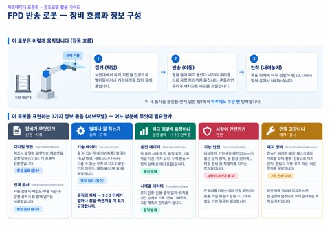

# 🧩 FPDTransferRobot_v0.0.1_260930.aasx

[← 장비 페이지](../README.md) · [⤓ AASX 다운로드](../AASX/FPDTransferRobot_v0.0.1_260930.aasx) · 2.9 MB

> 🤖 AASX 파일을 열어 자동으로 만든 열람 페이지입니다. 직접 고치지 말고 AASX를 다시 올리세요.

| 항목 | 내용 |
|---|---|
| AAS idShort | `FPDGlassSubstrateTransferRobot` |
| AAS id | https://www.smart-factory.kr/ids/aas/FPDGlassSubstrateTransferRobot/1/0 |
| 자산 종류 (assetKind) | Type |
| globalAssetId | https://www.smart-factory.kr/ids/asset/FPDGlassSubstrateTransferRobot/1/0 |
| 설명 | FPD 반송 로봇(FPD Glass Substrate Transfer Robot) 참조 모델 - 자산관리쉘(AAS) Type 수준 표준 모델. |
| 서브모델 | 7개 |
| 전체 요소 | 214개 |

## 서브모델 한눈에 보기

| # | 서브모델 | 요소 수 | semanticId |
|:-:|---|--:|---|
| 1 | [DigitalNameplate](#sm-1) | 30 | https://admin-shell.io/idta/nameplate/3/0/Nameplate |
| 2 | [HandoverDocumentation](#sm-2) | 38 | 0173-1#01-AHF578#003 |
| 3 | [TechnicalData](#sm-3) | 60 | 0173-1#01-AHX837#002 |
| 4 | [OperationalData](#sm-4) | 17 | https://www.smart-factory.kr/ids/sm/FPDGlassSubstrateTransferRobot/OperationalData/1/0 |
| 5 | [FunctionalSafety](#sm-5) | 17 | https://admin-shell.io/idta/iec62683/1/0/FunctionalSafety |
| 6 | [PredictiveMaintenance](#sm-6) | 28 | https://admin-shell.io/idta/SubmodelTemplate/PredictiveMaintenance/1/0 |
| 7 | [TimeSeries](#sm-7) | 24 | https://admin-shell.io/idta/TimeSeries/1/1 |

## 서브모델 상세

각 서브모델 이름을 누르면 펼쳐집니다. **굵은 글씨**는 하위 요소가 있는 묶음입니다.

<b>1. DigitalNameplate</b> — 요소 30개

> 디지털 명판 서브모델 - 제조사-모델-식별번호-제조일-인증 등 제품의 신분 정보를 표준 구조로 담는다(IDTA 공식 템플릿).

semanticId: `https://admin-shell.io/idta/nameplate/3/0/Nameplate`

| idShort | 종류 | 값 | semanticId |
|---|---|---|---|
| URIOfTheProduct | 속성 | https://www.domain-abc.com/Model-Nr-1234/Serial-Nr-5678 | 0112/2///61987#ABN590#002 |
| ManufacturerName | 다국어&nbsp;속성 | "Muster AG" | 0112/2///61987#ABA565#009 |
| ManufacturerProductDesignation | 다국어&nbsp;속성 | "ABC-123" | 0112/2///61987#ABA567#009 |
| AddressInformation | 묶음 |  | https://admin-shell.io/zvei/nameplate/1/0/ContactInformations/Address… |
| ManufacturerProductRoot | 다국어&nbsp;속성 | "flow meter" | 0112/2///61360_7#AAS011#001 |
| ManufacturerProductFamily | 다국어&nbsp;속성 | "Type ABC" | 0112/2///61987#ABP464#002 |
| ManufacturerProductType | 속성 | FM-ABC-1234 | 0112/2///61987#ABA300#008 |
| OrderCodeOfManufacturer | 속성 | FMABC1234 | 0112/2///61987#ABA950#008 |
| ProductArticleNumberOfManufacturer | 속성 | FM11-ABC22-123456 | 0112/2///61987#ABA581#007 |
| SerialNumber | 속성 | 12345678 | 0112/2///61987#ABA951#009 |
| YearOfConstruction | 속성 | 2022 | 0112/2///61987#ABP000#002 |
| DateOfManufacture | 속성 | 2022-01-01 | 0112/2///61987#ABB757#007 |
| HardwareVersion | 속성 | 1.0.0 | 0112/2///61987#ABA926#008 |
| FirmwareVersion | 속성 | 1.0.0 | 0112/2///61987#ABA302#006 |
| SoftwareVersion | 속성 | 1.0.0 | 0112/2///61987#ABA601#008 |
| CountryOfOrigin | 속성 | DE | 0112/2///61987#ABP462#001 |
| UniqueFacilityIdentifier | 속성 | 987654321 | https://admin-shell.io/idta/nameplate/3/0/UniqueFacilityIdentifier |
| CompanyLogo | 파일 |  | 0112/2///61987#ABP463#001 |
| **Markings** | 목록&nbsp;(1) |  | 0112/2///61360_7#AAS006#001 |
| &nbsp;&nbsp;&nbsp;└ **** | 묶음&nbsp;(6) |  | 0112/2///61360_7#AAS009#001 |
| &nbsp;&nbsp;&nbsp;&nbsp;&nbsp;&nbsp;└ MarkingName | 속성 | 0173-1#07-DAA603#004 | 0112/2///61987#ABA231#009 |
| &nbsp;&nbsp;&nbsp;&nbsp;&nbsp;&nbsp;└ DesignationOfCertificateOrApproval | 속성 | KEMA99IECEX1105/128 | 0112/2///61987#ABH783#003 |
| &nbsp;&nbsp;&nbsp;&nbsp;&nbsp;&nbsp;└ IssueDate | 속성 | 2022-01-01 | 0112/2///61987#ABO097#001 |
| &nbsp;&nbsp;&nbsp;&nbsp;&nbsp;&nbsp;└ ExpiryDate | 속성 | 2022-01-01 | 0112/2///61987#ABH830#002 |
| &nbsp;&nbsp;&nbsp;&nbsp;&nbsp;&nbsp;└ MarkingFile | 파일 |  | 0112/2///61987#ABO100#002 |
| &nbsp;&nbsp;&nbsp;&nbsp;&nbsp;&nbsp;└ MarkingAdditionalText | 속성 | 0044 | 0112/2///61987#ABB146#007 |
| **AssetSpecificProperties** | 묶음&nbsp;(1) |  | 0173-1#02-ABI218#003/0173-1#01-AGZ672#004 |
| &nbsp;&nbsp;&nbsp;└ **GuidelineSpecificProperties** | 목록&nbsp;(1) |  | 0173-1#02-ABI219#003/0173-1#01-AHD205#004 |
| &nbsp;&nbsp;&nbsp;&nbsp;&nbsp;&nbsp;└ **** | 묶음&nbsp;(1) |  | 0173-1#01-AHD205#004 |
| &nbsp;&nbsp;&nbsp;&nbsp;&nbsp;&nbsp;&nbsp;&nbsp;&nbsp;└ GuidelineForConformityDeclaration | 속성 | EXAMPLE-GuidelineForConformityDeclaration | 0173-1#02-AAO856#002 |

<b>2. HandoverDocumentation</b> — 요소 38개

> 인계 문서 서브모델 - 사용 매뉴얼-도면-인증서 등 인계 문서를 VDI 2770 기반 표준 구조로 관리한다(IDTA 공식 템플릿).

semanticId: `0173-1#01-AHF578#003`

| idShort | 종류 | 값 | semanticId |
|---|---|---|---|
| **Documents** | 목록&nbsp;(1) |  | 0173-1#02-ABI500#003 |
| &nbsp;&nbsp;&nbsp;└ **** | 묶음&nbsp;(4) |  | 0173-1#02-ABI500#003/0173-1#01-AHF579#003 |
| &nbsp;&nbsp;&nbsp;&nbsp;&nbsp;&nbsp;└ **DocumentIds** | 목록&nbsp;(1) |  | 0173-1#02-ABI501#003 |
| &nbsp;&nbsp;&nbsp;&nbsp;&nbsp;&nbsp;&nbsp;&nbsp;&nbsp;└ **** | 묶음&nbsp;(3) |  | 0173-1#02-ABI501#003/0173-1#01-AHF580#003 |
| &nbsp;&nbsp;&nbsp;&nbsp;&nbsp;&nbsp;&nbsp;&nbsp;&nbsp;&nbsp;&nbsp;&nbsp;└ DocumentDomainId | 속성 | IODA-HYU | 0173-1#02-ABH994#003 |
| &nbsp;&nbsp;&nbsp;&nbsp;&nbsp;&nbsp;&nbsp;&nbsp;&nbsp;&nbsp;&nbsp;&nbsp;└ DocumentIdentifier | 속성 | MAN-001 | 0173-1#02-AAO099#004 |
| &nbsp;&nbsp;&nbsp;&nbsp;&nbsp;&nbsp;&nbsp;&nbsp;&nbsp;&nbsp;&nbsp;&nbsp;└ DocumentIsPrimary | 속성 | false | 0173-1#02-ABH995#003 |
| &nbsp;&nbsp;&nbsp;&nbsp;&nbsp;&nbsp;└ **DocumentClassifications** | 목록&nbsp;(1) |  | 0173-1#02-ABI502#003 |
| &nbsp;&nbsp;&nbsp;&nbsp;&nbsp;&nbsp;&nbsp;&nbsp;&nbsp;└ **** | 묶음&nbsp;(3) |  | 0173-1#02-ABI502#003/0173-1#01-AHF581#003 |
| &nbsp;&nbsp;&nbsp;&nbsp;&nbsp;&nbsp;&nbsp;&nbsp;&nbsp;&nbsp;&nbsp;&nbsp;└ ClassId | 속성 | 03-02 | 0173-1#02-ABH996#003 |
| &nbsp;&nbsp;&nbsp;&nbsp;&nbsp;&nbsp;&nbsp;&nbsp;&nbsp;&nbsp;&nbsp;&nbsp;└ ClassName | 다국어&nbsp;속성 | 운영 | 0173-1#02-ABJ219#002 |
| &nbsp;&nbsp;&nbsp;&nbsp;&nbsp;&nbsp;&nbsp;&nbsp;&nbsp;&nbsp;&nbsp;&nbsp;└ ClassificationSystem | 속성 | VDI2770 Blatt1:2020 | 0173-1#02-ABH997#003 |
| &nbsp;&nbsp;&nbsp;&nbsp;&nbsp;&nbsp;└ **DocumentVersions** | 목록&nbsp;(1) |  | 0173-1#02-ABI503#003 |
| &nbsp;&nbsp;&nbsp;&nbsp;&nbsp;&nbsp;&nbsp;&nbsp;&nbsp;└ **** | 묶음&nbsp;(15) |  | 0173-1#02-ABI503#003/0173-1#01-AHF582#003 |
| &nbsp;&nbsp;&nbsp;&nbsp;&nbsp;&nbsp;&nbsp;&nbsp;&nbsp;&nbsp;&nbsp;&nbsp;└ **Language** | 목록&nbsp;(1) |  | 0173-1#02-AAN468#008 |
| &nbsp;&nbsp;&nbsp;&nbsp;&nbsp;&nbsp;&nbsp;&nbsp;&nbsp;&nbsp;&nbsp;&nbsp;&nbsp;&nbsp;&nbsp;└  | 속성 | en | 0173-1#02-AAN468#008 |
| &nbsp;&nbsp;&nbsp;&nbsp;&nbsp;&nbsp;&nbsp;&nbsp;&nbsp;&nbsp;&nbsp;&nbsp;└ Version | 속성 | 1.0 | 0173-1#02-AAP003#005 |
| &nbsp;&nbsp;&nbsp;&nbsp;&nbsp;&nbsp;&nbsp;&nbsp;&nbsp;&nbsp;&nbsp;&nbsp;└ Title | 다국어&nbsp;속성 | FPD 반송 로봇 운영 매뉴얼 | 0173-1#02-ABG940#003 |
| &nbsp;&nbsp;&nbsp;&nbsp;&nbsp;&nbsp;&nbsp;&nbsp;&nbsp;&nbsp;&nbsp;&nbsp;└ Subtitle | 다국어&nbsp;속성 | 설치 및 운전 안내 | 0173-1#02-ABH998#003 |
| &nbsp;&nbsp;&nbsp;&nbsp;&nbsp;&nbsp;&nbsp;&nbsp;&nbsp;&nbsp;&nbsp;&nbsp;└ Description | 다국어&nbsp;속성 | 운영·정비 매뉴얼 | 0173-1#02-AAN466#004 |
| &nbsp;&nbsp;&nbsp;&nbsp;&nbsp;&nbsp;&nbsp;&nbsp;&nbsp;&nbsp;&nbsp;&nbsp;└ KeyWords | 다국어&nbsp;속성 | 매뉴얼, 운영, 정비 | 0173-1#02-ABH999#003 |
| &nbsp;&nbsp;&nbsp;&nbsp;&nbsp;&nbsp;&nbsp;&nbsp;&nbsp;&nbsp;&nbsp;&nbsp;└ StatusSetDate | 속성 | 2026-01-01 | 0173-1#02-ABI000#003 |
| &nbsp;&nbsp;&nbsp;&nbsp;&nbsp;&nbsp;&nbsp;&nbsp;&nbsp;&nbsp;&nbsp;&nbsp;└ StatusValue | 속성 | Released | 0173-1#02-ABI001#003 |
| &nbsp;&nbsp;&nbsp;&nbsp;&nbsp;&nbsp;&nbsp;&nbsp;&nbsp;&nbsp;&nbsp;&nbsp;└ OrganizationShortName | 속성 | IODA | https://api.eclass-cdp.com/0173-1-02-ABI002-003 |
| &nbsp;&nbsp;&nbsp;&nbsp;&nbsp;&nbsp;&nbsp;&nbsp;&nbsp;&nbsp;&nbsp;&nbsp;└ OrganizationOfficialName | 속성 | IODA Lab, Hanyang University | 0173-1#02-ABI004#003 |
| &nbsp;&nbsp;&nbsp;&nbsp;&nbsp;&nbsp;&nbsp;&nbsp;&nbsp;&nbsp;&nbsp;&nbsp;└ **RefersToEntities** | 목록&nbsp;(1) |  | 0173-1#02-ABK288#002 |
| &nbsp;&nbsp;&nbsp;&nbsp;&nbsp;&nbsp;&nbsp;&nbsp;&nbsp;&nbsp;&nbsp;&nbsp;&nbsp;&nbsp;&nbsp;└  | 참조 |  | 0173-1#02-ABK288#002 |
| &nbsp;&nbsp;&nbsp;&nbsp;&nbsp;&nbsp;&nbsp;&nbsp;&nbsp;&nbsp;&nbsp;&nbsp;└ **BasedOnReferences** | 목록&nbsp;(1) |  | 0173-1#02-ABK289#002 |
| &nbsp;&nbsp;&nbsp;&nbsp;&nbsp;&nbsp;&nbsp;&nbsp;&nbsp;&nbsp;&nbsp;&nbsp;&nbsp;&nbsp;&nbsp;└  | 참조 |  | 0173-1#02-ABK289#002 |
| &nbsp;&nbsp;&nbsp;&nbsp;&nbsp;&nbsp;&nbsp;&nbsp;&nbsp;&nbsp;&nbsp;&nbsp;└ **TranslationOfEntities** | 목록&nbsp;(1) |  | 0173-1#02-ABK290#002 |
| &nbsp;&nbsp;&nbsp;&nbsp;&nbsp;&nbsp;&nbsp;&nbsp;&nbsp;&nbsp;&nbsp;&nbsp;&nbsp;&nbsp;&nbsp;└  | 참조 |  | 0173-1#02-ABK290#002 |
| &nbsp;&nbsp;&nbsp;&nbsp;&nbsp;&nbsp;&nbsp;&nbsp;&nbsp;&nbsp;&nbsp;&nbsp;└ **DigitalFiles** | 목록&nbsp;(1) |  | 0173-1#02-ABK126#002 |
| &nbsp;&nbsp;&nbsp;&nbsp;&nbsp;&nbsp;&nbsp;&nbsp;&nbsp;&nbsp;&nbsp;&nbsp;&nbsp;&nbsp;&nbsp;└  | 파일 |  | 0173-1#02-ABK126#002 |
| &nbsp;&nbsp;&nbsp;&nbsp;&nbsp;&nbsp;&nbsp;&nbsp;&nbsp;&nbsp;&nbsp;&nbsp;└ PreviewFile | 파일 |  | 0173-1#02-ABK127#002 |
| &nbsp;&nbsp;&nbsp;&nbsp;&nbsp;&nbsp;└ **DocumentedEntities** | 목록&nbsp;(1) |  | https://admin-shell.io/vdi/2770/1/0/Document/DocumentedEntities |
| &nbsp;&nbsp;&nbsp;&nbsp;&nbsp;&nbsp;&nbsp;&nbsp;&nbsp;└  | 참조 |  | https://admin-shell.io/vdi/2770/1/0/Document/DocumentedEntity |
| **Entities** | 목록&nbsp;(1) |  | https://admin-shell.io/vdi/2770/1/0/EntitiesForDocumentation |
| &nbsp;&nbsp;&nbsp;└  | 엔티티 |  | https://admin-shell.io/vdi/2770/1/0/EntityForDocumentation |

<b>3. TechnicalData</b> — 요소 60개

> 기술 데이터 서브모델 - 기구-성능-제어-전기 등 정적(변하지 않는) 기술 사양을 도메인 영역별 계층으로 담는다.

semanticId: `0173-1#01-AHX837#002`

| idShort | 종류 | 값 | semanticId |
|---|---|---|---|
| **GeneralInformation** | 묶음&nbsp;(6) |  | 0173-1#02-ABK161#002/0173-1#01-AHX838#002 |
| &nbsp;&nbsp;&nbsp;└ ManufacturerName | 속성 | ExampleCompany Co., Ltd. | 0173-1#02-AAO677#004 |
| &nbsp;&nbsp;&nbsp;└ CompanyLogo | 파일 |  | 0173-1#02-ABI776#002 |
| &nbsp;&nbsp;&nbsp;└ ManufacturerProductDesignation | 다국어&nbsp;속성 | FPD Glass Substrate Transfer Robot | 0173-1#02-AAW338#003 |
| &nbsp;&nbsp;&nbsp;└ ManufacturerArticleNumber | 속성 | ART-FPD-TR-1500 | 0173-1#02-AAO676#005 |
| &nbsp;&nbsp;&nbsp;└ ManufacturerOrderCode | 속성 | FPD-TR-1500-STD | 0173-1#02-AAO227#004 |
| &nbsp;&nbsp;&nbsp;└ **ProductImages** | 묶음&nbsp;(2) |  | 0173-1#02-ABM220#001 |
| &nbsp;&nbsp;&nbsp;&nbsp;&nbsp;&nbsp;└ ImageFile | 파일 | /aasx/files/fpdglasssubstratetransferrobot/productimage.png | 0173-1#02-ABK291#002 |
| &nbsp;&nbsp;&nbsp;&nbsp;&nbsp;&nbsp;└ ImageNote | 다국어&nbsp;속성 | Front view of FPD transfer robot | 0173-1#02-ABL423#001 |
| **ProductClassifications** | 목록&nbsp;(1) |  | 0173-1#02-ABK162#002 |
| &nbsp;&nbsp;&nbsp;└ **** | 묶음&nbsp;(6) |  | 0173-1#02-ABK162#002/0173-1#01-AHX839#002 |
| &nbsp;&nbsp;&nbsp;&nbsp;&nbsp;&nbsp;└ ClassificationSystem | 속성 | ECLASS | 0173-1#02-ABL424#001 |
| &nbsp;&nbsp;&nbsp;&nbsp;&nbsp;&nbsp;└ ClassificationSystemVersion | 속성 | 16.0 | 0173-1#02-AAR710#003 |
| &nbsp;&nbsp;&nbsp;&nbsp;&nbsp;&nbsp;└ ClassificationSystemUrl | 속성 | https://eclass.eu | https://admin-shell.io/IDTA/TechnicalData/ProductClassifications/Prod… |
| &nbsp;&nbsp;&nbsp;&nbsp;&nbsp;&nbsp;└ ProductClassId | 속성 | 0173-1#01-AJZ720#011 | 0173-1#02-ABG776#003 |
| &nbsp;&nbsp;&nbsp;&nbsp;&nbsp;&nbsp;└ ProductClassCodedName | 속성 | 27-38-01-00 | 0173-1#02-ABK128#002 |
| &nbsp;&nbsp;&nbsp;&nbsp;&nbsp;&nbsp;└ ProductClassName | 다국어&nbsp;속성 | Industrial robot | 0173-1#02-ABK273#002 |
| **TechnicalProperties** | 묶음&nbsp;(7) |  | https://www.smart-factory.kr/ids/cd/TechnicalProperties/1/0 |
| &nbsp;&nbsp;&nbsp;└ **MechanicalStructure** | 묶음&nbsp;(10) |  | https://www.smart-factory.kr/ids/cd/MechanicalStructure/1/0 |
| &nbsp;&nbsp;&nbsp;&nbsp;&nbsp;&nbsp;└ RobotType | 속성 | Dual-arm horizontal articulated (planar link-arm) substrate handling robot | https://www.smart-factory.kr/ids/cd/RobotType/1/0 |
| &nbsp;&nbsp;&nbsp;&nbsp;&nbsp;&nbsp;└ DriveType | 속성 | AC servo motor drive | https://www.smart-factory.kr/ids/cd/DriveType/1/0 |
| &nbsp;&nbsp;&nbsp;&nbsp;&nbsp;&nbsp;└ ControlSystemType | 속성 | PLC/robot controller (EtherCAT) | https://www.smart-factory.kr/ids/cd/ControlSystemType/1/0 |
| &nbsp;&nbsp;&nbsp;&nbsp;&nbsp;&nbsp;└ SystemConfiguration | 속성 | Manipulator + end-effector + drive + controller + safety unit | https://www.smart-factory.kr/ids/cd/SystemConfiguration/1/0 |
| &nbsp;&nbsp;&nbsp;&nbsp;&nbsp;&nbsp;└ InstallationType | 속성 | Indoor cleanroom frame-mounted | https://www.smart-factory.kr/ids/cd/InstallationType/1/0 |
| &nbsp;&nbsp;&nbsp;&nbsp;&nbsp;&nbsp;└ MachineWeight | 속성 | 1200.0 | https://www.smart-factory.kr/ids/cd/MachineWeight/1/0 |
| &nbsp;&nbsp;&nbsp;&nbsp;&nbsp;&nbsp;└ NumberOfAxes | 속성 | 5 axes | https://www.smart-factory.kr/ids/cd/NumberOfAxes/1/0 |
| &nbsp;&nbsp;&nbsp;&nbsp;&nbsp;&nbsp;└ ServoAxisCount | 속성 | 5 | https://www.smart-factory.kr/ids/cd/ServoAxisCount/1/0 |
| &nbsp;&nbsp;&nbsp;&nbsp;&nbsp;&nbsp;└ EndEffectorType | 속성 | Vacuum/edge-grip hand | https://www.smart-factory.kr/ids/cd/EndEffectorType/1/0 |
| &nbsp;&nbsp;&nbsp;&nbsp;&nbsp;&nbsp;└ NumberOfHands | 속성 | 2 (dual blade) | https://www.smart-factory.kr/ids/cd/NumberOfHands/1/0 |
| &nbsp;&nbsp;&nbsp;└ **MotionPerformance** | 묶음&nbsp;(10) |  | https://www.smart-factory.kr/ids/cd/MotionPerformance/1/0 |
| &nbsp;&nbsp;&nbsp;&nbsp;&nbsp;&nbsp;└ MaxPayload | 속성 | 30.0 | https://www.smart-factory.kr/ids/cd/MaxPayload/1/0 |
| &nbsp;&nbsp;&nbsp;&nbsp;&nbsp;&nbsp;└ Reach | 속성 | 1800.0 | https://www.smart-factory.kr/ids/cd/Reach/1/0 |
| &nbsp;&nbsp;&nbsp;&nbsp;&nbsp;&nbsp;└ VerticalStroke | 속성 | 1200.0 | https://www.smart-factory.kr/ids/cd/VerticalStroke/1/0 |
| &nbsp;&nbsp;&nbsp;&nbsp;&nbsp;&nbsp;└ RotationRange | 범위 | -180.0 ~ 180.0 | https://www.smart-factory.kr/ids/cd/RotationRange/1/0 |
| &nbsp;&nbsp;&nbsp;&nbsp;&nbsp;&nbsp;└ PositioningRepeatability | 속성 | 0.1 | https://www.smart-factory.kr/ids/cd/PositioningRepeatability/1/0 |
| &nbsp;&nbsp;&nbsp;&nbsp;&nbsp;&nbsp;└ MaxRotationSpeed | 속성 | 120.0 | https://www.smart-factory.kr/ids/cd/MaxRotationSpeed/1/0 |
| &nbsp;&nbsp;&nbsp;&nbsp;&nbsp;&nbsp;└ MaxTransferSpeed | 속성 | 2000.0 | https://www.smart-factory.kr/ids/cd/MaxTransferSpeed/1/0 |
| &nbsp;&nbsp;&nbsp;&nbsp;&nbsp;&nbsp;└ MaxAcceleration | 속성 | 1.0 G | https://www.smart-factory.kr/ids/cd/MaxAcceleration/1/0 |
| &nbsp;&nbsp;&nbsp;&nbsp;&nbsp;&nbsp;└ AlignmentAccuracy | 속성 | 0.1 | https://www.smart-factory.kr/ids/cd/AlignmentAccuracy/1/0 |
| &nbsp;&nbsp;&nbsp;&nbsp;&nbsp;&nbsp;└ VacuumHoldingForce | 속성 | -80.0 | https://www.smart-factory.kr/ids/cd/VacuumHoldingForce/1/0 |
| &nbsp;&nbsp;&nbsp;└ **HandlingCapability** | 묶음&nbsp;(2) |  | https://www.smart-factory.kr/ids/cd/HandlingCapability/1/0 |
| &nbsp;&nbsp;&nbsp;&nbsp;&nbsp;&nbsp;└ HandlingTarget | 속성 | FPD glass substrate | https://www.smart-factory.kr/ids/cd/HandlingTarget/1/0 |
| &nbsp;&nbsp;&nbsp;&nbsp;&nbsp;&nbsp;└ MaxSubstrateSize | 속성 | 8.5 | https://www.smart-factory.kr/ids/cd/MaxSubstrateSize/1/0 |
| &nbsp;&nbsp;&nbsp;└ **ControlAndInterface** | 묶음&nbsp;(4) |  | https://www.smart-factory.kr/ids/cd/ControlAndInterface/1/0 |
| &nbsp;&nbsp;&nbsp;&nbsp;&nbsp;&nbsp;└ ControllerModel | 속성 | FPD-RC-2000 | https://www.smart-factory.kr/ids/cd/ControllerModel/1/0 |
| &nbsp;&nbsp;&nbsp;&nbsp;&nbsp;&nbsp;└ TeachingMethod | 속성 | Teaching pendant / offline | https://www.smart-factory.kr/ids/cd/TeachingMethod/1/0 |
| &nbsp;&nbsp;&nbsp;&nbsp;&nbsp;&nbsp;└ CommunicationInterface | 속성 | EtherCAT / SECS-GEM | https://www.smart-factory.kr/ids/cd/CommunicationInterface/1/0 |
| &nbsp;&nbsp;&nbsp;&nbsp;&nbsp;&nbsp;└ PositionFeedback | 속성 | Absolute encoder | https://www.smart-factory.kr/ids/cd/PositionFeedback/1/0 |
| &nbsp;&nbsp;&nbsp;└ **CleanroomEnvironment** | 묶음&nbsp;(5) |  | https://www.smart-factory.kr/ids/cd/CleanroomEnvironment/1/0 |
| &nbsp;&nbsp;&nbsp;&nbsp;&nbsp;&nbsp;└ CleanlinessClass | 속성 | ISO Class 3 | https://www.smart-factory.kr/ids/cd/CleanlinessClass/1/0 |
| &nbsp;&nbsp;&nbsp;&nbsp;&nbsp;&nbsp;└ OperatingTemperatureRange | 범위 | 18.0 ~ 28.0 | https://www.smart-factory.kr/ids/cd/OperatingTemperatureRange/1/0 |
| &nbsp;&nbsp;&nbsp;&nbsp;&nbsp;&nbsp;└ OperatingHumidityRange | 범위 | 40.0 ~ 60.0 | https://www.smart-factory.kr/ids/cd/OperatingHumidityRange/1/0 |
| &nbsp;&nbsp;&nbsp;&nbsp;&nbsp;&nbsp;└ ParticleGeneration | 속성 | 10.0 | https://www.smart-factory.kr/ids/cd/ParticleGeneration/1/0 |
| &nbsp;&nbsp;&nbsp;&nbsp;&nbsp;&nbsp;└ ProtectionClassIP | 속성 | IP20 (cleanroom) | https://www.smart-factory.kr/ids/cd/ProtectionClassIP/1/0 |
| &nbsp;&nbsp;&nbsp;└ **ElectricalRatings** | 묶음&nbsp;(2) |  | https://www.smart-factory.kr/ids/cd/ElectricalRatings/1/0 |
| &nbsp;&nbsp;&nbsp;&nbsp;&nbsp;&nbsp;└ RatedVoltage | 속성 | 380.0 | 0173-1#02-ABM190#001 |
| &nbsp;&nbsp;&nbsp;&nbsp;&nbsp;&nbsp;└ RatedPower | 속성 | 8.0 | https://www.smart-factory.kr/ids/cd/RatedPower/1/0 |
| &nbsp;&nbsp;&nbsp;└ **SafetyRelatedSpec** | 묶음&nbsp;(2) |  | https://www.smart-factory.kr/ids/cd/SafetyRelatedSpec/1/0 |
| &nbsp;&nbsp;&nbsp;&nbsp;&nbsp;&nbsp;└ EmergencyStopCategory | 속성 | Category 0/1 (ISO 13849) | https://www.smart-factory.kr/ids/cd/EmergencyStopCategory/1/0 |
| &nbsp;&nbsp;&nbsp;&nbsp;&nbsp;&nbsp;└ SafetyRatedSpeed | 속성 | 250.0 | https://www.smart-factory.kr/ids/cd/SafetyRatedSpeed/1/0 |

<b>4. OperationalData</b> — 요소 17개

> 운영 데이터 서브모델 - 운전 상태-측정값-알람-누적 카운터 등 동적(운전 중 변하는) 데이터를 담는다.

semanticId: `https://www.smart-factory.kr/ids/sm/FPDGlassSubstrateTransferRobot/OperationalData/1/0`

| idShort | 종류 | 값 | semanticId |
|---|---|---|---|
| TransferOperationState | 속성 | Run | https://www.smart-factory.kr/ids/cd/TransferOperationState/1/0 |
| TransferOperationMode | 속성 | Auto | https://www.smart-factory.kr/ids/cd/TransferOperationMode/1/0 |
| ServoPowerStatus | 속성 | ServoOn | https://www.smart-factory.kr/ids/cd/ServoPowerStatus/1/0 |
| CurrentRecipeId | 속성 | FPD-TR-RCP-008 | https://www.smart-factory.kr/ids/cd/CurrentRecipeId/1/0 |
| MeasuredTransferSpeed | 속성 | 1480.0 | https://www.smart-factory.kr/ids/cd/MeasuredTransferSpeed/1/0 |
| MeasuredVacuumPressure | 속성 | -63.0 | https://www.smart-factory.kr/ids/cd/MeasuredVacuumPressure/1/0 |
| MeasuredAxisLoadRatio | 속성 | 62 % | https://www.smart-factory.kr/ids/cd/MeasuredAxisLoadRatio/1/0 |
| MeasuredCycleTime | 속성 | 6.2 | https://www.smart-factory.kr/ids/cd/MeasuredCycleTime/1/0 |
| MeasuredPositioningError | 속성 | 0.06 | https://www.smart-factory.kr/ids/cd/MeasuredPositioningError/1/0 |
| TransferAlarmCode | 속성 | E-VAC-LOW | 0173-1#02-ABI766#002 |
| TransferAlarmText | 다국어&nbsp;속성 | 엔드이펙터 흡착 진공압 저하 경고@ko | https://www.smart-factory.kr/ids/cd/TransferAlarmText/1/0 |
| TransferAlarmSeverity | 속성 | Warning | https://www.smart-factory.kr/ids/cd/TransferAlarmSeverity/1/0 |
| LastAlarmTimestamp | 속성 | 2026-06-03T09:14:22+00:00 | https://www.smart-factory.kr/ids/cd/LastAlarmTimestamp/1/0 |
| CumulativeOperatingHours | 속성 | 12500.0 | https://www.smart-factory.kr/ids/cd/CumulativeOperatingHours/1/0 |
| CumulativePowerOnHours | 속성 | 18200.0 | https://www.smart-factory.kr/ids/cd/CumulativePowerOnHours/1/0 |
| CumulativeTransferCount | 속성 | 8540000 sheet | https://www.smart-factory.kr/ids/cd/CumulativeTransferCount/1/0 |
| MaintenanceCycleCount | 속성 | 25 | https://www.smart-factory.kr/ids/cd/MaintenanceCycleCount/1/0 |

<b>5. FunctionalSafety</b> — 요소 17개

> 기능 안전 서브모델 - 안전 기능의 SIL-PL-Category 등 기능 안전 특성을 표준 구조로 담는다(IDTA 공식 템플릿).

semanticId: `https://admin-shell.io/idta/iec62683/1/0/FunctionalSafety`

| idShort | 종류 | 값 | semanticId |
|---|---|---|---|
| NumberOfFunctionalSafetySetsOfCharacteristics | 속성 | 1 | 0112/2///62683#ACE005#001 |
| **OperatingConditionsOfFunctionalSafetyCharacteristics** | 묶음&nbsp;(4) |  | 0112/2///62683#ACG057#001 |
| &nbsp;&nbsp;&nbsp;└ TypeOfVoltage | 속성 | AC | 0112/2///61987#ABA969#007 |
| &nbsp;&nbsp;&nbsp;└ RatedVoltage | 속성 | 380.0 | 0112/2///61987#ABA588#004 |
| &nbsp;&nbsp;&nbsp;└ RatedOperationalCurrent | 속성 | 13.0 | https://admin-shell.io/idta/FunctionalSafety/RatedOperationalCurrent/… |
| &nbsp;&nbsp;&nbsp;└ UsefulLifeInTimeInterval | 속성 | 87600.0 | 0112/2///62683#ACE054#001 |
| **SafetyDeviceTypes** | 묶음&nbsp;(1) |  | 0112/2///62683#ACG070#001 |
| &nbsp;&nbsp;&nbsp;└ FunctionalSafetyDeviceType | 속성 | SUBST | 0112/2///62683#ACE071#001 |
| **SafetySubsystem** | 묶음&nbsp;(5) |  | 0112/2///62683#ACG065#001 |
| &nbsp;&nbsp;&nbsp;└ SIL | 속성 | SIL2 | 0112/2///62683#ACE051#001 |
| &nbsp;&nbsp;&nbsp;└ PFH | 속성 | 8.0E-8 /h | 0112/2///62683#ACE052#001 |
| &nbsp;&nbsp;&nbsp;└ ProofTestInterval | 속성 | 8760.0 | 0112/2///62683#ACE058#001 |
| &nbsp;&nbsp;&nbsp;└ PL | 속성 | PLD | 0112/2///62683#ACE060#001 |
| &nbsp;&nbsp;&nbsp;└ Category | 속성 | CAT3 | 0112/2///62683#ACE063#001 |
| **ElectromechanicalElement** | 묶음&nbsp;(2) |  | 0112/2///62683#ACG067#001 |
| &nbsp;&nbsp;&nbsp;└ B10D | 속성 | 5000000.0 | 0112/2///62683#ACE056#001 |
| &nbsp;&nbsp;&nbsp;└ ProofTestInterval | 속성 | 8760.0 | 0112/2///62683#ACE058#001 |

<b>6. PredictiveMaintenance</b> — 요소 28개

> 예지보전 서브모델 - 잔여수명(RUL) 예측-경계조건-예측모델-경보 등 예지보전 정보를 표준 구조로 담는다(IDTA 공식 템플릿).

semanticId: `https://admin-shell.io/idta/SubmodelTemplate/PredictiveMaintenance/1/0`

| idShort | 종류 | 값 | semanticId |
|---|---|---|---|
| **RemainingUsefulLifePrediction** | 묶음&nbsp;(9) |  | https://admin-shell.io/idta/PredictiveMaintenance/RemainingUsefulLife… |
| &nbsp;&nbsp;&nbsp;└ RemainingUsefulLifetime | 속성 | 5000 | https://admin-shell.io/idta/PredictiveMaintenance/RemainingUsefulLife… |
| &nbsp;&nbsp;&nbsp;└ IndicationType | 속성 | operating hours | https://admin-shell.io/idta/PredictiveMaintenance/IndicationType/1/0 |
| &nbsp;&nbsp;&nbsp;└ DurationValue | 속성 | 8000 | https://admin-shell.io/idta/PredictiveMaintenance/DurationValue/1/0 |
| &nbsp;&nbsp;&nbsp;└ EngineeringUnit | 속성 | h | https://admin-shell.io/idta/PredictiveMaintenance/EngineeringUnit/1/0 |
| &nbsp;&nbsp;&nbsp;└ StartValue | 속성 | 0 | https://admin-shell.io/idta/PredictiveMaintenance/StartValue/1/0 |
| &nbsp;&nbsp;&nbsp;└ StartDateTime | 속성 | 2026-06-01T00:00:00+09:00 | https://admin-shell.io/idta/PredictiveMaintenance/StartDateTime/1/0 |
| &nbsp;&nbsp;&nbsp;└ Description | 속성 | 감속기(RV/하모닉) 진동·축 모터 전류 추이 기준 감속기·벨트·서보베어링 교체 잔여수명(누적 가동시간/반송 cycles 기준) | https://admin-shell.io/idta/PredictiveMaintenance/Description/1/0 |
| &nbsp;&nbsp;&nbsp;└ RemainingUsfulLifeDateTime | 속성 | 2027-04-30T08:00:00+09:00 | https://admin-shell.io/idta/PredictiveMaintenance/RemainingUsfulLifeD… |
| &nbsp;&nbsp;&nbsp;└ ConfidenceInterval | 범위 | 6500.0 ~ 9500.0 | https://admin-shell.io/idta/PredictiveMaintenance/ConfidenceInterval/… |
| ListRULBoundaryConditions | 목록 |  | https://admin-shell.io/idta/PredictiveMaintenance/ListRULBoundaryCond… |
| **RULCondition** | 묶음&nbsp;(7) |  | https://www.smart-factory.kr/ids/cd/RULCondition/1/0 |
| &nbsp;&nbsp;&nbsp;└ ConditionName | 속성 | ReducerVibration (감속기 진동) | https://admin-shell.io/idta/PredictiveMaintenance/ConditionName/1/0 |
| &nbsp;&nbsp;&nbsp;└ IsBoundaryConditionUsedInModel | 속성 | true | https://admin-shell.io/idta/PredictiveMaintenance/IsBoundaryCondition… |
| &nbsp;&nbsp;&nbsp;└ BoundaryValueRange | 범위 | 0.0 ~ 7.0 | https://admin-shell.io/idta/PredictiveMaintenance/BoundaryValueRange/… |
| &nbsp;&nbsp;&nbsp;└ BoundaryEngineeringUnit | 속성 | mm/s | https://admin-shell.io/idta/PredictiveMaintenance/BoundaryEngineering… |
| &nbsp;&nbsp;&nbsp;└ MeanValue | 속성 | 3.5 | https://admin-shell.io/idta/PredictiveMaintenance/MeanValue/1/0 |
| &nbsp;&nbsp;&nbsp;└ Standarddeviation | 속성 | 0.8 | https://admin-shell.io/idta/PredictiveMaintenance/Standarddeviation/1… |
| &nbsp;&nbsp;&nbsp;└ BoundaryDescription | 속성 | 7 | https://admin-shell.io/idta/PredictiveMaintenance/BoundaryDescription… |
| **PredictionModelInformation** | 묶음&nbsp;(2) |  | https://admin-shell.io/idta/PredictiveMaintenance/PredictionModelInfo… |
| &nbsp;&nbsp;&nbsp;└ ModelType | 속성 | ModelTypeDataDriven | https://admin-shell.io/idta/PredictiveMaintenance/ModelType/1/0 |
| &nbsp;&nbsp;&nbsp;└ ModelDescription | 속성 | 감속기 진동·축 모터 전류 특징량 기반 마모 진행 LSTM 회귀 모델(누적 가동시간/반송 cycles와 결합) | https://admin-shell.io/idta/PredictiveMaintenance/ModelDescription/1/0 |
| **ListPreAlerts** | 묶음&nbsp;(2) |  | https://admin-shell.io/idta/PredictiveMaintenance/ListPreAlerts/1/0 |
| &nbsp;&nbsp;&nbsp;└ PreAlertMessage | 속성 | 감속기 마모 진행: 윤활/점검 계획 수립 요망 | https://admin-shell.io/idta/PredictiveMaintenance/PreAlertMessage/1/0 |
| &nbsp;&nbsp;&nbsp;└ PreAlertValue | 속성 | 1000 | https://admin-shell.io/idta/PredictiveMaintenance/PreAlertValue/1/0 |
| **AlertAfterExceedingRemainingUsableLife** | 묶음&nbsp;(2) |  | https://admin-shell.io/idta/PredictiveMaintenance/AlertAfterExceeding… |
| &nbsp;&nbsp;&nbsp;└ AlertMessage | 속성 | 감속기·벨트 한계 마모: 교체 필요 | https://admin-shell.io/idta/PredictiveMaintenance/AlertMessage/1/0 |
| &nbsp;&nbsp;&nbsp;└ MaintenanceRequired | 속성 | true | https://admin-shell.io/idta/PredictiveMaintenance/MaintenanceRequired… |

<b>7. TimeSeries</b> — 요소 24개

> 시계열 데이터 서브모델 - 운전 중 측정되는 값들을 시간 축으로 기록하는 구조(메타데이터-세그먼트-레코드)를 담는다(IDTA 공식 템플릿).

semanticId: `https://admin-shell.io/idta/TimeSeries/1/1`

| idShort | 종류 | 값 | semanticId |
|---|---|---|---|
| **Metadata** | 묶음&nbsp;(3) |  | https://admin-shell.io/idta/TimeSeries/Metadata/1/1 |
| &nbsp;&nbsp;&nbsp;└ Name | 다국어&nbsp;속성 | 반송 운전 시계열 데이터@ko | https://admin-shell.io/idta/TimeSeries/Metadata/Name/1/1 |
| &nbsp;&nbsp;&nbsp;└ Description | 다국어&nbsp;속성 | 시계열 측정 변수 설명 | https://admin-shell.io/idta/TimeSeries/Metadata/Description/1/1 |
| &nbsp;&nbsp;&nbsp;└ **Record** | 묶음&nbsp;(5) |  | https://admin-shell.io/idta/TimeSeries/Record/1/1 |
| &nbsp;&nbsp;&nbsp;&nbsp;&nbsp;&nbsp;└ Time | 속성 | 0 | https://admin-shell.io/idta/TimeSeries/RelativePointInTime/1/1 |
| &nbsp;&nbsp;&nbsp;&nbsp;&nbsp;&nbsp;└ AxisMotorCurrent | 속성 | 2.4 | https://www.smart-factory.kr/ids/cd/AxisMotorCurrent/1/0 |
| &nbsp;&nbsp;&nbsp;&nbsp;&nbsp;&nbsp;└ AxisPosition | 속성 | 128.5 | https://www.smart-factory.kr/ids/cd/AxisPosition/1/0 |
| &nbsp;&nbsp;&nbsp;&nbsp;&nbsp;&nbsp;└ HandVacuumPressure | 속성 | -62.0 | https://www.smart-factory.kr/ids/cd/HandVacuumPressure/1/0 |
| &nbsp;&nbsp;&nbsp;&nbsp;&nbsp;&nbsp;└ Vibration | 속성 | 0.15 | https://www.smart-factory.kr/ids/cd/Vibration/1/0 |
| **Segments** | 묶음&nbsp;(1) |  | https://admin-shell.io/idta/TimeSeries/Segments/1/1 |
| &nbsp;&nbsp;&nbsp;└ **InternalSegment** | 묶음&nbsp;(7) |  | https://admin-shell.io/idta/TimeSeries/Segments/InternalSegment/1/1 |
| &nbsp;&nbsp;&nbsp;&nbsp;&nbsp;&nbsp;└ Name | 다국어&nbsp;속성 | 반송 운전 시계열 데이터@ko | https://admin-shell.io/idta/TimeSeries/Segment/Name/1/1 |
| &nbsp;&nbsp;&nbsp;&nbsp;&nbsp;&nbsp;└ RecordCount | 속성 | 1000 | https://admin-shell.io/idta/TimeSeries/Segment/RecordCount/1/1 |
| &nbsp;&nbsp;&nbsp;&nbsp;&nbsp;&nbsp;└ StartTime | 속성 | 2026-01-01T00:00:00+09:00 | https://admin-shell.io/idta/TimeSeries/Segment/StartTime/1/1 |
| &nbsp;&nbsp;&nbsp;&nbsp;&nbsp;&nbsp;└ EndTime | 속성 | 2026-01-01T00:01:40+09:00 | https://admin-shell.io/idta/TimeSeries/Segment/EndTime/1/1 |
| &nbsp;&nbsp;&nbsp;&nbsp;&nbsp;&nbsp;└ SamplingRate | 속성 | 10 | https://admin-shell.io/idta/TimeSeries/Segment/SamplingRate/1/1 |
| &nbsp;&nbsp;&nbsp;&nbsp;&nbsp;&nbsp;└ State | 속성 | completed | https://admin-shell.io/idta/TimeSeries/Segment/State/1/1 |
| &nbsp;&nbsp;&nbsp;&nbsp;&nbsp;&nbsp;└ **Records** | 묶음&nbsp;(1) |  | https://admin-shell.io/idta/TimeSeries/Records/1/1 |
| &nbsp;&nbsp;&nbsp;&nbsp;&nbsp;&nbsp;&nbsp;&nbsp;&nbsp;└ **Record** | 묶음&nbsp;(5) |  | https://admin-shell.io/idta/TimeSeries/Record/1/1 |
| &nbsp;&nbsp;&nbsp;&nbsp;&nbsp;&nbsp;&nbsp;&nbsp;&nbsp;&nbsp;&nbsp;&nbsp;└ Time | 속성 | 0 | https://admin-shell.io/idta/TimeSeries/RelativePointInTime/1/1 |
| &nbsp;&nbsp;&nbsp;&nbsp;&nbsp;&nbsp;&nbsp;&nbsp;&nbsp;&nbsp;&nbsp;&nbsp;└ AxisMotorCurrent | 속성 | 2.4 | https://www.smart-factory.kr/ids/cd/AxisMotorCurrent/1/0 |
| &nbsp;&nbsp;&nbsp;&nbsp;&nbsp;&nbsp;&nbsp;&nbsp;&nbsp;&nbsp;&nbsp;&nbsp;└ AxisPosition | 속성 | 128.5 | https://www.smart-factory.kr/ids/cd/AxisPosition/1/0 |
| &nbsp;&nbsp;&nbsp;&nbsp;&nbsp;&nbsp;&nbsp;&nbsp;&nbsp;&nbsp;&nbsp;&nbsp;└ HandVacuumPressure | 속성 | -62.0 | https://www.smart-factory.kr/ids/cd/HandVacuumPressure/1/0 |
| &nbsp;&nbsp;&nbsp;&nbsp;&nbsp;&nbsp;&nbsp;&nbsp;&nbsp;&nbsp;&nbsp;&nbsp;└ Vibration | 속성 | 0.15 | https://www.smart-factory.kr/ids/cd/Vibration/1/0 |

