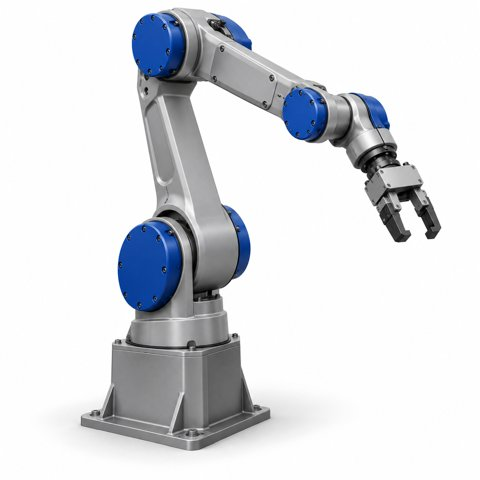

# 매니퓰레이터

[전체 목록](../../../README.md) · 장비군: **로봇·자동화 설비** · [이 장비 문의하기](https://github.com/gb011-hub/aas-archive/issues/new?template=equipment-question.yml&title=%5B%EB%AC%B8%EC%9D%98%5D+%EB%A7%A4%EB%8B%88%ED%93%B0%EB%A0%88%EC%9D%B4%ED%84%B0&equipment=%EB%A7%A4%EB%8B%88%ED%93%B0%EB%A0%88%EC%9D%B4%ED%84%B0)

> 자동 생성 페이지입니다. 이 폴더에 파일을 올리면 내용이 갱신됩니다.

필수 산출물 1/3 · 개발계획서 없음 · 가이던스 없음 · AASX 있음

## 산출물

| 구분 | 파일 | 크기 | 보기 |
|---|---|---|---|
| 개발계획서 | 아직 없음 | | |
| 가이던스 | 아직 없음 | | |
| AASX | [IndustrialHandlingManipulator_v0.0.1_260930.aasx](AASX/IndustrialHandlingManipulator_v0.0.1_260930.aasx) | 2.6 MB | [열람 페이지](gen/IndustrialHandlingManipulator_v0.0.1_260930.md) |
| 참고자료 | [참고링크.md](%EC%B0%B8%EA%B3%A0%EC%9E%90%EB%A3%8C/%EC%B0%B8%EA%B3%A0%EB%A7%81%ED%81%AC.md) | 324 B | [보기](%EC%B0%B8%EA%B3%A0%EC%9E%90%EB%A3%8C/%EC%B0%B8%EA%B3%A0%EB%A7%81%ED%81%AC.md) |

## AAS 구성 — `AIModelNameplateAAS`

`IndustrialHandlingManipulator_v0.0.1_260930.aasx` 에서 읽은 서브모델 1개 · **[요소 전체 보기](gen/IndustrialHandlingManipulator_v0.0.1_260930.md)**:

| # | 서브모델 idShort |
|:-:|---|
| 1 | AIModelNameplate |

## 서브모델 설계 (UML)

- [AI.puml](AASX/UML/AI.puml)
- [HD.puml](AASX/UML/HD.puml)
- [KPI.puml](AASX/UML/KPI.puml)
- [NP.puml](AASX/UML/NP.puml)
- [OD.puml](AASX/UML/OD.puml)
- [PM.puml](AASX/UML/PM.puml)
- [TD.puml](AASX/UML/TD.puml)
- [TS.puml](AASX/UML/TS.puml)

변경 기록 (최근 8건)

| 날짜 | 변경 | 파일 |
|---|---|---|
| 2026-11-04 | 삭제 | 매니퓰레이터_가이던스(자리표시).docx |
| 2026-11-04 | 삭제 | 매니퓰레이터_개발계획서(자리표시).docx |
| 2026-11-03 | 추가 | IndustrialHandlingManipulator_v0.0.1_260930.aasx |
| 2026-11-03 | 추가 | AI.puml |
| 2026-11-03 | 추가 | HD.puml |
| 2026-11-03 | 추가 | KPI.puml |
| 2026-11-03 | 추가 | NP.puml |
| 2026-11-03 | 추가 | OD.puml |

