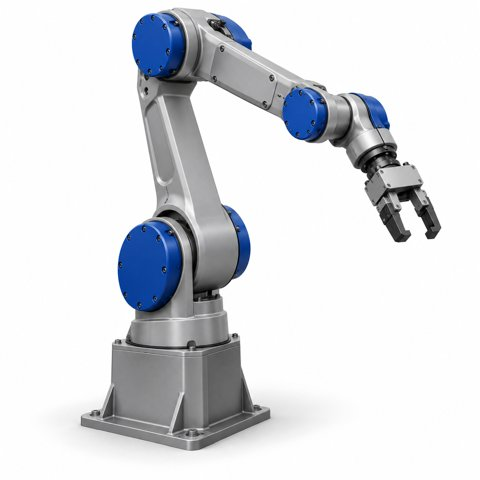

# IndustrialHandlingManipulator_v0.0.1_260930.aasx

[장비 페이지](../README.md) · [AASX 다운로드](../AASX/IndustrialHandlingManipulator_v0.0.1_260930.aasx) · 2.6 MB

> AASX 파일을 열어 자동으로 만든 열람 페이지입니다. 직접 고치지 말고 AASX를 다시 올리세요.

| 항목 | 내용 |
|---|---|
| AAS idShort | `AIModelNameplateAAS` |
| AAS id | https://admin-shell.io/idta/aas/AIModelNameplate/1/0 |
| 자산 종류 (assetKind) | Instance |
| globalAssetId | https://admin-shell.io/idta/asset/AIModelNameplate/1/0 |
| 서브모델 | 1개 |
| 전체 요소 | 41개 |

## 서브모델 한눈에 보기

| # | 서브모델 | 요소 수 | semanticId |
|:-:|---|--:|---|
| 1 | [AIModelNameplate](#sm-1) | 41 | https://admin-shell.io/idta/SubmodelTemplate/AIModelNameplate/1/0 |

## 서브모델 상세

각 서브모델 이름을 누르면 펼쳐집니다. **굵은 글씨**는 하위 요소가 있는 묶음입니다.

<b>1. AIModelNameplate</b> — 요소 41개

semanticId: `https://admin-shell.io/idta/SubmodelTemplate/AIModelNameplate/1/0`

| idShort | 종류 | 값 | semanticId |
|---|---|---|---|
| URIOfTheProduct | 속성 |  | 0112/2///61987#ABN590#002 |
| Version | 속성 |  | 0173-1#02-AAS354#002 |
| ContactInformation | 참조 |  | https://admin-shell.io/idta/AIModelNameplate/Contactinformation/1/0 |
| Storage | 속성 |  | https://admin-shell.io/idta/AIModelNameplate/Storage/1/0 |
| KindOfLearning | 다국어&nbsp;속성 | Learning method of the model (supervised, unsupervised, reinforcement, ....) | https://admin-shell.io/idta/AIModelNameplate/KindOfLearning/1/0 |
| **Inputs** | 묶음&nbsp;(3) |  | https://admin-shell.io/idta/AIModelNameplate/Inputs/1/0 |
| &nbsp;&nbsp;&nbsp;└ KindOfInput | 속성 |  | https://admin-shell.io/idta/AIModelNameplate/Inputs/KindOfInput/1/0 |
| &nbsp;&nbsp;&nbsp;└ **DimensionN** | 묶음&nbsp;(2) |  | https://admin-shell.io/idta/AIModelNameplate/Inputs/DimensionN/1/0 |
| &nbsp;&nbsp;&nbsp;&nbsp;&nbsp;&nbsp;└ Size | 속성 |  | https://admin-shell.io/idta/AIModelNameplate/Inputs/DimensionN/Size/1… |
| &nbsp;&nbsp;&nbsp;&nbsp;&nbsp;&nbsp;└ Information | 속성 |  | https://admin-shell.io/idta/AIModelNameplate/Inputs/DimensionN/Inform… |
| &nbsp;&nbsp;&nbsp;└ Preprocessing | 파일 |  | https://admin-shell.io/idta/AIModelNameplate/Inputs/Preprocessing/1/0 |
| **Outputs** | 묶음&nbsp;(1) |  | https://admin-shell.io/idta/AIModelNameplate/Outputs/1/0 |
| &nbsp;&nbsp;&nbsp;└ **DimensionN** | 묶음&nbsp;(2) |  | https://admin-shell.io/idta/AIModelNameplate/Outputs/DimensionN/1/0 |
| &nbsp;&nbsp;&nbsp;&nbsp;&nbsp;&nbsp;└ Size | 속성 |  | https://admin-shell.io/idta/AIModelNameplate/Outputs/DimensionN/Size/… |
| &nbsp;&nbsp;&nbsp;&nbsp;&nbsp;&nbsp;└ Result | 다국어&nbsp;속성 | This property describes the meaning of this outputdimension (e.g. class). | https://admin-shell.io/idta/AIModelNameplate/Outputs/DimensionN/Resul… |
| **TrainingResults** | 묶음&nbsp;(1) |  | https://admin-shell.io/idta/AIModelNameplate/TrainingResults/1/0 |
| &nbsp;&nbsp;&nbsp;└ ExampleResult | 속성 |  | https://admin-shell.io/idta/AIModelNameplate/TrainingResults/Result/1… |
| **Plots** | 묶음&nbsp;(3) |  | https://admin-shell.io/idta/AIModelNameplate/Plots/1/0 |
| &nbsp;&nbsp;&nbsp;└ **TrainingTesting** | 묶음&nbsp;(1) |  | https://admin-shell.io/idta/AIModelNameplate/Plots/TrainingTesting/1/0 |
| &nbsp;&nbsp;&nbsp;&nbsp;&nbsp;&nbsp;└ ExamplePlot | 파일 |  | https://admin-shell.io/idta/AIModelNameplate/Plots/TrainingTesting/Pl… |
| &nbsp;&nbsp;&nbsp;└ **Structure** | 묶음&nbsp;(1) |  | https://admin-shell.io/idta/AIModelNameplate/Plots/Structure/1/0 |
| &nbsp;&nbsp;&nbsp;&nbsp;&nbsp;&nbsp;└ ExampleStructurePlot | 파일 |  | https://admin-shell.io/idta/AIModelNameplate/Plots/Structure/Structur… |
| &nbsp;&nbsp;&nbsp;└ **GeneralPlots** | 묶음&nbsp;(1) |  | https://admin-shell.io/idta/AIModelNameplate/Plots/GeneralPlots/1/0 |
| &nbsp;&nbsp;&nbsp;&nbsp;&nbsp;&nbsp;└ ExamplePlot | 파일 |  | https://admin-shell.io/idta/AIModelNameplate/Plots/GeneralPlots/Plot/… |
| **Details** | 묶음&nbsp;(4) |  | https://admin-shell.io/idta/AIModelNameplate/Details/1/0 |
| &nbsp;&nbsp;&nbsp;└ FileExtension | 속성 |  | https://admin-shell.io/idta/AIModelNameplate/Details/DataEnding/1/0 |
| &nbsp;&nbsp;&nbsp;└ AIFramework | 속성 |  | https://admin-shell.io/idta/AIModelNameplate/Details/AIFramework/1/0 |
| &nbsp;&nbsp;&nbsp;└ ProgramLanguage | 속성 |  | https://admin-shell.io/idta/AIModelNameplate/Details/ProgramLanguage/… |
| &nbsp;&nbsp;&nbsp;└ Requirements | 파일 |  | https://admin-shell.io/idta/AIModelNameplate/Details/Requirements/1/0 |
| **AIDataset** | 묶음&nbsp;(2) |  | https://admin-shell.io/idta/AIModelNameplate/AIDataset/1/0 |
| &nbsp;&nbsp;&nbsp;└ AIDatasetReference | 참조 |  | https://admin-shell.io/idta/AIModelNameplate/AIDataset/DatasetReferen… |
| &nbsp;&nbsp;&nbsp;└ TimeStamp | 범위 |  | https://admin-shell.io/idta/AIModelNameplate/AIDataset/TimeStamp/1/0 |
| **AITypeSpecificInformation** | 묶음&nbsp;(3) |  | https://admin-shell.io/idta/AIModelNameplate/AITypeSpecificInformatio… |
| &nbsp;&nbsp;&nbsp;└ **TransferLearning** | 묶음&nbsp;(4) |  | https://admin-shell.io/idta/AIModelNameplate/AITypeSpecificInformatio… |
| &nbsp;&nbsp;&nbsp;&nbsp;&nbsp;&nbsp;└ Name | 속성 |  | https://admin-shell.io/idta/AIModelNameplate/AITypeSpecificInformatio… |
| &nbsp;&nbsp;&nbsp;&nbsp;&nbsp;&nbsp;└ TimeStamp | 속성 |  | https://admin-shell.io/idta/AIModelNameplate/AITypeSpecificInformatio… |
| &nbsp;&nbsp;&nbsp;&nbsp;&nbsp;&nbsp;└ Weights | 파일 |  | https://admin-shell.io/idta/AIModelNameplate/AITypeSpecificInformatio… |
| &nbsp;&nbsp;&nbsp;&nbsp;&nbsp;&nbsp;└ AIModelNameplate | 참조 |  | https://admin-shell.io/idta/AIModelNameplate/AITypeSpecificInformatio… |
| &nbsp;&nbsp;&nbsp;└ **Hyperparameter** | 묶음&nbsp;(1) |  | https://admin-shell.io/idta/AIModelNameplate/AITypeSpecificInformatio… |
| &nbsp;&nbsp;&nbsp;&nbsp;&nbsp;&nbsp;└ Example | 속성 |  | https://admin-shell.io/idta/AIModelNameplate/AITypeSpecificInformatio… |
| &nbsp;&nbsp;&nbsp;└ Type | 다국어&nbsp;속성 | Type of the AI(e.g. CNN, RNN, LSTM, ...) | https://admin-shell.io/idta/AIModelNameplate/AITypeSpecificInformatio… |

