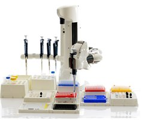

# 바이오 분석용 로봇

[전체 목록](../../../README.md) · 장비군: **로봇·자동화 설비**

> 자동 생성 페이지입니다. 이 폴더에 파일을 올리면 내용이 갱신됩니다.

필수 산출물 1/3 · 개발계획서 없음 · 가이던스 없음 · AASX 있음

## 산출물

| 구분 | 파일 | 크기 | 보기 |
|---|---|---|---|
| 개발계획서 | 아직 없음 | | |
| 가이던스 | 아직 없음 | | |
| AASX | [BioanalysisRobot_v0.0.1_260930.aasx](AASX/BioanalysisRobot_v0.0.1_260930.aasx) | 536 KB | [열람 페이지](gen/BioanalysisRobot_v0.0.1_260930.md) |
| 참고자료 | [참고링크.md](%EC%B0%B8%EA%B3%A0%EC%9E%90%EB%A3%8C/%EC%B0%B8%EA%B3%A0%EB%A7%81%ED%81%AC.md) | 5 KB | [보기](%EC%B0%B8%EA%B3%A0%EC%9E%90%EB%A3%8C/%EC%B0%B8%EA%B3%A0%EB%A7%81%ED%81%AC.md) |

## AAS 구성 — `BioanalysisRobotAAS`

`BioanalysisRobot_v0.0.1_260930.aasx` 에서 읽은 서브모델 8개 · **[요소 전체 보기](gen/BioanalysisRobot_v0.0.1_260930.md)**:

| # | 서브모델 idShort |
|:-:|---|
| 1 | Nameplate |
| 2 | HandoverDocumentation |
| 3 | TechnicalData |
| 4 | OperationalData |
| 5 | TimeSeries |
| 6 | ProcessParameters |
| 7 | PredictiveMaintenance |
| 8 | ProcessVariablesForManufacturingKPICalculation |

변경 기록 (최근 2건)

| 날짜 | 올린 사람 | 내용 |
|---|---|---|
| 2026-11-04 | Claude | 자리표시·테스트 파일 삭제, 장비별 하위 폴더 5개 유지 |
| 2026-11-03 | Claude | AAS 산출물 아카이브 데모: 장비 70종 폴더와 파일 |

