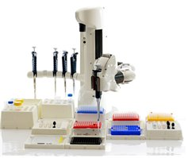

# 🧩 BioanalysisRobot_v0.0.1_260930.aasx

[← 장비 페이지](../README.md) · [⤓ AASX 다운로드](../AASX/BioanalysisRobot_v0.0.1_260930.aasx) · 536 KB

> 🤖 AASX 파일을 열어 자동으로 만든 열람 페이지입니다. 직접 고치지 말고 AASX를 다시 올리세요.

| 항목 | 내용 |
|---|---|
| AAS idShort | `BioanalysisRobotAAS` |
| AAS id | https://www.smart-factory.kr/ids/aas/BioanalysisRobotAAS/1/0 |
| 자산 종류 (assetKind) | Type |
| globalAssetId | https://www.smart-factory.kr/ids/asset/BioanalysisRobot/1/0 |
| 설명 | Type-level reference AAS for a 6-axis articulated bioanalysis (liquid-handling) robot used in laboratory automation. |
| 서브모델 | 8개 |
| 전체 요소 | 609개 |

## 서브모델 한눈에 보기

| # | 서브모델 | 요소 수 | semanticId |
|:-:|---|--:|---|
| 1 | [Nameplate](#sm-1) | 28 | https://admin-shell.io/idta/nameplate/3/0/Nameplate |
| 2 | [HandoverDocumentation](#sm-2) | 126 | 0173-1#01-AHF578#003 |
| 3 | [TechnicalData](#sm-3) | 98 | 0173-1#01-AHX837#002 |
| 4 | [OperationalData](#sm-4) | 57 | https://www.smart-factory.kr/ids/sm/BioanalysisRobotAAS/OperationalData/1/0 |
| 5 | [TimeSeries](#sm-5) | 122 | https://admin-shell.io/idta/TimeSeries/1/1 |
| 6 | [ProcessParameters](#sm-6) | 39 | https://admin-shell-io/idta/SubmodelTemplate/ProcessParameters/1/0 |
| 7 | [PredictiveMaintenance](#sm-7) | 79 | https://admin-shell.io/idta/SubmodelTemplate/PredictiveMaintenance/1/0 |
| 8 | [ProcessVariablesForManufacturingKPICalculation](#sm-8) | 60 | https://admin-shell.io/idta/SubmodelTemplate/ProcessVariablesForManufacturingKPICalculati… |

## 서브모델 상세

각 서브모델 이름을 누르면 펼쳐집니다. **굵은 글씨**는 하위 요소가 있는 묶음입니다.

<b>1. Nameplate</b> — 요소 28개

> Contains the nameplate information attached to the product

semanticId: `https://admin-shell.io/idta/nameplate/3/0/Nameplate`

| idShort | 종류 | 값 | semanticId |
|---|---|---|---|
| URIOfTheProduct | 속성 | https://www.smart-factory.kr/ids/sm/BioanalysisRobotAAS#Asset | 0112/2///61987#ABN590#002 |
| ManufacturerName | 다국어&nbsp;속성 | ExampleCompany | 0112/2///61987#ABA565#009 |
| ManufacturerProductDesignation | 다국어&nbsp;속성 | Bioanalysis Robot | 0112/2///61987#ABA567#009 |
| **AddressInformation** | 묶음&nbsp;(4) |  | https://admin-shell.io/zvei/nameplate/1/0/ContactInformations/Address… |
| &nbsp;&nbsp;&nbsp;└ Street | 다국어&nbsp;속성 | 123 Example Industrial Ave | 0173-1#02-AAO128#002 |
| &nbsp;&nbsp;&nbsp;└ Zipcode | 다국어&nbsp;속성 | 12345 | 0173-1#02-AAO129#002 |
| &nbsp;&nbsp;&nbsp;└ CityTown | 다국어&nbsp;속성 | Seoul | 0173-1#02-AAO132#002 |
| &nbsp;&nbsp;&nbsp;└ NationalCode | 다국어&nbsp;속성 | KR | 0173-1#02-AAO134#002 |
| ManufacturerProductType | 속성 | BAR-2000 | 0112/2///61987#ABA300#008 |
| OrderCodeOfManufacturer | 속성 | BAR-2000-ORD | 0112/2///61987#ABA950#008 |
| ProductArticleNumberOfManufacturer | 속성 | BAR-2000-ART | 0112/2///61987#ABA581#007 |
| SerialNumber | 속성 | BAR-SN-2026-0001 | 0112/2///61987#ABA951#009 |
| YearOfConstruction | 속성 | 2026 | 0112/2///61987#ABP000#002 |
| DateOfManufacture | 속성 | 2026-05-18 | 0112/2///61987#ABB757#007 |
| HardwareVersion | 속성 | HW-1.0 | 0112/2///61987#ABA926#008 |
| FirmwareVersion | 속성 | FW-1.2.0 | 0112/2///61987#ABA302#006 |
| SoftwareVersion | 속성 | SW-3.5.1 | 0112/2///61987#ABA601#008 |
| CountryOfOrigin | 속성 | KR | 0112/2///61987#ABP462#001 |
| UniqueFacilityIdentifier | 속성 | BAR-FAC-0001 | https://admin-shell.io/idta/nameplate/3/0/UniqueFacilityIdentifier |
| CompanyLogo | 파일 | /aasx/files/logo/CompanyLogo.png | 0112/2///61987#ABP463#001 |
| **Markings** | 목록&nbsp;(1) |  | 0112/2///61360_7#AAS006#001 |
| &nbsp;&nbsp;&nbsp;└ **** | 묶음&nbsp;(6) |  | 0112/2///61360_7#AAS009#001 |
| &nbsp;&nbsp;&nbsp;&nbsp;&nbsp;&nbsp;└ MarkingName | 속성 | KC | 0112/2///61987#ABA231#009 |
| &nbsp;&nbsp;&nbsp;&nbsp;&nbsp;&nbsp;└ DesignationOfCertificateOrApproval | 속성 | KC-BAR-2026-0001 | 0112/2///61987#ABH783#003 |
| &nbsp;&nbsp;&nbsp;&nbsp;&nbsp;&nbsp;└ IssueDate | 속성 | 2026-04-01 | 0112/2///61987#ABO097#001 |
| &nbsp;&nbsp;&nbsp;&nbsp;&nbsp;&nbsp;└ ExpiryDate | 속성 | 2031-03-31 | 0112/2///61987#ABH830#002 |
| &nbsp;&nbsp;&nbsp;&nbsp;&nbsp;&nbsp;└ MarkingFile | 파일 | /aasx/files/logo/mark.png | 0112/2///61987#ABO100#002 |
| &nbsp;&nbsp;&nbsp;&nbsp;&nbsp;&nbsp;└ MarkingAdditionalText | 속성 | Synthetic example marking for electrical and mechanical safety; not certificati… | 0112/2///61987#ABB146#007 |

<b>2. HandoverDocumentation</b> — 요소 126개

> The Submodel defines a set meta data for the handover of documentation from the manufacturer to the operator for industrial equipment

semanticId: `0173-1#01-AHF578#003`

| idShort | 종류 | 값 | semanticId |
|---|---|---|---|
| **Documents** | 목록&nbsp;(5) |  | 0173-1#02-ABI500#003 |
| &nbsp;&nbsp;&nbsp;└ **** | 묶음&nbsp;(3) |  | 0173-1#02-ABI500#003/0173-1#01-AHF579#003 |
| &nbsp;&nbsp;&nbsp;&nbsp;&nbsp;&nbsp;└ **DocumentIds** | 목록&nbsp;(1) |  | 0173-1#02-ABI501#003 |
| &nbsp;&nbsp;&nbsp;&nbsp;&nbsp;&nbsp;&nbsp;&nbsp;&nbsp;└ **** | 묶음&nbsp;(3) |  | 0173-1#02-ABI501#003/0173-1#01-AHF580#003 |
| &nbsp;&nbsp;&nbsp;&nbsp;&nbsp;&nbsp;&nbsp;&nbsp;&nbsp;&nbsp;&nbsp;&nbsp;└ DocumentDomainId | 속성 | BAR_DOC | 0173-1#02-ABH994#003 |
| &nbsp;&nbsp;&nbsp;&nbsp;&nbsp;&nbsp;&nbsp;&nbsp;&nbsp;&nbsp;&nbsp;&nbsp;└ DocumentIdentifier | 속성 | BAR-OM-001 | 0173-1#02-AAO099#004 |
| &nbsp;&nbsp;&nbsp;&nbsp;&nbsp;&nbsp;&nbsp;&nbsp;&nbsp;&nbsp;&nbsp;&nbsp;└ DocumentIsPrimary | 속성 | true | 0173-1#02-ABH995#003 |
| &nbsp;&nbsp;&nbsp;&nbsp;&nbsp;&nbsp;└ **DocumentClassifications** | 목록&nbsp;(1) |  | 0173-1#02-ABI502#003 |
| &nbsp;&nbsp;&nbsp;&nbsp;&nbsp;&nbsp;&nbsp;&nbsp;&nbsp;└ **** | 묶음&nbsp;(3) |  | 0173-1#02-ABI502#003/0173-1#01-AHF581#003 |
| &nbsp;&nbsp;&nbsp;&nbsp;&nbsp;&nbsp;&nbsp;&nbsp;&nbsp;&nbsp;&nbsp;&nbsp;└ ClassId | 속성 | 03-02 | 0173-1#02-ABH996#003 |
| &nbsp;&nbsp;&nbsp;&nbsp;&nbsp;&nbsp;&nbsp;&nbsp;&nbsp;&nbsp;&nbsp;&nbsp;└ ClassName | 다국어&nbsp;속성 | Operation | 0173-1#02-ABJ219#002 |
| &nbsp;&nbsp;&nbsp;&nbsp;&nbsp;&nbsp;&nbsp;&nbsp;&nbsp;&nbsp;&nbsp;&nbsp;└ ClassificationSystem | 속성 | VDI 2770 Blatt 1:2020 | 0173-1#02-ABH997#003 |
| &nbsp;&nbsp;&nbsp;&nbsp;&nbsp;&nbsp;└ **DocumentVersions** | 목록&nbsp;(1) |  | 0173-1#02-ABI503#003 |
| &nbsp;&nbsp;&nbsp;&nbsp;&nbsp;&nbsp;&nbsp;&nbsp;&nbsp;└ **** | 묶음&nbsp;(10) |  | 0173-1#02-ABI503#003/0173-1#01-AHF582#003 |
| &nbsp;&nbsp;&nbsp;&nbsp;&nbsp;&nbsp;&nbsp;&nbsp;&nbsp;&nbsp;&nbsp;&nbsp;└ **Language** | 목록&nbsp;(1) |  | 0173-1#02-AAN468#008 |
| &nbsp;&nbsp;&nbsp;&nbsp;&nbsp;&nbsp;&nbsp;&nbsp;&nbsp;&nbsp;&nbsp;&nbsp;&nbsp;&nbsp;&nbsp;└  | 속성 | en | 0173-1#02-AAN468#008 |
| &nbsp;&nbsp;&nbsp;&nbsp;&nbsp;&nbsp;&nbsp;&nbsp;&nbsp;&nbsp;&nbsp;&nbsp;└ Version | 속성 | 1.0 | 0173-1#02-AAP003#005 |
| &nbsp;&nbsp;&nbsp;&nbsp;&nbsp;&nbsp;&nbsp;&nbsp;&nbsp;&nbsp;&nbsp;&nbsp;└ Title | 다국어&nbsp;속성 | Bioanalysis Robot Operation Manual | 0173-1#02-ABG940#003 |
| &nbsp;&nbsp;&nbsp;&nbsp;&nbsp;&nbsp;&nbsp;&nbsp;&nbsp;&nbsp;&nbsp;&nbsp;└ Description | 다국어&nbsp;속성 | Synthetic de-identified example document for the bioanalysis robot reference mo… | 0173-1#02-AAN466#004 |
| &nbsp;&nbsp;&nbsp;&nbsp;&nbsp;&nbsp;&nbsp;&nbsp;&nbsp;&nbsp;&nbsp;&nbsp;└ KeyWords | 다국어&nbsp;속성 | handling, dispensing, plate transfer | 0173-1#02-ABH999#003 |
| &nbsp;&nbsp;&nbsp;&nbsp;&nbsp;&nbsp;&nbsp;&nbsp;&nbsp;&nbsp;&nbsp;&nbsp;└ StatusSetDate | 속성 | 2026-05-18 | 0173-1#02-ABI000#003 |
| &nbsp;&nbsp;&nbsp;&nbsp;&nbsp;&nbsp;&nbsp;&nbsp;&nbsp;&nbsp;&nbsp;&nbsp;└ StatusValue | 속성 | Released | 0173-1#02-ABI001#003 |
| &nbsp;&nbsp;&nbsp;&nbsp;&nbsp;&nbsp;&nbsp;&nbsp;&nbsp;&nbsp;&nbsp;&nbsp;└ OrganizationShortName | 속성 | ExampleOrg | https://api.eclass-cdp.com/0173-1-02-ABI002-003 |
| &nbsp;&nbsp;&nbsp;&nbsp;&nbsp;&nbsp;&nbsp;&nbsp;&nbsp;&nbsp;&nbsp;&nbsp;└ OrganizationOfficialName | 속성 | Example Organization | 0173-1#02-ABI004#003 |
| &nbsp;&nbsp;&nbsp;&nbsp;&nbsp;&nbsp;&nbsp;&nbsp;&nbsp;&nbsp;&nbsp;&nbsp;└ **DigitalFiles** | 목록&nbsp;(1) |  | 0173-1#02-ABK126#002 |
| &nbsp;&nbsp;&nbsp;&nbsp;&nbsp;&nbsp;&nbsp;&nbsp;&nbsp;&nbsp;&nbsp;&nbsp;&nbsp;&nbsp;&nbsp;└  | 파일 | /aasx/files/docs/BAR_OperationManual_v1_0.pdf | 0173-1#02-ABK126#002 |
| &nbsp;&nbsp;&nbsp;└ **** | 묶음&nbsp;(3) |  | 0173-1#02-ABI500#003/0173-1#01-AHF579#003 |
| &nbsp;&nbsp;&nbsp;&nbsp;&nbsp;&nbsp;└ **DocumentIds** | 목록&nbsp;(1) |  | 0173-1#02-ABI501#003 |
| &nbsp;&nbsp;&nbsp;&nbsp;&nbsp;&nbsp;&nbsp;&nbsp;&nbsp;└ **** | 묶음&nbsp;(3) |  | 0173-1#02-ABI501#003/0173-1#01-AHF580#003 |
| &nbsp;&nbsp;&nbsp;&nbsp;&nbsp;&nbsp;&nbsp;&nbsp;&nbsp;&nbsp;&nbsp;&nbsp;└ DocumentDomainId | 속성 | BAR_DOC | 0173-1#02-ABH994#003 |
| &nbsp;&nbsp;&nbsp;&nbsp;&nbsp;&nbsp;&nbsp;&nbsp;&nbsp;&nbsp;&nbsp;&nbsp;└ DocumentIdentifier | 속성 | BAR-CM-001 | 0173-1#02-AAO099#004 |
| &nbsp;&nbsp;&nbsp;&nbsp;&nbsp;&nbsp;&nbsp;&nbsp;&nbsp;&nbsp;&nbsp;&nbsp;└ DocumentIsPrimary | 속성 | true | 0173-1#02-ABH995#003 |
| &nbsp;&nbsp;&nbsp;&nbsp;&nbsp;&nbsp;└ **DocumentClassifications** | 목록&nbsp;(1) |  | 0173-1#02-ABI502#003 |
| &nbsp;&nbsp;&nbsp;&nbsp;&nbsp;&nbsp;&nbsp;&nbsp;&nbsp;└ **** | 묶음&nbsp;(3) |  | 0173-1#02-ABI502#003/0173-1#01-AHF581#003 |
| &nbsp;&nbsp;&nbsp;&nbsp;&nbsp;&nbsp;&nbsp;&nbsp;&nbsp;&nbsp;&nbsp;&nbsp;└ ClassId | 속성 | 03-01 | 0173-1#02-ABH996#003 |
| &nbsp;&nbsp;&nbsp;&nbsp;&nbsp;&nbsp;&nbsp;&nbsp;&nbsp;&nbsp;&nbsp;&nbsp;└ ClassName | 다국어&nbsp;속성 | Commissioning, de-commissioning | 0173-1#02-ABJ219#002 |
| &nbsp;&nbsp;&nbsp;&nbsp;&nbsp;&nbsp;&nbsp;&nbsp;&nbsp;&nbsp;&nbsp;&nbsp;└ ClassificationSystem | 속성 | VDI 2770 Blatt 1:2020 | 0173-1#02-ABH997#003 |
| &nbsp;&nbsp;&nbsp;&nbsp;&nbsp;&nbsp;└ **DocumentVersions** | 목록&nbsp;(1) |  | 0173-1#02-ABI503#003 |
| &nbsp;&nbsp;&nbsp;&nbsp;&nbsp;&nbsp;&nbsp;&nbsp;&nbsp;└ **** | 묶음&nbsp;(10) |  | 0173-1#02-ABI503#003/0173-1#01-AHF582#003 |
| &nbsp;&nbsp;&nbsp;&nbsp;&nbsp;&nbsp;&nbsp;&nbsp;&nbsp;&nbsp;&nbsp;&nbsp;└ **Language** | 목록&nbsp;(1) |  | 0173-1#02-AAN468#008 |
| &nbsp;&nbsp;&nbsp;&nbsp;&nbsp;&nbsp;&nbsp;&nbsp;&nbsp;&nbsp;&nbsp;&nbsp;&nbsp;&nbsp;&nbsp;└  | 속성 | en | 0173-1#02-AAN468#008 |
| &nbsp;&nbsp;&nbsp;&nbsp;&nbsp;&nbsp;&nbsp;&nbsp;&nbsp;&nbsp;&nbsp;&nbsp;└ Version | 속성 | 1.0 | 0173-1#02-AAP003#005 |
| &nbsp;&nbsp;&nbsp;&nbsp;&nbsp;&nbsp;&nbsp;&nbsp;&nbsp;&nbsp;&nbsp;&nbsp;└ Title | 다국어&nbsp;속성 | Bioanalysis Robot Commissioning Guide | 0173-1#02-ABG940#003 |
| &nbsp;&nbsp;&nbsp;&nbsp;&nbsp;&nbsp;&nbsp;&nbsp;&nbsp;&nbsp;&nbsp;&nbsp;└ Description | 다국어&nbsp;속성 | Synthetic de-identified example document for the bioanalysis robot reference mo… | 0173-1#02-AAN466#004 |
| &nbsp;&nbsp;&nbsp;&nbsp;&nbsp;&nbsp;&nbsp;&nbsp;&nbsp;&nbsp;&nbsp;&nbsp;└ KeyWords | 다국어&nbsp;속성 | commissioning, installation, decommissioning | 0173-1#02-ABH999#003 |
| &nbsp;&nbsp;&nbsp;&nbsp;&nbsp;&nbsp;&nbsp;&nbsp;&nbsp;&nbsp;&nbsp;&nbsp;└ StatusSetDate | 속성 | 2026-05-18 | 0173-1#02-ABI000#003 |
| &nbsp;&nbsp;&nbsp;&nbsp;&nbsp;&nbsp;&nbsp;&nbsp;&nbsp;&nbsp;&nbsp;&nbsp;└ StatusValue | 속성 | Released | 0173-1#02-ABI001#003 |
| &nbsp;&nbsp;&nbsp;&nbsp;&nbsp;&nbsp;&nbsp;&nbsp;&nbsp;&nbsp;&nbsp;&nbsp;└ OrganizationShortName | 속성 | ExampleOrg | https://api.eclass-cdp.com/0173-1-02-ABI002-003 |
| &nbsp;&nbsp;&nbsp;&nbsp;&nbsp;&nbsp;&nbsp;&nbsp;&nbsp;&nbsp;&nbsp;&nbsp;└ OrganizationOfficialName | 속성 | Example Organization | 0173-1#02-ABI004#003 |
| &nbsp;&nbsp;&nbsp;&nbsp;&nbsp;&nbsp;&nbsp;&nbsp;&nbsp;&nbsp;&nbsp;&nbsp;└ **DigitalFiles** | 목록&nbsp;(1) |  | 0173-1#02-ABK126#002 |
| &nbsp;&nbsp;&nbsp;&nbsp;&nbsp;&nbsp;&nbsp;&nbsp;&nbsp;&nbsp;&nbsp;&nbsp;&nbsp;&nbsp;&nbsp;└  | 파일 | /aasx/files/docs/BAR_CommissioningGuide_v1_0.pdf | 0173-1#02-ABK126#002 |
| &nbsp;&nbsp;&nbsp;└ **** | 묶음&nbsp;(3) |  | 0173-1#02-ABI500#003/0173-1#01-AHF579#003 |
| &nbsp;&nbsp;&nbsp;&nbsp;&nbsp;&nbsp;└ **DocumentIds** | 목록&nbsp;(1) |  | 0173-1#02-ABI501#003 |
| &nbsp;&nbsp;&nbsp;&nbsp;&nbsp;&nbsp;&nbsp;&nbsp;&nbsp;└ **** | 묶음&nbsp;(3) |  | 0173-1#02-ABI501#003/0173-1#01-AHF580#003 |
| &nbsp;&nbsp;&nbsp;&nbsp;&nbsp;&nbsp;&nbsp;&nbsp;&nbsp;&nbsp;&nbsp;&nbsp;└ DocumentDomainId | 속성 | BAR_DOC | 0173-1#02-ABH994#003 |
| &nbsp;&nbsp;&nbsp;&nbsp;&nbsp;&nbsp;&nbsp;&nbsp;&nbsp;&nbsp;&nbsp;&nbsp;└ DocumentIdentifier | 속성 | BAR-SF-001 | 0173-1#02-AAO099#004 |
| &nbsp;&nbsp;&nbsp;&nbsp;&nbsp;&nbsp;&nbsp;&nbsp;&nbsp;&nbsp;&nbsp;&nbsp;└ DocumentIsPrimary | 속성 | true | 0173-1#02-ABH995#003 |
| &nbsp;&nbsp;&nbsp;&nbsp;&nbsp;&nbsp;└ **DocumentClassifications** | 목록&nbsp;(1) |  | 0173-1#02-ABI502#003 |
| &nbsp;&nbsp;&nbsp;&nbsp;&nbsp;&nbsp;&nbsp;&nbsp;&nbsp;└ **** | 묶음&nbsp;(3) |  | 0173-1#02-ABI502#003/0173-1#01-AHF581#003 |
| &nbsp;&nbsp;&nbsp;&nbsp;&nbsp;&nbsp;&nbsp;&nbsp;&nbsp;&nbsp;&nbsp;&nbsp;└ ClassId | 속성 | 03-03 | 0173-1#02-ABH996#003 |
| &nbsp;&nbsp;&nbsp;&nbsp;&nbsp;&nbsp;&nbsp;&nbsp;&nbsp;&nbsp;&nbsp;&nbsp;└ ClassName | 다국어&nbsp;속성 | General safety | 0173-1#02-ABJ219#002 |
| &nbsp;&nbsp;&nbsp;&nbsp;&nbsp;&nbsp;&nbsp;&nbsp;&nbsp;&nbsp;&nbsp;&nbsp;└ ClassificationSystem | 속성 | VDI 2770 Blatt 1:2020 | 0173-1#02-ABH997#003 |
| &nbsp;&nbsp;&nbsp;&nbsp;&nbsp;&nbsp;└ **DocumentVersions** | 목록&nbsp;(1) |  | 0173-1#02-ABI503#003 |
| &nbsp;&nbsp;&nbsp;&nbsp;&nbsp;&nbsp;&nbsp;&nbsp;&nbsp;└ **** | 묶음&nbsp;(10) |  | 0173-1#02-ABI503#003/0173-1#01-AHF582#003 |
| &nbsp;&nbsp;&nbsp;&nbsp;&nbsp;&nbsp;&nbsp;&nbsp;&nbsp;&nbsp;&nbsp;&nbsp;└ **Language** | 목록&nbsp;(1) |  | 0173-1#02-AAN468#008 |
| &nbsp;&nbsp;&nbsp;&nbsp;&nbsp;&nbsp;&nbsp;&nbsp;&nbsp;&nbsp;&nbsp;&nbsp;&nbsp;&nbsp;&nbsp;└  | 속성 | en | 0173-1#02-AAN468#008 |
| &nbsp;&nbsp;&nbsp;&nbsp;&nbsp;&nbsp;&nbsp;&nbsp;&nbsp;&nbsp;&nbsp;&nbsp;└ Version | 속성 | 1.0 | 0173-1#02-AAP003#005 |
| &nbsp;&nbsp;&nbsp;&nbsp;&nbsp;&nbsp;&nbsp;&nbsp;&nbsp;&nbsp;&nbsp;&nbsp;└ Title | 다국어&nbsp;속성 | Bioanalysis Robot Safety Guide | 0173-1#02-ABG940#003 |
| &nbsp;&nbsp;&nbsp;&nbsp;&nbsp;&nbsp;&nbsp;&nbsp;&nbsp;&nbsp;&nbsp;&nbsp;└ Description | 다국어&nbsp;속성 | Synthetic de-identified example document for the bioanalysis robot reference mo… | 0173-1#02-AAN466#004 |
| &nbsp;&nbsp;&nbsp;&nbsp;&nbsp;&nbsp;&nbsp;&nbsp;&nbsp;&nbsp;&nbsp;&nbsp;└ KeyWords | 다국어&nbsp;속성 | safety, interlock, collision detection | 0173-1#02-ABH999#003 |
| &nbsp;&nbsp;&nbsp;&nbsp;&nbsp;&nbsp;&nbsp;&nbsp;&nbsp;&nbsp;&nbsp;&nbsp;└ StatusSetDate | 속성 | 2026-05-18 | 0173-1#02-ABI000#003 |
| &nbsp;&nbsp;&nbsp;&nbsp;&nbsp;&nbsp;&nbsp;&nbsp;&nbsp;&nbsp;&nbsp;&nbsp;└ StatusValue | 속성 | Released | 0173-1#02-ABI001#003 |
| &nbsp;&nbsp;&nbsp;&nbsp;&nbsp;&nbsp;&nbsp;&nbsp;&nbsp;&nbsp;&nbsp;&nbsp;└ OrganizationShortName | 속성 | ExampleOrg | https://api.eclass-cdp.com/0173-1-02-ABI002-003 |
| &nbsp;&nbsp;&nbsp;&nbsp;&nbsp;&nbsp;&nbsp;&nbsp;&nbsp;&nbsp;&nbsp;&nbsp;└ OrganizationOfficialName | 속성 | Example Organization | 0173-1#02-ABI004#003 |
| &nbsp;&nbsp;&nbsp;&nbsp;&nbsp;&nbsp;&nbsp;&nbsp;&nbsp;&nbsp;&nbsp;&nbsp;└ **DigitalFiles** | 목록&nbsp;(1) |  | 0173-1#02-ABK126#002 |
| &nbsp;&nbsp;&nbsp;&nbsp;&nbsp;&nbsp;&nbsp;&nbsp;&nbsp;&nbsp;&nbsp;&nbsp;&nbsp;&nbsp;&nbsp;└  | 파일 | /aasx/files/docs/BAR_SafetyGuide_v1_0.pdf | 0173-1#02-ABK126#002 |
| &nbsp;&nbsp;&nbsp;└ **** | 묶음&nbsp;(3) |  | 0173-1#02-ABI500#003/0173-1#01-AHF579#003 |
| &nbsp;&nbsp;&nbsp;&nbsp;&nbsp;&nbsp;└ **DocumentIds** | 목록&nbsp;(1) |  | 0173-1#02-ABI501#003 |
| &nbsp;&nbsp;&nbsp;&nbsp;&nbsp;&nbsp;&nbsp;&nbsp;&nbsp;└ **** | 묶음&nbsp;(3) |  | 0173-1#02-ABI501#003/0173-1#01-AHF580#003 |
| &nbsp;&nbsp;&nbsp;&nbsp;&nbsp;&nbsp;&nbsp;&nbsp;&nbsp;&nbsp;&nbsp;&nbsp;└ DocumentDomainId | 속성 | BAR_DOC | 0173-1#02-ABH994#003 |
| &nbsp;&nbsp;&nbsp;&nbsp;&nbsp;&nbsp;&nbsp;&nbsp;&nbsp;&nbsp;&nbsp;&nbsp;└ DocumentIdentifier | 속성 | BAR-MT-001 | 0173-1#02-AAO099#004 |
| &nbsp;&nbsp;&nbsp;&nbsp;&nbsp;&nbsp;&nbsp;&nbsp;&nbsp;&nbsp;&nbsp;&nbsp;└ DocumentIsPrimary | 속성 | true | 0173-1#02-ABH995#003 |
| &nbsp;&nbsp;&nbsp;&nbsp;&nbsp;&nbsp;└ **DocumentClassifications** | 목록&nbsp;(1) |  | 0173-1#02-ABI502#003 |
| &nbsp;&nbsp;&nbsp;&nbsp;&nbsp;&nbsp;&nbsp;&nbsp;&nbsp;└ **** | 묶음&nbsp;(3) |  | 0173-1#02-ABI502#003/0173-1#01-AHF581#003 |
| &nbsp;&nbsp;&nbsp;&nbsp;&nbsp;&nbsp;&nbsp;&nbsp;&nbsp;&nbsp;&nbsp;&nbsp;└ ClassId | 속성 | 03-04 | 0173-1#02-ABH996#003 |
| &nbsp;&nbsp;&nbsp;&nbsp;&nbsp;&nbsp;&nbsp;&nbsp;&nbsp;&nbsp;&nbsp;&nbsp;└ ClassName | 다국어&nbsp;속성 | Inspection, maintenance, testing | 0173-1#02-ABJ219#002 |
| &nbsp;&nbsp;&nbsp;&nbsp;&nbsp;&nbsp;&nbsp;&nbsp;&nbsp;&nbsp;&nbsp;&nbsp;└ ClassificationSystem | 속성 | VDI 2770 Blatt 1:2020 | 0173-1#02-ABH997#003 |
| &nbsp;&nbsp;&nbsp;&nbsp;&nbsp;&nbsp;└ **DocumentVersions** | 목록&nbsp;(1) |  | 0173-1#02-ABI503#003 |
| &nbsp;&nbsp;&nbsp;&nbsp;&nbsp;&nbsp;&nbsp;&nbsp;&nbsp;└ **** | 묶음&nbsp;(10) |  | 0173-1#02-ABI503#003/0173-1#01-AHF582#003 |
| &nbsp;&nbsp;&nbsp;&nbsp;&nbsp;&nbsp;&nbsp;&nbsp;&nbsp;&nbsp;&nbsp;&nbsp;└ **Language** | 목록&nbsp;(1) |  | 0173-1#02-AAN468#008 |
| &nbsp;&nbsp;&nbsp;&nbsp;&nbsp;&nbsp;&nbsp;&nbsp;&nbsp;&nbsp;&nbsp;&nbsp;&nbsp;&nbsp;&nbsp;└  | 속성 | en | 0173-1#02-AAN468#008 |
| &nbsp;&nbsp;&nbsp;&nbsp;&nbsp;&nbsp;&nbsp;&nbsp;&nbsp;&nbsp;&nbsp;&nbsp;└ Version | 속성 | 1.0 | 0173-1#02-AAP003#005 |
| &nbsp;&nbsp;&nbsp;&nbsp;&nbsp;&nbsp;&nbsp;&nbsp;&nbsp;&nbsp;&nbsp;&nbsp;└ Title | 다국어&nbsp;속성 | Bioanalysis Robot Maintenance and Calibration Guide | 0173-1#02-ABG940#003 |
| &nbsp;&nbsp;&nbsp;&nbsp;&nbsp;&nbsp;&nbsp;&nbsp;&nbsp;&nbsp;&nbsp;&nbsp;└ Description | 다국어&nbsp;속성 | Synthetic de-identified example document for the bioanalysis robot reference mo… | 0173-1#02-AAN466#004 |
| &nbsp;&nbsp;&nbsp;&nbsp;&nbsp;&nbsp;&nbsp;&nbsp;&nbsp;&nbsp;&nbsp;&nbsp;└ KeyWords | 다국어&nbsp;속성 | maintenance, calibration, inspection | 0173-1#02-ABH999#003 |
| &nbsp;&nbsp;&nbsp;&nbsp;&nbsp;&nbsp;&nbsp;&nbsp;&nbsp;&nbsp;&nbsp;&nbsp;└ StatusSetDate | 속성 | 2026-05-18 | 0173-1#02-ABI000#003 |
| &nbsp;&nbsp;&nbsp;&nbsp;&nbsp;&nbsp;&nbsp;&nbsp;&nbsp;&nbsp;&nbsp;&nbsp;└ StatusValue | 속성 | Released | 0173-1#02-ABI001#003 |
| &nbsp;&nbsp;&nbsp;&nbsp;&nbsp;&nbsp;&nbsp;&nbsp;&nbsp;&nbsp;&nbsp;&nbsp;└ OrganizationShortName | 속성 | ExampleOrg | https://api.eclass-cdp.com/0173-1-02-ABI002-003 |
| &nbsp;&nbsp;&nbsp;&nbsp;&nbsp;&nbsp;&nbsp;&nbsp;&nbsp;&nbsp;&nbsp;&nbsp;└ OrganizationOfficialName | 속성 | Example Organization | 0173-1#02-ABI004#003 |
| &nbsp;&nbsp;&nbsp;&nbsp;&nbsp;&nbsp;&nbsp;&nbsp;&nbsp;&nbsp;&nbsp;&nbsp;└ **DigitalFiles** | 목록&nbsp;(1) |  | 0173-1#02-ABK126#002 |
| &nbsp;&nbsp;&nbsp;&nbsp;&nbsp;&nbsp;&nbsp;&nbsp;&nbsp;&nbsp;&nbsp;&nbsp;&nbsp;&nbsp;&nbsp;└  | 파일 | /aasx/files/docs/BAR_MaintenanceCalibrationGuide_v1_0.pdf | 0173-1#02-ABK126#002 |
| &nbsp;&nbsp;&nbsp;└ **** | 묶음&nbsp;(3) |  | 0173-1#02-ABI500#003/0173-1#01-AHF579#003 |
| &nbsp;&nbsp;&nbsp;&nbsp;&nbsp;&nbsp;└ **DocumentIds** | 목록&nbsp;(1) |  | 0173-1#02-ABI501#003 |
| &nbsp;&nbsp;&nbsp;&nbsp;&nbsp;&nbsp;&nbsp;&nbsp;&nbsp;└ **** | 묶음&nbsp;(3) |  | 0173-1#02-ABI501#003/0173-1#01-AHF580#003 |
| &nbsp;&nbsp;&nbsp;&nbsp;&nbsp;&nbsp;&nbsp;&nbsp;&nbsp;&nbsp;&nbsp;&nbsp;└ DocumentDomainId | 속성 | BAR_DOC | 0173-1#02-ABH994#003 |
| &nbsp;&nbsp;&nbsp;&nbsp;&nbsp;&nbsp;&nbsp;&nbsp;&nbsp;&nbsp;&nbsp;&nbsp;└ DocumentIdentifier | 속성 | BAR-CE-001 | 0173-1#02-AAO099#004 |
| &nbsp;&nbsp;&nbsp;&nbsp;&nbsp;&nbsp;&nbsp;&nbsp;&nbsp;&nbsp;&nbsp;&nbsp;└ DocumentIsPrimary | 속성 | true | 0173-1#02-ABH995#003 |
| &nbsp;&nbsp;&nbsp;&nbsp;&nbsp;&nbsp;└ **DocumentClassifications** | 목록&nbsp;(1) |  | 0173-1#02-ABI502#003 |
| &nbsp;&nbsp;&nbsp;&nbsp;&nbsp;&nbsp;&nbsp;&nbsp;&nbsp;└ **** | 묶음&nbsp;(3) |  | 0173-1#02-ABI502#003/0173-1#01-AHF581#003 |
| &nbsp;&nbsp;&nbsp;&nbsp;&nbsp;&nbsp;&nbsp;&nbsp;&nbsp;&nbsp;&nbsp;&nbsp;└ ClassId | 속성 | 02-04 | 0173-1#02-ABH996#003 |
| &nbsp;&nbsp;&nbsp;&nbsp;&nbsp;&nbsp;&nbsp;&nbsp;&nbsp;&nbsp;&nbsp;&nbsp;└ ClassName | 다국어&nbsp;속성 | Certificates, declarations | 0173-1#02-ABJ219#002 |
| &nbsp;&nbsp;&nbsp;&nbsp;&nbsp;&nbsp;&nbsp;&nbsp;&nbsp;&nbsp;&nbsp;&nbsp;└ ClassificationSystem | 속성 | VDI 2770 Blatt 1:2020 | 0173-1#02-ABH997#003 |
| &nbsp;&nbsp;&nbsp;&nbsp;&nbsp;&nbsp;└ **DocumentVersions** | 목록&nbsp;(1) |  | 0173-1#02-ABI503#003 |
| &nbsp;&nbsp;&nbsp;&nbsp;&nbsp;&nbsp;&nbsp;&nbsp;&nbsp;└ **** | 묶음&nbsp;(10) |  | 0173-1#02-ABI503#003/0173-1#01-AHF582#003 |
| &nbsp;&nbsp;&nbsp;&nbsp;&nbsp;&nbsp;&nbsp;&nbsp;&nbsp;&nbsp;&nbsp;&nbsp;└ **Language** | 목록&nbsp;(1) |  | 0173-1#02-AAN468#008 |
| &nbsp;&nbsp;&nbsp;&nbsp;&nbsp;&nbsp;&nbsp;&nbsp;&nbsp;&nbsp;&nbsp;&nbsp;&nbsp;&nbsp;&nbsp;└  | 속성 | en | 0173-1#02-AAN468#008 |
| &nbsp;&nbsp;&nbsp;&nbsp;&nbsp;&nbsp;&nbsp;&nbsp;&nbsp;&nbsp;&nbsp;&nbsp;└ Version | 속성 | 1.0 | 0173-1#02-AAP003#005 |
| &nbsp;&nbsp;&nbsp;&nbsp;&nbsp;&nbsp;&nbsp;&nbsp;&nbsp;&nbsp;&nbsp;&nbsp;└ Title | 다국어&nbsp;속성 | Bioanalysis Robot Example Declaration of Conformity | 0173-1#02-ABG940#003 |
| &nbsp;&nbsp;&nbsp;&nbsp;&nbsp;&nbsp;&nbsp;&nbsp;&nbsp;&nbsp;&nbsp;&nbsp;└ Description | 다국어&nbsp;속성 | Synthetic de-identified example document for the bioanalysis robot reference mo… | 0173-1#02-AAN466#004 |
| &nbsp;&nbsp;&nbsp;&nbsp;&nbsp;&nbsp;&nbsp;&nbsp;&nbsp;&nbsp;&nbsp;&nbsp;└ KeyWords | 다국어&nbsp;속성 | synthetic declaration, conformity example | 0173-1#02-ABH999#003 |
| &nbsp;&nbsp;&nbsp;&nbsp;&nbsp;&nbsp;&nbsp;&nbsp;&nbsp;&nbsp;&nbsp;&nbsp;└ StatusSetDate | 속성 | 2026-05-18 | 0173-1#02-ABI000#003 |
| &nbsp;&nbsp;&nbsp;&nbsp;&nbsp;&nbsp;&nbsp;&nbsp;&nbsp;&nbsp;&nbsp;&nbsp;└ StatusValue | 속성 | Released | 0173-1#02-ABI001#003 |
| &nbsp;&nbsp;&nbsp;&nbsp;&nbsp;&nbsp;&nbsp;&nbsp;&nbsp;&nbsp;&nbsp;&nbsp;└ OrganizationShortName | 속성 | ExampleOrg | https://api.eclass-cdp.com/0173-1-02-ABI002-003 |
| &nbsp;&nbsp;&nbsp;&nbsp;&nbsp;&nbsp;&nbsp;&nbsp;&nbsp;&nbsp;&nbsp;&nbsp;└ OrganizationOfficialName | 속성 | Example Organization | 0173-1#02-ABI004#003 |
| &nbsp;&nbsp;&nbsp;&nbsp;&nbsp;&nbsp;&nbsp;&nbsp;&nbsp;&nbsp;&nbsp;&nbsp;└ **DigitalFiles** | 목록&nbsp;(1) |  | 0173-1#02-ABK126#002 |
| &nbsp;&nbsp;&nbsp;&nbsp;&nbsp;&nbsp;&nbsp;&nbsp;&nbsp;&nbsp;&nbsp;&nbsp;&nbsp;&nbsp;&nbsp;└  | 파일 | /aasx/files/docs/BAR_DeclarationOfConformity_v1_0.pdf | 0173-1#02-ABK126#002 |

<b>3. TechnicalData</b> — 요소 98개

> Submodel containing technical data of the asset and associated product classificatons

semanticId: `0173-1#01-AHX837#002`

| idShort | 종류 | 값 | semanticId |
|---|---|---|---|
| **GeneralInformation** | 묶음&nbsp;(6) |  | 0173-1#02-ABK161#002/0173-1#01-AHX838#002 |
| &nbsp;&nbsp;&nbsp;└ ManufacturerName | 속성 | ExampleCompany | 0173-1#02-AAO677#004 |
| &nbsp;&nbsp;&nbsp;└ CompanyLogo | 파일 | /aasx/files/logo/CompanyLogo.png | 0173-1#02-ABI776#002 |
| &nbsp;&nbsp;&nbsp;└ ManufacturerProductDesignation | 다국어&nbsp;속성 | 6-axis articulated bioanalysis robot with integrated liquid handler | 0173-1#02-AAW338#003 |
| &nbsp;&nbsp;&nbsp;└ ManufacturerArticleNumber | 속성 | BAR-2000-ART | 0173-1#02-AAO676#005 |
| &nbsp;&nbsp;&nbsp;└ ManufacturerOrderCode | 속성 | BAR-2000-ORD | 0173-1#02-AAO227#004 |
| &nbsp;&nbsp;&nbsp;└ **ProductImages** | 목록&nbsp;(1) |  | 0173-1#02-ABM220#001 |
| &nbsp;&nbsp;&nbsp;&nbsp;&nbsp;&nbsp;└ **** | 묶음&nbsp;(2) |  | 0173-1#02-ABM220#001/0173-1#01-AHY911#001 |
| &nbsp;&nbsp;&nbsp;&nbsp;&nbsp;&nbsp;&nbsp;&nbsp;&nbsp;└ ImageFile | 파일 | /aasx/files/images/BIOANALYSISROBOT_ProductImage.jpg | 0173-1#02-ABK291#002 |
| &nbsp;&nbsp;&nbsp;&nbsp;&nbsp;&nbsp;&nbsp;&nbsp;&nbsp;└ ImageNote | 다국어&nbsp;속성 | Side view of ExampleCompany bioanalysis robot | 0173-1#02-ABL423#001 |
| **ProductClassifications** | 목록&nbsp;(1) |  | 0173-1#02-ABK162#002 |
| &nbsp;&nbsp;&nbsp;└ **** | 묶음&nbsp;(6) |  | 0173-1#02-ABK162#002/0173-1#01-AHX839#002 |
| &nbsp;&nbsp;&nbsp;&nbsp;&nbsp;&nbsp;└ ClassificationSystem | 속성 | ECLASS | 0173-1#02-ABL424#001 |
| &nbsp;&nbsp;&nbsp;&nbsp;&nbsp;&nbsp;└ ClassificationSystemVersion | 속성 | 16.0 | 0173-1#02-AAR710#003 |
| &nbsp;&nbsp;&nbsp;&nbsp;&nbsp;&nbsp;└ ClassificationSystemUrl | 속성 | https://eclass.eu/en/eclass-standard/search-content/show?id=27380101&version=16… | https://admin-shell.io/IDTA/TechnicalData/ProductClassifications/Prod… |
| &nbsp;&nbsp;&nbsp;&nbsp;&nbsp;&nbsp;└ ProductClassId | 속성 | 27380101 | 0173-1#02-ABG776#003 |
| &nbsp;&nbsp;&nbsp;&nbsp;&nbsp;&nbsp;└ ProductClassCodedName | 속성 | 27-38-01-01 | 0173-1#02-ABK128#002 |
| &nbsp;&nbsp;&nbsp;&nbsp;&nbsp;&nbsp;└ ProductClassName | 다국어&nbsp;속성 | Articulated robot | 0173-1#02-ABK273#002 |
| **TechnicalPropertyAreas** | 목록&nbsp;(6) |  | 0173-1#02-ABK163#002 |
| &nbsp;&nbsp;&nbsp;└ **** | 묶음&nbsp;(1) |  | 0173-1#02-ABL358#002/0173-1#01-AHX773#002 |
| &nbsp;&nbsp;&nbsp;&nbsp;&nbsp;&nbsp;└ **BioanalysisRobotCommonSystem** | 묶음&nbsp;(1) |  | https://www.smart-factory.kr/ids/cd/BioanalysisRobotCommonSystem/1/0 |
| &nbsp;&nbsp;&nbsp;&nbsp;&nbsp;&nbsp;&nbsp;&nbsp;&nbsp;└ **BioanalysisRobotCommonSpecifications** | 묶음&nbsp;(7) |  | https://www.smart-factory.kr/ids/cd/BioanalysisRobotCommonSpecificati… |
| &nbsp;&nbsp;&nbsp;&nbsp;&nbsp;&nbsp;&nbsp;&nbsp;&nbsp;&nbsp;&nbsp;&nbsp;└ RobotType | 속성 | 6 | https://www.smart-factory.kr/ids/cd/RobotType/1/0 |
| &nbsp;&nbsp;&nbsp;&nbsp;&nbsp;&nbsp;&nbsp;&nbsp;&nbsp;&nbsp;&nbsp;&nbsp;└ RobotKinematicsType | 속성 | Vertically articulated (serial) manipulator | https://www.smart-factory.kr/ids/cd/RobotKinematicsType/1/0 |
| &nbsp;&nbsp;&nbsp;&nbsp;&nbsp;&nbsp;&nbsp;&nbsp;&nbsp;&nbsp;&nbsp;&nbsp;└ HandledLabwareType | 속성 | SBS microplates, deep-well plates, sample tubes, reagent troughs | https://www.smart-factory.kr/ids/cd/HandledLabwareType/1/0 |
| &nbsp;&nbsp;&nbsp;&nbsp;&nbsp;&nbsp;&nbsp;&nbsp;&nbsp;&nbsp;&nbsp;&nbsp;└ ApplicationProcess | 속성 | Automated bioanalysis sample preparation, dispensing, plate transfer and analyz… | https://www.smart-factory.kr/ids/cd/ApplicationProcess/1/0 |
| &nbsp;&nbsp;&nbsp;&nbsp;&nbsp;&nbsp;&nbsp;&nbsp;&nbsp;&nbsp;&nbsp;&nbsp;└ SystemConfiguration | 속성 | 6 | https://www.smart-factory.kr/ids/cd/SystemConfiguration/1/0 |
| &nbsp;&nbsp;&nbsp;&nbsp;&nbsp;&nbsp;&nbsp;&nbsp;&nbsp;&nbsp;&nbsp;&nbsp;└ InstallationType | 속성 | Bench/enclosure-mounted fixed base with vibration-damping feet | https://www.smart-factory.kr/ids/cd/InstallationType/1/0 |
| &nbsp;&nbsp;&nbsp;&nbsp;&nbsp;&nbsp;&nbsp;&nbsp;&nbsp;&nbsp;&nbsp;&nbsp;└ NetWeight | 속성 | 55 | https://www.smart-factory.kr/ids/cd/NetWeight/1/0 |
| &nbsp;&nbsp;&nbsp;└ **** | 묶음&nbsp;(1) |  | 0173-1#02-ABL358#002/0173-1#01-AHX773#002 |
| &nbsp;&nbsp;&nbsp;&nbsp;&nbsp;&nbsp;└ **PayloadAndReachSystem** | 묶음&nbsp;(1) |  | https://www.smart-factory.kr/ids/cd/PayloadAndReachSystem/1/0 |
| &nbsp;&nbsp;&nbsp;&nbsp;&nbsp;&nbsp;&nbsp;&nbsp;&nbsp;└ **PayloadAndReachSpecifications** | 묶음&nbsp;(8) |  | https://www.smart-factory.kr/ids/cd/PayloadAndReachSpecifications/1/0 |
| &nbsp;&nbsp;&nbsp;&nbsp;&nbsp;&nbsp;&nbsp;&nbsp;&nbsp;&nbsp;&nbsp;&nbsp;└ RatedPayload | 속성 | 5 | https://www.smart-factory.kr/ids/cd/RatedPayload/1/0 |
| &nbsp;&nbsp;&nbsp;&nbsp;&nbsp;&nbsp;&nbsp;&nbsp;&nbsp;&nbsp;&nbsp;&nbsp;└ MaxPayload | 속성 | 7 | https://www.smart-factory.kr/ids/cd/MaxPayload/1/0 |
| &nbsp;&nbsp;&nbsp;&nbsp;&nbsp;&nbsp;&nbsp;&nbsp;&nbsp;&nbsp;&nbsp;&nbsp;└ MaxReach | 속성 | 900 | https://www.smart-factory.kr/ids/cd/MaxReach/1/0 |
| &nbsp;&nbsp;&nbsp;&nbsp;&nbsp;&nbsp;&nbsp;&nbsp;&nbsp;&nbsp;&nbsp;&nbsp;└ PositionRepeatability | 속성 | ±0.02 mm | https://www.smart-factory.kr/ids/cd/PositionRepeatability/1/0 |
| &nbsp;&nbsp;&nbsp;&nbsp;&nbsp;&nbsp;&nbsp;&nbsp;&nbsp;&nbsp;&nbsp;&nbsp;└ MaxToolSpeed | 속성 | 2.0 | https://www.smart-factory.kr/ids/cd/MaxToolSpeed/1/0 |
| &nbsp;&nbsp;&nbsp;&nbsp;&nbsp;&nbsp;&nbsp;&nbsp;&nbsp;&nbsp;&nbsp;&nbsp;└ MaxToolAcceleration | 속성 | 8 | https://www.smart-factory.kr/ids/cd/MaxToolAcceleration/1/0 |
| &nbsp;&nbsp;&nbsp;&nbsp;&nbsp;&nbsp;&nbsp;&nbsp;&nbsp;&nbsp;&nbsp;&nbsp;└ RatedHandlingThroughput | 속성 | 180 | https://www.smart-factory.kr/ids/cd/RatedHandlingThroughput/1/0 |
| &nbsp;&nbsp;&nbsp;&nbsp;&nbsp;&nbsp;&nbsp;&nbsp;&nbsp;&nbsp;&nbsp;&nbsp;└ ProtectionZoneRadius | 속성 | 1100 | https://www.smart-factory.kr/ids/cd/ProtectionZoneRadius/1/0 |
| &nbsp;&nbsp;&nbsp;└ **** | 묶음&nbsp;(1) |  | 0173-1#02-ABL358#002/0173-1#01-AHX773#002 |
| &nbsp;&nbsp;&nbsp;&nbsp;&nbsp;&nbsp;└ **AxesAndMotionSystem** | 묶음&nbsp;(2) |  | https://www.smart-factory.kr/ids/cd/AxesAndMotionSystem/1/0 |
| &nbsp;&nbsp;&nbsp;&nbsp;&nbsp;&nbsp;&nbsp;&nbsp;&nbsp;└ **AxesAndMotionSpecifications** | 묶음&nbsp;(11) |  | https://www.smart-factory.kr/ids/cd/AxesAndMotionSpecifications/1/0 |
| &nbsp;&nbsp;&nbsp;&nbsp;&nbsp;&nbsp;&nbsp;&nbsp;&nbsp;&nbsp;&nbsp;&nbsp;└ NumberOfAxes | 속성 | 6 | https://www.smart-factory.kr/ids/cd/NumberOfAxes/1/0 |
| &nbsp;&nbsp;&nbsp;&nbsp;&nbsp;&nbsp;&nbsp;&nbsp;&nbsp;&nbsp;&nbsp;&nbsp;└ Axis1MotionRange | 범위 | -170 ~ 170 | https://www.smart-factory.kr/ids/cd/Axis1MotionRange/1/0 |
| &nbsp;&nbsp;&nbsp;&nbsp;&nbsp;&nbsp;&nbsp;&nbsp;&nbsp;&nbsp;&nbsp;&nbsp;└ Axis2MotionRange | 범위 | -120 ~ 120 | https://www.smart-factory.kr/ids/cd/Axis2MotionRange/1/0 |
| &nbsp;&nbsp;&nbsp;&nbsp;&nbsp;&nbsp;&nbsp;&nbsp;&nbsp;&nbsp;&nbsp;&nbsp;└ Axis3MotionRange | 범위 | -110 ~ 155 | https://www.smart-factory.kr/ids/cd/Axis3MotionRange/1/0 |
| &nbsp;&nbsp;&nbsp;&nbsp;&nbsp;&nbsp;&nbsp;&nbsp;&nbsp;&nbsp;&nbsp;&nbsp;└ Axis4MotionRange | 범위 | -180 ~ 180 | https://www.smart-factory.kr/ids/cd/Axis4MotionRange/1/0 |
| &nbsp;&nbsp;&nbsp;&nbsp;&nbsp;&nbsp;&nbsp;&nbsp;&nbsp;&nbsp;&nbsp;&nbsp;└ Axis5MotionRange | 범위 | -120 ~ 120 | https://www.smart-factory.kr/ids/cd/Axis5MotionRange/1/0 |
| &nbsp;&nbsp;&nbsp;&nbsp;&nbsp;&nbsp;&nbsp;&nbsp;&nbsp;&nbsp;&nbsp;&nbsp;└ Axis6MotionRange | 범위 | -360 ~ 360 | https://www.smart-factory.kr/ids/cd/Axis6MotionRange/1/0 |
| &nbsp;&nbsp;&nbsp;&nbsp;&nbsp;&nbsp;&nbsp;&nbsp;&nbsp;&nbsp;&nbsp;&nbsp;└ Axis1MaxSpeed | 속성 | 230 | https://www.smart-factory.kr/ids/cd/Axis1MaxSpeed/1/0 |
| &nbsp;&nbsp;&nbsp;&nbsp;&nbsp;&nbsp;&nbsp;&nbsp;&nbsp;&nbsp;&nbsp;&nbsp;└ Axis6MaxSpeed | 속성 | 600 | https://www.smart-factory.kr/ids/cd/Axis6MaxSpeed/1/0 |
| &nbsp;&nbsp;&nbsp;&nbsp;&nbsp;&nbsp;&nbsp;&nbsp;&nbsp;&nbsp;&nbsp;&nbsp;└ JointDriveType | 속성 | AC servo motor with harmonic drive reducer | https://www.smart-factory.kr/ids/cd/JointDriveType/1/0 |
| &nbsp;&nbsp;&nbsp;&nbsp;&nbsp;&nbsp;&nbsp;&nbsp;&nbsp;&nbsp;&nbsp;&nbsp;└ PathControlType | 속성 | PTP and linear/circular CP interpolation | https://www.smart-factory.kr/ids/cd/PathControlType/1/0 |
| &nbsp;&nbsp;&nbsp;&nbsp;&nbsp;&nbsp;&nbsp;&nbsp;&nbsp;└ **MaintenanceMaterials** | 묶음&nbsp;(1) |  | https://www.smart-factory.kr/ids/cd/MaintenanceMaterials/1/0 |
| &nbsp;&nbsp;&nbsp;&nbsp;&nbsp;&nbsp;&nbsp;&nbsp;&nbsp;&nbsp;&nbsp;&nbsp;└ ReducerGreaseLubricant | 속성 | REDUCER-GREASE-001 | https://www.smart-factory.kr/ids/cd/ReducerGreaseLubricant/1/0 |
| &nbsp;&nbsp;&nbsp;└ **** | 묶음&nbsp;(1) |  | 0173-1#02-ABL358#002/0173-1#01-AHX773#002 |
| &nbsp;&nbsp;&nbsp;&nbsp;&nbsp;&nbsp;└ **StructureAndDimensionSystem** | 묶음&nbsp;(1) |  | https://www.smart-factory.kr/ids/cd/StructureAndDimensionSystem/1/0 |
| &nbsp;&nbsp;&nbsp;&nbsp;&nbsp;&nbsp;&nbsp;&nbsp;&nbsp;└ **StructureAndDimensionSpecifications** | 묶음&nbsp;(9) |  | https://www.smart-factory.kr/ids/cd/StructureAndDimensionSpecificatio… |
| &nbsp;&nbsp;&nbsp;&nbsp;&nbsp;&nbsp;&nbsp;&nbsp;&nbsp;&nbsp;&nbsp;&nbsp;└ FrameType | 속성 | Cast-aluminum articulated arm on rigid base plate | https://www.smart-factory.kr/ids/cd/FrameType/1/0 |
| &nbsp;&nbsp;&nbsp;&nbsp;&nbsp;&nbsp;&nbsp;&nbsp;&nbsp;&nbsp;&nbsp;&nbsp;└ MountingType | 속성 | Floor/tabletop base or overhead ceiling mount | https://www.smart-factory.kr/ids/cd/MountingType/1/0 |
| &nbsp;&nbsp;&nbsp;&nbsp;&nbsp;&nbsp;&nbsp;&nbsp;&nbsp;&nbsp;&nbsp;&nbsp;└ BaseFootprint | 속성 | 320 | https://www.smart-factory.kr/ids/cd/BaseFootprint/1/0 |
| &nbsp;&nbsp;&nbsp;&nbsp;&nbsp;&nbsp;&nbsp;&nbsp;&nbsp;&nbsp;&nbsp;&nbsp;└ WorkEnvelopeType | 속성 | Spherical work envelope | https://www.smart-factory.kr/ids/cd/WorkEnvelopeType/1/0 |
| &nbsp;&nbsp;&nbsp;&nbsp;&nbsp;&nbsp;&nbsp;&nbsp;&nbsp;&nbsp;&nbsp;&nbsp;└ DimensionsWidth | 속성 | 420 | 0173-1#02-AAO032#007 |
| &nbsp;&nbsp;&nbsp;&nbsp;&nbsp;&nbsp;&nbsp;&nbsp;&nbsp;&nbsp;&nbsp;&nbsp;└ DimensionsDepth | 속성 | 380 | 0173-1#02-AAO035#008 |
| &nbsp;&nbsp;&nbsp;&nbsp;&nbsp;&nbsp;&nbsp;&nbsp;&nbsp;&nbsp;&nbsp;&nbsp;└ DimensionsHeight | 속성 | 1350 | 0173-1#02-AAO034#007 |
| &nbsp;&nbsp;&nbsp;&nbsp;&nbsp;&nbsp;&nbsp;&nbsp;&nbsp;&nbsp;&nbsp;&nbsp;└ SoundPowerLevel | 속성 | 68 | https://www.smart-factory.kr/ids/cd/SoundPowerLevel/1/0 |
| &nbsp;&nbsp;&nbsp;&nbsp;&nbsp;&nbsp;&nbsp;&nbsp;&nbsp;&nbsp;&nbsp;&nbsp;└ CleanlinessClass | 속성 | ISO Class 5 compatible | https://www.smart-factory.kr/ids/cd/CleanlinessClass/1/0 |
| &nbsp;&nbsp;&nbsp;└ **** | 묶음&nbsp;(1) |  | 0173-1#02-ABL358#002/0173-1#01-AHX773#002 |
| &nbsp;&nbsp;&nbsp;&nbsp;&nbsp;&nbsp;└ **EndEffectorAndLiquidHandlingSystem** | 묶음&nbsp;(1) |  | https://www.smart-factory.kr/ids/cd/EndEffectorAndLiquidHandlingSyste… |
| &nbsp;&nbsp;&nbsp;&nbsp;&nbsp;&nbsp;&nbsp;&nbsp;&nbsp;└ **EndEffectorAndLiquidHandlingSpecifications** | 묶음&nbsp;(11) |  | https://www.smart-factory.kr/ids/cd/EndEffectorAndLiquidHandlingSpeci… |
| &nbsp;&nbsp;&nbsp;&nbsp;&nbsp;&nbsp;&nbsp;&nbsp;&nbsp;&nbsp;&nbsp;&nbsp;└ EndEffectorType | 속성 | Quick-change servo gripper and pipetting head | https://www.smart-factory.kr/ids/cd/EndEffectorType/1/0 |
| &nbsp;&nbsp;&nbsp;&nbsp;&nbsp;&nbsp;&nbsp;&nbsp;&nbsp;&nbsp;&nbsp;&nbsp;└ GripperType | 속성 | Parallel two-finger servo gripper for plates and tubes | https://www.smart-factory.kr/ids/cd/GripperType/1/0 |
| &nbsp;&nbsp;&nbsp;&nbsp;&nbsp;&nbsp;&nbsp;&nbsp;&nbsp;&nbsp;&nbsp;&nbsp;└ MaxGripForce | 속성 | 40 | https://www.smart-factory.kr/ids/cd/MaxGripForce/1/0 |
| &nbsp;&nbsp;&nbsp;&nbsp;&nbsp;&nbsp;&nbsp;&nbsp;&nbsp;&nbsp;&nbsp;&nbsp;└ GripStrokeRange | 범위 | 0 ~ 90 | https://www.smart-factory.kr/ids/cd/GripStrokeRange/1/0 |
| &nbsp;&nbsp;&nbsp;&nbsp;&nbsp;&nbsp;&nbsp;&nbsp;&nbsp;&nbsp;&nbsp;&nbsp;└ LiquidHandlingChannels | 속성 | 8 | https://www.smart-factory.kr/ids/cd/LiquidHandlingChannels/1/0 |
| &nbsp;&nbsp;&nbsp;&nbsp;&nbsp;&nbsp;&nbsp;&nbsp;&nbsp;&nbsp;&nbsp;&nbsp;└ DispensingVolumeRange | 범위 | 1 ~ 1000 | https://www.smart-factory.kr/ids/cd/DispensingVolumeRange/1/0 |
| &nbsp;&nbsp;&nbsp;&nbsp;&nbsp;&nbsp;&nbsp;&nbsp;&nbsp;&nbsp;&nbsp;&nbsp;└ DispensingResolution | 속성 | 0.5 | https://www.smart-factory.kr/ids/cd/DispensingResolution/1/0 |
| &nbsp;&nbsp;&nbsp;&nbsp;&nbsp;&nbsp;&nbsp;&nbsp;&nbsp;&nbsp;&nbsp;&nbsp;└ DispensingAccuracy | 속성 | 1 | https://www.smart-factory.kr/ids/cd/DispensingAccuracy/1/0 |
| &nbsp;&nbsp;&nbsp;&nbsp;&nbsp;&nbsp;&nbsp;&nbsp;&nbsp;&nbsp;&nbsp;&nbsp;└ ToolChangeType | 속성 | Automatic tool changer | https://www.smart-factory.kr/ids/cd/ToolChangeType/1/0 |
| &nbsp;&nbsp;&nbsp;&nbsp;&nbsp;&nbsp;&nbsp;&nbsp;&nbsp;&nbsp;&nbsp;&nbsp;└ AnalyzerInterfaceType | 속성 | SiLA 2 / LIMS integration with barcode reader | https://www.smart-factory.kr/ids/cd/AnalyzerInterfaceType/1/0 |
| &nbsp;&nbsp;&nbsp;&nbsp;&nbsp;&nbsp;&nbsp;&nbsp;&nbsp;&nbsp;&nbsp;&nbsp;└ SupportedLabwareFormat | 속성 | ANSI/SLAS SBS footprint | https://www.smart-factory.kr/ids/cd/SupportedLabwareFormat/1/0 |
| &nbsp;&nbsp;&nbsp;└ **** | 묶음&nbsp;(1) |  | 0173-1#02-ABL358#002/0173-1#01-AHX773#002 |
| &nbsp;&nbsp;&nbsp;&nbsp;&nbsp;&nbsp;└ **ElectricalAndSafetySystem** | 묶음&nbsp;(1) |  | https://www.smart-factory.kr/ids/cd/ElectricalAndSafetySystem/1/0 |
| &nbsp;&nbsp;&nbsp;&nbsp;&nbsp;&nbsp;&nbsp;&nbsp;&nbsp;└ **ElectricalAndSafetySpecifications** | 묶음&nbsp;(13) |  | https://www.smart-factory.kr/ids/cd/ElectricalAndSafetySpecifications… |
| &nbsp;&nbsp;&nbsp;&nbsp;&nbsp;&nbsp;&nbsp;&nbsp;&nbsp;&nbsp;&nbsp;&nbsp;└ RatedVoltage | 범위 | 200 ~ 240 | https://www.smart-factory.kr/ids/cd/RatedVoltage/1/0 |
| &nbsp;&nbsp;&nbsp;&nbsp;&nbsp;&nbsp;&nbsp;&nbsp;&nbsp;&nbsp;&nbsp;&nbsp;└ PowerSupplyPhase | 속성 | 1 | https://www.smart-factory.kr/ids/cd/PowerSupplyPhase/1/0 |
| &nbsp;&nbsp;&nbsp;&nbsp;&nbsp;&nbsp;&nbsp;&nbsp;&nbsp;&nbsp;&nbsp;&nbsp;└ PowerSupplyFrequency | 속성 | 50 | https://www.smart-factory.kr/ids/cd/PowerSupplyFrequency/1/0 |
| &nbsp;&nbsp;&nbsp;&nbsp;&nbsp;&nbsp;&nbsp;&nbsp;&nbsp;&nbsp;&nbsp;&nbsp;└ RatedPower | 속성 | 1.5 | https://www.smart-factory.kr/ids/cd/RatedPower/1/0 |
| &nbsp;&nbsp;&nbsp;&nbsp;&nbsp;&nbsp;&nbsp;&nbsp;&nbsp;&nbsp;&nbsp;&nbsp;└ MaxRunningCurrent | 속성 | 8 | https://www.smart-factory.kr/ids/cd/MaxRunningCurrent/1/0 |
| &nbsp;&nbsp;&nbsp;&nbsp;&nbsp;&nbsp;&nbsp;&nbsp;&nbsp;&nbsp;&nbsp;&nbsp;└ ControllerType | 속성 | Integrated safety-rated robot controller | https://www.smart-factory.kr/ids/cd/ControllerType/1/0 |
| &nbsp;&nbsp;&nbsp;&nbsp;&nbsp;&nbsp;&nbsp;&nbsp;&nbsp;&nbsp;&nbsp;&nbsp;└ SupportedSafetyFunctions | 속성 | Emergency stop, safety-rated monitored stop, speed and separation monitoring, c… | https://www.smart-factory.kr/ids/cd/SupportedSafetyFunctions/1/0 |
| &nbsp;&nbsp;&nbsp;&nbsp;&nbsp;&nbsp;&nbsp;&nbsp;&nbsp;&nbsp;&nbsp;&nbsp;└ CollisionDetectionSupported | 속성 | true | https://www.smart-factory.kr/ids/cd/CollisionDetectionSupported/1/0 |
| &nbsp;&nbsp;&nbsp;&nbsp;&nbsp;&nbsp;&nbsp;&nbsp;&nbsp;&nbsp;&nbsp;&nbsp;└ SafetyRatedMonitoredStopSupported | 속성 | true | https://www.smart-factory.kr/ids/cd/SafetyRatedMonitoredStopSupported… |
| &nbsp;&nbsp;&nbsp;&nbsp;&nbsp;&nbsp;&nbsp;&nbsp;&nbsp;&nbsp;&nbsp;&nbsp;└ EmergencyStopSupported | 속성 | true | https://www.smart-factory.kr/ids/cd/EmergencyStopSupported/1/0 |
| &nbsp;&nbsp;&nbsp;&nbsp;&nbsp;&nbsp;&nbsp;&nbsp;&nbsp;&nbsp;&nbsp;&nbsp;└ EnclosureInterlockSupported | 속성 | true | https://www.smart-factory.kr/ids/cd/EnclosureInterlockSupported/1/0 |
| &nbsp;&nbsp;&nbsp;&nbsp;&nbsp;&nbsp;&nbsp;&nbsp;&nbsp;&nbsp;&nbsp;&nbsp;└ IPRating | 속성 | IP54 | https://www.smart-factory.kr/ids/cd/IPRating/1/0 |
| &nbsp;&nbsp;&nbsp;&nbsp;&nbsp;&nbsp;&nbsp;&nbsp;&nbsp;&nbsp;&nbsp;&nbsp;└ GroundingRequired | 속성 | true | https://www.smart-factory.kr/ids/cd/GroundingRequired/1/0 |

<b>4. OperationalData</b> — 요소 57개

> Two-level equipment-specific runtime monitoring data for the bioanalysis robot reference model.

semanticId: `https://www.smart-factory.kr/ids/sm/BioanalysisRobotAAS/OperationalData/1/0`

| idShort | 종류 | 값 | semanticId |
|---|---|---|---|
| **DeviceOperationSystem** | 묶음&nbsp;(1) |  | https://www.smart-factory.kr/ids/cd/DeviceOperationSystem/1/0 |
| &nbsp;&nbsp;&nbsp;└ **DeviceOperationMonitoring** | 묶음&nbsp;(11) |  | https://www.smart-factory.kr/ids/cd/DeviceOperationMonitoring/1/0 |
| &nbsp;&nbsp;&nbsp;&nbsp;&nbsp;&nbsp;└ DeviceRunState | 속성 | Running | https://www.smart-factory.kr/ids/cd/DeviceRunState/1/0 |
| &nbsp;&nbsp;&nbsp;&nbsp;&nbsp;&nbsp;└ OperationMode | 속성 | Automatic handling | https://www.smart-factory.kr/ids/cd/OperationMode/1/0 |
| &nbsp;&nbsp;&nbsp;&nbsp;&nbsp;&nbsp;└ ActiveProcessId | 속성 | BAR-P-001 | https://www.smart-factory.kr/ids/cd/ActiveProcessId/1/0 |
| &nbsp;&nbsp;&nbsp;&nbsp;&nbsp;&nbsp;└ RobotRunState | 속성 | Running | https://www.smart-factory.kr/ids/cd/RobotRunState/1/0 |
| &nbsp;&nbsp;&nbsp;&nbsp;&nbsp;&nbsp;└ CurrentJobId | 속성 | JOB-2026-0617-03 | https://www.smart-factory.kr/ids/cd/CurrentJobId/1/0 |
| &nbsp;&nbsp;&nbsp;&nbsp;&nbsp;&nbsp;└ CurrentTaskType | 속성 | Plate transfer | https://www.smart-factory.kr/ids/cd/CurrentTaskType/1/0 |
| &nbsp;&nbsp;&nbsp;&nbsp;&nbsp;&nbsp;└ CompletedTaskCount | 속성 | 42 | https://www.smart-factory.kr/ids/cd/CompletedTaskCount/1/0 |
| &nbsp;&nbsp;&nbsp;&nbsp;&nbsp;&nbsp;└ CumulativeTaskCount | 속성 | 3850000 | https://www.smart-factory.kr/ids/cd/CumulativeTaskCount/1/0 |
| &nbsp;&nbsp;&nbsp;&nbsp;&nbsp;&nbsp;└ CumulativeOperatingHours | 속성 | 9200 | https://www.smart-factory.kr/ids/cd/CumulativeOperatingHours/1/0 |
| &nbsp;&nbsp;&nbsp;&nbsp;&nbsp;&nbsp;└ OperationStartTimestamp | 속성 | 2026-06-17T08:00:00Z | https://www.smart-factory.kr/ids/cd/OperationStartTimestamp/1/0 |
| &nbsp;&nbsp;&nbsp;&nbsp;&nbsp;&nbsp;└ LastUpdateTimestamp | 속성 | 2026-06-17T08:20:30Z | https://www.smart-factory.kr/ids/cd/LastUpdateTimestamp/1/0 |
| **MotionAndAxisSystem** | 묶음&nbsp;(1) |  | https://www.smart-factory.kr/ids/cd/MotionAndAxisSystem/1/0 |
| &nbsp;&nbsp;&nbsp;└ **MotionAndAxisMonitoring** | 묶음&nbsp;(13) |  | https://www.smart-factory.kr/ids/cd/MotionAndAxisMonitoring/1/0 |
| &nbsp;&nbsp;&nbsp;&nbsp;&nbsp;&nbsp;└ TcpPositionActual | 속성 | X512.3 Y-120.8 Z340.5 mm | https://www.smart-factory.kr/ids/cd/TcpPositionActual/1/0 |
| &nbsp;&nbsp;&nbsp;&nbsp;&nbsp;&nbsp;└ TcpSpeedActual | 속성 | 1.2 | https://www.smart-factory.kr/ids/cd/TcpSpeedActual/1/0 |
| &nbsp;&nbsp;&nbsp;&nbsp;&nbsp;&nbsp;└ MotionProgramStep | 속성 | Approach-Pick | https://www.smart-factory.kr/ids/cd/MotionProgramStep/1/0 |
| &nbsp;&nbsp;&nbsp;&nbsp;&nbsp;&nbsp;└ Axis1PositionActual | 속성 | 45.2 | https://www.smart-factory.kr/ids/cd/Axis1PositionActual/1/0 |
| &nbsp;&nbsp;&nbsp;&nbsp;&nbsp;&nbsp;└ Axis3PositionActual | 속성 | -32.6 | https://www.smart-factory.kr/ids/cd/Axis3PositionActual/1/0 |
| &nbsp;&nbsp;&nbsp;&nbsp;&nbsp;&nbsp;└ Axis6PositionActual | 속성 | 128.0 | https://www.smart-factory.kr/ids/cd/Axis6PositionActual/1/0 |
| &nbsp;&nbsp;&nbsp;&nbsp;&nbsp;&nbsp;└ MaxAxisServoCurrentActual | 속성 | 3.4 | https://www.smart-factory.kr/ids/cd/MaxAxisServoCurrentActual/1/0 |
| &nbsp;&nbsp;&nbsp;&nbsp;&nbsp;&nbsp;└ MaxAxisTorqueRatioActual | 속성 | 48 | https://www.smart-factory.kr/ids/cd/MaxAxisTorqueRatioActual/1/0 |
| &nbsp;&nbsp;&nbsp;&nbsp;&nbsp;&nbsp;└ PathDeviationActual | 속성 | 0.03 | https://www.smart-factory.kr/ids/cd/PathDeviationActual/1/0 |
| &nbsp;&nbsp;&nbsp;&nbsp;&nbsp;&nbsp;└ ReducerTemperatureActual | 속성 | 52 | https://www.smart-factory.kr/ids/cd/ReducerTemperatureActual/1/0 |
| &nbsp;&nbsp;&nbsp;&nbsp;&nbsp;&nbsp;└ HandlingThroughputRate | 속성 | 175 | https://www.smart-factory.kr/ids/cd/HandlingThroughputRate/1/0 |
| &nbsp;&nbsp;&nbsp;&nbsp;&nbsp;&nbsp;└ HandlingPrecisionIndex | 속성 | 0.98 | https://www.smart-factory.kr/ids/cd/HandlingPrecisionIndex/1/0 |
| &nbsp;&nbsp;&nbsp;&nbsp;&nbsp;&nbsp;└ TaskErrorRate | 속성 | 0.7 | https://www.smart-factory.kr/ids/cd/TaskErrorRate/1/0 |
| **EndEffectorAndLiquidHandlingSystem** | 묶음&nbsp;(1) |  | https://www.smart-factory.kr/ids/cd/EndEffectorAndLiquidHandlingSyste… |
| &nbsp;&nbsp;&nbsp;└ **EndEffectorAndLiquidHandlingMonitoring** | 묶음&nbsp;(11) |  | https://www.smart-factory.kr/ids/cd/EndEffectorAndLiquidHandlingMonit… |
| &nbsp;&nbsp;&nbsp;&nbsp;&nbsp;&nbsp;└ ActiveEndEffector | 속성 | ServoGripper | https://www.smart-factory.kr/ids/cd/ActiveEndEffector/1/0 |
| &nbsp;&nbsp;&nbsp;&nbsp;&nbsp;&nbsp;└ GripperState | 속성 | Closed | https://www.smart-factory.kr/ids/cd/GripperState/1/0 |
| &nbsp;&nbsp;&nbsp;&nbsp;&nbsp;&nbsp;└ GripForceActual | 속성 | 22 | https://www.smart-factory.kr/ids/cd/GripForceActual/1/0 |
| &nbsp;&nbsp;&nbsp;&nbsp;&nbsp;&nbsp;└ GripStrokePositionActual | 속성 | 12 | https://www.smart-factory.kr/ids/cd/GripStrokePositionActual/1/0 |
| &nbsp;&nbsp;&nbsp;&nbsp;&nbsp;&nbsp;└ PayloadActual | 속성 | 0.4 | https://www.smart-factory.kr/ids/cd/PayloadActual/1/0 |
| &nbsp;&nbsp;&nbsp;&nbsp;&nbsp;&nbsp;└ DispensingState | 속성 | Idle | https://www.smart-factory.kr/ids/cd/DispensingState/1/0 |
| &nbsp;&nbsp;&nbsp;&nbsp;&nbsp;&nbsp;└ LastDispensedVolume | 속성 | 200 | https://www.smart-factory.kr/ids/cd/LastDispensedVolume/1/0 |
| &nbsp;&nbsp;&nbsp;&nbsp;&nbsp;&nbsp;└ DispensingVolumeDeviation | 속성 | 1.5 | https://www.smart-factory.kr/ids/cd/DispensingVolumeDeviation/1/0 |
| &nbsp;&nbsp;&nbsp;&nbsp;&nbsp;&nbsp;└ TipPresenceStatus | 속성 | Present | https://www.smart-factory.kr/ids/cd/TipPresenceStatus/1/0 |
| &nbsp;&nbsp;&nbsp;&nbsp;&nbsp;&nbsp;└ AnalyzerInterfaceStatus | 속성 | Connected | https://www.smart-factory.kr/ids/cd/AnalyzerInterfaceStatus/1/0 |
| &nbsp;&nbsp;&nbsp;&nbsp;&nbsp;&nbsp;└ LabwarePresenceStatus | 속성 | Detected | https://www.smart-factory.kr/ids/cd/LabwarePresenceStatus/1/0 |
| **ProtectionAndSafetyStateSystem** | 묶음&nbsp;(1) |  | https://www.smart-factory.kr/ids/cd/ProtectionAndSafetyStateSystem/1/0 |
| &nbsp;&nbsp;&nbsp;└ **ProtectionAndSafetyStateMonitoring** | 묶음&nbsp;(6) |  | https://www.smart-factory.kr/ids/cd/ProtectionAndSafetyStateMonitorin… |
| &nbsp;&nbsp;&nbsp;&nbsp;&nbsp;&nbsp;└ CollisionDetectionStatus | 속성 | Normal | https://www.smart-factory.kr/ids/cd/CollisionDetectionStatus/1/0 |
| &nbsp;&nbsp;&nbsp;&nbsp;&nbsp;&nbsp;└ SafetyZoneStatus | 속성 | Clear | https://www.smart-factory.kr/ids/cd/SafetyZoneStatus/1/0 |
| &nbsp;&nbsp;&nbsp;&nbsp;&nbsp;&nbsp;└ ProtectiveStopStatus | 속성 | Released | https://www.smart-factory.kr/ids/cd/ProtectiveStopStatus/1/0 |
| &nbsp;&nbsp;&nbsp;&nbsp;&nbsp;&nbsp;└ RobotAlarmStatus | 속성 | None | https://www.smart-factory.kr/ids/cd/RobotAlarmStatus/1/0 |
| &nbsp;&nbsp;&nbsp;&nbsp;&nbsp;&nbsp;└ AxisOverloadAlarmStatus | 속성 | Normal | https://www.smart-factory.kr/ids/cd/AxisOverloadAlarmStatus/1/0 |
| &nbsp;&nbsp;&nbsp;&nbsp;&nbsp;&nbsp;└ TeachModeStatus | 속성 | Off | https://www.smart-factory.kr/ids/cd/TeachModeStatus/1/0 |
| **ElectricalAndSafetyConditionSystem** | 묶음&nbsp;(1) |  | https://www.smart-factory.kr/ids/cd/ElectricalAndSafetyConditionSyste… |
| &nbsp;&nbsp;&nbsp;└ **ElectricalAndSafetyConditionMonitoring** | 묶음&nbsp;(6) |  | https://www.smart-factory.kr/ids/cd/ElectricalAndSafetyConditionMonit… |
| &nbsp;&nbsp;&nbsp;&nbsp;&nbsp;&nbsp;└ PowerConsumptionActual | 속성 | 820 | https://www.smart-factory.kr/ids/cd/PowerConsumptionActual/1/0 |
| &nbsp;&nbsp;&nbsp;&nbsp;&nbsp;&nbsp;└ ElectricalSupplyStatus | 속성 | Normal | https://www.smart-factory.kr/ids/cd/ElectricalSupplyStatus/1/0 |
| &nbsp;&nbsp;&nbsp;&nbsp;&nbsp;&nbsp;└ EmergencyStopStatus | 속성 | Released | https://www.smart-factory.kr/ids/cd/EmergencyStopStatus/1/0 |
| &nbsp;&nbsp;&nbsp;&nbsp;&nbsp;&nbsp;└ EnclosureInterlockStatus | 속성 | Locked | https://www.smart-factory.kr/ids/cd/EnclosureInterlockStatus/1/0 |
| &nbsp;&nbsp;&nbsp;&nbsp;&nbsp;&nbsp;└ SafetyControllerState | 속성 | Normal | https://www.smart-factory.kr/ids/cd/SafetyControllerState/1/0 |
| &nbsp;&nbsp;&nbsp;&nbsp;&nbsp;&nbsp;└ OperationPermittedState | 속성 | Permitted | https://www.smart-factory.kr/ids/cd/OperationPermittedState/1/0 |

<b>5. TimeSeries</b> — 요소 122개

> Contains time series data and references to time series data to discover and semantically describe them along the asset lifecycle.

semanticId: `https://admin-shell.io/idta/TimeSeries/1/1`

| idShort | 종류 | 값 | semanticId |
|---|---|---|---|
| **Metadata** | 묶음&nbsp;(3) |  | https://admin-shell.io/idta/TimeSeries/Metadata/1/1 |
| &nbsp;&nbsp;&nbsp;└ Name | 다국어&nbsp;속성 | Bioanalysis robot operation time series | https://admin-shell.io/idta/TimeSeries/Metadata/Name/1/1 |
| &nbsp;&nbsp;&nbsp;└ Description | 다국어&nbsp;속성 | Time series data for bioanalysis robot handling and dispensing operation values | https://admin-shell.io/idta/TimeSeries/Metadata/Description/1/1 |
| &nbsp;&nbsp;&nbsp;└ **Record** | 묶음&nbsp;(26) |  | https://admin-shell.io/idta/TimeSeries/Record/1/1 |
| &nbsp;&nbsp;&nbsp;&nbsp;&nbsp;&nbsp;└ Time | 속성 | 2026-06-17T08:15:30Z | https://admin-shell.io/idta/TimeSeries/UtcTime/1/1 |
| &nbsp;&nbsp;&nbsp;&nbsp;&nbsp;&nbsp;└ DeviceRunState | 속성 | Running | https://www.smart-factory.kr/ids/cd/DeviceRunState/1/0 |
| &nbsp;&nbsp;&nbsp;&nbsp;&nbsp;&nbsp;└ OperationMode | 속성 | Automatic handling | https://www.smart-factory.kr/ids/cd/OperationMode/1/0 |
| &nbsp;&nbsp;&nbsp;&nbsp;&nbsp;&nbsp;└ RobotRunState | 속성 | Running | https://www.smart-factory.kr/ids/cd/RobotRunState/1/0 |
| &nbsp;&nbsp;&nbsp;&nbsp;&nbsp;&nbsp;└ CurrentTaskType | 속성 | Plate transfer | https://www.smart-factory.kr/ids/cd/CurrentTaskType/1/0 |
| &nbsp;&nbsp;&nbsp;&nbsp;&nbsp;&nbsp;└ TcpSpeedActual | 속성 | 1.2 | https://www.smart-factory.kr/ids/cd/TcpSpeedActual/1/0 |
| &nbsp;&nbsp;&nbsp;&nbsp;&nbsp;&nbsp;└ MaxAxisServoCurrentActual | 속성 | 3.4 | https://www.smart-factory.kr/ids/cd/MaxAxisServoCurrentActual/1/0 |
| &nbsp;&nbsp;&nbsp;&nbsp;&nbsp;&nbsp;└ MaxAxisTorqueRatioActual | 속성 | 48 | https://www.smart-factory.kr/ids/cd/MaxAxisTorqueRatioActual/1/0 |
| &nbsp;&nbsp;&nbsp;&nbsp;&nbsp;&nbsp;└ PathDeviationActual | 속성 | 0.03 | https://www.smart-factory.kr/ids/cd/PathDeviationActual/1/0 |
| &nbsp;&nbsp;&nbsp;&nbsp;&nbsp;&nbsp;└ ReducerTemperatureActual | 속성 | 52 | https://www.smart-factory.kr/ids/cd/ReducerTemperatureActual/1/0 |
| &nbsp;&nbsp;&nbsp;&nbsp;&nbsp;&nbsp;└ Axis1PositionActual | 속성 | 45.2 | https://www.smart-factory.kr/ids/cd/Axis1PositionActual/1/0 |
| &nbsp;&nbsp;&nbsp;&nbsp;&nbsp;&nbsp;└ GripForceActual | 속성 | 22 | https://www.smart-factory.kr/ids/cd/GripForceActual/1/0 |
| &nbsp;&nbsp;&nbsp;&nbsp;&nbsp;&nbsp;└ PayloadActual | 속성 | 0.4 | https://www.smart-factory.kr/ids/cd/PayloadActual/1/0 |
| &nbsp;&nbsp;&nbsp;&nbsp;&nbsp;&nbsp;└ LastDispensedVolume | 속성 | 200 | https://www.smart-factory.kr/ids/cd/LastDispensedVolume/1/0 |
| &nbsp;&nbsp;&nbsp;&nbsp;&nbsp;&nbsp;└ DispensingVolumeDeviation | 속성 | 1.5 | https://www.smart-factory.kr/ids/cd/DispensingVolumeDeviation/1/0 |
| &nbsp;&nbsp;&nbsp;&nbsp;&nbsp;&nbsp;└ TipPresenceStatus | 속성 | Present | https://www.smart-factory.kr/ids/cd/TipPresenceStatus/1/0 |
| &nbsp;&nbsp;&nbsp;&nbsp;&nbsp;&nbsp;└ AnalyzerInterfaceStatus | 속성 | Connected | https://www.smart-factory.kr/ids/cd/AnalyzerInterfaceStatus/1/0 |
| &nbsp;&nbsp;&nbsp;&nbsp;&nbsp;&nbsp;└ CompletedTaskCount | 속성 | 42 | https://www.smart-factory.kr/ids/cd/CompletedTaskCount/1/0 |
| &nbsp;&nbsp;&nbsp;&nbsp;&nbsp;&nbsp;└ PowerConsumptionActual | 속성 | 820 | https://www.smart-factory.kr/ids/cd/PowerConsumptionActual/1/0 |
| &nbsp;&nbsp;&nbsp;&nbsp;&nbsp;&nbsp;└ ElectricalSupplyStatus | 속성 | Normal | https://www.smart-factory.kr/ids/cd/ElectricalSupplyStatus/1/0 |
| &nbsp;&nbsp;&nbsp;&nbsp;&nbsp;&nbsp;└ EmergencyStopStatus | 속성 | Released | https://www.smart-factory.kr/ids/cd/EmergencyStopStatus/1/0 |
| &nbsp;&nbsp;&nbsp;&nbsp;&nbsp;&nbsp;└ CollisionDetectionStatus | 속성 | Normal | https://www.smart-factory.kr/ids/cd/CollisionDetectionStatus/1/0 |
| &nbsp;&nbsp;&nbsp;&nbsp;&nbsp;&nbsp;└ ProtectiveStopStatus | 속성 | Released | https://www.smart-factory.kr/ids/cd/ProtectiveStopStatus/1/0 |
| &nbsp;&nbsp;&nbsp;&nbsp;&nbsp;&nbsp;└ EnclosureInterlockStatus | 속성 | Locked | https://www.smart-factory.kr/ids/cd/EnclosureInterlockStatus/1/0 |
| &nbsp;&nbsp;&nbsp;&nbsp;&nbsp;&nbsp;└ OperationPermittedState | 속성 | Permitted | https://www.smart-factory.kr/ids/cd/OperationPermittedState/1/0 |
| &nbsp;&nbsp;&nbsp;&nbsp;&nbsp;&nbsp;└ RobotAlarmStatus | 속성 | None | https://www.smart-factory.kr/ids/cd/RobotAlarmStatus/1/0 |
| **Segments** | 묶음&nbsp;(3) |  | https://admin-shell.io/idta/TimeSeries/Segments/1/1 |
| &nbsp;&nbsp;&nbsp;└ **ExternalSegment** | 묶음&nbsp;(11) |  | https://admin-shell.io/idta/TimeSeries/Segments/ExternalSegment/1/1 |
| &nbsp;&nbsp;&nbsp;&nbsp;&nbsp;&nbsp;└ Name | 다국어&nbsp;속성 | Bioanalysis robot historian file data | https://admin-shell.io/idta/TimeSeries/Segment/Name/1/1 |
| &nbsp;&nbsp;&nbsp;&nbsp;&nbsp;&nbsp;└ Description | 다국어&nbsp;속성 | Bioanalysis robot time series data stored in external CSV file | https://admin-shell.io/idta/TimeSeries/Segment/Description/1/1 |
| &nbsp;&nbsp;&nbsp;&nbsp;&nbsp;&nbsp;└ RecordCount | 속성 | 86400 | https://admin-shell.io/idta/TimeSeries/Segment/RecordCount/1/1 |
| &nbsp;&nbsp;&nbsp;&nbsp;&nbsp;&nbsp;└ StartTime | 속성 | 2026-06-17T00:00:00Z | https://admin-shell.io/idta/TimeSeries/Segment/StartTime/1/1 |
| &nbsp;&nbsp;&nbsp;&nbsp;&nbsp;&nbsp;└ EndTime | 속성 | 2026-06-17T23:59:59Z | https://admin-shell.io/idta/TimeSeries/Segment/EndTime/1/1 |
| &nbsp;&nbsp;&nbsp;&nbsp;&nbsp;&nbsp;└ Duration | 속성 | PT24H | https://admin-shell.io/idta/TimeSeries/Segment/Duration/1/1 |
| &nbsp;&nbsp;&nbsp;&nbsp;&nbsp;&nbsp;└ SamplingInterval | 속성 | 1 | https://admin-shell.io/idta/TimeSeries/Segment/SamplingInterval/1/1 |
| &nbsp;&nbsp;&nbsp;&nbsp;&nbsp;&nbsp;└ SamplingRate | 속성 | 1 | https://admin-shell.io/idta/TimeSeries/Segment/SamplingRate/1/1 |
| &nbsp;&nbsp;&nbsp;&nbsp;&nbsp;&nbsp;└ State | 속성 | completed | https://admin-shell.io/idta/TimeSeries/Segment/State/1/1 |
| &nbsp;&nbsp;&nbsp;&nbsp;&nbsp;&nbsp;└ LastUpdate | 속성 | 2026-06-18T00:00:05Z | https://admin-shell.io/idta/TimeSeries/Segment/LastUpdate/1/1 |
| &nbsp;&nbsp;&nbsp;&nbsp;&nbsp;&nbsp;└ File | 파일 | /aasx/files/timeseries/BAR_TS_20260617.csv | https://admin-shell.io/idta/TimeSeries/File/1/1 |
| &nbsp;&nbsp;&nbsp;└ **LinkedSegment** | 묶음&nbsp;(12) |  | https://admin-shell.io/idta/TimeSeries/Segments/LinkedSegment/1/1 |
| &nbsp;&nbsp;&nbsp;&nbsp;&nbsp;&nbsp;└ Name | 다국어&nbsp;속성 | Bioanalysis robot historian API data | https://admin-shell.io/idta/TimeSeries/Segment/Name/1/1 |
| &nbsp;&nbsp;&nbsp;&nbsp;&nbsp;&nbsp;└ Description | 다국어&nbsp;속성 | Bioanalysis robot time series data queried from external historian API | https://admin-shell.io/idta/TimeSeries/Segment/Description/1/1 |
| &nbsp;&nbsp;&nbsp;&nbsp;&nbsp;&nbsp;└ RecordCount | 속성 | 86400 | https://admin-shell.io/idta/TimeSeries/Segment/RecordCount/1/1 |
| &nbsp;&nbsp;&nbsp;&nbsp;&nbsp;&nbsp;└ StartTime | 속성 | 2026-06-17T00:00:00Z | https://admin-shell.io/idta/TimeSeries/Segment/StartTime/1/1 |
| &nbsp;&nbsp;&nbsp;&nbsp;&nbsp;&nbsp;└ EndTime | 속성 | 2026-06-17T23:59:59Z | https://admin-shell.io/idta/TimeSeries/Segment/EndTime/1/1 |
| &nbsp;&nbsp;&nbsp;&nbsp;&nbsp;&nbsp;└ Duration | 속성 | PT24H | https://admin-shell.io/idta/TimeSeries/Segment/Duration/1/1 |
| &nbsp;&nbsp;&nbsp;&nbsp;&nbsp;&nbsp;└ SamplingInterval | 속성 | 1 | https://admin-shell.io/idta/TimeSeries/Segment/SamplingInterval/1/1 |
| &nbsp;&nbsp;&nbsp;&nbsp;&nbsp;&nbsp;└ SamplingRate | 속성 | 1 | https://admin-shell.io/idta/TimeSeries/Segment/SamplingRate/1/1 |
| &nbsp;&nbsp;&nbsp;&nbsp;&nbsp;&nbsp;└ State | 속성 | completed | https://admin-shell.io/idta/TimeSeries/Segment/State/1/1 |
| &nbsp;&nbsp;&nbsp;&nbsp;&nbsp;&nbsp;└ LastUpdate | 속성 | 2026-06-18T00:00:05Z | https://admin-shell.io/idta/TimeSeries/Segment/LastUpdate/1/1 |
| &nbsp;&nbsp;&nbsp;&nbsp;&nbsp;&nbsp;└ Endpoint | 속성 | https://historian.example.com/api/timeseries | https://admin-shell.io/idta/TimeSeries/Endpoint/1/1 |
| &nbsp;&nbsp;&nbsp;&nbsp;&nbsp;&nbsp;└ Query | 속성 | assetId=BAR-SN-2026-0001&from=2026-06-17T00:00:00Z&to=2026-06-18T00:00:00Z | https://admin-shell.io/idta/TimeSeries/Query/1/1 |
| &nbsp;&nbsp;&nbsp;└ **InternalSegment** | 묶음&nbsp;(11) |  | https://admin-shell.io/idta/TimeSeries/Segments/InternalSegment/1/1 |
| &nbsp;&nbsp;&nbsp;&nbsp;&nbsp;&nbsp;└ Name | 다국어&nbsp;속성 | Recent bioanalysis robot operation data | https://admin-shell.io/idta/TimeSeries/Segment/Name/1/1 |
| &nbsp;&nbsp;&nbsp;&nbsp;&nbsp;&nbsp;└ Description | 다국어&nbsp;속성 | Recent bioanalysis robot operation records stored directly in AAS | https://admin-shell.io/idta/TimeSeries/Segment/Description/1/1 |
| &nbsp;&nbsp;&nbsp;&nbsp;&nbsp;&nbsp;└ RecordCount | 속성 | 60 | https://admin-shell.io/idta/TimeSeries/Segment/RecordCount/1/1 |
| &nbsp;&nbsp;&nbsp;&nbsp;&nbsp;&nbsp;└ StartTime | 속성 | 2026-06-17T08:15:00Z | https://admin-shell.io/idta/TimeSeries/Segment/StartTime/1/1 |
| &nbsp;&nbsp;&nbsp;&nbsp;&nbsp;&nbsp;└ EndTime | 속성 | 2026-06-17T08:15:59Z | https://admin-shell.io/idta/TimeSeries/Segment/EndTime/1/1 |
| &nbsp;&nbsp;&nbsp;&nbsp;&nbsp;&nbsp;└ Duration | 속성 | PT1M | https://admin-shell.io/idta/TimeSeries/Segment/Duration/1/1 |
| &nbsp;&nbsp;&nbsp;&nbsp;&nbsp;&nbsp;└ SamplingInterval | 속성 | 1 | https://admin-shell.io/idta/TimeSeries/Segment/SamplingInterval/1/1 |
| &nbsp;&nbsp;&nbsp;&nbsp;&nbsp;&nbsp;└ SamplingRate | 속성 | 1 | https://admin-shell.io/idta/TimeSeries/Segment/SamplingRate/1/1 |
| &nbsp;&nbsp;&nbsp;&nbsp;&nbsp;&nbsp;└ State | 속성 | completed | https://admin-shell.io/idta/TimeSeries/Segment/State/1/1 |
| &nbsp;&nbsp;&nbsp;&nbsp;&nbsp;&nbsp;└ LastUpdate | 속성 | 2026-06-17T08:16:00Z | https://admin-shell.io/idta/TimeSeries/Segment/LastUpdate/1/1 |
| &nbsp;&nbsp;&nbsp;&nbsp;&nbsp;&nbsp;└ **Records** | 묶음&nbsp;(2) |  | https://admin-shell.io/idta/TimeSeries/Records/1/1 |
| &nbsp;&nbsp;&nbsp;&nbsp;&nbsp;&nbsp;&nbsp;&nbsp;&nbsp;└ **Record_001** | 묶음&nbsp;(26) |  | https://admin-shell.io/idta/TimeSeries/Record/1/1 |
| &nbsp;&nbsp;&nbsp;&nbsp;&nbsp;&nbsp;&nbsp;&nbsp;&nbsp;&nbsp;&nbsp;&nbsp;└ Time | 속성 | 2026-06-17T08:15:00Z | https://admin-shell.io/idta/TimeSeries/UtcTime/1/1 |
| &nbsp;&nbsp;&nbsp;&nbsp;&nbsp;&nbsp;&nbsp;&nbsp;&nbsp;&nbsp;&nbsp;&nbsp;└ DeviceRunState | 속성 | Running | https://www.smart-factory.kr/ids/cd/DeviceRunState/1/0 |
| &nbsp;&nbsp;&nbsp;&nbsp;&nbsp;&nbsp;&nbsp;&nbsp;&nbsp;&nbsp;&nbsp;&nbsp;└ OperationMode | 속성 | Automatic handling | https://www.smart-factory.kr/ids/cd/OperationMode/1/0 |
| &nbsp;&nbsp;&nbsp;&nbsp;&nbsp;&nbsp;&nbsp;&nbsp;&nbsp;&nbsp;&nbsp;&nbsp;└ RobotRunState | 속성 | Running | https://www.smart-factory.kr/ids/cd/RobotRunState/1/0 |
| &nbsp;&nbsp;&nbsp;&nbsp;&nbsp;&nbsp;&nbsp;&nbsp;&nbsp;&nbsp;&nbsp;&nbsp;└ CurrentTaskType | 속성 | Plate transfer | https://www.smart-factory.kr/ids/cd/CurrentTaskType/1/0 |
| &nbsp;&nbsp;&nbsp;&nbsp;&nbsp;&nbsp;&nbsp;&nbsp;&nbsp;&nbsp;&nbsp;&nbsp;└ TcpSpeedActual | 속성 | 1.2 | https://www.smart-factory.kr/ids/cd/TcpSpeedActual/1/0 |
| &nbsp;&nbsp;&nbsp;&nbsp;&nbsp;&nbsp;&nbsp;&nbsp;&nbsp;&nbsp;&nbsp;&nbsp;└ MaxAxisServoCurrentActual | 속성 | 3.4 | https://www.smart-factory.kr/ids/cd/MaxAxisServoCurrentActual/1/0 |
| &nbsp;&nbsp;&nbsp;&nbsp;&nbsp;&nbsp;&nbsp;&nbsp;&nbsp;&nbsp;&nbsp;&nbsp;└ MaxAxisTorqueRatioActual | 속성 | 48 | https://www.smart-factory.kr/ids/cd/MaxAxisTorqueRatioActual/1/0 |
| &nbsp;&nbsp;&nbsp;&nbsp;&nbsp;&nbsp;&nbsp;&nbsp;&nbsp;&nbsp;&nbsp;&nbsp;└ PathDeviationActual | 속성 | 0.03 | https://www.smart-factory.kr/ids/cd/PathDeviationActual/1/0 |
| &nbsp;&nbsp;&nbsp;&nbsp;&nbsp;&nbsp;&nbsp;&nbsp;&nbsp;&nbsp;&nbsp;&nbsp;└ ReducerTemperatureActual | 속성 | 52 | https://www.smart-factory.kr/ids/cd/ReducerTemperatureActual/1/0 |
| &nbsp;&nbsp;&nbsp;&nbsp;&nbsp;&nbsp;&nbsp;&nbsp;&nbsp;&nbsp;&nbsp;&nbsp;└ Axis1PositionActual | 속성 | 45.2 | https://www.smart-factory.kr/ids/cd/Axis1PositionActual/1/0 |
| &nbsp;&nbsp;&nbsp;&nbsp;&nbsp;&nbsp;&nbsp;&nbsp;&nbsp;&nbsp;&nbsp;&nbsp;└ GripForceActual | 속성 | 22 | https://www.smart-factory.kr/ids/cd/GripForceActual/1/0 |
| &nbsp;&nbsp;&nbsp;&nbsp;&nbsp;&nbsp;&nbsp;&nbsp;&nbsp;&nbsp;&nbsp;&nbsp;└ PayloadActual | 속성 | 0.4 | https://www.smart-factory.kr/ids/cd/PayloadActual/1/0 |
| &nbsp;&nbsp;&nbsp;&nbsp;&nbsp;&nbsp;&nbsp;&nbsp;&nbsp;&nbsp;&nbsp;&nbsp;└ LastDispensedVolume | 속성 | 200 | https://www.smart-factory.kr/ids/cd/LastDispensedVolume/1/0 |
| &nbsp;&nbsp;&nbsp;&nbsp;&nbsp;&nbsp;&nbsp;&nbsp;&nbsp;&nbsp;&nbsp;&nbsp;└ DispensingVolumeDeviation | 속성 | 1.5 | https://www.smart-factory.kr/ids/cd/DispensingVolumeDeviation/1/0 |
| &nbsp;&nbsp;&nbsp;&nbsp;&nbsp;&nbsp;&nbsp;&nbsp;&nbsp;&nbsp;&nbsp;&nbsp;└ TipPresenceStatus | 속성 | Present | https://www.smart-factory.kr/ids/cd/TipPresenceStatus/1/0 |
| &nbsp;&nbsp;&nbsp;&nbsp;&nbsp;&nbsp;&nbsp;&nbsp;&nbsp;&nbsp;&nbsp;&nbsp;└ AnalyzerInterfaceStatus | 속성 | Connected | https://www.smart-factory.kr/ids/cd/AnalyzerInterfaceStatus/1/0 |
| &nbsp;&nbsp;&nbsp;&nbsp;&nbsp;&nbsp;&nbsp;&nbsp;&nbsp;&nbsp;&nbsp;&nbsp;└ CompletedTaskCount | 속성 | 42 | https://www.smart-factory.kr/ids/cd/CompletedTaskCount/1/0 |
| &nbsp;&nbsp;&nbsp;&nbsp;&nbsp;&nbsp;&nbsp;&nbsp;&nbsp;&nbsp;&nbsp;&nbsp;└ PowerConsumptionActual | 속성 | 820 | https://www.smart-factory.kr/ids/cd/PowerConsumptionActual/1/0 |
| &nbsp;&nbsp;&nbsp;&nbsp;&nbsp;&nbsp;&nbsp;&nbsp;&nbsp;&nbsp;&nbsp;&nbsp;└ ElectricalSupplyStatus | 속성 | Normal | https://www.smart-factory.kr/ids/cd/ElectricalSupplyStatus/1/0 |
| &nbsp;&nbsp;&nbsp;&nbsp;&nbsp;&nbsp;&nbsp;&nbsp;&nbsp;&nbsp;&nbsp;&nbsp;└ EmergencyStopStatus | 속성 | Released | https://www.smart-factory.kr/ids/cd/EmergencyStopStatus/1/0 |
| &nbsp;&nbsp;&nbsp;&nbsp;&nbsp;&nbsp;&nbsp;&nbsp;&nbsp;&nbsp;&nbsp;&nbsp;└ CollisionDetectionStatus | 속성 | Normal | https://www.smart-factory.kr/ids/cd/CollisionDetectionStatus/1/0 |
| &nbsp;&nbsp;&nbsp;&nbsp;&nbsp;&nbsp;&nbsp;&nbsp;&nbsp;&nbsp;&nbsp;&nbsp;└ ProtectiveStopStatus | 속성 | Released | https://www.smart-factory.kr/ids/cd/ProtectiveStopStatus/1/0 |
| &nbsp;&nbsp;&nbsp;&nbsp;&nbsp;&nbsp;&nbsp;&nbsp;&nbsp;&nbsp;&nbsp;&nbsp;└ EnclosureInterlockStatus | 속성 | Locked | https://www.smart-factory.kr/ids/cd/EnclosureInterlockStatus/1/0 |
| &nbsp;&nbsp;&nbsp;&nbsp;&nbsp;&nbsp;&nbsp;&nbsp;&nbsp;&nbsp;&nbsp;&nbsp;└ OperationPermittedState | 속성 | Permitted | https://www.smart-factory.kr/ids/cd/OperationPermittedState/1/0 |
| &nbsp;&nbsp;&nbsp;&nbsp;&nbsp;&nbsp;&nbsp;&nbsp;&nbsp;&nbsp;&nbsp;&nbsp;└ RobotAlarmStatus | 속성 | None | https://www.smart-factory.kr/ids/cd/RobotAlarmStatus/1/0 |
| &nbsp;&nbsp;&nbsp;&nbsp;&nbsp;&nbsp;&nbsp;&nbsp;&nbsp;└ **Record_002** | 묶음&nbsp;(26) |  | https://admin-shell.io/idta/TimeSeries/Record/1/1 |
| &nbsp;&nbsp;&nbsp;&nbsp;&nbsp;&nbsp;&nbsp;&nbsp;&nbsp;&nbsp;&nbsp;&nbsp;└ Time | 속성 | 2026-06-17T08:15:30Z | https://admin-shell.io/idta/TimeSeries/UtcTime/1/1 |
| &nbsp;&nbsp;&nbsp;&nbsp;&nbsp;&nbsp;&nbsp;&nbsp;&nbsp;&nbsp;&nbsp;&nbsp;└ DeviceRunState | 속성 | Running | https://www.smart-factory.kr/ids/cd/DeviceRunState/1/0 |
| &nbsp;&nbsp;&nbsp;&nbsp;&nbsp;&nbsp;&nbsp;&nbsp;&nbsp;&nbsp;&nbsp;&nbsp;└ OperationMode | 속성 | Automatic handling | https://www.smart-factory.kr/ids/cd/OperationMode/1/0 |
| &nbsp;&nbsp;&nbsp;&nbsp;&nbsp;&nbsp;&nbsp;&nbsp;&nbsp;&nbsp;&nbsp;&nbsp;└ RobotRunState | 속성 | Running | https://www.smart-factory.kr/ids/cd/RobotRunState/1/0 |
| &nbsp;&nbsp;&nbsp;&nbsp;&nbsp;&nbsp;&nbsp;&nbsp;&nbsp;&nbsp;&nbsp;&nbsp;└ CurrentTaskType | 속성 | Plate transfer | https://www.smart-factory.kr/ids/cd/CurrentTaskType/1/0 |
| &nbsp;&nbsp;&nbsp;&nbsp;&nbsp;&nbsp;&nbsp;&nbsp;&nbsp;&nbsp;&nbsp;&nbsp;└ TcpSpeedActual | 속성 | 1.2 | https://www.smart-factory.kr/ids/cd/TcpSpeedActual/1/0 |
| &nbsp;&nbsp;&nbsp;&nbsp;&nbsp;&nbsp;&nbsp;&nbsp;&nbsp;&nbsp;&nbsp;&nbsp;└ MaxAxisServoCurrentActual | 속성 | 3.4 | https://www.smart-factory.kr/ids/cd/MaxAxisServoCurrentActual/1/0 |
| &nbsp;&nbsp;&nbsp;&nbsp;&nbsp;&nbsp;&nbsp;&nbsp;&nbsp;&nbsp;&nbsp;&nbsp;└ MaxAxisTorqueRatioActual | 속성 | 48 | https://www.smart-factory.kr/ids/cd/MaxAxisTorqueRatioActual/1/0 |
| &nbsp;&nbsp;&nbsp;&nbsp;&nbsp;&nbsp;&nbsp;&nbsp;&nbsp;&nbsp;&nbsp;&nbsp;└ PathDeviationActual | 속성 | 0.03 | https://www.smart-factory.kr/ids/cd/PathDeviationActual/1/0 |
| &nbsp;&nbsp;&nbsp;&nbsp;&nbsp;&nbsp;&nbsp;&nbsp;&nbsp;&nbsp;&nbsp;&nbsp;└ ReducerTemperatureActual | 속성 | 52 | https://www.smart-factory.kr/ids/cd/ReducerTemperatureActual/1/0 |
| &nbsp;&nbsp;&nbsp;&nbsp;&nbsp;&nbsp;&nbsp;&nbsp;&nbsp;&nbsp;&nbsp;&nbsp;└ Axis1PositionActual | 속성 | 45.2 | https://www.smart-factory.kr/ids/cd/Axis1PositionActual/1/0 |
| &nbsp;&nbsp;&nbsp;&nbsp;&nbsp;&nbsp;&nbsp;&nbsp;&nbsp;&nbsp;&nbsp;&nbsp;└ GripForceActual | 속성 | 22 | https://www.smart-factory.kr/ids/cd/GripForceActual/1/0 |
| &nbsp;&nbsp;&nbsp;&nbsp;&nbsp;&nbsp;&nbsp;&nbsp;&nbsp;&nbsp;&nbsp;&nbsp;└ PayloadActual | 속성 | 0.4 | https://www.smart-factory.kr/ids/cd/PayloadActual/1/0 |
| &nbsp;&nbsp;&nbsp;&nbsp;&nbsp;&nbsp;&nbsp;&nbsp;&nbsp;&nbsp;&nbsp;&nbsp;└ LastDispensedVolume | 속성 | 200 | https://www.smart-factory.kr/ids/cd/LastDispensedVolume/1/0 |
| &nbsp;&nbsp;&nbsp;&nbsp;&nbsp;&nbsp;&nbsp;&nbsp;&nbsp;&nbsp;&nbsp;&nbsp;└ DispensingVolumeDeviation | 속성 | 1.5 | https://www.smart-factory.kr/ids/cd/DispensingVolumeDeviation/1/0 |
| &nbsp;&nbsp;&nbsp;&nbsp;&nbsp;&nbsp;&nbsp;&nbsp;&nbsp;&nbsp;&nbsp;&nbsp;└ TipPresenceStatus | 속성 | Present | https://www.smart-factory.kr/ids/cd/TipPresenceStatus/1/0 |
| &nbsp;&nbsp;&nbsp;&nbsp;&nbsp;&nbsp;&nbsp;&nbsp;&nbsp;&nbsp;&nbsp;&nbsp;└ AnalyzerInterfaceStatus | 속성 | Connected | https://www.smart-factory.kr/ids/cd/AnalyzerInterfaceStatus/1/0 |
| &nbsp;&nbsp;&nbsp;&nbsp;&nbsp;&nbsp;&nbsp;&nbsp;&nbsp;&nbsp;&nbsp;&nbsp;└ CompletedTaskCount | 속성 | 42 | https://www.smart-factory.kr/ids/cd/CompletedTaskCount/1/0 |
| &nbsp;&nbsp;&nbsp;&nbsp;&nbsp;&nbsp;&nbsp;&nbsp;&nbsp;&nbsp;&nbsp;&nbsp;└ PowerConsumptionActual | 속성 | 820 | https://www.smart-factory.kr/ids/cd/PowerConsumptionActual/1/0 |
| &nbsp;&nbsp;&nbsp;&nbsp;&nbsp;&nbsp;&nbsp;&nbsp;&nbsp;&nbsp;&nbsp;&nbsp;└ ElectricalSupplyStatus | 속성 | Normal | https://www.smart-factory.kr/ids/cd/ElectricalSupplyStatus/1/0 |
| &nbsp;&nbsp;&nbsp;&nbsp;&nbsp;&nbsp;&nbsp;&nbsp;&nbsp;&nbsp;&nbsp;&nbsp;└ EmergencyStopStatus | 속성 | Released | https://www.smart-factory.kr/ids/cd/EmergencyStopStatus/1/0 |
| &nbsp;&nbsp;&nbsp;&nbsp;&nbsp;&nbsp;&nbsp;&nbsp;&nbsp;&nbsp;&nbsp;&nbsp;└ CollisionDetectionStatus | 속성 | Normal | https://www.smart-factory.kr/ids/cd/CollisionDetectionStatus/1/0 |
| &nbsp;&nbsp;&nbsp;&nbsp;&nbsp;&nbsp;&nbsp;&nbsp;&nbsp;&nbsp;&nbsp;&nbsp;└ ProtectiveStopStatus | 속성 | Released | https://www.smart-factory.kr/ids/cd/ProtectiveStopStatus/1/0 |
| &nbsp;&nbsp;&nbsp;&nbsp;&nbsp;&nbsp;&nbsp;&nbsp;&nbsp;&nbsp;&nbsp;&nbsp;└ EnclosureInterlockStatus | 속성 | Locked | https://www.smart-factory.kr/ids/cd/EnclosureInterlockStatus/1/0 |
| &nbsp;&nbsp;&nbsp;&nbsp;&nbsp;&nbsp;&nbsp;&nbsp;&nbsp;&nbsp;&nbsp;&nbsp;└ OperationPermittedState | 속성 | Permitted | https://www.smart-factory.kr/ids/cd/OperationPermittedState/1/0 |
| &nbsp;&nbsp;&nbsp;&nbsp;&nbsp;&nbsp;&nbsp;&nbsp;&nbsp;&nbsp;&nbsp;&nbsp;└ RobotAlarmStatus | 속성 | None | https://www.smart-factory.kr/ids/cd/RobotAlarmStatus/1/0 |

<b>6. ProcessParameters</b> — 요소 39개

> The Submodel provides all the necessary parameters in a structured form that are required for the manufacture of any product

semanticId: `https://admin-shell-io/idta/SubmodelTemplate/ProcessParameters/1/0`

| idShort | 종류 | 값 | semanticId |
|---|---|---|---|
| **Processes** | 묶음&nbsp;(1) |  | https://admin-shell.io/idta/ProcessParameters/Processes/1/0 |
| &nbsp;&nbsp;&nbsp;└ **Process__00__** | 묶음&nbsp;(8) |  | https://admin-shell.io/idta/ProcessParameters/Process/1/0 |
| &nbsp;&nbsp;&nbsp;&nbsp;&nbsp;&nbsp;└ ProcessId | 속성 | BAR-P-001 | https://admin-shell.io/idta/ProcessParameters/ProcessId/1/0 |
| &nbsp;&nbsp;&nbsp;&nbsp;&nbsp;&nbsp;└ ProcessName | 속성 | Bioanalysis sample handling and dispensing | https://admin-shell.io/idta/ProcessParameters/ProcessName/1/0 |
| &nbsp;&nbsp;&nbsp;&nbsp;&nbsp;&nbsp;└ ProcessDescription | 다국어&nbsp;속성 | Process parameters for bioanalysis robot handling, dispensing and plate-transfe… | https://admin-shell.io/idta/ProcessParameters/ProcessDescription/1/0 |
| &nbsp;&nbsp;&nbsp;&nbsp;&nbsp;&nbsp;└ PlannedProcessTime | 속성 | PT20M | https://admin-shell.io/idta/ProcessParameters/PlannedProcessTime/1/0 |
| &nbsp;&nbsp;&nbsp;&nbsp;&nbsp;&nbsp;└ **ProductParameters** | 묶음&nbsp;(7) |  | https://admin-shell.io/idta/ProcessParameters/ProductParameters/1/0 |
| &nbsp;&nbsp;&nbsp;&nbsp;&nbsp;&nbsp;&nbsp;&nbsp;&nbsp;└ SampleType | 속성 | Biological liquid sample (serum/plasma) | https://www.smart-factory.kr/ids/cd/SampleType/1/0 |
| &nbsp;&nbsp;&nbsp;&nbsp;&nbsp;&nbsp;&nbsp;&nbsp;&nbsp;└ LabwareType | 속성 | 96 | https://www.smart-factory.kr/ids/cd/LabwareType/1/0 |
| &nbsp;&nbsp;&nbsp;&nbsp;&nbsp;&nbsp;&nbsp;&nbsp;&nbsp;└ SampleContainerCount | 속성 | 96 | https://www.smart-factory.kr/ids/cd/SampleContainerCount/1/0 |
| &nbsp;&nbsp;&nbsp;&nbsp;&nbsp;&nbsp;&nbsp;&nbsp;&nbsp;└ TargetDispensingVolume | 속성 | 200 | https://www.smart-factory.kr/ids/cd/TargetDispensingVolume/1/0 |
| &nbsp;&nbsp;&nbsp;&nbsp;&nbsp;&nbsp;&nbsp;&nbsp;&nbsp;└ SampleViscosityClass | 속성 | Low | https://www.smart-factory.kr/ids/cd/SampleViscosityClass/1/0 |
| &nbsp;&nbsp;&nbsp;&nbsp;&nbsp;&nbsp;&nbsp;&nbsp;&nbsp;└ TargetTaskCount | 속성 | 96 | https://www.smart-factory.kr/ids/cd/TargetTaskCount/1/0 |
| &nbsp;&nbsp;&nbsp;&nbsp;&nbsp;&nbsp;&nbsp;&nbsp;&nbsp;└ MicroplateConsumable | 속성 | PLATE-SBS96-001 | https://www.smart-factory.kr/ids/cd/MicroplateConsumable/1/0 |
| &nbsp;&nbsp;&nbsp;&nbsp;&nbsp;&nbsp;└ **ProcessParameters** | 묶음&nbsp;(13) |  | https://admin-shell.io/idta/ProcessParameters/ProcessParameters/1/0 |
| &nbsp;&nbsp;&nbsp;&nbsp;&nbsp;&nbsp;&nbsp;&nbsp;&nbsp;└ OperationRecipeId | 속성 | RECIPE-BAR-001 | https://www.smart-factory.kr/ids/cd/OperationRecipeId/1/0 |
| &nbsp;&nbsp;&nbsp;&nbsp;&nbsp;&nbsp;&nbsp;&nbsp;&nbsp;└ OperationMode | 속성 | Automatic handling | https://www.smart-factory.kr/ids/cd/OperationMode/1/0 |
| &nbsp;&nbsp;&nbsp;&nbsp;&nbsp;&nbsp;&nbsp;&nbsp;&nbsp;└ ProcessStepSequence | 속성 | Pick-Move-Dispense-Place | https://www.smart-factory.kr/ids/cd/ProcessStepSequence/1/0 |
| &nbsp;&nbsp;&nbsp;&nbsp;&nbsp;&nbsp;&nbsp;&nbsp;&nbsp;└ TargetPickPosition | 속성 | X510.0 Y-120.0 Z335.0 mm | https://www.smart-factory.kr/ids/cd/TargetPickPosition/1/0 |
| &nbsp;&nbsp;&nbsp;&nbsp;&nbsp;&nbsp;&nbsp;&nbsp;&nbsp;└ TargetPlacePosition | 속성 | X310.0 Y240.0 Z335.0 mm | https://www.smart-factory.kr/ids/cd/TargetPlacePosition/1/0 |
| &nbsp;&nbsp;&nbsp;&nbsp;&nbsp;&nbsp;&nbsp;&nbsp;&nbsp;└ MotionSpeedSetpoint | 속성 | 80 | https://www.smart-factory.kr/ids/cd/MotionSpeedSetpoint/1/0 |
| &nbsp;&nbsp;&nbsp;&nbsp;&nbsp;&nbsp;&nbsp;&nbsp;&nbsp;└ MotionAccelerationSetpoint | 속성 | 60 | https://www.smart-factory.kr/ids/cd/MotionAccelerationSetpoint/1/0 |
| &nbsp;&nbsp;&nbsp;&nbsp;&nbsp;&nbsp;&nbsp;&nbsp;&nbsp;└ GripForceSetpoint | 속성 | 25 | https://www.smart-factory.kr/ids/cd/GripForceSetpoint/1/0 |
| &nbsp;&nbsp;&nbsp;&nbsp;&nbsp;&nbsp;&nbsp;&nbsp;&nbsp;└ DispensingVolumeSetpoint | 속성 | 200 | https://www.smart-factory.kr/ids/cd/DispensingVolumeSetpoint/1/0 |
| &nbsp;&nbsp;&nbsp;&nbsp;&nbsp;&nbsp;&nbsp;&nbsp;&nbsp;└ DispensingSpeedSetpoint | 속성 | 150 | https://www.smart-factory.kr/ids/cd/DispensingSpeedSetpoint/1/0 |
| &nbsp;&nbsp;&nbsp;&nbsp;&nbsp;&nbsp;&nbsp;&nbsp;&nbsp;└ MotionPathId | 속성 | PATH-BAR-01 | https://www.smart-factory.kr/ids/cd/MotionPathId/1/0 |
| &nbsp;&nbsp;&nbsp;&nbsp;&nbsp;&nbsp;&nbsp;&nbsp;&nbsp;└ MaxAxisTorqueLimit | 속성 | 90 | https://www.smart-factory.kr/ids/cd/MaxAxisTorqueLimit/1/0 |
| &nbsp;&nbsp;&nbsp;&nbsp;&nbsp;&nbsp;&nbsp;&nbsp;&nbsp;└ CollisionSensitivityLevel | 속성 | High | https://www.smart-factory.kr/ids/cd/CollisionSensitivityLevel/1/0 |
| &nbsp;&nbsp;&nbsp;&nbsp;&nbsp;&nbsp;└ **ResourceParameters** | 묶음&nbsp;(7) |  | https://admin-shell.io/idta/ProcessParameters/ResourceParameters/1/0 |
| &nbsp;&nbsp;&nbsp;&nbsp;&nbsp;&nbsp;&nbsp;&nbsp;&nbsp;└ RequiredEndEffector | 속성 | ServoGripper01 | https://www.smart-factory.kr/ids/cd/RequiredEndEffector/1/0 |
| &nbsp;&nbsp;&nbsp;&nbsp;&nbsp;&nbsp;&nbsp;&nbsp;&nbsp;└ RequiredPipettingHead | 속성 | PipettingHead8ch01 | https://www.smart-factory.kr/ids/cd/RequiredPipettingHead/1/0 |
| &nbsp;&nbsp;&nbsp;&nbsp;&nbsp;&nbsp;&nbsp;&nbsp;&nbsp;└ RequiredJointServo | 속성 | JointServoDrive01 | https://www.smart-factory.kr/ids/cd/RequiredJointServo/1/0 |
| &nbsp;&nbsp;&nbsp;&nbsp;&nbsp;&nbsp;&nbsp;&nbsp;&nbsp;└ RequiredVisionSensor | 속성 | BarcodeVision01 | https://www.smart-factory.kr/ids/cd/RequiredVisionSensor/1/0 |
| &nbsp;&nbsp;&nbsp;&nbsp;&nbsp;&nbsp;&nbsp;&nbsp;&nbsp;└ RequiredForceSensor | 속성 | ForceTorqueSensor01 | https://www.smart-factory.kr/ids/cd/RequiredForceSensor/1/0 |
| &nbsp;&nbsp;&nbsp;&nbsp;&nbsp;&nbsp;&nbsp;&nbsp;&nbsp;└ RequiredAnalyzerInterface | 속성 | SiLA2Interface01 | https://www.smart-factory.kr/ids/cd/RequiredAnalyzerInterface/1/0 |
| &nbsp;&nbsp;&nbsp;&nbsp;&nbsp;&nbsp;&nbsp;&nbsp;&nbsp;└ **ConsumableInputs** | 묶음&nbsp;(2) |  | https://www.smart-factory.kr/ids/cd/ConsumableInputs/1/0 |
| &nbsp;&nbsp;&nbsp;&nbsp;&nbsp;&nbsp;&nbsp;&nbsp;&nbsp;&nbsp;&nbsp;&nbsp;└ DisposableTipConsumable | 속성 | TIP-1000-001 | https://www.smart-factory.kr/ids/cd/DisposableTipConsumable/1/0 |
| &nbsp;&nbsp;&nbsp;&nbsp;&nbsp;&nbsp;&nbsp;&nbsp;&nbsp;&nbsp;&nbsp;&nbsp;└ ReagentConsumable | 속성 | REAGENT-001 | https://www.smart-factory.kr/ids/cd/ReagentConsumable/1/0 |
| &nbsp;&nbsp;&nbsp;&nbsp;&nbsp;&nbsp;└ ProcessBoM | 묶음 |  | https://admin-shell.io/idta/ProcessParameters/ProcessBoM/1/0 |

<b>7. PredictiveMaintenance</b> — 요소 79개

> The Submodel Predictive Maintenance is a collection of properties to provide information for predictive maintenance use cases. It is intended to use this submodel in sub-systems of production lines to describe predictive maintenance relevant topics for the sub-system, as well as to use this submode…

semanticId: `https://admin-shell.io/idta/SubmodelTemplate/PredictiveMaintenance/1/0`

| idShort | 종류 | 값 | semanticId |
|---|---|---|---|
| **RemainingUsefulLifePrediction** | 묶음&nbsp;(7) |  | https://admin-shell.io/idta/PredictiveMaintenance/RemainingUsefulLife… |
| &nbsp;&nbsp;&nbsp;└ **RemainingUsefulLifetime** | 엔티티&nbsp;(6) |  | https://admin-shell.io/idta/PredictiveMaintenance/RemainingUsefulLife… |
| &nbsp;&nbsp;&nbsp;&nbsp;&nbsp;&nbsp;└ IndicationType | 속성 | operating hours | https://admin-shell.io/idta/PredictiveMaintenance/IndicationType/1/0 |
| &nbsp;&nbsp;&nbsp;&nbsp;&nbsp;&nbsp;└ DurationValue | 속성 | 8000 | https://admin-shell.io/idta/PredictiveMaintenance/DurationValue/1/0 |
| &nbsp;&nbsp;&nbsp;&nbsp;&nbsp;&nbsp;└ EngineeringUnit | 속성 | h | https://admin-shell.io/idta/PredictiveMaintenance/EngineeringUnit/1/0 |
| &nbsp;&nbsp;&nbsp;&nbsp;&nbsp;&nbsp;└ StartValue | 속성 | 8000 | https://admin-shell.io/idta/PredictiveMaintenance/StartValue/1/0 |
| &nbsp;&nbsp;&nbsp;&nbsp;&nbsp;&nbsp;└ StartDateTime | 속성 | 2026-06-26T09:00:00+09:00 | https://admin-shell.io/idta/PredictiveMaintenance/StartDateTime/1/0 |
| &nbsp;&nbsp;&nbsp;&nbsp;&nbsp;&nbsp;└ Description | 다국어&nbsp;속성 | 대표 예측 대상은 로봇 관절 감속기(하모닉 드라이브)이다. 관절 진동 RMS·서보 전류·위치결정 오차 열화 특징을 결합한 하이브리드 모델로 잔… | https://admin-shell.io/idta/PredictiveMaintenance/Description/1/0 |
| &nbsp;&nbsp;&nbsp;└ RemainingUsfulLifeDateTime | 속성 | 2027-05-01T09:00:00+09:00 | https://admin-shell.io/idta/PredictiveMaintenance/RemainingUsfulLifeD… |
| &nbsp;&nbsp;&nbsp;└ ConfidenceInterval | 범위 | 7000 ~ 9000 | https://admin-shell.io/idta/PredictiveMaintenance/ConfidenceInterval/… |
| &nbsp;&nbsp;&nbsp;└ **ListRULBoundaryConditions** | 목록&nbsp;(7) |  | https://admin-shell.io/idta/PredictiveMaintenance/ListRULBoundaryCond… |
| &nbsp;&nbsp;&nbsp;&nbsp;&nbsp;&nbsp;└ **** | 묶음&nbsp;(9) |  | https://admin-shell.io/idta/PredictiveMaintenance/RULCondition/1/0 |
| &nbsp;&nbsp;&nbsp;&nbsp;&nbsp;&nbsp;&nbsp;&nbsp;&nbsp;└ ConditionName | 속성 | JointServoCurrentActual | https://admin-shell.io/idta/PredictiveMaintenance/ConditionName/1/0 |
| &nbsp;&nbsp;&nbsp;&nbsp;&nbsp;&nbsp;&nbsp;&nbsp;&nbsp;└ IsBoundaryConditionUsedInModel | 속성 | true | https://admin-shell.io/idta/PredictiveMaintenance/IsBoundaryCondition… |
| &nbsp;&nbsp;&nbsp;&nbsp;&nbsp;&nbsp;&nbsp;&nbsp;&nbsp;└ BoundaryValueRange | 속성 | 6.0 | https://admin-shell.io/idta/PredictiveMaintenance/BoundaryValueRange/… |
| &nbsp;&nbsp;&nbsp;&nbsp;&nbsp;&nbsp;&nbsp;&nbsp;&nbsp;└ BoundaryEngineeringUnit | 속성 | A | https://admin-shell.io/idta/PredictiveMaintenance/BoundaryEngineering… |
| &nbsp;&nbsp;&nbsp;&nbsp;&nbsp;&nbsp;&nbsp;&nbsp;&nbsp;└ DriftInfoAIModel | 범위 | 0.07 ~ 0.07 | https://admin-shell.io/idta/PredictiveMaintenance/DriftInfoAIModel/1/0 |
| &nbsp;&nbsp;&nbsp;&nbsp;&nbsp;&nbsp;&nbsp;&nbsp;&nbsp;└ MeanValue | 속성 | 3.2 | https://admin-shell.io/idta/PredictiveMaintenance/MeanValue/1/0 |
| &nbsp;&nbsp;&nbsp;&nbsp;&nbsp;&nbsp;&nbsp;&nbsp;&nbsp;└ Standarddeviation | 속성 | 0.6 | https://admin-shell.io/idta/PredictiveMaintenance/Standarddeviation/1… |
| &nbsp;&nbsp;&nbsp;&nbsp;&nbsp;&nbsp;&nbsp;&nbsp;&nbsp;└ Skewness | 속성 | 0.4 | https://admin-shell.io/idta/PredictiveMaintenance/Skewness/1/0 |
| &nbsp;&nbsp;&nbsp;&nbsp;&nbsp;&nbsp;&nbsp;&nbsp;&nbsp;└ BoundaryDescription | 다국어&nbsp;속성 | Joint servo RMS current band within which the RUL model stays valid; a sustaine… | https://admin-shell.io/idta/PredictiveMaintenance/BoundaryDescription… |
| &nbsp;&nbsp;&nbsp;&nbsp;&nbsp;&nbsp;└ **** | 묶음&nbsp;(9) |  | https://admin-shell.io/idta/PredictiveMaintenance/RULCondition/1/0 |
| &nbsp;&nbsp;&nbsp;&nbsp;&nbsp;&nbsp;&nbsp;&nbsp;&nbsp;└ ConditionName | 속성 | JointVibrationRMS | https://admin-shell.io/idta/PredictiveMaintenance/ConditionName/1/0 |
| &nbsp;&nbsp;&nbsp;&nbsp;&nbsp;&nbsp;&nbsp;&nbsp;&nbsp;└ IsBoundaryConditionUsedInModel | 속성 | true | https://admin-shell.io/idta/PredictiveMaintenance/IsBoundaryCondition… |
| &nbsp;&nbsp;&nbsp;&nbsp;&nbsp;&nbsp;&nbsp;&nbsp;&nbsp;└ BoundaryValueRange | 속성 | 5.0 | https://admin-shell.io/idta/PredictiveMaintenance/BoundaryValueRange/… |
| &nbsp;&nbsp;&nbsp;&nbsp;&nbsp;&nbsp;&nbsp;&nbsp;&nbsp;└ BoundaryEngineeringUnit | 속성 | mm/s | https://admin-shell.io/idta/PredictiveMaintenance/BoundaryEngineering… |
| &nbsp;&nbsp;&nbsp;&nbsp;&nbsp;&nbsp;&nbsp;&nbsp;&nbsp;└ DriftInfoAIModel | 범위 | 0.10 ~ 0.10 | https://admin-shell.io/idta/PredictiveMaintenance/DriftInfoAIModel/1/0 |
| &nbsp;&nbsp;&nbsp;&nbsp;&nbsp;&nbsp;&nbsp;&nbsp;&nbsp;└ MeanValue | 속성 | 1.9 | https://admin-shell.io/idta/PredictiveMaintenance/MeanValue/1/0 |
| &nbsp;&nbsp;&nbsp;&nbsp;&nbsp;&nbsp;&nbsp;&nbsp;&nbsp;└ Standarddeviation | 속성 | 0.5 | https://admin-shell.io/idta/PredictiveMaintenance/Standarddeviation/1… |
| &nbsp;&nbsp;&nbsp;&nbsp;&nbsp;&nbsp;&nbsp;&nbsp;&nbsp;└ Skewness | 속성 | 0.85 | https://admin-shell.io/idta/PredictiveMaintenance/Skewness/1/0 |
| &nbsp;&nbsp;&nbsp;&nbsp;&nbsp;&nbsp;&nbsp;&nbsp;&nbsp;└ BoundaryDescription | 다국어&nbsp;속성 | Joint vibration velocity RMS range (ISO 10816-like zones) over which degradatio… | https://admin-shell.io/idta/PredictiveMaintenance/BoundaryDescription… |
| &nbsp;&nbsp;&nbsp;&nbsp;&nbsp;&nbsp;└ **** | 묶음&nbsp;(9) |  | https://admin-shell.io/idta/PredictiveMaintenance/RULCondition/1/0 |
| &nbsp;&nbsp;&nbsp;&nbsp;&nbsp;&nbsp;&nbsp;&nbsp;&nbsp;└ ConditionName | 속성 | PositioningErrorActual | https://admin-shell.io/idta/PredictiveMaintenance/ConditionName/1/0 |
| &nbsp;&nbsp;&nbsp;&nbsp;&nbsp;&nbsp;&nbsp;&nbsp;&nbsp;└ IsBoundaryConditionUsedInModel | 속성 | true | https://admin-shell.io/idta/PredictiveMaintenance/IsBoundaryCondition… |
| &nbsp;&nbsp;&nbsp;&nbsp;&nbsp;&nbsp;&nbsp;&nbsp;&nbsp;└ BoundaryValueRange | 속성 | 0.20 | https://admin-shell.io/idta/PredictiveMaintenance/BoundaryValueRange/… |
| &nbsp;&nbsp;&nbsp;&nbsp;&nbsp;&nbsp;&nbsp;&nbsp;&nbsp;└ BoundaryEngineeringUnit | 속성 | mm | https://admin-shell.io/idta/PredictiveMaintenance/BoundaryEngineering… |
| &nbsp;&nbsp;&nbsp;&nbsp;&nbsp;&nbsp;&nbsp;&nbsp;&nbsp;└ DriftInfoAIModel | 범위 | 0.08 ~ 0.08 | https://admin-shell.io/idta/PredictiveMaintenance/DriftInfoAIModel/1/0 |
| &nbsp;&nbsp;&nbsp;&nbsp;&nbsp;&nbsp;&nbsp;&nbsp;&nbsp;└ MeanValue | 속성 | 0.03 | https://admin-shell.io/idta/PredictiveMaintenance/MeanValue/1/0 |
| &nbsp;&nbsp;&nbsp;&nbsp;&nbsp;&nbsp;&nbsp;&nbsp;&nbsp;└ Standarddeviation | 속성 | 0.02 | https://admin-shell.io/idta/PredictiveMaintenance/Standarddeviation/1… |
| &nbsp;&nbsp;&nbsp;&nbsp;&nbsp;&nbsp;&nbsp;&nbsp;&nbsp;└ Skewness | 속성 | 0.9 | https://admin-shell.io/idta/PredictiveMaintenance/Skewness/1/0 |
| &nbsp;&nbsp;&nbsp;&nbsp;&nbsp;&nbsp;&nbsp;&nbsp;&nbsp;└ BoundaryDescription | 다국어&nbsp;속성 | Positioning-error band; a sustained increase reflects reducer backlash or joint… | https://admin-shell.io/idta/PredictiveMaintenance/BoundaryDescription… |
| &nbsp;&nbsp;&nbsp;&nbsp;&nbsp;&nbsp;└ **** | 묶음&nbsp;(9) |  | https://admin-shell.io/idta/PredictiveMaintenance/RULCondition/1/0 |
| &nbsp;&nbsp;&nbsp;&nbsp;&nbsp;&nbsp;&nbsp;&nbsp;&nbsp;└ ConditionName | 속성 | JointBearingTemperatureActual | https://admin-shell.io/idta/PredictiveMaintenance/ConditionName/1/0 |
| &nbsp;&nbsp;&nbsp;&nbsp;&nbsp;&nbsp;&nbsp;&nbsp;&nbsp;└ IsBoundaryConditionUsedInModel | 속성 | false | https://admin-shell.io/idta/PredictiveMaintenance/IsBoundaryCondition… |
| &nbsp;&nbsp;&nbsp;&nbsp;&nbsp;&nbsp;&nbsp;&nbsp;&nbsp;└ BoundaryValueRange | 속성 | 75.0 | https://admin-shell.io/idta/PredictiveMaintenance/BoundaryValueRange/… |
| &nbsp;&nbsp;&nbsp;&nbsp;&nbsp;&nbsp;&nbsp;&nbsp;&nbsp;└ BoundaryEngineeringUnit | 속성 | °C | https://admin-shell.io/idta/PredictiveMaintenance/BoundaryEngineering… |
| &nbsp;&nbsp;&nbsp;&nbsp;&nbsp;&nbsp;&nbsp;&nbsp;&nbsp;└ DriftInfoAIModel | 범위 | 0.05 ~ 0.05 | https://admin-shell.io/idta/PredictiveMaintenance/DriftInfoAIModel/1/0 |
| &nbsp;&nbsp;&nbsp;&nbsp;&nbsp;&nbsp;&nbsp;&nbsp;&nbsp;└ MeanValue | 속성 | 48.0 | https://admin-shell.io/idta/PredictiveMaintenance/MeanValue/1/0 |
| &nbsp;&nbsp;&nbsp;&nbsp;&nbsp;&nbsp;&nbsp;&nbsp;&nbsp;└ Standarddeviation | 속성 | 5.0 | https://admin-shell.io/idta/PredictiveMaintenance/Standarddeviation/1… |
| &nbsp;&nbsp;&nbsp;&nbsp;&nbsp;&nbsp;&nbsp;&nbsp;&nbsp;└ Skewness | 속성 | 0.6 | https://admin-shell.io/idta/PredictiveMaintenance/Skewness/1/0 |
| &nbsp;&nbsp;&nbsp;&nbsp;&nbsp;&nbsp;&nbsp;&nbsp;&nbsp;└ BoundaryDescription | 다국어&nbsp;속성 | Bearing/reducer temperature window used as an alarm guard; persistent excursion… | https://admin-shell.io/idta/PredictiveMaintenance/BoundaryDescription… |
| &nbsp;&nbsp;&nbsp;&nbsp;&nbsp;&nbsp;└ **** | 묶음&nbsp;(5) |  | https://admin-shell.io/idta/PredictiveMaintenance/RULCondition/1/0 |
| &nbsp;&nbsp;&nbsp;&nbsp;&nbsp;&nbsp;&nbsp;&nbsp;&nbsp;└ ConditionName | 속성 | ReducerWearLoadIndex | https://admin-shell.io/idta/PredictiveMaintenance/ConditionName/1/0 |
| &nbsp;&nbsp;&nbsp;&nbsp;&nbsp;&nbsp;&nbsp;&nbsp;&nbsp;└ IsBoundaryConditionUsedInModel | 속성 | true | https://admin-shell.io/idta/PredictiveMaintenance/IsBoundaryCondition… |
| &nbsp;&nbsp;&nbsp;&nbsp;&nbsp;&nbsp;&nbsp;&nbsp;&nbsp;└ BoundaryValueRange | 속성 | 1.0 | https://admin-shell.io/idta/PredictiveMaintenance/BoundaryValueRange/… |
| &nbsp;&nbsp;&nbsp;&nbsp;&nbsp;&nbsp;&nbsp;&nbsp;&nbsp;└ BoundaryEngineeringUnit | 속성 | 1 | https://admin-shell.io/idta/PredictiveMaintenance/BoundaryEngineering… |
| &nbsp;&nbsp;&nbsp;&nbsp;&nbsp;&nbsp;&nbsp;&nbsp;&nbsp;└ BoundaryDescription | 다국어&nbsp;속성 | 누적 부하·열화 진행을 종합한 지수. 예시 관측값 0.60. | https://admin-shell.io/idta/PredictiveMaintenance/BoundaryDescription… |
| &nbsp;&nbsp;&nbsp;&nbsp;&nbsp;&nbsp;└ **** | 묶음&nbsp;(5) |  | https://admin-shell.io/idta/PredictiveMaintenance/RULCondition/1/0 |
| &nbsp;&nbsp;&nbsp;&nbsp;&nbsp;&nbsp;&nbsp;&nbsp;&nbsp;└ ConditionName | 속성 | JointMisalignmentFactor | https://admin-shell.io/idta/PredictiveMaintenance/ConditionName/1/0 |
| &nbsp;&nbsp;&nbsp;&nbsp;&nbsp;&nbsp;&nbsp;&nbsp;&nbsp;└ IsBoundaryConditionUsedInModel | 속성 | true | https://admin-shell.io/idta/PredictiveMaintenance/IsBoundaryCondition… |
| &nbsp;&nbsp;&nbsp;&nbsp;&nbsp;&nbsp;&nbsp;&nbsp;&nbsp;└ BoundaryValueRange | 속성 | 1.5 | https://admin-shell.io/idta/PredictiveMaintenance/BoundaryValueRange/… |
| &nbsp;&nbsp;&nbsp;&nbsp;&nbsp;&nbsp;&nbsp;&nbsp;&nbsp;└ BoundaryEngineeringUnit | 속성 | 1 | https://admin-shell.io/idta/PredictiveMaintenance/BoundaryEngineering… |
| &nbsp;&nbsp;&nbsp;&nbsp;&nbsp;&nbsp;&nbsp;&nbsp;&nbsp;└ BoundaryDescription | 다국어&nbsp;속성 | 마모·부하 변동에 따른 보정 계수. 예시 관측값 1.10. | https://admin-shell.io/idta/PredictiveMaintenance/BoundaryDescription… |
| &nbsp;&nbsp;&nbsp;&nbsp;&nbsp;&nbsp;└ **** | 묶음&nbsp;(5) |  | https://admin-shell.io/idta/PredictiveMaintenance/RULCondition/1/0 |
| &nbsp;&nbsp;&nbsp;&nbsp;&nbsp;&nbsp;&nbsp;&nbsp;&nbsp;└ ConditionName | 속성 | HandlingLoadCorrectionFactor | https://admin-shell.io/idta/PredictiveMaintenance/ConditionName/1/0 |
| &nbsp;&nbsp;&nbsp;&nbsp;&nbsp;&nbsp;&nbsp;&nbsp;&nbsp;└ IsBoundaryConditionUsedInModel | 속성 | true | https://admin-shell.io/idta/PredictiveMaintenance/IsBoundaryCondition… |
| &nbsp;&nbsp;&nbsp;&nbsp;&nbsp;&nbsp;&nbsp;&nbsp;&nbsp;└ BoundaryValueRange | 속성 | 1.5 | https://admin-shell.io/idta/PredictiveMaintenance/BoundaryValueRange/… |
| &nbsp;&nbsp;&nbsp;&nbsp;&nbsp;&nbsp;&nbsp;&nbsp;&nbsp;└ BoundaryEngineeringUnit | 속성 | 1 | https://admin-shell.io/idta/PredictiveMaintenance/BoundaryEngineering… |
| &nbsp;&nbsp;&nbsp;&nbsp;&nbsp;&nbsp;&nbsp;&nbsp;&nbsp;└ BoundaryDescription | 다국어&nbsp;속성 | 마모·부하 변동에 따른 보정 계수. 예시 관측값 1.07. | https://admin-shell.io/idta/PredictiveMaintenance/BoundaryDescription… |
| &nbsp;&nbsp;&nbsp;└ **PredictionModelInformation** | 묶음&nbsp;(2) |  | https://admin-shell.io/idta/PredictiveMaintenance/PredictionModelInfo… |
| &nbsp;&nbsp;&nbsp;&nbsp;&nbsp;&nbsp;└ ModelType | 속성 | ModelTypeHybrid | https://admin-shell.io/idta/PredictiveMaintenance/ModelType/1/0 |
| &nbsp;&nbsp;&nbsp;&nbsp;&nbsp;&nbsp;└ ModelDescription | 다국어&nbsp;속성 | Hybrid RUL model combining a physics-based harmonic-reducer wear and joint-bear… | https://admin-shell.io/idta/PredictiveMaintenance/ModelDescription/1/0 |
| &nbsp;&nbsp;&nbsp;└ **ListPreAlerts** | 목록&nbsp;(1) |  | https://admin-shell.io/idta/PredictiveMaintenance/ListPreAlerts/1/0 |
| &nbsp;&nbsp;&nbsp;&nbsp;&nbsp;&nbsp;└ **** | 묶음&nbsp;(2) |  | https://admin-shell.io/idta/PredictiveMaintenance/PreAlerts/1/0 |
| &nbsp;&nbsp;&nbsp;&nbsp;&nbsp;&nbsp;&nbsp;&nbsp;&nbsp;└ PreAlertMessage | 속성 | Pre-alert: predicted remaining useful life of the robot joint drive has dropped… | https://admin-shell.io/idta/PredictiveMaintenance/PreAlertMessage/1/0 |
| &nbsp;&nbsp;&nbsp;&nbsp;&nbsp;&nbsp;&nbsp;&nbsp;&nbsp;└ PreAlertValue | 속성 | 1000 | https://admin-shell.io/idta/PredictiveMaintenance/PreAlertValue/1/0 |
| &nbsp;&nbsp;&nbsp;└ **AlertAfterExceedingRemainingUsableLife** | 묶음&nbsp;(2) |  | https://admin-shell.io/idta/PredictiveMaintenance/AlertAfterExceeding… |
| &nbsp;&nbsp;&nbsp;&nbsp;&nbsp;&nbsp;└ AlertMessage | 속성 | Alert: the bioanalysis robot has reached the end of its remaining usable life. … | https://admin-shell.io/idta/PredictiveMaintenance/AlertMessage/1/0 |
| &nbsp;&nbsp;&nbsp;&nbsp;&nbsp;&nbsp;└ MaintenanceRequired | 속성 | false | https://admin-shell.io/idta/PredictiveMaintenance/MaintenanceRequired… |

<b>8. ProcessVariablesForManufacturingKPICalculation</b> — 요소 60개

> Defines the template submodel for process variables used in manufacturing KPI calculation.

semanticId: `https://admin-shell.io/idta/SubmodelTemplate/ProcessVariablesForManufacturingKPICalculation/1/0`

| idShort | 종류 | 값 | semanticId |
|---|---|---|---|
| **PlannedBusyTime** | 묶음&nbsp;(3) |  | http://www.w3id.org/hsu-aut/ISO22400-2#PlannedBusyTime |
| &nbsp;&nbsp;&nbsp;└ key | 속성 | PBT | https://admin-shell.io/idta/ProcessVariablesForManufacturingKPICalcul… |
| &nbsp;&nbsp;&nbsp;└ currentValue | 속성 | PT22H | https://admin-shell.io/idta/ProcessVariablesForManufacturingKPICalcul… |
| &nbsp;&nbsp;&nbsp;└ comment | 다국어&nbsp;속성 | Planned busy time per shift | https://admin-shell.io/idta/ProcessVariablesForManufacturingKPICalcul… |
| **ActualUnitBusyTime** | 묶음&nbsp;(3) |  | http://www.w3id.org/hsu-aut/ISO22400-2#ActualUnitBusyTime |
| &nbsp;&nbsp;&nbsp;└ key | 속성 | AUBT | https://admin-shell.io/idta/ProcessVariablesForManufacturingKPICalcul… |
| &nbsp;&nbsp;&nbsp;└ currentValue | 속성 | PT21H30M | https://admin-shell.io/idta/ProcessVariablesForManufacturingKPICalcul… |
| &nbsp;&nbsp;&nbsp;└ comment | 다국어&nbsp;속성 | Actual unit busy time | https://admin-shell.io/idta/ProcessVariablesForManufacturingKPICalcul… |
| **ActualProductionTime** | 묶음&nbsp;(3) |  | http://www.w3id.org/hsu-aut/ISO22400-2#ActualProductionTime |
| &nbsp;&nbsp;&nbsp;└ key | 속성 | APT | https://admin-shell.io/idta/ProcessVariablesForManufacturingKPICalcul… |
| &nbsp;&nbsp;&nbsp;└ currentValue | 속성 | PT20H48M | https://admin-shell.io/idta/ProcessVariablesForManufacturingKPICalcul… |
| &nbsp;&nbsp;&nbsp;└ comment | 다국어&nbsp;속성 | Actual production time | https://admin-shell.io/idta/ProcessVariablesForManufacturingKPICalcul… |
| **ActualUnitProcessingTime** | 묶음&nbsp;(3) |  | http://www.w3id.org/hsu-aut/ISO22400-2#ActualUnitProcessingTime |
| &nbsp;&nbsp;&nbsp;└ key | 속성 | AUPT | https://admin-shell.io/idta/ProcessVariablesForManufacturingKPICalcul… |
| &nbsp;&nbsp;&nbsp;└ currentValue | 속성 | PT20H30M | https://admin-shell.io/idta/ProcessVariablesForManufacturingKPICalcul… |
| &nbsp;&nbsp;&nbsp;└ comment | 다국어&nbsp;속성 | Actual unit processing time | https://admin-shell.io/idta/ProcessVariablesForManufacturingKPICalcul… |
| **ActualUnitSetupTime** | 묶음&nbsp;(3) |  | http://www.w3id.org/hsu-aut/ISO22400-2#ActualSetupTime |
| &nbsp;&nbsp;&nbsp;└ key | 속성 | AUST | https://admin-shell.io/idta/ProcessVariablesForManufacturingKPICalcul… |
| &nbsp;&nbsp;&nbsp;└ currentValue | 속성 | PT36M | https://admin-shell.io/idta/ProcessVariablesForManufacturingKPICalcul… |
| &nbsp;&nbsp;&nbsp;└ comment | 다국어&nbsp;속성 | Actual unit setup time | https://admin-shell.io/idta/ProcessVariablesForManufacturingKPICalcul… |
| **ActualUnitDownTime** | 묶음&nbsp;(3) |  | http://www.w3id.org/hsu-aut/ISO22400-2#ActualUnitDownTime |
| &nbsp;&nbsp;&nbsp;└ key | 속성 | ADOT | https://admin-shell.io/idta/ProcessVariablesForManufacturingKPICalcul… |
| &nbsp;&nbsp;&nbsp;└ currentValue | 속성 | PT54M | https://admin-shell.io/idta/ProcessVariablesForManufacturingKPICalcul… |
| &nbsp;&nbsp;&nbsp;└ comment | 다국어&nbsp;속성 | Actual unit down time | https://admin-shell.io/idta/ProcessVariablesForManufacturingKPICalcul… |
| **ActualUnitDelayTime** | 묶음&nbsp;(3) |  | http://www.w3id.org/hsu-aut/ISO22400-2#ActualUnitDelayTime |
| &nbsp;&nbsp;&nbsp;└ key | 속성 | ADET | https://admin-shell.io/idta/ProcessVariablesForManufacturingKPICalcul… |
| &nbsp;&nbsp;&nbsp;└ currentValue | 속성 | PT24M | https://admin-shell.io/idta/ProcessVariablesForManufacturingKPICalcul… |
| &nbsp;&nbsp;&nbsp;└ comment | 다국어&nbsp;속성 | Actual unit delay time | https://admin-shell.io/idta/ProcessVariablesForManufacturingKPICalcul… |
| **ActualOrderExecutionTime** | 묶음&nbsp;(3) |  | http://www.w3id.org/hsu-aut/ISO22400-2#ActualOrderExecutionTime |
| &nbsp;&nbsp;&nbsp;└ key | 속성 | AOET | https://admin-shell.io/idta/ProcessVariablesForManufacturingKPICalcul… |
| &nbsp;&nbsp;&nbsp;└ currentValue | 속성 | PT21H | https://admin-shell.io/idta/ProcessVariablesForManufacturingKPICalcul… |
| &nbsp;&nbsp;&nbsp;└ comment | 다국어&nbsp;속성 | Actual order execution time | https://admin-shell.io/idta/ProcessVariablesForManufacturingKPICalcul… |
| **PlannedRuntimePerItem** | 묶음&nbsp;(3) |  | http://www.w3id.org/hsu-aut/ISO22400-2#PlannedRuntimePerUnit |
| &nbsp;&nbsp;&nbsp;└ key | 속성 | PRI | https://admin-shell.io/idta/ProcessVariablesForManufacturingKPICalcul… |
| &nbsp;&nbsp;&nbsp;└ currentValue | 속성 | PT20S | https://admin-shell.io/idta/ProcessVariablesForManufacturingKPICalcul… |
| &nbsp;&nbsp;&nbsp;└ comment | 다국어&nbsp;속성 | Planned runtime per task (20 s/ea) | https://admin-shell.io/idta/ProcessVariablesForManufacturingKPICalcul… |
| **ProducedQuantity** | 묶음&nbsp;(3) |  | http://www.w3id.org/hsu-aut/ISO22400-2#ProducedQuantity |
| &nbsp;&nbsp;&nbsp;└ key | 속성 | PQ | https://admin-shell.io/idta/ProcessVariablesForManufacturingKPICalcul… |
| &nbsp;&nbsp;&nbsp;└ currentValue | 속성 | 3600 | https://admin-shell.io/idta/ProcessVariablesForManufacturingKPICalcul… |
| &nbsp;&nbsp;&nbsp;└ comment | 다국어&nbsp;속성 | Produced quantity per shift (handling tasks) | https://admin-shell.io/idta/ProcessVariablesForManufacturingKPICalcul… |
| **GoodQuantity** | 묶음&nbsp;(3) |  | http://www.w3id.org/hsu-aut/ISO22400-2#GoodQuantity |
| &nbsp;&nbsp;&nbsp;└ key | 속성 | GQ | https://admin-shell.io/idta/ProcessVariablesForManufacturingKPICalcul… |
| &nbsp;&nbsp;&nbsp;└ currentValue | 속성 | 3565 | https://admin-shell.io/idta/ProcessVariablesForManufacturingKPICalcul… |
| &nbsp;&nbsp;&nbsp;└ comment | 다국어&nbsp;속성 | Good quantity (tasks) | https://admin-shell.io/idta/ProcessVariablesForManufacturingKPICalcul… |
| **ScrapQuantity** | 묶음&nbsp;(3) |  | http://www.w3id.org/hsu-aut/ISO22400-2#ScrapQuantity |
| &nbsp;&nbsp;&nbsp;└ key | 속성 | SQ | https://admin-shell.io/idta/ProcessVariablesForManufacturingKPICalcul… |
| &nbsp;&nbsp;&nbsp;└ currentValue | 속성 | 20 | https://admin-shell.io/idta/ProcessVariablesForManufacturingKPICalcul… |
| &nbsp;&nbsp;&nbsp;└ comment | 다국어&nbsp;속성 | Scrap quantity (tasks) | https://admin-shell.io/idta/ProcessVariablesForManufacturingKPICalcul… |
| **ReworkQuantity** | 묶음&nbsp;(3) |  | http://www.w3id.org/hsu-aut/ISO22400-2#ReworkQuantity |
| &nbsp;&nbsp;&nbsp;└ key | 속성 | RQ | https://admin-shell.io/idta/ProcessVariablesForManufacturingKPICalcul… |
| &nbsp;&nbsp;&nbsp;└ currentValue | 속성 | 15 | https://admin-shell.io/idta/ProcessVariablesForManufacturingKPICalcul… |
| &nbsp;&nbsp;&nbsp;└ comment | 다국어&nbsp;속성 | Rework quantity (tasks) | https://admin-shell.io/idta/ProcessVariablesForManufacturingKPICalcul… |
| **GoodPart** | 묶음&nbsp;(3) |  | http://www.w3id.org/hsu-aut/ISO22400-2#GoodPart |
| &nbsp;&nbsp;&nbsp;└ key | 속성 | GP | https://admin-shell.io/idta/ProcessVariablesForManufacturingKPICalcul… |
| &nbsp;&nbsp;&nbsp;└ currentValue | 속성 | 3565 | https://admin-shell.io/idta/ProcessVariablesForManufacturingKPICalcul… |
| &nbsp;&nbsp;&nbsp;└ comment | 다국어&nbsp;속성 | Good tasks passing inspection | https://admin-shell.io/idta/ProcessVariablesForManufacturingKPICalcul… |
| **InspectedPart** | 묶음&nbsp;(3) |  | http://www.w3id.org/hsu-aut/ISO22400-2#InspectedPart |
| &nbsp;&nbsp;&nbsp;└ key | 속성 | IP | https://admin-shell.io/idta/ProcessVariablesForManufacturingKPICalcul… |
| &nbsp;&nbsp;&nbsp;└ currentValue | 속성 | 3600 | https://admin-shell.io/idta/ProcessVariablesForManufacturingKPICalcul… |
| &nbsp;&nbsp;&nbsp;└ comment | 다국어&nbsp;속성 | Inspected tasks | https://admin-shell.io/idta/ProcessVariablesForManufacturingKPICalcul… |

