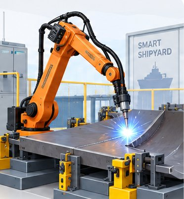

# 선박 용접용 로봇

[전체 목록](../../../README.md) · 장비군: **로봇·자동화 설비** · [이 장비 문의하기](https://github.com/gb011-hub/aas-archive/issues/new?template=equipment-question.yml&title=%5B%EB%AC%B8%EC%9D%98%5D+%EC%84%A0%EB%B0%95+%EC%9A%A9%EC%A0%91%EC%9A%A9+%EB%A1%9C%EB%B4%87&equipment=%EC%84%A0%EB%B0%95+%EC%9A%A9%EC%A0%91%EC%9A%A9+%EB%A1%9C%EB%B4%87)

> 자동 생성 페이지입니다. 이 폴더에 파일을 올리면 내용이 갱신됩니다.

필수 산출물 1/3 · 개발계획서 없음 · 가이던스 없음 · AASX 있음

## 산출물

| 구분 | 파일 | 크기 | 보기 |
|---|---|---|---|
| 개발계획서 | 아직 없음 | | |
| 가이던스 | 아직 없음 | | |
| AASX | [ShipWeldingRobot_v0.0.1_260930.aasx](AASX/ShipWeldingRobot_v0.0.1_260930.aasx) | 485 KB | [열람 페이지](gen/ShipWeldingRobot_v0.0.1_260930.md) |

## AAS 구성 — `ShipWeldingRobot`

`ShipWeldingRobot_v0.0.1_260930.aasx` 에서 읽은 서브모델 8개 · **[요소 전체 보기](gen/ShipWeldingRobot_v0.0.1_260930.md)**:

| # | 서브모델 idShort |
|:-:|---|
| 1 | DigitalNameplate |
| 2 | HandoverDocumentation |
| 3 | TechnicalData |
| 4 | OperationalData |
| 5 | FunctionalSafety |
| 6 | ProcessParameters |
| 7 | TimeSeries |
| 8 | PredictiveMaintenance |

변경 기록 (최근 5건)

| 날짜 | 변경 | 파일 |
|---|---|---|
| 2026-11-04 | 삭제 | 선박용접용로봇_가이던스(자리표시).docx |
| 2026-11-04 | 삭제 | 선박용접용로봇_개발계획서(자리표시).docx |
| 2026-11-03 | 추가 | ShipWeldingRobot_v0.0.1_260930.aasx |
| 2026-11-03 | 추가 | 선박용접용로봇_가이던스(자리표시).docx |
| 2026-11-03 | 추가 | 선박용접용로봇_개발계획서(자리표시).docx |

