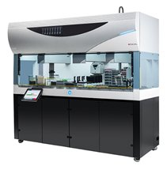

# BioCellManipulationAndDrugSynthesisRobot_v0.0.1_260930.aasx

[장비 페이지](../README.md) · [AASX 다운로드](../AASX/BioCellManipulationAndDrugSynthesisRobot_v0.0.1_260930.aasx) · 590 KB

> AASX 파일을 열어 자동으로 만든 열람 페이지입니다. 직접 고치지 말고 AASX를 다시 올리세요.

| 항목 | 내용 |
|---|---|
| AAS idShort | `BioCellManipulationAndDrugSynthesisRobotAAS` |
| AAS id | https://www.smart-factory.kr/ids/aas/BioCellManipulationAndDrugSynthesisRobotAAS/1/0 |
| 자산 종류 (assetKind) | Type |
| globalAssetId | https://www.smart-factory.kr/ids/asset/BioCellManipulationAndDrugSynthesisRobot/1/0 |
| 설명 | Type-level reference AAS for a fictional, de-identified integrated laboratory robot. |
| 서브모델 | 6개 |
| 전체 요소 | 649개 |

## 서브모델 한눈에 보기

| # | 서브모델 | 요소 수 | semanticId |
|:-:|---|--:|---|
| 1 | [Nameplate](#sm-1) | 30 | https://admin-shell.io/idta/nameplate/3/0/Nameplate |
| 2 | [HandoverDocumentation](#sm-2) | 126 | 0173-1#01-AHF578#003 |
| 3 | [TechnicalData](#sm-3) | 75 | 0173-1#01-AHX837#002 |
| 4 | [OperationalData](#sm-4) | 50 | https://www.smart-factory.kr/ids/sm/BioCellManipulationAndDrugSynthesisRobotAAS/Operation… |
| 5 | [AssetInterfacesDescription](#sm-5) | 270 | https://admin-shell.io/idta/AssetInterfacesDescription/1/1/Submodel |
| 6 | [ProcessParameters](#sm-6) | 98 | https://admin-shell-io/idta/SubmodelTemplate/ProcessParameters/1/0 |

## 서브모델 상세

각 서브모델 이름을 누르면 펼쳐집니다. **굵은 글씨**는 하위 요소가 있는 묶음입니다.

<b>1. Nameplate</b> — 요소 30개

> Contains the nameplate information attached to the product

semanticId: `https://admin-shell.io/idta/nameplate/3/0/Nameplate`

| idShort | 종류 | 값 | semanticId |
|---|---|---|---|
| URIOfTheProduct | 속성 | https://www.smart-factory.kr/ids/asset/BioCellManipulationAndDrugSynthesisRobot… | 0112/2///61987#ABN590#002 |
| ManufacturerName | 다국어&nbsp;속성 | Example Lab Automation Inc. | 0112/2///61987#ABA565#009 |
| ManufacturerProductDesignation | 다국어&nbsp;속성 | Example Cell Manipulation and Drug Synthesis Robot | 0112/2///61987#ABA567#009 |
| **AddressInformation** | 묶음&nbsp;(4) |  | https://admin-shell.io/zvei/nameplate/1/0/ContactInformations/Address… |
| &nbsp;&nbsp;&nbsp;└ Street | 다국어&nbsp;속성 | 123 가나다로 | 0173-1#02-AAO128#002 |
| &nbsp;&nbsp;&nbsp;└ Zipcode | 다국어&nbsp;속성 | 12345 | 0173-1#02-AAO129#002 |
| &nbsp;&nbsp;&nbsp;└ CityTown | 다국어&nbsp;속성 | 서울특별시 | 0173-1#02-AAO132#002 |
| &nbsp;&nbsp;&nbsp;└ NationalCode | 다국어&nbsp;속성 | KR | 0173-1#02-AAO134#002 |
| ManufacturerProductRoot | 다국어&nbsp;속성 | Robot | 0112/2///61360_7#AAS011#001 |
| ManufacturerProductFamily | 다국어&nbsp;속성 | Example Series | 0112/2///61987#ABP464#002 |
| ManufacturerProductType | 속성 | EXAMPLE-2000 | 0112/2///61987#ABA300#008 |
| OrderCodeOfManufacturer | 속성 | EXAMPLE-ORDER-2000 | 0112/2///61987#ABA950#008 |
| ProductArticleNumberOfManufacturer | 속성 | EXAMPLE-ARTICLE-2000 | 0112/2///61987#ABA581#007 |
| SerialNumber | 속성 | EXAMPLE-SN-0001 | 0112/2///61987#ABA951#009 |
| YearOfConstruction | 속성 | 2026 | 0112/2///61987#ABP000#002 |
| DateOfManufacture | 속성 | 2026-05-18 | 0112/2///61987#ABB757#007 |
| HardwareVersion | 속성 | HW-1.0 | 0112/2///61987#ABA926#008 |
| FirmwareVersion | 속성 | FW-1.2.0 | 0112/2///61987#ABA302#006 |
| SoftwareVersion | 속성 | SW-3.5.1 | 0112/2///61987#ABA601#008 |
| CountryOfOrigin | 속성 | KR | 0112/2///61987#ABP462#001 |
| UniqueFacilityIdentifier | 속성 | EX-FAC-001 | https://admin-shell.io/idta/nameplate/3/0/UniqueFacilityIdentifier |
| CompanyLogo | 파일 | /aasx/files/logo.png | 0112/2///61987#ABP463#001 |
| **Markings** | 목록&nbsp;(1) |  | 0112/2///61360_7#AAS006#001 |
| &nbsp;&nbsp;&nbsp;└ **** | 묶음&nbsp;(6) |  | 0112/2///61360_7#AAS009#001 |
| &nbsp;&nbsp;&nbsp;&nbsp;&nbsp;&nbsp;└ MarkingName | 속성 | ExampleMark-01 | 0112/2///61987#ABA231#009 |
| &nbsp;&nbsp;&nbsp;&nbsp;&nbsp;&nbsp;└ DesignationOfCertificateOrApproval | 속성 | CERT-EX-2026-001 | 0112/2///61987#ABH783#003 |
| &nbsp;&nbsp;&nbsp;&nbsp;&nbsp;&nbsp;└ IssueDate | 속성 | 2026-03-01 | 0112/2///61987#ABO097#001 |
| &nbsp;&nbsp;&nbsp;&nbsp;&nbsp;&nbsp;└ ExpiryDate | 속성 | 2029-03-01 | 0112/2///61987#ABH830#002 |
| &nbsp;&nbsp;&nbsp;&nbsp;&nbsp;&nbsp;└ MarkingFile | 파일 | /aasx/files/mark.png | 0112/2///61987#ABO100#002 |
| &nbsp;&nbsp;&nbsp;&nbsp;&nbsp;&nbsp;└ MarkingAdditionalText | 속성 | Synthetic example marking; not certification evidence | 0112/2///61987#ABB146#007 |

<b>2. HandoverDocumentation</b> — 요소 126개

> The Submodel defines a set meta data for the handover of documentation from the manufacturer to the operator for industrial equipment

semanticId: `0173-1#01-AHF578#003`

| idShort | 종류 | 값 | semanticId |
|---|---|---|---|
| **Documents** | 목록&nbsp;(5) |  | 0173-1#02-ABI500#003 |
| &nbsp;&nbsp;&nbsp;└ **** | 묶음&nbsp;(3) |  | 0173-1#02-ABI500#003/0173-1#01-AHF579#003 |
| &nbsp;&nbsp;&nbsp;&nbsp;&nbsp;&nbsp;└ **DocumentIds** | 목록&nbsp;(1) |  | 0173-1#02-ABI501#003 |
| &nbsp;&nbsp;&nbsp;&nbsp;&nbsp;&nbsp;&nbsp;&nbsp;&nbsp;└ **** | 묶음&nbsp;(3) |  | 0173-1#02-ABI501#003/0173-1#01-AHF580#003 |
| &nbsp;&nbsp;&nbsp;&nbsp;&nbsp;&nbsp;&nbsp;&nbsp;&nbsp;&nbsp;&nbsp;&nbsp;└ DocumentDomainId | 속성 | BCDSAR_DOC | 0173-1#02-ABH994#003 |
| &nbsp;&nbsp;&nbsp;&nbsp;&nbsp;&nbsp;&nbsp;&nbsp;&nbsp;&nbsp;&nbsp;&nbsp;└ DocumentIdentifier | 속성 | BCDSAR-OM-001 | 0173-1#02-AAO099#004 |
| &nbsp;&nbsp;&nbsp;&nbsp;&nbsp;&nbsp;&nbsp;&nbsp;&nbsp;&nbsp;&nbsp;&nbsp;└ DocumentIsPrimary | 속성 | true | 0173-1#02-ABH995#003 |
| &nbsp;&nbsp;&nbsp;&nbsp;&nbsp;&nbsp;└ **DocumentClassifications** | 목록&nbsp;(1) |  | 0173-1#02-ABI502#003 |
| &nbsp;&nbsp;&nbsp;&nbsp;&nbsp;&nbsp;&nbsp;&nbsp;&nbsp;└ **** | 묶음&nbsp;(3) |  | 0173-1#02-ABI502#003/0173-1#01-AHF581#003 |
| &nbsp;&nbsp;&nbsp;&nbsp;&nbsp;&nbsp;&nbsp;&nbsp;&nbsp;&nbsp;&nbsp;&nbsp;└ ClassId | 속성 | 03-02 | 0173-1#02-ABH996#003 |
| &nbsp;&nbsp;&nbsp;&nbsp;&nbsp;&nbsp;&nbsp;&nbsp;&nbsp;&nbsp;&nbsp;&nbsp;└ ClassName | 다국어&nbsp;속성 | Operation | 0173-1#02-ABJ219#002 |
| &nbsp;&nbsp;&nbsp;&nbsp;&nbsp;&nbsp;&nbsp;&nbsp;&nbsp;&nbsp;&nbsp;&nbsp;└ ClassificationSystem | 속성 | VDI 2770 Blatt 1:2020 | 0173-1#02-ABH997#003 |
| &nbsp;&nbsp;&nbsp;&nbsp;&nbsp;&nbsp;└ **DocumentVersions** | 목록&nbsp;(1) |  | 0173-1#02-ABI503#003 |
| &nbsp;&nbsp;&nbsp;&nbsp;&nbsp;&nbsp;&nbsp;&nbsp;&nbsp;└ **** | 묶음&nbsp;(10) |  | 0173-1#02-ABI503#003/0173-1#01-AHF582#003 |
| &nbsp;&nbsp;&nbsp;&nbsp;&nbsp;&nbsp;&nbsp;&nbsp;&nbsp;&nbsp;&nbsp;&nbsp;└ **Language** | 목록&nbsp;(1) |  | 0173-1#02-AAN468#008 |
| &nbsp;&nbsp;&nbsp;&nbsp;&nbsp;&nbsp;&nbsp;&nbsp;&nbsp;&nbsp;&nbsp;&nbsp;&nbsp;&nbsp;&nbsp;└  | 속성 | en | 0173-1#02-AAN468#008 |
| &nbsp;&nbsp;&nbsp;&nbsp;&nbsp;&nbsp;&nbsp;&nbsp;&nbsp;&nbsp;&nbsp;&nbsp;└ Version | 속성 | 1.0 | 0173-1#02-AAP003#005 |
| &nbsp;&nbsp;&nbsp;&nbsp;&nbsp;&nbsp;&nbsp;&nbsp;&nbsp;&nbsp;&nbsp;&nbsp;└ Title | 다국어&nbsp;속성 | BCDSAR Operation Manual | 0173-1#02-ABG940#003 |
| &nbsp;&nbsp;&nbsp;&nbsp;&nbsp;&nbsp;&nbsp;&nbsp;&nbsp;&nbsp;&nbsp;&nbsp;└ Description | 다국어&nbsp;속성 | Synthetic de-identified operation manual example for the reference model | 0173-1#02-AAN466#004 |
| &nbsp;&nbsp;&nbsp;&nbsp;&nbsp;&nbsp;&nbsp;&nbsp;&nbsp;&nbsp;&nbsp;&nbsp;└ KeyWords | 다국어&nbsp;속성 | liquid handling, cell culture | 0173-1#02-ABH999#003 |
| &nbsp;&nbsp;&nbsp;&nbsp;&nbsp;&nbsp;&nbsp;&nbsp;&nbsp;&nbsp;&nbsp;&nbsp;└ StatusSetDate | 속성 | 2026-05-18 | 0173-1#02-ABI000#003 |
| &nbsp;&nbsp;&nbsp;&nbsp;&nbsp;&nbsp;&nbsp;&nbsp;&nbsp;&nbsp;&nbsp;&nbsp;└ StatusValue | 속성 | Released | 0173-1#02-ABI001#003 |
| &nbsp;&nbsp;&nbsp;&nbsp;&nbsp;&nbsp;&nbsp;&nbsp;&nbsp;&nbsp;&nbsp;&nbsp;└ OrganizationShortName | 속성 | ExampleOrg | https://api.eclass-cdp.com/0173-1-02-ABI002-003 |
| &nbsp;&nbsp;&nbsp;&nbsp;&nbsp;&nbsp;&nbsp;&nbsp;&nbsp;&nbsp;&nbsp;&nbsp;└ OrganizationOfficialName | 속성 | Example Organization | 0173-1#02-ABI004#003 |
| &nbsp;&nbsp;&nbsp;&nbsp;&nbsp;&nbsp;&nbsp;&nbsp;&nbsp;&nbsp;&nbsp;&nbsp;└ **DigitalFiles** | 목록&nbsp;(1) |  | 0173-1#02-ABK126#002 |
| &nbsp;&nbsp;&nbsp;&nbsp;&nbsp;&nbsp;&nbsp;&nbsp;&nbsp;&nbsp;&nbsp;&nbsp;&nbsp;&nbsp;&nbsp;└  | 파일 | /aasx/files/docs/BCDSAR_OperationManual_v1_0.pdf | 0173-1#02-ABK126#002 |
| &nbsp;&nbsp;&nbsp;└ **** | 묶음&nbsp;(3) |  | 0173-1#02-ABI500#003/0173-1#01-AHF579#003 |
| &nbsp;&nbsp;&nbsp;&nbsp;&nbsp;&nbsp;└ **DocumentIds** | 목록&nbsp;(1) |  | 0173-1#02-ABI501#003 |
| &nbsp;&nbsp;&nbsp;&nbsp;&nbsp;&nbsp;&nbsp;&nbsp;&nbsp;└ **** | 묶음&nbsp;(3) |  | 0173-1#02-ABI501#003/0173-1#01-AHF580#003 |
| &nbsp;&nbsp;&nbsp;&nbsp;&nbsp;&nbsp;&nbsp;&nbsp;&nbsp;&nbsp;&nbsp;&nbsp;└ DocumentDomainId | 속성 | BCDSAR_DOC | 0173-1#02-ABH994#003 |
| &nbsp;&nbsp;&nbsp;&nbsp;&nbsp;&nbsp;&nbsp;&nbsp;&nbsp;&nbsp;&nbsp;&nbsp;└ DocumentIdentifier | 속성 | BCDSAR-CM-001 | 0173-1#02-AAO099#004 |
| &nbsp;&nbsp;&nbsp;&nbsp;&nbsp;&nbsp;&nbsp;&nbsp;&nbsp;&nbsp;&nbsp;&nbsp;└ DocumentIsPrimary | 속성 | true | 0173-1#02-ABH995#003 |
| &nbsp;&nbsp;&nbsp;&nbsp;&nbsp;&nbsp;└ **DocumentClassifications** | 목록&nbsp;(1) |  | 0173-1#02-ABI502#003 |
| &nbsp;&nbsp;&nbsp;&nbsp;&nbsp;&nbsp;&nbsp;&nbsp;&nbsp;└ **** | 묶음&nbsp;(3) |  | 0173-1#02-ABI502#003/0173-1#01-AHF581#003 |
| &nbsp;&nbsp;&nbsp;&nbsp;&nbsp;&nbsp;&nbsp;&nbsp;&nbsp;&nbsp;&nbsp;&nbsp;└ ClassId | 속성 | 03-01 | 0173-1#02-ABH996#003 |
| &nbsp;&nbsp;&nbsp;&nbsp;&nbsp;&nbsp;&nbsp;&nbsp;&nbsp;&nbsp;&nbsp;&nbsp;└ ClassName | 다국어&nbsp;속성 | Commissioning, de-commissioning | 0173-1#02-ABJ219#002 |
| &nbsp;&nbsp;&nbsp;&nbsp;&nbsp;&nbsp;&nbsp;&nbsp;&nbsp;&nbsp;&nbsp;&nbsp;└ ClassificationSystem | 속성 | VDI 2770 Blatt 1:2020 | 0173-1#02-ABH997#003 |
| &nbsp;&nbsp;&nbsp;&nbsp;&nbsp;&nbsp;└ **DocumentVersions** | 목록&nbsp;(1) |  | 0173-1#02-ABI503#003 |
| &nbsp;&nbsp;&nbsp;&nbsp;&nbsp;&nbsp;&nbsp;&nbsp;&nbsp;└ **** | 묶음&nbsp;(10) |  | 0173-1#02-ABI503#003/0173-1#01-AHF582#003 |
| &nbsp;&nbsp;&nbsp;&nbsp;&nbsp;&nbsp;&nbsp;&nbsp;&nbsp;&nbsp;&nbsp;&nbsp;└ **Language** | 목록&nbsp;(1) |  | 0173-1#02-AAN468#008 |
| &nbsp;&nbsp;&nbsp;&nbsp;&nbsp;&nbsp;&nbsp;&nbsp;&nbsp;&nbsp;&nbsp;&nbsp;&nbsp;&nbsp;&nbsp;└  | 속성 | en | 0173-1#02-AAN468#008 |
| &nbsp;&nbsp;&nbsp;&nbsp;&nbsp;&nbsp;&nbsp;&nbsp;&nbsp;&nbsp;&nbsp;&nbsp;└ Version | 속성 | 1.0 | 0173-1#02-AAP003#005 |
| &nbsp;&nbsp;&nbsp;&nbsp;&nbsp;&nbsp;&nbsp;&nbsp;&nbsp;&nbsp;&nbsp;&nbsp;└ Title | 다국어&nbsp;속성 | BCDSAR Commissioning Guide | 0173-1#02-ABG940#003 |
| &nbsp;&nbsp;&nbsp;&nbsp;&nbsp;&nbsp;&nbsp;&nbsp;&nbsp;&nbsp;&nbsp;&nbsp;└ Description | 다국어&nbsp;속성 | Synthetic de-identified example document for the reference equipment model | 0173-1#02-AAN466#004 |
| &nbsp;&nbsp;&nbsp;&nbsp;&nbsp;&nbsp;&nbsp;&nbsp;&nbsp;&nbsp;&nbsp;&nbsp;└ KeyWords | 다국어&nbsp;속성 | commissioning, installation, qualification | 0173-1#02-ABH999#003 |
| &nbsp;&nbsp;&nbsp;&nbsp;&nbsp;&nbsp;&nbsp;&nbsp;&nbsp;&nbsp;&nbsp;&nbsp;└ StatusSetDate | 속성 | 2026-05-18 | 0173-1#02-ABI000#003 |
| &nbsp;&nbsp;&nbsp;&nbsp;&nbsp;&nbsp;&nbsp;&nbsp;&nbsp;&nbsp;&nbsp;&nbsp;└ StatusValue | 속성 | Released | 0173-1#02-ABI001#003 |
| &nbsp;&nbsp;&nbsp;&nbsp;&nbsp;&nbsp;&nbsp;&nbsp;&nbsp;&nbsp;&nbsp;&nbsp;└ OrganizationShortName | 속성 | ExampleOrg | https://api.eclass-cdp.com/0173-1-02-ABI002-003 |
| &nbsp;&nbsp;&nbsp;&nbsp;&nbsp;&nbsp;&nbsp;&nbsp;&nbsp;&nbsp;&nbsp;&nbsp;└ OrganizationOfficialName | 속성 | Example Organization | 0173-1#02-ABI004#003 |
| &nbsp;&nbsp;&nbsp;&nbsp;&nbsp;&nbsp;&nbsp;&nbsp;&nbsp;&nbsp;&nbsp;&nbsp;└ **DigitalFiles** | 목록&nbsp;(1) |  | 0173-1#02-ABK126#002 |
| &nbsp;&nbsp;&nbsp;&nbsp;&nbsp;&nbsp;&nbsp;&nbsp;&nbsp;&nbsp;&nbsp;&nbsp;&nbsp;&nbsp;&nbsp;└  | 파일 | /aasx/files/docs/BCDSAR_CommissioningGuide_v1_0.pdf | 0173-1#02-ABK126#002 |
| &nbsp;&nbsp;&nbsp;└ **** | 묶음&nbsp;(3) |  | 0173-1#02-ABI500#003/0173-1#01-AHF579#003 |
| &nbsp;&nbsp;&nbsp;&nbsp;&nbsp;&nbsp;└ **DocumentIds** | 목록&nbsp;(1) |  | 0173-1#02-ABI501#003 |
| &nbsp;&nbsp;&nbsp;&nbsp;&nbsp;&nbsp;&nbsp;&nbsp;&nbsp;└ **** | 묶음&nbsp;(3) |  | 0173-1#02-ABI501#003/0173-1#01-AHF580#003 |
| &nbsp;&nbsp;&nbsp;&nbsp;&nbsp;&nbsp;&nbsp;&nbsp;&nbsp;&nbsp;&nbsp;&nbsp;└ DocumentDomainId | 속성 | BCDSAR_DOC | 0173-1#02-ABH994#003 |
| &nbsp;&nbsp;&nbsp;&nbsp;&nbsp;&nbsp;&nbsp;&nbsp;&nbsp;&nbsp;&nbsp;&nbsp;└ DocumentIdentifier | 속성 | BCDSAR-SF-001 | 0173-1#02-AAO099#004 |
| &nbsp;&nbsp;&nbsp;&nbsp;&nbsp;&nbsp;&nbsp;&nbsp;&nbsp;&nbsp;&nbsp;&nbsp;└ DocumentIsPrimary | 속성 | true | 0173-1#02-ABH995#003 |
| &nbsp;&nbsp;&nbsp;&nbsp;&nbsp;&nbsp;└ **DocumentClassifications** | 목록&nbsp;(1) |  | 0173-1#02-ABI502#003 |
| &nbsp;&nbsp;&nbsp;&nbsp;&nbsp;&nbsp;&nbsp;&nbsp;&nbsp;└ **** | 묶음&nbsp;(3) |  | 0173-1#02-ABI502#003/0173-1#01-AHF581#003 |
| &nbsp;&nbsp;&nbsp;&nbsp;&nbsp;&nbsp;&nbsp;&nbsp;&nbsp;&nbsp;&nbsp;&nbsp;└ ClassId | 속성 | 03-03 | 0173-1#02-ABH996#003 |
| &nbsp;&nbsp;&nbsp;&nbsp;&nbsp;&nbsp;&nbsp;&nbsp;&nbsp;&nbsp;&nbsp;&nbsp;└ ClassName | 다국어&nbsp;속성 | General safety | 0173-1#02-ABJ219#002 |
| &nbsp;&nbsp;&nbsp;&nbsp;&nbsp;&nbsp;&nbsp;&nbsp;&nbsp;&nbsp;&nbsp;&nbsp;└ ClassificationSystem | 속성 | VDI 2770 Blatt 1:2020 | 0173-1#02-ABH997#003 |
| &nbsp;&nbsp;&nbsp;&nbsp;&nbsp;&nbsp;└ **DocumentVersions** | 목록&nbsp;(1) |  | 0173-1#02-ABI503#003 |
| &nbsp;&nbsp;&nbsp;&nbsp;&nbsp;&nbsp;&nbsp;&nbsp;&nbsp;└ **** | 묶음&nbsp;(10) |  | 0173-1#02-ABI503#003/0173-1#01-AHF582#003 |
| &nbsp;&nbsp;&nbsp;&nbsp;&nbsp;&nbsp;&nbsp;&nbsp;&nbsp;&nbsp;&nbsp;&nbsp;└ **Language** | 목록&nbsp;(1) |  | 0173-1#02-AAN468#008 |
| &nbsp;&nbsp;&nbsp;&nbsp;&nbsp;&nbsp;&nbsp;&nbsp;&nbsp;&nbsp;&nbsp;&nbsp;&nbsp;&nbsp;&nbsp;└  | 속성 | en | 0173-1#02-AAN468#008 |
| &nbsp;&nbsp;&nbsp;&nbsp;&nbsp;&nbsp;&nbsp;&nbsp;&nbsp;&nbsp;&nbsp;&nbsp;└ Version | 속성 | 1.0 | 0173-1#02-AAP003#005 |
| &nbsp;&nbsp;&nbsp;&nbsp;&nbsp;&nbsp;&nbsp;&nbsp;&nbsp;&nbsp;&nbsp;&nbsp;└ Title | 다국어&nbsp;속성 | BCDSAR Safety Guide | 0173-1#02-ABG940#003 |
| &nbsp;&nbsp;&nbsp;&nbsp;&nbsp;&nbsp;&nbsp;&nbsp;&nbsp;&nbsp;&nbsp;&nbsp;└ Description | 다국어&nbsp;속성 | Synthetic de-identified example document for the reference equipment model | 0173-1#02-AAN466#004 |
| &nbsp;&nbsp;&nbsp;&nbsp;&nbsp;&nbsp;&nbsp;&nbsp;&nbsp;&nbsp;&nbsp;&nbsp;└ KeyWords | 다국어&nbsp;속성 | safety, interlock, biological handling | 0173-1#02-ABH999#003 |
| &nbsp;&nbsp;&nbsp;&nbsp;&nbsp;&nbsp;&nbsp;&nbsp;&nbsp;&nbsp;&nbsp;&nbsp;└ StatusSetDate | 속성 | 2026-05-18 | 0173-1#02-ABI000#003 |
| &nbsp;&nbsp;&nbsp;&nbsp;&nbsp;&nbsp;&nbsp;&nbsp;&nbsp;&nbsp;&nbsp;&nbsp;└ StatusValue | 속성 | Released | 0173-1#02-ABI001#003 |
| &nbsp;&nbsp;&nbsp;&nbsp;&nbsp;&nbsp;&nbsp;&nbsp;&nbsp;&nbsp;&nbsp;&nbsp;└ OrganizationShortName | 속성 | ExampleOrg | https://api.eclass-cdp.com/0173-1-02-ABI002-003 |
| &nbsp;&nbsp;&nbsp;&nbsp;&nbsp;&nbsp;&nbsp;&nbsp;&nbsp;&nbsp;&nbsp;&nbsp;└ OrganizationOfficialName | 속성 | Example Organization | 0173-1#02-ABI004#003 |
| &nbsp;&nbsp;&nbsp;&nbsp;&nbsp;&nbsp;&nbsp;&nbsp;&nbsp;&nbsp;&nbsp;&nbsp;└ **DigitalFiles** | 목록&nbsp;(1) |  | 0173-1#02-ABK126#002 |
| &nbsp;&nbsp;&nbsp;&nbsp;&nbsp;&nbsp;&nbsp;&nbsp;&nbsp;&nbsp;&nbsp;&nbsp;&nbsp;&nbsp;&nbsp;└  | 파일 | /aasx/files/docs/BCDSAR_SafetyGuide_v1_0.pdf | 0173-1#02-ABK126#002 |
| &nbsp;&nbsp;&nbsp;└ **** | 묶음&nbsp;(3) |  | 0173-1#02-ABI500#003/0173-1#01-AHF579#003 |
| &nbsp;&nbsp;&nbsp;&nbsp;&nbsp;&nbsp;└ **DocumentIds** | 목록&nbsp;(1) |  | 0173-1#02-ABI501#003 |
| &nbsp;&nbsp;&nbsp;&nbsp;&nbsp;&nbsp;&nbsp;&nbsp;&nbsp;└ **** | 묶음&nbsp;(3) |  | 0173-1#02-ABI501#003/0173-1#01-AHF580#003 |
| &nbsp;&nbsp;&nbsp;&nbsp;&nbsp;&nbsp;&nbsp;&nbsp;&nbsp;&nbsp;&nbsp;&nbsp;└ DocumentDomainId | 속성 | BCDSAR_DOC | 0173-1#02-ABH994#003 |
| &nbsp;&nbsp;&nbsp;&nbsp;&nbsp;&nbsp;&nbsp;&nbsp;&nbsp;&nbsp;&nbsp;&nbsp;└ DocumentIdentifier | 속성 | BCDSAR-MT-001 | 0173-1#02-AAO099#004 |
| &nbsp;&nbsp;&nbsp;&nbsp;&nbsp;&nbsp;&nbsp;&nbsp;&nbsp;&nbsp;&nbsp;&nbsp;└ DocumentIsPrimary | 속성 | true | 0173-1#02-ABH995#003 |
| &nbsp;&nbsp;&nbsp;&nbsp;&nbsp;&nbsp;└ **DocumentClassifications** | 목록&nbsp;(1) |  | 0173-1#02-ABI502#003 |
| &nbsp;&nbsp;&nbsp;&nbsp;&nbsp;&nbsp;&nbsp;&nbsp;&nbsp;└ **** | 묶음&nbsp;(3) |  | 0173-1#02-ABI502#003/0173-1#01-AHF581#003 |
| &nbsp;&nbsp;&nbsp;&nbsp;&nbsp;&nbsp;&nbsp;&nbsp;&nbsp;&nbsp;&nbsp;&nbsp;└ ClassId | 속성 | 03-04 | 0173-1#02-ABH996#003 |
| &nbsp;&nbsp;&nbsp;&nbsp;&nbsp;&nbsp;&nbsp;&nbsp;&nbsp;&nbsp;&nbsp;&nbsp;└ ClassName | 다국어&nbsp;속성 | Inspection, maintenance, testing | 0173-1#02-ABJ219#002 |
| &nbsp;&nbsp;&nbsp;&nbsp;&nbsp;&nbsp;&nbsp;&nbsp;&nbsp;&nbsp;&nbsp;&nbsp;└ ClassificationSystem | 속성 | VDI 2770 Blatt 1:2020 | 0173-1#02-ABH997#003 |
| &nbsp;&nbsp;&nbsp;&nbsp;&nbsp;&nbsp;└ **DocumentVersions** | 목록&nbsp;(1) |  | 0173-1#02-ABI503#003 |
| &nbsp;&nbsp;&nbsp;&nbsp;&nbsp;&nbsp;&nbsp;&nbsp;&nbsp;└ **** | 묶음&nbsp;(10) |  | 0173-1#02-ABI503#003/0173-1#01-AHF582#003 |
| &nbsp;&nbsp;&nbsp;&nbsp;&nbsp;&nbsp;&nbsp;&nbsp;&nbsp;&nbsp;&nbsp;&nbsp;└ **Language** | 목록&nbsp;(1) |  | 0173-1#02-AAN468#008 |
| &nbsp;&nbsp;&nbsp;&nbsp;&nbsp;&nbsp;&nbsp;&nbsp;&nbsp;&nbsp;&nbsp;&nbsp;&nbsp;&nbsp;&nbsp;└  | 속성 | en | 0173-1#02-AAN468#008 |
| &nbsp;&nbsp;&nbsp;&nbsp;&nbsp;&nbsp;&nbsp;&nbsp;&nbsp;&nbsp;&nbsp;&nbsp;└ Version | 속성 | 1.0 | 0173-1#02-AAP003#005 |
| &nbsp;&nbsp;&nbsp;&nbsp;&nbsp;&nbsp;&nbsp;&nbsp;&nbsp;&nbsp;&nbsp;&nbsp;└ Title | 다국어&nbsp;속성 | BCDSAR Maintenance and Calibration Guide | 0173-1#02-ABG940#003 |
| &nbsp;&nbsp;&nbsp;&nbsp;&nbsp;&nbsp;&nbsp;&nbsp;&nbsp;&nbsp;&nbsp;&nbsp;└ Description | 다국어&nbsp;속성 | Synthetic de-identified example document for the reference equipment model | 0173-1#02-AAN466#004 |
| &nbsp;&nbsp;&nbsp;&nbsp;&nbsp;&nbsp;&nbsp;&nbsp;&nbsp;&nbsp;&nbsp;&nbsp;└ KeyWords | 다국어&nbsp;속성 | maintenance, calibration, inspection | 0173-1#02-ABH999#003 |
| &nbsp;&nbsp;&nbsp;&nbsp;&nbsp;&nbsp;&nbsp;&nbsp;&nbsp;&nbsp;&nbsp;&nbsp;└ StatusSetDate | 속성 | 2026-05-18 | 0173-1#02-ABI000#003 |
| &nbsp;&nbsp;&nbsp;&nbsp;&nbsp;&nbsp;&nbsp;&nbsp;&nbsp;&nbsp;&nbsp;&nbsp;└ StatusValue | 속성 | Released | 0173-1#02-ABI001#003 |
| &nbsp;&nbsp;&nbsp;&nbsp;&nbsp;&nbsp;&nbsp;&nbsp;&nbsp;&nbsp;&nbsp;&nbsp;└ OrganizationShortName | 속성 | ExampleOrg | https://api.eclass-cdp.com/0173-1-02-ABI002-003 |
| &nbsp;&nbsp;&nbsp;&nbsp;&nbsp;&nbsp;&nbsp;&nbsp;&nbsp;&nbsp;&nbsp;&nbsp;└ OrganizationOfficialName | 속성 | Example Organization | 0173-1#02-ABI004#003 |
| &nbsp;&nbsp;&nbsp;&nbsp;&nbsp;&nbsp;&nbsp;&nbsp;&nbsp;&nbsp;&nbsp;&nbsp;└ **DigitalFiles** | 목록&nbsp;(1) |  | 0173-1#02-ABK126#002 |
| &nbsp;&nbsp;&nbsp;&nbsp;&nbsp;&nbsp;&nbsp;&nbsp;&nbsp;&nbsp;&nbsp;&nbsp;&nbsp;&nbsp;&nbsp;└  | 파일 | /aasx/files/docs/BCDSAR_MaintenanceCalibrationGuide_v1_0.pdf | 0173-1#02-ABK126#002 |
| &nbsp;&nbsp;&nbsp;└ **** | 묶음&nbsp;(3) |  | 0173-1#02-ABI500#003/0173-1#01-AHF579#003 |
| &nbsp;&nbsp;&nbsp;&nbsp;&nbsp;&nbsp;└ **DocumentIds** | 목록&nbsp;(1) |  | 0173-1#02-ABI501#003 |
| &nbsp;&nbsp;&nbsp;&nbsp;&nbsp;&nbsp;&nbsp;&nbsp;&nbsp;└ **** | 묶음&nbsp;(3) |  | 0173-1#02-ABI501#003/0173-1#01-AHF580#003 |
| &nbsp;&nbsp;&nbsp;&nbsp;&nbsp;&nbsp;&nbsp;&nbsp;&nbsp;&nbsp;&nbsp;&nbsp;└ DocumentDomainId | 속성 | BCDSAR_DOC | 0173-1#02-ABH994#003 |
| &nbsp;&nbsp;&nbsp;&nbsp;&nbsp;&nbsp;&nbsp;&nbsp;&nbsp;&nbsp;&nbsp;&nbsp;└ DocumentIdentifier | 속성 | BCDSAR-CE-001 | 0173-1#02-AAO099#004 |
| &nbsp;&nbsp;&nbsp;&nbsp;&nbsp;&nbsp;&nbsp;&nbsp;&nbsp;&nbsp;&nbsp;&nbsp;└ DocumentIsPrimary | 속성 | true | 0173-1#02-ABH995#003 |
| &nbsp;&nbsp;&nbsp;&nbsp;&nbsp;&nbsp;└ **DocumentClassifications** | 목록&nbsp;(1) |  | 0173-1#02-ABI502#003 |
| &nbsp;&nbsp;&nbsp;&nbsp;&nbsp;&nbsp;&nbsp;&nbsp;&nbsp;└ **** | 묶음&nbsp;(3) |  | 0173-1#02-ABI502#003/0173-1#01-AHF581#003 |
| &nbsp;&nbsp;&nbsp;&nbsp;&nbsp;&nbsp;&nbsp;&nbsp;&nbsp;&nbsp;&nbsp;&nbsp;└ ClassId | 속성 | 02-04 | 0173-1#02-ABH996#003 |
| &nbsp;&nbsp;&nbsp;&nbsp;&nbsp;&nbsp;&nbsp;&nbsp;&nbsp;&nbsp;&nbsp;&nbsp;└ ClassName | 다국어&nbsp;속성 | Certificates, declarations | 0173-1#02-ABJ219#002 |
| &nbsp;&nbsp;&nbsp;&nbsp;&nbsp;&nbsp;&nbsp;&nbsp;&nbsp;&nbsp;&nbsp;&nbsp;└ ClassificationSystem | 속성 | VDI 2770 Blatt 1:2020 | 0173-1#02-ABH997#003 |
| &nbsp;&nbsp;&nbsp;&nbsp;&nbsp;&nbsp;└ **DocumentVersions** | 목록&nbsp;(1) |  | 0173-1#02-ABI503#003 |
| &nbsp;&nbsp;&nbsp;&nbsp;&nbsp;&nbsp;&nbsp;&nbsp;&nbsp;└ **** | 묶음&nbsp;(10) |  | 0173-1#02-ABI503#003/0173-1#01-AHF582#003 |
| &nbsp;&nbsp;&nbsp;&nbsp;&nbsp;&nbsp;&nbsp;&nbsp;&nbsp;&nbsp;&nbsp;&nbsp;└ **Language** | 목록&nbsp;(1) |  | 0173-1#02-AAN468#008 |
| &nbsp;&nbsp;&nbsp;&nbsp;&nbsp;&nbsp;&nbsp;&nbsp;&nbsp;&nbsp;&nbsp;&nbsp;&nbsp;&nbsp;&nbsp;└  | 속성 | en | 0173-1#02-AAN468#008 |
| &nbsp;&nbsp;&nbsp;&nbsp;&nbsp;&nbsp;&nbsp;&nbsp;&nbsp;&nbsp;&nbsp;&nbsp;└ Version | 속성 | 1.0 | 0173-1#02-AAP003#005 |
| &nbsp;&nbsp;&nbsp;&nbsp;&nbsp;&nbsp;&nbsp;&nbsp;&nbsp;&nbsp;&nbsp;&nbsp;└ Title | 다국어&nbsp;속성 | BCDSAR Example Declaration of Conformity | 0173-1#02-ABG940#003 |
| &nbsp;&nbsp;&nbsp;&nbsp;&nbsp;&nbsp;&nbsp;&nbsp;&nbsp;&nbsp;&nbsp;&nbsp;└ Description | 다국어&nbsp;속성 | Synthetic de-identified example document for the reference equipment model | 0173-1#02-AAN466#004 |
| &nbsp;&nbsp;&nbsp;&nbsp;&nbsp;&nbsp;&nbsp;&nbsp;&nbsp;&nbsp;&nbsp;&nbsp;└ KeyWords | 다국어&nbsp;속성 | synthetic declaration, conformity example | 0173-1#02-ABH999#003 |
| &nbsp;&nbsp;&nbsp;&nbsp;&nbsp;&nbsp;&nbsp;&nbsp;&nbsp;&nbsp;&nbsp;&nbsp;└ StatusSetDate | 속성 | 2026-05-18 | 0173-1#02-ABI000#003 |
| &nbsp;&nbsp;&nbsp;&nbsp;&nbsp;&nbsp;&nbsp;&nbsp;&nbsp;&nbsp;&nbsp;&nbsp;└ StatusValue | 속성 | Released | 0173-1#02-ABI001#003 |
| &nbsp;&nbsp;&nbsp;&nbsp;&nbsp;&nbsp;&nbsp;&nbsp;&nbsp;&nbsp;&nbsp;&nbsp;└ OrganizationShortName | 속성 | ExampleOrg | https://api.eclass-cdp.com/0173-1-02-ABI002-003 |
| &nbsp;&nbsp;&nbsp;&nbsp;&nbsp;&nbsp;&nbsp;&nbsp;&nbsp;&nbsp;&nbsp;&nbsp;└ OrganizationOfficialName | 속성 | Example Organization | 0173-1#02-ABI004#003 |
| &nbsp;&nbsp;&nbsp;&nbsp;&nbsp;&nbsp;&nbsp;&nbsp;&nbsp;&nbsp;&nbsp;&nbsp;└ **DigitalFiles** | 목록&nbsp;(1) |  | 0173-1#02-ABK126#002 |
| &nbsp;&nbsp;&nbsp;&nbsp;&nbsp;&nbsp;&nbsp;&nbsp;&nbsp;&nbsp;&nbsp;&nbsp;&nbsp;&nbsp;&nbsp;└  | 파일 | /aasx/files/docs/BCDSAR_DeclarationOfConformity_v1_0.pdf | 0173-1#02-ABK126#002 |

<b>3. TechnicalData</b> — 요소 75개

> Submodel containing technical data of the asset and associated product classificatons

semanticId: `0173-1#01-AHX837#002`

| idShort | 종류 | 값 | semanticId |
|---|---|---|---|
| **GeneralInformation** | 묶음&nbsp;(5) |  | 0173-1#02-ABK161#002/0173-1#01-AHX838#002 |
| &nbsp;&nbsp;&nbsp;└ ManufacturerName | 속성 | Example Lab Automation Inc. | 0173-1#02-AAO677#004 |
| &nbsp;&nbsp;&nbsp;└ ManufacturerProductDesignation | 다국어&nbsp;속성 | Example Cell Manipulation and Drug Synthesis Robot | 0173-1#02-AAW338#003 |
| &nbsp;&nbsp;&nbsp;└ ManufacturerArticleNumber | 속성 | EXAMPLE-ARTICLE-2000 | 0173-1#02-AAO676#005 |
| &nbsp;&nbsp;&nbsp;└ ManufacturerOrderCode | 속성 | EXAMPLE-ORDER-2000 | 0173-1#02-AAO227#004 |
| &nbsp;&nbsp;&nbsp;└ **ProductImages** | 목록&nbsp;(1) |  | 0173-1#02-ABM220#001 |
| &nbsp;&nbsp;&nbsp;&nbsp;&nbsp;&nbsp;└ **** | 묶음&nbsp;(2) |  | 0173-1#02-ABM220#001/0173-1#01-AHY911#001 |
| &nbsp;&nbsp;&nbsp;&nbsp;&nbsp;&nbsp;&nbsp;&nbsp;&nbsp;└ ImageFile | 파일 | /aasx/files/images/BCDSAR01.jpg | 0173-1#02-ABK291#002 |
| &nbsp;&nbsp;&nbsp;&nbsp;&nbsp;&nbsp;&nbsp;&nbsp;&nbsp;└ ImageNote | 다국어&nbsp;속성 | Front view of the robot | 0173-1#02-ABL423#001 |
| **ProductClassifications** | 목록&nbsp;(1) |  | 0173-1#02-ABK162#002 |
| &nbsp;&nbsp;&nbsp;└ **** | 묶음&nbsp;(6) |  | 0173-1#02-ABK162#002/0173-1#01-AHX839#002 |
| &nbsp;&nbsp;&nbsp;&nbsp;&nbsp;&nbsp;└ ClassificationSystem | 속성 | ECLASS | 0173-1#02-ABL424#001 |
| &nbsp;&nbsp;&nbsp;&nbsp;&nbsp;&nbsp;└ ClassificationSystemVersion | 속성 | ECLASS 16.0 | 0173-1#02-AAR710#003 |
| &nbsp;&nbsp;&nbsp;&nbsp;&nbsp;&nbsp;└ ClassificationSystemUrl | 속성 | https://api.eclass-cdp.com/0173-1-01-ACI245-015 | https://admin-shell.io/IDTA/TechnicalData/ProductClassifications/Prod… |
| &nbsp;&nbsp;&nbsp;&nbsp;&nbsp;&nbsp;└ ProductClassId | 속성 | 0173-1#01-ACI245#015 | 0173-1#02-ABG776#003 |
| &nbsp;&nbsp;&nbsp;&nbsp;&nbsp;&nbsp;└ ProductClassCodedName | 속성 | 32035500 | 0173-1#02-ABK128#002 |
| &nbsp;&nbsp;&nbsp;&nbsp;&nbsp;&nbsp;└ ProductClassName | 다국어&nbsp;속성 | Manipulator (lab) | 0173-1#02-ABK273#002 |
| **TechnicalPropertyAreas** | 목록&nbsp;(1) |  | 0173-1#02-ABK163#002 |
| &nbsp;&nbsp;&nbsp;└ **** | 묶음&nbsp;(6) |  | 0173-1#02-ABL358#002/0173-1#01-AHX773#002 |
| &nbsp;&nbsp;&nbsp;&nbsp;&nbsp;&nbsp;└ **RoboticTransportSystem** | 묶음&nbsp;(2) |  | https://www.smart-factory.kr/ids/cd/RoboticTransportSystem/1/0 |
| &nbsp;&nbsp;&nbsp;&nbsp;&nbsp;&nbsp;&nbsp;&nbsp;&nbsp;└ **MechanicalArchitecture** | 묶음&nbsp;(4) |  | https://www.smart-factory.kr/ids/cd/MechanicalArchitecture/1/0 |
| &nbsp;&nbsp;&nbsp;&nbsp;&nbsp;&nbsp;&nbsp;&nbsp;&nbsp;&nbsp;&nbsp;&nbsp;└ RobotSystemType | 속성 | Manipulator (lab) | https://www.smart-factory.kr/ids/cd/RobotSystemType/1/0 |
| &nbsp;&nbsp;&nbsp;&nbsp;&nbsp;&nbsp;&nbsp;&nbsp;&nbsp;&nbsp;&nbsp;&nbsp;└ ManipulatorType | 속성 | Cartesian robot | https://www.smart-factory.kr/ids/cd/ManipulatorType/1/0 |
| &nbsp;&nbsp;&nbsp;&nbsp;&nbsp;&nbsp;&nbsp;&nbsp;&nbsp;&nbsp;&nbsp;&nbsp;└ ElectricGripperType | 속성 | Parallel gripper (electric) | https://www.smart-factory.kr/ids/cd/ElectricGripperType/1/0 |
| &nbsp;&nbsp;&nbsp;&nbsp;&nbsp;&nbsp;&nbsp;&nbsp;&nbsp;&nbsp;&nbsp;&nbsp;└ GripperFunction | 속성 | Move plates, lids and tip racks across deck and modules | https://www.smart-factory.kr/ids/cd/GripperFunction/1/0 |
| &nbsp;&nbsp;&nbsp;&nbsp;&nbsp;&nbsp;&nbsp;&nbsp;&nbsp;└ **WorkcellCapacity** | 묶음&nbsp;(2) |  | https://www.smart-factory.kr/ids/cd/WorkcellCapacity/1/0 |
| &nbsp;&nbsp;&nbsp;&nbsp;&nbsp;&nbsp;&nbsp;&nbsp;&nbsp;&nbsp;&nbsp;&nbsp;└ DeckSlotCount | 속성 | 12 | https://www.smart-factory.kr/ids/cd/DeckSlotCount/1/0 |
| &nbsp;&nbsp;&nbsp;&nbsp;&nbsp;&nbsp;&nbsp;&nbsp;&nbsp;&nbsp;&nbsp;&nbsp;└ StagingSlotCount | 속성 | 4 | https://www.smart-factory.kr/ids/cd/StagingSlotCount/1/0 |
| &nbsp;&nbsp;&nbsp;&nbsp;&nbsp;&nbsp;└ **LiquidHandlingSystem** | 묶음&nbsp;(2) |  | https://www.smart-factory.kr/ids/cd/LiquidHandlingSystem/1/0 |
| &nbsp;&nbsp;&nbsp;&nbsp;&nbsp;&nbsp;&nbsp;&nbsp;&nbsp;└ **DispensingCapacity** | 묶음&nbsp;(4) |  | https://www.smart-factory.kr/ids/cd/DispensingCapacity/1/0 |
| &nbsp;&nbsp;&nbsp;&nbsp;&nbsp;&nbsp;&nbsp;&nbsp;&nbsp;&nbsp;&nbsp;&nbsp;└ LiquidHandlingType | 속성 | Pipetting system (lab) | https://www.smart-factory.kr/ids/cd/LiquidHandlingType/1/0 |
| &nbsp;&nbsp;&nbsp;&nbsp;&nbsp;&nbsp;&nbsp;&nbsp;&nbsp;&nbsp;&nbsp;&nbsp;└ PipetteChannelCount | 속성 | 8 | 0173-1#02-AAE447#005 |
| &nbsp;&nbsp;&nbsp;&nbsp;&nbsp;&nbsp;&nbsp;&nbsp;&nbsp;&nbsp;&nbsp;&nbsp;└ MinimumDispenseVolume | 속성 | 1 | https://www.smart-factory.kr/ids/cd/MinimumDispenseVolume/1/0 |
| &nbsp;&nbsp;&nbsp;&nbsp;&nbsp;&nbsp;&nbsp;&nbsp;&nbsp;&nbsp;&nbsp;&nbsp;└ MaximumDispenseVolume | 속성 | 1000 | https://www.smart-factory.kr/ids/cd/MaximumDispenseVolume/1/0 |
| &nbsp;&nbsp;&nbsp;&nbsp;&nbsp;&nbsp;&nbsp;&nbsp;&nbsp;└ **AccuracyAndCompatibility** | 묶음&nbsp;(4) |  | https://www.smart-factory.kr/ids/cd/AccuracyAndCompatibility/1/0 |
| &nbsp;&nbsp;&nbsp;&nbsp;&nbsp;&nbsp;&nbsp;&nbsp;&nbsp;&nbsp;&nbsp;&nbsp;└ PipetteTipType | 속성 | Pipette tip (lab) | https://www.smart-factory.kr/ids/cd/PipetteTipType/1/0 |
| &nbsp;&nbsp;&nbsp;&nbsp;&nbsp;&nbsp;&nbsp;&nbsp;&nbsp;&nbsp;&nbsp;&nbsp;└ LabwareType | 속성 | Multi-well tissue culture plate (lab) | https://www.smart-factory.kr/ids/cd/LabwareType/1/0 |
| &nbsp;&nbsp;&nbsp;&nbsp;&nbsp;&nbsp;&nbsp;&nbsp;&nbsp;&nbsp;&nbsp;&nbsp;└ RandomErrorAtLowVolume | 속성 | 3.5 | https://www.smart-factory.kr/ids/cd/RandomErrorAtLowVolume/1/0 |
| &nbsp;&nbsp;&nbsp;&nbsp;&nbsp;&nbsp;&nbsp;&nbsp;&nbsp;&nbsp;&nbsp;&nbsp;└ SystematicErrorAtLowVolume | 속성 | 8.0 | https://www.smart-factory.kr/ids/cd/SystematicErrorAtLowVolume/1/0 |
| &nbsp;&nbsp;&nbsp;&nbsp;&nbsp;&nbsp;└ **EnvironmentalControlSystem** | 묶음&nbsp;(2) |  | https://www.smart-factory.kr/ids/cd/EnvironmentalControlSystem/1/0 |
| &nbsp;&nbsp;&nbsp;&nbsp;&nbsp;&nbsp;&nbsp;&nbsp;&nbsp;└ **OperatingEnvironment** | 묶음&nbsp;(5) |  | https://www.smart-factory.kr/ids/cd/OperatingEnvironment/1/0 |
| &nbsp;&nbsp;&nbsp;&nbsp;&nbsp;&nbsp;&nbsp;&nbsp;&nbsp;&nbsp;&nbsp;&nbsp;└ CellCultureSystemType | 속성 | Cell culture system (lab) | https://www.smart-factory.kr/ids/cd/CellCultureSystemType/1/0 |
| &nbsp;&nbsp;&nbsp;&nbsp;&nbsp;&nbsp;&nbsp;&nbsp;&nbsp;&nbsp;&nbsp;&nbsp;└ EnvironmentalUseCondition | 속성 | Indoor use only | https://www.smart-factory.kr/ids/cd/EnvironmentalUseCondition/1/0 |
| &nbsp;&nbsp;&nbsp;&nbsp;&nbsp;&nbsp;&nbsp;&nbsp;&nbsp;&nbsp;&nbsp;&nbsp;└ MinRecommendedAmbientTemperature | 속성 | 20 | https://www.smart-factory.kr/ids/cd/MinRecommendedAmbientTemperature/… |
| &nbsp;&nbsp;&nbsp;&nbsp;&nbsp;&nbsp;&nbsp;&nbsp;&nbsp;&nbsp;&nbsp;&nbsp;└ MaxRecommendedAmbientTemperature | 속성 | 25 | https://www.smart-factory.kr/ids/cd/MaxRecommendedAmbientTemperature/… |
| &nbsp;&nbsp;&nbsp;&nbsp;&nbsp;&nbsp;&nbsp;&nbsp;&nbsp;&nbsp;&nbsp;&nbsp;└ RecommendedRelativeHumidityRange | 범위 | 40 ~ 60 | https://www.smart-factory.kr/ids/cd/RecommendedRelativeHumidityRange/… |
| &nbsp;&nbsp;&nbsp;&nbsp;&nbsp;&nbsp;&nbsp;&nbsp;&nbsp;└ **IntegratedModules** | 묶음&nbsp;(3) |  | https://www.smart-factory.kr/ids/cd/IntegratedModules/1/0 |
| &nbsp;&nbsp;&nbsp;&nbsp;&nbsp;&nbsp;&nbsp;&nbsp;&nbsp;&nbsp;&nbsp;&nbsp;└ AirSterilizationModuleType | 속성 | Air sterilizer | https://www.smart-factory.kr/ids/cd/AirSterilizationModuleType/1/0 |
| &nbsp;&nbsp;&nbsp;&nbsp;&nbsp;&nbsp;&nbsp;&nbsp;&nbsp;&nbsp;&nbsp;&nbsp;└ TemperatureControlModuleType | 속성 | Thermostating device (electric, lab) | https://www.smart-factory.kr/ids/cd/TemperatureControlModuleType/1/0 |
| &nbsp;&nbsp;&nbsp;&nbsp;&nbsp;&nbsp;&nbsp;&nbsp;&nbsp;&nbsp;&nbsp;&nbsp;└ ThermocyclerModuleType | 속성 | PCR apparatus (lab) | https://www.smart-factory.kr/ids/cd/ThermocyclerModuleType/1/0 |
| &nbsp;&nbsp;&nbsp;&nbsp;&nbsp;&nbsp;└ **ChemicalSynthesisSystem** | 묶음&nbsp;(2) |  | https://www.smart-factory.kr/ids/cd/ChemicalSynthesisSystem/1/0 |
| &nbsp;&nbsp;&nbsp;&nbsp;&nbsp;&nbsp;&nbsp;&nbsp;&nbsp;└ **ReactionHandling** | 묶음&nbsp;(5) |  | https://www.smart-factory.kr/ids/cd/ReactionHandling/1/0 |
| &nbsp;&nbsp;&nbsp;&nbsp;&nbsp;&nbsp;&nbsp;&nbsp;&nbsp;&nbsp;&nbsp;&nbsp;└ SynthesisAutomationType | 속성 | Cartridge-based automated synthesis | https://www.smart-factory.kr/ids/cd/SynthesisAutomationType/1/0 |
| &nbsp;&nbsp;&nbsp;&nbsp;&nbsp;&nbsp;&nbsp;&nbsp;&nbsp;&nbsp;&nbsp;&nbsp;└ ReactionProtocolLoadingMethod | 속성 | RFID chip scan | https://www.smart-factory.kr/ids/cd/ReactionProtocolLoadingMethod/1/0 |
| &nbsp;&nbsp;&nbsp;&nbsp;&nbsp;&nbsp;&nbsp;&nbsp;&nbsp;&nbsp;&nbsp;&nbsp;└ PumpType | 속성 | Syringe pump | https://www.smart-factory.kr/ids/cd/PumpType/1/0 |
| &nbsp;&nbsp;&nbsp;&nbsp;&nbsp;&nbsp;&nbsp;&nbsp;&nbsp;&nbsp;&nbsp;&nbsp;└ ReactionVesselType | 속성 | Reaction vessel (lab) | https://www.smart-factory.kr/ids/cd/ReactionVesselType/1/0 |
| &nbsp;&nbsp;&nbsp;&nbsp;&nbsp;&nbsp;&nbsp;&nbsp;&nbsp;&nbsp;&nbsp;&nbsp;└ ReactorType | 속성 | Reactor | https://www.smart-factory.kr/ids/cd/ReactorType/1/0 |
| &nbsp;&nbsp;&nbsp;&nbsp;&nbsp;&nbsp;&nbsp;&nbsp;&nbsp;└ **CartridgeAndSupply** | 묶음&nbsp;(1) |  | https://www.smart-factory.kr/ids/cd/CartridgeAndSupply/1/0 |
| &nbsp;&nbsp;&nbsp;&nbsp;&nbsp;&nbsp;&nbsp;&nbsp;&nbsp;&nbsp;&nbsp;&nbsp;└ ReagentCartridgeSupported | 속성 | true | https://www.smart-factory.kr/ids/cd/ReagentCartridgeSupported/1/0 |
| &nbsp;&nbsp;&nbsp;&nbsp;&nbsp;&nbsp;└ **AnalyticalReadoutSystem** | 묶음&nbsp;(2) |  | https://www.smart-factory.kr/ids/cd/AnalyticalReadoutSystem/1/0 |
| &nbsp;&nbsp;&nbsp;&nbsp;&nbsp;&nbsp;&nbsp;&nbsp;&nbsp;└ **DetectionCapabilities** | 묶음&nbsp;(4) |  | https://www.smart-factory.kr/ids/cd/DetectionCapabilities/1/0 |
| &nbsp;&nbsp;&nbsp;&nbsp;&nbsp;&nbsp;&nbsp;&nbsp;&nbsp;&nbsp;&nbsp;&nbsp;└ PlateReaderModuleSupported | 속성 | true | https://www.smart-factory.kr/ids/cd/PlateReaderModuleSupported/1/0 |
| &nbsp;&nbsp;&nbsp;&nbsp;&nbsp;&nbsp;&nbsp;&nbsp;&nbsp;&nbsp;&nbsp;&nbsp;└ ImagingModuleSupported | 속성 | false | https://www.smart-factory.kr/ids/cd/ImagingModuleSupported/1/0 |
| &nbsp;&nbsp;&nbsp;&nbsp;&nbsp;&nbsp;&nbsp;&nbsp;&nbsp;&nbsp;&nbsp;&nbsp;└ AbsorbanceMeasurementSupported | 속성 | false | https://www.smart-factory.kr/ids/cd/AbsorbanceMeasurementSupported/1/0 |
| &nbsp;&nbsp;&nbsp;&nbsp;&nbsp;&nbsp;&nbsp;&nbsp;&nbsp;&nbsp;&nbsp;&nbsp;└ FluorescenceMeasurementSupported | 속성 | true | https://www.smart-factory.kr/ids/cd/FluorescenceMeasurementSupported/… |
| &nbsp;&nbsp;&nbsp;&nbsp;&nbsp;&nbsp;&nbsp;&nbsp;&nbsp;└ **DataOutputCapabilities** | 묶음&nbsp;(1) |  | https://www.smart-factory.kr/ids/cd/DataOutputCapabilities/1/0 |
| &nbsp;&nbsp;&nbsp;&nbsp;&nbsp;&nbsp;&nbsp;&nbsp;&nbsp;&nbsp;&nbsp;&nbsp;└ DataExportSupported | 속성 | true | https://www.smart-factory.kr/ids/cd/DataExportSupported/1/0 |
| &nbsp;&nbsp;&nbsp;&nbsp;&nbsp;&nbsp;└ **InstallationAndUtilityRequirements** | 묶음&nbsp;(2) |  | https://www.smart-factory.kr/ids/cd/InstallationAndUtilityRequirement… |
| &nbsp;&nbsp;&nbsp;&nbsp;&nbsp;&nbsp;&nbsp;&nbsp;&nbsp;└ **EquipmentEnvelope** | 묶음&nbsp;(3) |  | https://www.smart-factory.kr/ids/cd/EquipmentEnvelope/1/0 |
| &nbsp;&nbsp;&nbsp;&nbsp;&nbsp;&nbsp;&nbsp;&nbsp;&nbsp;&nbsp;&nbsp;&nbsp;└ OverallWidth | 속성 | 1200 | 0173-1#02-AAO032#007 |
| &nbsp;&nbsp;&nbsp;&nbsp;&nbsp;&nbsp;&nbsp;&nbsp;&nbsp;&nbsp;&nbsp;&nbsp;└ OverallDepth | 속성 | 900 | 0173-1#02-AAO035#008 |
| &nbsp;&nbsp;&nbsp;&nbsp;&nbsp;&nbsp;&nbsp;&nbsp;&nbsp;&nbsp;&nbsp;&nbsp;└ OverallHeight | 속성 | 850 | 0173-1#02-AAO034#007 |
| &nbsp;&nbsp;&nbsp;&nbsp;&nbsp;&nbsp;&nbsp;&nbsp;&nbsp;└ **ElectricalRequirements** | 묶음&nbsp;(2) |  | https://www.smart-factory.kr/ids/cd/ElectricalRequirements/1/0 |
| &nbsp;&nbsp;&nbsp;&nbsp;&nbsp;&nbsp;&nbsp;&nbsp;&nbsp;&nbsp;&nbsp;&nbsp;└ SupplyVoltage | 속성 | 230 | 0173-1#02-BAI991#009 |
| &nbsp;&nbsp;&nbsp;&nbsp;&nbsp;&nbsp;&nbsp;&nbsp;&nbsp;&nbsp;&nbsp;&nbsp;└ PowerConsumption | 속성 | 2500 | 0173-1#02-AAC969#010 |

<b>4. OperationalData</b> — 요소 50개

> Two-level equipment-specific runtime monitoring data for the synthetic reference robot.

semanticId: `https://www.smart-factory.kr/ids/sm/BioCellManipulationAndDrugSynthesisRobotAAS/OperationalData/1/0`

| idShort | 종류 | 값 | semanticId |
|---|---|---|---|
| **ExecutionMonitoring** | 묶음&nbsp;(2) |  | https://www.smart-factory.kr/ids/cd/ExecutionMonitoring/1/0 |
| &nbsp;&nbsp;&nbsp;└ **RunContext** | 묶음&nbsp;(4) |  | https://www.smart-factory.kr/ids/cd/RunContext/1/0 |
| &nbsp;&nbsp;&nbsp;&nbsp;&nbsp;&nbsp;└ DeviceRunState | 속성 | Running | https://www.smart-factory.kr/ids/cd/DeviceRunState/1/0 |
| &nbsp;&nbsp;&nbsp;&nbsp;&nbsp;&nbsp;└ CurrentRunId | 속성 | RUN-2026-0001 | https://www.smart-factory.kr/ids/cd/CurrentRunId/1/0 |
| &nbsp;&nbsp;&nbsp;&nbsp;&nbsp;&nbsp;└ ActiveProcessId | 속성 | EXAMPLE-P-003 | https://www.smart-factory.kr/ids/cd/ActiveProcessId/1/0 |
| &nbsp;&nbsp;&nbsp;&nbsp;&nbsp;&nbsp;└ ProgramRunState | 속성 | Executing | https://www.smart-factory.kr/ids/cd/ProgramRunState/1/0 |
| &nbsp;&nbsp;&nbsp;└ **EquipmentStateAndEvents** | 묶음&nbsp;(3) |  | https://www.smart-factory.kr/ids/cd/EquipmentStateAndEvents/1/0 |
| &nbsp;&nbsp;&nbsp;&nbsp;&nbsp;&nbsp;└ ProcessProgressRate | 속성 | 62.5 | https://www.smart-factory.kr/ids/cd/ProcessProgressRate/1/0 |
| &nbsp;&nbsp;&nbsp;&nbsp;&nbsp;&nbsp;└ AlarmCode | 속성 | ALM-0000 | 0173-1#02-ABI766#002 |
| &nbsp;&nbsp;&nbsp;&nbsp;&nbsp;&nbsp;└ LastEventTimestamp | 속성 | 2026-06-02T10:15:30Z | https://www.smart-factory.kr/ids/cd/LastEventTimestamp/1/0 |
| **FunctionalUnitMonitoring** | 묶음&nbsp;(2) |  | https://www.smart-factory.kr/ids/cd/FunctionalUnitMonitoring/1/0 |
| &nbsp;&nbsp;&nbsp;└ **RoboticsAndLiquidHandlingState** | 묶음&nbsp;(6) |  | https://www.smart-factory.kr/ids/cd/RoboticsAndLiquidHandlingState/1/0 |
| &nbsp;&nbsp;&nbsp;&nbsp;&nbsp;&nbsp;└ RobotState | 속성 | Idle | https://www.smart-factory.kr/ids/cd/RobotState/1/0 |
| &nbsp;&nbsp;&nbsp;&nbsp;&nbsp;&nbsp;└ LiquidHandlerState | 속성 | Dispensing | https://www.smart-factory.kr/ids/cd/LiquidHandlerState/1/0 |
| &nbsp;&nbsp;&nbsp;&nbsp;&nbsp;&nbsp;└ GripperHoldingStatus | 속성 | Picked | https://www.smart-factory.kr/ids/cd/GripperHoldingStatus/1/0 |
| &nbsp;&nbsp;&nbsp;&nbsp;&nbsp;&nbsp;└ DoorInterlockStatus | 속성 | Locked | https://www.smart-factory.kr/ids/cd/DoorInterlockStatus/1/0 |
| &nbsp;&nbsp;&nbsp;&nbsp;&nbsp;&nbsp;└ CoverState | 속성 | Closed | https://www.smart-factory.kr/ids/cd/CoverState/1/0 |
| &nbsp;&nbsp;&nbsp;&nbsp;&nbsp;&nbsp;└ PipettingStatus | 속성 | Aspirating | https://www.smart-factory.kr/ids/cd/PipettingStatus/1/0 |
| &nbsp;&nbsp;&nbsp;└ **EnvironmentAndSynthesisState** | 묶음&nbsp;(2) |  | https://www.smart-factory.kr/ids/cd/EnvironmentAndSynthesisState/1/0 |
| &nbsp;&nbsp;&nbsp;&nbsp;&nbsp;&nbsp;└ IncubatorState | 속성 | Stable | https://www.smart-factory.kr/ids/cd/IncubatorState/1/0 |
| &nbsp;&nbsp;&nbsp;&nbsp;&nbsp;&nbsp;└ SynthesisState | 속성 | Heating | https://www.smart-factory.kr/ids/cd/SynthesisState/1/0 |
| **LiquidHandlingRuntime** | 묶음&nbsp;(2) |  | https://www.smart-factory.kr/ids/cd/LiquidHandlingRuntime/1/0 |
| &nbsp;&nbsp;&nbsp;└ **PressureAndTiming** | 묶음&nbsp;(3) |  | https://www.smart-factory.kr/ids/cd/PressureAndTiming/1/0 |
| &nbsp;&nbsp;&nbsp;&nbsp;&nbsp;&nbsp;└ AspiratePressure | 속성 | -12.5 | https://www.smart-factory.kr/ids/cd/AspiratePressure/1/0 |
| &nbsp;&nbsp;&nbsp;&nbsp;&nbsp;&nbsp;└ DispensePressure | 속성 | 8.2 | https://www.smart-factory.kr/ids/cd/DispensePressure/1/0 |
| &nbsp;&nbsp;&nbsp;&nbsp;&nbsp;&nbsp;└ LastPipettingCycleTime | 속성 | PT2.4S | https://www.smart-factory.kr/ids/cd/LastPipettingCycleTime/1/0 |
| &nbsp;&nbsp;&nbsp;└ **TipAndConsumableStatus** | 묶음&nbsp;(4) |  | https://www.smart-factory.kr/ids/cd/TipAndConsumableStatus/1/0 |
| &nbsp;&nbsp;&nbsp;&nbsp;&nbsp;&nbsp;└ TipLoadedStatus | 속성 | true | https://www.smart-factory.kr/ids/cd/TipLoadedStatus/1/0 |
| &nbsp;&nbsp;&nbsp;&nbsp;&nbsp;&nbsp;└ LiquidLevelDetectionStatus | 속성 | Detected | https://www.smart-factory.kr/ids/cd/LiquidLevelDetectionStatus/1/0 |
| &nbsp;&nbsp;&nbsp;&nbsp;&nbsp;&nbsp;└ PipettingErrorCount | 속성 | 0 | https://www.smart-factory.kr/ids/cd/PipettingErrorCount/1/0 |
| &nbsp;&nbsp;&nbsp;&nbsp;&nbsp;&nbsp;└ TipRackRemainingCount | 속성 | 72 | https://www.smart-factory.kr/ids/cd/TipRackRemainingCount/1/0 |
| **CultureEnvironmentRuntime** | 묶음&nbsp;(2) |  | https://www.smart-factory.kr/ids/cd/CultureEnvironmentRuntime/1/0 |
| &nbsp;&nbsp;&nbsp;└ **ChamberMeasurements** | 묶음&nbsp;(4) |  | https://www.smart-factory.kr/ids/cd/ChamberMeasurements/1/0 |
| &nbsp;&nbsp;&nbsp;&nbsp;&nbsp;&nbsp;└ IncubatorTemperatureActual | 속성 | 37.1 | https://www.smart-factory.kr/ids/cd/IncubatorTemperatureActual/1/0 |
| &nbsp;&nbsp;&nbsp;&nbsp;&nbsp;&nbsp;└ CO2ConcentrationActual | 속성 | 5.1 | https://www.smart-factory.kr/ids/cd/CO2ConcentrationActual/1/0 |
| &nbsp;&nbsp;&nbsp;&nbsp;&nbsp;&nbsp;└ RelativeHumidityActual | 속성 | 94.8 | https://www.smart-factory.kr/ids/cd/RelativeHumidityActual/1/0 |
| &nbsp;&nbsp;&nbsp;&nbsp;&nbsp;&nbsp;└ IncubatorDoorOpenStatus | 속성 | Closed | https://www.smart-factory.kr/ids/cd/IncubatorDoorOpenStatus/1/0 |
| &nbsp;&nbsp;&nbsp;└ **SetpointDeviations** | 묶음&nbsp;(2) |  | https://www.smart-factory.kr/ids/cd/SetpointDeviations/1/0 |
| &nbsp;&nbsp;&nbsp;&nbsp;&nbsp;&nbsp;└ TemperatureDeviationFromSetpoint | 속성 | 0.1 | https://www.smart-factory.kr/ids/cd/TemperatureDeviationFromSetpoint/… |
| &nbsp;&nbsp;&nbsp;&nbsp;&nbsp;&nbsp;└ CO2DeviationFromSetpoint | 속성 | 0.1 | https://www.smart-factory.kr/ids/cd/CO2DeviationFromSetpoint/1/0 |
| **SynthesisReactionRuntime** | 묶음&nbsp;(2) |  | https://www.smart-factory.kr/ids/cd/SynthesisReactionRuntime/1/0 |
| &nbsp;&nbsp;&nbsp;└ **ReactionConditions** | 묶음&nbsp;(5) |  | https://www.smart-factory.kr/ids/cd/ReactionConditions/1/0 |
| &nbsp;&nbsp;&nbsp;&nbsp;&nbsp;&nbsp;└ ReactionRunState | 속성 | Reacting | https://www.smart-factory.kr/ids/cd/ReactionRunState/1/0 |
| &nbsp;&nbsp;&nbsp;&nbsp;&nbsp;&nbsp;└ ReactionTemperatureActual | 속성 | 60.4 | https://www.smart-factory.kr/ids/cd/ReactionTemperatureActual/1/0 |
| &nbsp;&nbsp;&nbsp;&nbsp;&nbsp;&nbsp;└ ReactionPressureActual | 속성 | 105.2 | https://www.smart-factory.kr/ids/cd/ReactionPressureActual/1/0 |
| &nbsp;&nbsp;&nbsp;&nbsp;&nbsp;&nbsp;└ PumpRunState | 속성 | Running | https://www.smart-factory.kr/ids/cd/PumpRunState/1/0 |
| &nbsp;&nbsp;&nbsp;&nbsp;&nbsp;&nbsp;└ CartridgeRecognitionStatus | 속성 | Recognized | https://www.smart-factory.kr/ids/cd/CartridgeRecognitionStatus/1/0 |
| &nbsp;&nbsp;&nbsp;└ **ReactionProgressAndSupply** | 묶음&nbsp;(2) |  | https://www.smart-factory.kr/ids/cd/ReactionProgressAndSupply/1/0 |
| &nbsp;&nbsp;&nbsp;&nbsp;&nbsp;&nbsp;└ ReactionElapsedTime | 속성 | PT45M | https://www.smart-factory.kr/ids/cd/ReactionElapsedTime/1/0 |
| &nbsp;&nbsp;&nbsp;&nbsp;&nbsp;&nbsp;└ ReactionProgressRate | 속성 | 37.5 | https://www.smart-factory.kr/ids/cd/ReactionProgressRate/1/0 |

<b>5. AssetInterfacesDescription</b> — 요소 270개

> Definition of the Submodel Asset Interfaces Description identified by its semanticId. The Submodel idShort can be picked freely.

semanticId: `https://admin-shell.io/idta/AssetInterfacesDescription/1/1/Submodel`

| idShort | 종류 | 값 | semanticId |
|---|---|---|---|
| **Interface__00__** | 묶음&nbsp;(3) |  | https://admin-shell.io/idta/AssetInterfacesDescription/1/0/Interface |
| &nbsp;&nbsp;&nbsp;└ title | 속성 | OPC UA Interface | https://www.w3.org/2019/wot/td#title |
| &nbsp;&nbsp;&nbsp;└ **EndpointMetadata** | 묶음&nbsp;(4) |  | https://admin-shell.io/idta/AssetInterfacesDescription/1/0/EndpointMe… |
| &nbsp;&nbsp;&nbsp;&nbsp;&nbsp;&nbsp;└ base | 속성 | opc.tcp://192.0.2.10:4840 | https://www.w3.org/2019/wot/td#baseURI |
| &nbsp;&nbsp;&nbsp;&nbsp;&nbsp;&nbsp;└ contentType | 속성 | application/json | https://www.w3.org/2019/wot/hypermedia#forContentType |
| &nbsp;&nbsp;&nbsp;&nbsp;&nbsp;&nbsp;└ **security** | 목록&nbsp;(1) |  | https://www.w3.org/2019/wot/td#hasSecurityConfiguration |
| &nbsp;&nbsp;&nbsp;&nbsp;&nbsp;&nbsp;&nbsp;&nbsp;&nbsp;└  | 참조 | https://www.smart-factory.kr/ids/sm/BioCellManipulationAndDrugSynthesisRobotAAS… | https://www.w3.org/2019/wot/td#hasSecurityConfiguration |
| &nbsp;&nbsp;&nbsp;&nbsp;&nbsp;&nbsp;└ **securityDefinitions** | 묶음&nbsp;(1) |  | https://www.w3.org/2019/wot/td#definesSecurityScheme |
| &nbsp;&nbsp;&nbsp;&nbsp;&nbsp;&nbsp;&nbsp;&nbsp;&nbsp;└ **nosec_sc** | 묶음&nbsp;(1) |  | https://www.w3.org/2019/wot/security#NoSecurityScheme |
| &nbsp;&nbsp;&nbsp;&nbsp;&nbsp;&nbsp;&nbsp;&nbsp;&nbsp;&nbsp;&nbsp;&nbsp;└ scheme | 속성 | nosec | https://www.w3.org/2019/wot/security#SecurityScheme |
| &nbsp;&nbsp;&nbsp;└ **InteractionMetadata** | 묶음&nbsp;(1) |  | https://admin-shell.io/idta/AssetInterfacesDescription/1/0/Interactio… |
| &nbsp;&nbsp;&nbsp;&nbsp;&nbsp;&nbsp;└ **properties** | 묶음&nbsp;(23) |  | https://www.w3.org/2019/wot/td#PropertyAffordance |
| &nbsp;&nbsp;&nbsp;&nbsp;&nbsp;&nbsp;&nbsp;&nbsp;&nbsp;└ **DeviceState** | 묶음&nbsp;(6) |  | https://admin-shell.io/idta/AssetInterfacesDescription/1/0/PropertyDe… |
| &nbsp;&nbsp;&nbsp;&nbsp;&nbsp;&nbsp;&nbsp;&nbsp;&nbsp;&nbsp;&nbsp;&nbsp;└ key | 속성 | DeviceState | https://admin-shell.io/idta/AssetInterfacesDescription/1/0/key |
| &nbsp;&nbsp;&nbsp;&nbsp;&nbsp;&nbsp;&nbsp;&nbsp;&nbsp;&nbsp;&nbsp;&nbsp;└ type | 속성 | string | https://www.w3.org/1999/02/22-rdf-syntax-ns#type |
| &nbsp;&nbsp;&nbsp;&nbsp;&nbsp;&nbsp;&nbsp;&nbsp;&nbsp;&nbsp;&nbsp;&nbsp;└ title | 속성 | DeviceState | https://www.w3.org/2019/wot/td#title |
| &nbsp;&nbsp;&nbsp;&nbsp;&nbsp;&nbsp;&nbsp;&nbsp;&nbsp;&nbsp;&nbsp;&nbsp;└ observable | 속성 | true | https://www.w3.org/2019/wot/td#isObservable |
| &nbsp;&nbsp;&nbsp;&nbsp;&nbsp;&nbsp;&nbsp;&nbsp;&nbsp;&nbsp;&nbsp;&nbsp;└ valueSemantics | 참조 | https://www.smart-factory.kr/ids/cd/DeviceState/1/0 | https://admin-shell.io/idta/AssetInterfacesDescription/1/0/valueSeman… |
| &nbsp;&nbsp;&nbsp;&nbsp;&nbsp;&nbsp;&nbsp;&nbsp;&nbsp;&nbsp;&nbsp;&nbsp;└ **forms** | 묶음&nbsp;(3) |  | https://www.w3.org/2019/wot/td#hasForm |
| &nbsp;&nbsp;&nbsp;&nbsp;&nbsp;&nbsp;&nbsp;&nbsp;&nbsp;&nbsp;&nbsp;&nbsp;&nbsp;&nbsp;&nbsp;└ href | 속성 | /?id=ns=2;s=BCDSAR.DeviceState | https://www.w3.org/2019/wot/hypermedia#hasTarget |
| &nbsp;&nbsp;&nbsp;&nbsp;&nbsp;&nbsp;&nbsp;&nbsp;&nbsp;&nbsp;&nbsp;&nbsp;&nbsp;&nbsp;&nbsp;└ **security** | 목록&nbsp;(1) |  | https://www.w3.org/2019/wot/td#hasSecurityConfiguration |
| &nbsp;&nbsp;&nbsp;&nbsp;&nbsp;&nbsp;&nbsp;&nbsp;&nbsp;&nbsp;&nbsp;&nbsp;&nbsp;&nbsp;&nbsp;&nbsp;&nbsp;&nbsp;└  | 참조 | https://www.smart-factory.kr/ids/sm/BioCellManipulationAndDrugSynthesisRobotAAS… | https://www.w3.org/2019/wot/td#hasSecurityConfiguration |
| &nbsp;&nbsp;&nbsp;&nbsp;&nbsp;&nbsp;&nbsp;&nbsp;&nbsp;&nbsp;&nbsp;&nbsp;&nbsp;&nbsp;&nbsp;└ uav_browsePath | 속성 | /Root/Objects/BCDSAR/Device/State/CurrentState | http://opcfoundation.org/UA/WoT-Binding/browsePath |
| &nbsp;&nbsp;&nbsp;&nbsp;&nbsp;&nbsp;&nbsp;&nbsp;&nbsp;└ **OperationMode** | 묶음&nbsp;(6) |  | https://admin-shell.io/idta/AssetInterfacesDescription/1/0/PropertyDe… |
| &nbsp;&nbsp;&nbsp;&nbsp;&nbsp;&nbsp;&nbsp;&nbsp;&nbsp;&nbsp;&nbsp;&nbsp;└ key | 속성 | OperationMode | https://admin-shell.io/idta/AssetInterfacesDescription/1/0/key |
| &nbsp;&nbsp;&nbsp;&nbsp;&nbsp;&nbsp;&nbsp;&nbsp;&nbsp;&nbsp;&nbsp;&nbsp;└ type | 속성 | string | https://www.w3.org/1999/02/22-rdf-syntax-ns#type |
| &nbsp;&nbsp;&nbsp;&nbsp;&nbsp;&nbsp;&nbsp;&nbsp;&nbsp;&nbsp;&nbsp;&nbsp;└ title | 속성 | OperationMode | https://www.w3.org/2019/wot/td#title |
| &nbsp;&nbsp;&nbsp;&nbsp;&nbsp;&nbsp;&nbsp;&nbsp;&nbsp;&nbsp;&nbsp;&nbsp;└ observable | 속성 | true | https://www.w3.org/2019/wot/td#isObservable |
| &nbsp;&nbsp;&nbsp;&nbsp;&nbsp;&nbsp;&nbsp;&nbsp;&nbsp;&nbsp;&nbsp;&nbsp;└ valueSemantics | 참조 | https://www.smart-factory.kr/ids/cd/OperationMode/1/0 | https://admin-shell.io/idta/AssetInterfacesDescription/1/0/valueSeman… |
| &nbsp;&nbsp;&nbsp;&nbsp;&nbsp;&nbsp;&nbsp;&nbsp;&nbsp;&nbsp;&nbsp;&nbsp;└ **forms** | 묶음&nbsp;(2) |  | https://www.w3.org/2019/wot/td#hasForm |
| &nbsp;&nbsp;&nbsp;&nbsp;&nbsp;&nbsp;&nbsp;&nbsp;&nbsp;&nbsp;&nbsp;&nbsp;&nbsp;&nbsp;&nbsp;└ href | 속성 | /?id=ns=2;s=BCDSAR.OperationMode | https://www.w3.org/2019/wot/hypermedia#hasTarget |
| &nbsp;&nbsp;&nbsp;&nbsp;&nbsp;&nbsp;&nbsp;&nbsp;&nbsp;&nbsp;&nbsp;&nbsp;&nbsp;&nbsp;&nbsp;└ **security** | 목록&nbsp;(1) |  | https://www.w3.org/2019/wot/td#hasSecurityConfiguration |
| &nbsp;&nbsp;&nbsp;&nbsp;&nbsp;&nbsp;&nbsp;&nbsp;&nbsp;&nbsp;&nbsp;&nbsp;&nbsp;&nbsp;&nbsp;&nbsp;&nbsp;&nbsp;└  | 참조 | https://www.smart-factory.kr/ids/sm/BioCellManipulationAndDrugSynthesisRobotAAS… | https://www.w3.org/2019/wot/td#hasSecurityConfiguration |
| &nbsp;&nbsp;&nbsp;&nbsp;&nbsp;&nbsp;&nbsp;&nbsp;&nbsp;└ **AlarmStatus** | 묶음&nbsp;(6) |  | https://admin-shell.io/idta/AssetInterfacesDescription/1/0/PropertyDe… |
| &nbsp;&nbsp;&nbsp;&nbsp;&nbsp;&nbsp;&nbsp;&nbsp;&nbsp;&nbsp;&nbsp;&nbsp;└ key | 속성 | AlarmStatus | https://admin-shell.io/idta/AssetInterfacesDescription/1/0/key |
| &nbsp;&nbsp;&nbsp;&nbsp;&nbsp;&nbsp;&nbsp;&nbsp;&nbsp;&nbsp;&nbsp;&nbsp;└ type | 속성 | string | https://www.w3.org/1999/02/22-rdf-syntax-ns#type |
| &nbsp;&nbsp;&nbsp;&nbsp;&nbsp;&nbsp;&nbsp;&nbsp;&nbsp;&nbsp;&nbsp;&nbsp;└ title | 속성 | AlarmStatus | https://www.w3.org/2019/wot/td#title |
| &nbsp;&nbsp;&nbsp;&nbsp;&nbsp;&nbsp;&nbsp;&nbsp;&nbsp;&nbsp;&nbsp;&nbsp;└ observable | 속성 | true | https://www.w3.org/2019/wot/td#isObservable |
| &nbsp;&nbsp;&nbsp;&nbsp;&nbsp;&nbsp;&nbsp;&nbsp;&nbsp;&nbsp;&nbsp;&nbsp;└ valueSemantics | 참조 | https://www.smart-factory.kr/ids/cd/AlarmStatus/1/0 | https://admin-shell.io/idta/AssetInterfacesDescription/1/0/valueSeman… |
| &nbsp;&nbsp;&nbsp;&nbsp;&nbsp;&nbsp;&nbsp;&nbsp;&nbsp;&nbsp;&nbsp;&nbsp;└ **forms** | 묶음&nbsp;(2) |  | https://www.w3.org/2019/wot/td#hasForm |
| &nbsp;&nbsp;&nbsp;&nbsp;&nbsp;&nbsp;&nbsp;&nbsp;&nbsp;&nbsp;&nbsp;&nbsp;&nbsp;&nbsp;&nbsp;└ href | 속성 | /?id=ns=2;s=BCDSAR.AlarmStatus | https://www.w3.org/2019/wot/hypermedia#hasTarget |
| &nbsp;&nbsp;&nbsp;&nbsp;&nbsp;&nbsp;&nbsp;&nbsp;&nbsp;&nbsp;&nbsp;&nbsp;&nbsp;&nbsp;&nbsp;└ **security** | 목록&nbsp;(1) |  | https://www.w3.org/2019/wot/td#hasSecurityConfiguration |
| &nbsp;&nbsp;&nbsp;&nbsp;&nbsp;&nbsp;&nbsp;&nbsp;&nbsp;&nbsp;&nbsp;&nbsp;&nbsp;&nbsp;&nbsp;&nbsp;&nbsp;&nbsp;└  | 참조 | https://www.smart-factory.kr/ids/sm/BioCellManipulationAndDrugSynthesisRobotAAS… | https://www.w3.org/2019/wot/td#hasSecurityConfiguration |
| &nbsp;&nbsp;&nbsp;&nbsp;&nbsp;&nbsp;&nbsp;&nbsp;&nbsp;└ **RobotFunctionalState** | 묶음&nbsp;(6) |  | https://admin-shell.io/idta/AssetInterfacesDescription/1/0/PropertyDe… |
| &nbsp;&nbsp;&nbsp;&nbsp;&nbsp;&nbsp;&nbsp;&nbsp;&nbsp;&nbsp;&nbsp;&nbsp;└ key | 속성 | RobotFunctionalState | https://admin-shell.io/idta/AssetInterfacesDescription/1/0/key |
| &nbsp;&nbsp;&nbsp;&nbsp;&nbsp;&nbsp;&nbsp;&nbsp;&nbsp;&nbsp;&nbsp;&nbsp;└ type | 속성 | string | https://www.w3.org/1999/02/22-rdf-syntax-ns#type |
| &nbsp;&nbsp;&nbsp;&nbsp;&nbsp;&nbsp;&nbsp;&nbsp;&nbsp;&nbsp;&nbsp;&nbsp;└ title | 속성 | RobotFunctionalState | https://www.w3.org/2019/wot/td#title |
| &nbsp;&nbsp;&nbsp;&nbsp;&nbsp;&nbsp;&nbsp;&nbsp;&nbsp;&nbsp;&nbsp;&nbsp;└ observable | 속성 | true | https://www.w3.org/2019/wot/td#isObservable |
| &nbsp;&nbsp;&nbsp;&nbsp;&nbsp;&nbsp;&nbsp;&nbsp;&nbsp;&nbsp;&nbsp;&nbsp;└ valueSemantics | 참조 | https://www.smart-factory.kr/ids/cd/RobotFunctionalState/1/0 | https://admin-shell.io/idta/AssetInterfacesDescription/1/0/valueSeman… |
| &nbsp;&nbsp;&nbsp;&nbsp;&nbsp;&nbsp;&nbsp;&nbsp;&nbsp;&nbsp;&nbsp;&nbsp;└ **forms** | 묶음&nbsp;(3) |  | https://www.w3.org/2019/wot/td#hasForm |
| &nbsp;&nbsp;&nbsp;&nbsp;&nbsp;&nbsp;&nbsp;&nbsp;&nbsp;&nbsp;&nbsp;&nbsp;&nbsp;&nbsp;&nbsp;└ href | 속성 | /?id=ns=2;s=BCDSAR.RobotFunctionalState | https://www.w3.org/2019/wot/hypermedia#hasTarget |
| &nbsp;&nbsp;&nbsp;&nbsp;&nbsp;&nbsp;&nbsp;&nbsp;&nbsp;&nbsp;&nbsp;&nbsp;&nbsp;&nbsp;&nbsp;└ **security** | 목록&nbsp;(1) |  | https://www.w3.org/2019/wot/td#hasSecurityConfiguration |
| &nbsp;&nbsp;&nbsp;&nbsp;&nbsp;&nbsp;&nbsp;&nbsp;&nbsp;&nbsp;&nbsp;&nbsp;&nbsp;&nbsp;&nbsp;&nbsp;&nbsp;&nbsp;└  | 참조 | https://www.smart-factory.kr/ids/sm/BioCellManipulationAndDrugSynthesisRobotAAS… | https://www.w3.org/2019/wot/td#hasSecurityConfiguration |
| &nbsp;&nbsp;&nbsp;&nbsp;&nbsp;&nbsp;&nbsp;&nbsp;&nbsp;&nbsp;&nbsp;&nbsp;&nbsp;&nbsp;&nbsp;└ uav_browsePath | 속성 | /Root/Objects/BCDSAR/FunctionalUnits/Robot/State/CurrentState | http://opcfoundation.org/UA/WoT-Binding/browsePath |
| &nbsp;&nbsp;&nbsp;&nbsp;&nbsp;&nbsp;&nbsp;&nbsp;&nbsp;└ **LiquidHandlerFunctionalState** | 묶음&nbsp;(6) |  | https://admin-shell.io/idta/AssetInterfacesDescription/1/0/PropertyDe… |
| &nbsp;&nbsp;&nbsp;&nbsp;&nbsp;&nbsp;&nbsp;&nbsp;&nbsp;&nbsp;&nbsp;&nbsp;└ key | 속성 | LiquidHandlerFunctionalState | https://admin-shell.io/idta/AssetInterfacesDescription/1/0/key |
| &nbsp;&nbsp;&nbsp;&nbsp;&nbsp;&nbsp;&nbsp;&nbsp;&nbsp;&nbsp;&nbsp;&nbsp;└ type | 속성 | string | https://www.w3.org/1999/02/22-rdf-syntax-ns#type |
| &nbsp;&nbsp;&nbsp;&nbsp;&nbsp;&nbsp;&nbsp;&nbsp;&nbsp;&nbsp;&nbsp;&nbsp;└ title | 속성 | LiquidHandlerFunctionalState | https://www.w3.org/2019/wot/td#title |
| &nbsp;&nbsp;&nbsp;&nbsp;&nbsp;&nbsp;&nbsp;&nbsp;&nbsp;&nbsp;&nbsp;&nbsp;└ observable | 속성 | true | https://www.w3.org/2019/wot/td#isObservable |
| &nbsp;&nbsp;&nbsp;&nbsp;&nbsp;&nbsp;&nbsp;&nbsp;&nbsp;&nbsp;&nbsp;&nbsp;└ valueSemantics | 참조 | https://www.smart-factory.kr/ids/cd/LiquidHandlerFunctionalState/1/0 | https://admin-shell.io/idta/AssetInterfacesDescription/1/0/valueSeman… |
| &nbsp;&nbsp;&nbsp;&nbsp;&nbsp;&nbsp;&nbsp;&nbsp;&nbsp;&nbsp;&nbsp;&nbsp;└ **forms** | 묶음&nbsp;(3) |  | https://www.w3.org/2019/wot/td#hasForm |
| &nbsp;&nbsp;&nbsp;&nbsp;&nbsp;&nbsp;&nbsp;&nbsp;&nbsp;&nbsp;&nbsp;&nbsp;&nbsp;&nbsp;&nbsp;└ href | 속성 | /?id=ns=2;s=BCDSAR.LiquidHandlerFunctionalState | https://www.w3.org/2019/wot/hypermedia#hasTarget |
| &nbsp;&nbsp;&nbsp;&nbsp;&nbsp;&nbsp;&nbsp;&nbsp;&nbsp;&nbsp;&nbsp;&nbsp;&nbsp;&nbsp;&nbsp;└ **security** | 목록&nbsp;(1) |  | https://www.w3.org/2019/wot/td#hasSecurityConfiguration |
| &nbsp;&nbsp;&nbsp;&nbsp;&nbsp;&nbsp;&nbsp;&nbsp;&nbsp;&nbsp;&nbsp;&nbsp;&nbsp;&nbsp;&nbsp;&nbsp;&nbsp;&nbsp;└  | 참조 | https://www.smart-factory.kr/ids/sm/BioCellManipulationAndDrugSynthesisRobotAAS… | https://www.w3.org/2019/wot/td#hasSecurityConfiguration |
| &nbsp;&nbsp;&nbsp;&nbsp;&nbsp;&nbsp;&nbsp;&nbsp;&nbsp;&nbsp;&nbsp;&nbsp;&nbsp;&nbsp;&nbsp;└ uav_browsePath | 속성 | /Root/Objects/BCDSAR/FunctionalUnits/LiquidHandler/State/CurrentState | http://opcfoundation.org/UA/WoT-Binding/browsePath |
| &nbsp;&nbsp;&nbsp;&nbsp;&nbsp;&nbsp;&nbsp;&nbsp;&nbsp;└ **IncubatorFunctionalState** | 묶음&nbsp;(6) |  | https://admin-shell.io/idta/AssetInterfacesDescription/1/0/PropertyDe… |
| &nbsp;&nbsp;&nbsp;&nbsp;&nbsp;&nbsp;&nbsp;&nbsp;&nbsp;&nbsp;&nbsp;&nbsp;└ key | 속성 | IncubatorFunctionalState | https://admin-shell.io/idta/AssetInterfacesDescription/1/0/key |
| &nbsp;&nbsp;&nbsp;&nbsp;&nbsp;&nbsp;&nbsp;&nbsp;&nbsp;&nbsp;&nbsp;&nbsp;└ type | 속성 | string | https://www.w3.org/1999/02/22-rdf-syntax-ns#type |
| &nbsp;&nbsp;&nbsp;&nbsp;&nbsp;&nbsp;&nbsp;&nbsp;&nbsp;&nbsp;&nbsp;&nbsp;└ title | 속성 | IncubatorFunctionalState | https://www.w3.org/2019/wot/td#title |
| &nbsp;&nbsp;&nbsp;&nbsp;&nbsp;&nbsp;&nbsp;&nbsp;&nbsp;&nbsp;&nbsp;&nbsp;└ observable | 속성 | true | https://www.w3.org/2019/wot/td#isObservable |
| &nbsp;&nbsp;&nbsp;&nbsp;&nbsp;&nbsp;&nbsp;&nbsp;&nbsp;&nbsp;&nbsp;&nbsp;└ valueSemantics | 참조 | https://www.smart-factory.kr/ids/cd/IncubatorFunctionalState/1/0 | https://admin-shell.io/idta/AssetInterfacesDescription/1/0/valueSeman… |
| &nbsp;&nbsp;&nbsp;&nbsp;&nbsp;&nbsp;&nbsp;&nbsp;&nbsp;&nbsp;&nbsp;&nbsp;└ **forms** | 묶음&nbsp;(3) |  | https://www.w3.org/2019/wot/td#hasForm |
| &nbsp;&nbsp;&nbsp;&nbsp;&nbsp;&nbsp;&nbsp;&nbsp;&nbsp;&nbsp;&nbsp;&nbsp;&nbsp;&nbsp;&nbsp;└ href | 속성 | /?id=ns=2;s=BCDSAR.IncubatorFunctionalState | https://www.w3.org/2019/wot/hypermedia#hasTarget |
| &nbsp;&nbsp;&nbsp;&nbsp;&nbsp;&nbsp;&nbsp;&nbsp;&nbsp;&nbsp;&nbsp;&nbsp;&nbsp;&nbsp;&nbsp;└ **security** | 목록&nbsp;(1) |  | https://www.w3.org/2019/wot/td#hasSecurityConfiguration |
| &nbsp;&nbsp;&nbsp;&nbsp;&nbsp;&nbsp;&nbsp;&nbsp;&nbsp;&nbsp;&nbsp;&nbsp;&nbsp;&nbsp;&nbsp;&nbsp;&nbsp;&nbsp;└  | 참조 | https://www.smart-factory.kr/ids/sm/BioCellManipulationAndDrugSynthesisRobotAAS… | https://www.w3.org/2019/wot/td#hasSecurityConfiguration |
| &nbsp;&nbsp;&nbsp;&nbsp;&nbsp;&nbsp;&nbsp;&nbsp;&nbsp;&nbsp;&nbsp;&nbsp;&nbsp;&nbsp;&nbsp;└ uav_browsePath | 속성 | /Root/Objects/BCDSAR/FunctionalUnits/Incubator/State/CurrentState | http://opcfoundation.org/UA/WoT-Binding/browsePath |
| &nbsp;&nbsp;&nbsp;&nbsp;&nbsp;&nbsp;&nbsp;&nbsp;&nbsp;└ **SynthesisFunctionalState** | 묶음&nbsp;(6) |  | https://admin-shell.io/idta/AssetInterfacesDescription/1/0/PropertyDe… |
| &nbsp;&nbsp;&nbsp;&nbsp;&nbsp;&nbsp;&nbsp;&nbsp;&nbsp;&nbsp;&nbsp;&nbsp;└ key | 속성 | SynthesisFunctionalState | https://admin-shell.io/idta/AssetInterfacesDescription/1/0/key |
| &nbsp;&nbsp;&nbsp;&nbsp;&nbsp;&nbsp;&nbsp;&nbsp;&nbsp;&nbsp;&nbsp;&nbsp;└ type | 속성 | string | https://www.w3.org/1999/02/22-rdf-syntax-ns#type |
| &nbsp;&nbsp;&nbsp;&nbsp;&nbsp;&nbsp;&nbsp;&nbsp;&nbsp;&nbsp;&nbsp;&nbsp;└ title | 속성 | SynthesisFunctionalState | https://www.w3.org/2019/wot/td#title |
| &nbsp;&nbsp;&nbsp;&nbsp;&nbsp;&nbsp;&nbsp;&nbsp;&nbsp;&nbsp;&nbsp;&nbsp;└ observable | 속성 | true | https://www.w3.org/2019/wot/td#isObservable |
| &nbsp;&nbsp;&nbsp;&nbsp;&nbsp;&nbsp;&nbsp;&nbsp;&nbsp;&nbsp;&nbsp;&nbsp;└ valueSemantics | 참조 | https://www.smart-factory.kr/ids/cd/SynthesisFunctionalState/1/0 | https://admin-shell.io/idta/AssetInterfacesDescription/1/0/valueSeman… |
| &nbsp;&nbsp;&nbsp;&nbsp;&nbsp;&nbsp;&nbsp;&nbsp;&nbsp;&nbsp;&nbsp;&nbsp;└ **forms** | 묶음&nbsp;(3) |  | https://www.w3.org/2019/wot/td#hasForm |
| &nbsp;&nbsp;&nbsp;&nbsp;&nbsp;&nbsp;&nbsp;&nbsp;&nbsp;&nbsp;&nbsp;&nbsp;&nbsp;&nbsp;&nbsp;└ href | 속성 | /?id=ns=2;s=BCDSAR.SynthesisFunctionalState | https://www.w3.org/2019/wot/hypermedia#hasTarget |
| &nbsp;&nbsp;&nbsp;&nbsp;&nbsp;&nbsp;&nbsp;&nbsp;&nbsp;&nbsp;&nbsp;&nbsp;&nbsp;&nbsp;&nbsp;└ **security** | 목록&nbsp;(1) |  | https://www.w3.org/2019/wot/td#hasSecurityConfiguration |
| &nbsp;&nbsp;&nbsp;&nbsp;&nbsp;&nbsp;&nbsp;&nbsp;&nbsp;&nbsp;&nbsp;&nbsp;&nbsp;&nbsp;&nbsp;&nbsp;&nbsp;&nbsp;└  | 참조 | https://www.smart-factory.kr/ids/sm/BioCellManipulationAndDrugSynthesisRobotAAS… | https://www.w3.org/2019/wot/td#hasSecurityConfiguration |
| &nbsp;&nbsp;&nbsp;&nbsp;&nbsp;&nbsp;&nbsp;&nbsp;&nbsp;&nbsp;&nbsp;&nbsp;&nbsp;&nbsp;&nbsp;└ uav_browsePath | 속성 | /Root/Objects/BCDSAR/FunctionalUnits/Synthesis/State/CurrentState | http://opcfoundation.org/UA/WoT-Binding/browsePath |
| &nbsp;&nbsp;&nbsp;&nbsp;&nbsp;&nbsp;&nbsp;&nbsp;&nbsp;└ **IncubatorTemperature** | 묶음&nbsp;(7) |  | https://admin-shell.io/idta/AssetInterfacesDescription/1/0/PropertyDe… |
| &nbsp;&nbsp;&nbsp;&nbsp;&nbsp;&nbsp;&nbsp;&nbsp;&nbsp;&nbsp;&nbsp;&nbsp;└ key | 속성 | IncubatorTemperature | https://admin-shell.io/idta/AssetInterfacesDescription/1/0/key |
| &nbsp;&nbsp;&nbsp;&nbsp;&nbsp;&nbsp;&nbsp;&nbsp;&nbsp;&nbsp;&nbsp;&nbsp;└ type | 속성 | number | https://www.w3.org/1999/02/22-rdf-syntax-ns#type |
| &nbsp;&nbsp;&nbsp;&nbsp;&nbsp;&nbsp;&nbsp;&nbsp;&nbsp;&nbsp;&nbsp;&nbsp;└ title | 속성 | IncubatorTemperature | https://www.w3.org/2019/wot/td#title |
| &nbsp;&nbsp;&nbsp;&nbsp;&nbsp;&nbsp;&nbsp;&nbsp;&nbsp;&nbsp;&nbsp;&nbsp;└ observable | 속성 | true | https://www.w3.org/2019/wot/td#isObservable |
| &nbsp;&nbsp;&nbsp;&nbsp;&nbsp;&nbsp;&nbsp;&nbsp;&nbsp;&nbsp;&nbsp;&nbsp;└ unit | 속성 | °C | https://schema.org/unitCode |
| &nbsp;&nbsp;&nbsp;&nbsp;&nbsp;&nbsp;&nbsp;&nbsp;&nbsp;&nbsp;&nbsp;&nbsp;└ valueSemantics | 참조 | https://www.smart-factory.kr/ids/cd/IncubatorTemperature/1/0 | https://admin-shell.io/idta/AssetInterfacesDescription/1/0/valueSeman… |
| &nbsp;&nbsp;&nbsp;&nbsp;&nbsp;&nbsp;&nbsp;&nbsp;&nbsp;&nbsp;&nbsp;&nbsp;└ **forms** | 묶음&nbsp;(3) |  | https://www.w3.org/2019/wot/td#hasForm |
| &nbsp;&nbsp;&nbsp;&nbsp;&nbsp;&nbsp;&nbsp;&nbsp;&nbsp;&nbsp;&nbsp;&nbsp;&nbsp;&nbsp;&nbsp;└ href | 속성 | /?id=ns=2;s=BCDSAR.IncubatorTemperature | https://www.w3.org/2019/wot/hypermedia#hasTarget |
| &nbsp;&nbsp;&nbsp;&nbsp;&nbsp;&nbsp;&nbsp;&nbsp;&nbsp;&nbsp;&nbsp;&nbsp;&nbsp;&nbsp;&nbsp;└ **security** | 목록&nbsp;(1) |  | https://www.w3.org/2019/wot/td#hasSecurityConfiguration |
| &nbsp;&nbsp;&nbsp;&nbsp;&nbsp;&nbsp;&nbsp;&nbsp;&nbsp;&nbsp;&nbsp;&nbsp;&nbsp;&nbsp;&nbsp;&nbsp;&nbsp;&nbsp;└  | 참조 | https://www.smart-factory.kr/ids/sm/BioCellManipulationAndDrugSynthesisRobotAAS… | https://www.w3.org/2019/wot/td#hasSecurityConfiguration |
| &nbsp;&nbsp;&nbsp;&nbsp;&nbsp;&nbsp;&nbsp;&nbsp;&nbsp;&nbsp;&nbsp;&nbsp;&nbsp;&nbsp;&nbsp;└ uav_browsePath | 속성 | /Root/Objects/BCDSAR/FunctionalUnits/Incubator/Sensors/Temperature/Value | http://opcfoundation.org/UA/WoT-Binding/browsePath |
| &nbsp;&nbsp;&nbsp;&nbsp;&nbsp;&nbsp;&nbsp;&nbsp;&nbsp;└ **CO2Concentration** | 묶음&nbsp;(7) |  | https://admin-shell.io/idta/AssetInterfacesDescription/1/0/PropertyDe… |
| &nbsp;&nbsp;&nbsp;&nbsp;&nbsp;&nbsp;&nbsp;&nbsp;&nbsp;&nbsp;&nbsp;&nbsp;└ key | 속성 | CO2Concentration | https://admin-shell.io/idta/AssetInterfacesDescription/1/0/key |
| &nbsp;&nbsp;&nbsp;&nbsp;&nbsp;&nbsp;&nbsp;&nbsp;&nbsp;&nbsp;&nbsp;&nbsp;└ type | 속성 | number | https://www.w3.org/1999/02/22-rdf-syntax-ns#type |
| &nbsp;&nbsp;&nbsp;&nbsp;&nbsp;&nbsp;&nbsp;&nbsp;&nbsp;&nbsp;&nbsp;&nbsp;└ title | 속성 | CO2Concentration | https://www.w3.org/2019/wot/td#title |
| &nbsp;&nbsp;&nbsp;&nbsp;&nbsp;&nbsp;&nbsp;&nbsp;&nbsp;&nbsp;&nbsp;&nbsp;└ observable | 속성 | true | https://www.w3.org/2019/wot/td#isObservable |
| &nbsp;&nbsp;&nbsp;&nbsp;&nbsp;&nbsp;&nbsp;&nbsp;&nbsp;&nbsp;&nbsp;&nbsp;└ unit | 속성 | % | https://schema.org/unitCode |
| &nbsp;&nbsp;&nbsp;&nbsp;&nbsp;&nbsp;&nbsp;&nbsp;&nbsp;&nbsp;&nbsp;&nbsp;└ valueSemantics | 참조 | https://www.smart-factory.kr/ids/cd/CO2Concentration/1/0 | https://admin-shell.io/idta/AssetInterfacesDescription/1/0/valueSeman… |
| &nbsp;&nbsp;&nbsp;&nbsp;&nbsp;&nbsp;&nbsp;&nbsp;&nbsp;&nbsp;&nbsp;&nbsp;└ **forms** | 묶음&nbsp;(3) |  | https://www.w3.org/2019/wot/td#hasForm |
| &nbsp;&nbsp;&nbsp;&nbsp;&nbsp;&nbsp;&nbsp;&nbsp;&nbsp;&nbsp;&nbsp;&nbsp;&nbsp;&nbsp;&nbsp;└ href | 속성 | /?id=ns=2;s=BCDSAR.CO2Concentration | https://www.w3.org/2019/wot/hypermedia#hasTarget |
| &nbsp;&nbsp;&nbsp;&nbsp;&nbsp;&nbsp;&nbsp;&nbsp;&nbsp;&nbsp;&nbsp;&nbsp;&nbsp;&nbsp;&nbsp;└ **security** | 목록&nbsp;(1) |  | https://www.w3.org/2019/wot/td#hasSecurityConfiguration |
| &nbsp;&nbsp;&nbsp;&nbsp;&nbsp;&nbsp;&nbsp;&nbsp;&nbsp;&nbsp;&nbsp;&nbsp;&nbsp;&nbsp;&nbsp;&nbsp;&nbsp;&nbsp;└  | 참조 | https://www.smart-factory.kr/ids/sm/BioCellManipulationAndDrugSynthesisRobotAAS… | https://www.w3.org/2019/wot/td#hasSecurityConfiguration |
| &nbsp;&nbsp;&nbsp;&nbsp;&nbsp;&nbsp;&nbsp;&nbsp;&nbsp;&nbsp;&nbsp;&nbsp;&nbsp;&nbsp;&nbsp;└ uav_browsePath | 속성 | /Root/Objects/BCDSAR/FunctionalUnits/Incubator/Sensors/CO2/Value | http://opcfoundation.org/UA/WoT-Binding/browsePath |
| &nbsp;&nbsp;&nbsp;&nbsp;&nbsp;&nbsp;&nbsp;&nbsp;&nbsp;└ **RelativeHumidity** | 묶음&nbsp;(7) |  | https://admin-shell.io/idta/AssetInterfacesDescription/1/0/PropertyDe… |
| &nbsp;&nbsp;&nbsp;&nbsp;&nbsp;&nbsp;&nbsp;&nbsp;&nbsp;&nbsp;&nbsp;&nbsp;└ key | 속성 | RelativeHumidity | https://admin-shell.io/idta/AssetInterfacesDescription/1/0/key |
| &nbsp;&nbsp;&nbsp;&nbsp;&nbsp;&nbsp;&nbsp;&nbsp;&nbsp;&nbsp;&nbsp;&nbsp;└ type | 속성 | number | https://www.w3.org/1999/02/22-rdf-syntax-ns#type |
| &nbsp;&nbsp;&nbsp;&nbsp;&nbsp;&nbsp;&nbsp;&nbsp;&nbsp;&nbsp;&nbsp;&nbsp;└ title | 속성 | RelativeHumidity | https://www.w3.org/2019/wot/td#title |
| &nbsp;&nbsp;&nbsp;&nbsp;&nbsp;&nbsp;&nbsp;&nbsp;&nbsp;&nbsp;&nbsp;&nbsp;└ observable | 속성 | true | https://www.w3.org/2019/wot/td#isObservable |
| &nbsp;&nbsp;&nbsp;&nbsp;&nbsp;&nbsp;&nbsp;&nbsp;&nbsp;&nbsp;&nbsp;&nbsp;└ unit | 속성 | % | https://schema.org/unitCode |
| &nbsp;&nbsp;&nbsp;&nbsp;&nbsp;&nbsp;&nbsp;&nbsp;&nbsp;&nbsp;&nbsp;&nbsp;└ valueSemantics | 참조 | https://www.smart-factory.kr/ids/cd/RelativeHumidity/1/0 | https://admin-shell.io/idta/AssetInterfacesDescription/1/0/valueSeman… |
| &nbsp;&nbsp;&nbsp;&nbsp;&nbsp;&nbsp;&nbsp;&nbsp;&nbsp;&nbsp;&nbsp;&nbsp;└ **forms** | 묶음&nbsp;(3) |  | https://www.w3.org/2019/wot/td#hasForm |
| &nbsp;&nbsp;&nbsp;&nbsp;&nbsp;&nbsp;&nbsp;&nbsp;&nbsp;&nbsp;&nbsp;&nbsp;&nbsp;&nbsp;&nbsp;└ href | 속성 | /?id=ns=2;s=BCDSAR.RelativeHumidity | https://www.w3.org/2019/wot/hypermedia#hasTarget |
| &nbsp;&nbsp;&nbsp;&nbsp;&nbsp;&nbsp;&nbsp;&nbsp;&nbsp;&nbsp;&nbsp;&nbsp;&nbsp;&nbsp;&nbsp;└ **security** | 목록&nbsp;(1) |  | https://www.w3.org/2019/wot/td#hasSecurityConfiguration |
| &nbsp;&nbsp;&nbsp;&nbsp;&nbsp;&nbsp;&nbsp;&nbsp;&nbsp;&nbsp;&nbsp;&nbsp;&nbsp;&nbsp;&nbsp;&nbsp;&nbsp;&nbsp;└  | 참조 | https://www.smart-factory.kr/ids/sm/BioCellManipulationAndDrugSynthesisRobotAAS… | https://www.w3.org/2019/wot/td#hasSecurityConfiguration |
| &nbsp;&nbsp;&nbsp;&nbsp;&nbsp;&nbsp;&nbsp;&nbsp;&nbsp;&nbsp;&nbsp;&nbsp;&nbsp;&nbsp;&nbsp;└ uav_browsePath | 속성 | /Root/Objects/BCDSAR/FunctionalUnits/Incubator/Sensors/Humidity/Value | http://opcfoundation.org/UA/WoT-Binding/browsePath |
| &nbsp;&nbsp;&nbsp;&nbsp;&nbsp;&nbsp;&nbsp;&nbsp;&nbsp;└ **AspiratePressure** | 묶음&nbsp;(7) |  | https://admin-shell.io/idta/AssetInterfacesDescription/1/0/PropertyDe… |
| &nbsp;&nbsp;&nbsp;&nbsp;&nbsp;&nbsp;&nbsp;&nbsp;&nbsp;&nbsp;&nbsp;&nbsp;└ key | 속성 | AspiratePressure | https://admin-shell.io/idta/AssetInterfacesDescription/1/0/key |
| &nbsp;&nbsp;&nbsp;&nbsp;&nbsp;&nbsp;&nbsp;&nbsp;&nbsp;&nbsp;&nbsp;&nbsp;└ type | 속성 | number | https://www.w3.org/1999/02/22-rdf-syntax-ns#type |
| &nbsp;&nbsp;&nbsp;&nbsp;&nbsp;&nbsp;&nbsp;&nbsp;&nbsp;&nbsp;&nbsp;&nbsp;└ title | 속성 | AspiratePressure | https://www.w3.org/2019/wot/td#title |
| &nbsp;&nbsp;&nbsp;&nbsp;&nbsp;&nbsp;&nbsp;&nbsp;&nbsp;&nbsp;&nbsp;&nbsp;└ observable | 속성 | true | https://www.w3.org/2019/wot/td#isObservable |
| &nbsp;&nbsp;&nbsp;&nbsp;&nbsp;&nbsp;&nbsp;&nbsp;&nbsp;&nbsp;&nbsp;&nbsp;└ unit | 속성 | kPa | https://schema.org/unitCode |
| &nbsp;&nbsp;&nbsp;&nbsp;&nbsp;&nbsp;&nbsp;&nbsp;&nbsp;&nbsp;&nbsp;&nbsp;└ valueSemantics | 참조 | https://www.smart-factory.kr/ids/cd/AspiratePressure/1/0 | https://admin-shell.io/idta/AssetInterfacesDescription/1/0/valueSeman… |
| &nbsp;&nbsp;&nbsp;&nbsp;&nbsp;&nbsp;&nbsp;&nbsp;&nbsp;&nbsp;&nbsp;&nbsp;└ **forms** | 묶음&nbsp;(3) |  | https://www.w3.org/2019/wot/td#hasForm |
| &nbsp;&nbsp;&nbsp;&nbsp;&nbsp;&nbsp;&nbsp;&nbsp;&nbsp;&nbsp;&nbsp;&nbsp;&nbsp;&nbsp;&nbsp;└ href | 속성 | /?id=ns=2;s=BCDSAR.AspiratePressure | https://www.w3.org/2019/wot/hypermedia#hasTarget |
| &nbsp;&nbsp;&nbsp;&nbsp;&nbsp;&nbsp;&nbsp;&nbsp;&nbsp;&nbsp;&nbsp;&nbsp;&nbsp;&nbsp;&nbsp;└ **security** | 목록&nbsp;(1) |  | https://www.w3.org/2019/wot/td#hasSecurityConfiguration |
| &nbsp;&nbsp;&nbsp;&nbsp;&nbsp;&nbsp;&nbsp;&nbsp;&nbsp;&nbsp;&nbsp;&nbsp;&nbsp;&nbsp;&nbsp;&nbsp;&nbsp;&nbsp;└  | 참조 | https://www.smart-factory.kr/ids/sm/BioCellManipulationAndDrugSynthesisRobotAAS… | https://www.w3.org/2019/wot/td#hasSecurityConfiguration |
| &nbsp;&nbsp;&nbsp;&nbsp;&nbsp;&nbsp;&nbsp;&nbsp;&nbsp;&nbsp;&nbsp;&nbsp;&nbsp;&nbsp;&nbsp;└ uav_browsePath | 속성 | /Root/Objects/BCDSAR/FunctionalUnits/LiquidHandler/Sensors/AspiratePressure/Val… | http://opcfoundation.org/UA/WoT-Binding/browsePath |
| &nbsp;&nbsp;&nbsp;&nbsp;&nbsp;&nbsp;&nbsp;&nbsp;&nbsp;└ **ReactionTemperature** | 묶음&nbsp;(7) |  | https://admin-shell.io/idta/AssetInterfacesDescription/1/0/PropertyDe… |
| &nbsp;&nbsp;&nbsp;&nbsp;&nbsp;&nbsp;&nbsp;&nbsp;&nbsp;&nbsp;&nbsp;&nbsp;└ key | 속성 | ReactionTemperature | https://admin-shell.io/idta/AssetInterfacesDescription/1/0/key |
| &nbsp;&nbsp;&nbsp;&nbsp;&nbsp;&nbsp;&nbsp;&nbsp;&nbsp;&nbsp;&nbsp;&nbsp;└ type | 속성 | number | https://www.w3.org/1999/02/22-rdf-syntax-ns#type |
| &nbsp;&nbsp;&nbsp;&nbsp;&nbsp;&nbsp;&nbsp;&nbsp;&nbsp;&nbsp;&nbsp;&nbsp;└ title | 속성 | ReactionTemperature | https://www.w3.org/2019/wot/td#title |
| &nbsp;&nbsp;&nbsp;&nbsp;&nbsp;&nbsp;&nbsp;&nbsp;&nbsp;&nbsp;&nbsp;&nbsp;└ observable | 속성 | true | https://www.w3.org/2019/wot/td#isObservable |
| &nbsp;&nbsp;&nbsp;&nbsp;&nbsp;&nbsp;&nbsp;&nbsp;&nbsp;&nbsp;&nbsp;&nbsp;└ unit | 속성 | °C | https://schema.org/unitCode |
| &nbsp;&nbsp;&nbsp;&nbsp;&nbsp;&nbsp;&nbsp;&nbsp;&nbsp;&nbsp;&nbsp;&nbsp;└ valueSemantics | 참조 | https://www.smart-factory.kr/ids/cd/ReactionTemperatureActual/1/0 | https://admin-shell.io/idta/AssetInterfacesDescription/1/0/valueSeman… |
| &nbsp;&nbsp;&nbsp;&nbsp;&nbsp;&nbsp;&nbsp;&nbsp;&nbsp;&nbsp;&nbsp;&nbsp;└ **forms** | 묶음&nbsp;(3) |  | https://www.w3.org/2019/wot/td#hasForm |
| &nbsp;&nbsp;&nbsp;&nbsp;&nbsp;&nbsp;&nbsp;&nbsp;&nbsp;&nbsp;&nbsp;&nbsp;&nbsp;&nbsp;&nbsp;└ href | 속성 | /?id=ns=2;s=BCDSAR.ReactionTemperature | https://www.w3.org/2019/wot/hypermedia#hasTarget |
| &nbsp;&nbsp;&nbsp;&nbsp;&nbsp;&nbsp;&nbsp;&nbsp;&nbsp;&nbsp;&nbsp;&nbsp;&nbsp;&nbsp;&nbsp;└ **security** | 목록&nbsp;(1) |  | https://www.w3.org/2019/wot/td#hasSecurityConfiguration |
| &nbsp;&nbsp;&nbsp;&nbsp;&nbsp;&nbsp;&nbsp;&nbsp;&nbsp;&nbsp;&nbsp;&nbsp;&nbsp;&nbsp;&nbsp;&nbsp;&nbsp;&nbsp;└  | 참조 | https://www.smart-factory.kr/ids/sm/BioCellManipulationAndDrugSynthesisRobotAAS… | https://www.w3.org/2019/wot/td#hasSecurityConfiguration |
| &nbsp;&nbsp;&nbsp;&nbsp;&nbsp;&nbsp;&nbsp;&nbsp;&nbsp;&nbsp;&nbsp;&nbsp;&nbsp;&nbsp;&nbsp;└ uav_browsePath | 속성 | /Root/Objects/BCDSAR/FunctionalUnits/Synthesis/Sensors/ReactionTemperature/Value | http://opcfoundation.org/UA/WoT-Binding/browsePath |
| &nbsp;&nbsp;&nbsp;&nbsp;&nbsp;&nbsp;&nbsp;&nbsp;&nbsp;└ **TemperatureSetpoint** | 묶음&nbsp;(7) |  | https://admin-shell.io/idta/AssetInterfacesDescription/1/0/PropertyDe… |
| &nbsp;&nbsp;&nbsp;&nbsp;&nbsp;&nbsp;&nbsp;&nbsp;&nbsp;&nbsp;&nbsp;&nbsp;└ key | 속성 | TemperatureSetpoint | https://admin-shell.io/idta/AssetInterfacesDescription/1/0/key |
| &nbsp;&nbsp;&nbsp;&nbsp;&nbsp;&nbsp;&nbsp;&nbsp;&nbsp;&nbsp;&nbsp;&nbsp;└ type | 속성 | number | https://www.w3.org/1999/02/22-rdf-syntax-ns#type |
| &nbsp;&nbsp;&nbsp;&nbsp;&nbsp;&nbsp;&nbsp;&nbsp;&nbsp;&nbsp;&nbsp;&nbsp;└ title | 속성 | TemperatureSetpoint | https://www.w3.org/2019/wot/td#title |
| &nbsp;&nbsp;&nbsp;&nbsp;&nbsp;&nbsp;&nbsp;&nbsp;&nbsp;&nbsp;&nbsp;&nbsp;└ observable | 속성 | true | https://www.w3.org/2019/wot/td#isObservable |
| &nbsp;&nbsp;&nbsp;&nbsp;&nbsp;&nbsp;&nbsp;&nbsp;&nbsp;&nbsp;&nbsp;&nbsp;└ unit | 속성 | °C | https://schema.org/unitCode |
| &nbsp;&nbsp;&nbsp;&nbsp;&nbsp;&nbsp;&nbsp;&nbsp;&nbsp;&nbsp;&nbsp;&nbsp;└ valueSemantics | 참조 | https://www.smart-factory.kr/ids/cd/TemperatureSetpoint/1/0 | https://admin-shell.io/idta/AssetInterfacesDescription/1/0/valueSeman… |
| &nbsp;&nbsp;&nbsp;&nbsp;&nbsp;&nbsp;&nbsp;&nbsp;&nbsp;&nbsp;&nbsp;&nbsp;└ **forms** | 묶음&nbsp;(3) |  | https://www.w3.org/2019/wot/td#hasForm |
| &nbsp;&nbsp;&nbsp;&nbsp;&nbsp;&nbsp;&nbsp;&nbsp;&nbsp;&nbsp;&nbsp;&nbsp;&nbsp;&nbsp;&nbsp;└ href | 속성 | /?id=ns=2;s=BCDSAR.TemperatureSetpoint | https://www.w3.org/2019/wot/hypermedia#hasTarget |
| &nbsp;&nbsp;&nbsp;&nbsp;&nbsp;&nbsp;&nbsp;&nbsp;&nbsp;&nbsp;&nbsp;&nbsp;&nbsp;&nbsp;&nbsp;└ **security** | 목록&nbsp;(1) |  | https://www.w3.org/2019/wot/td#hasSecurityConfiguration |
| &nbsp;&nbsp;&nbsp;&nbsp;&nbsp;&nbsp;&nbsp;&nbsp;&nbsp;&nbsp;&nbsp;&nbsp;&nbsp;&nbsp;&nbsp;&nbsp;&nbsp;&nbsp;└  | 참조 | https://www.smart-factory.kr/ids/sm/BioCellManipulationAndDrugSynthesisRobotAAS… | https://www.w3.org/2019/wot/td#hasSecurityConfiguration |
| &nbsp;&nbsp;&nbsp;&nbsp;&nbsp;&nbsp;&nbsp;&nbsp;&nbsp;&nbsp;&nbsp;&nbsp;&nbsp;&nbsp;&nbsp;└ uav_browsePath | 속성 | /Root/Objects/BCDSAR/FunctionalUnits/Incubator/ControlFunctions/Temperature/Tar… | http://opcfoundation.org/UA/WoT-Binding/browsePath |
| &nbsp;&nbsp;&nbsp;&nbsp;&nbsp;&nbsp;&nbsp;&nbsp;&nbsp;└ **CO2Setpoint** | 묶음&nbsp;(7) |  | https://admin-shell.io/idta/AssetInterfacesDescription/1/0/PropertyDe… |
| &nbsp;&nbsp;&nbsp;&nbsp;&nbsp;&nbsp;&nbsp;&nbsp;&nbsp;&nbsp;&nbsp;&nbsp;└ key | 속성 | CO2Setpoint | https://admin-shell.io/idta/AssetInterfacesDescription/1/0/key |
| &nbsp;&nbsp;&nbsp;&nbsp;&nbsp;&nbsp;&nbsp;&nbsp;&nbsp;&nbsp;&nbsp;&nbsp;└ type | 속성 | number | https://www.w3.org/1999/02/22-rdf-syntax-ns#type |
| &nbsp;&nbsp;&nbsp;&nbsp;&nbsp;&nbsp;&nbsp;&nbsp;&nbsp;&nbsp;&nbsp;&nbsp;└ title | 속성 | CO2Setpoint | https://www.w3.org/2019/wot/td#title |
| &nbsp;&nbsp;&nbsp;&nbsp;&nbsp;&nbsp;&nbsp;&nbsp;&nbsp;&nbsp;&nbsp;&nbsp;└ observable | 속성 | true | https://www.w3.org/2019/wot/td#isObservable |
| &nbsp;&nbsp;&nbsp;&nbsp;&nbsp;&nbsp;&nbsp;&nbsp;&nbsp;&nbsp;&nbsp;&nbsp;└ unit | 속성 | % | https://schema.org/unitCode |
| &nbsp;&nbsp;&nbsp;&nbsp;&nbsp;&nbsp;&nbsp;&nbsp;&nbsp;&nbsp;&nbsp;&nbsp;└ valueSemantics | 참조 | https://www.smart-factory.kr/ids/cd/CO2Setpoint/1/0 | https://admin-shell.io/idta/AssetInterfacesDescription/1/0/valueSeman… |
| &nbsp;&nbsp;&nbsp;&nbsp;&nbsp;&nbsp;&nbsp;&nbsp;&nbsp;&nbsp;&nbsp;&nbsp;└ **forms** | 묶음&nbsp;(3) |  | https://www.w3.org/2019/wot/td#hasForm |
| &nbsp;&nbsp;&nbsp;&nbsp;&nbsp;&nbsp;&nbsp;&nbsp;&nbsp;&nbsp;&nbsp;&nbsp;&nbsp;&nbsp;&nbsp;└ href | 속성 | /?id=ns=2;s=BCDSAR.CO2Setpoint | https://www.w3.org/2019/wot/hypermedia#hasTarget |
| &nbsp;&nbsp;&nbsp;&nbsp;&nbsp;&nbsp;&nbsp;&nbsp;&nbsp;&nbsp;&nbsp;&nbsp;&nbsp;&nbsp;&nbsp;└ **security** | 목록&nbsp;(1) |  | https://www.w3.org/2019/wot/td#hasSecurityConfiguration |
| &nbsp;&nbsp;&nbsp;&nbsp;&nbsp;&nbsp;&nbsp;&nbsp;&nbsp;&nbsp;&nbsp;&nbsp;&nbsp;&nbsp;&nbsp;&nbsp;&nbsp;&nbsp;└  | 참조 | https://www.smart-factory.kr/ids/sm/BioCellManipulationAndDrugSynthesisRobotAAS… | https://www.w3.org/2019/wot/td#hasSecurityConfiguration |
| &nbsp;&nbsp;&nbsp;&nbsp;&nbsp;&nbsp;&nbsp;&nbsp;&nbsp;&nbsp;&nbsp;&nbsp;&nbsp;&nbsp;&nbsp;└ uav_browsePath | 속성 | /Root/Objects/BCDSAR/FunctionalUnits/Incubator/ControlFunctions/CO2/TargetValue | http://opcfoundation.org/UA/WoT-Binding/browsePath |
| &nbsp;&nbsp;&nbsp;&nbsp;&nbsp;&nbsp;&nbsp;&nbsp;&nbsp;└ **ActiveProgramId** | 묶음&nbsp;(6) |  | https://admin-shell.io/idta/AssetInterfacesDescription/1/0/PropertyDe… |
| &nbsp;&nbsp;&nbsp;&nbsp;&nbsp;&nbsp;&nbsp;&nbsp;&nbsp;&nbsp;&nbsp;&nbsp;└ key | 속성 | ActiveProgramId | https://admin-shell.io/idta/AssetInterfacesDescription/1/0/key |
| &nbsp;&nbsp;&nbsp;&nbsp;&nbsp;&nbsp;&nbsp;&nbsp;&nbsp;&nbsp;&nbsp;&nbsp;└ type | 속성 | string | https://www.w3.org/1999/02/22-rdf-syntax-ns#type |
| &nbsp;&nbsp;&nbsp;&nbsp;&nbsp;&nbsp;&nbsp;&nbsp;&nbsp;&nbsp;&nbsp;&nbsp;└ title | 속성 | ActiveProgramId | https://www.w3.org/2019/wot/td#title |
| &nbsp;&nbsp;&nbsp;&nbsp;&nbsp;&nbsp;&nbsp;&nbsp;&nbsp;&nbsp;&nbsp;&nbsp;└ observable | 속성 | true | https://www.w3.org/2019/wot/td#isObservable |
| &nbsp;&nbsp;&nbsp;&nbsp;&nbsp;&nbsp;&nbsp;&nbsp;&nbsp;&nbsp;&nbsp;&nbsp;└ valueSemantics | 참조 | https://www.smart-factory.kr/ids/cd/ActiveProgramId/1/0 | https://admin-shell.io/idta/AssetInterfacesDescription/1/0/valueSeman… |
| &nbsp;&nbsp;&nbsp;&nbsp;&nbsp;&nbsp;&nbsp;&nbsp;&nbsp;&nbsp;&nbsp;&nbsp;└ **forms** | 묶음&nbsp;(3) |  | https://www.w3.org/2019/wot/td#hasForm |
| &nbsp;&nbsp;&nbsp;&nbsp;&nbsp;&nbsp;&nbsp;&nbsp;&nbsp;&nbsp;&nbsp;&nbsp;&nbsp;&nbsp;&nbsp;└ href | 속성 | /?id=ns=2;s=BCDSAR.ActiveProgramId | https://www.w3.org/2019/wot/hypermedia#hasTarget |
| &nbsp;&nbsp;&nbsp;&nbsp;&nbsp;&nbsp;&nbsp;&nbsp;&nbsp;&nbsp;&nbsp;&nbsp;&nbsp;&nbsp;&nbsp;└ **security** | 목록&nbsp;(1) |  | https://www.w3.org/2019/wot/td#hasSecurityConfiguration |
| &nbsp;&nbsp;&nbsp;&nbsp;&nbsp;&nbsp;&nbsp;&nbsp;&nbsp;&nbsp;&nbsp;&nbsp;&nbsp;&nbsp;&nbsp;&nbsp;&nbsp;&nbsp;└  | 참조 | https://www.smart-factory.kr/ids/sm/BioCellManipulationAndDrugSynthesisRobotAAS… | https://www.w3.org/2019/wot/td#hasSecurityConfiguration |
| &nbsp;&nbsp;&nbsp;&nbsp;&nbsp;&nbsp;&nbsp;&nbsp;&nbsp;&nbsp;&nbsp;&nbsp;&nbsp;&nbsp;&nbsp;└ uav_browsePath | 속성 | /Root/Objects/BCDSAR/ProgramManager/ActiveProgram/ProgramId | http://opcfoundation.org/UA/WoT-Binding/browsePath |
| &nbsp;&nbsp;&nbsp;&nbsp;&nbsp;&nbsp;&nbsp;&nbsp;&nbsp;└ **ProgramRunState** | 묶음&nbsp;(6) |  | https://admin-shell.io/idta/AssetInterfacesDescription/1/0/PropertyDe… |
| &nbsp;&nbsp;&nbsp;&nbsp;&nbsp;&nbsp;&nbsp;&nbsp;&nbsp;&nbsp;&nbsp;&nbsp;└ key | 속성 | ProgramRunState | https://admin-shell.io/idta/AssetInterfacesDescription/1/0/key |
| &nbsp;&nbsp;&nbsp;&nbsp;&nbsp;&nbsp;&nbsp;&nbsp;&nbsp;&nbsp;&nbsp;&nbsp;└ type | 속성 | string | https://www.w3.org/1999/02/22-rdf-syntax-ns#type |
| &nbsp;&nbsp;&nbsp;&nbsp;&nbsp;&nbsp;&nbsp;&nbsp;&nbsp;&nbsp;&nbsp;&nbsp;└ title | 속성 | ProgramRunState | https://www.w3.org/2019/wot/td#title |
| &nbsp;&nbsp;&nbsp;&nbsp;&nbsp;&nbsp;&nbsp;&nbsp;&nbsp;&nbsp;&nbsp;&nbsp;└ observable | 속성 | true | https://www.w3.org/2019/wot/td#isObservable |
| &nbsp;&nbsp;&nbsp;&nbsp;&nbsp;&nbsp;&nbsp;&nbsp;&nbsp;&nbsp;&nbsp;&nbsp;└ valueSemantics | 참조 | https://www.smart-factory.kr/ids/cd/ProgramRunState/1/0 | https://admin-shell.io/idta/AssetInterfacesDescription/1/0/valueSeman… |
| &nbsp;&nbsp;&nbsp;&nbsp;&nbsp;&nbsp;&nbsp;&nbsp;&nbsp;&nbsp;&nbsp;&nbsp;└ **forms** | 묶음&nbsp;(3) |  | https://www.w3.org/2019/wot/td#hasForm |
| &nbsp;&nbsp;&nbsp;&nbsp;&nbsp;&nbsp;&nbsp;&nbsp;&nbsp;&nbsp;&nbsp;&nbsp;&nbsp;&nbsp;&nbsp;└ href | 속성 | /?id=ns=2;s=BCDSAR.ProgramRunState | https://www.w3.org/2019/wot/hypermedia#hasTarget |
| &nbsp;&nbsp;&nbsp;&nbsp;&nbsp;&nbsp;&nbsp;&nbsp;&nbsp;&nbsp;&nbsp;&nbsp;&nbsp;&nbsp;&nbsp;└ **security** | 목록&nbsp;(1) |  | https://www.w3.org/2019/wot/td#hasSecurityConfiguration |
| &nbsp;&nbsp;&nbsp;&nbsp;&nbsp;&nbsp;&nbsp;&nbsp;&nbsp;&nbsp;&nbsp;&nbsp;&nbsp;&nbsp;&nbsp;&nbsp;&nbsp;&nbsp;└  | 참조 | https://www.smart-factory.kr/ids/sm/BioCellManipulationAndDrugSynthesisRobotAAS… | https://www.w3.org/2019/wot/td#hasSecurityConfiguration |
| &nbsp;&nbsp;&nbsp;&nbsp;&nbsp;&nbsp;&nbsp;&nbsp;&nbsp;&nbsp;&nbsp;&nbsp;&nbsp;&nbsp;&nbsp;└ uav_browsePath | 속성 | /Root/Objects/BCDSAR/ProgramManager/ActiveProgram/RunState/CurrentState | http://opcfoundation.org/UA/WoT-Binding/browsePath |
| &nbsp;&nbsp;&nbsp;&nbsp;&nbsp;&nbsp;&nbsp;&nbsp;&nbsp;└ **CurrentRunId** | 묶음&nbsp;(6) |  | https://admin-shell.io/idta/AssetInterfacesDescription/1/0/PropertyDe… |
| &nbsp;&nbsp;&nbsp;&nbsp;&nbsp;&nbsp;&nbsp;&nbsp;&nbsp;&nbsp;&nbsp;&nbsp;└ key | 속성 | CurrentRunId | https://admin-shell.io/idta/AssetInterfacesDescription/1/0/key |
| &nbsp;&nbsp;&nbsp;&nbsp;&nbsp;&nbsp;&nbsp;&nbsp;&nbsp;&nbsp;&nbsp;&nbsp;└ type | 속성 | string | https://www.w3.org/1999/02/22-rdf-syntax-ns#type |
| &nbsp;&nbsp;&nbsp;&nbsp;&nbsp;&nbsp;&nbsp;&nbsp;&nbsp;&nbsp;&nbsp;&nbsp;└ title | 속성 | CurrentRunId | https://www.w3.org/2019/wot/td#title |
| &nbsp;&nbsp;&nbsp;&nbsp;&nbsp;&nbsp;&nbsp;&nbsp;&nbsp;&nbsp;&nbsp;&nbsp;└ observable | 속성 | true | https://www.w3.org/2019/wot/td#isObservable |
| &nbsp;&nbsp;&nbsp;&nbsp;&nbsp;&nbsp;&nbsp;&nbsp;&nbsp;&nbsp;&nbsp;&nbsp;└ valueSemantics | 참조 | https://www.smart-factory.kr/ids/cd/CurrentRunId/1/0 | https://admin-shell.io/idta/AssetInterfacesDescription/1/0/valueSeman… |
| &nbsp;&nbsp;&nbsp;&nbsp;&nbsp;&nbsp;&nbsp;&nbsp;&nbsp;&nbsp;&nbsp;&nbsp;└ **forms** | 묶음&nbsp;(3) |  | https://www.w3.org/2019/wot/td#hasForm |
| &nbsp;&nbsp;&nbsp;&nbsp;&nbsp;&nbsp;&nbsp;&nbsp;&nbsp;&nbsp;&nbsp;&nbsp;&nbsp;&nbsp;&nbsp;└ href | 속성 | /?id=ns=2;s=BCDSAR.CurrentRunId | https://www.w3.org/2019/wot/hypermedia#hasTarget |
| &nbsp;&nbsp;&nbsp;&nbsp;&nbsp;&nbsp;&nbsp;&nbsp;&nbsp;&nbsp;&nbsp;&nbsp;&nbsp;&nbsp;&nbsp;└ **security** | 목록&nbsp;(1) |  | https://www.w3.org/2019/wot/td#hasSecurityConfiguration |
| &nbsp;&nbsp;&nbsp;&nbsp;&nbsp;&nbsp;&nbsp;&nbsp;&nbsp;&nbsp;&nbsp;&nbsp;&nbsp;&nbsp;&nbsp;&nbsp;&nbsp;&nbsp;└  | 참조 | https://www.smart-factory.kr/ids/sm/BioCellManipulationAndDrugSynthesisRobotAAS… | https://www.w3.org/2019/wot/td#hasSecurityConfiguration |
| &nbsp;&nbsp;&nbsp;&nbsp;&nbsp;&nbsp;&nbsp;&nbsp;&nbsp;&nbsp;&nbsp;&nbsp;&nbsp;&nbsp;&nbsp;└ uav_browsePath | 속성 | /Root/Objects/BCDSAR/ProgramManager/ActiveProgram/DeviceProgramRunId | http://opcfoundation.org/UA/WoT-Binding/browsePath |
| &nbsp;&nbsp;&nbsp;&nbsp;&nbsp;&nbsp;&nbsp;&nbsp;&nbsp;└ **ResultId** | 묶음&nbsp;(6) |  | https://admin-shell.io/idta/AssetInterfacesDescription/1/0/PropertyDe… |
| &nbsp;&nbsp;&nbsp;&nbsp;&nbsp;&nbsp;&nbsp;&nbsp;&nbsp;&nbsp;&nbsp;&nbsp;└ key | 속성 | ResultId | https://admin-shell.io/idta/AssetInterfacesDescription/1/0/key |
| &nbsp;&nbsp;&nbsp;&nbsp;&nbsp;&nbsp;&nbsp;&nbsp;&nbsp;&nbsp;&nbsp;&nbsp;└ type | 속성 | string | https://www.w3.org/1999/02/22-rdf-syntax-ns#type |
| &nbsp;&nbsp;&nbsp;&nbsp;&nbsp;&nbsp;&nbsp;&nbsp;&nbsp;&nbsp;&nbsp;&nbsp;└ title | 속성 | ResultId | https://www.w3.org/2019/wot/td#title |
| &nbsp;&nbsp;&nbsp;&nbsp;&nbsp;&nbsp;&nbsp;&nbsp;&nbsp;&nbsp;&nbsp;&nbsp;└ observable | 속성 | true | https://www.w3.org/2019/wot/td#isObservable |
| &nbsp;&nbsp;&nbsp;&nbsp;&nbsp;&nbsp;&nbsp;&nbsp;&nbsp;&nbsp;&nbsp;&nbsp;└ valueSemantics | 참조 | https://www.smart-factory.kr/ids/cd/ResultId/1/0 | https://admin-shell.io/idta/AssetInterfacesDescription/1/0/valueSeman… |
| &nbsp;&nbsp;&nbsp;&nbsp;&nbsp;&nbsp;&nbsp;&nbsp;&nbsp;&nbsp;&nbsp;&nbsp;└ **forms** | 묶음&nbsp;(3) |  | https://www.w3.org/2019/wot/td#hasForm |
| &nbsp;&nbsp;&nbsp;&nbsp;&nbsp;&nbsp;&nbsp;&nbsp;&nbsp;&nbsp;&nbsp;&nbsp;&nbsp;&nbsp;&nbsp;└ href | 속성 | /?id=ns=2;s=BCDSAR.ResultId | https://www.w3.org/2019/wot/hypermedia#hasTarget |
| &nbsp;&nbsp;&nbsp;&nbsp;&nbsp;&nbsp;&nbsp;&nbsp;&nbsp;&nbsp;&nbsp;&nbsp;&nbsp;&nbsp;&nbsp;└ **security** | 목록&nbsp;(1) |  | https://www.w3.org/2019/wot/td#hasSecurityConfiguration |
| &nbsp;&nbsp;&nbsp;&nbsp;&nbsp;&nbsp;&nbsp;&nbsp;&nbsp;&nbsp;&nbsp;&nbsp;&nbsp;&nbsp;&nbsp;&nbsp;&nbsp;&nbsp;└  | 참조 | https://www.smart-factory.kr/ids/sm/BioCellManipulationAndDrugSynthesisRobotAAS… | https://www.w3.org/2019/wot/td#hasSecurityConfiguration |
| &nbsp;&nbsp;&nbsp;&nbsp;&nbsp;&nbsp;&nbsp;&nbsp;&nbsp;&nbsp;&nbsp;&nbsp;&nbsp;&nbsp;&nbsp;└ uav_browsePath | 속성 | /Root/Objects/BCDSAR/Results/LatestResult/ResultId | http://opcfoundation.org/UA/WoT-Binding/browsePath |
| &nbsp;&nbsp;&nbsp;&nbsp;&nbsp;&nbsp;&nbsp;&nbsp;&nbsp;└ **ResultFileUri** | 묶음&nbsp;(6) |  | https://admin-shell.io/idta/AssetInterfacesDescription/1/0/PropertyDe… |
| &nbsp;&nbsp;&nbsp;&nbsp;&nbsp;&nbsp;&nbsp;&nbsp;&nbsp;&nbsp;&nbsp;&nbsp;└ key | 속성 | ResultFileUri | https://admin-shell.io/idta/AssetInterfacesDescription/1/0/key |
| &nbsp;&nbsp;&nbsp;&nbsp;&nbsp;&nbsp;&nbsp;&nbsp;&nbsp;&nbsp;&nbsp;&nbsp;└ type | 속성 | string | https://www.w3.org/1999/02/22-rdf-syntax-ns#type |
| &nbsp;&nbsp;&nbsp;&nbsp;&nbsp;&nbsp;&nbsp;&nbsp;&nbsp;&nbsp;&nbsp;&nbsp;└ title | 속성 | ResultFileUri | https://www.w3.org/2019/wot/td#title |
| &nbsp;&nbsp;&nbsp;&nbsp;&nbsp;&nbsp;&nbsp;&nbsp;&nbsp;&nbsp;&nbsp;&nbsp;└ observable | 속성 | true | https://www.w3.org/2019/wot/td#isObservable |
| &nbsp;&nbsp;&nbsp;&nbsp;&nbsp;&nbsp;&nbsp;&nbsp;&nbsp;&nbsp;&nbsp;&nbsp;└ valueSemantics | 참조 | https://www.smart-factory.kr/ids/cd/ResultFileUri/1/0 | https://admin-shell.io/idta/AssetInterfacesDescription/1/0/valueSeman… |
| &nbsp;&nbsp;&nbsp;&nbsp;&nbsp;&nbsp;&nbsp;&nbsp;&nbsp;&nbsp;&nbsp;&nbsp;└ **forms** | 묶음&nbsp;(3) |  | https://www.w3.org/2019/wot/td#hasForm |
| &nbsp;&nbsp;&nbsp;&nbsp;&nbsp;&nbsp;&nbsp;&nbsp;&nbsp;&nbsp;&nbsp;&nbsp;&nbsp;&nbsp;&nbsp;└ href | 속성 | /?id=ns=2;s=BCDSAR.ResultFileUri | https://www.w3.org/2019/wot/hypermedia#hasTarget |
| &nbsp;&nbsp;&nbsp;&nbsp;&nbsp;&nbsp;&nbsp;&nbsp;&nbsp;&nbsp;&nbsp;&nbsp;&nbsp;&nbsp;&nbsp;└ **security** | 목록&nbsp;(1) |  | https://www.w3.org/2019/wot/td#hasSecurityConfiguration |
| &nbsp;&nbsp;&nbsp;&nbsp;&nbsp;&nbsp;&nbsp;&nbsp;&nbsp;&nbsp;&nbsp;&nbsp;&nbsp;&nbsp;&nbsp;&nbsp;&nbsp;&nbsp;└  | 참조 | https://www.smart-factory.kr/ids/sm/BioCellManipulationAndDrugSynthesisRobotAAS… | https://www.w3.org/2019/wot/td#hasSecurityConfiguration |
| &nbsp;&nbsp;&nbsp;&nbsp;&nbsp;&nbsp;&nbsp;&nbsp;&nbsp;&nbsp;&nbsp;&nbsp;&nbsp;&nbsp;&nbsp;└ uav_browsePath | 속성 | /Root/Objects/BCDSAR/Results/LatestResult/ResultFile/FileUri | http://opcfoundation.org/UA/WoT-Binding/browsePath |
| &nbsp;&nbsp;&nbsp;&nbsp;&nbsp;&nbsp;&nbsp;&nbsp;&nbsp;└ **MaintenanceTaskState** | 묶음&nbsp;(6) |  | https://admin-shell.io/idta/AssetInterfacesDescription/1/0/PropertyDe… |
| &nbsp;&nbsp;&nbsp;&nbsp;&nbsp;&nbsp;&nbsp;&nbsp;&nbsp;&nbsp;&nbsp;&nbsp;└ key | 속성 | MaintenanceTaskState | https://admin-shell.io/idta/AssetInterfacesDescription/1/0/key |
| &nbsp;&nbsp;&nbsp;&nbsp;&nbsp;&nbsp;&nbsp;&nbsp;&nbsp;&nbsp;&nbsp;&nbsp;└ type | 속성 | string | https://www.w3.org/1999/02/22-rdf-syntax-ns#type |
| &nbsp;&nbsp;&nbsp;&nbsp;&nbsp;&nbsp;&nbsp;&nbsp;&nbsp;&nbsp;&nbsp;&nbsp;└ title | 속성 | MaintenanceTaskState | https://www.w3.org/2019/wot/td#title |
| &nbsp;&nbsp;&nbsp;&nbsp;&nbsp;&nbsp;&nbsp;&nbsp;&nbsp;&nbsp;&nbsp;&nbsp;└ observable | 속성 | true | https://www.w3.org/2019/wot/td#isObservable |
| &nbsp;&nbsp;&nbsp;&nbsp;&nbsp;&nbsp;&nbsp;&nbsp;&nbsp;&nbsp;&nbsp;&nbsp;└ valueSemantics | 참조 | https://www.smart-factory.kr/ids/cd/MaintenanceTaskState/1/0 | https://admin-shell.io/idta/AssetInterfacesDescription/1/0/valueSeman… |
| &nbsp;&nbsp;&nbsp;&nbsp;&nbsp;&nbsp;&nbsp;&nbsp;&nbsp;&nbsp;&nbsp;&nbsp;└ **forms** | 묶음&nbsp;(3) |  | https://www.w3.org/2019/wot/td#hasForm |
| &nbsp;&nbsp;&nbsp;&nbsp;&nbsp;&nbsp;&nbsp;&nbsp;&nbsp;&nbsp;&nbsp;&nbsp;&nbsp;&nbsp;&nbsp;└ href | 속성 | /?id=ns=2;s=BCDSAR.MaintenanceTaskState | https://www.w3.org/2019/wot/hypermedia#hasTarget |
| &nbsp;&nbsp;&nbsp;&nbsp;&nbsp;&nbsp;&nbsp;&nbsp;&nbsp;&nbsp;&nbsp;&nbsp;&nbsp;&nbsp;&nbsp;└ **security** | 목록&nbsp;(1) |  | https://www.w3.org/2019/wot/td#hasSecurityConfiguration |
| &nbsp;&nbsp;&nbsp;&nbsp;&nbsp;&nbsp;&nbsp;&nbsp;&nbsp;&nbsp;&nbsp;&nbsp;&nbsp;&nbsp;&nbsp;&nbsp;&nbsp;&nbsp;└  | 참조 | https://www.smart-factory.kr/ids/sm/BioCellManipulationAndDrugSynthesisRobotAAS… | https://www.w3.org/2019/wot/td#hasSecurityConfiguration |
| &nbsp;&nbsp;&nbsp;&nbsp;&nbsp;&nbsp;&nbsp;&nbsp;&nbsp;&nbsp;&nbsp;&nbsp;&nbsp;&nbsp;&nbsp;└ uav_browsePath | 속성 | /Root/Objects/BCDSAR/Maintenance/Calibration/State/CurrentState | http://opcfoundation.org/UA/WoT-Binding/browsePath |
| &nbsp;&nbsp;&nbsp;&nbsp;&nbsp;&nbsp;&nbsp;&nbsp;&nbsp;└ **ServiceRequiredStatus** | 묶음&nbsp;(6) |  | https://admin-shell.io/idta/AssetInterfacesDescription/1/0/PropertyDe… |
| &nbsp;&nbsp;&nbsp;&nbsp;&nbsp;&nbsp;&nbsp;&nbsp;&nbsp;&nbsp;&nbsp;&nbsp;└ key | 속성 | ServiceRequiredStatus | https://admin-shell.io/idta/AssetInterfacesDescription/1/0/key |
| &nbsp;&nbsp;&nbsp;&nbsp;&nbsp;&nbsp;&nbsp;&nbsp;&nbsp;&nbsp;&nbsp;&nbsp;└ type | 속성 | boolean | https://www.w3.org/1999/02/22-rdf-syntax-ns#type |
| &nbsp;&nbsp;&nbsp;&nbsp;&nbsp;&nbsp;&nbsp;&nbsp;&nbsp;&nbsp;&nbsp;&nbsp;└ title | 속성 | ServiceRequiredStatus | https://www.w3.org/2019/wot/td#title |
| &nbsp;&nbsp;&nbsp;&nbsp;&nbsp;&nbsp;&nbsp;&nbsp;&nbsp;&nbsp;&nbsp;&nbsp;└ observable | 속성 | true | https://www.w3.org/2019/wot/td#isObservable |
| &nbsp;&nbsp;&nbsp;&nbsp;&nbsp;&nbsp;&nbsp;&nbsp;&nbsp;&nbsp;&nbsp;&nbsp;└ valueSemantics | 참조 | https://www.smart-factory.kr/ids/cd/ServiceRequiredStatus/1/0 | https://admin-shell.io/idta/AssetInterfacesDescription/1/0/valueSeman… |
| &nbsp;&nbsp;&nbsp;&nbsp;&nbsp;&nbsp;&nbsp;&nbsp;&nbsp;&nbsp;&nbsp;&nbsp;└ **forms** | 묶음&nbsp;(3) |  | https://www.w3.org/2019/wot/td#hasForm |
| &nbsp;&nbsp;&nbsp;&nbsp;&nbsp;&nbsp;&nbsp;&nbsp;&nbsp;&nbsp;&nbsp;&nbsp;&nbsp;&nbsp;&nbsp;└ href | 속성 | /?id=ns=2;s=BCDSAR.ServiceRequiredStatus | https://www.w3.org/2019/wot/hypermedia#hasTarget |
| &nbsp;&nbsp;&nbsp;&nbsp;&nbsp;&nbsp;&nbsp;&nbsp;&nbsp;&nbsp;&nbsp;&nbsp;&nbsp;&nbsp;&nbsp;└ **security** | 목록&nbsp;(1) |  | https://www.w3.org/2019/wot/td#hasSecurityConfiguration |
| &nbsp;&nbsp;&nbsp;&nbsp;&nbsp;&nbsp;&nbsp;&nbsp;&nbsp;&nbsp;&nbsp;&nbsp;&nbsp;&nbsp;&nbsp;&nbsp;&nbsp;&nbsp;└  | 참조 | https://www.smart-factory.kr/ids/sm/BioCellManipulationAndDrugSynthesisRobotAAS… | https://www.w3.org/2019/wot/td#hasSecurityConfiguration |
| &nbsp;&nbsp;&nbsp;&nbsp;&nbsp;&nbsp;&nbsp;&nbsp;&nbsp;&nbsp;&nbsp;&nbsp;&nbsp;&nbsp;&nbsp;└ uav_browsePath | 속성 | /Root/Objects/BCDSAR/Maintenance/ServiceRequired | http://opcfoundation.org/UA/WoT-Binding/browsePath |
| &nbsp;&nbsp;&nbsp;&nbsp;&nbsp;&nbsp;&nbsp;&nbsp;&nbsp;└ **CoverState** | 묶음&nbsp;(6) |  | https://admin-shell.io/idta/AssetInterfacesDescription/1/0/PropertyDe… |
| &nbsp;&nbsp;&nbsp;&nbsp;&nbsp;&nbsp;&nbsp;&nbsp;&nbsp;&nbsp;&nbsp;&nbsp;└ key | 속성 | CoverState | https://admin-shell.io/idta/AssetInterfacesDescription/1/0/key |
| &nbsp;&nbsp;&nbsp;&nbsp;&nbsp;&nbsp;&nbsp;&nbsp;&nbsp;&nbsp;&nbsp;&nbsp;└ type | 속성 | string | https://www.w3.org/1999/02/22-rdf-syntax-ns#type |
| &nbsp;&nbsp;&nbsp;&nbsp;&nbsp;&nbsp;&nbsp;&nbsp;&nbsp;&nbsp;&nbsp;&nbsp;└ title | 속성 | CoverState | https://www.w3.org/2019/wot/td#title |
| &nbsp;&nbsp;&nbsp;&nbsp;&nbsp;&nbsp;&nbsp;&nbsp;&nbsp;&nbsp;&nbsp;&nbsp;└ observable | 속성 | true | https://www.w3.org/2019/wot/td#isObservable |
| &nbsp;&nbsp;&nbsp;&nbsp;&nbsp;&nbsp;&nbsp;&nbsp;&nbsp;&nbsp;&nbsp;&nbsp;└ valueSemantics | 참조 | https://www.smart-factory.kr/ids/cd/CoverState/1/0 | https://admin-shell.io/idta/AssetInterfacesDescription/1/0/valueSeman… |
| &nbsp;&nbsp;&nbsp;&nbsp;&nbsp;&nbsp;&nbsp;&nbsp;&nbsp;&nbsp;&nbsp;&nbsp;└ **forms** | 묶음&nbsp;(3) |  | https://www.w3.org/2019/wot/td#hasForm |
| &nbsp;&nbsp;&nbsp;&nbsp;&nbsp;&nbsp;&nbsp;&nbsp;&nbsp;&nbsp;&nbsp;&nbsp;&nbsp;&nbsp;&nbsp;└ href | 속성 | /?id=ns=2;s=BCDSAR.CoverState | https://www.w3.org/2019/wot/hypermedia#hasTarget |
| &nbsp;&nbsp;&nbsp;&nbsp;&nbsp;&nbsp;&nbsp;&nbsp;&nbsp;&nbsp;&nbsp;&nbsp;&nbsp;&nbsp;&nbsp;└ **security** | 목록&nbsp;(1) |  | https://www.w3.org/2019/wot/td#hasSecurityConfiguration |
| &nbsp;&nbsp;&nbsp;&nbsp;&nbsp;&nbsp;&nbsp;&nbsp;&nbsp;&nbsp;&nbsp;&nbsp;&nbsp;&nbsp;&nbsp;&nbsp;&nbsp;&nbsp;└  | 참조 | https://www.smart-factory.kr/ids/sm/BioCellManipulationAndDrugSynthesisRobotAAS… | https://www.w3.org/2019/wot/td#hasSecurityConfiguration |
| &nbsp;&nbsp;&nbsp;&nbsp;&nbsp;&nbsp;&nbsp;&nbsp;&nbsp;&nbsp;&nbsp;&nbsp;&nbsp;&nbsp;&nbsp;└ uav_browsePath | 속성 | /Root/Objects/BCDSAR/Functions/Cover/State/CurrentState | http://opcfoundation.org/UA/WoT-Binding/browsePath |
| &nbsp;&nbsp;&nbsp;&nbsp;&nbsp;&nbsp;&nbsp;&nbsp;&nbsp;└ **DoorInterlockStatus** | 묶음&nbsp;(6) |  | https://admin-shell.io/idta/AssetInterfacesDescription/1/0/PropertyDe… |
| &nbsp;&nbsp;&nbsp;&nbsp;&nbsp;&nbsp;&nbsp;&nbsp;&nbsp;&nbsp;&nbsp;&nbsp;└ key | 속성 | DoorInterlockStatus | https://admin-shell.io/idta/AssetInterfacesDescription/1/0/key |
| &nbsp;&nbsp;&nbsp;&nbsp;&nbsp;&nbsp;&nbsp;&nbsp;&nbsp;&nbsp;&nbsp;&nbsp;└ type | 속성 | string | https://www.w3.org/1999/02/22-rdf-syntax-ns#type |
| &nbsp;&nbsp;&nbsp;&nbsp;&nbsp;&nbsp;&nbsp;&nbsp;&nbsp;&nbsp;&nbsp;&nbsp;└ title | 속성 | DoorInterlockStatus | https://www.w3.org/2019/wot/td#title |
| &nbsp;&nbsp;&nbsp;&nbsp;&nbsp;&nbsp;&nbsp;&nbsp;&nbsp;&nbsp;&nbsp;&nbsp;└ observable | 속성 | true | https://www.w3.org/2019/wot/td#isObservable |
| &nbsp;&nbsp;&nbsp;&nbsp;&nbsp;&nbsp;&nbsp;&nbsp;&nbsp;&nbsp;&nbsp;&nbsp;└ valueSemantics | 참조 | https://www.smart-factory.kr/ids/cd/DoorInterlockStatus/1/0 | https://admin-shell.io/idta/AssetInterfacesDescription/1/0/valueSeman… |
| &nbsp;&nbsp;&nbsp;&nbsp;&nbsp;&nbsp;&nbsp;&nbsp;&nbsp;&nbsp;&nbsp;&nbsp;└ **forms** | 묶음&nbsp;(3) |  | https://www.w3.org/2019/wot/td#hasForm |
| &nbsp;&nbsp;&nbsp;&nbsp;&nbsp;&nbsp;&nbsp;&nbsp;&nbsp;&nbsp;&nbsp;&nbsp;&nbsp;&nbsp;&nbsp;└ href | 속성 | /?id=ns=2;s=BCDSAR.DoorInterlockStatus | https://www.w3.org/2019/wot/hypermedia#hasTarget |
| &nbsp;&nbsp;&nbsp;&nbsp;&nbsp;&nbsp;&nbsp;&nbsp;&nbsp;&nbsp;&nbsp;&nbsp;&nbsp;&nbsp;&nbsp;└ **security** | 목록&nbsp;(1) |  | https://www.w3.org/2019/wot/td#hasSecurityConfiguration |
| &nbsp;&nbsp;&nbsp;&nbsp;&nbsp;&nbsp;&nbsp;&nbsp;&nbsp;&nbsp;&nbsp;&nbsp;&nbsp;&nbsp;&nbsp;&nbsp;&nbsp;&nbsp;└  | 참조 | https://www.smart-factory.kr/ids/sm/BioCellManipulationAndDrugSynthesisRobotAAS… | https://www.w3.org/2019/wot/td#hasSecurityConfiguration |
| &nbsp;&nbsp;&nbsp;&nbsp;&nbsp;&nbsp;&nbsp;&nbsp;&nbsp;&nbsp;&nbsp;&nbsp;&nbsp;&nbsp;&nbsp;└ uav_browsePath | 속성 | /Root/Objects/BCDSAR/Functions/Cover/InterlockStatus | http://opcfoundation.org/UA/WoT-Binding/browsePath |

<b>6. ProcessParameters</b> — 요소 98개

> The Submodel provides all the necessary parameters in a structured form that are required for the manufacture of any product

semanticId: `https://admin-shell-io/idta/SubmodelTemplate/ProcessParameters/1/0`

| idShort | 종류 | 값 | semanticId |
|---|---|---|---|
| **Processes** | 묶음&nbsp;(5) |  | https://admin-shell.io/idta/ProcessParameters/Processes/1/0 |
| &nbsp;&nbsp;&nbsp;└ **Process__00__** | 묶음&nbsp;(8) |  | https://admin-shell.io/idta/ProcessParameters/Process/1/0 |
| &nbsp;&nbsp;&nbsp;&nbsp;&nbsp;&nbsp;└ ProcessId | 속성 | EXAMPLE-P-001 | https://admin-shell.io/idta/ProcessParameters/ProcessId/1/0 |
| &nbsp;&nbsp;&nbsp;&nbsp;&nbsp;&nbsp;└ ProcessName | 속성 | Cell Seeding | https://admin-shell.io/idta/ProcessParameters/ProcessName/1/0 |
| &nbsp;&nbsp;&nbsp;&nbsp;&nbsp;&nbsp;└ ProcessDescription | 다국어&nbsp;속성 | 플레이트에 세포를 파종하는 비식별 예시 공정 | https://admin-shell.io/idta/ProcessParameters/ProcessDescription/1/0 |
| &nbsp;&nbsp;&nbsp;&nbsp;&nbsp;&nbsp;└ PlannedProcessTime | 속성 | PT15M | https://admin-shell.io/idta/ProcessParameters/PlannedProcessTime/1/0 |
| &nbsp;&nbsp;&nbsp;&nbsp;&nbsp;&nbsp;└ **ProductParameters** | 묶음&nbsp;(3) |  | https://admin-shell.io/idta/ProcessParameters/ProductParameters/1/0 |
| &nbsp;&nbsp;&nbsp;&nbsp;&nbsp;&nbsp;&nbsp;&nbsp;&nbsp;└ CellLineId | 속성 | HEK293T-EX-001 | https://www.smart-factory.kr/ids/cd/CellLineId/1/0 |
| &nbsp;&nbsp;&nbsp;&nbsp;&nbsp;&nbsp;&nbsp;&nbsp;&nbsp;└ PlateFormat | 속성 | 96-well microplate | https://www.smart-factory.kr/ids/cd/PlateFormat/1/0 |
| &nbsp;&nbsp;&nbsp;&nbsp;&nbsp;&nbsp;&nbsp;&nbsp;&nbsp;└ TargetWellRange | 속성 | A1:H12 | https://www.smart-factory.kr/ids/cd/TargetWellRange/1/0 |
| &nbsp;&nbsp;&nbsp;&nbsp;&nbsp;&nbsp;└ **ProcessParameters** | 묶음&nbsp;(3) |  | https://admin-shell.io/idta/ProcessParameters/ProcessParameters/1/0 |
| &nbsp;&nbsp;&nbsp;&nbsp;&nbsp;&nbsp;&nbsp;&nbsp;&nbsp;└ CellSeedingDensity | 속성 | 1.0E5 | https://www.smart-factory.kr/ids/cd/CellSeedingDensity/1/0 |
| &nbsp;&nbsp;&nbsp;&nbsp;&nbsp;&nbsp;&nbsp;&nbsp;&nbsp;└ SeedingVolume | 속성 | 100 | https://www.smart-factory.kr/ids/cd/SeedingVolume/1/0 |
| &nbsp;&nbsp;&nbsp;&nbsp;&nbsp;&nbsp;&nbsp;&nbsp;&nbsp;└ MixingCycleCount | 속성 | 3 | https://www.smart-factory.kr/ids/cd/MixingCycleCount/1/0 |
| &nbsp;&nbsp;&nbsp;&nbsp;&nbsp;&nbsp;└ **ResourceParameters** | 묶음&nbsp;(3) |  | https://admin-shell.io/idta/ProcessParameters/ResourceParameters/1/0 |
| &nbsp;&nbsp;&nbsp;&nbsp;&nbsp;&nbsp;&nbsp;&nbsp;&nbsp;└ RequiredPipetteChannel | 속성 | 8-channel | https://www.smart-factory.kr/ids/cd/RequiredPipetteChannel/1/0 |
| &nbsp;&nbsp;&nbsp;&nbsp;&nbsp;&nbsp;&nbsp;&nbsp;&nbsp;└ TipType | 속성 | Pipette tip (lab) | https://www.smart-factory.kr/ids/cd/TipType/1/0 |
| &nbsp;&nbsp;&nbsp;&nbsp;&nbsp;&nbsp;&nbsp;&nbsp;&nbsp;└ CultureMicroplate | 속성 | ANSI_SLAS_96WellPlate | https://www.smart-factory.kr/ids/cd/CultureMicroplate/1/0 |
| &nbsp;&nbsp;&nbsp;&nbsp;&nbsp;&nbsp;└ **ProcessBoM** | 묶음&nbsp;(1) |  | https://admin-shell.io/idta/ProcessParameters/ProcessBoM/1/0 |
| &nbsp;&nbsp;&nbsp;&nbsp;&nbsp;&nbsp;&nbsp;&nbsp;&nbsp;└ CellSuspension | 속성 | CellSuspension_HEK293T_Lot001 | https://www.smart-factory.kr/ids/cd/CellSuspension/1/0 |
| &nbsp;&nbsp;&nbsp;└ **Process__01__** | 묶음&nbsp;(8) |  | https://admin-shell.io/idta/ProcessParameters/Process/1/0 |
| &nbsp;&nbsp;&nbsp;&nbsp;&nbsp;&nbsp;└ ProcessId | 속성 | EXAMPLE-P-002 | https://admin-shell.io/idta/ProcessParameters/ProcessId/1/0 |
| &nbsp;&nbsp;&nbsp;&nbsp;&nbsp;&nbsp;└ ProcessName | 속성 | Cell Culture Media Exchange | https://admin-shell.io/idta/ProcessParameters/ProcessName/1/0 |
| &nbsp;&nbsp;&nbsp;&nbsp;&nbsp;&nbsp;└ ProcessDescription | 다국어&nbsp;속성 | 배양 플레이트의 배지를 교환하는 비식별 예시 공정 | https://admin-shell.io/idta/ProcessParameters/ProcessDescription/1/0 |
| &nbsp;&nbsp;&nbsp;&nbsp;&nbsp;&nbsp;└ PlannedProcessTime | 속성 | PT10M | https://admin-shell.io/idta/ProcessParameters/PlannedProcessTime/1/0 |
| &nbsp;&nbsp;&nbsp;&nbsp;&nbsp;&nbsp;└ **ProductParameters** | 묶음&nbsp;(2) |  | https://admin-shell.io/idta/ProcessParameters/ProductParameters/1/0 |
| &nbsp;&nbsp;&nbsp;&nbsp;&nbsp;&nbsp;&nbsp;&nbsp;&nbsp;└ CulturePlateId | 속성 | PLATE-EX-2026-001 | https://www.smart-factory.kr/ids/cd/CulturePlateId/1/0 |
| &nbsp;&nbsp;&nbsp;&nbsp;&nbsp;&nbsp;&nbsp;&nbsp;&nbsp;└ TargetWellRange | 속성 | A1:H12 | https://www.smart-factory.kr/ids/cd/TargetWellRange/1/0 |
| &nbsp;&nbsp;&nbsp;&nbsp;&nbsp;&nbsp;└ **ProcessParameters** | 묶음&nbsp;(5) |  | https://admin-shell.io/idta/ProcessParameters/ProcessParameters/1/0 |
| &nbsp;&nbsp;&nbsp;&nbsp;&nbsp;&nbsp;&nbsp;&nbsp;&nbsp;└ AspirationVolume | 속성 | 80 | https://www.smart-factory.kr/ids/cd/AspirationVolume/1/0 |
| &nbsp;&nbsp;&nbsp;&nbsp;&nbsp;&nbsp;&nbsp;&nbsp;&nbsp;└ DispenseVolume | 속성 | 100 | https://www.smart-factory.kr/ids/cd/DispenseVolume/1/0 |
| &nbsp;&nbsp;&nbsp;&nbsp;&nbsp;&nbsp;&nbsp;&nbsp;&nbsp;└ AspirationHeight | 속성 | 1.0 | https://www.smart-factory.kr/ids/cd/AspirationHeight/1/0 |
| &nbsp;&nbsp;&nbsp;&nbsp;&nbsp;&nbsp;&nbsp;&nbsp;&nbsp;└ DispenseSpeed | 속성 | 50 | https://www.smart-factory.kr/ids/cd/DispenseSpeed/1/0 |
| &nbsp;&nbsp;&nbsp;&nbsp;&nbsp;&nbsp;&nbsp;&nbsp;&nbsp;└ FreshCultureMedium | 속성 | FreshCultureMedium_LotEX001 | https://www.smart-factory.kr/ids/cd/FreshCultureMedium/1/0 |
| &nbsp;&nbsp;&nbsp;&nbsp;&nbsp;&nbsp;└ **ResourceParameters** | 묶음&nbsp;(2) |  | https://admin-shell.io/idta/ProcessParameters/ResourceParameters/1/0 |
| &nbsp;&nbsp;&nbsp;&nbsp;&nbsp;&nbsp;&nbsp;&nbsp;&nbsp;└ RequiredPipetteChannel | 속성 | 8-channel | https://www.smart-factory.kr/ids/cd/RequiredPipetteChannel/1/0 |
| &nbsp;&nbsp;&nbsp;&nbsp;&nbsp;&nbsp;&nbsp;&nbsp;&nbsp;└ WasteReservoir | 속성 | WasteReservoir_01 | https://www.smart-factory.kr/ids/cd/WasteReservoir/1/0 |
| &nbsp;&nbsp;&nbsp;&nbsp;&nbsp;&nbsp;└ ProcessBoM | 묶음 |  | https://admin-shell.io/idta/ProcessParameters/ProcessBoM/1/0 |
| &nbsp;&nbsp;&nbsp;└ **Process__02__** | 묶음&nbsp;(8) |  | https://admin-shell.io/idta/ProcessParameters/Process/1/0 |
| &nbsp;&nbsp;&nbsp;&nbsp;&nbsp;&nbsp;└ ProcessId | 속성 | EXAMPLE-P-003 | https://admin-shell.io/idta/ProcessParameters/ProcessId/1/0 |
| &nbsp;&nbsp;&nbsp;&nbsp;&nbsp;&nbsp;└ ProcessName | 속성 | Compound Dispensing | https://admin-shell.io/idta/ProcessParameters/ProcessName/1/0 |
| &nbsp;&nbsp;&nbsp;&nbsp;&nbsp;&nbsp;└ ProcessDescription | 다국어&nbsp;속성 | 화합물 용액을 assay plate에 분주하는 비식별 예시 공정 | https://admin-shell.io/idta/ProcessParameters/ProcessDescription/1/0 |
| &nbsp;&nbsp;&nbsp;&nbsp;&nbsp;&nbsp;└ PlannedProcessTime | 속성 | PT12M | https://admin-shell.io/idta/ProcessParameters/PlannedProcessTime/1/0 |
| &nbsp;&nbsp;&nbsp;&nbsp;&nbsp;&nbsp;└ **ProductParameters** | 묶음&nbsp;(2) |  | https://admin-shell.io/idta/ProcessParameters/ProductParameters/1/0 |
| &nbsp;&nbsp;&nbsp;&nbsp;&nbsp;&nbsp;&nbsp;&nbsp;&nbsp;└ CompoundPlateId | 속성 | CPD-PLATE-001 | https://www.smart-factory.kr/ids/cd/CompoundPlateId/1/0 |
| &nbsp;&nbsp;&nbsp;&nbsp;&nbsp;&nbsp;&nbsp;&nbsp;&nbsp;└ TargetAssayPlateId | 속성 | ASSAY-PLATE-001 | https://www.smart-factory.kr/ids/cd/TargetAssayPlateId/1/0 |
| &nbsp;&nbsp;&nbsp;&nbsp;&nbsp;&nbsp;└ **ProcessParameters** | 묶음&nbsp;(5) |  | https://admin-shell.io/idta/ProcessParameters/ProcessParameters/1/0 |
| &nbsp;&nbsp;&nbsp;&nbsp;&nbsp;&nbsp;&nbsp;&nbsp;&nbsp;└ CompoundDispenseVolume | 속성 | 2 | https://www.smart-factory.kr/ids/cd/CompoundDispenseVolume/1/0 |
| &nbsp;&nbsp;&nbsp;&nbsp;&nbsp;&nbsp;&nbsp;&nbsp;&nbsp;└ FinalDMSOConcentration | 속성 | 0.1 | https://www.smart-factory.kr/ids/cd/FinalDMSOConcentration/1/0 |
| &nbsp;&nbsp;&nbsp;&nbsp;&nbsp;&nbsp;&nbsp;&nbsp;&nbsp;└ MixAfterDispense | 속성 | true | https://www.smart-factory.kr/ids/cd/MixAfterDispense/1/0 |
| &nbsp;&nbsp;&nbsp;&nbsp;&nbsp;&nbsp;&nbsp;&nbsp;&nbsp;└ MixCycleCount | 속성 | 5 | https://www.smart-factory.kr/ids/cd/MixCycleCount/1/0 |
| &nbsp;&nbsp;&nbsp;&nbsp;&nbsp;&nbsp;&nbsp;&nbsp;&nbsp;└ CompoundSolution | 속성 | CompoundLibrary_Lot2026A | https://www.smart-factory.kr/ids/cd/CompoundSolution/1/0 |
| &nbsp;&nbsp;&nbsp;&nbsp;&nbsp;&nbsp;└ **ResourceParameters** | 묶음&nbsp;(2) |  | https://admin-shell.io/idta/ProcessParameters/ResourceParameters/1/0 |
| &nbsp;&nbsp;&nbsp;&nbsp;&nbsp;&nbsp;&nbsp;&nbsp;&nbsp;└ **RequiredDeckSlot** | 목록&nbsp;(2) |  | https://www.smart-factory.kr/ids/cd/RequiredDeckSlot/1/0 |
| &nbsp;&nbsp;&nbsp;&nbsp;&nbsp;&nbsp;&nbsp;&nbsp;&nbsp;&nbsp;&nbsp;&nbsp;└  | 속성 | Slot 3 | https://www.smart-factory.kr/ids/cd/RequiredDeckSlot/1/0 |
| &nbsp;&nbsp;&nbsp;&nbsp;&nbsp;&nbsp;&nbsp;&nbsp;&nbsp;&nbsp;&nbsp;&nbsp;└  | 속성 | Slot 4 | https://www.smart-factory.kr/ids/cd/RequiredDeckSlot/1/0 |
| &nbsp;&nbsp;&nbsp;&nbsp;&nbsp;&nbsp;&nbsp;&nbsp;&nbsp;└ RequiredPipetteChannel | 속성 | 96-channel | https://www.smart-factory.kr/ids/cd/RequiredPipetteChannel/1/0 |
| &nbsp;&nbsp;&nbsp;&nbsp;&nbsp;&nbsp;└ **ProcessBoM** | 묶음&nbsp;(1) |  | https://admin-shell.io/idta/ProcessParameters/ProcessBoM/1/0 |
| &nbsp;&nbsp;&nbsp;&nbsp;&nbsp;&nbsp;&nbsp;&nbsp;&nbsp;└ AssayPlate | 속성 | ANSI_SLAS_384WellPlate | https://www.smart-factory.kr/ids/cd/AssayPlate/1/0 |
| &nbsp;&nbsp;&nbsp;└ **Process__03__** | 묶음&nbsp;(8) |  | https://admin-shell.io/idta/ProcessParameters/Process/1/0 |
| &nbsp;&nbsp;&nbsp;&nbsp;&nbsp;&nbsp;└ ProcessId | 속성 | EXAMPLE-P-004 | https://admin-shell.io/idta/ProcessParameters/ProcessId/1/0 |
| &nbsp;&nbsp;&nbsp;&nbsp;&nbsp;&nbsp;└ ProcessName | 속성 | Incubation | https://admin-shell.io/idta/ProcessParameters/ProcessName/1/0 |
| &nbsp;&nbsp;&nbsp;&nbsp;&nbsp;&nbsp;└ ProcessDescription | 다국어&nbsp;속성 | 설정 온도와 CO₂ 농도로 배양하는 비식별 예시 공정 | https://admin-shell.io/idta/ProcessParameters/ProcessDescription/1/0 |
| &nbsp;&nbsp;&nbsp;&nbsp;&nbsp;&nbsp;└ PlannedProcessTime | 속성 | PT24H | https://admin-shell.io/idta/ProcessParameters/PlannedProcessTime/1/0 |
| &nbsp;&nbsp;&nbsp;&nbsp;&nbsp;&nbsp;└ **ProductParameters** | 묶음&nbsp;(2) |  | https://admin-shell.io/idta/ProcessParameters/ProductParameters/1/0 |
| &nbsp;&nbsp;&nbsp;&nbsp;&nbsp;&nbsp;&nbsp;&nbsp;&nbsp;└ CulturePlateId | 속성 | PLATE-EX-2026-001 | https://www.smart-factory.kr/ids/cd/CulturePlateId/1/0 |
| &nbsp;&nbsp;&nbsp;&nbsp;&nbsp;&nbsp;&nbsp;&nbsp;&nbsp;└ CellCultureWorkflowId | 속성 | CCW-001 | https://www.smart-factory.kr/ids/cd/CellCultureWorkflowId/1/0 |
| &nbsp;&nbsp;&nbsp;&nbsp;&nbsp;&nbsp;└ **ProcessParameters** | 묶음&nbsp;(4) |  | https://admin-shell.io/idta/ProcessParameters/ProcessParameters/1/0 |
| &nbsp;&nbsp;&nbsp;&nbsp;&nbsp;&nbsp;&nbsp;&nbsp;&nbsp;└ IncubationTemperature | 속성 | 37 | https://www.smart-factory.kr/ids/cd/IncubationTemperature/1/0 |
| &nbsp;&nbsp;&nbsp;&nbsp;&nbsp;&nbsp;&nbsp;&nbsp;&nbsp;└ CO2ConcentrationSetpoint | 속성 | 5 | https://www.smart-factory.kr/ids/cd/CO2ConcentrationSetpoint/1/0 |
| &nbsp;&nbsp;&nbsp;&nbsp;&nbsp;&nbsp;&nbsp;&nbsp;&nbsp;└ RelativeHumiditySetpoint | 속성 | 95 | https://www.smart-factory.kr/ids/cd/RelativeHumiditySetpoint/1/0 |
| &nbsp;&nbsp;&nbsp;&nbsp;&nbsp;&nbsp;&nbsp;&nbsp;&nbsp;└ IncubationTime | 속성 | PT24H | https://www.smart-factory.kr/ids/cd/IncubationTime/1/0 |
| &nbsp;&nbsp;&nbsp;&nbsp;&nbsp;&nbsp;└ **ResourceParameters** | 묶음&nbsp;(3) |  | https://admin-shell.io/idta/ProcessParameters/ResourceParameters/1/0 |
| &nbsp;&nbsp;&nbsp;&nbsp;&nbsp;&nbsp;&nbsp;&nbsp;&nbsp;└ RequiredIncubatorModule | 속성 | CO2 incubator (lab) | https://www.smart-factory.kr/ids/cd/RequiredIncubatorModule/1/0 |
| &nbsp;&nbsp;&nbsp;&nbsp;&nbsp;&nbsp;&nbsp;&nbsp;&nbsp;└ RequiredGripperType | 속성 | Parallel gripper (electric) | https://www.smart-factory.kr/ids/cd/RequiredGripperType/1/0 |
| &nbsp;&nbsp;&nbsp;&nbsp;&nbsp;&nbsp;&nbsp;&nbsp;&nbsp;└ IncubatorConsumable | 속성 | SterilePlateLid | https://www.smart-factory.kr/ids/cd/IncubatorConsumable/1/0 |
| &nbsp;&nbsp;&nbsp;&nbsp;&nbsp;&nbsp;└ **ProcessBoM** | 묶음&nbsp;(1) |  | https://admin-shell.io/idta/ProcessParameters/ProcessBoM/1/0 |
| &nbsp;&nbsp;&nbsp;&nbsp;&nbsp;&nbsp;&nbsp;&nbsp;&nbsp;└ CulturePlate | 속성 | PLATE-EX-2026-001 | https://www.smart-factory.kr/ids/cd/CulturePlate/1/0 |
| &nbsp;&nbsp;&nbsp;└ **Process__04__** | 묶음&nbsp;(8) |  | https://admin-shell.io/idta/ProcessParameters/Process/1/0 |
| &nbsp;&nbsp;&nbsp;&nbsp;&nbsp;&nbsp;└ ProcessId | 속성 | EXAMPLE-P-005 | https://admin-shell.io/idta/ProcessParameters/ProcessId/1/0 |
| &nbsp;&nbsp;&nbsp;&nbsp;&nbsp;&nbsp;└ ProcessName | 속성 | Drug Synthesis Reaction | https://admin-shell.io/idta/ProcessParameters/ProcessName/1/0 |
| &nbsp;&nbsp;&nbsp;&nbsp;&nbsp;&nbsp;└ ProcessDescription | 다국어&nbsp;속성 | 카트리지 기반 합성 반응을 수행하는 비식별 예시 공정 | https://admin-shell.io/idta/ProcessParameters/ProcessDescription/1/0 |
| &nbsp;&nbsp;&nbsp;&nbsp;&nbsp;&nbsp;└ PlannedProcessTime | 속성 | PT2H | https://admin-shell.io/idta/ProcessParameters/PlannedProcessTime/1/0 |
| &nbsp;&nbsp;&nbsp;&nbsp;&nbsp;&nbsp;└ **ProductParameters** | 묶음&nbsp;(2) |  | https://admin-shell.io/idta/ProcessParameters/ProductParameters/1/0 |
| &nbsp;&nbsp;&nbsp;&nbsp;&nbsp;&nbsp;&nbsp;&nbsp;&nbsp;└ SynthesisProtocolId | 속성 | SYN-PROT-RA-001 | https://www.smart-factory.kr/ids/cd/SynthesisProtocolId/1/0 |
| &nbsp;&nbsp;&nbsp;&nbsp;&nbsp;&nbsp;&nbsp;&nbsp;&nbsp;└ TargetCompoundId | 속성 | CMPD-EX-001 | https://www.smart-factory.kr/ids/cd/TargetCompoundId/1/0 |
| &nbsp;&nbsp;&nbsp;&nbsp;&nbsp;&nbsp;└ **ProcessParameters** | 묶음&nbsp;(6) |  | https://admin-shell.io/idta/ProcessParameters/ProcessParameters/1/0 |
| &nbsp;&nbsp;&nbsp;&nbsp;&nbsp;&nbsp;&nbsp;&nbsp;&nbsp;└ ReactionTemperature | 속성 | 60 | https://www.smart-factory.kr/ids/cd/ReactionTemperatureSetpoint/1/0 |
| &nbsp;&nbsp;&nbsp;&nbsp;&nbsp;&nbsp;&nbsp;&nbsp;&nbsp;└ ReactionTime | 속성 | PT2H | https://www.smart-factory.kr/ids/cd/ReactionTime/1/0 |
| &nbsp;&nbsp;&nbsp;&nbsp;&nbsp;&nbsp;&nbsp;&nbsp;&nbsp;└ ReagentVolume | 속성 | 500 | https://www.smart-factory.kr/ids/cd/ReagentVolume/1/0 |
| &nbsp;&nbsp;&nbsp;&nbsp;&nbsp;&nbsp;&nbsp;&nbsp;&nbsp;└ SolventVolume | 속성 | 2 | https://www.smart-factory.kr/ids/cd/SolventVolume/1/0 |
| &nbsp;&nbsp;&nbsp;&nbsp;&nbsp;&nbsp;&nbsp;&nbsp;&nbsp;└ MixingSpeed | 속성 | 600 | https://www.smart-factory.kr/ids/cd/MixingSpeed/1/0 |
| &nbsp;&nbsp;&nbsp;&nbsp;&nbsp;&nbsp;&nbsp;&nbsp;&nbsp;└ SynthesisReagentPack | 속성 | SynthesisReagentPack_LotEX001 | https://www.smart-factory.kr/ids/cd/SynthesisReagentPack/1/0 |
| &nbsp;&nbsp;&nbsp;&nbsp;&nbsp;&nbsp;└ **ResourceParameters** | 묶음&nbsp;(3) |  | https://admin-shell.io/idta/ProcessParameters/ResourceParameters/1/0 |
| &nbsp;&nbsp;&nbsp;&nbsp;&nbsp;&nbsp;&nbsp;&nbsp;&nbsp;└ RequiredSynthesisModuleType | 속성 | Reactor | https://www.smart-factory.kr/ids/cd/RequiredSynthesisModuleType/1/0 |
| &nbsp;&nbsp;&nbsp;&nbsp;&nbsp;&nbsp;&nbsp;&nbsp;&nbsp;└ ReagentCartridgeId | 속성 | CART-RA-001 | https://www.smart-factory.kr/ids/cd/ReagentCartridgeId/1/0 |
| &nbsp;&nbsp;&nbsp;&nbsp;&nbsp;&nbsp;&nbsp;&nbsp;&nbsp;└ SolventReservoirId | 속성 | SOLV-RES-001 | https://www.smart-factory.kr/ids/cd/SolventReservoirId/1/0 |
| &nbsp;&nbsp;&nbsp;&nbsp;&nbsp;&nbsp;└ ProcessBoM | 묶음 |  | https://admin-shell.io/idta/ProcessParameters/ProcessBoM/1/0 |

