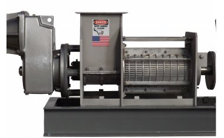

# 디스크 탈수기(DISCFILTER)

[← 전체 목록](../../../README.md) · 장비군: **분리·여과 설비**

> 🤖 자동 생성 페이지입니다. 이 폴더에 파일을 올리면 내용이 갱신됩니다.

| 항목 | 내용 |
|---|---|
| 상태 | 🟡 작성 중 |
| 최근 올린 사람 | Claude |
| 수정일 | 2026-11-03 |

## 산출물

| 구분 | 파일 | 크기 | 바로 보기 |
|---|---|---|---|
| 📄 개발계획서 | _아직 없음_ | | |
| 📘 가이던스 | _아직 없음_ | | |
| 🧩 AASX | [DiskDewateringMachine_v0.0.1_260930.aasx](AASX/DiskDewateringMachine_v0.0.1_260930.aasx) | 11.7 MB | [👁 열람 페이지](gen/DiskDewateringMachine_v0.0.1_260930.md) |

## AAS 구성 — `DiskDewateringMachineAAS`

`DiskDewateringMachine_v0.0.1_260930.aasx` 에서 읽은 서브모델 8개 · **[👁 요소 전체 펼쳐 보기](gen/DiskDewateringMachine_v0.0.1_260930.md)**:

| # | 서브모델 idShort |
|:-:|---|
| 1 | Nameplate |
| 2 | HandoverDocumentation |
| 3 | TechnicalData |
| 4 | OperationalData |
| 5 | TimeSeries |
| 6 | ProcessParameters |
| 7 | ProcessVariablesForManufacturingKPICalculation |
| 8 | PredictiveMaintenance |
