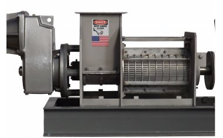

# 🧩 DiskDewateringMachine_v0.0.1_260930.aasx

[← 장비 페이지](../README.md) · [⤓ AASX 다운로드](../AASX/DiskDewateringMachine_v0.0.1_260930.aasx) · 11.7 MB

> 🤖 AASX 파일을 열어 자동으로 만든 열람 페이지입니다. 직접 고치지 말고 AASX를 다시 올리세요.

| 항목 | 내용 |
|---|---|
| AAS idShort | `DiskDewateringMachineAAS` |
| AAS id | https://www.smart-factory.kr/ids/aas/DiskDewateringMachineAAS/1/0 |
| 자산 종류 (assetKind) | Type |
| globalAssetId | https://www.smart-factory.kr/ids/asset/DiskDewateringMachineType/1/0 |
| 설명 | 회전 디스크와 스크류 프레스로 응집 슬러지를 연속 가압·고액분리하는 디스크탈수기 Type 자산의 AAS 참조모델입니다. |
| 서브모델 | 8개 |
| 전체 요소 | 493개 |

## 서브모델 한눈에 보기

| # | 서브모델 | 요소 수 | semanticId |
|:-:|---|--:|---|
| 1 | [Nameplate](#sm-1) | 18 | https://admin-shell.io/idta/nameplate/3/0/Nameplate |
| 2 | [HandoverDocumentation](#sm-2) | 26 | 0173-1#01-AHF578#003 |
| 3 | [TechnicalData](#sm-3) | 71 | 0173-1#01-AHX837#002 |
| 4 | [OperationalData](#sm-4) | 68 | https://www.smart-factory.kr/ids/sm/DiskDewateringMachineAAS/OperationalData/1/0 |
| 5 | [TimeSeries](#sm-5) | 114 | https://admin-shell.io/idta/TimeSeries/1/1 |
| 6 | [ProcessParameters](#sm-6) | 59 | https://admin-shell-io/idta/SubmodelTemplate/ProcessParameters/1/0 |
| 7 | [ProcessVariablesForManufacturingKPICalculation](#sm-7) | 76 | https://admin-shell.io/idta/SubmodelTemplate/ProcessVariablesForManufacturingKPICalculati… |
| 8 | [PredictiveMaintenance](#sm-8) | 61 | https://admin-shell.io/idta/SubmodelTemplate/PredictiveMaintenance/1/0 |

## 서브모델 상세

각 서브모델 이름을 누르면 펼쳐집니다. **굵은 글씨**는 하위 요소가 있는 묶음입니다.

<b>1. Nameplate</b> — 요소 18개

> 디스크탈수기의 제조사·제품·식별·버전 정보를 IDTA Digital Nameplate 구조로 제공합니다.

semanticId: `https://admin-shell.io/idta/nameplate/3/0/Nameplate`

| idShort | 종류 | 값 | semanticId |
|---|---|---|---|
| URIOfTheProduct | 속성 | https://www.smart-factory.kr/ids/product/DiskDewateringMachine/DD-300 | 0112/2///61987#ABN590#002 |
| ManufacturerName | 다국어&nbsp;속성 | 예시제조사 주식회사 | 0112/2///61987#ABA565#009 |
| ManufacturerProductDesignation | 다국어&nbsp;속성 | 다중 디스크 스크류 프레스식 탈수기 | 0112/2///61987#ABA567#009 |
| ManufacturerProductFamily | 다국어&nbsp;속성 | 디스크탈수기 | 0112/2///61987#ABP464#002 |
| ManufacturerProductType | 속성 | DD-300 | 0112/2///61987#ABA300#008 |
| OrderCodeOfManufacturer | 속성 | DD-300-ORD | 0112/2///61987#ABA950#008 |
| ProductArticleNumberOfManufacturer | 속성 | DD-300-ART | 0112/2///61987#ABA581#007 |
| SerialNumber | 속성 | DD-SN-2026-0001 | 0112/2///61987#ABA951#009 |
| YearOfConstruction | 속성 | 2026 | 0112/2///61987#ABP000#002 |
| DateOfManufacture | 속성 | 2026-06-21 | 0112/2///61987#ABB757#007 |
| HardwareVersion | 속성 | 1.0 | 0112/2///61987#ABA926#008 |
| FirmwareVersion | 속성 | 1.0.0 | 0112/2///61987#ABA302#006 |
| SoftwareVersion | 속성 | 1.0.0 | 0112/2///61987#ABA601#008 |
| **AddressInformation** | 묶음&nbsp;(4) |  | https://admin-shell.io/zvei/nameplate/1/0/ContactInformations/Address… |
| &nbsp;&nbsp;&nbsp;└ Street | 다국어&nbsp;속성 | 123 Industrial Road | 0173-1#02-AAO128#002 |
| &nbsp;&nbsp;&nbsp;└ Zipcode | 다국어&nbsp;속성 | 00000 | 0173-1#02-AAO129#002 |
| &nbsp;&nbsp;&nbsp;└ CityTown | 다국어&nbsp;속성 | Example City | 0173-1#02-AAO132#002 |
| &nbsp;&nbsp;&nbsp;└ NationalCode | 다국어&nbsp;속성 | KR | 0173-1#02-AAO134#002 |

<b>2. HandoverDocumentation</b> — 요소 26개

> 디스크탈수기와 함께 제공되는 개발계획서 및 기술 문서를 VDI 2770 기반 메타데이터로 구조화합니다.

semanticId: `0173-1#01-AHF578#003`

| idShort | 종류 | 값 | semanticId |
|---|---|---|---|
| **Documents** | 목록&nbsp;(1) |  | 0173-1#02-ABI500#003 |
| &nbsp;&nbsp;&nbsp;└ **** | 묶음&nbsp;(3) |  | 0173-1#02-ABI500#003/0173-1#01-AHF579#003 |
| &nbsp;&nbsp;&nbsp;&nbsp;&nbsp;&nbsp;└ **DocumentIds** | 목록&nbsp;(1) |  | 0173-1#02-ABI501#003 |
| &nbsp;&nbsp;&nbsp;&nbsp;&nbsp;&nbsp;&nbsp;&nbsp;&nbsp;└ **** | 묶음&nbsp;(3) |  | 0173-1#02-ABI501#003/0173-1#01-AHF580#003 |
| &nbsp;&nbsp;&nbsp;&nbsp;&nbsp;&nbsp;&nbsp;&nbsp;&nbsp;&nbsp;&nbsp;&nbsp;└ DocumentDomainId | 속성 | https://www.smart-factory.kr/ids/doc-domain/disk-dewatering | 0173-1#02-ABH994#003 |
| &nbsp;&nbsp;&nbsp;&nbsp;&nbsp;&nbsp;&nbsp;&nbsp;&nbsp;&nbsp;&nbsp;&nbsp;└ DocumentIdentifier | 속성 | DD-AAS-DEVPLAN-001 | 0173-1#02-AAO099#004 |
| &nbsp;&nbsp;&nbsp;&nbsp;&nbsp;&nbsp;&nbsp;&nbsp;&nbsp;&nbsp;&nbsp;&nbsp;└ DocumentIsPrimary | 속성 | true | 0173-1#02-ABH995#003 |
| &nbsp;&nbsp;&nbsp;&nbsp;&nbsp;&nbsp;└ **DocumentVersions** | 목록&nbsp;(1) |  | 0173-1#02-ABI503#003 |
| &nbsp;&nbsp;&nbsp;&nbsp;&nbsp;&nbsp;&nbsp;&nbsp;&nbsp;└ **** | 묶음&nbsp;(10) |  | 0173-1#02-ABI503#003/0173-1#01-AHF582#003 |
| &nbsp;&nbsp;&nbsp;&nbsp;&nbsp;&nbsp;&nbsp;&nbsp;&nbsp;&nbsp;&nbsp;&nbsp;└ **Language** | 목록&nbsp;(1) |  | 0173-1#02-AAN468#008 |
| &nbsp;&nbsp;&nbsp;&nbsp;&nbsp;&nbsp;&nbsp;&nbsp;&nbsp;&nbsp;&nbsp;&nbsp;&nbsp;&nbsp;&nbsp;└  | 속성 | ko-KR | 0173-1#02-AAN468#008 |
| &nbsp;&nbsp;&nbsp;&nbsp;&nbsp;&nbsp;&nbsp;&nbsp;&nbsp;&nbsp;&nbsp;&nbsp;└ Version | 속성 | 2026-09-24 | 0173-1#02-AAP003#005 |
| &nbsp;&nbsp;&nbsp;&nbsp;&nbsp;&nbsp;&nbsp;&nbsp;&nbsp;&nbsp;&nbsp;&nbsp;└ StatusSetDate | 속성 | 2026-09-24 | 0173-1#02-ABI000#003 |
| &nbsp;&nbsp;&nbsp;&nbsp;&nbsp;&nbsp;&nbsp;&nbsp;&nbsp;&nbsp;&nbsp;&nbsp;└ Title | 다국어&nbsp;속성 | 디스크탈수기 AAS 참조모델 개발계획서 | 0173-1#02-ABG940#003 |
| &nbsp;&nbsp;&nbsp;&nbsp;&nbsp;&nbsp;&nbsp;&nbsp;&nbsp;&nbsp;&nbsp;&nbsp;└ Description | 다국어&nbsp;속성 | 표준 구조, 서브모델 및 요소 경로, 자료형·단위와 예시값을 본문에 통합한 디스크탈수기 AAS 참조모델 개발계획서. | 0173-1#02-AAN466#004 |
| &nbsp;&nbsp;&nbsp;&nbsp;&nbsp;&nbsp;&nbsp;&nbsp;&nbsp;&nbsp;&nbsp;&nbsp;└ KeyWords | 다국어&nbsp;속성 | 디스크탈수기; 슬러지 탈수; 다중 디스크; 스크류 프레스; AAS | 0173-1#02-ABH999#003 |
| &nbsp;&nbsp;&nbsp;&nbsp;&nbsp;&nbsp;&nbsp;&nbsp;&nbsp;&nbsp;&nbsp;&nbsp;└ OrganizationOfficialName | 속성 | 예시제조사 주식회사 | 0173-1#02-ABI004#003 |
| &nbsp;&nbsp;&nbsp;&nbsp;&nbsp;&nbsp;&nbsp;&nbsp;&nbsp;&nbsp;&nbsp;&nbsp;└ **DigitalFiles** | 목록&nbsp;(1) |  | 0173-1#02-ABK126#002 |
| &nbsp;&nbsp;&nbsp;&nbsp;&nbsp;&nbsp;&nbsp;&nbsp;&nbsp;&nbsp;&nbsp;&nbsp;&nbsp;&nbsp;&nbsp;└  | 파일 | file:///aasx/files/documents/63_disk_dewatering_development_plan.hwp | 0173-1#02-ABK126#002 |
| &nbsp;&nbsp;&nbsp;&nbsp;&nbsp;&nbsp;&nbsp;&nbsp;&nbsp;&nbsp;&nbsp;&nbsp;└ StatusValue | 속성 | Draft | 0173-1#02-ABI001#003 |
| &nbsp;&nbsp;&nbsp;&nbsp;&nbsp;&nbsp;&nbsp;&nbsp;&nbsp;&nbsp;&nbsp;&nbsp;└ OrganizationShortName | 속성 | ExampleCompany | https://api.eclass-cdp.com/0173-1-02-ABI002-003 |
| &nbsp;&nbsp;&nbsp;&nbsp;&nbsp;&nbsp;└ **DocumentClassifications** | 목록&nbsp;(1) |  | 0173-1#02-ABI502#003 |
| &nbsp;&nbsp;&nbsp;&nbsp;&nbsp;&nbsp;&nbsp;&nbsp;&nbsp;└ **** | 묶음&nbsp;(3) |  | 0173-1#02-ABI502#003/0173-1#01-AHF581#003 |
| &nbsp;&nbsp;&nbsp;&nbsp;&nbsp;&nbsp;&nbsp;&nbsp;&nbsp;&nbsp;&nbsp;&nbsp;└ ClassId | 속성 | 02-05 | 0173-1#02-ABH996#003 |
| &nbsp;&nbsp;&nbsp;&nbsp;&nbsp;&nbsp;&nbsp;&nbsp;&nbsp;&nbsp;&nbsp;&nbsp;└ ClassName | 다국어&nbsp;속성 | 계획서 및 기술사양 | 0173-1#02-ABJ219#002 |
| &nbsp;&nbsp;&nbsp;&nbsp;&nbsp;&nbsp;&nbsp;&nbsp;&nbsp;&nbsp;&nbsp;&nbsp;└ ClassificationSystem | 속성 | VDI 2770 Blatt 1:2020 | 0173-1#02-ABH997#003 |

<b>3. TechnicalData</b> — 요소 71개

> 디스크탈수기의 일반정보, 제품분류, 처리성능, 디스크·스크류, 응집, 배관, 전기·안전 기술사양을 제공합니다.

semanticId: `0173-1#01-AHX837#002`

| idShort | 종류 | 값 | semanticId |
|---|---|---|---|
| **GeneralInformation** | 묶음&nbsp;(5) |  | 0173-1#02-ABK161#002/0173-1#01-AHX838#002 |
| &nbsp;&nbsp;&nbsp;└ ManufacturerName | 속성 | ExampleCompany | 0173-1#02-AAO677#004 |
| &nbsp;&nbsp;&nbsp;└ ManufacturerProductDesignation | 다국어&nbsp;속성 | ExampleCompany Multi-disk Screw Press Dewatering Machine | 0173-1#02-AAW338#003 |
| &nbsp;&nbsp;&nbsp;└ ManufacturerArticleNumber | 속성 | DD-300-ART | 0173-1#02-AAO676#005 |
| &nbsp;&nbsp;&nbsp;└ ManufacturerOrderCode | 속성 | DD-300-ORD | 0173-1#02-AAO227#004 |
| &nbsp;&nbsp;&nbsp;└ **ProductImages** | 목록&nbsp;(1) |  | 0173-1#02-ABM220#001 |
| &nbsp;&nbsp;&nbsp;&nbsp;&nbsp;&nbsp;└ **** | 묶음&nbsp;(2) |  | 0173-1#02-ABM220#001/0173-1#01-AHY911#001 |
| &nbsp;&nbsp;&nbsp;&nbsp;&nbsp;&nbsp;&nbsp;&nbsp;&nbsp;└ ImageFile | 파일 | file:///aasx/files/images/DISKDEWATERING_ProductImage.jpg | 0173-1#02-ABK291#002 |
| &nbsp;&nbsp;&nbsp;&nbsp;&nbsp;&nbsp;&nbsp;&nbsp;&nbsp;└ ImageNote | 다국어&nbsp;속성 | Side view of ExampleCompany disk dewatering machine | 0173-1#02-ABL423#001 |
| **ProductClassifications** | 목록&nbsp;(1) |  | 0173-1#02-ABK162#002 |
| &nbsp;&nbsp;&nbsp;└ **** | 묶음&nbsp;(6) |  | 0173-1#02-ABK162#002/0173-1#01-AHX839#002 |
| &nbsp;&nbsp;&nbsp;&nbsp;&nbsp;&nbsp;└ ClassificationSystem | 속성 | ECLASS | 0173-1#02-ABL424#001 |
| &nbsp;&nbsp;&nbsp;&nbsp;&nbsp;&nbsp;└ ClassificationSystemVersion | 속성 | ECLASS 16.0 | 0173-1#02-AAR710#003 |
| &nbsp;&nbsp;&nbsp;&nbsp;&nbsp;&nbsp;└ ClassificationSystemUrl | 속성 | https://eclass.eu | https://admin-shell.io/IDTA/TechnicalData/ProductClassifications/Prod… |
| &nbsp;&nbsp;&nbsp;&nbsp;&nbsp;&nbsp;└ ProductClassId | 속성 | 0173-1#01-AAD432#021 | 0173-1#02-ABG776#003 |
| &nbsp;&nbsp;&nbsp;&nbsp;&nbsp;&nbsp;└ ProductClassCodedName | 속성 | 36-10-20-10 | 0173-1#02-ABK128#002 |
| &nbsp;&nbsp;&nbsp;&nbsp;&nbsp;&nbsp;└ ProductClassName | 다국어&nbsp;속성 | Disk filter (for liquids) | 0173-1#02-ABK273#002 |
| **TechnicalPropertyAreas** | 목록&nbsp;(1) |  | 0173-1#02-ABK163#002 |
| &nbsp;&nbsp;&nbsp;└ **** | 묶음&nbsp;(1) |  | 0173-1#02-ABL358#002/0173-1#01-AHX773#002 |
| &nbsp;&nbsp;&nbsp;&nbsp;&nbsp;&nbsp;└ **DiskDewateringMachineSystem** | 묶음&nbsp;(6) |  | https://www.smart-factory.kr/ids/cd/DiskDewateringMachineSystem/1/0 |
| &nbsp;&nbsp;&nbsp;&nbsp;&nbsp;&nbsp;&nbsp;&nbsp;&nbsp;└ **DiskDewateringCommonSpecifications** | 묶음&nbsp;(6) |  | https://www.smart-factory.kr/ids/cd/DiskDewateringCommonSpecification… |
| &nbsp;&nbsp;&nbsp;&nbsp;&nbsp;&nbsp;&nbsp;&nbsp;&nbsp;&nbsp;&nbsp;&nbsp;└ DewateringMachineType | 속성 | Multi-disk screw press dewatering machine | https://www.smart-factory.kr/ids/cd/DewateringMachineType/1/0 |
| &nbsp;&nbsp;&nbsp;&nbsp;&nbsp;&nbsp;&nbsp;&nbsp;&nbsp;&nbsp;&nbsp;&nbsp;└ SeparationPrinciple | 속성 | Rotating disk and screw press compression | https://www.smart-factory.kr/ids/cd/SeparationPrinciple/1/0 |
| &nbsp;&nbsp;&nbsp;&nbsp;&nbsp;&nbsp;&nbsp;&nbsp;&nbsp;&nbsp;&nbsp;&nbsp;└ SystemConfiguration | 속성 | Flocculation tank with multi-disk screw press unit | https://www.smart-factory.kr/ids/cd/SystemConfiguration/1/0 |
| &nbsp;&nbsp;&nbsp;&nbsp;&nbsp;&nbsp;&nbsp;&nbsp;&nbsp;&nbsp;&nbsp;&nbsp;└ InstallationType | 속성 | Floor-mounted skid type | https://www.smart-factory.kr/ids/cd/InstallationType/1/0 |
| &nbsp;&nbsp;&nbsp;&nbsp;&nbsp;&nbsp;&nbsp;&nbsp;&nbsp;&nbsp;&nbsp;&nbsp;└ TargetSludgeType | 속성 | Organic and mixed municipal sludge | https://www.smart-factory.kr/ids/cd/TargetSludgeType/1/0 |
| &nbsp;&nbsp;&nbsp;&nbsp;&nbsp;&nbsp;&nbsp;&nbsp;&nbsp;&nbsp;&nbsp;&nbsp;└ NetWeight | 속성 | 1650 | https://www.smart-factory.kr/ids/cd/NetWeight/1/0 |
| &nbsp;&nbsp;&nbsp;&nbsp;&nbsp;&nbsp;&nbsp;&nbsp;&nbsp;└ **CapacityAndPerformanceSpecifications** | 묶음&nbsp;(7) |  | https://www.smart-factory.kr/ids/cd/CapacityAndPerformanceSpecificati… |
| &nbsp;&nbsp;&nbsp;&nbsp;&nbsp;&nbsp;&nbsp;&nbsp;&nbsp;&nbsp;&nbsp;&nbsp;└ RatedTreatmentCapacity | 속성 | 8.0 | https://www.smart-factory.kr/ids/cd/RatedTreatmentCapacity/1/0 |
| &nbsp;&nbsp;&nbsp;&nbsp;&nbsp;&nbsp;&nbsp;&nbsp;&nbsp;&nbsp;&nbsp;&nbsp;└ RatedSolidLoadingCapacity | 속성 | 120 | https://www.smart-factory.kr/ids/cd/RatedSolidLoadingCapacity/1/0 |
| &nbsp;&nbsp;&nbsp;&nbsp;&nbsp;&nbsp;&nbsp;&nbsp;&nbsp;&nbsp;&nbsp;&nbsp;└ TargetCakeMoistureContent | 속성 | 80 | https://www.smart-factory.kr/ids/cd/TargetCakeMoistureContent/1/0 |
| &nbsp;&nbsp;&nbsp;&nbsp;&nbsp;&nbsp;&nbsp;&nbsp;&nbsp;&nbsp;&nbsp;&nbsp;└ InletSludgeConcentrationRange | 범위 | 0.5 ~ 4.0 | https://www.smart-factory.kr/ids/cd/InletSludgeConcentrationRange/1/0 |
| &nbsp;&nbsp;&nbsp;&nbsp;&nbsp;&nbsp;&nbsp;&nbsp;&nbsp;&nbsp;&nbsp;&nbsp;└ SolidsRecoveryRate | 속성 | 95 | https://www.smart-factory.kr/ids/cd/SolidsRecoveryRate/1/0 |
| &nbsp;&nbsp;&nbsp;&nbsp;&nbsp;&nbsp;&nbsp;&nbsp;&nbsp;&nbsp;&nbsp;&nbsp;└ DriveMotorRatedPower | 속성 | 2.2 | https://www.smart-factory.kr/ids/cd/DriveMotorRatedPower/1/0 |
| &nbsp;&nbsp;&nbsp;&nbsp;&nbsp;&nbsp;&nbsp;&nbsp;&nbsp;&nbsp;&nbsp;&nbsp;└ RatedPowerInput | 속성 | 3.5 | https://www.smart-factory.kr/ids/cd/RatedPowerInput/1/0 |
| &nbsp;&nbsp;&nbsp;&nbsp;&nbsp;&nbsp;&nbsp;&nbsp;&nbsp;└ **DiskAndScrewSpecifications** | 묶음&nbsp;(8) |  | https://www.smart-factory.kr/ids/cd/DiskAndScrewSpecifications/1/0 |
| &nbsp;&nbsp;&nbsp;&nbsp;&nbsp;&nbsp;&nbsp;&nbsp;&nbsp;&nbsp;&nbsp;&nbsp;└ NumberOfDisks | 속성 | 24 | https://www.smart-factory.kr/ids/cd/NumberOfDisks/1/0 |
| &nbsp;&nbsp;&nbsp;&nbsp;&nbsp;&nbsp;&nbsp;&nbsp;&nbsp;&nbsp;&nbsp;&nbsp;└ DiskDiameter | 속성 | 300 | https://www.smart-factory.kr/ids/cd/DiskDiameter/1/0 |
| &nbsp;&nbsp;&nbsp;&nbsp;&nbsp;&nbsp;&nbsp;&nbsp;&nbsp;&nbsp;&nbsp;&nbsp;└ ScrewShaftDiameter | 속성 | 200 | https://www.smart-factory.kr/ids/cd/ScrewShaftDiameter/1/0 |
| &nbsp;&nbsp;&nbsp;&nbsp;&nbsp;&nbsp;&nbsp;&nbsp;&nbsp;&nbsp;&nbsp;&nbsp;└ ScrewPitchType | 속성 | Variable pitch | https://www.smart-factory.kr/ids/cd/ScrewPitchType/1/0 |
| &nbsp;&nbsp;&nbsp;&nbsp;&nbsp;&nbsp;&nbsp;&nbsp;&nbsp;&nbsp;&nbsp;&nbsp;└ ScrewRotationSpeedRange | 범위 | 0.5 ~ 5.0 | https://www.smart-factory.kr/ids/cd/ScrewRotationSpeedRange/1/0 |
| &nbsp;&nbsp;&nbsp;&nbsp;&nbsp;&nbsp;&nbsp;&nbsp;&nbsp;&nbsp;&nbsp;&nbsp;└ DiskRotationSpeedRange | 범위 | 1.0 ~ 8.0 | https://www.smart-factory.kr/ids/cd/DiskRotationSpeedRange/1/0 |
| &nbsp;&nbsp;&nbsp;&nbsp;&nbsp;&nbsp;&nbsp;&nbsp;&nbsp;&nbsp;&nbsp;&nbsp;└ MovableRingMaterial | 속성 | HDPE | https://www.smart-factory.kr/ids/cd/MovableRingMaterial/1/0 |
| &nbsp;&nbsp;&nbsp;&nbsp;&nbsp;&nbsp;&nbsp;&nbsp;&nbsp;&nbsp;&nbsp;&nbsp;└ SelfCleaningSupported | 속성 | true | https://www.smart-factory.kr/ids/cd/SelfCleaningSupported/1/0 |
| &nbsp;&nbsp;&nbsp;&nbsp;&nbsp;&nbsp;&nbsp;&nbsp;&nbsp;└ **PolymerAndFlocculationSpecifications** | 묶음&nbsp;(6) |  | https://www.smart-factory.kr/ids/cd/PolymerAndFlocculationSpecificati… |
| &nbsp;&nbsp;&nbsp;&nbsp;&nbsp;&nbsp;&nbsp;&nbsp;&nbsp;&nbsp;&nbsp;&nbsp;└ PolymerDosingMethod | 속성 | Inline metering pump dosing | https://www.smart-factory.kr/ids/cd/PolymerDosingMethod/1/0 |
| &nbsp;&nbsp;&nbsp;&nbsp;&nbsp;&nbsp;&nbsp;&nbsp;&nbsp;&nbsp;&nbsp;&nbsp;└ PolymerType | 속성 | Cationic polyacrylamide | https://www.smart-factory.kr/ids/cd/PolymerType/1/0 |
| &nbsp;&nbsp;&nbsp;&nbsp;&nbsp;&nbsp;&nbsp;&nbsp;&nbsp;&nbsp;&nbsp;&nbsp;└ PolymerDosageRange | 범위 | 3 ~ 12 | https://www.smart-factory.kr/ids/cd/PolymerDosageRange/1/0 |
| &nbsp;&nbsp;&nbsp;&nbsp;&nbsp;&nbsp;&nbsp;&nbsp;&nbsp;&nbsp;&nbsp;&nbsp;└ FlocculationTankVolume | 속성 | 0.6 | https://www.smart-factory.kr/ids/cd/FlocculationTankVolume/1/0 |
| &nbsp;&nbsp;&nbsp;&nbsp;&nbsp;&nbsp;&nbsp;&nbsp;&nbsp;&nbsp;&nbsp;&nbsp;└ FlocculationMixerType | 속성 | Slow-speed paddle mixer | https://www.smart-factory.kr/ids/cd/FlocculationMixerType/1/0 |
| &nbsp;&nbsp;&nbsp;&nbsp;&nbsp;&nbsp;&nbsp;&nbsp;&nbsp;&nbsp;&nbsp;&nbsp;└ PolymerPreparationConcentration | 속성 | 0.2 | https://www.smart-factory.kr/ids/cd/PolymerPreparationConcentration/1… |
| &nbsp;&nbsp;&nbsp;&nbsp;&nbsp;&nbsp;&nbsp;&nbsp;&nbsp;└ **DrainageAndDimensionSpecifications** | 묶음&nbsp;(8) |  | https://www.smart-factory.kr/ids/cd/DrainageAndDimensionSpecification… |
| &nbsp;&nbsp;&nbsp;&nbsp;&nbsp;&nbsp;&nbsp;&nbsp;&nbsp;&nbsp;&nbsp;&nbsp;└ SludgeInletConnectionSize | 속성 | Flange 80 mm | https://www.smart-factory.kr/ids/cd/SludgeInletConnectionSize/1/0 |
| &nbsp;&nbsp;&nbsp;&nbsp;&nbsp;&nbsp;&nbsp;&nbsp;&nbsp;&nbsp;&nbsp;&nbsp;└ FiltrateOutletConnectionSize | 속성 | Flange 100 mm | https://www.smart-factory.kr/ids/cd/FiltrateOutletConnectionSize/1/0 |
| &nbsp;&nbsp;&nbsp;&nbsp;&nbsp;&nbsp;&nbsp;&nbsp;&nbsp;&nbsp;&nbsp;&nbsp;└ WashWaterConnectionSize | 속성 | Flange 25 mm | https://www.smart-factory.kr/ids/cd/WashWaterConnectionSize/1/0 |
| &nbsp;&nbsp;&nbsp;&nbsp;&nbsp;&nbsp;&nbsp;&nbsp;&nbsp;&nbsp;&nbsp;&nbsp;└ WashWaterConsumption | 속성 | 0.3 | https://www.smart-factory.kr/ids/cd/WashWaterConsumption/1/0 |
| &nbsp;&nbsp;&nbsp;&nbsp;&nbsp;&nbsp;&nbsp;&nbsp;&nbsp;&nbsp;&nbsp;&nbsp;└ WettedPartsMaterial | 속성 | SUS304 | https://www.smart-factory.kr/ids/cd/WettedPartsMaterial/1/0 |
| &nbsp;&nbsp;&nbsp;&nbsp;&nbsp;&nbsp;&nbsp;&nbsp;&nbsp;&nbsp;&nbsp;&nbsp;└ DimensionsLength | 속성 | 2800 | 0173-1#02-BAA018#008 |
| &nbsp;&nbsp;&nbsp;&nbsp;&nbsp;&nbsp;&nbsp;&nbsp;&nbsp;&nbsp;&nbsp;&nbsp;└ DimensionsWidth | 속성 | 1100 | 0173-1#02-BAA019#004 |
| &nbsp;&nbsp;&nbsp;&nbsp;&nbsp;&nbsp;&nbsp;&nbsp;&nbsp;&nbsp;&nbsp;&nbsp;└ DimensionsHeight | 속성 | 1750 | 0173-1#02-BAA020#011 |
| &nbsp;&nbsp;&nbsp;&nbsp;&nbsp;&nbsp;&nbsp;&nbsp;&nbsp;└ **ElectricalAndSafetySpecifications** | 묶음&nbsp;(10) |  | https://www.smart-factory.kr/ids/cd/ElectricalAndSafetySpecifications… |
| &nbsp;&nbsp;&nbsp;&nbsp;&nbsp;&nbsp;&nbsp;&nbsp;&nbsp;&nbsp;&nbsp;&nbsp;└ RatedVoltage | 범위 | 380 ~ 415 | https://www.smart-factory.kr/ids/cd/RatedVoltage/1/0 |
| &nbsp;&nbsp;&nbsp;&nbsp;&nbsp;&nbsp;&nbsp;&nbsp;&nbsp;&nbsp;&nbsp;&nbsp;└ PowerSupplyPhaseFrequency | 속성 | 3-phase, 50/60 Hz | https://www.smart-factory.kr/ids/cd/PowerSupplyPhaseFrequency/1/0 |
| &nbsp;&nbsp;&nbsp;&nbsp;&nbsp;&nbsp;&nbsp;&nbsp;&nbsp;&nbsp;&nbsp;&nbsp;└ RatedPower | 속성 | 4.0 | https://www.smart-factory.kr/ids/cd/RatedPower/1/0 |
| &nbsp;&nbsp;&nbsp;&nbsp;&nbsp;&nbsp;&nbsp;&nbsp;&nbsp;&nbsp;&nbsp;&nbsp;└ MaxRunningCurrent | 속성 | 9 | https://www.smart-factory.kr/ids/cd/MaxRunningCurrent/1/0 |
| &nbsp;&nbsp;&nbsp;&nbsp;&nbsp;&nbsp;&nbsp;&nbsp;&nbsp;&nbsp;&nbsp;&nbsp;└ LeakageBreakerCapacity | 속성 | 30 | https://www.smart-factory.kr/ids/cd/LeakageBreakerCapacity/1/0 |
| &nbsp;&nbsp;&nbsp;&nbsp;&nbsp;&nbsp;&nbsp;&nbsp;&nbsp;&nbsp;&nbsp;&nbsp;└ SupportedSafetyFunctions | 속성 | Drive overload protection, emergency stop | https://www.smart-factory.kr/ids/cd/SupportedSafetyFunctions/1/0 |
| &nbsp;&nbsp;&nbsp;&nbsp;&nbsp;&nbsp;&nbsp;&nbsp;&nbsp;&nbsp;&nbsp;&nbsp;└ OverTorqueProtectionSupported | 속성 | true | https://www.smart-factory.kr/ids/cd/OverTorqueProtectionSupported/1/0 |
| &nbsp;&nbsp;&nbsp;&nbsp;&nbsp;&nbsp;&nbsp;&nbsp;&nbsp;&nbsp;&nbsp;&nbsp;└ RotatingPartGuardInterlockSupported | 속성 | true | https://www.smart-factory.kr/ids/cd/RotatingPartGuardInterlockSupport… |
| &nbsp;&nbsp;&nbsp;&nbsp;&nbsp;&nbsp;&nbsp;&nbsp;&nbsp;&nbsp;&nbsp;&nbsp;└ IPRating | 속성 | IP55 | https://www.smart-factory.kr/ids/cd/IPRating/1/0 |
| &nbsp;&nbsp;&nbsp;&nbsp;&nbsp;&nbsp;&nbsp;&nbsp;&nbsp;&nbsp;&nbsp;&nbsp;└ GroundingRequired | 속성 | true | https://www.smart-factory.kr/ids/cd/GroundingRequired/1/0 |

<b>4. OperationalData</b> — 요소 68개

> 디스크탈수기의 운전·공정·전기·안전 상태와 예지보전 평가 정보 및 탈수 성능 지표를 계통별로 구조화합니다.

semanticId: `https://www.smart-factory.kr/ids/sm/DiskDewateringMachineAAS/OperationalData/1/0`

| idShort | 종류 | 값 | semanticId |
|---|---|---|---|
| **OperationManagement** | 묶음&nbsp;(2) |  | https://www.smart-factory.kr/ids/cd/OperationManagement/1/0 |
| &nbsp;&nbsp;&nbsp;└ **DeviceOperationMonitoring** | 묶음&nbsp;(8) |  | https://www.smart-factory.kr/ids/cd/DeviceOperationMonitoring/1/0 |
| &nbsp;&nbsp;&nbsp;&nbsp;&nbsp;&nbsp;└ DeviceRunState | 속성 | Running | https://www.smart-factory.kr/ids/cd/DeviceRunState/1/0 |
| &nbsp;&nbsp;&nbsp;&nbsp;&nbsp;&nbsp;└ OperationMode | 속성 | Continuous dewatering | https://www.smart-factory.kr/ids/cd/OperationMode/1/0 |
| &nbsp;&nbsp;&nbsp;&nbsp;&nbsp;&nbsp;└ ActiveProcessId | 속성 | DD-P-001 | https://www.smart-factory.kr/ids/cd/ActiveProcessId/1/0 |
| &nbsp;&nbsp;&nbsp;&nbsp;&nbsp;&nbsp;└ TreatmentCapacityActual | 속성 | 6.8 | https://www.smart-factory.kr/ids/cd/TreatmentCapacityActual/1/0 |
| &nbsp;&nbsp;&nbsp;&nbsp;&nbsp;&nbsp;└ CapacityRatioActual | 속성 | 85 | https://www.smart-factory.kr/ids/cd/CapacityRatioActual/1/0 |
| &nbsp;&nbsp;&nbsp;&nbsp;&nbsp;&nbsp;└ CumulativeTreatedVolume | 속성 | 142.5 | https://www.smart-factory.kr/ids/cd/CumulativeTreatedVolume/1/0 |
| &nbsp;&nbsp;&nbsp;&nbsp;&nbsp;&nbsp;└ OperationStartTimestamp | 속성 | 2026-06-21T08:00:00Z | https://www.smart-factory.kr/ids/cd/OperationStartTimestamp/1/0 |
| &nbsp;&nbsp;&nbsp;&nbsp;&nbsp;&nbsp;└ LastUpdateTimestamp | 속성 | 2026-06-21T08:20:30Z | https://www.smart-factory.kr/ids/cd/LastUpdateTimestamp/1/0 |
| &nbsp;&nbsp;&nbsp;└ **ElectricalAndSafetyConditionMonitoring** | 묶음&nbsp;(7) |  | https://www.smart-factory.kr/ids/cd/ElectricalAndSafetyConditionMonit… |
| &nbsp;&nbsp;&nbsp;&nbsp;&nbsp;&nbsp;└ PowerConsumptionActual | 속성 | 3100 | https://www.smart-factory.kr/ids/cd/PowerConsumptionActual/1/0 |
| &nbsp;&nbsp;&nbsp;&nbsp;&nbsp;&nbsp;└ ElectricalSupplyStatus | 속성 | Normal | https://www.smart-factory.kr/ids/cd/ElectricalSupplyStatus/1/0 |
| &nbsp;&nbsp;&nbsp;&nbsp;&nbsp;&nbsp;└ EmergencyStopStatus | 속성 | Released | https://www.smart-factory.kr/ids/cd/EmergencyStopStatus/1/0 |
| &nbsp;&nbsp;&nbsp;&nbsp;&nbsp;&nbsp;└ OverTorqueProtectionStatus | 속성 | Released | https://www.smart-factory.kr/ids/cd/OverTorqueProtectionStatus/1/0 |
| &nbsp;&nbsp;&nbsp;&nbsp;&nbsp;&nbsp;└ RotatingPartGuardInterlockStatus | 속성 | Locked | https://www.smart-factory.kr/ids/cd/RotatingPartGuardInterlockStatus/… |
| &nbsp;&nbsp;&nbsp;&nbsp;&nbsp;&nbsp;└ DewateringMachineAlarmStatus | 속성 | None | https://www.smart-factory.kr/ids/cd/DewateringMachineAlarmStatus/1/0 |
| &nbsp;&nbsp;&nbsp;&nbsp;&nbsp;&nbsp;└ OperationPermittedState | 속성 | Permitted | https://www.smart-factory.kr/ids/cd/OperationPermittedState/1/0 |
| **DewateringProcess** | 묶음&nbsp;(2) |  | https://www.smart-factory.kr/ids/cd/DewateringProcess/1/0 |
| &nbsp;&nbsp;&nbsp;└ **SludgeFeedAndDewateringMonitoring** | 묶음&nbsp;(6) |  | https://www.smart-factory.kr/ids/cd/SludgeFeedAndDewateringMonitoring… |
| &nbsp;&nbsp;&nbsp;&nbsp;&nbsp;&nbsp;└ InletSludgeConcentrationActual | 속성 | 2.1 | https://www.smart-factory.kr/ids/cd/InletSludgeConcentrationActual/1/0 |
| &nbsp;&nbsp;&nbsp;&nbsp;&nbsp;&nbsp;└ InletSludgeFlowActual | 속성 | 6.8 | https://www.smart-factory.kr/ids/cd/InletSludgeFlowActual/1/0 |
| &nbsp;&nbsp;&nbsp;&nbsp;&nbsp;&nbsp;└ CakeMoistureContentActual | 속성 | 81.5 | https://www.smart-factory.kr/ids/cd/CakeMoistureContentActual/1/0 |
| &nbsp;&nbsp;&nbsp;&nbsp;&nbsp;&nbsp;└ CakeMoistureContentDeviation | 속성 | 1.5 | https://www.smart-factory.kr/ids/cd/CakeMoistureContentDeviation/1/0 |
| &nbsp;&nbsp;&nbsp;&nbsp;&nbsp;&nbsp;└ CakeDischargeRateActual | 속성 | 0.28 | https://www.smart-factory.kr/ids/cd/CakeDischargeRateActual/1/0 |
| &nbsp;&nbsp;&nbsp;&nbsp;&nbsp;&nbsp;└ SludgeFeedPumpRunState | 속성 | Running | https://www.smart-factory.kr/ids/cd/SludgeFeedPumpRunState/1/0 |
| &nbsp;&nbsp;&nbsp;└ **PolymerAndFiltrateMonitoring** | 묶음&nbsp;(7) |  | https://www.smart-factory.kr/ids/cd/PolymerAndFiltrateMonitoring/1/0 |
| &nbsp;&nbsp;&nbsp;&nbsp;&nbsp;&nbsp;└ PolymerDosingRateActual | 속성 | 18.0 | https://www.smart-factory.kr/ids/cd/PolymerDosingRateActual/1/0 |
| &nbsp;&nbsp;&nbsp;&nbsp;&nbsp;&nbsp;└ PolymerDosingPumpRunState | 속성 | Running | https://www.smart-factory.kr/ids/cd/PolymerDosingPumpRunState/1/0 |
| &nbsp;&nbsp;&nbsp;&nbsp;&nbsp;&nbsp;└ FlocculationMixerRunState | 속성 | Running | https://www.smart-factory.kr/ids/cd/FlocculationMixerRunState/1/0 |
| &nbsp;&nbsp;&nbsp;&nbsp;&nbsp;&nbsp;└ FiltrateTurbidityActual | 속성 | 35 | https://www.smart-factory.kr/ids/cd/FiltrateTurbidityActual/1/0 |
| &nbsp;&nbsp;&nbsp;&nbsp;&nbsp;&nbsp;└ FiltrateDischargeStatus | 속성 | Normal | https://www.smart-factory.kr/ids/cd/FiltrateDischargeStatus/1/0 |
| &nbsp;&nbsp;&nbsp;&nbsp;&nbsp;&nbsp;└ WashWaterValveState | 속성 | Closed | https://www.smart-factory.kr/ids/cd/WashWaterValveState/1/0 |
| &nbsp;&nbsp;&nbsp;&nbsp;&nbsp;&nbsp;└ BackwashStatus | 속성 | Inactive | https://www.smart-factory.kr/ids/cd/BackwashStatus/1/0 |
| **EquipmentCondition** | 묶음&nbsp;(3) |  | https://www.smart-factory.kr/ids/cd/EquipmentCondition/1/0 |
| &nbsp;&nbsp;&nbsp;└ **DiskAndScrewDriveMonitoring** | 묶음&nbsp;(7) |  | https://www.smart-factory.kr/ids/cd/DiskAndScrewDriveMonitoring/1/0 |
| &nbsp;&nbsp;&nbsp;&nbsp;&nbsp;&nbsp;└ ScrewDriveRunState | 속성 | Running | https://www.smart-factory.kr/ids/cd/ScrewDriveRunState/1/0 |
| &nbsp;&nbsp;&nbsp;&nbsp;&nbsp;&nbsp;└ ScrewRotationSpeedActual | 속성 | 2.4 | https://www.smart-factory.kr/ids/cd/ScrewRotationSpeedActual/1/0 |
| &nbsp;&nbsp;&nbsp;&nbsp;&nbsp;&nbsp;└ DiskRotationSpeedActual | 속성 | 4.0 | https://www.smart-factory.kr/ids/cd/DiskRotationSpeedActual/1/0 |
| &nbsp;&nbsp;&nbsp;&nbsp;&nbsp;&nbsp;└ DriveTorqueActual | 속성 | 320 | https://www.smart-factory.kr/ids/cd/DriveTorqueActual/1/0 |
| &nbsp;&nbsp;&nbsp;&nbsp;&nbsp;&nbsp;└ DriveMotorCurrentActual | 속성 | 6.2 | https://www.smart-factory.kr/ids/cd/DriveMotorCurrentActual/1/0 |
| &nbsp;&nbsp;&nbsp;&nbsp;&nbsp;&nbsp;└ DiskDifferentialPressureActual | 속성 | 28 | https://www.smart-factory.kr/ids/cd/DiskDifferentialPressureActual/1/0 |
| &nbsp;&nbsp;&nbsp;&nbsp;&nbsp;&nbsp;└ DiskCloggingStatus | 속성 | Normal | https://www.smart-factory.kr/ids/cd/DiskCloggingStatus/1/0 |
| &nbsp;&nbsp;&nbsp;└ **MaintenanceContext** | 묶음&nbsp;(3) |  | https://www.smart-factory.kr/ids/cd/MaintenanceContext/1/0 |
| &nbsp;&nbsp;&nbsp;&nbsp;&nbsp;&nbsp;└ DiscDehydratorComponent | 속성 | Disc rotating shaft / drive bearing / filter cloth | https://www.smart-factory.kr/ids/cd/DiscDehydratorComponent/1/0 |
| &nbsp;&nbsp;&nbsp;&nbsp;&nbsp;&nbsp;└ DiscDehydratorFailureMode | 속성 | Filter-cloth clogging / bearing wear / shaft imbalance | https://www.smart-factory.kr/ids/cd/DiscDehydratorFailureMode/1/0 |
| &nbsp;&nbsp;&nbsp;&nbsp;&nbsp;&nbsp;└ RULFeatureImportance | 속성 | Torque 0.41 / DiffPressure 0.33 / Vibration 0.26 | https://www.smart-factory.kr/ids/cd/RULFeatureImportance/1/0 |
| &nbsp;&nbsp;&nbsp;└ **MaintenanceIndicators** | 묶음&nbsp;(3) |  | https://www.smart-factory.kr/ids/cd/MaintenanceIndicators/1/0 |
| &nbsp;&nbsp;&nbsp;&nbsp;&nbsp;&nbsp;└ FilterClothCloggingIndex | 속성 | 0.34 | https://www.smart-factory.kr/ids/cd/FilterClothCloggingIndex/1/0 |
| &nbsp;&nbsp;&nbsp;&nbsp;&nbsp;&nbsp;└ DewateringLoadFactor | 속성 | 0.86 | https://www.smart-factory.kr/ids/cd/DewateringLoadFactor/1/0 |
| &nbsp;&nbsp;&nbsp;&nbsp;&nbsp;&nbsp;└ SludgeAbrasivenessCorrectionFactor | 속성 | 1.15 | https://www.smart-factory.kr/ids/cd/SludgeAbrasivenessCorrectionFacto… |
| **DewateringPerformanceIndicators** | 묶음&nbsp;(4) |  | https://www.smart-factory.kr/ids/cd/DewateringPerformanceIndicators/1… |
| &nbsp;&nbsp;&nbsp;└ **DewateredCakeDrynessIndicator** | 묶음&nbsp;(3) |  | https://www.smart-factory.kr/ids/cd/DewateredCakeDrynessIndicator/1/0 |
| &nbsp;&nbsp;&nbsp;&nbsp;&nbsp;&nbsp;└ Key | 속성 | DCD | https://www.smart-factory.kr/ids/cd/DewateredCakeDrynessKey/1/0 |
| &nbsp;&nbsp;&nbsp;&nbsp;&nbsp;&nbsp;└ CurrentValue | 속성 | 18.5 | https://www.smart-factory.kr/ids/cd/DewateredCakeDrynessValue/1/0 |
| &nbsp;&nbsp;&nbsp;&nbsp;&nbsp;&nbsp;└ Comment | 다국어&nbsp;속성 | 탈수 성능 핵심 지표 | https://www.smart-factory.kr/ids/cd/DewateredCakeDrynessComment/1/0 |
| &nbsp;&nbsp;&nbsp;└ **SolidsRecoveryRateIndicator** | 묶음&nbsp;(3) |  | https://www.smart-factory.kr/ids/cd/SolidsRecoveryRateIndicator/1/0 |
| &nbsp;&nbsp;&nbsp;&nbsp;&nbsp;&nbsp;└ Key | 속성 | SRR | https://www.smart-factory.kr/ids/cd/SolidsRecoveryRateKey/1/0 |
| &nbsp;&nbsp;&nbsp;&nbsp;&nbsp;&nbsp;└ CurrentValue | 속성 | 96.5 | https://www.smart-factory.kr/ids/cd/SolidsRecoveryRateValue/1/0 |
| &nbsp;&nbsp;&nbsp;&nbsp;&nbsp;&nbsp;└ Comment | 다국어&nbsp;속성 | 여액 손실 대비 고형물 포집률 | https://www.smart-factory.kr/ids/cd/SolidsRecoveryRateComment/1/0 |
| &nbsp;&nbsp;&nbsp;└ **HydraulicThroughputIndicator** | 묶음&nbsp;(3) |  | https://www.smart-factory.kr/ids/cd/HydraulicThroughputIndicator/1/0 |
| &nbsp;&nbsp;&nbsp;&nbsp;&nbsp;&nbsp;└ Key | 속성 | HTP | https://www.smart-factory.kr/ids/cd/HydraulicThroughputKey/1/0 |
| &nbsp;&nbsp;&nbsp;&nbsp;&nbsp;&nbsp;└ CurrentValue | 속성 | 6.8 | https://www.smart-factory.kr/ids/cd/HydraulicThroughputValue/1/0 |
| &nbsp;&nbsp;&nbsp;&nbsp;&nbsp;&nbsp;└ Comment | 다국어&nbsp;속성 | 디스크 여과면 처리 능력 | https://www.smart-factory.kr/ids/cd/HydraulicThroughputComment/1/0 |
| &nbsp;&nbsp;&nbsp;└ **PolymerConsumptionRateIndicator** | 묶음&nbsp;(3) |  | https://www.smart-factory.kr/ids/cd/PolymerConsumptionRateIndicator/1… |
| &nbsp;&nbsp;&nbsp;&nbsp;&nbsp;&nbsp;└ Key | 속성 | PCR | https://www.smart-factory.kr/ids/cd/PolymerConsumptionRateKey/1/0 |
| &nbsp;&nbsp;&nbsp;&nbsp;&nbsp;&nbsp;└ CurrentValue | 속성 | 4.2 | https://www.smart-factory.kr/ids/cd/PolymerConsumptionRateValue/1/0 |
| &nbsp;&nbsp;&nbsp;&nbsp;&nbsp;&nbsp;└ Comment | 다국어&nbsp;속성 | 응집·탈수 보조제 소비 | https://www.smart-factory.kr/ids/cd/PolymerConsumptionRateComment/1/0 |

<b>5. TimeSeries</b> — 요소 114개

> 디스크탈수기 운전값의 시간 이력과 외부·연결·내부 저장 세그먼트를 IDTA Time Series 구조로 표현합니다.

semanticId: `https://admin-shell.io/idta/TimeSeries/1/1`

| idShort | 종류 | 값 | semanticId |
|---|---|---|---|
| **Metadata** | 묶음&nbsp;(3) |  | https://admin-shell.io/idta/TimeSeries/Metadata/1/1 |
| &nbsp;&nbsp;&nbsp;└ Name | 다국어&nbsp;속성 | 디스크탈수기 운전 시계열 | https://admin-shell.io/idta/TimeSeries/Metadata/Name/1/1 |
| &nbsp;&nbsp;&nbsp;└ Description | 다국어&nbsp;속성 | 다중 디스크 스크류 프레스식 탈수기 운전값의 시계열 데이터 | https://admin-shell.io/idta/TimeSeries/Metadata/Description/1/1 |
| &nbsp;&nbsp;&nbsp;└ **Record** | 묶음&nbsp;(2) |  | https://admin-shell.io/idta/TimeSeries/Record/1/1 |
| &nbsp;&nbsp;&nbsp;&nbsp;&nbsp;&nbsp;└ Time | 속성 | 0 | https://admin-shell.io/idta/TimeSeries/RelativePointInTime/1/1 |
| &nbsp;&nbsp;&nbsp;&nbsp;&nbsp;&nbsp;└ **DiskDewateringObservations** | 묶음&nbsp;(5) |  | https://www.smart-factory.kr/ids/cd/DiskDewateringObservations/1/0 |
| &nbsp;&nbsp;&nbsp;&nbsp;&nbsp;&nbsp;&nbsp;&nbsp;&nbsp;└ **DeviceOperationMonitoring** | 묶음&nbsp;(4) |  | https://www.smart-factory.kr/ids/cd/DeviceOperationMonitoring/1/0 |
| &nbsp;&nbsp;&nbsp;&nbsp;&nbsp;&nbsp;&nbsp;&nbsp;&nbsp;&nbsp;&nbsp;&nbsp;└ DeviceRunState | 속성 | Running | https://www.smart-factory.kr/ids/cd/DeviceRunState/1/0 |
| &nbsp;&nbsp;&nbsp;&nbsp;&nbsp;&nbsp;&nbsp;&nbsp;&nbsp;&nbsp;&nbsp;&nbsp;└ OperationMode | 속성 | Continuous dewatering | https://www.smart-factory.kr/ids/cd/OperationMode/1/0 |
| &nbsp;&nbsp;&nbsp;&nbsp;&nbsp;&nbsp;&nbsp;&nbsp;&nbsp;&nbsp;&nbsp;&nbsp;└ TreatmentCapacityActual | 속성 | 6.8 | https://www.smart-factory.kr/ids/cd/TreatmentCapacityActual/1/0 |
| &nbsp;&nbsp;&nbsp;&nbsp;&nbsp;&nbsp;&nbsp;&nbsp;&nbsp;&nbsp;&nbsp;&nbsp;└ CumulativeTreatedVolume | 속성 | 142.5 | https://www.smart-factory.kr/ids/cd/CumulativeTreatedVolume/1/0 |
| &nbsp;&nbsp;&nbsp;&nbsp;&nbsp;&nbsp;&nbsp;&nbsp;&nbsp;└ **SludgeFeedAndDewateringMonitoring** | 묶음&nbsp;(5) |  | https://www.smart-factory.kr/ids/cd/SludgeFeedAndDewateringMonitoring… |
| &nbsp;&nbsp;&nbsp;&nbsp;&nbsp;&nbsp;&nbsp;&nbsp;&nbsp;&nbsp;&nbsp;&nbsp;└ InletSludgeConcentrationActual | 속성 | 2.1 | https://www.smart-factory.kr/ids/cd/InletSludgeConcentrationActual/1/0 |
| &nbsp;&nbsp;&nbsp;&nbsp;&nbsp;&nbsp;&nbsp;&nbsp;&nbsp;&nbsp;&nbsp;&nbsp;└ InletSludgeFlowActual | 속성 | 6.8 | https://www.smart-factory.kr/ids/cd/InletSludgeFlowActual/1/0 |
| &nbsp;&nbsp;&nbsp;&nbsp;&nbsp;&nbsp;&nbsp;&nbsp;&nbsp;&nbsp;&nbsp;&nbsp;└ CakeMoistureContentActual | 속성 | 81.5 | https://www.smart-factory.kr/ids/cd/CakeMoistureContentActual/1/0 |
| &nbsp;&nbsp;&nbsp;&nbsp;&nbsp;&nbsp;&nbsp;&nbsp;&nbsp;&nbsp;&nbsp;&nbsp;└ CakeMoistureContentDeviation | 속성 | 1.5 | https://www.smart-factory.kr/ids/cd/CakeMoistureContentDeviation/1/0 |
| &nbsp;&nbsp;&nbsp;&nbsp;&nbsp;&nbsp;&nbsp;&nbsp;&nbsp;&nbsp;&nbsp;&nbsp;└ CakeDischargeRateActual | 속성 | 0.28 | https://www.smart-factory.kr/ids/cd/CakeDischargeRateActual/1/0 |
| &nbsp;&nbsp;&nbsp;&nbsp;&nbsp;&nbsp;&nbsp;&nbsp;&nbsp;└ **DiskAndScrewDriveMonitoring** | 묶음&nbsp;(7) |  | https://www.smart-factory.kr/ids/cd/DiskAndScrewDriveMonitoring/1/0 |
| &nbsp;&nbsp;&nbsp;&nbsp;&nbsp;&nbsp;&nbsp;&nbsp;&nbsp;&nbsp;&nbsp;&nbsp;└ ScrewDriveRunState | 속성 | Running | https://www.smart-factory.kr/ids/cd/ScrewDriveRunState/1/0 |
| &nbsp;&nbsp;&nbsp;&nbsp;&nbsp;&nbsp;&nbsp;&nbsp;&nbsp;&nbsp;&nbsp;&nbsp;└ ScrewRotationSpeedActual | 속성 | 2.4 | https://www.smart-factory.kr/ids/cd/ScrewRotationSpeedActual/1/0 |
| &nbsp;&nbsp;&nbsp;&nbsp;&nbsp;&nbsp;&nbsp;&nbsp;&nbsp;&nbsp;&nbsp;&nbsp;└ DiskRotationSpeedActual | 속성 | 4.0 | https://www.smart-factory.kr/ids/cd/DiskRotationSpeedActual/1/0 |
| &nbsp;&nbsp;&nbsp;&nbsp;&nbsp;&nbsp;&nbsp;&nbsp;&nbsp;&nbsp;&nbsp;&nbsp;└ DriveTorqueActual | 속성 | 320 | https://www.smart-factory.kr/ids/cd/DriveTorqueActual/1/0 |
| &nbsp;&nbsp;&nbsp;&nbsp;&nbsp;&nbsp;&nbsp;&nbsp;&nbsp;&nbsp;&nbsp;&nbsp;└ DriveMotorCurrentActual | 속성 | 6.2 | https://www.smart-factory.kr/ids/cd/DriveMotorCurrentActual/1/0 |
| &nbsp;&nbsp;&nbsp;&nbsp;&nbsp;&nbsp;&nbsp;&nbsp;&nbsp;&nbsp;&nbsp;&nbsp;└ DiskDifferentialPressureActual | 속성 | 28 | https://www.smart-factory.kr/ids/cd/DiskDifferentialPressureActual/1/0 |
| &nbsp;&nbsp;&nbsp;&nbsp;&nbsp;&nbsp;&nbsp;&nbsp;&nbsp;&nbsp;&nbsp;&nbsp;└ DiskCloggingStatus | 속성 | Normal | https://www.smart-factory.kr/ids/cd/DiskCloggingStatus/1/0 |
| &nbsp;&nbsp;&nbsp;&nbsp;&nbsp;&nbsp;&nbsp;&nbsp;&nbsp;└ **PolymerAndFiltrateMonitoring** | 묶음&nbsp;(6) |  | https://www.smart-factory.kr/ids/cd/PolymerAndFiltrateMonitoring/1/0 |
| &nbsp;&nbsp;&nbsp;&nbsp;&nbsp;&nbsp;&nbsp;&nbsp;&nbsp;&nbsp;&nbsp;&nbsp;└ PolymerDosingRateActual | 속성 | 18.0 | https://www.smart-factory.kr/ids/cd/PolymerDosingRateActual/1/0 |
| &nbsp;&nbsp;&nbsp;&nbsp;&nbsp;&nbsp;&nbsp;&nbsp;&nbsp;&nbsp;&nbsp;&nbsp;└ PolymerDosingPumpRunState | 속성 | Running | https://www.smart-factory.kr/ids/cd/PolymerDosingPumpRunState/1/0 |
| &nbsp;&nbsp;&nbsp;&nbsp;&nbsp;&nbsp;&nbsp;&nbsp;&nbsp;&nbsp;&nbsp;&nbsp;└ FlocculationMixerRunState | 속성 | Running | https://www.smart-factory.kr/ids/cd/FlocculationMixerRunState/1/0 |
| &nbsp;&nbsp;&nbsp;&nbsp;&nbsp;&nbsp;&nbsp;&nbsp;&nbsp;&nbsp;&nbsp;&nbsp;└ FiltrateTurbidityActual | 속성 | 35 | https://www.smart-factory.kr/ids/cd/FiltrateTurbidityActual/1/0 |
| &nbsp;&nbsp;&nbsp;&nbsp;&nbsp;&nbsp;&nbsp;&nbsp;&nbsp;&nbsp;&nbsp;&nbsp;└ FiltrateDischargeStatus | 속성 | Normal | https://www.smart-factory.kr/ids/cd/FiltrateDischargeStatus/1/0 |
| &nbsp;&nbsp;&nbsp;&nbsp;&nbsp;&nbsp;&nbsp;&nbsp;&nbsp;&nbsp;&nbsp;&nbsp;└ BackwashStatus | 속성 | Inactive | https://www.smart-factory.kr/ids/cd/BackwashStatus/1/0 |
| &nbsp;&nbsp;&nbsp;&nbsp;&nbsp;&nbsp;&nbsp;&nbsp;&nbsp;└ **ElectricalAndSafetyConditionMonitoring** | 묶음&nbsp;(6) |  | https://www.smart-factory.kr/ids/cd/ElectricalAndSafetyConditionMonit… |
| &nbsp;&nbsp;&nbsp;&nbsp;&nbsp;&nbsp;&nbsp;&nbsp;&nbsp;&nbsp;&nbsp;&nbsp;└ PowerConsumptionActual | 속성 | 3100 | https://www.smart-factory.kr/ids/cd/PowerConsumptionActual/1/0 |
| &nbsp;&nbsp;&nbsp;&nbsp;&nbsp;&nbsp;&nbsp;&nbsp;&nbsp;&nbsp;&nbsp;&nbsp;└ ElectricalSupplyStatus | 속성 | Normal | https://www.smart-factory.kr/ids/cd/ElectricalSupplyStatus/1/0 |
| &nbsp;&nbsp;&nbsp;&nbsp;&nbsp;&nbsp;&nbsp;&nbsp;&nbsp;&nbsp;&nbsp;&nbsp;└ EmergencyStopStatus | 속성 | Released | https://www.smart-factory.kr/ids/cd/EmergencyStopStatus/1/0 |
| &nbsp;&nbsp;&nbsp;&nbsp;&nbsp;&nbsp;&nbsp;&nbsp;&nbsp;&nbsp;&nbsp;&nbsp;└ OverTorqueProtectionStatus | 속성 | Released | https://www.smart-factory.kr/ids/cd/OverTorqueProtectionStatus/1/0 |
| &nbsp;&nbsp;&nbsp;&nbsp;&nbsp;&nbsp;&nbsp;&nbsp;&nbsp;&nbsp;&nbsp;&nbsp;└ RotatingPartGuardInterlockStatus | 속성 | Locked | https://www.smart-factory.kr/ids/cd/RotatingPartGuardInterlockStatus/… |
| &nbsp;&nbsp;&nbsp;&nbsp;&nbsp;&nbsp;&nbsp;&nbsp;&nbsp;&nbsp;&nbsp;&nbsp;└ OperationPermittedState | 속성 | Permitted | https://www.smart-factory.kr/ids/cd/OperationPermittedState/1/0 |
| **Segments** | 묶음&nbsp;(3) |  | https://admin-shell.io/idta/TimeSeries/Segments/1/1 |
| &nbsp;&nbsp;&nbsp;└ **ExternalSegment** | 묶음&nbsp;(12) |  | https://admin-shell.io/idta/TimeSeries/Segments/ExternalSegment/1/1 |
| &nbsp;&nbsp;&nbsp;&nbsp;&nbsp;&nbsp;└ Name | 다국어&nbsp;속성 | 디스크탈수기 외부 파일 시계열 | https://admin-shell.io/idta/TimeSeries/Segment/Name/1/1 |
| &nbsp;&nbsp;&nbsp;&nbsp;&nbsp;&nbsp;└ Description | 다국어&nbsp;속성 | 수집주기 1초인 시계열의 대표 예시 레코드 1건. 날짜 전체의 측정 데이터가 아니다. | https://admin-shell.io/idta/TimeSeries/Segment/Description/1/1 |
| &nbsp;&nbsp;&nbsp;&nbsp;&nbsp;&nbsp;└ RecordCount | 속성 | 1 | https://admin-shell.io/idta/TimeSeries/Segment/RecordCount/1/1 |
| &nbsp;&nbsp;&nbsp;&nbsp;&nbsp;&nbsp;└ StartTime | 속성 | 2026-06-21T08:15:30Z | https://admin-shell.io/idta/TimeSeries/Segment/StartTime/1/1 |
| &nbsp;&nbsp;&nbsp;&nbsp;&nbsp;&nbsp;└ EndTime | 속성 | 2026-06-21T08:15:30Z | https://admin-shell.io/idta/TimeSeries/Segment/EndTime/1/1 |
| &nbsp;&nbsp;&nbsp;&nbsp;&nbsp;&nbsp;└ Duration | 속성 | PT0S | https://admin-shell.io/idta/TimeSeries/Segment/Duration/1/1 |
| &nbsp;&nbsp;&nbsp;&nbsp;&nbsp;&nbsp;└ SamplingInterval | 속성 | 1 | https://admin-shell.io/idta/TimeSeries/Segment/SamplingInterval/1/1 |
| &nbsp;&nbsp;&nbsp;&nbsp;&nbsp;&nbsp;└ SamplingRate | 속성 | 1 | https://admin-shell.io/idta/TimeSeries/Segment/SamplingRate/1/1 |
| &nbsp;&nbsp;&nbsp;&nbsp;&nbsp;&nbsp;└ State | 속성 | completed | https://admin-shell.io/idta/TimeSeries/Segment/State/1/1 |
| &nbsp;&nbsp;&nbsp;&nbsp;&nbsp;&nbsp;└ LastUpdate | 속성 | 2026-06-21T08:15:30Z | https://admin-shell.io/idta/TimeSeries/Segment/LastUpdate/1/1 |
| &nbsp;&nbsp;&nbsp;&nbsp;&nbsp;&nbsp;└ File | 파일 | file:///aasx/files/timeseries/DD_TS_20260621.csv | https://admin-shell.io/idta/TimeSeries/File/1/1 |
| &nbsp;&nbsp;&nbsp;&nbsp;&nbsp;&nbsp;└ Blob | 바이너리 | application/gzip | https://admin-shell.io/idta/TimeSeries/Blob/1/1 |
| &nbsp;&nbsp;&nbsp;└ **LinkedSegment** | 묶음&nbsp;(12) |  | https://admin-shell.io/idta/TimeSeries/Segments/LinkedSegment/1/1 |
| &nbsp;&nbsp;&nbsp;&nbsp;&nbsp;&nbsp;└ Name | 다국어&nbsp;속성 | 디스크탈수기 히스토리안 API 시계열 | https://admin-shell.io/idta/TimeSeries/Segment/Name/1/1 |
| &nbsp;&nbsp;&nbsp;&nbsp;&nbsp;&nbsp;└ Description | 다국어&nbsp;속성 | 24시간·86,400건 조회를 설명하는 가상 히스토리안 API 예시. 실제 연결 또는 데이터 제공을 의미하지 않는다. | https://admin-shell.io/idta/TimeSeries/Segment/Description/1/1 |
| &nbsp;&nbsp;&nbsp;&nbsp;&nbsp;&nbsp;└ RecordCount | 속성 | 86400 | https://admin-shell.io/idta/TimeSeries/Segment/RecordCount/1/1 |
| &nbsp;&nbsp;&nbsp;&nbsp;&nbsp;&nbsp;└ StartTime | 속성 | 2026-06-21T00:00:00Z | https://admin-shell.io/idta/TimeSeries/Segment/StartTime/1/1 |
| &nbsp;&nbsp;&nbsp;&nbsp;&nbsp;&nbsp;└ EndTime | 속성 | 2026-06-21T23:59:59Z | https://admin-shell.io/idta/TimeSeries/Segment/EndTime/1/1 |
| &nbsp;&nbsp;&nbsp;&nbsp;&nbsp;&nbsp;└ Duration | 속성 | PT24H | https://admin-shell.io/idta/TimeSeries/Segment/Duration/1/1 |
| &nbsp;&nbsp;&nbsp;&nbsp;&nbsp;&nbsp;└ SamplingInterval | 속성 | 1 | https://admin-shell.io/idta/TimeSeries/Segment/SamplingInterval/1/1 |
| &nbsp;&nbsp;&nbsp;&nbsp;&nbsp;&nbsp;└ SamplingRate | 속성 | 1 | https://admin-shell.io/idta/TimeSeries/Segment/SamplingRate/1/1 |
| &nbsp;&nbsp;&nbsp;&nbsp;&nbsp;&nbsp;└ State | 속성 | completed | https://admin-shell.io/idta/TimeSeries/Segment/State/1/1 |
| &nbsp;&nbsp;&nbsp;&nbsp;&nbsp;&nbsp;└ LastUpdate | 속성 | 2026-06-22T00:00:05Z | https://admin-shell.io/idta/TimeSeries/Segment/LastUpdate/1/1 |
| &nbsp;&nbsp;&nbsp;&nbsp;&nbsp;&nbsp;└ Endpoint | 속성 | https://historian.example.com/api/timeseries | https://admin-shell.io/idta/TimeSeries/Endpoint/1/1 |
| &nbsp;&nbsp;&nbsp;&nbsp;&nbsp;&nbsp;└ Query | 속성 | assetId=DD-SN-2026-0001&from=2026-06-21T00:00:00Z&to=2026-06-22T00:00:00Z | https://admin-shell.io/idta/TimeSeries/Query/1/1 |
| &nbsp;&nbsp;&nbsp;└ **InternalSegment** | 묶음&nbsp;(11) |  | https://admin-shell.io/idta/TimeSeries/Segments/InternalSegment/1/1 |
| &nbsp;&nbsp;&nbsp;&nbsp;&nbsp;&nbsp;└ Name | 다국어&nbsp;속성 | 최근 디스크탈수기 운전 데이터 | https://admin-shell.io/idta/TimeSeries/Segment/Name/1/1 |
| &nbsp;&nbsp;&nbsp;&nbsp;&nbsp;&nbsp;└ Description | 다국어&nbsp;속성 | 수집주기 1초인 시계열의 대표 예시 레코드 1건. 날짜 전체의 측정 데이터가 아니다. | https://admin-shell.io/idta/TimeSeries/Segment/Description/1/1 |
| &nbsp;&nbsp;&nbsp;&nbsp;&nbsp;&nbsp;└ RecordCount | 속성 | 1 | https://admin-shell.io/idta/TimeSeries/Segment/RecordCount/1/1 |
| &nbsp;&nbsp;&nbsp;&nbsp;&nbsp;&nbsp;└ StartTime | 속성 | 2026-06-21T08:15:30Z | https://admin-shell.io/idta/TimeSeries/Segment/StartTime/1/1 |
| &nbsp;&nbsp;&nbsp;&nbsp;&nbsp;&nbsp;└ EndTime | 속성 | 2026-06-21T08:15:30Z | https://admin-shell.io/idta/TimeSeries/Segment/EndTime/1/1 |
| &nbsp;&nbsp;&nbsp;&nbsp;&nbsp;&nbsp;└ Duration | 속성 | PT0S | https://admin-shell.io/idta/TimeSeries/Segment/Duration/1/1 |
| &nbsp;&nbsp;&nbsp;&nbsp;&nbsp;&nbsp;└ SamplingInterval | 속성 | 1 | https://admin-shell.io/idta/TimeSeries/Segment/SamplingInterval/1/1 |
| &nbsp;&nbsp;&nbsp;&nbsp;&nbsp;&nbsp;└ SamplingRate | 속성 | 1 | https://admin-shell.io/idta/TimeSeries/Segment/SamplingRate/1/1 |
| &nbsp;&nbsp;&nbsp;&nbsp;&nbsp;&nbsp;└ State | 속성 | completed | https://admin-shell.io/idta/TimeSeries/Segment/State/1/1 |
| &nbsp;&nbsp;&nbsp;&nbsp;&nbsp;&nbsp;└ LastUpdate | 속성 | 2026-06-21T08:15:30Z | https://admin-shell.io/idta/TimeSeries/Segment/LastUpdate/1/1 |
| &nbsp;&nbsp;&nbsp;&nbsp;&nbsp;&nbsp;└ **Records** | 묶음&nbsp;(1) |  | https://admin-shell.io/idta/TimeSeries/Records/1/1 |
| &nbsp;&nbsp;&nbsp;&nbsp;&nbsp;&nbsp;&nbsp;&nbsp;&nbsp;└ **Record** | 묶음&nbsp;(2) |  | https://admin-shell.io/idta/TimeSeries/Record/1/1 |
| &nbsp;&nbsp;&nbsp;&nbsp;&nbsp;&nbsp;&nbsp;&nbsp;&nbsp;&nbsp;&nbsp;&nbsp;└ Time | 속성 | 0 | https://admin-shell.io/idta/TimeSeries/RelativePointInTime/1/1 |
| &nbsp;&nbsp;&nbsp;&nbsp;&nbsp;&nbsp;&nbsp;&nbsp;&nbsp;&nbsp;&nbsp;&nbsp;└ **DiskDewateringObservations** | 묶음&nbsp;(5) |  | https://www.smart-factory.kr/ids/cd/DiskDewateringObservations/1/0 |
| &nbsp;&nbsp;&nbsp;&nbsp;&nbsp;&nbsp;&nbsp;&nbsp;&nbsp;&nbsp;&nbsp;&nbsp;&nbsp;&nbsp;&nbsp;└ **DeviceOperationMonitoring** | 묶음&nbsp;(4) |  | https://www.smart-factory.kr/ids/cd/DeviceOperationMonitoring/1/0 |
| &nbsp;&nbsp;&nbsp;&nbsp;&nbsp;&nbsp;&nbsp;&nbsp;&nbsp;&nbsp;&nbsp;&nbsp;&nbsp;&nbsp;&nbsp;&nbsp;&nbsp;&nbsp;└ DeviceRunState | 속성 | Running | https://www.smart-factory.kr/ids/cd/DeviceRunState/1/0 |
| &nbsp;&nbsp;&nbsp;&nbsp;&nbsp;&nbsp;&nbsp;&nbsp;&nbsp;&nbsp;&nbsp;&nbsp;&nbsp;&nbsp;&nbsp;&nbsp;&nbsp;&nbsp;└ OperationMode | 속성 | Continuous dewatering | https://www.smart-factory.kr/ids/cd/OperationMode/1/0 |
| &nbsp;&nbsp;&nbsp;&nbsp;&nbsp;&nbsp;&nbsp;&nbsp;&nbsp;&nbsp;&nbsp;&nbsp;&nbsp;&nbsp;&nbsp;&nbsp;&nbsp;&nbsp;└ TreatmentCapacityActual | 속성 | 6.8 | https://www.smart-factory.kr/ids/cd/TreatmentCapacityActual/1/0 |
| &nbsp;&nbsp;&nbsp;&nbsp;&nbsp;&nbsp;&nbsp;&nbsp;&nbsp;&nbsp;&nbsp;&nbsp;&nbsp;&nbsp;&nbsp;&nbsp;&nbsp;&nbsp;└ CumulativeTreatedVolume | 속성 | 142.5 | https://www.smart-factory.kr/ids/cd/CumulativeTreatedVolume/1/0 |
| &nbsp;&nbsp;&nbsp;&nbsp;&nbsp;&nbsp;&nbsp;&nbsp;&nbsp;&nbsp;&nbsp;&nbsp;&nbsp;&nbsp;&nbsp;└ **SludgeFeedAndDewateringMonitoring** | 묶음&nbsp;(5) |  | https://www.smart-factory.kr/ids/cd/SludgeFeedAndDewateringMonitoring… |
| &nbsp;&nbsp;&nbsp;&nbsp;&nbsp;&nbsp;&nbsp;&nbsp;&nbsp;&nbsp;&nbsp;&nbsp;&nbsp;&nbsp;&nbsp;&nbsp;&nbsp;&nbsp;└ InletSludgeConcentrationActual | 속성 | 2.1 | https://www.smart-factory.kr/ids/cd/InletSludgeConcentrationActual/1/0 |
| &nbsp;&nbsp;&nbsp;&nbsp;&nbsp;&nbsp;&nbsp;&nbsp;&nbsp;&nbsp;&nbsp;&nbsp;&nbsp;&nbsp;&nbsp;&nbsp;&nbsp;&nbsp;└ InletSludgeFlowActual | 속성 | 6.8 | https://www.smart-factory.kr/ids/cd/InletSludgeFlowActual/1/0 |
| &nbsp;&nbsp;&nbsp;&nbsp;&nbsp;&nbsp;&nbsp;&nbsp;&nbsp;&nbsp;&nbsp;&nbsp;&nbsp;&nbsp;&nbsp;&nbsp;&nbsp;&nbsp;└ CakeMoistureContentActual | 속성 | 81.5 | https://www.smart-factory.kr/ids/cd/CakeMoistureContentActual/1/0 |
| &nbsp;&nbsp;&nbsp;&nbsp;&nbsp;&nbsp;&nbsp;&nbsp;&nbsp;&nbsp;&nbsp;&nbsp;&nbsp;&nbsp;&nbsp;&nbsp;&nbsp;&nbsp;└ CakeMoistureContentDeviation | 속성 | 1.5 | https://www.smart-factory.kr/ids/cd/CakeMoistureContentDeviation/1/0 |
| &nbsp;&nbsp;&nbsp;&nbsp;&nbsp;&nbsp;&nbsp;&nbsp;&nbsp;&nbsp;&nbsp;&nbsp;&nbsp;&nbsp;&nbsp;&nbsp;&nbsp;&nbsp;└ CakeDischargeRateActual | 속성 | 0.28 | https://www.smart-factory.kr/ids/cd/CakeDischargeRateActual/1/0 |
| &nbsp;&nbsp;&nbsp;&nbsp;&nbsp;&nbsp;&nbsp;&nbsp;&nbsp;&nbsp;&nbsp;&nbsp;&nbsp;&nbsp;&nbsp;└ **DiskAndScrewDriveMonitoring** | 묶음&nbsp;(7) |  | https://www.smart-factory.kr/ids/cd/DiskAndScrewDriveMonitoring/1/0 |
| &nbsp;&nbsp;&nbsp;&nbsp;&nbsp;&nbsp;&nbsp;&nbsp;&nbsp;&nbsp;&nbsp;&nbsp;&nbsp;&nbsp;&nbsp;&nbsp;&nbsp;&nbsp;└ ScrewDriveRunState | 속성 | Running | https://www.smart-factory.kr/ids/cd/ScrewDriveRunState/1/0 |
| &nbsp;&nbsp;&nbsp;&nbsp;&nbsp;&nbsp;&nbsp;&nbsp;&nbsp;&nbsp;&nbsp;&nbsp;&nbsp;&nbsp;&nbsp;&nbsp;&nbsp;&nbsp;└ ScrewRotationSpeedActual | 속성 | 2.4 | https://www.smart-factory.kr/ids/cd/ScrewRotationSpeedActual/1/0 |
| &nbsp;&nbsp;&nbsp;&nbsp;&nbsp;&nbsp;&nbsp;&nbsp;&nbsp;&nbsp;&nbsp;&nbsp;&nbsp;&nbsp;&nbsp;&nbsp;&nbsp;&nbsp;└ DiskRotationSpeedActual | 속성 | 4.0 | https://www.smart-factory.kr/ids/cd/DiskRotationSpeedActual/1/0 |
| &nbsp;&nbsp;&nbsp;&nbsp;&nbsp;&nbsp;&nbsp;&nbsp;&nbsp;&nbsp;&nbsp;&nbsp;&nbsp;&nbsp;&nbsp;&nbsp;&nbsp;&nbsp;└ DriveTorqueActual | 속성 | 320 | https://www.smart-factory.kr/ids/cd/DriveTorqueActual/1/0 |
| &nbsp;&nbsp;&nbsp;&nbsp;&nbsp;&nbsp;&nbsp;&nbsp;&nbsp;&nbsp;&nbsp;&nbsp;&nbsp;&nbsp;&nbsp;&nbsp;&nbsp;&nbsp;└ DriveMotorCurrentActual | 속성 | 6.2 | https://www.smart-factory.kr/ids/cd/DriveMotorCurrentActual/1/0 |
| &nbsp;&nbsp;&nbsp;&nbsp;&nbsp;&nbsp;&nbsp;&nbsp;&nbsp;&nbsp;&nbsp;&nbsp;&nbsp;&nbsp;&nbsp;&nbsp;&nbsp;&nbsp;└ DiskDifferentialPressureActual | 속성 | 28 | https://www.smart-factory.kr/ids/cd/DiskDifferentialPressureActual/1/0 |
| &nbsp;&nbsp;&nbsp;&nbsp;&nbsp;&nbsp;&nbsp;&nbsp;&nbsp;&nbsp;&nbsp;&nbsp;&nbsp;&nbsp;&nbsp;&nbsp;&nbsp;&nbsp;└ DiskCloggingStatus | 속성 | Normal | https://www.smart-factory.kr/ids/cd/DiskCloggingStatus/1/0 |
| &nbsp;&nbsp;&nbsp;&nbsp;&nbsp;&nbsp;&nbsp;&nbsp;&nbsp;&nbsp;&nbsp;&nbsp;&nbsp;&nbsp;&nbsp;└ **PolymerAndFiltrateMonitoring** | 묶음&nbsp;(6) |  | https://www.smart-factory.kr/ids/cd/PolymerAndFiltrateMonitoring/1/0 |
| &nbsp;&nbsp;&nbsp;&nbsp;&nbsp;&nbsp;&nbsp;&nbsp;&nbsp;&nbsp;&nbsp;&nbsp;&nbsp;&nbsp;&nbsp;&nbsp;&nbsp;&nbsp;└ PolymerDosingRateActual | 속성 | 18.0 | https://www.smart-factory.kr/ids/cd/PolymerDosingRateActual/1/0 |
| &nbsp;&nbsp;&nbsp;&nbsp;&nbsp;&nbsp;&nbsp;&nbsp;&nbsp;&nbsp;&nbsp;&nbsp;&nbsp;&nbsp;&nbsp;&nbsp;&nbsp;&nbsp;└ PolymerDosingPumpRunState | 속성 | Running | https://www.smart-factory.kr/ids/cd/PolymerDosingPumpRunState/1/0 |
| &nbsp;&nbsp;&nbsp;&nbsp;&nbsp;&nbsp;&nbsp;&nbsp;&nbsp;&nbsp;&nbsp;&nbsp;&nbsp;&nbsp;&nbsp;&nbsp;&nbsp;&nbsp;└ FlocculationMixerRunState | 속성 | Running | https://www.smart-factory.kr/ids/cd/FlocculationMixerRunState/1/0 |
| &nbsp;&nbsp;&nbsp;&nbsp;&nbsp;&nbsp;&nbsp;&nbsp;&nbsp;&nbsp;&nbsp;&nbsp;&nbsp;&nbsp;&nbsp;&nbsp;&nbsp;&nbsp;└ FiltrateTurbidityActual | 속성 | 35 | https://www.smart-factory.kr/ids/cd/FiltrateTurbidityActual/1/0 |
| &nbsp;&nbsp;&nbsp;&nbsp;&nbsp;&nbsp;&nbsp;&nbsp;&nbsp;&nbsp;&nbsp;&nbsp;&nbsp;&nbsp;&nbsp;&nbsp;&nbsp;&nbsp;└ FiltrateDischargeStatus | 속성 | Normal | https://www.smart-factory.kr/ids/cd/FiltrateDischargeStatus/1/0 |
| &nbsp;&nbsp;&nbsp;&nbsp;&nbsp;&nbsp;&nbsp;&nbsp;&nbsp;&nbsp;&nbsp;&nbsp;&nbsp;&nbsp;&nbsp;&nbsp;&nbsp;&nbsp;└ BackwashStatus | 속성 | Inactive | https://www.smart-factory.kr/ids/cd/BackwashStatus/1/0 |
| &nbsp;&nbsp;&nbsp;&nbsp;&nbsp;&nbsp;&nbsp;&nbsp;&nbsp;&nbsp;&nbsp;&nbsp;&nbsp;&nbsp;&nbsp;└ **ElectricalAndSafetyConditionMonitoring** | 묶음&nbsp;(6) |  | https://www.smart-factory.kr/ids/cd/ElectricalAndSafetyConditionMonit… |
| &nbsp;&nbsp;&nbsp;&nbsp;&nbsp;&nbsp;&nbsp;&nbsp;&nbsp;&nbsp;&nbsp;&nbsp;&nbsp;&nbsp;&nbsp;&nbsp;&nbsp;&nbsp;└ PowerConsumptionActual | 속성 | 3100 | https://www.smart-factory.kr/ids/cd/PowerConsumptionActual/1/0 |
| &nbsp;&nbsp;&nbsp;&nbsp;&nbsp;&nbsp;&nbsp;&nbsp;&nbsp;&nbsp;&nbsp;&nbsp;&nbsp;&nbsp;&nbsp;&nbsp;&nbsp;&nbsp;└ ElectricalSupplyStatus | 속성 | Normal | https://www.smart-factory.kr/ids/cd/ElectricalSupplyStatus/1/0 |
| &nbsp;&nbsp;&nbsp;&nbsp;&nbsp;&nbsp;&nbsp;&nbsp;&nbsp;&nbsp;&nbsp;&nbsp;&nbsp;&nbsp;&nbsp;&nbsp;&nbsp;&nbsp;└ EmergencyStopStatus | 속성 | Released | https://www.smart-factory.kr/ids/cd/EmergencyStopStatus/1/0 |
| &nbsp;&nbsp;&nbsp;&nbsp;&nbsp;&nbsp;&nbsp;&nbsp;&nbsp;&nbsp;&nbsp;&nbsp;&nbsp;&nbsp;&nbsp;&nbsp;&nbsp;&nbsp;└ OverTorqueProtectionStatus | 속성 | Released | https://www.smart-factory.kr/ids/cd/OverTorqueProtectionStatus/1/0 |
| &nbsp;&nbsp;&nbsp;&nbsp;&nbsp;&nbsp;&nbsp;&nbsp;&nbsp;&nbsp;&nbsp;&nbsp;&nbsp;&nbsp;&nbsp;&nbsp;&nbsp;&nbsp;└ RotatingPartGuardInterlockStatus | 속성 | Locked | https://www.smart-factory.kr/ids/cd/RotatingPartGuardInterlockStatus/… |
| &nbsp;&nbsp;&nbsp;&nbsp;&nbsp;&nbsp;&nbsp;&nbsp;&nbsp;&nbsp;&nbsp;&nbsp;&nbsp;&nbsp;&nbsp;&nbsp;&nbsp;&nbsp;└ OperationPermittedState | 속성 | Permitted | https://www.smart-factory.kr/ids/cd/OperationPermittedState/1/0 |

<b>6. ProcessParameters</b> — 요소 59개

> 슬러지 종류별 디스크탈수 공정의 제품, 운전 설정, 자원 및 공정 BOM 파라미터를 구조화합니다.

semanticId: `https://admin-shell-io/idta/SubmodelTemplate/ProcessParameters/1/0`

| idShort | 종류 | 값 | semanticId |
|---|---|---|---|
| **Processes** | 묶음&nbsp;(1) |  | https://admin-shell.io/idta/ProcessParameters/Processes/1/0 |
| &nbsp;&nbsp;&nbsp;└ **Process__00__** | 묶음&nbsp;(8) |  | https://admin-shell.io/idta/ProcessParameters/Process/1/0 |
| &nbsp;&nbsp;&nbsp;&nbsp;&nbsp;&nbsp;└ ProcessId | 속성 | DD-P-001 | https://admin-shell.io/idta/ProcessParameters/ProcessId/1/0 |
| &nbsp;&nbsp;&nbsp;&nbsp;&nbsp;&nbsp;└ ProcessName | 속성 | Organic sludge dewatering cycle | https://admin-shell.io/idta/ProcessParameters/ProcessName/1/0 |
| &nbsp;&nbsp;&nbsp;&nbsp;&nbsp;&nbsp;└ ProcessDescription | 다국어&nbsp;속성 | Process parameters for multi-disk screw press dewatering by sludge type | https://admin-shell.io/idta/ProcessParameters/ProcessDescription/1/0 |
| &nbsp;&nbsp;&nbsp;&nbsp;&nbsp;&nbsp;└ PlannedProcessTime | 속성 | PT8H | https://admin-shell.io/idta/ProcessParameters/PlannedProcessTime/1/0 |
| &nbsp;&nbsp;&nbsp;&nbsp;&nbsp;&nbsp;└ **ProductParameters** | 묶음&nbsp;(1) |  | https://admin-shell.io/idta/ProcessParameters/ProductParameters/1/0 |
| &nbsp;&nbsp;&nbsp;&nbsp;&nbsp;&nbsp;&nbsp;&nbsp;&nbsp;└ **SludgeMaterial** | 묶음&nbsp;(2) |  | https://www.smart-factory.kr/ids/cd/SludgeMaterial/1/0 |
| &nbsp;&nbsp;&nbsp;&nbsp;&nbsp;&nbsp;&nbsp;&nbsp;&nbsp;&nbsp;&nbsp;&nbsp;└ **SludgeIdentification** | 묶음&nbsp;(2) |  | https://www.smart-factory.kr/ids/cd/SludgeIdentification/1/0 |
| &nbsp;&nbsp;&nbsp;&nbsp;&nbsp;&nbsp;&nbsp;&nbsp;&nbsp;&nbsp;&nbsp;&nbsp;&nbsp;&nbsp;&nbsp;└ SludgeType | 속성 | Organic | https://www.smart-factory.kr/ids/cd/SludgeType/1/0 |
| &nbsp;&nbsp;&nbsp;&nbsp;&nbsp;&nbsp;&nbsp;&nbsp;&nbsp;&nbsp;&nbsp;&nbsp;&nbsp;&nbsp;&nbsp;└ SludgeOrigin | 속성 | Municipal wastewater treatment | https://www.smart-factory.kr/ids/cd/SludgeOrigin/1/0 |
| &nbsp;&nbsp;&nbsp;&nbsp;&nbsp;&nbsp;&nbsp;&nbsp;&nbsp;&nbsp;&nbsp;&nbsp;└ **SludgeDesignTargets** | 묶음&nbsp;(4) |  | https://www.smart-factory.kr/ids/cd/SludgeDesignTargets/1/0 |
| &nbsp;&nbsp;&nbsp;&nbsp;&nbsp;&nbsp;&nbsp;&nbsp;&nbsp;&nbsp;&nbsp;&nbsp;&nbsp;&nbsp;&nbsp;└ InletConcentrationDesign | 속성 | 2.0 | https://www.smart-factory.kr/ids/cd/InletConcentrationDesign/1/0 |
| &nbsp;&nbsp;&nbsp;&nbsp;&nbsp;&nbsp;&nbsp;&nbsp;&nbsp;&nbsp;&nbsp;&nbsp;&nbsp;&nbsp;&nbsp;└ TargetCakeMoisture | 속성 | 80 | https://www.smart-factory.kr/ids/cd/TargetCakeMoisture/1/0 |
| &nbsp;&nbsp;&nbsp;&nbsp;&nbsp;&nbsp;&nbsp;&nbsp;&nbsp;&nbsp;&nbsp;&nbsp;&nbsp;&nbsp;&nbsp;└ DesignThroughput | 속성 | 8.0 | https://www.smart-factory.kr/ids/cd/DesignThroughput/1/0 |
| &nbsp;&nbsp;&nbsp;&nbsp;&nbsp;&nbsp;&nbsp;&nbsp;&nbsp;&nbsp;&nbsp;&nbsp;&nbsp;&nbsp;&nbsp;└ SludgeVolatileSolidsRatio | 속성 | 65 | https://www.smart-factory.kr/ids/cd/SludgeVolatileSolidsRatio/1/0 |
| &nbsp;&nbsp;&nbsp;&nbsp;&nbsp;&nbsp;└ **ProcessParameters** | 묶음&nbsp;(1) |  | https://admin-shell.io/idta/ProcessParameters/ProcessParameters/1/0 |
| &nbsp;&nbsp;&nbsp;&nbsp;&nbsp;&nbsp;&nbsp;&nbsp;&nbsp;└ **DewateringRecipe** | 묶음&nbsp;(5) |  | https://www.smart-factory.kr/ids/cd/DewateringRecipe/1/0 |
| &nbsp;&nbsp;&nbsp;&nbsp;&nbsp;&nbsp;&nbsp;&nbsp;&nbsp;&nbsp;&nbsp;&nbsp;└ **RecipeSequence** | 묶음&nbsp;(3) |  | https://www.smart-factory.kr/ids/cd/RecipeSequence/1/0 |
| &nbsp;&nbsp;&nbsp;&nbsp;&nbsp;&nbsp;&nbsp;&nbsp;&nbsp;&nbsp;&nbsp;&nbsp;&nbsp;&nbsp;&nbsp;└ DewateringRecipeId | 속성 | RECIPE-DD-ORG-001 | https://www.smart-factory.kr/ids/cd/DewateringRecipeId/1/0 |
| &nbsp;&nbsp;&nbsp;&nbsp;&nbsp;&nbsp;&nbsp;&nbsp;&nbsp;&nbsp;&nbsp;&nbsp;&nbsp;&nbsp;&nbsp;└ OperationMode | 속성 | Continuous dewatering | https://www.smart-factory.kr/ids/cd/OperationMode/1/0 |
| &nbsp;&nbsp;&nbsp;&nbsp;&nbsp;&nbsp;&nbsp;&nbsp;&nbsp;&nbsp;&nbsp;&nbsp;&nbsp;&nbsp;&nbsp;└ ProcessStepSequence | 속성 | Flocculation-Pressing-Discharge | https://www.smart-factory.kr/ids/cd/ProcessStepSequence/1/0 |
| &nbsp;&nbsp;&nbsp;&nbsp;&nbsp;&nbsp;&nbsp;&nbsp;&nbsp;&nbsp;&nbsp;&nbsp;└ **DewateringSetpoints** | 묶음&nbsp;(5) |  | https://www.smart-factory.kr/ids/cd/DewateringSetpoints/1/0 |
| &nbsp;&nbsp;&nbsp;&nbsp;&nbsp;&nbsp;&nbsp;&nbsp;&nbsp;&nbsp;&nbsp;&nbsp;&nbsp;&nbsp;&nbsp;└ TargetCakeMoistureSetpoint | 속성 | 80 | https://www.smart-factory.kr/ids/cd/TargetCakeMoistureSetpoint/1/0 |
| &nbsp;&nbsp;&nbsp;&nbsp;&nbsp;&nbsp;&nbsp;&nbsp;&nbsp;&nbsp;&nbsp;&nbsp;&nbsp;&nbsp;&nbsp;└ ScrewSpeedSetpoint | 속성 | 2.4 | https://www.smart-factory.kr/ids/cd/ScrewSpeedSetpoint/1/0 |
| &nbsp;&nbsp;&nbsp;&nbsp;&nbsp;&nbsp;&nbsp;&nbsp;&nbsp;&nbsp;&nbsp;&nbsp;&nbsp;&nbsp;&nbsp;└ DiskSpeedSetpoint | 속성 | 4.0 | https://www.smart-factory.kr/ids/cd/DiskSpeedSetpoint/1/0 |
| &nbsp;&nbsp;&nbsp;&nbsp;&nbsp;&nbsp;&nbsp;&nbsp;&nbsp;&nbsp;&nbsp;&nbsp;&nbsp;&nbsp;&nbsp;└ DiskDifferentialPressureLimitRange | 범위 | 10 ~ 50 | https://www.smart-factory.kr/ids/cd/DiskDifferentialPressureLimitRang… |
| &nbsp;&nbsp;&nbsp;&nbsp;&nbsp;&nbsp;&nbsp;&nbsp;&nbsp;&nbsp;&nbsp;&nbsp;&nbsp;&nbsp;&nbsp;└ DriveTorqueLimit | 속성 | 450 | https://www.smart-factory.kr/ids/cd/DriveTorqueLimit/1/0 |
| &nbsp;&nbsp;&nbsp;&nbsp;&nbsp;&nbsp;&nbsp;&nbsp;&nbsp;&nbsp;&nbsp;&nbsp;└ **FlocculationSetpoints** | 묶음&nbsp;(4) |  | https://www.smart-factory.kr/ids/cd/FlocculationSetpoints/1/0 |
| &nbsp;&nbsp;&nbsp;&nbsp;&nbsp;&nbsp;&nbsp;&nbsp;&nbsp;&nbsp;&nbsp;&nbsp;&nbsp;&nbsp;&nbsp;└ PolymerDosageSetpoint | 속성 | 8 | https://www.smart-factory.kr/ids/cd/PolymerDosageSetpoint/1/0 |
| &nbsp;&nbsp;&nbsp;&nbsp;&nbsp;&nbsp;&nbsp;&nbsp;&nbsp;&nbsp;&nbsp;&nbsp;&nbsp;&nbsp;&nbsp;└ PolymerSolutionConcentration | 속성 | 0.2 | https://www.smart-factory.kr/ids/cd/PolymerSolutionConcentration/1/0 |
| &nbsp;&nbsp;&nbsp;&nbsp;&nbsp;&nbsp;&nbsp;&nbsp;&nbsp;&nbsp;&nbsp;&nbsp;&nbsp;&nbsp;&nbsp;└ FlocculationMixingSpeed | 속성 | 60 | https://www.smart-factory.kr/ids/cd/FlocculationMixingSpeed/1/0 |
| &nbsp;&nbsp;&nbsp;&nbsp;&nbsp;&nbsp;&nbsp;&nbsp;&nbsp;&nbsp;&nbsp;&nbsp;&nbsp;&nbsp;&nbsp;└ FlocculationRetentionTime | 속성 | PT3M | https://www.smart-factory.kr/ids/cd/FlocculationRetentionTime/1/0 |
| &nbsp;&nbsp;&nbsp;&nbsp;&nbsp;&nbsp;&nbsp;&nbsp;&nbsp;&nbsp;&nbsp;&nbsp;└ **CleaningSetpoints** | 묶음&nbsp;(4) |  | https://www.smart-factory.kr/ids/cd/CleaningSetpoints/1/0 |
| &nbsp;&nbsp;&nbsp;&nbsp;&nbsp;&nbsp;&nbsp;&nbsp;&nbsp;&nbsp;&nbsp;&nbsp;&nbsp;&nbsp;&nbsp;└ BackwashInterval | 속성 | PT30M | https://www.smart-factory.kr/ids/cd/BackwashInterval/1/0 |
| &nbsp;&nbsp;&nbsp;&nbsp;&nbsp;&nbsp;&nbsp;&nbsp;&nbsp;&nbsp;&nbsp;&nbsp;&nbsp;&nbsp;&nbsp;└ WashWaterDuration | 속성 | PT30S | https://www.smart-factory.kr/ids/cd/WashWaterDuration/1/0 |
| &nbsp;&nbsp;&nbsp;&nbsp;&nbsp;&nbsp;&nbsp;&nbsp;&nbsp;&nbsp;&nbsp;&nbsp;&nbsp;&nbsp;&nbsp;└ WashWaterPressureSetpoint | 속성 | 0.3 | https://www.smart-factory.kr/ids/cd/WashWaterPressureSetpoint/1/0 |
| &nbsp;&nbsp;&nbsp;&nbsp;&nbsp;&nbsp;&nbsp;&nbsp;&nbsp;&nbsp;&nbsp;&nbsp;&nbsp;&nbsp;&nbsp;└ FiltrateTurbidityLimit | 속성 | 60 | https://www.smart-factory.kr/ids/cd/FiltrateTurbidityLimit/1/0 |
| &nbsp;&nbsp;&nbsp;&nbsp;&nbsp;&nbsp;&nbsp;&nbsp;&nbsp;&nbsp;&nbsp;&nbsp;└ **ConsumablesAndUtilities** | 묶음&nbsp;(2) |  | https://www.smart-factory.kr/ids/cd/ConsumablesAndUtilities/1/0 |
| &nbsp;&nbsp;&nbsp;&nbsp;&nbsp;&nbsp;&nbsp;&nbsp;&nbsp;&nbsp;&nbsp;&nbsp;&nbsp;&nbsp;&nbsp;└ PolymerConsumable | 속성 | POLYMER-CPAM-001 | https://www.smart-factory.kr/ids/cd/PolymerConsumable/1/0 |
| &nbsp;&nbsp;&nbsp;&nbsp;&nbsp;&nbsp;&nbsp;&nbsp;&nbsp;&nbsp;&nbsp;&nbsp;&nbsp;&nbsp;&nbsp;└ WashWaterSupply | 속성 | WASHWATER-001 | https://www.smart-factory.kr/ids/cd/WashWaterSupply/1/0 |
| &nbsp;&nbsp;&nbsp;&nbsp;&nbsp;&nbsp;└ **ResourceParameters** | 묶음&nbsp;(1) |  | https://admin-shell.io/idta/ProcessParameters/ResourceParameters/1/0 |
| &nbsp;&nbsp;&nbsp;&nbsp;&nbsp;&nbsp;&nbsp;&nbsp;&nbsp;└ **DewateringResources** | 묶음&nbsp;(3) |  | https://www.smart-factory.kr/ids/cd/DewateringResources/1/0 |
| &nbsp;&nbsp;&nbsp;&nbsp;&nbsp;&nbsp;&nbsp;&nbsp;&nbsp;&nbsp;&nbsp;&nbsp;└ **MeasurementResources** | 묶음&nbsp;(3) |  | https://www.smart-factory.kr/ids/cd/MeasurementResources/1/0 |
| &nbsp;&nbsp;&nbsp;&nbsp;&nbsp;&nbsp;&nbsp;&nbsp;&nbsp;&nbsp;&nbsp;&nbsp;&nbsp;&nbsp;&nbsp;└ RequiredInletConcentrationSensor | 속성 | InletConcSensor01 | https://www.smart-factory.kr/ids/cd/RequiredInletConcentrationSensor/… |
| &nbsp;&nbsp;&nbsp;&nbsp;&nbsp;&nbsp;&nbsp;&nbsp;&nbsp;&nbsp;&nbsp;&nbsp;&nbsp;&nbsp;&nbsp;└ RequiredFiltrateTurbiditySensor | 속성 | FiltrateTurbiditySensor01 | https://www.smart-factory.kr/ids/cd/RequiredFiltrateTurbiditySensor/1… |
| &nbsp;&nbsp;&nbsp;&nbsp;&nbsp;&nbsp;&nbsp;&nbsp;&nbsp;&nbsp;&nbsp;&nbsp;&nbsp;&nbsp;&nbsp;└ RequiredDriveTorqueSensor | 속성 | DriveTorqueSensor01 | https://www.smart-factory.kr/ids/cd/RequiredDriveTorqueSensor/1/0 |
| &nbsp;&nbsp;&nbsp;&nbsp;&nbsp;&nbsp;&nbsp;&nbsp;&nbsp;&nbsp;&nbsp;&nbsp;└ **ActuationResources** | 묶음&nbsp;(5) |  | https://www.smart-factory.kr/ids/cd/ActuationResources/1/0 |
| &nbsp;&nbsp;&nbsp;&nbsp;&nbsp;&nbsp;&nbsp;&nbsp;&nbsp;&nbsp;&nbsp;&nbsp;&nbsp;&nbsp;&nbsp;└ RequiredScrewDriveMotor | 속성 | ScrewDriveUnit01 | https://www.smart-factory.kr/ids/cd/RequiredScrewDriveMotor/1/0 |
| &nbsp;&nbsp;&nbsp;&nbsp;&nbsp;&nbsp;&nbsp;&nbsp;&nbsp;&nbsp;&nbsp;&nbsp;&nbsp;&nbsp;&nbsp;└ RequiredPolymerDosingPump | 속성 | PolymerDosingPump01 | https://www.smart-factory.kr/ids/cd/RequiredPolymerDosingPump/1/0 |
| &nbsp;&nbsp;&nbsp;&nbsp;&nbsp;&nbsp;&nbsp;&nbsp;&nbsp;&nbsp;&nbsp;&nbsp;&nbsp;&nbsp;&nbsp;└ RequiredFlocculationMixer | 속성 | FlocculationMixer01 | https://www.smart-factory.kr/ids/cd/RequiredFlocculationMixer/1/0 |
| &nbsp;&nbsp;&nbsp;&nbsp;&nbsp;&nbsp;&nbsp;&nbsp;&nbsp;&nbsp;&nbsp;&nbsp;&nbsp;&nbsp;&nbsp;└ RequiredSludgeFeedPump | 속성 | SludgeFeedPump01 | https://www.smart-factory.kr/ids/cd/RequiredSludgeFeedPump/1/0 |
| &nbsp;&nbsp;&nbsp;&nbsp;&nbsp;&nbsp;&nbsp;&nbsp;&nbsp;&nbsp;&nbsp;&nbsp;&nbsp;&nbsp;&nbsp;└ RequiredWashWaterUnit | 속성 | WashWaterUnit01 | https://www.smart-factory.kr/ids/cd/RequiredWashWaterUnit/1/0 |
| &nbsp;&nbsp;&nbsp;&nbsp;&nbsp;&nbsp;&nbsp;&nbsp;&nbsp;&nbsp;&nbsp;&nbsp;└ **WearParts** | 묶음&nbsp;(1) |  | https://www.smart-factory.kr/ids/cd/WearParts/1/0 |
| &nbsp;&nbsp;&nbsp;&nbsp;&nbsp;&nbsp;&nbsp;&nbsp;&nbsp;&nbsp;&nbsp;&nbsp;&nbsp;&nbsp;&nbsp;└ DiskSpacerConsumable | 속성 | DISK-SPACER-001 | https://www.smart-factory.kr/ids/cd/DiskSpacerConsumable/1/0 |
| &nbsp;&nbsp;&nbsp;&nbsp;&nbsp;&nbsp;└ **ProcessBoM** | 묶음&nbsp;(1) |  | https://admin-shell.io/idta/ProcessParameters/ProcessBoM/1/0 |
| &nbsp;&nbsp;&nbsp;&nbsp;&nbsp;&nbsp;&nbsp;&nbsp;&nbsp;└ **DewateringMaterials** | 묶음&nbsp;(1) |  | https://www.smart-factory.kr/ids/cd/DewateringMaterials/1/0 |
| &nbsp;&nbsp;&nbsp;&nbsp;&nbsp;&nbsp;&nbsp;&nbsp;&nbsp;&nbsp;&nbsp;&nbsp;└ **ProcessInputs** | 묶음&nbsp;(1) |  | https://www.smart-factory.kr/ids/cd/ProcessInputs/1/0 |
| &nbsp;&nbsp;&nbsp;&nbsp;&nbsp;&nbsp;&nbsp;&nbsp;&nbsp;&nbsp;&nbsp;&nbsp;&nbsp;&nbsp;&nbsp;└ SludgeFeedstock | 속성 | SLUDGE-ORG-001 | https://www.smart-factory.kr/ids/cd/SludgeFeedstock/1/0 |

<b>7. ProcessVariablesForManufacturingKPICalculation</b> — 요소 76개

> 디스크탈수기의 제조 KPI 산출에 사용하는 ISO 22400-2 표준 시간·수량 변수를 제공합니다. 장비 특화 성능 지표는 OperationalData에 구성합니다.

semanticId: `https://admin-shell.io/idta/SubmodelTemplate/ProcessVariablesForManufacturingKPICalculation/1/0`

| idShort | 종류 | 값 | semanticId |
|---|---|---|---|
| **PlannedBusyTime** | 묶음&nbsp;(3) |  | http://www.w3id.org/hsu-aut/ISO22400-2#PlannedBusyTime |
| &nbsp;&nbsp;&nbsp;└ key | 속성 | PBT | https://admin-shell.io/idta/ProcessVariablesForManufacturingKPICalcul… |
| &nbsp;&nbsp;&nbsp;└ currentValue | 속성 | PT22H | https://admin-shell.io/idta/ProcessVariablesForManufacturingKPICalcul… |
| &nbsp;&nbsp;&nbsp;└ comment | 다국어&nbsp;속성 | ISO 22400-2 PlannedBusyTime. 대표값: 22.0 h | https://admin-shell.io/idta/ProcessVariablesForManufacturingKPICalcul… |
| **ActualUnitBusyTime** | 묶음&nbsp;(3) |  | http://www.w3id.org/hsu-aut/ISO22400-2#ActualUnitBusyTime |
| &nbsp;&nbsp;&nbsp;└ key | 속성 | AUBT | https://admin-shell.io/idta/ProcessVariablesForManufacturingKPICalcul… |
| &nbsp;&nbsp;&nbsp;└ currentValue | 속성 | PT21H30M | https://admin-shell.io/idta/ProcessVariablesForManufacturingKPICalcul… |
| &nbsp;&nbsp;&nbsp;└ comment | 다국어&nbsp;속성 | ISO 22400-2 ActualUnitBusyTime. 대표값: 21.5 h | https://admin-shell.io/idta/ProcessVariablesForManufacturingKPICalcul… |
| **ActualProductionTime** | 묶음&nbsp;(3) |  | http://www.w3id.org/hsu-aut/ISO22400-2#ActualProductionTime |
| &nbsp;&nbsp;&nbsp;└ key | 속성 | APT | https://admin-shell.io/idta/ProcessVariablesForManufacturingKPICalcul… |
| &nbsp;&nbsp;&nbsp;└ currentValue | 속성 | PT20H48M | https://admin-shell.io/idta/ProcessVariablesForManufacturingKPICalcul… |
| &nbsp;&nbsp;&nbsp;└ comment | 다국어&nbsp;속성 | ISO 22400-2 ActualProductionTime. 대표값: 20.8 h | https://admin-shell.io/idta/ProcessVariablesForManufacturingKPICalcul… |
| **ActualUnitProcessingTime** | 묶음&nbsp;(3) |  | http://www.w3id.org/hsu-aut/ISO22400-2#ActualUnitProcessingTime |
| &nbsp;&nbsp;&nbsp;└ key | 속성 | AUPT | https://admin-shell.io/idta/ProcessVariablesForManufacturingKPICalcul… |
| &nbsp;&nbsp;&nbsp;└ currentValue | 속성 | PT20H30M | https://admin-shell.io/idta/ProcessVariablesForManufacturingKPICalcul… |
| &nbsp;&nbsp;&nbsp;└ comment | 다국어&nbsp;속성 | ISO 22400-2 ActualUnitProcessingTime. 대표값: 20.5 h | https://admin-shell.io/idta/ProcessVariablesForManufacturingKPICalcul… |
| **ActualUnitSetupTime** | 묶음&nbsp;(3) |  | http://www.w3id.org/hsu-aut/ISO22400-2#ActualSetupTime |
| &nbsp;&nbsp;&nbsp;└ key | 속성 | AUST | https://admin-shell.io/idta/ProcessVariablesForManufacturingKPICalcul… |
| &nbsp;&nbsp;&nbsp;└ currentValue | 속성 | PT36M | https://admin-shell.io/idta/ProcessVariablesForManufacturingKPICalcul… |
| &nbsp;&nbsp;&nbsp;└ comment | 다국어&nbsp;속성 | ISO 22400-2 ActualUnitSetupTime. 대표값: 0.6 h | https://admin-shell.io/idta/ProcessVariablesForManufacturingKPICalcul… |
| **ActualUnitDownTime** | 묶음&nbsp;(3) |  | http://www.w3id.org/hsu-aut/ISO22400-2#ActualUnitDownTime |
| &nbsp;&nbsp;&nbsp;└ key | 속성 | ADOT | https://admin-shell.io/idta/ProcessVariablesForManufacturingKPICalcul… |
| &nbsp;&nbsp;&nbsp;└ currentValue | 속성 | PT54M | https://admin-shell.io/idta/ProcessVariablesForManufacturingKPICalcul… |
| &nbsp;&nbsp;&nbsp;└ comment | 다국어&nbsp;속성 | ISO 22400-2 ActualUnitDownTime. 대표값: 0.9 h | https://admin-shell.io/idta/ProcessVariablesForManufacturingKPICalcul… |
| **ActualUnitDelayTime** | 묶음&nbsp;(3) |  | http://www.w3id.org/hsu-aut/ISO22400-2#ActualUnitDelayTime |
| &nbsp;&nbsp;&nbsp;└ key | 속성 | ADET | https://admin-shell.io/idta/ProcessVariablesForManufacturingKPICalcul… |
| &nbsp;&nbsp;&nbsp;└ currentValue | 속성 | PT24M | https://admin-shell.io/idta/ProcessVariablesForManufacturingKPICalcul… |
| &nbsp;&nbsp;&nbsp;└ comment | 다국어&nbsp;속성 | ISO 22400-2 ActualUnitDelayTime. 대표값: 0.4 h | https://admin-shell.io/idta/ProcessVariablesForManufacturingKPICalcul… |
| **ActualQueuingTime** | 묶음&nbsp;(3) |  | http://www.w3id.org/hsu-aut/ISO22400-2#ActualQueuingTime |
| &nbsp;&nbsp;&nbsp;└ key | 속성 | AQT | https://admin-shell.io/idta/ProcessVariablesForManufacturingKPICalcul… |
| &nbsp;&nbsp;&nbsp;└ currentValue | 속성 | PT18M | https://admin-shell.io/idta/ProcessVariablesForManufacturingKPICalcul… |
| &nbsp;&nbsp;&nbsp;└ comment | 다국어&nbsp;속성 | ISO 22400-2 ActualQueuingTime. 대표값: 0.3 h | https://admin-shell.io/idta/ProcessVariablesForManufacturingKPICalcul… |
| **ActualTransportTime** | 묶음&nbsp;(3) |  | http://www.w3id.org/hsu-aut/ISO22400-2#ActualTransportTime |
| &nbsp;&nbsp;&nbsp;└ key | 속성 | ATT | https://admin-shell.io/idta/ProcessVariablesForManufacturingKPICalcul… |
| &nbsp;&nbsp;&nbsp;└ currentValue | 속성 | PT12M | https://admin-shell.io/idta/ProcessVariablesForManufacturingKPICalcul… |
| &nbsp;&nbsp;&nbsp;└ comment | 다국어&nbsp;속성 | ISO 22400-2 ActualTransportTime. 대표값: 0.2 h | https://admin-shell.io/idta/ProcessVariablesForManufacturingKPICalcul… |
| **ActualOrderExecutionTime** | 묶음&nbsp;(3) |  | http://www.w3id.org/hsu-aut/ISO22400-2#ActualOrderExecutionTime |
| &nbsp;&nbsp;&nbsp;└ key | 속성 | AOET | https://admin-shell.io/idta/ProcessVariablesForManufacturingKPICalcul… |
| &nbsp;&nbsp;&nbsp;└ currentValue | 속성 | PT21H | https://admin-shell.io/idta/ProcessVariablesForManufacturingKPICalcul… |
| &nbsp;&nbsp;&nbsp;└ comment | 다국어&nbsp;속성 | ISO 22400-2 ActualOrderExecutionTime. 대표값: 21.0 h | https://admin-shell.io/idta/ProcessVariablesForManufacturingKPICalcul… |
| **PlannedRuntimePerItem** | 묶음&nbsp;(3) |  | http://www.w3id.org/hsu-aut/ISO22400-2#PlannedRuntimePerUnit |
| &nbsp;&nbsp;&nbsp;└ key | 속성 | PRI | https://admin-shell.io/idta/ProcessVariablesForManufacturingKPICalcul… |
| &nbsp;&nbsp;&nbsp;└ currentValue | 속성 | PT1M15S | https://admin-shell.io/idta/ProcessVariablesForManufacturingKPICalcul… |
| &nbsp;&nbsp;&nbsp;└ comment | 다국어&nbsp;속성 | ISO 22400-2 PlannedRuntimePerItem. 대표값: 75 s/ea | https://admin-shell.io/idta/ProcessVariablesForManufacturingKPICalcul… |
| **ActualPersonnelWorkTime** | 묶음&nbsp;(3) |  | http://www.w3id.org/hsu-aut/ISO22400-2#ActualPersonnelWorkTime |
| &nbsp;&nbsp;&nbsp;└ key | 속성 | APWT | https://admin-shell.io/idta/ProcessVariablesForManufacturingKPICalcul… |
| &nbsp;&nbsp;&nbsp;└ currentValue | 속성 | PT8H | https://admin-shell.io/idta/ProcessVariablesForManufacturingKPICalcul… |
| &nbsp;&nbsp;&nbsp;└ comment | 다국어&nbsp;속성 | ISO 22400-2 ActualPersonnelWorkTime. 대표값: 8.0 h | https://admin-shell.io/idta/ProcessVariablesForManufacturingKPICalcul… |
| **ActualPersonnelAttendanceTime** | 묶음&nbsp;(3) |  | http://www.w3id.org/hsu-aut/ISO22400-2#ActualPersonnelAttendanceTime |
| &nbsp;&nbsp;&nbsp;└ key | 속성 | APAT | https://admin-shell.io/idta/ProcessVariablesForManufacturingKPICalcul… |
| &nbsp;&nbsp;&nbsp;└ currentValue | 속성 | PT8H30M | https://admin-shell.io/idta/ProcessVariablesForManufacturingKPICalcul… |
| &nbsp;&nbsp;&nbsp;└ comment | 다국어&nbsp;속성 | ISO 22400-2 ActualPersonnelAttendanceTime. 대표값: 8.5 h | https://admin-shell.io/idta/ProcessVariablesForManufacturingKPICalcul… |
| **ProducedQuantity** | 묶음&nbsp;(3) |  | http://www.w3id.org/hsu-aut/ISO22400-2#ProducedQuantity |
| &nbsp;&nbsp;&nbsp;└ key | 속성 | PQ | https://admin-shell.io/idta/ProcessVariablesForManufacturingKPICalcul… |
| &nbsp;&nbsp;&nbsp;└ currentValue | 속성 | 850 | https://admin-shell.io/idta/ProcessVariablesForManufacturingKPICalcul… |
| &nbsp;&nbsp;&nbsp;└ comment | 다국어&nbsp;속성 | ISO 22400-2 ProducedQuantity. 대표값: 850 ea | https://admin-shell.io/idta/ProcessVariablesForManufacturingKPICalcul… |
| **GoodQuantity** | 묶음&nbsp;(3) |  | http://www.w3id.org/hsu-aut/ISO22400-2#GoodQuantity |
| &nbsp;&nbsp;&nbsp;└ key | 속성 | GQ | https://admin-shell.io/idta/ProcessVariablesForManufacturingKPICalcul… |
| &nbsp;&nbsp;&nbsp;└ currentValue | 속성 | 825 | https://admin-shell.io/idta/ProcessVariablesForManufacturingKPICalcul… |
| &nbsp;&nbsp;&nbsp;└ comment | 다국어&nbsp;속성 | ISO 22400-2 GoodQuantity. 대표값: 825 ea | https://admin-shell.io/idta/ProcessVariablesForManufacturingKPICalcul… |
| **ScrapQuantity** | 묶음&nbsp;(3) |  | http://www.w3id.org/hsu-aut/ISO22400-2#ScrapQuantity |
| &nbsp;&nbsp;&nbsp;└ key | 속성 | SQ | https://admin-shell.io/idta/ProcessVariablesForManufacturingKPICalcul… |
| &nbsp;&nbsp;&nbsp;└ currentValue | 속성 | 15 | https://admin-shell.io/idta/ProcessVariablesForManufacturingKPICalcul… |
| &nbsp;&nbsp;&nbsp;└ comment | 다국어&nbsp;속성 | ISO 22400-2 ScrapQuantity. 대표값: 15 ea | https://admin-shell.io/idta/ProcessVariablesForManufacturingKPICalcul… |
| **ReworkQuantity** | 묶음&nbsp;(3) |  | http://www.w3id.org/hsu-aut/ISO22400-2#ReworkQuantity |
| &nbsp;&nbsp;&nbsp;└ key | 속성 | RQ | https://admin-shell.io/idta/ProcessVariablesForManufacturingKPICalcul… |
| &nbsp;&nbsp;&nbsp;└ currentValue | 속성 | 10 | https://admin-shell.io/idta/ProcessVariablesForManufacturingKPICalcul… |
| &nbsp;&nbsp;&nbsp;└ comment | 다국어&nbsp;속성 | ISO 22400-2 ReworkQuantity. 대표값: 10 ea | https://admin-shell.io/idta/ProcessVariablesForManufacturingKPICalcul… |
| **GoodPart** | 묶음&nbsp;(3) |  | http://www.w3id.org/hsu-aut/ISO22400-2#GoodPart |
| &nbsp;&nbsp;&nbsp;└ key | 속성 | GP | https://admin-shell.io/idta/ProcessVariablesForManufacturingKPICalcul… |
| &nbsp;&nbsp;&nbsp;└ currentValue | 속성 | 825 | https://admin-shell.io/idta/ProcessVariablesForManufacturingKPICalcul… |
| &nbsp;&nbsp;&nbsp;└ comment | 다국어&nbsp;속성 | ISO 22400-2 GoodPart. 대표값: 825 ea | https://admin-shell.io/idta/ProcessVariablesForManufacturingKPICalcul… |
| **InspectedPart** | 묶음&nbsp;(3) |  | http://www.w3id.org/hsu-aut/ISO22400-2#InspectedPart |
| &nbsp;&nbsp;&nbsp;└ key | 속성 | IP | https://admin-shell.io/idta/ProcessVariablesForManufacturingKPICalcul… |
| &nbsp;&nbsp;&nbsp;└ currentValue | 속성 | 850 | https://admin-shell.io/idta/ProcessVariablesForManufacturingKPICalcul… |
| &nbsp;&nbsp;&nbsp;└ comment | 다국어&nbsp;속성 | ISO 22400-2 InspectedPart. 대표값: 850 ea | https://admin-shell.io/idta/ProcessVariablesForManufacturingKPICalcul… |

<b>8. PredictiveMaintenance</b> — 요소 61개

> 디스크 회전축, 구동 베어링 및 여과포의 잔여수명과 경계조건, 사전경보를 제공합니다.

semanticId: `https://admin-shell.io/idta/SubmodelTemplate/PredictiveMaintenance/1/0`

| idShort | 종류 | 값 | semanticId |
|---|---|---|---|
| **RemainingUsefulLifePrediction** | 묶음&nbsp;(7) |  | https://admin-shell.io/idta/PredictiveMaintenance/RemainingUsefulLife… |
| &nbsp;&nbsp;&nbsp;└ **RemainingUsefulLifetime** | 엔티티&nbsp;(6) |  | https://admin-shell.io/idta/PredictiveMaintenance/RemainingUsefulLife… |
| &nbsp;&nbsp;&nbsp;&nbsp;&nbsp;&nbsp;└ IndicationType | 속성 | operating hours | https://admin-shell.io/idta/PredictiveMaintenance/IndicationType/1/0 |
| &nbsp;&nbsp;&nbsp;&nbsp;&nbsp;&nbsp;└ DurationValue | 속성 | 14000 | https://admin-shell.io/idta/PredictiveMaintenance/DurationValue/1/0 |
| &nbsp;&nbsp;&nbsp;&nbsp;&nbsp;&nbsp;└ EngineeringUnit | 속성 | h | https://admin-shell.io/idta/PredictiveMaintenance/EngineeringUnit/1/0 |
| &nbsp;&nbsp;&nbsp;&nbsp;&nbsp;&nbsp;└ StartValue | 속성 | 14000 | https://admin-shell.io/idta/PredictiveMaintenance/StartValue/1/0 |
| &nbsp;&nbsp;&nbsp;&nbsp;&nbsp;&nbsp;└ StartDateTime | 속성 | 2026-06-26T09:00:00+09:00 | https://admin-shell.io/idta/PredictiveMaintenance/StartDateTime/1/0 |
| &nbsp;&nbsp;&nbsp;&nbsp;&nbsp;&nbsp;└ Description | 속성 | 디스크 회전축(스폴링·언밸런스 진행)을 대표 예측 대상으로 한 잔여수명. 회전축 진동 RMS 상승과 구동 토크 증가 추세가 주 기여 인자이며,… | https://admin-shell.io/idta/PredictiveMaintenance/Description/1/0 |
| &nbsp;&nbsp;&nbsp;└ RemainingUsfulLifeDateTime | 속성 | 2028-11-30T00:00:00+09:00 | https://admin-shell.io/idta/PredictiveMaintenance/RemainingUsfulLifeD… |
| &nbsp;&nbsp;&nbsp;└ ConfidenceInterval | 범위 | 12600 ~ 15400 | https://admin-shell.io/idta/PredictiveMaintenance/ConfidenceInterval/… |
| &nbsp;&nbsp;&nbsp;└ **ListRULBoundaryConditions** | 목록&nbsp;(4) |  | https://admin-shell.io/idta/PredictiveMaintenance/ListRULBoundaryCond… |
| &nbsp;&nbsp;&nbsp;&nbsp;&nbsp;&nbsp;└ **** | 묶음&nbsp;(9) |  | https://admin-shell.io/idta/PredictiveMaintenance/RULCondition/1/0 |
| &nbsp;&nbsp;&nbsp;&nbsp;&nbsp;&nbsp;&nbsp;&nbsp;&nbsp;└ ConditionName | 속성 | RotatingShaftVibrationRMS | https://admin-shell.io/idta/PredictiveMaintenance/ConditionName/1/0 |
| &nbsp;&nbsp;&nbsp;&nbsp;&nbsp;&nbsp;&nbsp;&nbsp;&nbsp;└ IsBoundaryConditionUsedInModel | 속성 | true | https://admin-shell.io/idta/PredictiveMaintenance/IsBoundaryCondition… |
| &nbsp;&nbsp;&nbsp;&nbsp;&nbsp;&nbsp;&nbsp;&nbsp;&nbsp;└ BoundaryValueRange | 속성 | 4.5 | https://admin-shell.io/idta/PredictiveMaintenance/BoundaryValueRange/… |
| &nbsp;&nbsp;&nbsp;&nbsp;&nbsp;&nbsp;&nbsp;&nbsp;&nbsp;└ BoundaryEngineeringUnit | 속성 | mm/s | https://admin-shell.io/idta/PredictiveMaintenance/BoundaryEngineering… |
| &nbsp;&nbsp;&nbsp;&nbsp;&nbsp;&nbsp;&nbsp;&nbsp;&nbsp;└ DriftInfoAIModel | 범위 | 0.12 ~ 0.12 | https://admin-shell.io/idta/PredictiveMaintenance/DriftInfoAIModel/1/0 |
| &nbsp;&nbsp;&nbsp;&nbsp;&nbsp;&nbsp;&nbsp;&nbsp;&nbsp;└ MeanValue | 속성 | 2.4 | https://admin-shell.io/idta/PredictiveMaintenance/MeanValue/1/0 |
| &nbsp;&nbsp;&nbsp;&nbsp;&nbsp;&nbsp;&nbsp;&nbsp;&nbsp;└ Standarddeviation | 속성 | 0.6 | https://admin-shell.io/idta/PredictiveMaintenance/Standarddeviation/1… |
| &nbsp;&nbsp;&nbsp;&nbsp;&nbsp;&nbsp;&nbsp;&nbsp;&nbsp;└ Skewness | 속성 | 0.8 | https://admin-shell.io/idta/PredictiveMaintenance/Skewness/1/0 |
| &nbsp;&nbsp;&nbsp;&nbsp;&nbsp;&nbsp;&nbsp;&nbsp;&nbsp;└ BoundaryDescription | 속성 | Upper boundary of broadband RMS vibration velocity at the drive-shaft bearing; … | https://admin-shell.io/idta/PredictiveMaintenance/BoundaryDescription… |
| &nbsp;&nbsp;&nbsp;&nbsp;&nbsp;&nbsp;└ **** | 묶음&nbsp;(9) |  | https://admin-shell.io/idta/PredictiveMaintenance/RULCondition/1/0 |
| &nbsp;&nbsp;&nbsp;&nbsp;&nbsp;&nbsp;&nbsp;&nbsp;&nbsp;└ ConditionName | 속성 | DriveTorqueActual | https://admin-shell.io/idta/PredictiveMaintenance/ConditionName/1/0 |
| &nbsp;&nbsp;&nbsp;&nbsp;&nbsp;&nbsp;&nbsp;&nbsp;&nbsp;└ IsBoundaryConditionUsedInModel | 속성 | true | https://admin-shell.io/idta/PredictiveMaintenance/IsBoundaryCondition… |
| &nbsp;&nbsp;&nbsp;&nbsp;&nbsp;&nbsp;&nbsp;&nbsp;&nbsp;└ BoundaryValueRange | 속성 | 480 | https://admin-shell.io/idta/PredictiveMaintenance/BoundaryValueRange/… |
| &nbsp;&nbsp;&nbsp;&nbsp;&nbsp;&nbsp;&nbsp;&nbsp;&nbsp;└ BoundaryEngineeringUnit | 속성 | Nm | https://admin-shell.io/idta/PredictiveMaintenance/BoundaryEngineering… |
| &nbsp;&nbsp;&nbsp;&nbsp;&nbsp;&nbsp;&nbsp;&nbsp;&nbsp;└ DriftInfoAIModel | 범위 | 0.18 ~ 0.18 | https://admin-shell.io/idta/PredictiveMaintenance/DriftInfoAIModel/1/0 |
| &nbsp;&nbsp;&nbsp;&nbsp;&nbsp;&nbsp;&nbsp;&nbsp;&nbsp;└ MeanValue | 속성 | 330 | https://admin-shell.io/idta/PredictiveMaintenance/MeanValue/1/0 |
| &nbsp;&nbsp;&nbsp;&nbsp;&nbsp;&nbsp;&nbsp;&nbsp;&nbsp;└ Standarddeviation | 속성 | 46 | https://admin-shell.io/idta/PredictiveMaintenance/Standarddeviation/1… |
| &nbsp;&nbsp;&nbsp;&nbsp;&nbsp;&nbsp;&nbsp;&nbsp;&nbsp;└ Skewness | 속성 | 1.1 | https://admin-shell.io/idta/PredictiveMaintenance/Skewness/1/0 |
| &nbsp;&nbsp;&nbsp;&nbsp;&nbsp;&nbsp;&nbsp;&nbsp;&nbsp;└ BoundaryDescription | 속성 | Upper boundary of drive-shaft torque; a rising baseline reflects filter-cloth c… | https://admin-shell.io/idta/PredictiveMaintenance/BoundaryDescription… |
| &nbsp;&nbsp;&nbsp;&nbsp;&nbsp;&nbsp;└ **** | 묶음&nbsp;(9) |  | https://admin-shell.io/idta/PredictiveMaintenance/RULCondition/1/0 |
| &nbsp;&nbsp;&nbsp;&nbsp;&nbsp;&nbsp;&nbsp;&nbsp;&nbsp;└ ConditionName | 속성 | DiskDifferentialPressureActual | https://admin-shell.io/idta/PredictiveMaintenance/ConditionName/1/0 |
| &nbsp;&nbsp;&nbsp;&nbsp;&nbsp;&nbsp;&nbsp;&nbsp;&nbsp;└ IsBoundaryConditionUsedInModel | 속성 | true | https://admin-shell.io/idta/PredictiveMaintenance/IsBoundaryCondition… |
| &nbsp;&nbsp;&nbsp;&nbsp;&nbsp;&nbsp;&nbsp;&nbsp;&nbsp;└ BoundaryValueRange | 속성 | 55 | https://admin-shell.io/idta/PredictiveMaintenance/BoundaryValueRange/… |
| &nbsp;&nbsp;&nbsp;&nbsp;&nbsp;&nbsp;&nbsp;&nbsp;&nbsp;└ BoundaryEngineeringUnit | 속성 | kPa | https://admin-shell.io/idta/PredictiveMaintenance/BoundaryEngineering… |
| &nbsp;&nbsp;&nbsp;&nbsp;&nbsp;&nbsp;&nbsp;&nbsp;&nbsp;└ DriftInfoAIModel | 범위 | 0.22 ~ 0.22 | https://admin-shell.io/idta/PredictiveMaintenance/DriftInfoAIModel/1/0 |
| &nbsp;&nbsp;&nbsp;&nbsp;&nbsp;&nbsp;&nbsp;&nbsp;&nbsp;└ MeanValue | 속성 | 30 | https://admin-shell.io/idta/PredictiveMaintenance/MeanValue/1/0 |
| &nbsp;&nbsp;&nbsp;&nbsp;&nbsp;&nbsp;&nbsp;&nbsp;&nbsp;└ Standarddeviation | 속성 | 7 | https://admin-shell.io/idta/PredictiveMaintenance/Standarddeviation/1… |
| &nbsp;&nbsp;&nbsp;&nbsp;&nbsp;&nbsp;&nbsp;&nbsp;&nbsp;└ Skewness | 속성 | 0.9 | https://admin-shell.io/idta/PredictiveMaintenance/Skewness/1/0 |
| &nbsp;&nbsp;&nbsp;&nbsp;&nbsp;&nbsp;&nbsp;&nbsp;&nbsp;└ BoundaryDescription | 속성 | Upper boundary of pressure drop across the disc filtration stack; a progressive… | https://admin-shell.io/idta/PredictiveMaintenance/BoundaryDescription… |
| &nbsp;&nbsp;&nbsp;&nbsp;&nbsp;&nbsp;└ **** | 묶음&nbsp;(9) |  | https://admin-shell.io/idta/PredictiveMaintenance/RULCondition/1/0 |
| &nbsp;&nbsp;&nbsp;&nbsp;&nbsp;&nbsp;&nbsp;&nbsp;&nbsp;└ ConditionName | 속성 | BearingTemperatureActual | https://admin-shell.io/idta/PredictiveMaintenance/ConditionName/1/0 |
| &nbsp;&nbsp;&nbsp;&nbsp;&nbsp;&nbsp;&nbsp;&nbsp;&nbsp;└ IsBoundaryConditionUsedInModel | 속성 | false | https://admin-shell.io/idta/PredictiveMaintenance/IsBoundaryCondition… |
| &nbsp;&nbsp;&nbsp;&nbsp;&nbsp;&nbsp;&nbsp;&nbsp;&nbsp;└ BoundaryValueRange | 속성 | 85 | https://admin-shell.io/idta/PredictiveMaintenance/BoundaryValueRange/… |
| &nbsp;&nbsp;&nbsp;&nbsp;&nbsp;&nbsp;&nbsp;&nbsp;&nbsp;└ BoundaryEngineeringUnit | 속성 | °C | https://admin-shell.io/idta/PredictiveMaintenance/BoundaryEngineering… |
| &nbsp;&nbsp;&nbsp;&nbsp;&nbsp;&nbsp;&nbsp;&nbsp;&nbsp;└ DriftInfoAIModel | 범위 | 0.09 ~ 0.09 | https://admin-shell.io/idta/PredictiveMaintenance/DriftInfoAIModel/1/0 |
| &nbsp;&nbsp;&nbsp;&nbsp;&nbsp;&nbsp;&nbsp;&nbsp;&nbsp;└ MeanValue | 속성 | 52 | https://admin-shell.io/idta/PredictiveMaintenance/MeanValue/1/0 |
| &nbsp;&nbsp;&nbsp;&nbsp;&nbsp;&nbsp;&nbsp;&nbsp;&nbsp;└ Standarddeviation | 속성 | 8 | https://admin-shell.io/idta/PredictiveMaintenance/Standarddeviation/1… |
| &nbsp;&nbsp;&nbsp;&nbsp;&nbsp;&nbsp;&nbsp;&nbsp;&nbsp;└ Skewness | 속성 | 0.6 | https://admin-shell.io/idta/PredictiveMaintenance/Skewness/1/0 |
| &nbsp;&nbsp;&nbsp;&nbsp;&nbsp;&nbsp;&nbsp;&nbsp;&nbsp;└ BoundaryDescription | 속성 | Upper boundary of drive-shaft bearing-housing temperature; retained as a confir… | https://admin-shell.io/idta/PredictiveMaintenance/BoundaryDescription… |
| &nbsp;&nbsp;&nbsp;└ **PredictionModelInformation** | 묶음&nbsp;(2) |  | https://admin-shell.io/idta/PredictiveMaintenance/PredictionModelInfo… |
| &nbsp;&nbsp;&nbsp;&nbsp;&nbsp;&nbsp;└ ModelType | 속성 | ModelTypeHybrid | https://admin-shell.io/idta/PredictiveMaintenance/ModelType/1/0 |
| &nbsp;&nbsp;&nbsp;&nbsp;&nbsp;&nbsp;└ ModelDescription | 속성 | Hybrid remaining-useful-life model that combines a physics-based dewatering-res… | https://admin-shell.io/idta/PredictiveMaintenance/ModelDescription/1/0 |
| &nbsp;&nbsp;&nbsp;└ **ListPreAlerts** | 목록&nbsp;(1) |  | https://admin-shell.io/idta/PredictiveMaintenance/ListPreAlerts/1/0 |
| &nbsp;&nbsp;&nbsp;&nbsp;&nbsp;&nbsp;└ **** | 묶음&nbsp;(2) |  | https://admin-shell.io/idta/PredictiveMaintenance/PreAlerts/1/0 |
| &nbsp;&nbsp;&nbsp;&nbsp;&nbsp;&nbsp;&nbsp;&nbsp;&nbsp;└ PreAlertMessage | 속성 | Pre-alert: the estimated remaining useful life of the disc dehydrator has falle… | https://admin-shell.io/idta/PredictiveMaintenance/PreAlertMessage/1/0 |
| &nbsp;&nbsp;&nbsp;&nbsp;&nbsp;&nbsp;&nbsp;&nbsp;&nbsp;└ PreAlertValue | 속성 | 1500 | https://admin-shell.io/idta/PredictiveMaintenance/PreAlertValue/1/0 |
| &nbsp;&nbsp;&nbsp;└ **AlertAfterExceedingRemainingUsableLife** | 묶음&nbsp;(2) |  | https://admin-shell.io/idta/PredictiveMaintenance/AlertAfterExceeding… |
| &nbsp;&nbsp;&nbsp;&nbsp;&nbsp;&nbsp;└ AlertMessage | 속성 | Alert: the predicted remaining useful life of the disc dehydrator has been exce… | https://admin-shell.io/idta/PredictiveMaintenance/AlertMessage/1/0 |
| &nbsp;&nbsp;&nbsp;&nbsp;&nbsp;&nbsp;└ MaintenanceRequired | 속성 | false | https://admin-shell.io/idta/PredictiveMaintenance/MaintenanceRequired… |

