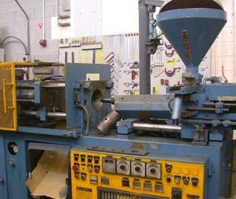

# PET 사출성형기

[전체 목록](../../../README.md) · 장비군: **사출성형 설비** · [이 장비 문의하기](https://github.com/gb011-hub/aas-archive/issues/new?template=equipment-question.yml&title=%5B%EB%AC%B8%EC%9D%98%5D+PET+%EC%82%AC%EC%B6%9C%EC%84%B1%ED%98%95%EA%B8%B0&equipment=PET+%EC%82%AC%EC%B6%9C%EC%84%B1%ED%98%95%EA%B8%B0)

> 자동 생성 페이지입니다. 이 폴더에 파일을 올리면 내용이 갱신됩니다.

필수 산출물 1/3 · 개발계획서 없음 · 가이던스 없음 · AASX 있음

## 산출물

| 구분 | 파일 | 크기 | 보기 |
|---|---|---|---|
| 개발계획서 | 아직 없음 | | |
| 가이던스 | 아직 없음 | | |
| AASX | [PETInjectionMoldingMachine_v0.0.1.aasx](AASX/PETInjectionMoldingMachine_v0.0.1.aasx) | 3.9 MB | [열람 페이지](gen/PETInjectionMoldingMachine_v0.0.1.md) |
| 시뮬레이션 | [PET_Simio_PostgreSQL_실행가이드.pdf](%EC%8B%9C%EB%AE%AC%EB%A0%88%EC%9D%B4%EC%85%98/PET_Simio_PostgreSQL_%EC%8B%A4%ED%96%89%EA%B0%80%EC%9D%B4%EB%93%9C.pdf) | 219 KB | [보기](%EC%8B%9C%EB%AE%AC%EB%A0%88%EC%9D%B4%EC%85%98/PET_Simio_PostgreSQL_%EC%8B%A4%ED%96%89%EA%B0%80%EC%9D%B4%EB%93%9C.pdf) |
| 참고자료 | [참고링크.md](%EC%B0%B8%EA%B3%A0%EC%9E%90%EB%A3%8C/%EC%B0%B8%EA%B3%A0%EB%A7%81%ED%81%AC.md) | 1017 B | [보기](%EC%B0%B8%EA%B3%A0%EC%9E%90%EB%A3%8C/%EC%B0%B8%EA%B3%A0%EB%A7%81%ED%81%AC.md) |

## AAS 구성 — `PETInjectionMoldingMachineAAS`

`PETInjectionMoldingMachine_v0.0.1.aasx` 에서 읽은 서브모델 8개 · **[요소 전체 보기](gen/PETInjectionMoldingMachine_v0.0.1.md)**:

| # | 서브모델 idShort |
|:-:|---|
| 1 | DigitalNameplate |
| 2 | HandoverDocumentation |
| 3 | TechnicalData |
| 4 | OperationalData |
| 5 | TimeSeries |
| 6 | ProcessParameters |
| 7 | ProcessVariablesForManufacturingKPICalculation |
| 8 | PredictiveMaintenance |

변경 기록 (최근 7건)

| 날짜 | 변경 | 파일 |
|---|---|---|
| 2026-11-04 | 삭제 | PET사출성형기_가이던스(자리표시).docx |
| 2026-11-04 | 삭제 | PET사출성형기_개발계획서(자리표시).docx |
| 2026-11-03 | 추가 | PETInjectionMoldingMachine_v0.0.1.aasx |
| 2026-11-03 | 추가 | PET사출성형기_가이던스(자리표시).docx |
| 2026-11-03 | 추가 | PET사출성형기_개발계획서(자리표시).docx |
| 2026-11-03 | 추가 | PET_Simio_PostgreSQL_실행가이드.pdf |
| 2026-11-03 | 추가 | 참고링크.md |

