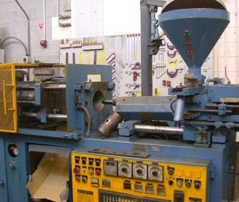

# 🧩 PETInjectionMoldingMachine_v0.0.1.aasx

[← 장비 페이지](../README.md) · [⤓ AASX 다운로드](../AASX/PETInjectionMoldingMachine_v0.0.1.aasx) · 3.9 MB

> 🤖 AASX 파일을 열어 자동으로 만든 열람 페이지입니다. 직접 고치지 말고 AASX를 다시 올리세요.

| 항목 | 내용 |
|---|---|
| AAS idShort | `PETInjectionMoldingMachineAAS` |
| AAS id | https://www.smart-factory.kr/ids/aas/PETInjectionMoldingMachineAAS/1/0 |
| 자산 종류 (assetKind) | Type |
| globalAssetId | https://www.smart-factory.kr/ids/asset/PETInjectionMoldingMachineType/1/0 |
| 설명 | 개발계획서에 정의된 PET 프리폼 사출성형기의 자산관리셸입니다. |
| 서브모델 | 8개 |
| 전체 요소 | 575개 |

## 서브모델 한눈에 보기

| # | 서브모델 | 요소 수 | semanticId |
|:-:|---|--:|---|
| 1 | [DigitalNameplate](#sm-1) | 18 | https://admin-shell.io/idta/nameplate/3/0/Nameplate |
| 2 | [HandoverDocumentation](#sm-2) | 126 | 0173-1#01-AHF578#003 |
| 3 | [TechnicalData](#sm-3) | 100 | 0173-1#01-AHX837#002 |
| 4 | [OperationalData](#sm-4) | 57 | https://www.smart-factory.kr/ids/sm/PETInjectionMoldingMachineAAS/OperationalData/1/0 |
| 5 | [TimeSeries](#sm-5) | 93 | https://admin-shell.io/idta/TimeSeries/1/1 |
| 6 | [ProcessParameters](#sm-6) | 44 | https://admin-shell-io/idta/SubmodelTemplate/ProcessParameters/1/0 |
| 7 | [ProcessVariablesForManufacturingKPICalculation](#sm-7) | 76 | https://admin-shell.io/idta/SubmodelTemplate/ProcessVariablesForManufacturingKPICalculati… |
| 8 | [PredictiveMaintenance](#sm-8) | 61 | https://admin-shell.io/idta/SubmodelTemplate/PredictiveMaintenance/1/0 |

## 서브모델 상세

각 서브모델 이름을 누르면 펼쳐집니다. **굵은 글씨**는 하위 요소가 있는 묶음입니다.

<b>1. DigitalNameplate</b> — 요소 18개

> 개발계획서의 비식별 예시 명판 정보를 담는 IDTA Digital Nameplate 서브모델입니다.

semanticId: `https://admin-shell.io/idta/nameplate/3/0/Nameplate`

| idShort | 종류 | 값 | semanticId |
|---|---|---|---|
| URIOfTheProduct | 속성 | https://www.smart-factory.kr/products/PETInjectionMoldingMachine/PIM-4000 | 0112/2///61987#ABN590#002 |
| ManufacturerName | 다국어 속성 | 예시 제조사 | 0112/2///61987#ABA565#009 |
| ManufacturerProductDesignation | 다국어 속성 | PET 프리폼 사출성형기 PIM-4000 | 0112/2///61987#ABA567#009 |
| ManufacturerProductFamily | 다국어 속성 | PET 프리폼 사출성형기 제품군 | 0112/2///61987#ABP464#002 |
| ManufacturerProductType | 속성 | PIM-4000 | 0112/2///61987#ABA300#008 |
| OrderCodeOfManufacturer | 속성 | PIM-4000-ORD | 0112/2///61987#ABA950#008 |
| ProductArticleNumberOfManufacturer | 속성 | PIM-4000-ART | 0112/2///61987#ABA581#007 |
| SerialNumber | 속성 | PIM-SN-2026-0001 | 0112/2///61987#ABA951#009 |
| YearOfConstruction | 속성 | 2026 | 0112/2///61987#ABP000#002 |
| DateOfManufacture | 속성 | 2026-06-17 | 0112/2///61987#ABB757#007 |
| HardwareVersion | 속성 | 1.0 | 0112/2///61987#ABA926#008 |
| FirmwareVersion | 속성 | 1.0.0 | 0112/2///61987#ABA302#006 |
| SoftwareVersion | 속성 | 1.0.0 | 0112/2///61987#ABA601#008 |
| **AddressInformation** | 묶음 (4) |  | https://admin-shell.io/zvei/nameplate/1/0/ContactInformations/Address… |
| &nbsp;&nbsp;&nbsp;└ Street | 속성 | 123 Industrial Road | https://www.smart-factory.kr/ids/cd/Street/1/0 |
| &nbsp;&nbsp;&nbsp;└ ZipCode | 속성 | 00000 | https://www.smart-factory.kr/ids/cd/ZipCode/1/0 |
| &nbsp;&nbsp;&nbsp;└ CityTown | 속성 | Example City | https://www.smart-factory.kr/ids/cd/CityTown/1/0 |
| &nbsp;&nbsp;&nbsp;└ NationalCode | 속성 | KR | https://www.smart-factory.kr/ids/cd/NationalCode/1/0 |

<b>2. HandoverDocumentation</b> — 요소 126개

> 개발계획서에 지정된 5종 인계 문서 예시를 VDI 2770 구조로 표현합니다.

semanticId: `0173-1#01-AHF578#003`

| idShort | 종류 | 값 | semanticId |
|---|---|---|---|
| **Documents** | 목록 (5) |  | 0173-1#02-ABI500#003 |
| &nbsp;&nbsp;&nbsp;└ **** | 묶음 (3) |  | 0173-1#02-ABI500#003/0173-1#01-AHF579#003 |
| &nbsp;&nbsp;&nbsp;&nbsp;&nbsp;&nbsp;└ **DocumentIds** | 목록 (1) |  | 0173-1#02-ABI501#003 |
| &nbsp;&nbsp;&nbsp;&nbsp;&nbsp;&nbsp;&nbsp;&nbsp;&nbsp;└ **** | 묶음 (3) |  | 0173-1#02-ABI501#003/0173-1#01-AHF580#003 |
| &nbsp;&nbsp;&nbsp;&nbsp;&nbsp;&nbsp;&nbsp;&nbsp;&nbsp;&nbsp;&nbsp;&nbsp;└ DocumentDomainId | 속성 | PETInjectionMoldingMachine | 0173-1#02-ABH994#003 |
| &nbsp;&nbsp;&nbsp;&nbsp;&nbsp;&nbsp;&nbsp;&nbsp;&nbsp;&nbsp;&nbsp;&nbsp;└ DocumentIdentifier | 속성 | PIM-OM-001 | 0173-1#02-AAO099#004 |
| &nbsp;&nbsp;&nbsp;&nbsp;&nbsp;&nbsp;&nbsp;&nbsp;&nbsp;&nbsp;&nbsp;&nbsp;└ DocumentIsPrimary | 속성 | true | 0173-1#02-ABH995#003 |
| &nbsp;&nbsp;&nbsp;&nbsp;&nbsp;&nbsp;└ **DocumentVersions** | 목록 (1) |  | 0173-1#02-ABI503#003 |
| &nbsp;&nbsp;&nbsp;&nbsp;&nbsp;&nbsp;&nbsp;&nbsp;&nbsp;└ **** | 묶음 (10) |  | 0173-1#02-ABI503#003/0173-1#01-AHF582#003 |
| &nbsp;&nbsp;&nbsp;&nbsp;&nbsp;&nbsp;&nbsp;&nbsp;&nbsp;&nbsp;&nbsp;&nbsp;└ **Language** | 목록 (1) |  | 0173-1#02-AAN468#008 |
| &nbsp;&nbsp;&nbsp;&nbsp;&nbsp;&nbsp;&nbsp;&nbsp;&nbsp;&nbsp;&nbsp;&nbsp;&nbsp;&nbsp;&nbsp;└  | 속성 | ko | 0173-1#02-AAN468#008 |
| &nbsp;&nbsp;&nbsp;&nbsp;&nbsp;&nbsp;&nbsp;&nbsp;&nbsp;&nbsp;&nbsp;&nbsp;└ Version | 속성 | 1.0.0 | 0173-1#02-AAP003#005 |
| &nbsp;&nbsp;&nbsp;&nbsp;&nbsp;&nbsp;&nbsp;&nbsp;&nbsp;&nbsp;&nbsp;&nbsp;└ StatusSetDate | 속성 | 2026-08-28 | 0173-1#02-ABI000#003 |
| &nbsp;&nbsp;&nbsp;&nbsp;&nbsp;&nbsp;&nbsp;&nbsp;&nbsp;&nbsp;&nbsp;&nbsp;└ Title | 다국어 속성 | 운영 매뉴얼 | 0173-1#02-ABG940#003 |
| &nbsp;&nbsp;&nbsp;&nbsp;&nbsp;&nbsp;&nbsp;&nbsp;&nbsp;&nbsp;&nbsp;&nbsp;└ Description | 다국어 속성 | PET 사출성형기 운전, 설정 및 정상 정지 절차의 예시 문서입니다. | 0173-1#02-AAN466#004 |
| &nbsp;&nbsp;&nbsp;&nbsp;&nbsp;&nbsp;&nbsp;&nbsp;&nbsp;&nbsp;&nbsp;&nbsp;└ KeyWords | 다국어 속성 | PET 프리폼, 사출성형기, AAS, IDTA, ECLASS | 0173-1#02-ABH999#003 |
| &nbsp;&nbsp;&nbsp;&nbsp;&nbsp;&nbsp;&nbsp;&nbsp;&nbsp;&nbsp;&nbsp;&nbsp;└ OrganizationOfficialName | 속성 | ExampleCompany | 0173-1#02-ABI004#003 |
| &nbsp;&nbsp;&nbsp;&nbsp;&nbsp;&nbsp;&nbsp;&nbsp;&nbsp;&nbsp;&nbsp;&nbsp;└ **DigitalFiles** | 목록 (1) |  | 0173-1#02-ABK126#002 |
| &nbsp;&nbsp;&nbsp;&nbsp;&nbsp;&nbsp;&nbsp;&nbsp;&nbsp;&nbsp;&nbsp;&nbsp;&nbsp;&nbsp;&nbsp;└  | 파일 | file:///aasx/files/documents/examples/PIM-OM-001.txt | 0173-1#02-ABK126#002 |
| &nbsp;&nbsp;&nbsp;&nbsp;&nbsp;&nbsp;&nbsp;&nbsp;&nbsp;&nbsp;&nbsp;&nbsp;└ StatusValue | 속성 | Released | 0173-1#02-ABI001#003 |
| &nbsp;&nbsp;&nbsp;&nbsp;&nbsp;&nbsp;&nbsp;&nbsp;&nbsp;&nbsp;&nbsp;&nbsp;└ OrganizationShortName | 속성 | ExampleCompany | https://api.eclass-cdp.com/0173-1-02-ABI002-003 |
| &nbsp;&nbsp;&nbsp;&nbsp;&nbsp;&nbsp;└ **DocumentClassifications** | 목록 (1) |  | 0173-1#02-ABI502#003 |
| &nbsp;&nbsp;&nbsp;&nbsp;&nbsp;&nbsp;&nbsp;&nbsp;&nbsp;└ **** | 묶음 (3) |  | 0173-1#02-ABI502#003/0173-1#01-AHF581#003 |
| &nbsp;&nbsp;&nbsp;&nbsp;&nbsp;&nbsp;&nbsp;&nbsp;&nbsp;&nbsp;&nbsp;&nbsp;└ ClassId | 속성 | 03-02 | 0173-1#02-ABH996#003 |
| &nbsp;&nbsp;&nbsp;&nbsp;&nbsp;&nbsp;&nbsp;&nbsp;&nbsp;&nbsp;&nbsp;&nbsp;└ ClassName | 다국어 속성 | 운영 매뉴얼 | 0173-1#02-ABJ219#002 |
| &nbsp;&nbsp;&nbsp;&nbsp;&nbsp;&nbsp;&nbsp;&nbsp;&nbsp;&nbsp;&nbsp;&nbsp;└ ClassificationSystem | 속성 | VDI 2770:2020 | 0173-1#02-ABH997#003 |
| &nbsp;&nbsp;&nbsp;└ **** | 묶음 (3) |  | 0173-1#02-ABI500#003/0173-1#01-AHF579#003 |
| &nbsp;&nbsp;&nbsp;&nbsp;&nbsp;&nbsp;└ **DocumentIds** | 목록 (1) |  | 0173-1#02-ABI501#003 |
| &nbsp;&nbsp;&nbsp;&nbsp;&nbsp;&nbsp;&nbsp;&nbsp;&nbsp;└ **** | 묶음 (3) |  | 0173-1#02-ABI501#003/0173-1#01-AHF580#003 |
| &nbsp;&nbsp;&nbsp;&nbsp;&nbsp;&nbsp;&nbsp;&nbsp;&nbsp;&nbsp;&nbsp;&nbsp;└ DocumentDomainId | 속성 | PETInjectionMoldingMachine | 0173-1#02-ABH994#003 |
| &nbsp;&nbsp;&nbsp;&nbsp;&nbsp;&nbsp;&nbsp;&nbsp;&nbsp;&nbsp;&nbsp;&nbsp;└ DocumentIdentifier | 속성 | PIM-CM-001 | 0173-1#02-AAO099#004 |
| &nbsp;&nbsp;&nbsp;&nbsp;&nbsp;&nbsp;&nbsp;&nbsp;&nbsp;&nbsp;&nbsp;&nbsp;└ DocumentIsPrimary | 속성 | false | 0173-1#02-ABH995#003 |
| &nbsp;&nbsp;&nbsp;&nbsp;&nbsp;&nbsp;└ **DocumentVersions** | 목록 (1) |  | 0173-1#02-ABI503#003 |
| &nbsp;&nbsp;&nbsp;&nbsp;&nbsp;&nbsp;&nbsp;&nbsp;&nbsp;└ **** | 묶음 (10) |  | 0173-1#02-ABI503#003/0173-1#01-AHF582#003 |
| &nbsp;&nbsp;&nbsp;&nbsp;&nbsp;&nbsp;&nbsp;&nbsp;&nbsp;&nbsp;&nbsp;&nbsp;└ **Language** | 목록 (1) |  | 0173-1#02-AAN468#008 |
| &nbsp;&nbsp;&nbsp;&nbsp;&nbsp;&nbsp;&nbsp;&nbsp;&nbsp;&nbsp;&nbsp;&nbsp;&nbsp;&nbsp;&nbsp;└  | 속성 | ko | 0173-1#02-AAN468#008 |
| &nbsp;&nbsp;&nbsp;&nbsp;&nbsp;&nbsp;&nbsp;&nbsp;&nbsp;&nbsp;&nbsp;&nbsp;└ Version | 속성 | 1.0.0 | 0173-1#02-AAP003#005 |
| &nbsp;&nbsp;&nbsp;&nbsp;&nbsp;&nbsp;&nbsp;&nbsp;&nbsp;&nbsp;&nbsp;&nbsp;└ StatusSetDate | 속성 | 2026-08-28 | 0173-1#02-ABI000#003 |
| &nbsp;&nbsp;&nbsp;&nbsp;&nbsp;&nbsp;&nbsp;&nbsp;&nbsp;&nbsp;&nbsp;&nbsp;└ Title | 다국어 속성 | 설치·시운전 가이드 | 0173-1#02-ABG940#003 |
| &nbsp;&nbsp;&nbsp;&nbsp;&nbsp;&nbsp;&nbsp;&nbsp;&nbsp;&nbsp;&nbsp;&nbsp;└ Description | 다국어 속성 | 설치, 유틸리티 연결, 시운전 및 인수 확인 절차의 예시 문서입니다. | 0173-1#02-AAN466#004 |
| &nbsp;&nbsp;&nbsp;&nbsp;&nbsp;&nbsp;&nbsp;&nbsp;&nbsp;&nbsp;&nbsp;&nbsp;└ KeyWords | 다국어 속성 | PET 프리폼, 사출성형기, AAS, IDTA, ECLASS | 0173-1#02-ABH999#003 |
| &nbsp;&nbsp;&nbsp;&nbsp;&nbsp;&nbsp;&nbsp;&nbsp;&nbsp;&nbsp;&nbsp;&nbsp;└ OrganizationOfficialName | 속성 | ExampleCompany | 0173-1#02-ABI004#003 |
| &nbsp;&nbsp;&nbsp;&nbsp;&nbsp;&nbsp;&nbsp;&nbsp;&nbsp;&nbsp;&nbsp;&nbsp;└ **DigitalFiles** | 목록 (1) |  | 0173-1#02-ABK126#002 |
| &nbsp;&nbsp;&nbsp;&nbsp;&nbsp;&nbsp;&nbsp;&nbsp;&nbsp;&nbsp;&nbsp;&nbsp;&nbsp;&nbsp;&nbsp;└  | 파일 | file:///aasx/files/documents/examples/PIM-CM-001.txt | 0173-1#02-ABK126#002 |
| &nbsp;&nbsp;&nbsp;&nbsp;&nbsp;&nbsp;&nbsp;&nbsp;&nbsp;&nbsp;&nbsp;&nbsp;└ StatusValue | 속성 | Released | 0173-1#02-ABI001#003 |
| &nbsp;&nbsp;&nbsp;&nbsp;&nbsp;&nbsp;&nbsp;&nbsp;&nbsp;&nbsp;&nbsp;&nbsp;└ OrganizationShortName | 속성 | ExampleCompany | https://api.eclass-cdp.com/0173-1-02-ABI002-003 |
| &nbsp;&nbsp;&nbsp;&nbsp;&nbsp;&nbsp;└ **DocumentClassifications** | 목록 (1) |  | 0173-1#02-ABI502#003 |
| &nbsp;&nbsp;&nbsp;&nbsp;&nbsp;&nbsp;&nbsp;&nbsp;&nbsp;└ **** | 묶음 (3) |  | 0173-1#02-ABI502#003/0173-1#01-AHF581#003 |
| &nbsp;&nbsp;&nbsp;&nbsp;&nbsp;&nbsp;&nbsp;&nbsp;&nbsp;&nbsp;&nbsp;&nbsp;└ ClassId | 속성 | 03-01 | 0173-1#02-ABH996#003 |
| &nbsp;&nbsp;&nbsp;&nbsp;&nbsp;&nbsp;&nbsp;&nbsp;&nbsp;&nbsp;&nbsp;&nbsp;└ ClassName | 다국어 속성 | 설치·시운전 가이드 | 0173-1#02-ABJ219#002 |
| &nbsp;&nbsp;&nbsp;&nbsp;&nbsp;&nbsp;&nbsp;&nbsp;&nbsp;&nbsp;&nbsp;&nbsp;└ ClassificationSystem | 속성 | VDI 2770:2020 | 0173-1#02-ABH997#003 |
| &nbsp;&nbsp;&nbsp;└ **** | 묶음 (3) |  | 0173-1#02-ABI500#003/0173-1#01-AHF579#003 |
| &nbsp;&nbsp;&nbsp;&nbsp;&nbsp;&nbsp;└ **DocumentIds** | 목록 (1) |  | 0173-1#02-ABI501#003 |
| &nbsp;&nbsp;&nbsp;&nbsp;&nbsp;&nbsp;&nbsp;&nbsp;&nbsp;└ **** | 묶음 (3) |  | 0173-1#02-ABI501#003/0173-1#01-AHF580#003 |
| &nbsp;&nbsp;&nbsp;&nbsp;&nbsp;&nbsp;&nbsp;&nbsp;&nbsp;&nbsp;&nbsp;&nbsp;└ DocumentDomainId | 속성 | PETInjectionMoldingMachine | 0173-1#02-ABH994#003 |
| &nbsp;&nbsp;&nbsp;&nbsp;&nbsp;&nbsp;&nbsp;&nbsp;&nbsp;&nbsp;&nbsp;&nbsp;└ DocumentIdentifier | 속성 | PIM-SF-001 | 0173-1#02-AAO099#004 |
| &nbsp;&nbsp;&nbsp;&nbsp;&nbsp;&nbsp;&nbsp;&nbsp;&nbsp;&nbsp;&nbsp;&nbsp;└ DocumentIsPrimary | 속성 | false | 0173-1#02-ABH995#003 |
| &nbsp;&nbsp;&nbsp;&nbsp;&nbsp;&nbsp;└ **DocumentVersions** | 목록 (1) |  | 0173-1#02-ABI503#003 |
| &nbsp;&nbsp;&nbsp;&nbsp;&nbsp;&nbsp;&nbsp;&nbsp;&nbsp;└ **** | 묶음 (10) |  | 0173-1#02-ABI503#003/0173-1#01-AHF582#003 |
| &nbsp;&nbsp;&nbsp;&nbsp;&nbsp;&nbsp;&nbsp;&nbsp;&nbsp;&nbsp;&nbsp;&nbsp;└ **Language** | 목록 (1) |  | 0173-1#02-AAN468#008 |
| &nbsp;&nbsp;&nbsp;&nbsp;&nbsp;&nbsp;&nbsp;&nbsp;&nbsp;&nbsp;&nbsp;&nbsp;&nbsp;&nbsp;&nbsp;└  | 속성 | ko | 0173-1#02-AAN468#008 |
| &nbsp;&nbsp;&nbsp;&nbsp;&nbsp;&nbsp;&nbsp;&nbsp;&nbsp;&nbsp;&nbsp;&nbsp;└ Version | 속성 | 1.0.0 | 0173-1#02-AAP003#005 |
| &nbsp;&nbsp;&nbsp;&nbsp;&nbsp;&nbsp;&nbsp;&nbsp;&nbsp;&nbsp;&nbsp;&nbsp;└ StatusSetDate | 속성 | 2026-08-28 | 0173-1#02-ABI000#003 |
| &nbsp;&nbsp;&nbsp;&nbsp;&nbsp;&nbsp;&nbsp;&nbsp;&nbsp;&nbsp;&nbsp;&nbsp;└ Title | 다국어 속성 | 안전 지침 | 0173-1#02-ABG940#003 |
| &nbsp;&nbsp;&nbsp;&nbsp;&nbsp;&nbsp;&nbsp;&nbsp;&nbsp;&nbsp;&nbsp;&nbsp;└ Description | 다국어 속성 | 고온·고압·형체부 협착 및 전기 위험에 대한 예시 안전 지침입니다. | 0173-1#02-AAN466#004 |
| &nbsp;&nbsp;&nbsp;&nbsp;&nbsp;&nbsp;&nbsp;&nbsp;&nbsp;&nbsp;&nbsp;&nbsp;└ KeyWords | 다국어 속성 | PET 프리폼, 사출성형기, AAS, IDTA, ECLASS | 0173-1#02-ABH999#003 |
| &nbsp;&nbsp;&nbsp;&nbsp;&nbsp;&nbsp;&nbsp;&nbsp;&nbsp;&nbsp;&nbsp;&nbsp;└ OrganizationOfficialName | 속성 | ExampleCompany | 0173-1#02-ABI004#003 |
| &nbsp;&nbsp;&nbsp;&nbsp;&nbsp;&nbsp;&nbsp;&nbsp;&nbsp;&nbsp;&nbsp;&nbsp;└ **DigitalFiles** | 목록 (1) |  | 0173-1#02-ABK126#002 |
| &nbsp;&nbsp;&nbsp;&nbsp;&nbsp;&nbsp;&nbsp;&nbsp;&nbsp;&nbsp;&nbsp;&nbsp;&nbsp;&nbsp;&nbsp;└  | 파일 | file:///aasx/files/documents/examples/PIM-SF-001.txt | 0173-1#02-ABK126#002 |
| &nbsp;&nbsp;&nbsp;&nbsp;&nbsp;&nbsp;&nbsp;&nbsp;&nbsp;&nbsp;&nbsp;&nbsp;└ StatusValue | 속성 | Released | 0173-1#02-ABI001#003 |
| &nbsp;&nbsp;&nbsp;&nbsp;&nbsp;&nbsp;&nbsp;&nbsp;&nbsp;&nbsp;&nbsp;&nbsp;└ OrganizationShortName | 속성 | ExampleCompany | https://api.eclass-cdp.com/0173-1-02-ABI002-003 |
| &nbsp;&nbsp;&nbsp;&nbsp;&nbsp;&nbsp;└ **DocumentClassifications** | 목록 (1) |  | 0173-1#02-ABI502#003 |
| &nbsp;&nbsp;&nbsp;&nbsp;&nbsp;&nbsp;&nbsp;&nbsp;&nbsp;└ **** | 묶음 (3) |  | 0173-1#02-ABI502#003/0173-1#01-AHF581#003 |
| &nbsp;&nbsp;&nbsp;&nbsp;&nbsp;&nbsp;&nbsp;&nbsp;&nbsp;&nbsp;&nbsp;&nbsp;└ ClassId | 속성 | 03-03 | 0173-1#02-ABH996#003 |
| &nbsp;&nbsp;&nbsp;&nbsp;&nbsp;&nbsp;&nbsp;&nbsp;&nbsp;&nbsp;&nbsp;&nbsp;└ ClassName | 다국어 속성 | 안전 지침 | 0173-1#02-ABJ219#002 |
| &nbsp;&nbsp;&nbsp;&nbsp;&nbsp;&nbsp;&nbsp;&nbsp;&nbsp;&nbsp;&nbsp;&nbsp;└ ClassificationSystem | 속성 | VDI 2770:2020 | 0173-1#02-ABH997#003 |
| &nbsp;&nbsp;&nbsp;└ **** | 묶음 (3) |  | 0173-1#02-ABI500#003/0173-1#01-AHF579#003 |
| &nbsp;&nbsp;&nbsp;&nbsp;&nbsp;&nbsp;└ **DocumentIds** | 목록 (1) |  | 0173-1#02-ABI501#003 |
| &nbsp;&nbsp;&nbsp;&nbsp;&nbsp;&nbsp;&nbsp;&nbsp;&nbsp;└ **** | 묶음 (3) |  | 0173-1#02-ABI501#003/0173-1#01-AHF580#003 |
| &nbsp;&nbsp;&nbsp;&nbsp;&nbsp;&nbsp;&nbsp;&nbsp;&nbsp;&nbsp;&nbsp;&nbsp;└ DocumentDomainId | 속성 | PETInjectionMoldingMachine | 0173-1#02-ABH994#003 |
| &nbsp;&nbsp;&nbsp;&nbsp;&nbsp;&nbsp;&nbsp;&nbsp;&nbsp;&nbsp;&nbsp;&nbsp;└ DocumentIdentifier | 속성 | PIM-MT-001 | 0173-1#02-AAO099#004 |
| &nbsp;&nbsp;&nbsp;&nbsp;&nbsp;&nbsp;&nbsp;&nbsp;&nbsp;&nbsp;&nbsp;&nbsp;└ DocumentIsPrimary | 속성 | false | 0173-1#02-ABH995#003 |
| &nbsp;&nbsp;&nbsp;&nbsp;&nbsp;&nbsp;└ **DocumentVersions** | 목록 (1) |  | 0173-1#02-ABI503#003 |
| &nbsp;&nbsp;&nbsp;&nbsp;&nbsp;&nbsp;&nbsp;&nbsp;&nbsp;└ **** | 묶음 (10) |  | 0173-1#02-ABI503#003/0173-1#01-AHF582#003 |
| &nbsp;&nbsp;&nbsp;&nbsp;&nbsp;&nbsp;&nbsp;&nbsp;&nbsp;&nbsp;&nbsp;&nbsp;└ **Language** | 목록 (1) |  | 0173-1#02-AAN468#008 |
| &nbsp;&nbsp;&nbsp;&nbsp;&nbsp;&nbsp;&nbsp;&nbsp;&nbsp;&nbsp;&nbsp;&nbsp;&nbsp;&nbsp;&nbsp;└  | 속성 | ko | 0173-1#02-AAN468#008 |
| &nbsp;&nbsp;&nbsp;&nbsp;&nbsp;&nbsp;&nbsp;&nbsp;&nbsp;&nbsp;&nbsp;&nbsp;└ Version | 속성 | 1.0.0 | 0173-1#02-AAP003#005 |
| &nbsp;&nbsp;&nbsp;&nbsp;&nbsp;&nbsp;&nbsp;&nbsp;&nbsp;&nbsp;&nbsp;&nbsp;└ StatusSetDate | 속성 | 2026-08-28 | 0173-1#02-ABI000#003 |
| &nbsp;&nbsp;&nbsp;&nbsp;&nbsp;&nbsp;&nbsp;&nbsp;&nbsp;&nbsp;&nbsp;&nbsp;└ Title | 다국어 속성 | 유지보수·점검 가이드 | 0173-1#02-ABG940#003 |
| &nbsp;&nbsp;&nbsp;&nbsp;&nbsp;&nbsp;&nbsp;&nbsp;&nbsp;&nbsp;&nbsp;&nbsp;└ Description | 다국어 속성 | 스크류·체크링, 배럴·노즐, 금형, 유압유·필터 및 윤활 점검의 예시 문서입니다. | 0173-1#02-AAN466#004 |
| &nbsp;&nbsp;&nbsp;&nbsp;&nbsp;&nbsp;&nbsp;&nbsp;&nbsp;&nbsp;&nbsp;&nbsp;└ KeyWords | 다국어 속성 | PET 프리폼, 사출성형기, AAS, IDTA, ECLASS | 0173-1#02-ABH999#003 |
| &nbsp;&nbsp;&nbsp;&nbsp;&nbsp;&nbsp;&nbsp;&nbsp;&nbsp;&nbsp;&nbsp;&nbsp;└ OrganizationOfficialName | 속성 | ExampleCompany | 0173-1#02-ABI004#003 |
| &nbsp;&nbsp;&nbsp;&nbsp;&nbsp;&nbsp;&nbsp;&nbsp;&nbsp;&nbsp;&nbsp;&nbsp;└ **DigitalFiles** | 목록 (1) |  | 0173-1#02-ABK126#002 |
| &nbsp;&nbsp;&nbsp;&nbsp;&nbsp;&nbsp;&nbsp;&nbsp;&nbsp;&nbsp;&nbsp;&nbsp;&nbsp;&nbsp;&nbsp;└  | 파일 | file:///aasx/files/documents/examples/PIM-MT-001.txt | 0173-1#02-ABK126#002 |
| &nbsp;&nbsp;&nbsp;&nbsp;&nbsp;&nbsp;&nbsp;&nbsp;&nbsp;&nbsp;&nbsp;&nbsp;└ StatusValue | 속성 | Released | 0173-1#02-ABI001#003 |
| &nbsp;&nbsp;&nbsp;&nbsp;&nbsp;&nbsp;&nbsp;&nbsp;&nbsp;&nbsp;&nbsp;&nbsp;└ OrganizationShortName | 속성 | ExampleCompany | https://api.eclass-cdp.com/0173-1-02-ABI002-003 |
| &nbsp;&nbsp;&nbsp;&nbsp;&nbsp;&nbsp;└ **DocumentClassifications** | 목록 (1) |  | 0173-1#02-ABI502#003 |
| &nbsp;&nbsp;&nbsp;&nbsp;&nbsp;&nbsp;&nbsp;&nbsp;&nbsp;└ **** | 묶음 (3) |  | 0173-1#02-ABI502#003/0173-1#01-AHF581#003 |
| &nbsp;&nbsp;&nbsp;&nbsp;&nbsp;&nbsp;&nbsp;&nbsp;&nbsp;&nbsp;&nbsp;&nbsp;└ ClassId | 속성 | 03-04 | 0173-1#02-ABH996#003 |
| &nbsp;&nbsp;&nbsp;&nbsp;&nbsp;&nbsp;&nbsp;&nbsp;&nbsp;&nbsp;&nbsp;&nbsp;└ ClassName | 다국어 속성 | 유지보수·점검 가이드 | 0173-1#02-ABJ219#002 |
| &nbsp;&nbsp;&nbsp;&nbsp;&nbsp;&nbsp;&nbsp;&nbsp;&nbsp;&nbsp;&nbsp;&nbsp;└ ClassificationSystem | 속성 | VDI 2770:2020 | 0173-1#02-ABH997#003 |
| &nbsp;&nbsp;&nbsp;└ **** | 묶음 (3) |  | 0173-1#02-ABI500#003/0173-1#01-AHF579#003 |
| &nbsp;&nbsp;&nbsp;&nbsp;&nbsp;&nbsp;└ **DocumentIds** | 목록 (1) |  | 0173-1#02-ABI501#003 |
| &nbsp;&nbsp;&nbsp;&nbsp;&nbsp;&nbsp;&nbsp;&nbsp;&nbsp;└ **** | 묶음 (3) |  | 0173-1#02-ABI501#003/0173-1#01-AHF580#003 |
| &nbsp;&nbsp;&nbsp;&nbsp;&nbsp;&nbsp;&nbsp;&nbsp;&nbsp;&nbsp;&nbsp;&nbsp;└ DocumentDomainId | 속성 | PETInjectionMoldingMachine | 0173-1#02-ABH994#003 |
| &nbsp;&nbsp;&nbsp;&nbsp;&nbsp;&nbsp;&nbsp;&nbsp;&nbsp;&nbsp;&nbsp;&nbsp;└ DocumentIdentifier | 속성 | PIM-CE-001 | 0173-1#02-AAO099#004 |
| &nbsp;&nbsp;&nbsp;&nbsp;&nbsp;&nbsp;&nbsp;&nbsp;&nbsp;&nbsp;&nbsp;&nbsp;└ DocumentIsPrimary | 속성 | false | 0173-1#02-ABH995#003 |
| &nbsp;&nbsp;&nbsp;&nbsp;&nbsp;&nbsp;└ **DocumentVersions** | 목록 (1) |  | 0173-1#02-ABI503#003 |
| &nbsp;&nbsp;&nbsp;&nbsp;&nbsp;&nbsp;&nbsp;&nbsp;&nbsp;└ **** | 묶음 (10) |  | 0173-1#02-ABI503#003/0173-1#01-AHF582#003 |
| &nbsp;&nbsp;&nbsp;&nbsp;&nbsp;&nbsp;&nbsp;&nbsp;&nbsp;&nbsp;&nbsp;&nbsp;└ **Language** | 목록 (1) |  | 0173-1#02-AAN468#008 |
| &nbsp;&nbsp;&nbsp;&nbsp;&nbsp;&nbsp;&nbsp;&nbsp;&nbsp;&nbsp;&nbsp;&nbsp;&nbsp;&nbsp;&nbsp;└  | 속성 | ko | 0173-1#02-AAN468#008 |
| &nbsp;&nbsp;&nbsp;&nbsp;&nbsp;&nbsp;&nbsp;&nbsp;&nbsp;&nbsp;&nbsp;&nbsp;└ Version | 속성 | 1.0.0 | 0173-1#02-AAP003#005 |
| &nbsp;&nbsp;&nbsp;&nbsp;&nbsp;&nbsp;&nbsp;&nbsp;&nbsp;&nbsp;&nbsp;&nbsp;└ StatusSetDate | 속성 | 2026-08-28 | 0173-1#02-ABI000#003 |
| &nbsp;&nbsp;&nbsp;&nbsp;&nbsp;&nbsp;&nbsp;&nbsp;&nbsp;&nbsp;&nbsp;&nbsp;└ Title | 다국어 속성 | 인증·적합성 문서 | 0173-1#02-ABG940#003 |
| &nbsp;&nbsp;&nbsp;&nbsp;&nbsp;&nbsp;&nbsp;&nbsp;&nbsp;&nbsp;&nbsp;&nbsp;└ Description | 다국어 속성 | 기계·전기 안전 인증과 적합성 선언을 관리하기 위한 예시 문서입니다. | 0173-1#02-AAN466#004 |
| &nbsp;&nbsp;&nbsp;&nbsp;&nbsp;&nbsp;&nbsp;&nbsp;&nbsp;&nbsp;&nbsp;&nbsp;└ KeyWords | 다국어 속성 | PET 프리폼, 사출성형기, AAS, IDTA, ECLASS | 0173-1#02-ABH999#003 |
| &nbsp;&nbsp;&nbsp;&nbsp;&nbsp;&nbsp;&nbsp;&nbsp;&nbsp;&nbsp;&nbsp;&nbsp;└ OrganizationOfficialName | 속성 | ExampleCompany | 0173-1#02-ABI004#003 |
| &nbsp;&nbsp;&nbsp;&nbsp;&nbsp;&nbsp;&nbsp;&nbsp;&nbsp;&nbsp;&nbsp;&nbsp;└ **DigitalFiles** | 목록 (1) |  | 0173-1#02-ABK126#002 |
| &nbsp;&nbsp;&nbsp;&nbsp;&nbsp;&nbsp;&nbsp;&nbsp;&nbsp;&nbsp;&nbsp;&nbsp;&nbsp;&nbsp;&nbsp;└  | 파일 | file:///aasx/files/documents/examples/PIM-CE-001.txt | 0173-1#02-ABK126#002 |
| &nbsp;&nbsp;&nbsp;&nbsp;&nbsp;&nbsp;&nbsp;&nbsp;&nbsp;&nbsp;&nbsp;&nbsp;└ StatusValue | 속성 | Released | 0173-1#02-ABI001#003 |
| &nbsp;&nbsp;&nbsp;&nbsp;&nbsp;&nbsp;&nbsp;&nbsp;&nbsp;&nbsp;&nbsp;&nbsp;└ OrganizationShortName | 속성 | ExampleCompany | https://api.eclass-cdp.com/0173-1-02-ABI002-003 |
| &nbsp;&nbsp;&nbsp;&nbsp;&nbsp;&nbsp;└ **DocumentClassifications** | 목록 (1) |  | 0173-1#02-ABI502#003 |
| &nbsp;&nbsp;&nbsp;&nbsp;&nbsp;&nbsp;&nbsp;&nbsp;&nbsp;└ **** | 묶음 (3) |  | 0173-1#02-ABI502#003/0173-1#01-AHF581#003 |
| &nbsp;&nbsp;&nbsp;&nbsp;&nbsp;&nbsp;&nbsp;&nbsp;&nbsp;&nbsp;&nbsp;&nbsp;└ ClassId | 속성 | 02-04 | 0173-1#02-ABH996#003 |
| &nbsp;&nbsp;&nbsp;&nbsp;&nbsp;&nbsp;&nbsp;&nbsp;&nbsp;&nbsp;&nbsp;&nbsp;└ ClassName | 다국어 속성 | 인증·적합성 문서 | 0173-1#02-ABJ219#002 |
| &nbsp;&nbsp;&nbsp;&nbsp;&nbsp;&nbsp;&nbsp;&nbsp;&nbsp;&nbsp;&nbsp;&nbsp;└ ClassificationSystem | 속성 | VDI 2770:2020 | 0173-1#02-ABH997#003 |

<b>3. TechnicalData</b> — 요소 100개

> 개발계획서에 정의된 PET 사출성형기 정적 기술사양을 표현합니다.

semanticId: `0173-1#01-AHX837#002`

| idShort | 종류 | 값 | semanticId |
|---|---|---|---|
| **GeneralInformation** | 묶음 (5) |  | 0173-1#02-ABK161#002/0173-1#01-AHX838#002 |
| &nbsp;&nbsp;&nbsp;└ ManufacturerName | 속성 | ExampleCompany | 0173-1#02-AAO677#004 |
| &nbsp;&nbsp;&nbsp;└ ManufacturerProductDesignation | 다국어 속성 | PET 프리폼 사출성형기 PIM-4000 | 0173-1#02-AAW338#003 |
| &nbsp;&nbsp;&nbsp;└ ManufacturerArticleNumber | 속성 | PIM-4000-ART | 0173-1#02-AAO676#005 |
| &nbsp;&nbsp;&nbsp;└ ManufacturerOrderCode | 속성 | PIM-4000-ORD | 0173-1#02-AAO227#004 |
| &nbsp;&nbsp;&nbsp;└ **ProductImages** | 목록 (1) |  | 0173-1#02-ABM220#001 |
| &nbsp;&nbsp;&nbsp;&nbsp;&nbsp;&nbsp;└ **** | 묶음 (2) |  | 0173-1#02-ABM220#001/0173-1#01-AHY911#001 |
| &nbsp;&nbsp;&nbsp;&nbsp;&nbsp;&nbsp;&nbsp;&nbsp;&nbsp;└ ImageFile | 파일 | file:///aasx/files/images/PETInjectionMoldingMachine_ProductImage.jpg | 0173-1#02-ABK291#002 |
| &nbsp;&nbsp;&nbsp;&nbsp;&nbsp;&nbsp;&nbsp;&nbsp;&nbsp;└ ImageNote | 다국어 속성 | Side view of ExampleCompany PET preform injection molding machine | 0173-1#02-ABL423#001 |
| **ProductClassifications** | 목록 (1) |  | 0173-1#02-ABK162#002 |
| &nbsp;&nbsp;&nbsp;└ **** | 묶음 (5) |  | 0173-1#02-ABK162#002/0173-1#01-AHX839#002 |
| &nbsp;&nbsp;&nbsp;&nbsp;&nbsp;&nbsp;└ ClassificationSystem | 속성 | ECLASS | 0173-1#02-ABL424#001 |
| &nbsp;&nbsp;&nbsp;&nbsp;&nbsp;&nbsp;└ ClassificationSystemVersion | 속성 | 16.0 | 0173-1#02-AAR710#003 |
| &nbsp;&nbsp;&nbsp;&nbsp;&nbsp;&nbsp;└ ProductClassId | 속성 | 0173-1#01-AHY890#002 | 0173-1#02-ABG776#003 |
| &nbsp;&nbsp;&nbsp;&nbsp;&nbsp;&nbsp;└ ProductClassCodedName | 속성 | 17-06-01-01 | 0173-1#02-ABK128#002 |
| &nbsp;&nbsp;&nbsp;&nbsp;&nbsp;&nbsp;└ ProductClassName | 다국어 속성 | 사출성형기 | 0173-1#02-ABK273#002 |
| **TechnicalPropertyAreas** | 목록 (6) |  | 0173-1#02-ABK163#002 |
| &nbsp;&nbsp;&nbsp;└ **** | 묶음 (1) |  | 0173-1#02-ABL358#002/0173-1#01-AHX773#002 |
| &nbsp;&nbsp;&nbsp;&nbsp;&nbsp;&nbsp;└ **MachineConfigurationSystem** | 묶음 (1) |  | https://www.smart-factory.kr/ids/cd/MachineConfigurationSystem/1/0 |
| &nbsp;&nbsp;&nbsp;&nbsp;&nbsp;&nbsp;&nbsp;&nbsp;&nbsp;└ **CommonSpecifications** | 묶음 (7) |  | https://www.smart-factory.kr/ids/cd/CommonSpecifications/1/0 |
| &nbsp;&nbsp;&nbsp;&nbsp;&nbsp;&nbsp;&nbsp;&nbsp;&nbsp;&nbsp;&nbsp;&nbsp;└ MachineType | 속성 | Horizontal PET preform injection molding machine | https://www.smart-factory.kr/ids/cd/MachineType/1/0 |
| &nbsp;&nbsp;&nbsp;&nbsp;&nbsp;&nbsp;&nbsp;&nbsp;&nbsp;&nbsp;&nbsp;&nbsp;└ MoldingProcessType | 속성 | Reciprocating-screw injection molding | https://www.smart-factory.kr/ids/cd/MoldingProcessType/1/0 |
| &nbsp;&nbsp;&nbsp;&nbsp;&nbsp;&nbsp;&nbsp;&nbsp;&nbsp;&nbsp;&nbsp;&nbsp;└ DriveSystemType | 속성 | Servo-hydraulic drive | https://www.smart-factory.kr/ids/cd/DriveSystemType/1/0 |
| &nbsp;&nbsp;&nbsp;&nbsp;&nbsp;&nbsp;&nbsp;&nbsp;&nbsp;&nbsp;&nbsp;&nbsp;└ TargetProductType | 속성 | PET preforms for bottles and containers | https://www.smart-factory.kr/ids/cd/TargetProductType/1/0 |
| &nbsp;&nbsp;&nbsp;&nbsp;&nbsp;&nbsp;&nbsp;&nbsp;&nbsp;&nbsp;&nbsp;&nbsp;└ SystemConfiguration | 속성 | Injection unit with barrier screw, toggle clamping unit, hot-runner preform mol… | https://www.smart-factory.kr/ids/cd/SystemConfiguration/1/0 |
| &nbsp;&nbsp;&nbsp;&nbsp;&nbsp;&nbsp;&nbsp;&nbsp;&nbsp;&nbsp;&nbsp;&nbsp;└ InstallationType | 속성 | Floor-mounted fixed steel base frame | https://www.smart-factory.kr/ids/cd/InstallationType/1/0 |
| &nbsp;&nbsp;&nbsp;&nbsp;&nbsp;&nbsp;&nbsp;&nbsp;&nbsp;&nbsp;&nbsp;&nbsp;└ NetWeight | 속성 | 42000000 | 0173-1#02-BAD875#010 |
| &nbsp;&nbsp;&nbsp;└ **** | 묶음 (1) |  | 0173-1#02-ABL358#002/0173-1#01-AHX773#002 |
| &nbsp;&nbsp;&nbsp;&nbsp;&nbsp;&nbsp;└ **ClampingAndInjectionSystem** | 묶음 (1) |  | https://www.smart-factory.kr/ids/cd/ClampingAndInjectionSystem/1/0 |
| &nbsp;&nbsp;&nbsp;&nbsp;&nbsp;&nbsp;&nbsp;&nbsp;&nbsp;└ **ClampingAndInjectionCapacitySpecifications** | 묶음 (11) |  | https://www.smart-factory.kr/ids/cd/ClampingAndInjectionCapacitySpeci… |
| &nbsp;&nbsp;&nbsp;&nbsp;&nbsp;&nbsp;&nbsp;&nbsp;&nbsp;&nbsp;&nbsp;&nbsp;└ ClampingForce | 속성 | 4000 | 0173-1#02-AAJ507#005 |
| &nbsp;&nbsp;&nbsp;&nbsp;&nbsp;&nbsp;&nbsp;&nbsp;&nbsp;&nbsp;&nbsp;&nbsp;└ ShotWeightPET | 속성 | 1850 | https://www.smart-factory.kr/ids/cd/ShotWeightPET/1/0 |
| &nbsp;&nbsp;&nbsp;&nbsp;&nbsp;&nbsp;&nbsp;&nbsp;&nbsp;&nbsp;&nbsp;&nbsp;└ ShotVolume | 속성 | 1620 | https://www.smart-factory.kr/ids/cd/ShotVolume/1/0 |
| &nbsp;&nbsp;&nbsp;&nbsp;&nbsp;&nbsp;&nbsp;&nbsp;&nbsp;&nbsp;&nbsp;&nbsp;└ PlasticizingRate | 속성 | 125 | https://www.smart-factory.kr/ids/cd/PlasticizingRate/1/0 |
| &nbsp;&nbsp;&nbsp;&nbsp;&nbsp;&nbsp;&nbsp;&nbsp;&nbsp;&nbsp;&nbsp;&nbsp;└ MaxInjectionPressure | 속성 | 2000 | 0173-1#02-ABL643#002 |
| &nbsp;&nbsp;&nbsp;&nbsp;&nbsp;&nbsp;&nbsp;&nbsp;&nbsp;&nbsp;&nbsp;&nbsp;└ MaxHoldingPressure | 속성 | 1600 | https://www.smart-factory.kr/ids/cd/MaxHoldingPressure/1/0 |
| &nbsp;&nbsp;&nbsp;&nbsp;&nbsp;&nbsp;&nbsp;&nbsp;&nbsp;&nbsp;&nbsp;&nbsp;└ MaxInjectionSpeed | 속성 | 180 | 0173-1#02-ABL648#002 |
| &nbsp;&nbsp;&nbsp;&nbsp;&nbsp;&nbsp;&nbsp;&nbsp;&nbsp;&nbsp;&nbsp;&nbsp;└ ScrewSpeedRange | 범위 | 0 ~ 250 | https://www.smart-factory.kr/ids/cd/ScrewSpeedRange/1/0 |
| &nbsp;&nbsp;&nbsp;&nbsp;&nbsp;&nbsp;&nbsp;&nbsp;&nbsp;&nbsp;&nbsp;&nbsp;└ MinCycleTimePreform | 속성 | PT12S | https://www.smart-factory.kr/ids/cd/MinCycleTimePreform/1/0 |
| &nbsp;&nbsp;&nbsp;&nbsp;&nbsp;&nbsp;&nbsp;&nbsp;&nbsp;&nbsp;&nbsp;&nbsp;└ PreformOutputRate | 속성 | 21600 | https://www.smart-factory.kr/ids/cd/PreformOutputRate/1/0 |
| &nbsp;&nbsp;&nbsp;&nbsp;&nbsp;&nbsp;&nbsp;&nbsp;&nbsp;&nbsp;&nbsp;&nbsp;└ NumberOfCavities | 속성 | 72 | https://www.smart-factory.kr/ids/cd/NumberOfCavities/1/0 |
| &nbsp;&nbsp;&nbsp;└ **** | 묶음 (1) |  | 0173-1#02-ABL358#002/0173-1#01-AHX773#002 |
| &nbsp;&nbsp;&nbsp;&nbsp;&nbsp;&nbsp;└ **ResinAndThermalProcessSystem** | 묶음 (1) |  | https://www.smart-factory.kr/ids/cd/ResinAndThermalProcessSystem/1/0 |
| &nbsp;&nbsp;&nbsp;&nbsp;&nbsp;&nbsp;&nbsp;&nbsp;&nbsp;└ **ResinAndProcessTemperatureSpecifications** | 묶음 (10) |  | https://www.smart-factory.kr/ids/cd/ResinAndProcessTemperatureSpecifi… |
| &nbsp;&nbsp;&nbsp;&nbsp;&nbsp;&nbsp;&nbsp;&nbsp;&nbsp;&nbsp;&nbsp;&nbsp;└ ResinType | 속성 | Bottle-grade PET (polyethylene terephthalate) | https://www.smart-factory.kr/ids/cd/ResinType/1/0 |
| &nbsp;&nbsp;&nbsp;&nbsp;&nbsp;&nbsp;&nbsp;&nbsp;&nbsp;&nbsp;&nbsp;&nbsp;└ ResinIntrinsicViscosity | 속성 | 0.80 | https://www.smart-factory.kr/ids/cd/ResinIntrinsicViscosity/1/0 |
| &nbsp;&nbsp;&nbsp;&nbsp;&nbsp;&nbsp;&nbsp;&nbsp;&nbsp;&nbsp;&nbsp;&nbsp;└ ResinDryingDewPoint | 속성 | -40 | https://www.smart-factory.kr/ids/cd/ResinDryingDewPoint/1/0 |
| &nbsp;&nbsp;&nbsp;&nbsp;&nbsp;&nbsp;&nbsp;&nbsp;&nbsp;&nbsp;&nbsp;&nbsp;└ ResinDryingTemperature | 속성 | 170 | https://www.smart-factory.kr/ids/cd/ResinDryingTemperature/1/0 |
| &nbsp;&nbsp;&nbsp;&nbsp;&nbsp;&nbsp;&nbsp;&nbsp;&nbsp;&nbsp;&nbsp;&nbsp;└ NumberOfBarrelHeatingZones | 속성 | 5 | https://www.smart-factory.kr/ids/cd/NumberOfBarrelHeatingZones/1/0 |
| &nbsp;&nbsp;&nbsp;&nbsp;&nbsp;&nbsp;&nbsp;&nbsp;&nbsp;&nbsp;&nbsp;&nbsp;└ BarrelTemperatureRange | 범위 | 270 ~ 300 | https://www.smart-factory.kr/ids/cd/BarrelTemperatureRange/1/0 |
| &nbsp;&nbsp;&nbsp;&nbsp;&nbsp;&nbsp;&nbsp;&nbsp;&nbsp;&nbsp;&nbsp;&nbsp;└ MeltTemperatureTarget | 속성 | 285 | https://www.smart-factory.kr/ids/cd/MeltTemperatureTarget/1/0 |
| &nbsp;&nbsp;&nbsp;&nbsp;&nbsp;&nbsp;&nbsp;&nbsp;&nbsp;&nbsp;&nbsp;&nbsp;└ InjectionPressureRange | 범위 | 500 ~ 2000 | https://www.smart-factory.kr/ids/cd/InjectionPressureRange/1/0 |
| &nbsp;&nbsp;&nbsp;&nbsp;&nbsp;&nbsp;&nbsp;&nbsp;&nbsp;&nbsp;&nbsp;&nbsp;└ MoldTemperatureRange | 범위 | 8 ~ 20 | https://www.smart-factory.kr/ids/cd/MoldTemperatureRange/1/0 |
| &nbsp;&nbsp;&nbsp;&nbsp;&nbsp;&nbsp;&nbsp;&nbsp;&nbsp;&nbsp;&nbsp;&nbsp;└ MaxAcetaldehydeLevel | 속성 | 8 | https://www.smart-factory.kr/ids/cd/MaxAcetaldehydeLevel/1/0 |
| &nbsp;&nbsp;&nbsp;└ **** | 묶음 (1) |  | 0173-1#02-ABL358#002/0173-1#01-AHX773#002 |
| &nbsp;&nbsp;&nbsp;&nbsp;&nbsp;&nbsp;└ **ScrewMoldAndMachineStructureSystem** | 묶음 (1) |  | https://www.smart-factory.kr/ids/cd/ScrewMoldAndMachineStructureSyste… |
| &nbsp;&nbsp;&nbsp;&nbsp;&nbsp;&nbsp;&nbsp;&nbsp;&nbsp;└ **MoldAndDimensionSpecifications** | 묶음 (14) |  | https://www.smart-factory.kr/ids/cd/MoldAndDimensionSpecifications/1/0 |
| &nbsp;&nbsp;&nbsp;&nbsp;&nbsp;&nbsp;&nbsp;&nbsp;&nbsp;&nbsp;&nbsp;&nbsp;└ ScrewDiameter | 속성 | 100 | 0173-1#02-AAH150#006 |
| &nbsp;&nbsp;&nbsp;&nbsp;&nbsp;&nbsp;&nbsp;&nbsp;&nbsp;&nbsp;&nbsp;&nbsp;└ ScrewLDRatio | 속성 | 22:1 | https://www.smart-factory.kr/ids/cd/ScrewLDRatio/1/0 |
| &nbsp;&nbsp;&nbsp;&nbsp;&nbsp;&nbsp;&nbsp;&nbsp;&nbsp;&nbsp;&nbsp;&nbsp;└ ScrewType | 속성 | Barrier screw for PET | https://www.smart-factory.kr/ids/cd/ScrewType/1/0 |
| &nbsp;&nbsp;&nbsp;&nbsp;&nbsp;&nbsp;&nbsp;&nbsp;&nbsp;&nbsp;&nbsp;&nbsp;└ PlatenSize | 속성 | 1400 × 1400 | https://www.smart-factory.kr/ids/cd/PlatenSize/1/0 |
| &nbsp;&nbsp;&nbsp;&nbsp;&nbsp;&nbsp;&nbsp;&nbsp;&nbsp;&nbsp;&nbsp;&nbsp;└ TieBarClearance | 속성 | 820 × 820 | https://www.smart-factory.kr/ids/cd/TieBarClearance/1/0 |
| &nbsp;&nbsp;&nbsp;&nbsp;&nbsp;&nbsp;&nbsp;&nbsp;&nbsp;&nbsp;&nbsp;&nbsp;└ MoldThicknessRange | 범위 | 400 ~ 900 | https://www.smart-factory.kr/ids/cd/MoldThicknessRange/1/0 |
| &nbsp;&nbsp;&nbsp;&nbsp;&nbsp;&nbsp;&nbsp;&nbsp;&nbsp;&nbsp;&nbsp;&nbsp;└ MaxMoldOpeningStroke | 속성 | 900 | https://www.smart-factory.kr/ids/cd/MaxMoldOpeningStroke/1/0 |
| &nbsp;&nbsp;&nbsp;&nbsp;&nbsp;&nbsp;&nbsp;&nbsp;&nbsp;&nbsp;&nbsp;&nbsp;└ MaxDaylight | 속성 | 1800 | https://www.smart-factory.kr/ids/cd/MaxDaylight/1/0 |
| &nbsp;&nbsp;&nbsp;&nbsp;&nbsp;&nbsp;&nbsp;&nbsp;&nbsp;&nbsp;&nbsp;&nbsp;└ EjectorStroke | 속성 | 200 | https://www.smart-factory.kr/ids/cd/EjectorStroke/1/0 |
| &nbsp;&nbsp;&nbsp;&nbsp;&nbsp;&nbsp;&nbsp;&nbsp;&nbsp;&nbsp;&nbsp;&nbsp;└ EjectorForce | 속성 | 62 | https://www.smart-factory.kr/ids/cd/EjectorForce/1/0 |
| &nbsp;&nbsp;&nbsp;&nbsp;&nbsp;&nbsp;&nbsp;&nbsp;&nbsp;&nbsp;&nbsp;&nbsp;└ DimensionsLength | 속성 | 9500 | https://www.smart-factory.kr/ids/cd/DimensionsLength/1/0 |
| &nbsp;&nbsp;&nbsp;&nbsp;&nbsp;&nbsp;&nbsp;&nbsp;&nbsp;&nbsp;&nbsp;&nbsp;└ DimensionsWidth | 속성 | 2600 | https://www.smart-factory.kr/ids/cd/DimensionsWidth/1/0 |
| &nbsp;&nbsp;&nbsp;&nbsp;&nbsp;&nbsp;&nbsp;&nbsp;&nbsp;&nbsp;&nbsp;&nbsp;└ DimensionsHeight | 속성 | 2900 | https://www.smart-factory.kr/ids/cd/DimensionsHeight/1/0 |
| &nbsp;&nbsp;&nbsp;&nbsp;&nbsp;&nbsp;&nbsp;&nbsp;&nbsp;&nbsp;&nbsp;&nbsp;└ SoundPowerLevel | 속성 | 82 | https://www.smart-factory.kr/ids/cd/SoundPowerLevel/1/0 |
| &nbsp;&nbsp;&nbsp;└ **** | 묶음 (1) |  | 0173-1#02-ABL358#002/0173-1#01-AHX773#002 |
| &nbsp;&nbsp;&nbsp;&nbsp;&nbsp;&nbsp;└ **HydraulicCoolingAndMaterialHandlingSystem** | 묶음 (1) |  | https://www.smart-factory.kr/ids/cd/HydraulicCoolingAndMaterialHandli… |
| &nbsp;&nbsp;&nbsp;&nbsp;&nbsp;&nbsp;&nbsp;&nbsp;&nbsp;└ **HydraulicAndMoldCoolingSpecifications** | 묶음 (10) |  | https://www.smart-factory.kr/ids/cd/HydraulicAndMoldCoolingSpecificat… |
| &nbsp;&nbsp;&nbsp;&nbsp;&nbsp;&nbsp;&nbsp;&nbsp;&nbsp;&nbsp;&nbsp;&nbsp;└ DriveType | 속성 | Servo-motor driven variable displacement pump | https://www.smart-factory.kr/ids/cd/DriveType/1/0 |
| &nbsp;&nbsp;&nbsp;&nbsp;&nbsp;&nbsp;&nbsp;&nbsp;&nbsp;&nbsp;&nbsp;&nbsp;└ HydraulicSystemPressure | 속성 | 175 | https://www.smart-factory.kr/ids/cd/HydraulicSystemPressure/1/0 |
| &nbsp;&nbsp;&nbsp;&nbsp;&nbsp;&nbsp;&nbsp;&nbsp;&nbsp;&nbsp;&nbsp;&nbsp;└ HydraulicTankCapacity | 속성 | 600 | https://www.smart-factory.kr/ids/cd/HydraulicTankCapacity/1/0 |
| &nbsp;&nbsp;&nbsp;&nbsp;&nbsp;&nbsp;&nbsp;&nbsp;&nbsp;&nbsp;&nbsp;&nbsp;└ MoldCoolingMethod | 속성 | Chilled-water mold cooling circuit | https://www.smart-factory.kr/ids/cd/MoldCoolingMethod/1/0 |
| &nbsp;&nbsp;&nbsp;&nbsp;&nbsp;&nbsp;&nbsp;&nbsp;&nbsp;&nbsp;&nbsp;&nbsp;└ MoldCoolingWaterFlow | 속성 | 300 | https://www.smart-factory.kr/ids/cd/MoldCoolingWaterFlow/1/0 |
| &nbsp;&nbsp;&nbsp;&nbsp;&nbsp;&nbsp;&nbsp;&nbsp;&nbsp;&nbsp;&nbsp;&nbsp;└ MoldCoolingWaterTemperature | 속성 | 9 | https://www.smart-factory.kr/ids/cd/MoldCoolingWaterTemperature/1/0 |
| &nbsp;&nbsp;&nbsp;&nbsp;&nbsp;&nbsp;&nbsp;&nbsp;&nbsp;&nbsp;&nbsp;&nbsp;└ FeedThroatCoolingMethod | 속성 | Water-cooled feed throat | https://www.smart-factory.kr/ids/cd/FeedThroatCoolingMethod/1/0 |
| &nbsp;&nbsp;&nbsp;&nbsp;&nbsp;&nbsp;&nbsp;&nbsp;&nbsp;&nbsp;&nbsp;&nbsp;└ ResinDryerType | 속성 | Desiccant dehumidifying dryer | https://www.smart-factory.kr/ids/cd/ResinDryerType/1/0 |
| &nbsp;&nbsp;&nbsp;&nbsp;&nbsp;&nbsp;&nbsp;&nbsp;&nbsp;&nbsp;&nbsp;&nbsp;└ ResinDryerAirflow | 속성 | 1200 | https://www.smart-factory.kr/ids/cd/ResinDryerAirflow/1/0 |
| &nbsp;&nbsp;&nbsp;&nbsp;&nbsp;&nbsp;&nbsp;&nbsp;&nbsp;&nbsp;&nbsp;&nbsp;└ DryingHopperCapacity | 속성 | 800 | https://www.smart-factory.kr/ids/cd/DryingHopperCapacity/1/0 |
| &nbsp;&nbsp;&nbsp;└ **** | 묶음 (1) |  | 0173-1#02-ABL358#002/0173-1#01-AHX773#002 |
| &nbsp;&nbsp;&nbsp;&nbsp;&nbsp;&nbsp;└ **ElectricalAndSafetySystem** | 묶음 (1) |  | https://www.smart-factory.kr/ids/cd/ElectricalAndSafetySystem/1/0 |
| &nbsp;&nbsp;&nbsp;&nbsp;&nbsp;&nbsp;&nbsp;&nbsp;&nbsp;└ **ElectricalAndSafetySpecifications** | 묶음 (13) |  | https://www.smart-factory.kr/ids/cd/ElectricalAndSafetySpecifications… |
| &nbsp;&nbsp;&nbsp;&nbsp;&nbsp;&nbsp;&nbsp;&nbsp;&nbsp;&nbsp;&nbsp;&nbsp;└ RatedVoltage | 범위 | 380 ~ 415 | https://www.smart-factory.kr/ids/cd/RatedVoltage/1/0 |
| &nbsp;&nbsp;&nbsp;&nbsp;&nbsp;&nbsp;&nbsp;&nbsp;&nbsp;&nbsp;&nbsp;&nbsp;└ PowerSupplyPhaseFrequency | 속성 | 3-phase, 50/60 Hz | https://www.smart-factory.kr/ids/cd/PowerSupplyPhaseFrequency/1/0 |
| &nbsp;&nbsp;&nbsp;&nbsp;&nbsp;&nbsp;&nbsp;&nbsp;&nbsp;&nbsp;&nbsp;&nbsp;└ RatedPower | 속성 | 160 | https://www.smart-factory.kr/ids/cd/RatedPower/1/0 |
| &nbsp;&nbsp;&nbsp;&nbsp;&nbsp;&nbsp;&nbsp;&nbsp;&nbsp;&nbsp;&nbsp;&nbsp;└ MaxRunningCurrent | 속성 | 290 | https://www.smart-factory.kr/ids/cd/MaxRunningCurrent/1/0 |
| &nbsp;&nbsp;&nbsp;&nbsp;&nbsp;&nbsp;&nbsp;&nbsp;&nbsp;&nbsp;&nbsp;&nbsp;└ LeakageBreakerCapacity | 속성 | 400 | https://www.smart-factory.kr/ids/cd/LeakageBreakerCapacity/1/0 |
| &nbsp;&nbsp;&nbsp;&nbsp;&nbsp;&nbsp;&nbsp;&nbsp;&nbsp;&nbsp;&nbsp;&nbsp;└ InstalledHeaterPower | 속성 | 45 | https://www.smart-factory.kr/ids/cd/InstalledHeaterPower/1/0 |
| &nbsp;&nbsp;&nbsp;&nbsp;&nbsp;&nbsp;&nbsp;&nbsp;&nbsp;&nbsp;&nbsp;&nbsp;└ SupportedSafetyFunctions | 속성 | Emergency stop; safety gate interlock; mold-area light curtain; hydraulic overp… | https://www.smart-factory.kr/ids/cd/SupportedSafetyFunctions/1/0 |
| &nbsp;&nbsp;&nbsp;&nbsp;&nbsp;&nbsp;&nbsp;&nbsp;&nbsp;&nbsp;&nbsp;&nbsp;└ SafetyGateInterlockSupported | 속성 | true | https://www.smart-factory.kr/ids/cd/SafetyGateInterlockSupported/1/0 |
| &nbsp;&nbsp;&nbsp;&nbsp;&nbsp;&nbsp;&nbsp;&nbsp;&nbsp;&nbsp;&nbsp;&nbsp;└ MoldAreaLightCurtainSupported | 속성 | true | https://www.smart-factory.kr/ids/cd/MoldAreaLightCurtainSupported/1/0 |
| &nbsp;&nbsp;&nbsp;&nbsp;&nbsp;&nbsp;&nbsp;&nbsp;&nbsp;&nbsp;&nbsp;&nbsp;└ OverPressureReliefSupported | 속성 | true | https://www.smart-factory.kr/ids/cd/OverPressureReliefSupported/1/0 |
| &nbsp;&nbsp;&nbsp;&nbsp;&nbsp;&nbsp;&nbsp;&nbsp;&nbsp;&nbsp;&nbsp;&nbsp;└ BarrelOverTempCutoutSupported | 속성 | true | https://www.smart-factory.kr/ids/cd/BarrelOverTempCutoutSupported/1/0 |
| &nbsp;&nbsp;&nbsp;&nbsp;&nbsp;&nbsp;&nbsp;&nbsp;&nbsp;&nbsp;&nbsp;&nbsp;└ IPRating | 속성 | IP54 | https://www.smart-factory.kr/ids/cd/IPRating/1/0 |
| &nbsp;&nbsp;&nbsp;&nbsp;&nbsp;&nbsp;&nbsp;&nbsp;&nbsp;&nbsp;&nbsp;&nbsp;└ GroundingRequired | 속성 | true | https://www.smart-factory.kr/ids/cd/GroundingRequired/1/0 |

<b>4. OperationalData</b> — 요소 57개

> PET 프리폼 사출성형기의 장비 운전, 사출·가소화, 형체·금형·온도, 보호·안전, 전기·인터록 시스템에서 제공되는 현재 운전값을 2단계 기능 계층으로 표현합니다.

semanticId: `https://www.smart-factory.kr/ids/sm/PETInjectionMoldingMachineAAS/OperationalData/1/0`

| idShort | 종류 | 값 | semanticId |
|---|---|---|---|
| **DeviceOperationSystem** | 묶음 (1) |  | https://www.smart-factory.kr/ids/cd/DeviceOperationSystem/1/0 |
| &nbsp;&nbsp;&nbsp;└ **DeviceOperationMonitoring** | 묶음 (11) |  | https://www.smart-factory.kr/ids/cd/DeviceOperationMonitoring/1/0 |
| &nbsp;&nbsp;&nbsp;&nbsp;&nbsp;&nbsp;└ DeviceRunState | 속성 | Running | https://www.smart-factory.kr/ids/cd/DeviceRunState/1/0 |
| &nbsp;&nbsp;&nbsp;&nbsp;&nbsp;&nbsp;└ OperationMode | 속성 | Automatic molding | https://www.smart-factory.kr/ids/cd/OperationMode/1/0 |
| &nbsp;&nbsp;&nbsp;&nbsp;&nbsp;&nbsp;└ ActiveProcessId | 속성 | PIM-P-001 | https://www.smart-factory.kr/ids/cd/ActiveProcessId/1/0 |
| &nbsp;&nbsp;&nbsp;&nbsp;&nbsp;&nbsp;└ MoldingRunState | 속성 | Running | https://www.smart-factory.kr/ids/cd/MoldingRunState/1/0 |
| &nbsp;&nbsp;&nbsp;&nbsp;&nbsp;&nbsp;└ CurrentMoldId | 속성 | MOLD-72CAV-001 | https://www.smart-factory.kr/ids/cd/CurrentMoldId/1/0 |
| &nbsp;&nbsp;&nbsp;&nbsp;&nbsp;&nbsp;└ CycleTimeActual | 속성 | 12.8 | https://www.smart-factory.kr/ids/cd/CycleTimeActual/1/0 |
| &nbsp;&nbsp;&nbsp;&nbsp;&nbsp;&nbsp;└ ShotCountActual | 속성 | 96 | https://www.smart-factory.kr/ids/cd/ShotCountActual/1/0 |
| &nbsp;&nbsp;&nbsp;&nbsp;&nbsp;&nbsp;└ CumulativeShotCount | 속성 | 18500000 | https://www.smart-factory.kr/ids/cd/CumulativeShotCount/1/0 |
| &nbsp;&nbsp;&nbsp;&nbsp;&nbsp;&nbsp;└ GoodPreformCountActual | 속성 | 6912 | https://www.smart-factory.kr/ids/cd/GoodPreformCountActual/1/0 |
| &nbsp;&nbsp;&nbsp;&nbsp;&nbsp;&nbsp;└ OperationStartTimestamp | 속성 | 2026-06-17T08:00:00Z | https://www.smart-factory.kr/ids/cd/OperationStartTimestamp/1/0 |
| &nbsp;&nbsp;&nbsp;&nbsp;&nbsp;&nbsp;└ LastUpdateTimestamp | 속성 | 2026-06-17T08:30:02Z | https://www.smart-factory.kr/ids/cd/LastUpdateTimestamp/1/0 |
| **InjectionAndPlasticizingSystem** | 묶음 (1) |  | https://www.smart-factory.kr/ids/cd/InjectionAndPlasticizingSystem/1/0 |
| &nbsp;&nbsp;&nbsp;└ **InjectionAndPlasticizingMonitoring** | 묶음 (11) |  | https://www.smart-factory.kr/ids/cd/InjectionAndPlasticizingMonitorin… |
| &nbsp;&nbsp;&nbsp;&nbsp;&nbsp;&nbsp;└ InjectionUnitRunState | 속성 | Running | https://www.smart-factory.kr/ids/cd/InjectionUnitRunState/1/0 |
| &nbsp;&nbsp;&nbsp;&nbsp;&nbsp;&nbsp;└ InjectionPressureActual | 속성 | 1720 | https://www.smart-factory.kr/ids/cd/InjectionPressureActual/1/0 |
| &nbsp;&nbsp;&nbsp;&nbsp;&nbsp;&nbsp;└ HoldingPressureActual | 속성 | 1350 | https://www.smart-factory.kr/ids/cd/HoldingPressureActual/1/0 |
| &nbsp;&nbsp;&nbsp;&nbsp;&nbsp;&nbsp;└ InjectionSpeedActual | 속성 | 150 | https://www.smart-factory.kr/ids/cd/InjectionSpeedActual/1/0 |
| &nbsp;&nbsp;&nbsp;&nbsp;&nbsp;&nbsp;└ ScrewSpeedActual | 속성 | 210 | https://www.smart-factory.kr/ids/cd/ScrewSpeedActual/1/0 |
| &nbsp;&nbsp;&nbsp;&nbsp;&nbsp;&nbsp;└ BackPressureActual | 속성 | 80 | https://www.smart-factory.kr/ids/cd/BackPressureActual/1/0 |
| &nbsp;&nbsp;&nbsp;&nbsp;&nbsp;&nbsp;└ MeltCushionActual | 속성 | 6.5 | https://www.smart-factory.kr/ids/cd/MeltCushionActual/1/0 |
| &nbsp;&nbsp;&nbsp;&nbsp;&nbsp;&nbsp;└ ShotWeightActual | 속성 | 1810 | https://www.smart-factory.kr/ids/cd/ShotWeightActual/1/0 |
| &nbsp;&nbsp;&nbsp;&nbsp;&nbsp;&nbsp;└ PlasticizingTimeActual | 속성 | 5.2 | https://www.smart-factory.kr/ids/cd/PlasticizingTimeActual/1/0 |
| &nbsp;&nbsp;&nbsp;&nbsp;&nbsp;&nbsp;└ MeltTemperatureActual | 속성 | 284 | https://www.smart-factory.kr/ids/cd/MeltTemperatureActual/1/0 |
| &nbsp;&nbsp;&nbsp;&nbsp;&nbsp;&nbsp;└ PlasticizingMotorCurrentActual | 속성 | 185 | https://www.smart-factory.kr/ids/cd/PlasticizingMotorCurrentActual/1/0 |
| **ClampingMoldAndTemperatureSystem** | 묶음 (1) |  | https://www.smart-factory.kr/ids/cd/ClampingMoldAndTemperatureSystem/… |
| &nbsp;&nbsp;&nbsp;└ **ClampingMoldAndTemperatureMonitoring** | 묶음 (12) |  | https://www.smart-factory.kr/ids/cd/ClampingMoldAndTemperatureMonitor… |
| &nbsp;&nbsp;&nbsp;&nbsp;&nbsp;&nbsp;└ ClampingUnitRunState | 속성 | Running | https://www.smart-factory.kr/ids/cd/ClampingUnitRunState/1/0 |
| &nbsp;&nbsp;&nbsp;&nbsp;&nbsp;&nbsp;└ ClampingForceActual | 속성 | 3960 | https://www.smart-factory.kr/ids/cd/ClampingForceActual/1/0 |
| &nbsp;&nbsp;&nbsp;&nbsp;&nbsp;&nbsp;└ MoldClampStatus | 속성 | Clamped | https://www.smart-factory.kr/ids/cd/MoldClampStatus/1/0 |
| &nbsp;&nbsp;&nbsp;&nbsp;&nbsp;&nbsp;└ MoldTemperatureActual | 속성 | 12 | https://www.smart-factory.kr/ids/cd/MoldTemperatureActual/1/0 |
| &nbsp;&nbsp;&nbsp;&nbsp;&nbsp;&nbsp;└ MoldCoolingWaterFlowActual | 속성 | 295 | https://www.smart-factory.kr/ids/cd/MoldCoolingWaterFlowActual/1/0 |
| &nbsp;&nbsp;&nbsp;&nbsp;&nbsp;&nbsp;└ MoldCoolingWaterTempActual | 속성 | 9.5 | https://www.smart-factory.kr/ids/cd/MoldCoolingWaterTempActual/1/0 |
| &nbsp;&nbsp;&nbsp;&nbsp;&nbsp;&nbsp;└ BarrelZone1TempActual | 속성 | 272 | https://www.smart-factory.kr/ids/cd/BarrelZone1TempActual/1/0 |
| &nbsp;&nbsp;&nbsp;&nbsp;&nbsp;&nbsp;└ BarrelZone3TempActual | 속성 | 288 | https://www.smart-factory.kr/ids/cd/BarrelZone3TempActual/1/0 |
| &nbsp;&nbsp;&nbsp;&nbsp;&nbsp;&nbsp;└ NozzleTempActual | 속성 | 290 | https://www.smart-factory.kr/ids/cd/NozzleTempActual/1/0 |
| &nbsp;&nbsp;&nbsp;&nbsp;&nbsp;&nbsp;└ HotRunnerTempActual | 속성 | 285 | https://www.smart-factory.kr/ids/cd/HotRunnerTempActual/1/0 |
| &nbsp;&nbsp;&nbsp;&nbsp;&nbsp;&nbsp;└ EjectorRunState | 속성 | Running | https://www.smart-factory.kr/ids/cd/EjectorRunState/1/0 |
| &nbsp;&nbsp;&nbsp;&nbsp;&nbsp;&nbsp;└ TakeOutRobotStatus | 속성 | Running | https://www.smart-factory.kr/ids/cd/TakeOutRobotStatus/1/0 |
| **ProtectionAndSafetySystem** | 묶음 (1) |  | https://www.smart-factory.kr/ids/cd/ProtectionAndSafetySystem/1/0 |
| &nbsp;&nbsp;&nbsp;└ **ProtectionAndSafetyStateMonitoring** | 묶음 (7) |  | https://www.smart-factory.kr/ids/cd/ProtectionAndSafetyStateMonitorin… |
| &nbsp;&nbsp;&nbsp;&nbsp;&nbsp;&nbsp;└ OverPressureAlarmStatus | 속성 | Normal | https://www.smart-factory.kr/ids/cd/OverPressureAlarmStatus/1/0 |
| &nbsp;&nbsp;&nbsp;&nbsp;&nbsp;&nbsp;└ BarrelOverTempAlarmStatus | 속성 | Normal | https://www.smart-factory.kr/ids/cd/BarrelOverTempAlarmStatus/1/0 |
| &nbsp;&nbsp;&nbsp;&nbsp;&nbsp;&nbsp;└ SafetyGateInterlockStatus | 속성 | Locked | https://www.smart-factory.kr/ids/cd/SafetyGateInterlockStatus/1/0 |
| &nbsp;&nbsp;&nbsp;&nbsp;&nbsp;&nbsp;└ MoldAreaLightCurtainStatus | 속성 | Clear | https://www.smart-factory.kr/ids/cd/MoldAreaLightCurtainStatus/1/0 |
| &nbsp;&nbsp;&nbsp;&nbsp;&nbsp;&nbsp;└ ShortShotAlarmStatus | 속성 | Normal | https://www.smart-factory.kr/ids/cd/ShortShotAlarmStatus/1/0 |
| &nbsp;&nbsp;&nbsp;&nbsp;&nbsp;&nbsp;└ ProtectionStopStatus | 속성 | Released | https://www.smart-factory.kr/ids/cd/ProtectionStopStatus/1/0 |
| &nbsp;&nbsp;&nbsp;&nbsp;&nbsp;&nbsp;└ MoldingAlarmStatus | 속성 | None | https://www.smart-factory.kr/ids/cd/MoldingAlarmStatus/1/0 |
| **ElectricalAndSafetyInterlockSystem** | 묶음 (1) |  | https://www.smart-factory.kr/ids/cd/ElectricalAndSafetyInterlockSyste… |
| &nbsp;&nbsp;&nbsp;└ **ElectricalAndSafetyConditionMonitoring** | 묶음 (6) |  | https://www.smart-factory.kr/ids/cd/ElectricalAndSafetyConditionMonit… |
| &nbsp;&nbsp;&nbsp;&nbsp;&nbsp;&nbsp;└ PowerConsumptionActual | 속성 | 132000 | https://www.smart-factory.kr/ids/cd/PowerConsumptionActual/1/0 |
| &nbsp;&nbsp;&nbsp;&nbsp;&nbsp;&nbsp;└ ElectricalSupplyStatus | 속성 | Normal | https://www.smart-factory.kr/ids/cd/ElectricalSupplyStatus/1/0 |
| &nbsp;&nbsp;&nbsp;&nbsp;&nbsp;&nbsp;└ EmergencyStopStatus | 속성 | Released | https://www.smart-factory.kr/ids/cd/EmergencyStopStatus/1/0 |
| &nbsp;&nbsp;&nbsp;&nbsp;&nbsp;&nbsp;└ GuardInterlockStatus | 속성 | Locked | https://www.smart-factory.kr/ids/cd/GuardInterlockStatus/1/0 |
| &nbsp;&nbsp;&nbsp;&nbsp;&nbsp;&nbsp;└ SafetyCoverState | 속성 | Closed | https://www.smart-factory.kr/ids/cd/SafetyCoverState/1/0 |
| &nbsp;&nbsp;&nbsp;&nbsp;&nbsp;&nbsp;└ OperationPermittedState | 속성 | Permitted | https://www.smart-factory.kr/ids/cd/OperationPermittedState/1/0 |

<b>5. TimeSeries</b> — 요소 93개

> 개발계획서에 정의된 PET 사출성형기 운전 이력과 세그먼트를 표현합니다.

semanticId: `https://admin-shell.io/idta/TimeSeries/1/1`

| idShort | 종류 | 값 | semanticId |
|---|---|---|---|
| **Metadata** | 묶음 (3) |  | https://admin-shell.io/idta/TimeSeries/Metadata/1/1 |
| &nbsp;&nbsp;&nbsp;└ Name | 다국어 속성 | PET 프리폼 성형 시계열 메타데이터 | https://admin-shell.io/idta/TimeSeries/Metadata/Name/1/1 |
| &nbsp;&nbsp;&nbsp;└ Description | 다국어 속성 | PET 프리폼 사출성형기의 운전 상태·사출·보압·스크루·형체·온도·냉각·소비전력 예시를 기록합니다. Time은 각 세그먼트 StartTime … | https://admin-shell.io/idta/TimeSeries/Metadata/Description/1/1 |
| &nbsp;&nbsp;&nbsp;└ **Record** | 묶음 (25) |  | https://admin-shell.io/idta/TimeSeries/Record/1/1 |
| &nbsp;&nbsp;&nbsp;&nbsp;&nbsp;&nbsp;└ Time | 속성 | 0 | https://admin-shell.io/idta/TimeSeries/RelativePointInTime/1/1 |
| &nbsp;&nbsp;&nbsp;&nbsp;&nbsp;&nbsp;└ DeviceRunState | 속성 | Running | https://www.smart-factory.kr/ids/cd/DeviceRunState/1/0 |
| &nbsp;&nbsp;&nbsp;&nbsp;&nbsp;&nbsp;└ OperationMode | 속성 | Automatic molding | https://www.smart-factory.kr/ids/cd/OperationMode/1/0 |
| &nbsp;&nbsp;&nbsp;&nbsp;&nbsp;&nbsp;└ MoldingRunState | 속성 | Running | https://www.smart-factory.kr/ids/cd/MoldingRunState/1/0 |
| &nbsp;&nbsp;&nbsp;&nbsp;&nbsp;&nbsp;└ CycleTimeActual | 속성 | 12.8 | https://www.smart-factory.kr/ids/cd/CycleTimeActual/1/0 |
| &nbsp;&nbsp;&nbsp;&nbsp;&nbsp;&nbsp;└ InjectionPressureActual | 속성 | 1720 | https://www.smart-factory.kr/ids/cd/InjectionPressureActual/1/0 |
| &nbsp;&nbsp;&nbsp;&nbsp;&nbsp;&nbsp;└ HoldingPressureActual | 속성 | 1350 | https://www.smart-factory.kr/ids/cd/HoldingPressureActual/1/0 |
| &nbsp;&nbsp;&nbsp;&nbsp;&nbsp;&nbsp;└ InjectionSpeedActual | 속성 | 150 | https://www.smart-factory.kr/ids/cd/InjectionSpeedActual/1/0 |
| &nbsp;&nbsp;&nbsp;&nbsp;&nbsp;&nbsp;└ ScrewSpeedActual | 속성 | 210 | https://www.smart-factory.kr/ids/cd/ScrewSpeedActual/1/0 |
| &nbsp;&nbsp;&nbsp;&nbsp;&nbsp;&nbsp;└ BackPressureActual | 속성 | 80 | https://www.smart-factory.kr/ids/cd/BackPressureActual/1/0 |
| &nbsp;&nbsp;&nbsp;&nbsp;&nbsp;&nbsp;└ MeltCushionActual | 속성 | 6.5 | https://www.smart-factory.kr/ids/cd/MeltCushionActual/1/0 |
| &nbsp;&nbsp;&nbsp;&nbsp;&nbsp;&nbsp;└ ShotWeightActual | 속성 | 1810 | https://www.smart-factory.kr/ids/cd/ShotWeightActual/1/0 |
| &nbsp;&nbsp;&nbsp;&nbsp;&nbsp;&nbsp;└ MeltTemperatureActual | 속성 | 284 | https://www.smart-factory.kr/ids/cd/MeltTemperatureActual/1/0 |
| &nbsp;&nbsp;&nbsp;&nbsp;&nbsp;&nbsp;└ PlasticizingMotorCurrentActual | 속성 | 185 | https://www.smart-factory.kr/ids/cd/PlasticizingMotorCurrentActual/1/0 |
| &nbsp;&nbsp;&nbsp;&nbsp;&nbsp;&nbsp;└ ClampingForceActual | 속성 | 3960 | https://www.smart-factory.kr/ids/cd/ClampingForceActual/1/0 |
| &nbsp;&nbsp;&nbsp;&nbsp;&nbsp;&nbsp;└ MoldTemperatureActual | 속성 | 12 | https://www.smart-factory.kr/ids/cd/MoldTemperatureActual/1/0 |
| &nbsp;&nbsp;&nbsp;&nbsp;&nbsp;&nbsp;└ MoldCoolingWaterFlowActual | 속성 | 295 | https://www.smart-factory.kr/ids/cd/MoldCoolingWaterFlowActual/1/0 |
| &nbsp;&nbsp;&nbsp;&nbsp;&nbsp;&nbsp;└ MoldCoolingWaterTempActual | 속성 | 9.5 | https://www.smart-factory.kr/ids/cd/MoldCoolingWaterTempActual/1/0 |
| &nbsp;&nbsp;&nbsp;&nbsp;&nbsp;&nbsp;└ BarrelZone3TempActual | 속성 | 288 | https://www.smart-factory.kr/ids/cd/BarrelZone3TempActual/1/0 |
| &nbsp;&nbsp;&nbsp;&nbsp;&nbsp;&nbsp;└ NozzleTempActual | 속성 | 290 | https://www.smart-factory.kr/ids/cd/NozzleTempActual/1/0 |
| &nbsp;&nbsp;&nbsp;&nbsp;&nbsp;&nbsp;└ HotRunnerTempActual | 속성 | 285 | https://www.smart-factory.kr/ids/cd/HotRunnerTempActual/1/0 |
| &nbsp;&nbsp;&nbsp;&nbsp;&nbsp;&nbsp;└ PowerConsumptionActual | 속성 | 132000 | https://www.smart-factory.kr/ids/cd/PowerConsumptionActual/1/0 |
| &nbsp;&nbsp;&nbsp;&nbsp;&nbsp;&nbsp;└ ProtectionStopStatus | 속성 | Released | https://www.smart-factory.kr/ids/cd/ProtectionStopStatus/1/0 |
| &nbsp;&nbsp;&nbsp;&nbsp;&nbsp;&nbsp;└ MoldingAlarmStatus | 속성 | None | https://www.smart-factory.kr/ids/cd/MoldingAlarmStatus/1/0 |
| &nbsp;&nbsp;&nbsp;&nbsp;&nbsp;&nbsp;└ OperationPermittedState | 속성 | Permitted | https://www.smart-factory.kr/ids/cd/OperationPermittedState/1/0 |
| **Segments** | 묶음 (3) |  | https://admin-shell.io/idta/TimeSeries/Segments/1/1 |
| &nbsp;&nbsp;&nbsp;└ **ExternalSegment** | 묶음 (11) |  | https://admin-shell.io/idta/TimeSeries/Segments/ExternalSegment/1/1 |
| &nbsp;&nbsp;&nbsp;&nbsp;&nbsp;&nbsp;└ Name | 다국어 속성 | 일간 PET 성형 CSV | https://admin-shell.io/idta/TimeSeries/Segment/Name/1/1 |
| &nbsp;&nbsp;&nbsp;&nbsp;&nbsp;&nbsp;└ Description | 다국어 속성 | 패키지에 실제 포함된 2개 행의 완료된 축약 예시입니다. 전체 일일 운전 기록이 아닙니다. 시작 2026-06-17T08:15:00Z, 종료 … | https://admin-shell.io/idta/TimeSeries/Segment/Description/1/1 |
| &nbsp;&nbsp;&nbsp;&nbsp;&nbsp;&nbsp;└ RecordCount | 속성 | 2 | https://admin-shell.io/idta/TimeSeries/Segment/RecordCount/1/1 |
| &nbsp;&nbsp;&nbsp;&nbsp;&nbsp;&nbsp;└ StartTime | 속성 | 2026-06-17T08:15:00Z | https://admin-shell.io/idta/TimeSeries/Segment/StartTime/1/1 |
| &nbsp;&nbsp;&nbsp;&nbsp;&nbsp;&nbsp;└ EndTime | 속성 | 2026-06-17T08:15:01Z | https://admin-shell.io/idta/TimeSeries/Segment/EndTime/1/1 |
| &nbsp;&nbsp;&nbsp;&nbsp;&nbsp;&nbsp;└ Duration | 속성 | PT1S | https://admin-shell.io/idta/TimeSeries/Segment/Duration/1/1 |
| &nbsp;&nbsp;&nbsp;&nbsp;&nbsp;&nbsp;└ SamplingInterval | 속성 | 1 | https://admin-shell.io/idta/TimeSeries/Segment/SamplingInterval/1/1 |
| &nbsp;&nbsp;&nbsp;&nbsp;&nbsp;&nbsp;└ SamplingRate | 속성 | 1 | https://admin-shell.io/idta/TimeSeries/Segment/SamplingRate/1/1 |
| &nbsp;&nbsp;&nbsp;&nbsp;&nbsp;&nbsp;└ State | 속성 | completed | https://admin-shell.io/idta/TimeSeries/Segment/State/1/1 |
| &nbsp;&nbsp;&nbsp;&nbsp;&nbsp;&nbsp;└ LastUpdate | 속성 | 2026-06-18T00:00:05Z | https://admin-shell.io/idta/TimeSeries/Segment/LastUpdate/1/1 |
| &nbsp;&nbsp;&nbsp;&nbsp;&nbsp;&nbsp;└ File | 파일 | file:///aasx/files/timeseries/PIM_TS_20260617.csv | https://admin-shell.io/idta/TimeSeries/File/1/1 |
| &nbsp;&nbsp;&nbsp;└ **LinkedSegment** | 묶음 (12) |  | https://admin-shell.io/idta/TimeSeries/Segments/LinkedSegment/1/1 |
| &nbsp;&nbsp;&nbsp;&nbsp;&nbsp;&nbsp;└ Name | 다국어 속성 | 연결형 PET 성형 히스토리언 | https://admin-shell.io/idta/TimeSeries/Segment/Name/1/1 |
| &nbsp;&nbsp;&nbsp;&nbsp;&nbsp;&nbsp;└ Description | 다국어 속성 | 연결 방식 설명용 가상 엔드포인트(example.invalid)입니다. 실제로 조회한 데이터가 없으므로 건수·기간·샘플링·완료 상태의 값은 지… | https://admin-shell.io/idta/TimeSeries/Segment/Description/1/1 |
| &nbsp;&nbsp;&nbsp;&nbsp;&nbsp;&nbsp;└ RecordCount | 속성 |  | https://admin-shell.io/idta/TimeSeries/Segment/RecordCount/1/1 |
| &nbsp;&nbsp;&nbsp;&nbsp;&nbsp;&nbsp;└ StartTime | 속성 |  | https://admin-shell.io/idta/TimeSeries/Segment/StartTime/1/1 |
| &nbsp;&nbsp;&nbsp;&nbsp;&nbsp;&nbsp;└ EndTime | 속성 |  | https://admin-shell.io/idta/TimeSeries/Segment/EndTime/1/1 |
| &nbsp;&nbsp;&nbsp;&nbsp;&nbsp;&nbsp;└ Duration | 속성 |  | https://admin-shell.io/idta/TimeSeries/Segment/Duration/1/1 |
| &nbsp;&nbsp;&nbsp;&nbsp;&nbsp;&nbsp;└ SamplingInterval | 속성 |  | https://admin-shell.io/idta/TimeSeries/Segment/SamplingInterval/1/1 |
| &nbsp;&nbsp;&nbsp;&nbsp;&nbsp;&nbsp;└ SamplingRate | 속성 |  | https://admin-shell.io/idta/TimeSeries/Segment/SamplingRate/1/1 |
| &nbsp;&nbsp;&nbsp;&nbsp;&nbsp;&nbsp;└ State | 속성 |  | https://admin-shell.io/idta/TimeSeries/Segment/State/1/1 |
| &nbsp;&nbsp;&nbsp;&nbsp;&nbsp;&nbsp;└ LastUpdate | 속성 |  | https://admin-shell.io/idta/TimeSeries/Segment/LastUpdate/1/1 |
| &nbsp;&nbsp;&nbsp;&nbsp;&nbsp;&nbsp;└ Endpoint | 속성 | opc.tcp://example.invalid:4840/PETInjectionMoldingMachine/PIM-4000 | https://admin-shell.io/idta/TimeSeries/Endpoint/1/1 |
| &nbsp;&nbsp;&nbsp;&nbsp;&nbsp;&nbsp;└ Query | 속성 | SELECT * FROM PET_MOLDING_TS WHERE timestamp >= '2026-06-17T00:00:00Z' AND time… | https://admin-shell.io/idta/TimeSeries/Query/1/1 |
| &nbsp;&nbsp;&nbsp;└ **InternalSegment** | 묶음 (11) |  | https://admin-shell.io/idta/TimeSeries/Segments/InternalSegment/1/1 |
| &nbsp;&nbsp;&nbsp;&nbsp;&nbsp;&nbsp;└ Name | 다국어 속성 | 내장 PET 성형 샘플 | https://admin-shell.io/idta/TimeSeries/Segment/Name/1/1 |
| &nbsp;&nbsp;&nbsp;&nbsp;&nbsp;&nbsp;└ Description | 다국어 속성 | 패키지에 내장된 1개 레코드의 완료된 예시입니다. 시작·종료는 2026-06-17T08:15:00Z, Time=0초, 기간은 PT0S입니다. … | https://admin-shell.io/idta/TimeSeries/Segment/Description/1/1 |
| &nbsp;&nbsp;&nbsp;&nbsp;&nbsp;&nbsp;└ RecordCount | 속성 | 1 | https://admin-shell.io/idta/TimeSeries/Segment/RecordCount/1/1 |
| &nbsp;&nbsp;&nbsp;&nbsp;&nbsp;&nbsp;└ StartTime | 속성 | 2026-06-17T08:15:00Z | https://admin-shell.io/idta/TimeSeries/Segment/StartTime/1/1 |
| &nbsp;&nbsp;&nbsp;&nbsp;&nbsp;&nbsp;└ EndTime | 속성 | 2026-06-17T08:15:00Z | https://admin-shell.io/idta/TimeSeries/Segment/EndTime/1/1 |
| &nbsp;&nbsp;&nbsp;&nbsp;&nbsp;&nbsp;└ Duration | 속성 | PT0S | https://admin-shell.io/idta/TimeSeries/Segment/Duration/1/1 |
| &nbsp;&nbsp;&nbsp;&nbsp;&nbsp;&nbsp;└ SamplingInterval | 속성 |  | https://admin-shell.io/idta/TimeSeries/Segment/SamplingInterval/1/1 |
| &nbsp;&nbsp;&nbsp;&nbsp;&nbsp;&nbsp;└ SamplingRate | 속성 |  | https://admin-shell.io/idta/TimeSeries/Segment/SamplingRate/1/1 |
| &nbsp;&nbsp;&nbsp;&nbsp;&nbsp;&nbsp;└ State | 속성 | completed | https://admin-shell.io/idta/TimeSeries/Segment/State/1/1 |
| &nbsp;&nbsp;&nbsp;&nbsp;&nbsp;&nbsp;└ LastUpdate | 속성 | 2026-06-17T08:16:00Z | https://admin-shell.io/idta/TimeSeries/Segment/LastUpdate/1/1 |
| &nbsp;&nbsp;&nbsp;&nbsp;&nbsp;&nbsp;└ **Records** | 묶음 (1) |  | https://admin-shell.io/idta/TimeSeries/Records/1/1 |
| &nbsp;&nbsp;&nbsp;&nbsp;&nbsp;&nbsp;&nbsp;&nbsp;&nbsp;└ **Record** | 묶음 (25) |  | https://admin-shell.io/idta/TimeSeries/Record/1/1 |
| &nbsp;&nbsp;&nbsp;&nbsp;&nbsp;&nbsp;&nbsp;&nbsp;&nbsp;&nbsp;&nbsp;&nbsp;└ Time | 속성 | 0 | https://admin-shell.io/idta/TimeSeries/RelativePointInTime/1/1 |
| &nbsp;&nbsp;&nbsp;&nbsp;&nbsp;&nbsp;&nbsp;&nbsp;&nbsp;&nbsp;&nbsp;&nbsp;└ DeviceRunState | 속성 | Running | https://www.smart-factory.kr/ids/cd/DeviceRunState/1/0 |
| &nbsp;&nbsp;&nbsp;&nbsp;&nbsp;&nbsp;&nbsp;&nbsp;&nbsp;&nbsp;&nbsp;&nbsp;└ OperationMode | 속성 | Automatic molding | https://www.smart-factory.kr/ids/cd/OperationMode/1/0 |
| &nbsp;&nbsp;&nbsp;&nbsp;&nbsp;&nbsp;&nbsp;&nbsp;&nbsp;&nbsp;&nbsp;&nbsp;└ MoldingRunState | 속성 | Running | https://www.smart-factory.kr/ids/cd/MoldingRunState/1/0 |
| &nbsp;&nbsp;&nbsp;&nbsp;&nbsp;&nbsp;&nbsp;&nbsp;&nbsp;&nbsp;&nbsp;&nbsp;└ CycleTimeActual | 속성 | 12.8 | https://www.smart-factory.kr/ids/cd/CycleTimeActual/1/0 |
| &nbsp;&nbsp;&nbsp;&nbsp;&nbsp;&nbsp;&nbsp;&nbsp;&nbsp;&nbsp;&nbsp;&nbsp;└ InjectionPressureActual | 속성 | 1720 | https://www.smart-factory.kr/ids/cd/InjectionPressureActual/1/0 |
| &nbsp;&nbsp;&nbsp;&nbsp;&nbsp;&nbsp;&nbsp;&nbsp;&nbsp;&nbsp;&nbsp;&nbsp;└ HoldingPressureActual | 속성 | 1350 | https://www.smart-factory.kr/ids/cd/HoldingPressureActual/1/0 |
| &nbsp;&nbsp;&nbsp;&nbsp;&nbsp;&nbsp;&nbsp;&nbsp;&nbsp;&nbsp;&nbsp;&nbsp;└ InjectionSpeedActual | 속성 | 150 | https://www.smart-factory.kr/ids/cd/InjectionSpeedActual/1/0 |
| &nbsp;&nbsp;&nbsp;&nbsp;&nbsp;&nbsp;&nbsp;&nbsp;&nbsp;&nbsp;&nbsp;&nbsp;└ ScrewSpeedActual | 속성 | 210 | https://www.smart-factory.kr/ids/cd/ScrewSpeedActual/1/0 |
| &nbsp;&nbsp;&nbsp;&nbsp;&nbsp;&nbsp;&nbsp;&nbsp;&nbsp;&nbsp;&nbsp;&nbsp;└ BackPressureActual | 속성 | 80 | https://www.smart-factory.kr/ids/cd/BackPressureActual/1/0 |
| &nbsp;&nbsp;&nbsp;&nbsp;&nbsp;&nbsp;&nbsp;&nbsp;&nbsp;&nbsp;&nbsp;&nbsp;└ MeltCushionActual | 속성 | 6.5 | https://www.smart-factory.kr/ids/cd/MeltCushionActual/1/0 |
| &nbsp;&nbsp;&nbsp;&nbsp;&nbsp;&nbsp;&nbsp;&nbsp;&nbsp;&nbsp;&nbsp;&nbsp;└ ShotWeightActual | 속성 | 1810 | https://www.smart-factory.kr/ids/cd/ShotWeightActual/1/0 |
| &nbsp;&nbsp;&nbsp;&nbsp;&nbsp;&nbsp;&nbsp;&nbsp;&nbsp;&nbsp;&nbsp;&nbsp;└ MeltTemperatureActual | 속성 | 284 | https://www.smart-factory.kr/ids/cd/MeltTemperatureActual/1/0 |
| &nbsp;&nbsp;&nbsp;&nbsp;&nbsp;&nbsp;&nbsp;&nbsp;&nbsp;&nbsp;&nbsp;&nbsp;└ PlasticizingMotorCurrentActual | 속성 | 185 | https://www.smart-factory.kr/ids/cd/PlasticizingMotorCurrentActual/1/0 |
| &nbsp;&nbsp;&nbsp;&nbsp;&nbsp;&nbsp;&nbsp;&nbsp;&nbsp;&nbsp;&nbsp;&nbsp;└ ClampingForceActual | 속성 | 3960 | https://www.smart-factory.kr/ids/cd/ClampingForceActual/1/0 |
| &nbsp;&nbsp;&nbsp;&nbsp;&nbsp;&nbsp;&nbsp;&nbsp;&nbsp;&nbsp;&nbsp;&nbsp;└ MoldTemperatureActual | 속성 | 12 | https://www.smart-factory.kr/ids/cd/MoldTemperatureActual/1/0 |
| &nbsp;&nbsp;&nbsp;&nbsp;&nbsp;&nbsp;&nbsp;&nbsp;&nbsp;&nbsp;&nbsp;&nbsp;└ MoldCoolingWaterFlowActual | 속성 | 295 | https://www.smart-factory.kr/ids/cd/MoldCoolingWaterFlowActual/1/0 |
| &nbsp;&nbsp;&nbsp;&nbsp;&nbsp;&nbsp;&nbsp;&nbsp;&nbsp;&nbsp;&nbsp;&nbsp;└ MoldCoolingWaterTempActual | 속성 | 9.5 | https://www.smart-factory.kr/ids/cd/MoldCoolingWaterTempActual/1/0 |
| &nbsp;&nbsp;&nbsp;&nbsp;&nbsp;&nbsp;&nbsp;&nbsp;&nbsp;&nbsp;&nbsp;&nbsp;└ BarrelZone3TempActual | 속성 | 288 | https://www.smart-factory.kr/ids/cd/BarrelZone3TempActual/1/0 |
| &nbsp;&nbsp;&nbsp;&nbsp;&nbsp;&nbsp;&nbsp;&nbsp;&nbsp;&nbsp;&nbsp;&nbsp;└ NozzleTempActual | 속성 | 290 | https://www.smart-factory.kr/ids/cd/NozzleTempActual/1/0 |
| &nbsp;&nbsp;&nbsp;&nbsp;&nbsp;&nbsp;&nbsp;&nbsp;&nbsp;&nbsp;&nbsp;&nbsp;└ HotRunnerTempActual | 속성 | 285 | https://www.smart-factory.kr/ids/cd/HotRunnerTempActual/1/0 |
| &nbsp;&nbsp;&nbsp;&nbsp;&nbsp;&nbsp;&nbsp;&nbsp;&nbsp;&nbsp;&nbsp;&nbsp;└ PowerConsumptionActual | 속성 | 132000 | https://www.smart-factory.kr/ids/cd/PowerConsumptionActual/1/0 |
| &nbsp;&nbsp;&nbsp;&nbsp;&nbsp;&nbsp;&nbsp;&nbsp;&nbsp;&nbsp;&nbsp;&nbsp;└ ProtectionStopStatus | 속성 | Released | https://www.smart-factory.kr/ids/cd/ProtectionStopStatus/1/0 |
| &nbsp;&nbsp;&nbsp;&nbsp;&nbsp;&nbsp;&nbsp;&nbsp;&nbsp;&nbsp;&nbsp;&nbsp;└ MoldingAlarmStatus | 속성 | None | https://www.smart-factory.kr/ids/cd/MoldingAlarmStatus/1/0 |
| &nbsp;&nbsp;&nbsp;&nbsp;&nbsp;&nbsp;&nbsp;&nbsp;&nbsp;&nbsp;&nbsp;&nbsp;└ OperationPermittedState | 속성 | Permitted | https://www.smart-factory.kr/ids/cd/OperationPermittedState/1/0 |

<b>6. ProcessParameters</b> — 요소 44개

> 개발계획서에 정의된 PET 프리폼 사출성형 공정 입력 파라미터를 표현합니다.

semanticId: `https://admin-shell-io/idta/SubmodelTemplate/ProcessParameters/1/0`

| idShort | 종류 | 값 | semanticId |
|---|---|---|---|
| **Processes** | 묶음 (1) |  | https://admin-shell.io/idta/ProcessParameters/Processes/1/0 |
| &nbsp;&nbsp;&nbsp;└ **Process__00__** | 묶음 (8) |  | https://admin-shell.io/idta/ProcessParameters/Process/1/0 |
| &nbsp;&nbsp;&nbsp;&nbsp;&nbsp;&nbsp;└ ProcessId | 속성 | PIM-P-001 | https://admin-shell.io/idta/ProcessParameters/ProcessId/1/0 |
| &nbsp;&nbsp;&nbsp;&nbsp;&nbsp;&nbsp;└ ProcessName | 속성 | PET preform injection molding | https://admin-shell.io/idta/ProcessParameters/ProcessName/1/0 |
| &nbsp;&nbsp;&nbsp;&nbsp;&nbsp;&nbsp;└ ProcessDescription | 다국어 속성 | PET 프리폼 사출성형 작업에 적용되는 공정 파라미터입니다. | https://admin-shell.io/idta/ProcessParameters/ProcessDescription/1/0 |
| &nbsp;&nbsp;&nbsp;&nbsp;&nbsp;&nbsp;└ PlannedProcessTime | 속성 | PT8H | https://admin-shell.io/idta/ProcessParameters/PlannedProcessTime/1/0 |
| &nbsp;&nbsp;&nbsp;&nbsp;&nbsp;&nbsp;└ **ProductParameters** | 묶음 (6) |  | https://admin-shell.io/idta/ProcessParameters/ProductParameters/1/0 |
| &nbsp;&nbsp;&nbsp;&nbsp;&nbsp;&nbsp;&nbsp;&nbsp;&nbsp;└ ResinType | 속성 | Bottle-grade PET | https://www.smart-factory.kr/ids/cd/ResinType/1/0 |
| &nbsp;&nbsp;&nbsp;&nbsp;&nbsp;&nbsp;&nbsp;&nbsp;&nbsp;└ ResinIntrinsicViscosity | 속성 | 0.80 | https://www.smart-factory.kr/ids/cd/ResinIntrinsicViscosity/1/0 |
| &nbsp;&nbsp;&nbsp;&nbsp;&nbsp;&nbsp;&nbsp;&nbsp;&nbsp;└ ResinMoistureAfterDrying | 속성 | 50 | https://www.smart-factory.kr/ids/cd/ResinMoistureAfterDrying/1/0 |
| &nbsp;&nbsp;&nbsp;&nbsp;&nbsp;&nbsp;&nbsp;&nbsp;&nbsp;└ TargetPreformWeight | 속성 | 25.5 | https://www.smart-factory.kr/ids/cd/TargetPreformWeight/1/0 |
| &nbsp;&nbsp;&nbsp;&nbsp;&nbsp;&nbsp;&nbsp;&nbsp;&nbsp;└ TargetPreformCount | 속성 | 172800 | https://www.smart-factory.kr/ids/cd/TargetPreformCount/1/0 |
| &nbsp;&nbsp;&nbsp;&nbsp;&nbsp;&nbsp;&nbsp;&nbsp;&nbsp;└ MaxAcetaldehydeTarget | 속성 | 8 | https://www.smart-factory.kr/ids/cd/MaxAcetaldehydeTarget/1/0 |
| &nbsp;&nbsp;&nbsp;&nbsp;&nbsp;&nbsp;└ **ProcessParameters** | 묶음 (16) |  | https://admin-shell.io/idta/ProcessParameters/ProcessParameters/1/0 |
| &nbsp;&nbsp;&nbsp;&nbsp;&nbsp;&nbsp;&nbsp;&nbsp;&nbsp;└ OperationRecipeId | 속성 | RECIPE-PIM-001 | https://www.smart-factory.kr/ids/cd/OperationRecipeId/1/0 |
| &nbsp;&nbsp;&nbsp;&nbsp;&nbsp;&nbsp;&nbsp;&nbsp;&nbsp;└ OperationMode | 속성 | Automatic molding | https://www.smart-factory.kr/ids/cd/OperationMode/1/0 |
| &nbsp;&nbsp;&nbsp;&nbsp;&nbsp;&nbsp;&nbsp;&nbsp;&nbsp;└ ProcessStepSequence | 속성 | Plasticizing-Injection-Holding-Cooling-Ejection | https://www.smart-factory.kr/ids/cd/ProcessStepSequence/1/0 |
| &nbsp;&nbsp;&nbsp;&nbsp;&nbsp;&nbsp;&nbsp;&nbsp;&nbsp;└ InjectionPressureSetpoint | 속성 | 1750 | https://www.smart-factory.kr/ids/cd/InjectionPressureSetpoint/1/0 |
| &nbsp;&nbsp;&nbsp;&nbsp;&nbsp;&nbsp;&nbsp;&nbsp;&nbsp;└ HoldingPressureSetpoint | 속성 | 1350 | https://www.smart-factory.kr/ids/cd/HoldingPressureSetpoint/1/0 |
| &nbsp;&nbsp;&nbsp;&nbsp;&nbsp;&nbsp;&nbsp;&nbsp;&nbsp;└ HoldingTimeSetpoint | 속성 | PT3S | https://www.smart-factory.kr/ids/cd/HoldingTimeSetpoint/1/0 |
| &nbsp;&nbsp;&nbsp;&nbsp;&nbsp;&nbsp;&nbsp;&nbsp;&nbsp;└ InjectionSpeedSetpoint | 속성 | 150 | https://www.smart-factory.kr/ids/cd/InjectionSpeedSetpoint/1/0 |
| &nbsp;&nbsp;&nbsp;&nbsp;&nbsp;&nbsp;&nbsp;&nbsp;&nbsp;└ ScrewSpeedSetpoint | 속성 | 210 | https://www.smart-factory.kr/ids/cd/ScrewSpeedSetpoint/1/0 |
| &nbsp;&nbsp;&nbsp;&nbsp;&nbsp;&nbsp;&nbsp;&nbsp;&nbsp;└ BackPressureSetpoint | 속성 | 80 | https://www.smart-factory.kr/ids/cd/BackPressureSetpoint/1/0 |
| &nbsp;&nbsp;&nbsp;&nbsp;&nbsp;&nbsp;&nbsp;&nbsp;&nbsp;└ MeltCushionSetpoint | 속성 | 6.0 | https://www.smart-factory.kr/ids/cd/MeltCushionSetpoint/1/0 |
| &nbsp;&nbsp;&nbsp;&nbsp;&nbsp;&nbsp;&nbsp;&nbsp;&nbsp;└ CoolingTimeSetpoint | 속성 | PT6S | https://www.smart-factory.kr/ids/cd/CoolingTimeSetpoint/1/0 |
| &nbsp;&nbsp;&nbsp;&nbsp;&nbsp;&nbsp;&nbsp;&nbsp;&nbsp;└ MeltTemperatureSetpoint | 속성 | 285 | https://www.smart-factory.kr/ids/cd/MeltTemperatureSetpoint/1/0 |
| &nbsp;&nbsp;&nbsp;&nbsp;&nbsp;&nbsp;&nbsp;&nbsp;&nbsp;└ MoldTemperatureSetpoint | 속성 | 12 | https://www.smart-factory.kr/ids/cd/MoldTemperatureSetpoint/1/0 |
| &nbsp;&nbsp;&nbsp;&nbsp;&nbsp;&nbsp;&nbsp;&nbsp;&nbsp;└ ClampingForceSetpoint | 속성 | 4000 | https://www.smart-factory.kr/ids/cd/ClampingForceSetpoint/1/0 |
| &nbsp;&nbsp;&nbsp;&nbsp;&nbsp;&nbsp;&nbsp;&nbsp;&nbsp;└ MaxInjectionPressureLimit | 속성 | 2000 | https://www.smart-factory.kr/ids/cd/MaxInjectionPressureLimit/1/0 |
| &nbsp;&nbsp;&nbsp;&nbsp;&nbsp;&nbsp;&nbsp;&nbsp;&nbsp;└ CycleTimeTarget | 속성 | PT12S | https://www.smart-factory.kr/ids/cd/CycleTimeTarget/1/0 |
| &nbsp;&nbsp;&nbsp;&nbsp;&nbsp;&nbsp;└ **ResourceParameters** | 묶음 (7) |  | https://admin-shell.io/idta/ProcessParameters/ResourceParameters/1/0 |
| &nbsp;&nbsp;&nbsp;&nbsp;&nbsp;&nbsp;&nbsp;&nbsp;&nbsp;└ RequiredInjectionUnit | 속성 | InjectionUnit01 | https://www.smart-factory.kr/ids/cd/RequiredInjectionUnit/1/0 |
| &nbsp;&nbsp;&nbsp;&nbsp;&nbsp;&nbsp;&nbsp;&nbsp;&nbsp;└ RequiredClampingUnit | 속성 | ToggleClampingUnit01 | https://www.smart-factory.kr/ids/cd/RequiredClampingUnit/1/0 |
| &nbsp;&nbsp;&nbsp;&nbsp;&nbsp;&nbsp;&nbsp;&nbsp;&nbsp;└ RequiredPreformMold | 속성 | Mold72Cavity01 | https://www.smart-factory.kr/ids/cd/RequiredPreformMold/1/0 |
| &nbsp;&nbsp;&nbsp;&nbsp;&nbsp;&nbsp;&nbsp;&nbsp;&nbsp;└ RequiredHotRunnerController | 속성 | HotRunnerController01 | https://www.smart-factory.kr/ids/cd/RequiredHotRunnerController/1/0 |
| &nbsp;&nbsp;&nbsp;&nbsp;&nbsp;&nbsp;&nbsp;&nbsp;&nbsp;└ RequiredResinDryer | 속성 | DesiccantDryer01 | https://www.smart-factory.kr/ids/cd/RequiredResinDryer/1/0 |
| &nbsp;&nbsp;&nbsp;&nbsp;&nbsp;&nbsp;&nbsp;&nbsp;&nbsp;└ RequiredTakeOutRobot | 속성 | TakeOutRobot01 | https://www.smart-factory.kr/ids/cd/RequiredTakeOutRobot/1/0 |
| &nbsp;&nbsp;&nbsp;&nbsp;&nbsp;&nbsp;&nbsp;&nbsp;&nbsp;└ RequiredMoldTempController | 속성 | MoldChiller01 | https://www.smart-factory.kr/ids/cd/RequiredMoldTempController/1/0 |
| &nbsp;&nbsp;&nbsp;&nbsp;&nbsp;&nbsp;└ **ProcessBoM** | 묶음 (5) |  | https://admin-shell.io/idta/ProcessParameters/ProcessBoM/1/0 |
| &nbsp;&nbsp;&nbsp;&nbsp;&nbsp;&nbsp;&nbsp;&nbsp;&nbsp;└ PETResinConsumable | 속성 | PET-RESIN-IV080-01 | https://www.smart-factory.kr/ids/cd/PETResinConsumable/1/0 |
| &nbsp;&nbsp;&nbsp;&nbsp;&nbsp;&nbsp;&nbsp;&nbsp;&nbsp;└ MasterbatchColorant | 속성 | MB-COLOR-001 | https://www.smart-factory.kr/ids/cd/MasterbatchColorant/1/0 |
| &nbsp;&nbsp;&nbsp;&nbsp;&nbsp;&nbsp;&nbsp;&nbsp;&nbsp;└ HydraulicOil | 속성 | HYD-OIL-VG46-001 | https://www.smart-factory.kr/ids/cd/HydraulicOil/1/0 |
| &nbsp;&nbsp;&nbsp;&nbsp;&nbsp;&nbsp;&nbsp;&nbsp;&nbsp;└ ScrewTipCheckringConsumable | 속성 | CHECKRING-100-01 | https://www.smart-factory.kr/ids/cd/ScrewTipCheckringConsumable/1/0 |
| &nbsp;&nbsp;&nbsp;&nbsp;&nbsp;&nbsp;&nbsp;&nbsp;&nbsp;└ MoldReleaseAgent | 속성 | MOLD-RELEASE-01 | https://www.smart-factory.kr/ids/cd/MoldReleaseAgent/1/0 |

<b>7. ProcessVariablesForManufacturingKPICalculation</b> — 요소 76개

> 개발계획서에 정의된 ISO 22400 KPI 계산 입력변수를 표현합니다.

semanticId: `https://admin-shell.io/idta/SubmodelTemplate/ProcessVariablesForManufacturingKPICalculation/1/0`

| idShort | 종류 | 값 | semanticId |
|---|---|---|---|
| **PlannedBusyTime** | 묶음 (3) |  | http://www.w3id.org/hsu-aut/ISO22400-2#PlannedBusyTime |
| &nbsp;&nbsp;&nbsp;└ key | 속성 | PBT | https://admin-shell.io/idta/ProcessVariablesForManufacturingKPICalcul… |
| &nbsp;&nbsp;&nbsp;└ currentValue | 속성 | PT22H | https://admin-shell.io/idta/ProcessVariablesForManufacturingKPICalcul… |
| &nbsp;&nbsp;&nbsp;└ comment | 다국어 속성 | PET 사출성형기 개발계획서의 예시값입니다. | https://admin-shell.io/idta/ProcessVariablesForManufacturingKPICalcul… |
| **ActualUnitBusyTime** | 묶음 (3) |  | http://www.w3id.org/hsu-aut/ISO22400-2#ActualUnitBusyTime |
| &nbsp;&nbsp;&nbsp;└ key | 속성 | AUBT | https://admin-shell.io/idta/ProcessVariablesForManufacturingKPICalcul… |
| &nbsp;&nbsp;&nbsp;└ currentValue | 속성 | PT21H30M | https://admin-shell.io/idta/ProcessVariablesForManufacturingKPICalcul… |
| &nbsp;&nbsp;&nbsp;└ comment | 다국어 속성 | PET 사출성형기 개발계획서의 예시값입니다. | https://admin-shell.io/idta/ProcessVariablesForManufacturingKPICalcul… |
| **ActualProductionTime** | 묶음 (3) |  | http://www.w3id.org/hsu-aut/ISO22400-2#ActualProductionTime |
| &nbsp;&nbsp;&nbsp;└ key | 속성 | APT | https://admin-shell.io/idta/ProcessVariablesForManufacturingKPICalcul… |
| &nbsp;&nbsp;&nbsp;└ currentValue | 속성 | PT21H | https://admin-shell.io/idta/ProcessVariablesForManufacturingKPICalcul… |
| &nbsp;&nbsp;&nbsp;└ comment | 다국어 속성 | PET 사출성형기 개발계획서의 예시값입니다. | https://admin-shell.io/idta/ProcessVariablesForManufacturingKPICalcul… |
| **ActualUnitProcessingTime** | 묶음 (3) |  | http://www.w3id.org/hsu-aut/ISO22400-2#ActualUnitProcessingTime |
| &nbsp;&nbsp;&nbsp;└ key | 속성 | AUPT | https://admin-shell.io/idta/ProcessVariablesForManufacturingKPICalcul… |
| &nbsp;&nbsp;&nbsp;└ currentValue | 속성 | PT20H30M | https://admin-shell.io/idta/ProcessVariablesForManufacturingKPICalcul… |
| &nbsp;&nbsp;&nbsp;└ comment | 다국어 속성 | PET 사출성형기 개발계획서의 예시값입니다. | https://admin-shell.io/idta/ProcessVariablesForManufacturingKPICalcul… |
| **ActualUnitSetupTime** | 묶음 (3) |  | http://www.w3id.org/hsu-aut/ISO22400-2#ActualSetupTime |
| &nbsp;&nbsp;&nbsp;└ key | 속성 | AUST | https://admin-shell.io/idta/ProcessVariablesForManufacturingKPICalcul… |
| &nbsp;&nbsp;&nbsp;└ currentValue | 속성 | PT36M | https://admin-shell.io/idta/ProcessVariablesForManufacturingKPICalcul… |
| &nbsp;&nbsp;&nbsp;└ comment | 다국어 속성 | PET 사출성형기 개발계획서의 예시값입니다. | https://admin-shell.io/idta/ProcessVariablesForManufacturingKPICalcul… |
| **ActualUnitDownTime** | 묶음 (3) |  | http://www.w3id.org/hsu-aut/ISO22400-2#ActualUnitDownTime |
| &nbsp;&nbsp;&nbsp;└ key | 속성 | ADOT | https://admin-shell.io/idta/ProcessVariablesForManufacturingKPICalcul… |
| &nbsp;&nbsp;&nbsp;└ currentValue | 속성 | PT54M | https://admin-shell.io/idta/ProcessVariablesForManufacturingKPICalcul… |
| &nbsp;&nbsp;&nbsp;└ comment | 다국어 속성 | PET 사출성형기 개발계획서의 예시값입니다. | https://admin-shell.io/idta/ProcessVariablesForManufacturingKPICalcul… |
| **ActualUnitDelayTime** | 묶음 (3) |  | http://www.w3id.org/hsu-aut/ISO22400-2#ActualUnitDelayTime |
| &nbsp;&nbsp;&nbsp;└ key | 속성 | ADET | https://admin-shell.io/idta/ProcessVariablesForManufacturingKPICalcul… |
| &nbsp;&nbsp;&nbsp;└ currentValue | 속성 | PT24M | https://admin-shell.io/idta/ProcessVariablesForManufacturingKPICalcul… |
| &nbsp;&nbsp;&nbsp;└ comment | 다국어 속성 | PET 사출성형기 개발계획서의 예시값입니다. | https://admin-shell.io/idta/ProcessVariablesForManufacturingKPICalcul… |
| **ActualQueuingTime** | 묶음 (3) |  | http://www.w3id.org/hsu-aut/ISO22400-2#ActualQueuingTime |
| &nbsp;&nbsp;&nbsp;└ key | 속성 | AQT | https://admin-shell.io/idta/ProcessVariablesForManufacturingKPICalcul… |
| &nbsp;&nbsp;&nbsp;└ currentValue | 속성 | PT18M | https://admin-shell.io/idta/ProcessVariablesForManufacturingKPICalcul… |
| &nbsp;&nbsp;&nbsp;└ comment | 다국어 속성 | PET 사출성형기 개발계획서의 예시값입니다. | https://admin-shell.io/idta/ProcessVariablesForManufacturingKPICalcul… |
| **ActualTransportTime** | 묶음 (3) |  | http://www.w3id.org/hsu-aut/ISO22400-2#ActualTransportTime |
| &nbsp;&nbsp;&nbsp;└ key | 속성 | ATT | https://admin-shell.io/idta/ProcessVariablesForManufacturingKPICalcul… |
| &nbsp;&nbsp;&nbsp;└ currentValue | 속성 | PT12M | https://admin-shell.io/idta/ProcessVariablesForManufacturingKPICalcul… |
| &nbsp;&nbsp;&nbsp;└ comment | 다국어 속성 | PET 사출성형기 개발계획서의 예시값입니다. | https://admin-shell.io/idta/ProcessVariablesForManufacturingKPICalcul… |
| **ActualOrderExecutionTime** | 묶음 (3) |  | http://www.w3id.org/hsu-aut/ISO22400-2#ActualOrderExecutionTime |
| &nbsp;&nbsp;&nbsp;└ key | 속성 | AOET | https://admin-shell.io/idta/ProcessVariablesForManufacturingKPICalcul… |
| &nbsp;&nbsp;&nbsp;└ currentValue | 속성 | PT21H | https://admin-shell.io/idta/ProcessVariablesForManufacturingKPICalcul… |
| &nbsp;&nbsp;&nbsp;└ comment | 다국어 속성 | PET 사출성형기 개발계획서의 예시값입니다. | https://admin-shell.io/idta/ProcessVariablesForManufacturingKPICalcul… |
| **PlannedRuntimePerItem** | 묶음 (3) |  | http://www.w3id.org/hsu-aut/ISO22400-2#PlannedRuntimePerUnit |
| &nbsp;&nbsp;&nbsp;└ key | 속성 | PRI | https://admin-shell.io/idta/ProcessVariablesForManufacturingKPICalcul… |
| &nbsp;&nbsp;&nbsp;└ currentValue | 속성 | PT0.1667S | https://admin-shell.io/idta/ProcessVariablesForManufacturingKPICalcul… |
| &nbsp;&nbsp;&nbsp;└ comment | 다국어 속성 | PET 사출성형기 개발계획서의 예시값입니다. | https://admin-shell.io/idta/ProcessVariablesForManufacturingKPICalcul… |
| **ActualPersonnelWorkTime** | 묶음 (3) |  | http://www.w3id.org/hsu-aut/ISO22400-2#ActualPersonnelWorkTime |
| &nbsp;&nbsp;&nbsp;└ key | 속성 | APWT | https://admin-shell.io/idta/ProcessVariablesForManufacturingKPICalcul… |
| &nbsp;&nbsp;&nbsp;└ currentValue | 속성 | PT8H | https://admin-shell.io/idta/ProcessVariablesForManufacturingKPICalcul… |
| &nbsp;&nbsp;&nbsp;└ comment | 다국어 속성 | PET 사출성형기 개발계획서의 예시값입니다. | https://admin-shell.io/idta/ProcessVariablesForManufacturingKPICalcul… |
| **ActualPersonnelAttendanceTime** | 묶음 (3) |  | http://www.w3id.org/hsu-aut/ISO22400-2#ActualPersonnelAttendanceTime |
| &nbsp;&nbsp;&nbsp;└ key | 속성 | APAT | https://admin-shell.io/idta/ProcessVariablesForManufacturingKPICalcul… |
| &nbsp;&nbsp;&nbsp;└ currentValue | 속성 | PT8H30M | https://admin-shell.io/idta/ProcessVariablesForManufacturingKPICalcul… |
| &nbsp;&nbsp;&nbsp;└ comment | 다국어 속성 | PET 사출성형기 개발계획서의 예시값입니다. | https://admin-shell.io/idta/ProcessVariablesForManufacturingKPICalcul… |
| **ProducedQuantity** | 묶음 (3) |  | http://www.w3id.org/hsu-aut/ISO22400-2#ProducedQuantity |
| &nbsp;&nbsp;&nbsp;└ key | 속성 | PQ | https://admin-shell.io/idta/ProcessVariablesForManufacturingKPICalcul… |
| &nbsp;&nbsp;&nbsp;└ currentValue | 속성 | 453600 | https://admin-shell.io/idta/ProcessVariablesForManufacturingKPICalcul… |
| &nbsp;&nbsp;&nbsp;└ comment | 다국어 속성 | PET 사출성형기 개발계획서의 예시값입니다. | https://admin-shell.io/idta/ProcessVariablesForManufacturingKPICalcul… |
| **GoodQuantity** | 묶음 (3) |  | http://www.w3id.org/hsu-aut/ISO22400-2#GoodQuantity |
| &nbsp;&nbsp;&nbsp;└ key | 속성 | GQ | https://admin-shell.io/idta/ProcessVariablesForManufacturingKPICalcul… |
| &nbsp;&nbsp;&nbsp;└ currentValue | 속성 | 450000 | https://admin-shell.io/idta/ProcessVariablesForManufacturingKPICalcul… |
| &nbsp;&nbsp;&nbsp;└ comment | 다국어 속성 | PET 사출성형기 개발계획서의 예시값입니다. | https://admin-shell.io/idta/ProcessVariablesForManufacturingKPICalcul… |
| **ScrapQuantity** | 묶음 (3) |  | http://www.w3id.org/hsu-aut/ISO22400-2#ScrapQuantity |
| &nbsp;&nbsp;&nbsp;└ key | 속성 | SQ | https://admin-shell.io/idta/ProcessVariablesForManufacturingKPICalcul… |
| &nbsp;&nbsp;&nbsp;└ currentValue | 속성 | 2100 | https://admin-shell.io/idta/ProcessVariablesForManufacturingKPICalcul… |
| &nbsp;&nbsp;&nbsp;└ comment | 다국어 속성 | PET 사출성형기 개발계획서의 예시값입니다. | https://admin-shell.io/idta/ProcessVariablesForManufacturingKPICalcul… |
| **ReworkQuantity** | 묶음 (3) |  | http://www.w3id.org/hsu-aut/ISO22400-2#ReworkQuantity |
| &nbsp;&nbsp;&nbsp;└ key | 속성 | RQ | https://admin-shell.io/idta/ProcessVariablesForManufacturingKPICalcul… |
| &nbsp;&nbsp;&nbsp;└ currentValue | 속성 | 1500 | https://admin-shell.io/idta/ProcessVariablesForManufacturingKPICalcul… |
| &nbsp;&nbsp;&nbsp;└ comment | 다국어 속성 | PET 사출성형기 개발계획서의 예시값입니다. | https://admin-shell.io/idta/ProcessVariablesForManufacturingKPICalcul… |
| **GoodPart** | 묶음 (3) |  | http://www.w3id.org/hsu-aut/ISO22400-2#GoodPart |
| &nbsp;&nbsp;&nbsp;└ key | 속성 | GP | https://admin-shell.io/idta/ProcessVariablesForManufacturingKPICalcul… |
| &nbsp;&nbsp;&nbsp;└ currentValue | 속성 | 450000 | https://admin-shell.io/idta/ProcessVariablesForManufacturingKPICalcul… |
| &nbsp;&nbsp;&nbsp;└ comment | 다국어 속성 | PET 사출성형기 개발계획서의 예시값입니다. | https://admin-shell.io/idta/ProcessVariablesForManufacturingKPICalcul… |
| **InspectedPart** | 묶음 (3) |  | http://www.w3id.org/hsu-aut/ISO22400-2#InspectedPart |
| &nbsp;&nbsp;&nbsp;└ key | 속성 | IP | https://admin-shell.io/idta/ProcessVariablesForManufacturingKPICalcul… |
| &nbsp;&nbsp;&nbsp;└ currentValue | 속성 | 453600 | https://admin-shell.io/idta/ProcessVariablesForManufacturingKPICalcul… |
| &nbsp;&nbsp;&nbsp;└ comment | 다국어 속성 | PET 사출성형기 개발계획서의 예시값입니다. | https://admin-shell.io/idta/ProcessVariablesForManufacturingKPICalcul… |

<b>8. PredictiveMaintenance</b> — 요소 61개

> 개발계획서에 정의된 가소화·형체·유압 계통의 잔여수명 예측 구조를 표현합니다.

semanticId: `https://admin-shell.io/idta/SubmodelTemplate/PredictiveMaintenance/1/0`

| idShort | 종류 | 값 | semanticId |
|---|---|---|---|
| **RemainingUsefulLifePrediction** | 묶음 (7) |  | https://admin-shell.io/idta/PredictiveMaintenance/RemainingUsefulLife… |
| &nbsp;&nbsp;&nbsp;└ **RemainingUsefulLifetime** | 엔티티 (6) |  | https://admin-shell.io/idta/PredictiveMaintenance/RemainingUsefulLife… |
| &nbsp;&nbsp;&nbsp;&nbsp;&nbsp;&nbsp;└ IndicationType | 속성 | operating hours | https://admin-shell.io/idta/PredictiveMaintenance/IndicationType/1/0 |
| &nbsp;&nbsp;&nbsp;&nbsp;&nbsp;&nbsp;└ DurationValue | 속성 | 9000 | https://admin-shell.io/idta/PredictiveMaintenance/DurationValue/1/0 |
| &nbsp;&nbsp;&nbsp;&nbsp;&nbsp;&nbsp;└ EngineeringUnit | 속성 | h | https://admin-shell.io/idta/PredictiveMaintenance/EngineeringUnit/1/0 |
| &nbsp;&nbsp;&nbsp;&nbsp;&nbsp;&nbsp;└ StartValue | 속성 | 9000 | https://admin-shell.io/idta/PredictiveMaintenance/StartValue/1/0 |
| &nbsp;&nbsp;&nbsp;&nbsp;&nbsp;&nbsp;└ StartDateTime | 속성 | 2026-06-26T09:00:00+09:00 | https://admin-shell.io/idta/PredictiveMaintenance/StartDateTime/1/0 |
| &nbsp;&nbsp;&nbsp;&nbsp;&nbsp;&nbsp;└ Description | 속성 | Estimated hours until maintenance limits are reached for PET molding wear compo… | https://admin-shell.io/idta/PredictiveMaintenance/Description/1/0 |
| &nbsp;&nbsp;&nbsp;└ RemainingUsfulLifeDateTime | 속성 | 2027-06-20T09:00:00+09:00 | https://admin-shell.io/idta/PredictiveMaintenance/RemainingUsfulLifeD… |
| &nbsp;&nbsp;&nbsp;└ ConfidenceInterval | 범위 | 7800 ~ 10200 | https://admin-shell.io/idta/PredictiveMaintenance/ConfidenceInterval/… |
| &nbsp;&nbsp;&nbsp;└ **ListRULBoundaryConditions** | 목록 (4) |  | https://admin-shell.io/idta/PredictiveMaintenance/ListRULBoundaryCond… |
| &nbsp;&nbsp;&nbsp;&nbsp;&nbsp;&nbsp;└ **** | 묶음 (9) |  | https://admin-shell.io/idta/PredictiveMaintenance/RULCondition/1/0 |
| &nbsp;&nbsp;&nbsp;&nbsp;&nbsp;&nbsp;&nbsp;&nbsp;&nbsp;└ ConditionName | 속성 | PlasticizingMotorTorque | https://admin-shell.io/idta/PredictiveMaintenance/ConditionName/1/0 |
| &nbsp;&nbsp;&nbsp;&nbsp;&nbsp;&nbsp;&nbsp;&nbsp;&nbsp;└ IsBoundaryConditionUsedInModel | 속성 | true | https://admin-shell.io/idta/PredictiveMaintenance/IsBoundaryCondition… |
| &nbsp;&nbsp;&nbsp;&nbsp;&nbsp;&nbsp;&nbsp;&nbsp;&nbsp;└ BoundaryValueRange | 속성 | 85.0 | https://admin-shell.io/idta/PredictiveMaintenance/BoundaryValueRange/… |
| &nbsp;&nbsp;&nbsp;&nbsp;&nbsp;&nbsp;&nbsp;&nbsp;&nbsp;└ BoundaryEngineeringUnit | 속성 | % | https://admin-shell.io/idta/PredictiveMaintenance/BoundaryEngineering… |
| &nbsp;&nbsp;&nbsp;&nbsp;&nbsp;&nbsp;&nbsp;&nbsp;&nbsp;└ DriftInfoAIModel | 범위 | 0.08 ~ 0.08 | https://admin-shell.io/idta/PredictiveMaintenance/DriftInfoAIModel/1/0 |
| &nbsp;&nbsp;&nbsp;&nbsp;&nbsp;&nbsp;&nbsp;&nbsp;&nbsp;└ MeanValue | 속성 | 58.0 | https://admin-shell.io/idta/PredictiveMaintenance/MeanValue/1/0 |
| &nbsp;&nbsp;&nbsp;&nbsp;&nbsp;&nbsp;&nbsp;&nbsp;&nbsp;└ Standarddeviation | 속성 | 6.2 | https://admin-shell.io/idta/PredictiveMaintenance/Standarddeviation/1… |
| &nbsp;&nbsp;&nbsp;&nbsp;&nbsp;&nbsp;&nbsp;&nbsp;&nbsp;└ Skewness | 속성 | 0.5 | https://admin-shell.io/idta/PredictiveMaintenance/Skewness/1/0 |
| &nbsp;&nbsp;&nbsp;&nbsp;&nbsp;&nbsp;&nbsp;&nbsp;&nbsp;└ BoundaryDescription | 속성 | Upper boundary of plasticizing screw-drive torque as a percentage of rated torq… | https://admin-shell.io/idta/PredictiveMaintenance/BoundaryDescription… |
| &nbsp;&nbsp;&nbsp;&nbsp;&nbsp;&nbsp;└ **** | 묶음 (9) |  | https://admin-shell.io/idta/PredictiveMaintenance/RULCondition/1/0 |
| &nbsp;&nbsp;&nbsp;&nbsp;&nbsp;&nbsp;&nbsp;&nbsp;&nbsp;└ ConditionName | 속성 | MeltCushion | https://admin-shell.io/idta/PredictiveMaintenance/ConditionName/1/0 |
| &nbsp;&nbsp;&nbsp;&nbsp;&nbsp;&nbsp;&nbsp;&nbsp;&nbsp;└ IsBoundaryConditionUsedInModel | 속성 | true | https://admin-shell.io/idta/PredictiveMaintenance/IsBoundaryCondition… |
| &nbsp;&nbsp;&nbsp;&nbsp;&nbsp;&nbsp;&nbsp;&nbsp;&nbsp;└ BoundaryValueRange | 속성 | 10.0 | https://admin-shell.io/idta/PredictiveMaintenance/BoundaryValueRange/… |
| &nbsp;&nbsp;&nbsp;&nbsp;&nbsp;&nbsp;&nbsp;&nbsp;&nbsp;└ BoundaryEngineeringUnit | 속성 | mm | https://admin-shell.io/idta/PredictiveMaintenance/BoundaryEngineering… |
| &nbsp;&nbsp;&nbsp;&nbsp;&nbsp;&nbsp;&nbsp;&nbsp;&nbsp;└ DriftInfoAIModel | 범위 | 0.10 ~ 0.10 | https://admin-shell.io/idta/PredictiveMaintenance/DriftInfoAIModel/1/0 |
| &nbsp;&nbsp;&nbsp;&nbsp;&nbsp;&nbsp;&nbsp;&nbsp;&nbsp;└ MeanValue | 속성 | 6.4 | https://admin-shell.io/idta/PredictiveMaintenance/MeanValue/1/0 |
| &nbsp;&nbsp;&nbsp;&nbsp;&nbsp;&nbsp;&nbsp;&nbsp;&nbsp;└ Standarddeviation | 속성 | 0.6 | https://admin-shell.io/idta/PredictiveMaintenance/Standarddeviation/1… |
| &nbsp;&nbsp;&nbsp;&nbsp;&nbsp;&nbsp;&nbsp;&nbsp;&nbsp;└ Skewness | 속성 | -0.7 | https://admin-shell.io/idta/PredictiveMaintenance/Skewness/1/0 |
| &nbsp;&nbsp;&nbsp;&nbsp;&nbsp;&nbsp;&nbsp;&nbsp;&nbsp;└ BoundaryDescription | 속성 | Upper boundary of the residual melt cushion; drift outside the normal 3 to 10 m… | https://admin-shell.io/idta/PredictiveMaintenance/BoundaryDescription… |
| &nbsp;&nbsp;&nbsp;&nbsp;&nbsp;&nbsp;└ **** | 묶음 (9) |  | https://admin-shell.io/idta/PredictiveMaintenance/RULCondition/1/0 |
| &nbsp;&nbsp;&nbsp;&nbsp;&nbsp;&nbsp;&nbsp;&nbsp;&nbsp;└ ConditionName | 속성 | ClampingForceDeviation | https://admin-shell.io/idta/PredictiveMaintenance/ConditionName/1/0 |
| &nbsp;&nbsp;&nbsp;&nbsp;&nbsp;&nbsp;&nbsp;&nbsp;&nbsp;└ IsBoundaryConditionUsedInModel | 속성 | true | https://admin-shell.io/idta/PredictiveMaintenance/IsBoundaryCondition… |
| &nbsp;&nbsp;&nbsp;&nbsp;&nbsp;&nbsp;&nbsp;&nbsp;&nbsp;└ BoundaryValueRange | 속성 | 5.0 | https://admin-shell.io/idta/PredictiveMaintenance/BoundaryValueRange/… |
| &nbsp;&nbsp;&nbsp;&nbsp;&nbsp;&nbsp;&nbsp;&nbsp;&nbsp;└ BoundaryEngineeringUnit | 속성 | % | https://admin-shell.io/idta/PredictiveMaintenance/BoundaryEngineering… |
| &nbsp;&nbsp;&nbsp;&nbsp;&nbsp;&nbsp;&nbsp;&nbsp;&nbsp;└ DriftInfoAIModel | 범위 | 0.07 ~ 0.07 | https://admin-shell.io/idta/PredictiveMaintenance/DriftInfoAIModel/1/0 |
| &nbsp;&nbsp;&nbsp;&nbsp;&nbsp;&nbsp;&nbsp;&nbsp;&nbsp;└ MeanValue | 속성 | 1.8 | https://admin-shell.io/idta/PredictiveMaintenance/MeanValue/1/0 |
| &nbsp;&nbsp;&nbsp;&nbsp;&nbsp;&nbsp;&nbsp;&nbsp;&nbsp;└ Standarddeviation | 속성 | 0.5 | https://admin-shell.io/idta/PredictiveMaintenance/Standarddeviation/1… |
| &nbsp;&nbsp;&nbsp;&nbsp;&nbsp;&nbsp;&nbsp;&nbsp;&nbsp;└ Skewness | 속성 | 0.6 | https://admin-shell.io/idta/PredictiveMaintenance/Skewness/1/0 |
| &nbsp;&nbsp;&nbsp;&nbsp;&nbsp;&nbsp;&nbsp;&nbsp;&nbsp;└ BoundaryDescription | 속성 | Maximum allowed deviation between commanded and actual clamping force; sustaine… | https://admin-shell.io/idta/PredictiveMaintenance/BoundaryDescription… |
| &nbsp;&nbsp;&nbsp;&nbsp;&nbsp;&nbsp;└ **** | 묶음 (9) |  | https://admin-shell.io/idta/PredictiveMaintenance/RULCondition/1/0 |
| &nbsp;&nbsp;&nbsp;&nbsp;&nbsp;&nbsp;&nbsp;&nbsp;&nbsp;└ ConditionName | 속성 | HydraulicOilTemperature | https://admin-shell.io/idta/PredictiveMaintenance/ConditionName/1/0 |
| &nbsp;&nbsp;&nbsp;&nbsp;&nbsp;&nbsp;&nbsp;&nbsp;&nbsp;└ IsBoundaryConditionUsedInModel | 속성 | true | https://admin-shell.io/idta/PredictiveMaintenance/IsBoundaryCondition… |
| &nbsp;&nbsp;&nbsp;&nbsp;&nbsp;&nbsp;&nbsp;&nbsp;&nbsp;└ BoundaryValueRange | 속성 | 60.0 | https://admin-shell.io/idta/PredictiveMaintenance/BoundaryValueRange/… |
| &nbsp;&nbsp;&nbsp;&nbsp;&nbsp;&nbsp;&nbsp;&nbsp;&nbsp;└ BoundaryEngineeringUnit | 속성 | °C | https://admin-shell.io/idta/PredictiveMaintenance/BoundaryEngineering… |
| &nbsp;&nbsp;&nbsp;&nbsp;&nbsp;&nbsp;&nbsp;&nbsp;&nbsp;└ DriftInfoAIModel | 범위 | 0.05 ~ 0.05 | https://admin-shell.io/idta/PredictiveMaintenance/DriftInfoAIModel/1/0 |
| &nbsp;&nbsp;&nbsp;&nbsp;&nbsp;&nbsp;&nbsp;&nbsp;&nbsp;└ MeanValue | 속성 | 46.0 | https://admin-shell.io/idta/PredictiveMaintenance/MeanValue/1/0 |
| &nbsp;&nbsp;&nbsp;&nbsp;&nbsp;&nbsp;&nbsp;&nbsp;&nbsp;└ Standarddeviation | 속성 | 5.0 | https://admin-shell.io/idta/PredictiveMaintenance/Standarddeviation/1… |
| &nbsp;&nbsp;&nbsp;&nbsp;&nbsp;&nbsp;&nbsp;&nbsp;&nbsp;└ Skewness | 속성 | 0.6 | https://admin-shell.io/idta/PredictiveMaintenance/Skewness/1/0 |
| &nbsp;&nbsp;&nbsp;&nbsp;&nbsp;&nbsp;&nbsp;&nbsp;&nbsp;└ BoundaryDescription | 속성 | Upper hydraulic-oil temperature boundary; sustained exceedance accelerates oil … | https://admin-shell.io/idta/PredictiveMaintenance/BoundaryDescription… |
| &nbsp;&nbsp;&nbsp;└ **PredictionModelInformation** | 묶음 (2) |  | https://admin-shell.io/idta/PredictiveMaintenance/PredictionModelInfo… |
| &nbsp;&nbsp;&nbsp;&nbsp;&nbsp;&nbsp;└ ModelType | 속성 | ModelTypeHybrid | https://admin-shell.io/idta/PredictiveMaintenance/ModelType/1/0 |
| &nbsp;&nbsp;&nbsp;&nbsp;&nbsp;&nbsp;└ ModelDescription | 속성 | Hybrid RUL model combining physics-based screw and check-ring wear with a data-… | https://admin-shell.io/idta/PredictiveMaintenance/ModelDescription/1/0 |
| &nbsp;&nbsp;&nbsp;└ **ListPreAlerts** | 목록 (1) |  | https://admin-shell.io/idta/PredictiveMaintenance/ListPreAlerts/1/0 |
| &nbsp;&nbsp;&nbsp;&nbsp;&nbsp;&nbsp;└ **** | 묶음 (2) |  | https://admin-shell.io/idta/PredictiveMaintenance/PreAlerts/1/0 |
| &nbsp;&nbsp;&nbsp;&nbsp;&nbsp;&nbsp;&nbsp;&nbsp;&nbsp;└ PreAlertMessage | 속성 | Pre-alert: estimated remaining useful life is below 1200 h. Inspect the plastic… | https://admin-shell.io/idta/PredictiveMaintenance/PreAlertMessage/1/0 |
| &nbsp;&nbsp;&nbsp;&nbsp;&nbsp;&nbsp;&nbsp;&nbsp;&nbsp;└ PreAlertValue | 속성 | 1200 | https://admin-shell.io/idta/PredictiveMaintenance/PreAlertValue/1/0 |
| &nbsp;&nbsp;&nbsp;└ **AlertAfterExceedingRemainingUsableLife** | 묶음 (2) |  | https://admin-shell.io/idta/PredictiveMaintenance/AlertAfterExceeding… |
| &nbsp;&nbsp;&nbsp;&nbsp;&nbsp;&nbsp;└ AlertMessage | 속성 | Alert: the predicted remaining useful life has been exceeded. Stop the affected… | https://admin-shell.io/idta/PredictiveMaintenance/AlertMessage/1/0 |
| &nbsp;&nbsp;&nbsp;&nbsp;&nbsp;&nbsp;└ MaintenanceRequired | 속성 | true | https://admin-shell.io/idta/PredictiveMaintenance/MaintenanceRequired… |

