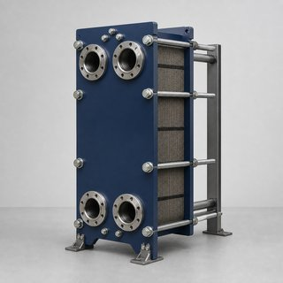

# 🧩 PlateHeatExchanger_AAS_v0.0.1.aasx

[← 장비 페이지](../README.md) · [⤓ AASX 다운로드](../AASX/PlateHeatExchanger_AAS_v0.0.1.aasx) · 2.8 MB

> 🤖 AASX 파일을 열어 자동으로 만든 열람 페이지입니다. 직접 고치지 말고 AASX를 다시 올리세요.

| 항목 | 내용 |
|---|---|
| AAS idShort | `PlateHeatExchangerAAS` |
| AAS id | https://www.smart-factory.kr/ids/aas/PlateHeatExchangerAAS/1/0 |
| 자산 종류 (assetKind) | Type |
| globalAssetId | https://www.smart-factory.kr/ids/asset/HeatExchanger/PHE-2026-0001 |
| 설명 | 비식별 판형 열교환기 타입 참조모델이며 실물 자산 승인 정보가 아닙니다. |
| 서브모델 | 6개 |
| 전체 요소 | 273개 |

## 서브모델 한눈에 보기

| # | 서브모델 | 요소 수 | semanticId |
|:-:|---|--:|---|
| 1 | [Nameplate](#sm-1) | 34 | https://admin-shell.io/idta/nameplate/3/0/Nameplate |
| 2 | [HandoverDocumentation](#sm-2) | 38 | 0173-1#01-AHF578#003 |
| 3 | [TechnicalData](#sm-3) | 82 | 0173-1#01-AHX837#002 |
| 4 | [OperationalData](#sm-4) | 48 | https://www.smart-factory.kr/ids/sm/PlateHeatExchangerAAS/OperationalData/1/0 |
| 5 | [Reliability](#sm-5) | 15 | https://admin-shell.io/idta/iec62683/1/0/Reliability |
| 6 | [ProcessParameters](#sm-6) | 56 | https://admin-shell-io/idta/SubmodelTemplate/ProcessParameters/1/0 |

## 서브모델 상세

각 서브모델 이름을 누르면 펼쳐집니다. **굵은 글씨**는 하위 요소가 있는 묶음입니다.

<b>1. Nameplate</b> — 요소 34개

> Contains the nameplate information attached to the product

semanticId: `https://admin-shell.io/idta/nameplate/3/0/Nameplate`

| idShort | 종류 | 값 | semanticId |
|---|---|---|---|
| URIOfTheProduct | 속성 | https://www.smart-factory.kr/ids/asset/HeatExchanger/PHE-2026-0001 | 0112/2///61987#ABN590#002 |
| ManufacturerName | 다국어 속성 | Heat Exchanger Maker Co., Ltd. | 0112/2///61987#ABA565#009 |
| ManufacturerProductDesignation | 다국어 속성 | Plate Heat Exchanger | 0112/2///61987#ABA567#009 |
| ManufacturerProductRoot | 다국어 속성 | Heat Exchanger | 0112/2///61360_7#AAS011#001 |
| ManufacturerProductFamily | 다국어 속성 | Plate Heat Exchanger Series | 0112/2///61987#ABP464#002 |
| ManufacturerProductType | 속성 | PHE-Example-100 | 0112/2///61987#ABA300#008 |
| OrderCodeOfManufacturer | 속성 | PHE-100-STD | 0112/2///61987#ABA950#008 |
| ProductArticleNumberOfManufacturer | 속성 | ART-PHE-100 | 0112/2///61987#ABA581#007 |
| SerialNumber | 속성 | PHE-2026-0001 | 0112/2///61987#ABA951#009 |
| YearOfConstruction | 속성 | 2026 | 0112/2///61987#ABP000#002 |
| DateOfManufacture | 속성 | 2026-01-22 | 0112/2///61987#ABB757#007 |
| HardwareVersion | 속성 | HW-1.0 | 0112/2///61987#ABA926#008 |
| FirmwareVersion | 속성 | FW-1.0 | 0112/2///61987#ABA302#006 |
| SoftwareVersion | 속성 | SW-1.0 | 0112/2///61987#ABA601#008 |
| CountryOfOrigin | 속성 | KR | 0112/2///61987#ABP462#001 |
| UniqueFacilityIdentifier | 속성 | PHE-FAC-001 | https://admin-shell.io/idta/nameplate/3/0/UniqueFacilityIdentifier |
| **AddressInformation** | 묶음 (4) |  | https://admin-shell.io/zvei/nameplate/1/0/ContactInformations/Address… |
| &nbsp;&nbsp;&nbsp;└ Street | 다국어 속성 | 123 Industrial-ro | 0173-1#02-AAO128#002 |
| &nbsp;&nbsp;&nbsp;└ Zipcode | 다국어 속성 | 12345 | 0173-1#02-AAO129#002 |
| &nbsp;&nbsp;&nbsp;└ CityTown | 다국어 속성 | Seoul | 0173-1#02-AAO132#002 |
| &nbsp;&nbsp;&nbsp;└ NationalCode | 다국어 속성 | KR | 0173-1#02-AAO134#002 |
| CompanyLogo | 파일 | /aasx/files/images/ExampleManufacturer.svg | 0112/2///61987#ABP463#001 |
| **Markings** | 목록 (1) |  | 0112/2///61360_7#AAS006#001 |
| &nbsp;&nbsp;&nbsp;└ **** | 묶음 (6) |  | 0112/2///61360_7#AAS009#001 |
| &nbsp;&nbsp;&nbsp;&nbsp;&nbsp;&nbsp;└ MarkingName | 속성 | EXAMPLE - NOT CERTIFIED | 0112/2///61987#ABA231#009 |
| &nbsp;&nbsp;&nbsp;&nbsp;&nbsp;&nbsp;└ DesignationOfCertificateOrApproval | 속성 | EXAMPLE-NO-APPROVAL | 0112/2///61987#ABH783#003 |
| &nbsp;&nbsp;&nbsp;&nbsp;&nbsp;&nbsp;└ IssueDate | 속성 | 2026-06-03 | 0112/2///61987#ABO097#001 |
| &nbsp;&nbsp;&nbsp;&nbsp;&nbsp;&nbsp;└ ExpiryDate | 속성 | 2027-06-03 | 0112/2///61987#ABH830#002 |
| &nbsp;&nbsp;&nbsp;&nbsp;&nbsp;&nbsp;└ MarkingFile | 파일 | /aasx/files/documents/Example_NotCertified.txt | 0112/2///61987#ABO100#002 |
| &nbsp;&nbsp;&nbsp;&nbsp;&nbsp;&nbsp;└ MarkingAdditionalText | 속성 | Fictional reference-model example only. No certification, pressure approval or … | 0112/2///61987#ABB146#007 |
| **AssetSpecificProperties** | 묶음 (1) |  | 0173-1#02-ABI218#003/0173-1#01-AGZ672#004 |
| &nbsp;&nbsp;&nbsp;└ **GuidelineSpecificProperties** | 목록 (1) |  | 0173-1#02-ABI219#003/0173-1#01-AHD205#004 |
| &nbsp;&nbsp;&nbsp;&nbsp;&nbsp;&nbsp;└ **** | 묶음 (1) |  | 0173-1#01-AHD205#004 |
| &nbsp;&nbsp;&nbsp;&nbsp;&nbsp;&nbsp;&nbsp;&nbsp;&nbsp;└ GuidelineForConformityDeclaration | 속성 | Not applicable: no real conformity declaration is supplied for this fictional r… | 0173-1#02-AAO856#002 |

<b>2. HandoverDocumentation</b> — 요소 38개

> The Submodel defines a set meta data for the handover of documentation from the manufacturer to the operator for industrial equipment

semanticId: `0173-1#01-AHF578#003`

| idShort | 종류 | 값 | semanticId |
|---|---|---|---|
| **Documents** | 목록 (1) |  | 0173-1#02-ABI500#003 |
| &nbsp;&nbsp;&nbsp;└ **** | 묶음 (4) |  | 0173-1#02-ABI500#003/0173-1#01-AHF579#003 |
| &nbsp;&nbsp;&nbsp;&nbsp;&nbsp;&nbsp;└ **DocumentIds** | 목록 (1) |  | 0173-1#02-ABI501#003 |
| &nbsp;&nbsp;&nbsp;&nbsp;&nbsp;&nbsp;&nbsp;&nbsp;&nbsp;└ **** | 묶음 (3) |  | 0173-1#02-ABI501#003/0173-1#01-AHF580#003 |
| &nbsp;&nbsp;&nbsp;&nbsp;&nbsp;&nbsp;&nbsp;&nbsp;&nbsp;&nbsp;&nbsp;&nbsp;└ DocumentDomainId | 속성 | HEAT_EXCHANGER_DOC | 0173-1#02-ABH994#003 |
| &nbsp;&nbsp;&nbsp;&nbsp;&nbsp;&nbsp;&nbsp;&nbsp;&nbsp;&nbsp;&nbsp;&nbsp;└ DocumentIdentifier | 속성 | PHE-PLAN-001 | 0173-1#02-AAO099#004 |
| &nbsp;&nbsp;&nbsp;&nbsp;&nbsp;&nbsp;&nbsp;&nbsp;&nbsp;&nbsp;&nbsp;&nbsp;└ DocumentIsPrimary | 속성 | true | 0173-1#02-ABH995#003 |
| &nbsp;&nbsp;&nbsp;&nbsp;&nbsp;&nbsp;└ **DocumentClassifications** | 목록 (1) |  | 0173-1#02-ABI502#003 |
| &nbsp;&nbsp;&nbsp;&nbsp;&nbsp;&nbsp;&nbsp;&nbsp;&nbsp;└ **** | 묶음 (3) |  | 0173-1#02-ABI502#003/0173-1#01-AHF581#003 |
| &nbsp;&nbsp;&nbsp;&nbsp;&nbsp;&nbsp;&nbsp;&nbsp;&nbsp;&nbsp;&nbsp;&nbsp;└ ClassId | 속성 | 02-01 | 0173-1#02-ABH996#003 |
| &nbsp;&nbsp;&nbsp;&nbsp;&nbsp;&nbsp;&nbsp;&nbsp;&nbsp;&nbsp;&nbsp;&nbsp;└ ClassName | 다국어 속성 | Technical specification | 0173-1#02-ABJ219#002 |
| &nbsp;&nbsp;&nbsp;&nbsp;&nbsp;&nbsp;&nbsp;&nbsp;&nbsp;&nbsp;&nbsp;&nbsp;└ ClassificationSystem | 속성 | VDI 2770 Blatt 1:2020 | 0173-1#02-ABH997#003 |
| &nbsp;&nbsp;&nbsp;&nbsp;&nbsp;&nbsp;└ **DocumentVersions** | 목록 (1) |  | 0173-1#02-ABI503#003 |
| &nbsp;&nbsp;&nbsp;&nbsp;&nbsp;&nbsp;&nbsp;&nbsp;&nbsp;└ **** | 묶음 (15) |  | 0173-1#02-ABI503#003/0173-1#01-AHF582#003 |
| &nbsp;&nbsp;&nbsp;&nbsp;&nbsp;&nbsp;&nbsp;&nbsp;&nbsp;&nbsp;&nbsp;&nbsp;└ **Language** | 목록 (1) |  | 0173-1#02-AAN468#008 |
| &nbsp;&nbsp;&nbsp;&nbsp;&nbsp;&nbsp;&nbsp;&nbsp;&nbsp;&nbsp;&nbsp;&nbsp;&nbsp;&nbsp;&nbsp;└  | 속성 | ko | 0173-1#02-AAN468#008 |
| &nbsp;&nbsp;&nbsp;&nbsp;&nbsp;&nbsp;&nbsp;&nbsp;&nbsp;&nbsp;&nbsp;&nbsp;└ Version | 속성 | 1 | 0173-1#02-AAP003#005 |
| &nbsp;&nbsp;&nbsp;&nbsp;&nbsp;&nbsp;&nbsp;&nbsp;&nbsp;&nbsp;&nbsp;&nbsp;└ Title | 다국어 속성 | Plate Heat Exchanger Reference-Model Development Plan | 0173-1#02-ABG940#003 |
| &nbsp;&nbsp;&nbsp;&nbsp;&nbsp;&nbsp;&nbsp;&nbsp;&nbsp;&nbsp;&nbsp;&nbsp;└ Description | 다국어 속성 | 첨부파일은 기존 개발계획서이며 제조사 운전매뉴얼이나 시험성적서가 아니다. 이번 AASX 수정내용을 반영한 문서 개정은 후속 작업이다. | 0173-1#02-AAN466#004 |
| &nbsp;&nbsp;&nbsp;&nbsp;&nbsp;&nbsp;&nbsp;&nbsp;&nbsp;&nbsp;&nbsp;&nbsp;└ KeyWords | 다국어 속성 | plate heat exchanger, AAS, technical data, operation, reliability, process para… | 0173-1#02-ABH999#003 |
| &nbsp;&nbsp;&nbsp;&nbsp;&nbsp;&nbsp;&nbsp;&nbsp;&nbsp;&nbsp;&nbsp;&nbsp;└ StatusSetDate | 속성 | 2026-08-21 | 0173-1#02-ABI000#003 |
| &nbsp;&nbsp;&nbsp;&nbsp;&nbsp;&nbsp;&nbsp;&nbsp;&nbsp;&nbsp;&nbsp;&nbsp;└ StatusValue | 속성 | Existing development plan; alignment update pending | 0173-1#02-ABI001#003 |
| &nbsp;&nbsp;&nbsp;&nbsp;&nbsp;&nbsp;&nbsp;&nbsp;&nbsp;&nbsp;&nbsp;&nbsp;└ OrganizationShortName | 속성 | ExampleOrganization | https://api.eclass-cdp.com/0173-1-02-ABI002-003 |
| &nbsp;&nbsp;&nbsp;&nbsp;&nbsp;&nbsp;&nbsp;&nbsp;&nbsp;&nbsp;&nbsp;&nbsp;└ OrganizationOfficialName | 속성 | Example Organization Co., Ltd. | 0173-1#02-ABI004#003 |
| &nbsp;&nbsp;&nbsp;&nbsp;&nbsp;&nbsp;&nbsp;&nbsp;&nbsp;&nbsp;&nbsp;&nbsp;└ **DigitalFiles** | 목록 (1) |  | 0173-1#02-ABK126#002 |
| &nbsp;&nbsp;&nbsp;&nbsp;&nbsp;&nbsp;&nbsp;&nbsp;&nbsp;&nbsp;&nbsp;&nbsp;&nbsp;&nbsp;&nbsp;└  | 파일 | /aasx/files/documents/HeatExchanger_DevelopmentPlan.hwpx | 0173-1#02-ABK126#002 |
| &nbsp;&nbsp;&nbsp;&nbsp;&nbsp;&nbsp;&nbsp;&nbsp;&nbsp;&nbsp;&nbsp;&nbsp;└ PreviewFile | 파일 |  | 0173-1#02-ABK127#002 |
| &nbsp;&nbsp;&nbsp;&nbsp;&nbsp;&nbsp;&nbsp;&nbsp;&nbsp;&nbsp;&nbsp;&nbsp;└ Subtitle | 다국어 속성 | 판형 열교환기 참조모델 개발 목적과 구성에 관한 문서 | 0173-1#02-ABH998#003 |
| &nbsp;&nbsp;&nbsp;&nbsp;&nbsp;&nbsp;&nbsp;&nbsp;&nbsp;&nbsp;&nbsp;&nbsp;└ **RefersToEntities** | 목록 (1) |  | 0173-1#02-ABK288#002 |
| &nbsp;&nbsp;&nbsp;&nbsp;&nbsp;&nbsp;&nbsp;&nbsp;&nbsp;&nbsp;&nbsp;&nbsp;&nbsp;&nbsp;&nbsp;└  | 참조 | https://www.smart-factory.kr/ids/sm/PlateHeatExchangerAAS/HandoverDocumentation… | 0173-1#02-ABK288#002 |
| &nbsp;&nbsp;&nbsp;&nbsp;&nbsp;&nbsp;&nbsp;&nbsp;&nbsp;&nbsp;&nbsp;&nbsp;└ **BasedOnReferences** | 목록 (1) |  | 0173-1#02-ABK289#002 |
| &nbsp;&nbsp;&nbsp;&nbsp;&nbsp;&nbsp;&nbsp;&nbsp;&nbsp;&nbsp;&nbsp;&nbsp;&nbsp;&nbsp;&nbsp;└  | 참조 |  | 0173-1#02-ABK289#002 |
| &nbsp;&nbsp;&nbsp;&nbsp;&nbsp;&nbsp;&nbsp;&nbsp;&nbsp;&nbsp;&nbsp;&nbsp;└ **TranslationOfEntities** | 목록 (1) |  | 0173-1#02-ABK290#002 |
| &nbsp;&nbsp;&nbsp;&nbsp;&nbsp;&nbsp;&nbsp;&nbsp;&nbsp;&nbsp;&nbsp;&nbsp;&nbsp;&nbsp;&nbsp;└  | 참조 |  | 0173-1#02-ABK290#002 |
| &nbsp;&nbsp;&nbsp;&nbsp;&nbsp;&nbsp;└ **DocumentedEntities** | 목록 (1) |  | https://admin-shell.io/vdi/2770/1/0/Document/DocumentedEntities |
| &nbsp;&nbsp;&nbsp;&nbsp;&nbsp;&nbsp;&nbsp;&nbsp;&nbsp;└  | 참조 | https://www.smart-factory.kr/ids/sm/PlateHeatExchangerAAS/HandoverDocumentation… | https://admin-shell.io/vdi/2770/1/0/Document/DocumentedEntity |
| **Entities** | 목록 (1) |  | https://admin-shell.io/vdi/2770/1/0/EntitiesForDocumentation |
| &nbsp;&nbsp;&nbsp;└  | 엔티티 |  | https://admin-shell.io/vdi/2770/1/0/EntityForDocumentation |

<b>3. TechnicalData</b> — 요소 82개

> Submodel containing technical data of the asset and associated product classificatons

semanticId: `0173-1#01-AHX837#002`

| idShort | 종류 | 값 | semanticId |
|---|---|---|---|
| **GeneralInformation** | 묶음 (6) |  | 0173-1#02-ABK161#002/0173-1#01-AHX838#002 |
| &nbsp;&nbsp;&nbsp;└ ManufacturerName | 속성 | Heat Exchanger Maker Co., Ltd. | 0173-1#02-AAO677#004 |
| &nbsp;&nbsp;&nbsp;└ ManufacturerProductDesignation | 다국어 속성 | Plate Heat Exchanger | 0173-1#02-AAW338#003 |
| &nbsp;&nbsp;&nbsp;└ ManufacturerArticleNumber | 속성 | ART-PHE-100 | 0173-1#02-AAO676#005 |
| &nbsp;&nbsp;&nbsp;└ ManufacturerOrderCode | 속성 | PHE-100-STD | 0173-1#02-AAO227#004 |
| &nbsp;&nbsp;&nbsp;└ **ProductImages** | 목록 (1) |  | 0173-1#02-ABM220#001 |
| &nbsp;&nbsp;&nbsp;&nbsp;&nbsp;&nbsp;└ **** | 묶음 (2) |  | 0173-1#02-ABM220#001/0173-1#01-AHY911#001 |
| &nbsp;&nbsp;&nbsp;&nbsp;&nbsp;&nbsp;&nbsp;&nbsp;&nbsp;└ ImageFile | 파일 | /aasx/files/images/PHE_ProductImage.png | 0173-1#02-ABK291#002 |
| &nbsp;&nbsp;&nbsp;&nbsp;&nbsp;&nbsp;&nbsp;&nbsp;&nbsp;└ ImageNote | 다국어 속성 | Three-quarter view of a gasketed plate heat exchanger | 0173-1#02-ABL423#001 |
| &nbsp;&nbsp;&nbsp;└ CompanyLogo | 파일 | /aasx/files/images/ExampleManufacturer.svg | 0173-1#02-ABI776#002 |
| **ProductClassifications** | 목록 (1) |  | 0173-1#02-ABK162#002 |
| &nbsp;&nbsp;&nbsp;└ **** | 묶음 (7) |  | 0173-1#02-ABK162#002/0173-1#01-AHX839#002 |
| &nbsp;&nbsp;&nbsp;&nbsp;&nbsp;&nbsp;└ ClassificationSystem | 속성 | ECLASS | 0173-1#02-ABL424#001 |
| &nbsp;&nbsp;&nbsp;&nbsp;&nbsp;&nbsp;└ ClassificationSystemVersion | 속성 | ECLASS 16.0 | 0173-1#02-AAR710#003 |
| &nbsp;&nbsp;&nbsp;&nbsp;&nbsp;&nbsp;└ ClassificationSystemUrl | 속성 | https://eclass.eu | https://admin-shell.io/IDTA/TechnicalData/ProductClassifications/Prod… |
| &nbsp;&nbsp;&nbsp;&nbsp;&nbsp;&nbsp;└ ProductClassId | 속성 | 0173-1#01-AAD341#021 | 0173-1#02-ABG776#003 |
| &nbsp;&nbsp;&nbsp;&nbsp;&nbsp;&nbsp;└ ProductClassCodedName | 속성 | 36-04-01-02 | 0173-1#02-ABK128#002 |
| &nbsp;&nbsp;&nbsp;&nbsp;&nbsp;&nbsp;└ ProductClassName | 다국어 속성 | Plate heat exchanger | 0173-1#02-ABK273#002 |
| &nbsp;&nbsp;&nbsp;&nbsp;&nbsp;&nbsp;└ ReferenceToTechnicalPropertyArea | 참조 | https://www.smart-factory.kr/ids/sm/PlateHeatExchangerAAS/TechnicalData/2/0 / T… | 0173-1#02-ABL358#002 |
| **TechnicalPropertyAreas** | 목록 (6) |  | 0173-1#02-ABK163#002 |
| &nbsp;&nbsp;&nbsp;└ **** | 묶음 (1) |  | 0173-1#02-ABL358#002/0173-1#01-AHX773#002 |
| &nbsp;&nbsp;&nbsp;&nbsp;&nbsp;&nbsp;└ **HeatExchangerCommonSpecifications** | 묶음 (1) |  | https://www.smart-factory.kr/ids/cd/HeatExchangerCommonSpecifications… |
| &nbsp;&nbsp;&nbsp;&nbsp;&nbsp;&nbsp;&nbsp;&nbsp;&nbsp;└ **ConstructionAndServiceability** | 묶음 (5) |  | https://www.smart-factory.kr/ids/cd/ConstructionAndServiceability/1/0 |
| &nbsp;&nbsp;&nbsp;&nbsp;&nbsp;&nbsp;&nbsp;&nbsp;&nbsp;&nbsp;&nbsp;&nbsp;└ HeatExchangerType | 속성 | Plate Heat Exchanger | 0173-1#02-ABI725#003 |
| &nbsp;&nbsp;&nbsp;&nbsp;&nbsp;&nbsp;&nbsp;&nbsp;&nbsp;&nbsp;&nbsp;&nbsp;└ PlateType | 속성 | Chevron patterned plate | 0173-1#02-AAP850#004 |
| &nbsp;&nbsp;&nbsp;&nbsp;&nbsp;&nbsp;&nbsp;&nbsp;&nbsp;&nbsp;&nbsp;&nbsp;└ NumberOfPlates | 속성 | 45 | 0173-1#02-AAP475#004 |
| &nbsp;&nbsp;&nbsp;&nbsp;&nbsp;&nbsp;&nbsp;&nbsp;&nbsp;&nbsp;&nbsp;&nbsp;└ FlowArrangement | 속성 | Counter flow | https://www.smart-factory.kr/ids/cd/FlowArrangement/1/0 |
| &nbsp;&nbsp;&nbsp;&nbsp;&nbsp;&nbsp;&nbsp;&nbsp;&nbsp;&nbsp;&nbsp;&nbsp;└ CleaningSupport | 속성 | true | https://www.smart-factory.kr/ids/cd/CleaningSupport/1/0 |
| &nbsp;&nbsp;&nbsp;└ **** | 묶음 (1) |  | 0173-1#02-ABL358#002/0173-1#01-AHX773#002 |
| &nbsp;&nbsp;&nbsp;&nbsp;&nbsp;&nbsp;└ **ThermalPerformanceSpecifications** | 묶음 (2) |  | https://www.smart-factory.kr/ids/cd/ThermalPerformanceSpecifications/… |
| &nbsp;&nbsp;&nbsp;&nbsp;&nbsp;&nbsp;&nbsp;&nbsp;&nbsp;└ **HeatTransferCapacityAndFlowDesign** | 묶음 (4) |  | https://www.smart-factory.kr/ids/cd/HeatTransferCapacityAndFlowDesign… |
| &nbsp;&nbsp;&nbsp;&nbsp;&nbsp;&nbsp;&nbsp;&nbsp;&nbsp;&nbsp;&nbsp;&nbsp;└ HeatTransferArea | 속성 | 25 | 0173-1#02-BAI259#008 |
| &nbsp;&nbsp;&nbsp;&nbsp;&nbsp;&nbsp;&nbsp;&nbsp;&nbsp;&nbsp;&nbsp;&nbsp;└ DesignHeatDuty | 속성 | 957.916667 | https://www.smart-factory.kr/ids/cd/DesignHeatDuty/1/0 |
| &nbsp;&nbsp;&nbsp;&nbsp;&nbsp;&nbsp;&nbsp;&nbsp;&nbsp;&nbsp;&nbsp;&nbsp;└ PrimarySideDesignFlowRate | 속성 | 15 | https://www.smart-factory.kr/ids/cd/PrimarySideDesignFlowRate/1/0 |
| &nbsp;&nbsp;&nbsp;&nbsp;&nbsp;&nbsp;&nbsp;&nbsp;&nbsp;&nbsp;&nbsp;&nbsp;└ SecondarySideDesignFlowRate | 속성 | 18 | https://www.smart-factory.kr/ids/cd/SecondarySideDesignFlowRate/1/0 |
| &nbsp;&nbsp;&nbsp;&nbsp;&nbsp;&nbsp;&nbsp;&nbsp;&nbsp;└ **DesignTemperatureProfile** | 묶음 (4) |  | https://www.smart-factory.kr/ids/cd/DesignTemperatureProfile/1/0 |
| &nbsp;&nbsp;&nbsp;&nbsp;&nbsp;&nbsp;&nbsp;&nbsp;&nbsp;&nbsp;&nbsp;&nbsp;└ PrimarySideDesignInletTemperature | 속성 | 80 | https://www.smart-factory.kr/ids/cd/PrimarySideDesignInletTemperature… |
| &nbsp;&nbsp;&nbsp;&nbsp;&nbsp;&nbsp;&nbsp;&nbsp;&nbsp;&nbsp;&nbsp;&nbsp;└ PrimarySideDesignOutletTemperature | 속성 | 25 | https://www.smart-factory.kr/ids/cd/PrimarySideDesignOutletTemperatur… |
| &nbsp;&nbsp;&nbsp;&nbsp;&nbsp;&nbsp;&nbsp;&nbsp;&nbsp;&nbsp;&nbsp;&nbsp;└ SecondarySideDesignInletTemperature | 속성 | 20 | https://www.smart-factory.kr/ids/cd/SecondarySideDesignInletTemperatu… |
| &nbsp;&nbsp;&nbsp;&nbsp;&nbsp;&nbsp;&nbsp;&nbsp;&nbsp;&nbsp;&nbsp;&nbsp;└ SecondarySideDesignOutletTemperature | 속성 | 65.833333 | https://www.smart-factory.kr/ids/cd/SecondarySideDesignOutletTemperat… |
| &nbsp;&nbsp;&nbsp;└ **** | 묶음 (1) |  | 0173-1#02-ABL358#002/0173-1#01-AHX773#002 |
| &nbsp;&nbsp;&nbsp;&nbsp;&nbsp;&nbsp;└ **OperatingTemperatureSpecifications** | 묶음 (1) |  | https://www.smart-factory.kr/ids/cd/OperatingTemperatureSpecification… |
| &nbsp;&nbsp;&nbsp;&nbsp;&nbsp;&nbsp;&nbsp;&nbsp;&nbsp;└ **PermissibleOperatingTemperatureRange** | 묶음 (2) |  | https://www.smart-factory.kr/ids/cd/PermissibleOperatingTemperatureRa… |
| &nbsp;&nbsp;&nbsp;&nbsp;&nbsp;&nbsp;&nbsp;&nbsp;&nbsp;&nbsp;&nbsp;&nbsp;└ MinimumOperatingTemperature | 속성 | -10 | 0173-1#02-BAA015#013 |
| &nbsp;&nbsp;&nbsp;&nbsp;&nbsp;&nbsp;&nbsp;&nbsp;&nbsp;&nbsp;&nbsp;&nbsp;└ MaximumOperatingTemperature | 속성 | 150 | 0173-1#02-AAN307#007 |
| &nbsp;&nbsp;&nbsp;└ **** | 묶음 (1) |  | 0173-1#02-ABL358#002/0173-1#01-AHX773#002 |
| &nbsp;&nbsp;&nbsp;&nbsp;&nbsp;&nbsp;└ **PressureSpecifications** | 묶음 (1) |  | https://www.smart-factory.kr/ids/cd/PressureSpecifications/1/0 |
| &nbsp;&nbsp;&nbsp;&nbsp;&nbsp;&nbsp;&nbsp;&nbsp;&nbsp;└ **PressureDesignAndLossLimits** | 묶음 (7) |  | https://www.smart-factory.kr/ids/cd/PressureDesignAndLossLimits/1/0 |
| &nbsp;&nbsp;&nbsp;&nbsp;&nbsp;&nbsp;&nbsp;&nbsp;&nbsp;&nbsp;&nbsp;&nbsp;└ PrimaryDesignPressure | 속성 | 10 | 0173-1#02-ABI795#003 |
| &nbsp;&nbsp;&nbsp;&nbsp;&nbsp;&nbsp;&nbsp;&nbsp;&nbsp;&nbsp;&nbsp;&nbsp;└ SecondaryDesignPressure | 속성 | 10 | 0173-1#02-ABL372#002 |
| &nbsp;&nbsp;&nbsp;&nbsp;&nbsp;&nbsp;&nbsp;&nbsp;&nbsp;&nbsp;&nbsp;&nbsp;└ PrimaryMaximumOperatingPressure | 속성 | 10 | 0173-1#02-ABL373#002 |
| &nbsp;&nbsp;&nbsp;&nbsp;&nbsp;&nbsp;&nbsp;&nbsp;&nbsp;&nbsp;&nbsp;&nbsp;└ SecondaryMaximumOperatingPressure | 속성 | 10 | 0173-1#02-ABL374#002 |
| &nbsp;&nbsp;&nbsp;&nbsp;&nbsp;&nbsp;&nbsp;&nbsp;&nbsp;&nbsp;&nbsp;&nbsp;└ PrimaryTestPressure | 속성 | 15 | 0173-1#02-ABL380#002 |
| &nbsp;&nbsp;&nbsp;&nbsp;&nbsp;&nbsp;&nbsp;&nbsp;&nbsp;&nbsp;&nbsp;&nbsp;└ SecondaryTestPressure | 속성 | 15 | 0173-1#02-ABL381#002 |
| &nbsp;&nbsp;&nbsp;&nbsp;&nbsp;&nbsp;&nbsp;&nbsp;&nbsp;&nbsp;&nbsp;&nbsp;└ MaximumAllowablePressureDrop | 속성 | 0.6 | https://www.smart-factory.kr/ids/cd/MaximumAllowablePressureDrop/1/0 |
| &nbsp;&nbsp;&nbsp;└ **** | 묶음 (1) |  | 0173-1#02-ABL358#002/0173-1#01-AHX773#002 |
| &nbsp;&nbsp;&nbsp;&nbsp;&nbsp;&nbsp;└ **MaterialAndConnectionSpecifications** | 묶음 (2) |  | https://www.smart-factory.kr/ids/cd/MaterialAndConnectionSpecificatio… |
| &nbsp;&nbsp;&nbsp;&nbsp;&nbsp;&nbsp;&nbsp;&nbsp;&nbsp;└ **ConstructionMaterials** | 묶음 (4) |  | https://www.smart-factory.kr/ids/cd/ConstructionMaterials/1/0 |
| &nbsp;&nbsp;&nbsp;&nbsp;&nbsp;&nbsp;&nbsp;&nbsp;&nbsp;&nbsp;&nbsp;&nbsp;└ PlateMaterial | 속성 | Stainless steel 316L | 0173-1#02-AAP103#005 |
| &nbsp;&nbsp;&nbsp;&nbsp;&nbsp;&nbsp;&nbsp;&nbsp;&nbsp;&nbsp;&nbsp;&nbsp;└ GasketMaterial | 속성 | EPDM | https://www.smart-factory.kr/ids/cd/GasketMaterial/1/0 |
| &nbsp;&nbsp;&nbsp;&nbsp;&nbsp;&nbsp;&nbsp;&nbsp;&nbsp;&nbsp;&nbsp;&nbsp;└ FrameMaterial | 속성 | Carbon steel coated | 0173-1#02-AAP123#004 |
| &nbsp;&nbsp;&nbsp;&nbsp;&nbsp;&nbsp;&nbsp;&nbsp;&nbsp;&nbsp;&nbsp;&nbsp;└ PlateThickness | 속성 | 0.5 | 0173-1#02-BAI257#007 |
| &nbsp;&nbsp;&nbsp;&nbsp;&nbsp;&nbsp;&nbsp;&nbsp;&nbsp;└ **ProcessConnections** | 묶음 (2) |  | https://www.smart-factory.kr/ids/cd/ProcessConnections/1/0 |
| &nbsp;&nbsp;&nbsp;&nbsp;&nbsp;&nbsp;&nbsp;&nbsp;&nbsp;&nbsp;&nbsp;&nbsp;└ ConnectionType | 속성 | Flanged connection | 0173-1#02-AAH217#005 |
| &nbsp;&nbsp;&nbsp;&nbsp;&nbsp;&nbsp;&nbsp;&nbsp;&nbsp;&nbsp;&nbsp;&nbsp;└ PortSize | 속성 | DN50 | 0173-1#02-AAO331#007 |
| &nbsp;&nbsp;&nbsp;└ **** | 묶음 (1) |  | 0173-1#02-ABL358#002/0173-1#01-AHX773#002 |
| &nbsp;&nbsp;&nbsp;&nbsp;&nbsp;&nbsp;└ **ElectricalAndSafetySpecifications** | 묶음 (2) |  | https://www.smart-factory.kr/ids/cd/ElectricalAndSafetySpecifications… |
| &nbsp;&nbsp;&nbsp;&nbsp;&nbsp;&nbsp;&nbsp;&nbsp;&nbsp;└ **ElectricalSupplyAndProtection** | 묶음 (4) |  | https://www.smart-factory.kr/ids/cd/ElectricalSupplyAndProtection/1/0 |
| &nbsp;&nbsp;&nbsp;&nbsp;&nbsp;&nbsp;&nbsp;&nbsp;&nbsp;&nbsp;&nbsp;&nbsp;└ PowerSupply | 속성 | 220 VAC ±10%, 50/60 Hz | https://www.smart-factory.kr/ids/cd/PowerSupply/1/0 |
| &nbsp;&nbsp;&nbsp;&nbsp;&nbsp;&nbsp;&nbsp;&nbsp;&nbsp;&nbsp;&nbsp;&nbsp;└ RatedPower | 속성 | 0.2 | 0173-1#02-AAJ700#005 |
| &nbsp;&nbsp;&nbsp;&nbsp;&nbsp;&nbsp;&nbsp;&nbsp;&nbsp;&nbsp;&nbsp;&nbsp;└ RatedPowerConsumption | 속성 | 200 | 0173-1#02-AAC970#010 |
| &nbsp;&nbsp;&nbsp;&nbsp;&nbsp;&nbsp;&nbsp;&nbsp;&nbsp;&nbsp;&nbsp;&nbsp;└ LeakageBreakerCapacity | 속성 | 5 | https://www.smart-factory.kr/ids/cd/LeakageBreakerCapacity/1/0 |
| &nbsp;&nbsp;&nbsp;&nbsp;&nbsp;&nbsp;&nbsp;&nbsp;&nbsp;└ **FunctionalSafetyAndGrounding** | 묶음 (3) |  | https://www.smart-factory.kr/ids/cd/FunctionalSafetyAndGrounding/1/0 |
| &nbsp;&nbsp;&nbsp;&nbsp;&nbsp;&nbsp;&nbsp;&nbsp;&nbsp;&nbsp;&nbsp;&nbsp;└ SupportedSafetyFunctions | 속성 | Emergency stop | 0173-1#02-AAR796#006 |
| &nbsp;&nbsp;&nbsp;&nbsp;&nbsp;&nbsp;&nbsp;&nbsp;&nbsp;&nbsp;&nbsp;&nbsp;└ OverTemperatureProtectionSupported | 속성 | true | https://www.smart-factory.kr/ids/cd/OverTemperatureProtectionSupporte… |
| &nbsp;&nbsp;&nbsp;&nbsp;&nbsp;&nbsp;&nbsp;&nbsp;&nbsp;&nbsp;&nbsp;&nbsp;└ GroundingRequired | 속성 | true | https://www.smart-factory.kr/ids/cd/GroundingRequired/1/0 |
| **FurtherInformation** | 묶음 (2) |  | 0173-1#02-ABK164#002 |
| &nbsp;&nbsp;&nbsp;└ TextStatement | 다국어 속성 | This specification is based on clean heat-transfer conditions | 0173-1#02-ABK134#002 |
| &nbsp;&nbsp;&nbsp;└ ValidDate | 속성 | 2026-01-22 | 0173-1#02-ABL775#001 |
| **SpecificDescriptions** | 목록 (1) |  | 0173-1#02-ABM221#001 |
| &nbsp;&nbsp;&nbsp;└ **** | 묶음 (1) |  | 0173-1#02-ABM221#001/0173-1#01-AHY912#001 |
| &nbsp;&nbsp;&nbsp;&nbsp;&nbsp;&nbsp;└ ExampleScope | 속성 | Fictional water-to-water counterflow plate heat exchanger. Values are illustrat… | https://www.smart-factory.kr/ids/cd/ExampleScope/1/0 |

<b>4. OperationalData</b> — 요소 48개

> 판형 열교환기의 현재 운전값과 상태

semanticId: `https://www.smart-factory.kr/ids/sm/PlateHeatExchangerAAS/OperationalData/1/0`

| idShort | 종류 | 값 | semanticId |
|---|---|---|---|
| **PlateHeatExchangerOperationData** | 묶음 (5) |  | https://www.smart-factory.kr/ids/cd/PlateHeatExchangerOperationData/1… |
| &nbsp;&nbsp;&nbsp;└ **OperationStatus** | 묶음 (6) |  | https://www.smart-factory.kr/ids/cd/OperationStatus/1/0 |
| &nbsp;&nbsp;&nbsp;&nbsp;&nbsp;&nbsp;└ CurrentOperationMode | 속성 | Continuous | https://www.smart-factory.kr/ids/cd/CurrentOperationMode/1/0 |
| &nbsp;&nbsp;&nbsp;&nbsp;&nbsp;&nbsp;└ EquipmentStatus | 속성 | Running | https://www.smart-factory.kr/ids/cd/EquipmentStatus/1/0 |
| &nbsp;&nbsp;&nbsp;&nbsp;&nbsp;&nbsp;└ AlarmStatus | 속성 | Normal | https://www.smart-factory.kr/ids/cd/AlarmStatus/1/0 |
| &nbsp;&nbsp;&nbsp;&nbsp;&nbsp;&nbsp;└ LeakageStatus | 속성 | Not detected | https://www.smart-factory.kr/ids/cd/LeakageStatus/1/0 |
| &nbsp;&nbsp;&nbsp;&nbsp;&nbsp;&nbsp;└ CleaningRequiredStatus | 속성 | Not required | https://www.smart-factory.kr/ids/cd/CleaningRequiredStatus/1/0 |
| &nbsp;&nbsp;&nbsp;&nbsp;&nbsp;&nbsp;└ LastUpdateTime | 속성 | 2026-06-03T09:00:00+09:00 | https://www.smart-factory.kr/ids/cd/LastUpdateTime/1/0 |
| &nbsp;&nbsp;&nbsp;└ **PrimarySideFluidOperationData** | 묶음 (10) |  | https://www.smart-factory.kr/ids/cd/PrimarySideFluidOperationData/1/0 |
| &nbsp;&nbsp;&nbsp;&nbsp;&nbsp;&nbsp;└ PrimarySideWorkingFluid | 속성 | Hot water | https://www.smart-factory.kr/ids/cd/PrimarySideWorkingFluid/1/0 |
| &nbsp;&nbsp;&nbsp;&nbsp;&nbsp;&nbsp;└ TargetPrimaryFlowRate | 속성 | 15 | https://www.smart-factory.kr/ids/cd/TargetPrimaryFlowRate/1/0 |
| &nbsp;&nbsp;&nbsp;&nbsp;&nbsp;&nbsp;└ CurrentPrimaryFlowRate | 속성 | 14.8 | https://www.smart-factory.kr/ids/cd/CurrentPrimaryFlowRate/1/0 |
| &nbsp;&nbsp;&nbsp;&nbsp;&nbsp;&nbsp;└ TargetPrimaryInletTemperature | 속성 | 80 | https://www.smart-factory.kr/ids/cd/TargetPrimaryInletTemperature/1/0 |
| &nbsp;&nbsp;&nbsp;&nbsp;&nbsp;&nbsp;└ CurrentPrimaryInletTemperature | 속성 | 79.6 | 0173-1#02-BAI173#007 |
| &nbsp;&nbsp;&nbsp;&nbsp;&nbsp;&nbsp;└ TargetPrimaryOutletTemperature | 속성 | 25 | https://www.smart-factory.kr/ids/cd/TargetPrimaryOutletTemperature/1/0 |
| &nbsp;&nbsp;&nbsp;&nbsp;&nbsp;&nbsp;└ CurrentPrimaryOutletTemperature | 속성 | 26.2 | 0173-1#02-BAI172#007 |
| &nbsp;&nbsp;&nbsp;&nbsp;&nbsp;&nbsp;└ TargetPrimaryInletPressure | 속성 | 4.0 | https://www.smart-factory.kr/ids/cd/TargetPrimaryInletPressure/1/0 |
| &nbsp;&nbsp;&nbsp;&nbsp;&nbsp;&nbsp;└ CurrentPrimaryInletPressure | 속성 | 4.1 | https://www.smart-factory.kr/ids/cd/CurrentPrimaryInletPressure/1/0 |
| &nbsp;&nbsp;&nbsp;&nbsp;&nbsp;&nbsp;└ CurrentPrimaryPressureDrop | 속성 | 0.42 | https://www.smart-factory.kr/ids/cd/CurrentPrimaryPressureDrop/1/0 |
| &nbsp;&nbsp;&nbsp;└ **SecondarySideFluidOperationData** | 묶음 (10) |  | https://www.smart-factory.kr/ids/cd/SecondarySideFluidOperationData/1… |
| &nbsp;&nbsp;&nbsp;&nbsp;&nbsp;&nbsp;└ SecondarySideWorkingFluid | 속성 | Cooling water | https://www.smart-factory.kr/ids/cd/SecondarySideWorkingFluid/1/0 |
| &nbsp;&nbsp;&nbsp;&nbsp;&nbsp;&nbsp;└ TargetSecondaryFlowRate | 속성 | 18 | https://www.smart-factory.kr/ids/cd/TargetSecondaryFlowRate/1/0 |
| &nbsp;&nbsp;&nbsp;&nbsp;&nbsp;&nbsp;└ CurrentSecondaryFlowRate | 속성 | 18.2 | https://www.smart-factory.kr/ids/cd/CurrentSecondaryFlowRate/1/0 |
| &nbsp;&nbsp;&nbsp;&nbsp;&nbsp;&nbsp;└ TargetSecondaryInletTemperature | 속성 | 20 | https://www.smart-factory.kr/ids/cd/TargetSecondaryInletTemperature/1… |
| &nbsp;&nbsp;&nbsp;&nbsp;&nbsp;&nbsp;└ CurrentSecondaryInletTemperature | 속성 | 20.4 | https://www.smart-factory.kr/ids/cd/CurrentSecondaryInletTemperature/… |
| &nbsp;&nbsp;&nbsp;&nbsp;&nbsp;&nbsp;└ TargetSecondaryOutletTemperature | 속성 | 65.833333 | https://www.smart-factory.kr/ids/cd/TargetSecondaryOutletTemperature/… |
| &nbsp;&nbsp;&nbsp;&nbsp;&nbsp;&nbsp;└ CurrentSecondaryOutletTemperature | 속성 | 63.824176 | https://www.smart-factory.kr/ids/cd/CurrentSecondaryOutletTemperature… |
| &nbsp;&nbsp;&nbsp;&nbsp;&nbsp;&nbsp;└ TargetSecondaryInletPressure | 속성 | 3.5 | https://www.smart-factory.kr/ids/cd/TargetSecondaryInletPressure/1/0 |
| &nbsp;&nbsp;&nbsp;&nbsp;&nbsp;&nbsp;└ CurrentSecondaryInletPressure | 속성 | 3.4 | https://www.smart-factory.kr/ids/cd/CurrentSecondaryInletPressure/1/0 |
| &nbsp;&nbsp;&nbsp;&nbsp;&nbsp;&nbsp;└ CurrentSecondaryPressureDrop | 속성 | 0.38 | https://www.smart-factory.kr/ids/cd/CurrentSecondaryPressureDrop/1/0 |
| &nbsp;&nbsp;&nbsp;└ **ThermalPerformanceOperationData** | 묶음 (11) |  | https://www.smart-factory.kr/ids/cd/ThermalPerformanceOperationData/1… |
| &nbsp;&nbsp;&nbsp;&nbsp;&nbsp;&nbsp;└ TargetHeatDuty | 속성 | 957.916667 | https://www.smart-factory.kr/ids/cd/TargetHeatDuty/1/0 |
| &nbsp;&nbsp;&nbsp;&nbsp;&nbsp;&nbsp;└ CurrentHeatDuty | 속성 | 917.649333 | https://www.smart-factory.kr/ids/cd/CurrentHeatDuty/1/0 |
| &nbsp;&nbsp;&nbsp;&nbsp;&nbsp;&nbsp;└ TargetHeatTransferEfficiency | 속성 | 90 | https://www.smart-factory.kr/ids/cd/TargetHeatTransferEfficiency/1/0 |
| &nbsp;&nbsp;&nbsp;&nbsp;&nbsp;&nbsp;└ CurrentHeatTransferEfficiency | 속성 | 90.202703 | https://www.smart-factory.kr/ids/cd/CurrentHeatTransferEfficiency/1/0 |
| &nbsp;&nbsp;&nbsp;&nbsp;&nbsp;&nbsp;└ TargetApproachTemperature | 속성 | 5 | https://www.smart-factory.kr/ids/cd/TargetApproachTemperature/1/0 |
| &nbsp;&nbsp;&nbsp;&nbsp;&nbsp;&nbsp;└ CurrentApproachTemperature | 속성 | 5.8 | https://www.smart-factory.kr/ids/cd/CurrentApproachTemperature/1/0 |
| &nbsp;&nbsp;&nbsp;&nbsp;&nbsp;&nbsp;└ MaximumAllowableApproachTemperature | 속성 | 8 | https://www.smart-factory.kr/ids/cd/MaximumAllowableApproachTemperatu… |
| &nbsp;&nbsp;&nbsp;&nbsp;&nbsp;&nbsp;└ MaximumAllowablePrimaryOutletTemperatureDeviation | 속성 | 2 | https://www.smart-factory.kr/ids/cd/MaximumAllowablePrimaryOutletTemp… |
| &nbsp;&nbsp;&nbsp;&nbsp;&nbsp;&nbsp;└ MaximumAllowableSecondaryOutletTemperatureDeviation | 속성 | 2 | https://www.smart-factory.kr/ids/cd/MaximumAllowableSecondaryOutletTe… |
| &nbsp;&nbsp;&nbsp;&nbsp;&nbsp;&nbsp;└ EstimatedFoulingFactor | 속성 | 0.00012 | https://www.smart-factory.kr/ids/cd/EstimatedFoulingFactor/1/0 |
| &nbsp;&nbsp;&nbsp;&nbsp;&nbsp;&nbsp;└ MaximumAllowableFoulingFactor | 속성 | 0.0002 | https://www.smart-factory.kr/ids/cd/MaximumAllowableFoulingFactor/1/0 |
| &nbsp;&nbsp;&nbsp;└ **PressureAndDifferentialPressureOperationData** | 묶음 (5) |  | https://www.smart-factory.kr/ids/cd/PressureAndDifferentialPressureOp… |
| &nbsp;&nbsp;&nbsp;&nbsp;&nbsp;&nbsp;└ MaximumAllowablePrimaryPressureDrop | 속성 | 0.6 | https://www.smart-factory.kr/ids/cd/MaximumAllowablePrimaryPressureDr… |
| &nbsp;&nbsp;&nbsp;&nbsp;&nbsp;&nbsp;└ MaximumAllowableSecondaryPressureDrop | 속성 | 0.6 | https://www.smart-factory.kr/ids/cd/MaximumAllowableSecondaryPressure… |
| &nbsp;&nbsp;&nbsp;&nbsp;&nbsp;&nbsp;└ PressureDropWarningThreshold | 속성 | 0.5 | https://www.smart-factory.kr/ids/cd/PressureDropWarningThreshold/1/0 |
| &nbsp;&nbsp;&nbsp;&nbsp;&nbsp;&nbsp;└ HighPressureAlarmThreshold | 속성 | 9 | https://www.smart-factory.kr/ids/cd/HighPressureAlarmThreshold/1/0 |
| &nbsp;&nbsp;&nbsp;&nbsp;&nbsp;&nbsp;└ HighPressureDropAlarmThreshold | 속성 | 0.7 | https://www.smart-factory.kr/ids/cd/HighPressureDropAlarmThreshold/1/0 |

<b>5. Reliability</b> — 요소 15개

semanticId: `https://admin-shell.io/idta/iec62683/1/0/Reliability`

| idShort | 종류 | 값 | semanticId |
|---|---|---|---|
| NumberOfReliabilitySets | 속성 | 1 | 0112/2///62683#ACE006#001 |
| **OperatingConditionsOfReliabilityCharacteristics** | 묶음 (9) |  | 0112/2///62683#ACG071#001 |
| &nbsp;&nbsp;&nbsp;└ TypeOfVoltage | 속성 | AC | 0112/2///61987#ABA969#007 |
| &nbsp;&nbsp;&nbsp;└ RatedVoltage | 속성 | 220 | 0112/2///61987#ABA588#004 |
| &nbsp;&nbsp;&nbsp;└ MinimumRatedVoltage | 속성 | 198 | 0112/2///61987#ABD461#004 |
| &nbsp;&nbsp;&nbsp;└ MaximumRatedVoltage | 속성 | 242 | 0112/2///61987#ABD462#004 |
| &nbsp;&nbsp;&nbsp;└ RatedOperationalCurrent | 속성 | 1000 | https://admin-shell.io/idta/FunctionalSafety/RatedOperationalCurrent/… |
| &nbsp;&nbsp;&nbsp;└ TypeOfInterlockingDevice | 속성 | Pressure and leakage alarm interlock | 0112/2///62683#ACE053#001 |
| &nbsp;&nbsp;&nbsp;└ OtherOperatingConditions | 속성 | Illustrative steady-state water-to-water counterflow operation; design pressure… | 0112/2///62683#ACE070#001 |
| &nbsp;&nbsp;&nbsp;└ UsefulLifeInNumberOfOperations | 속성 | 20000 | 0112/2///62683#ACE055#001 |
| &nbsp;&nbsp;&nbsp;└ UsefulLifeInTimeInterval | 속성 | 10 | 0112/2///62683#ACE054#001 |
| **ReliabilityCharacteristics** | 묶음 (3) |  | 0112/2///62683#ACG080#001 |
| &nbsp;&nbsp;&nbsp;└ MTTF | 속성 | 10 | 0112/2///62683#ACE061#001 |
| &nbsp;&nbsp;&nbsp;└ MTBF | 속성 | 5 | 0112/2///62683#ACE062#001 |
| &nbsp;&nbsp;&nbsp;└ B10 | 속성 | 15000 | https://admin-shell.io/idta/Reliability/B10/1/0 |

<b>6. ProcessParameters</b> — 요소 56개

> The Submodel provides all the necessary parameters in a structured form that are required for the manufacture of any product

semanticId: `https://admin-shell-io/idta/SubmodelTemplate/ProcessParameters/1/0`

| idShort | 종류 | 값 | semanticId |
|---|---|---|---|
| **Processes** | 묶음 (1) |  | https://admin-shell.io/idta/ProcessParameters/Processes/1/0 |
| &nbsp;&nbsp;&nbsp;└ **Process__00__** | 묶음 (8) |  | https://admin-shell.io/idta/ProcessParameters/Process/1/0 |
| &nbsp;&nbsp;&nbsp;&nbsp;&nbsp;&nbsp;└ ProcessId | 속성 | PHE-P-001 | https://admin-shell.io/idta/ProcessParameters/ProcessId/1/0 |
| &nbsp;&nbsp;&nbsp;&nbsp;&nbsp;&nbsp;└ ProcessName | 속성 | Plate heat exchange process | https://admin-shell.io/idta/ProcessParameters/ProcessName/1/0 |
| &nbsp;&nbsp;&nbsp;&nbsp;&nbsp;&nbsp;└ ProcessDescription | 다국어 속성 | Process parameters for plate heat-exchanger operation and CIP cleaning | https://admin-shell.io/idta/ProcessParameters/ProcessDescription/1/0 |
| &nbsp;&nbsp;&nbsp;&nbsp;&nbsp;&nbsp;└ PlannedProcessTime | 속성 | PT60M | https://admin-shell.io/idta/ProcessParameters/PlannedProcessTime/1/0 |
| &nbsp;&nbsp;&nbsp;&nbsp;&nbsp;&nbsp;└ **ProductParameters** | 묶음 (1) |  | https://admin-shell.io/idta/ProcessParameters/ProductParameters/1/0 |
| &nbsp;&nbsp;&nbsp;&nbsp;&nbsp;&nbsp;&nbsp;&nbsp;&nbsp;└ **PlateHeatExchangerProductRequirements** | 묶음 (2) |  | https://www.smart-factory.kr/ids/cd/PlateHeatExchangerProductRequirem… |
| &nbsp;&nbsp;&nbsp;&nbsp;&nbsp;&nbsp;&nbsp;&nbsp;&nbsp;&nbsp;&nbsp;&nbsp;└ **FluidAndFoulingConditions** | 묶음 (4) |  | https://www.smart-factory.kr/ids/cd/FluidAndFoulingConditions/1/0 |
| &nbsp;&nbsp;&nbsp;&nbsp;&nbsp;&nbsp;&nbsp;&nbsp;&nbsp;&nbsp;&nbsp;&nbsp;&nbsp;&nbsp;&nbsp;└ TargetFluidType | 속성 | Water | https://www.smart-factory.kr/ids/cd/TargetFluidType/1/0 |
| &nbsp;&nbsp;&nbsp;&nbsp;&nbsp;&nbsp;&nbsp;&nbsp;&nbsp;&nbsp;&nbsp;&nbsp;&nbsp;&nbsp;&nbsp;└ PrimarySideFluidCondition | 속성 | Hot water, clean condition | https://www.smart-factory.kr/ids/cd/PrimarySideFluidCondition/1/0 |
| &nbsp;&nbsp;&nbsp;&nbsp;&nbsp;&nbsp;&nbsp;&nbsp;&nbsp;&nbsp;&nbsp;&nbsp;&nbsp;&nbsp;&nbsp;└ SecondarySideFluidCondition | 속성 | Cooling water, clean condition | https://www.smart-factory.kr/ids/cd/SecondarySideFluidCondition/1/0 |
| &nbsp;&nbsp;&nbsp;&nbsp;&nbsp;&nbsp;&nbsp;&nbsp;&nbsp;&nbsp;&nbsp;&nbsp;&nbsp;&nbsp;&nbsp;└ FoulingAllowanceCondition | 속성 | Clean to light fouling condition | https://www.smart-factory.kr/ids/cd/FoulingAllowanceCondition/1/0 |
| &nbsp;&nbsp;&nbsp;&nbsp;&nbsp;&nbsp;&nbsp;&nbsp;&nbsp;&nbsp;&nbsp;&nbsp;└ **ThermalPerformanceRequirements** | 묶음 (4) |  | https://www.smart-factory.kr/ids/cd/ThermalPerformanceRequirements/1/0 |
| &nbsp;&nbsp;&nbsp;&nbsp;&nbsp;&nbsp;&nbsp;&nbsp;&nbsp;&nbsp;&nbsp;&nbsp;&nbsp;&nbsp;&nbsp;└ RequiredOutletTemperature | 속성 | 65.833333 | https://www.smart-factory.kr/ids/cd/RequiredOutletTemperature/1/0 |
| &nbsp;&nbsp;&nbsp;&nbsp;&nbsp;&nbsp;&nbsp;&nbsp;&nbsp;&nbsp;&nbsp;&nbsp;&nbsp;&nbsp;&nbsp;└ RequiredHeatDuty | 속성 | 957.916667 | https://www.smart-factory.kr/ids/cd/RequiredHeatDuty/1/0 |
| &nbsp;&nbsp;&nbsp;&nbsp;&nbsp;&nbsp;&nbsp;&nbsp;&nbsp;&nbsp;&nbsp;&nbsp;&nbsp;&nbsp;&nbsp;└ RequiredHeatTransferEfficiency | 속성 | 91.666667 | https://www.smart-factory.kr/ids/cd/RequiredHeatTransferEfficiency/1/0 |
| &nbsp;&nbsp;&nbsp;&nbsp;&nbsp;&nbsp;&nbsp;&nbsp;&nbsp;&nbsp;&nbsp;&nbsp;&nbsp;&nbsp;&nbsp;└ RequiredApproachTemperature | 속성 | 5 | https://www.smart-factory.kr/ids/cd/RequiredApproachTemperature/1/0 |
| &nbsp;&nbsp;&nbsp;&nbsp;&nbsp;&nbsp;└ **ProcessParameters** | 묶음 (1) |  | https://admin-shell.io/idta/ProcessParameters/ProcessParameters/1/0 |
| &nbsp;&nbsp;&nbsp;&nbsp;&nbsp;&nbsp;&nbsp;&nbsp;&nbsp;└ **PlateHeatExchangerOperatingRecipe** | 묶음 (3) |  | https://www.smart-factory.kr/ids/cd/PlateHeatExchangerOperatingRecipe… |
| &nbsp;&nbsp;&nbsp;&nbsp;&nbsp;&nbsp;&nbsp;&nbsp;&nbsp;&nbsp;&nbsp;&nbsp;└ **FlowTemperatureAndPressureSetpoints** | 묶음 (8) |  | https://www.smart-factory.kr/ids/cd/FlowTemperatureAndPressureSetpoin… |
| &nbsp;&nbsp;&nbsp;&nbsp;&nbsp;&nbsp;&nbsp;&nbsp;&nbsp;&nbsp;&nbsp;&nbsp;&nbsp;&nbsp;&nbsp;└ TargetPrimaryFlowRate | 속성 | 15 | https://www.smart-factory.kr/ids/cd/TargetPrimaryFlowRate/1/0 |
| &nbsp;&nbsp;&nbsp;&nbsp;&nbsp;&nbsp;&nbsp;&nbsp;&nbsp;&nbsp;&nbsp;&nbsp;&nbsp;&nbsp;&nbsp;└ TargetSecondaryFlowRate | 속성 | 18 | https://www.smart-factory.kr/ids/cd/TargetSecondaryFlowRate/1/0 |
| &nbsp;&nbsp;&nbsp;&nbsp;&nbsp;&nbsp;&nbsp;&nbsp;&nbsp;&nbsp;&nbsp;&nbsp;&nbsp;&nbsp;&nbsp;└ TargetPrimaryInletTemperature | 속성 | 80 | https://www.smart-factory.kr/ids/cd/TargetPrimaryInletTemperature/1/0 |
| &nbsp;&nbsp;&nbsp;&nbsp;&nbsp;&nbsp;&nbsp;&nbsp;&nbsp;&nbsp;&nbsp;&nbsp;&nbsp;&nbsp;&nbsp;└ TargetPrimaryOutletTemperature | 속성 | 25 | https://www.smart-factory.kr/ids/cd/TargetPrimaryOutletTemperature/1/0 |
| &nbsp;&nbsp;&nbsp;&nbsp;&nbsp;&nbsp;&nbsp;&nbsp;&nbsp;&nbsp;&nbsp;&nbsp;&nbsp;&nbsp;&nbsp;└ TargetSecondaryInletTemperature | 속성 | 20 | https://www.smart-factory.kr/ids/cd/TargetSecondaryInletTemperature/1… |
| &nbsp;&nbsp;&nbsp;&nbsp;&nbsp;&nbsp;&nbsp;&nbsp;&nbsp;&nbsp;&nbsp;&nbsp;&nbsp;&nbsp;&nbsp;└ TargetSecondaryOutletTemperature | 속성 | 65.833333 | https://www.smart-factory.kr/ids/cd/TargetSecondaryOutletTemperature/… |
| &nbsp;&nbsp;&nbsp;&nbsp;&nbsp;&nbsp;&nbsp;&nbsp;&nbsp;&nbsp;&nbsp;&nbsp;&nbsp;&nbsp;&nbsp;└ TargetPrimaryInletPressure | 속성 | 4.0 | https://www.smart-factory.kr/ids/cd/TargetPrimaryInletPressure/1/0 |
| &nbsp;&nbsp;&nbsp;&nbsp;&nbsp;&nbsp;&nbsp;&nbsp;&nbsp;&nbsp;&nbsp;&nbsp;&nbsp;&nbsp;&nbsp;└ TargetSecondaryInletPressure | 속성 | 3.5 | https://www.smart-factory.kr/ids/cd/TargetSecondaryInletPressure/1/0 |
| &nbsp;&nbsp;&nbsp;&nbsp;&nbsp;&nbsp;&nbsp;&nbsp;&nbsp;&nbsp;&nbsp;&nbsp;└ **ThermalPerformanceSetpoints** | 묶음 (2) |  | https://www.smart-factory.kr/ids/cd/ThermalPerformanceSetpoints/1/0 |
| &nbsp;&nbsp;&nbsp;&nbsp;&nbsp;&nbsp;&nbsp;&nbsp;&nbsp;&nbsp;&nbsp;&nbsp;&nbsp;&nbsp;&nbsp;└ TargetApproachTemperature | 속성 | 5 | https://www.smart-factory.kr/ids/cd/TargetApproachTemperature/1/0 |
| &nbsp;&nbsp;&nbsp;&nbsp;&nbsp;&nbsp;&nbsp;&nbsp;&nbsp;&nbsp;&nbsp;&nbsp;&nbsp;&nbsp;&nbsp;└ TargetHeatDuty | 속성 | 957.916667 | https://www.smart-factory.kr/ids/cd/TargetHeatDuty/1/0 |
| &nbsp;&nbsp;&nbsp;&nbsp;&nbsp;&nbsp;&nbsp;&nbsp;&nbsp;&nbsp;&nbsp;&nbsp;└ **CleaningSetpoints** | 묶음 (3) |  | https://www.smart-factory.kr/ids/cd/CleaningSetpoints/1/0 |
| &nbsp;&nbsp;&nbsp;&nbsp;&nbsp;&nbsp;&nbsp;&nbsp;&nbsp;&nbsp;&nbsp;&nbsp;&nbsp;&nbsp;&nbsp;└ CleaningFluidFlowRate | 속성 | 10 | https://www.smart-factory.kr/ids/cd/CleaningFluidFlowRate/1/0 |
| &nbsp;&nbsp;&nbsp;&nbsp;&nbsp;&nbsp;&nbsp;&nbsp;&nbsp;&nbsp;&nbsp;&nbsp;&nbsp;&nbsp;&nbsp;└ CleaningTemperature | 속성 | 60 | https://www.smart-factory.kr/ids/cd/CleaningTemperature/1/0 |
| &nbsp;&nbsp;&nbsp;&nbsp;&nbsp;&nbsp;&nbsp;&nbsp;&nbsp;&nbsp;&nbsp;&nbsp;&nbsp;&nbsp;&nbsp;└ CleaningTime | 속성 | PT30M | https://www.smart-factory.kr/ids/cd/CleaningTime/1/0 |
| &nbsp;&nbsp;&nbsp;&nbsp;&nbsp;&nbsp;└ **ResourceParameters** | 묶음 (1) |  | https://admin-shell.io/idta/ProcessParameters/ResourceParameters/1/0 |
| &nbsp;&nbsp;&nbsp;&nbsp;&nbsp;&nbsp;&nbsp;&nbsp;&nbsp;└ **PlateHeatExchangerResourceRequirements** | 묶음 (2) |  | https://www.smart-factory.kr/ids/cd/PlateHeatExchangerResourceRequire… |
| &nbsp;&nbsp;&nbsp;&nbsp;&nbsp;&nbsp;&nbsp;&nbsp;&nbsp;&nbsp;&nbsp;&nbsp;└ **MeasurementInstrumentRequirements** | 묶음 (4) |  | https://www.smart-factory.kr/ids/cd/MeasurementInstrumentRequirements… |
| &nbsp;&nbsp;&nbsp;&nbsp;&nbsp;&nbsp;&nbsp;&nbsp;&nbsp;&nbsp;&nbsp;&nbsp;&nbsp;&nbsp;&nbsp;└ TemperatureSensorRequirement | 속성 | Primary and secondary inlet/outlet temperature sensors | https://www.smart-factory.kr/ids/cd/TemperatureSensorRequirement/1/0 |
| &nbsp;&nbsp;&nbsp;&nbsp;&nbsp;&nbsp;&nbsp;&nbsp;&nbsp;&nbsp;&nbsp;&nbsp;&nbsp;&nbsp;&nbsp;└ FlowMeterRequirement | 속성 | Primary and secondary flow meters | https://www.smart-factory.kr/ids/cd/FlowMeterRequirement/1/0 |
| &nbsp;&nbsp;&nbsp;&nbsp;&nbsp;&nbsp;&nbsp;&nbsp;&nbsp;&nbsp;&nbsp;&nbsp;&nbsp;&nbsp;&nbsp;└ PressureSensorRequirement | 속성 | Primary and secondary pressure sensors | https://www.smart-factory.kr/ids/cd/PressureSensorRequirement/1/0 |
| &nbsp;&nbsp;&nbsp;&nbsp;&nbsp;&nbsp;&nbsp;&nbsp;&nbsp;&nbsp;&nbsp;&nbsp;&nbsp;&nbsp;&nbsp;└ DifferentialPressureSensorRequirement | 속성 | Differential pressure monitoring supported | https://www.smart-factory.kr/ids/cd/DifferentialPressureSensorRequire… |
| &nbsp;&nbsp;&nbsp;&nbsp;&nbsp;&nbsp;&nbsp;&nbsp;&nbsp;&nbsp;&nbsp;&nbsp;└ **CleaningControlAndDataRequirements** | 묶음 (3) |  | https://www.smart-factory.kr/ids/cd/CleaningControlAndDataRequirement… |
| &nbsp;&nbsp;&nbsp;&nbsp;&nbsp;&nbsp;&nbsp;&nbsp;&nbsp;&nbsp;&nbsp;&nbsp;&nbsp;&nbsp;&nbsp;└ CleaningSystemRequirement | 속성 | CIP cleaning connection required | https://www.smart-factory.kr/ids/cd/CleaningSystemRequirement/1/0 |
| &nbsp;&nbsp;&nbsp;&nbsp;&nbsp;&nbsp;&nbsp;&nbsp;&nbsp;&nbsp;&nbsp;&nbsp;&nbsp;&nbsp;&nbsp;└ ValveControlRequirement | 속성 | Flow-balancing valve control required | https://www.smart-factory.kr/ids/cd/ValveControlRequirement/1/0 |
| &nbsp;&nbsp;&nbsp;&nbsp;&nbsp;&nbsp;&nbsp;&nbsp;&nbsp;&nbsp;&nbsp;&nbsp;&nbsp;&nbsp;&nbsp;└ DataAcquisitionRequirement | 속성 | PLC or SCADA data acquisition required | https://www.smart-factory.kr/ids/cd/DataAcquisitionRequirement/1/0 |
| &nbsp;&nbsp;&nbsp;&nbsp;&nbsp;&nbsp;└ **ProcessBoM** | 묶음 (1) |  | https://admin-shell.io/idta/ProcessParameters/ProcessBoM/1/0 |
| &nbsp;&nbsp;&nbsp;&nbsp;&nbsp;&nbsp;&nbsp;&nbsp;&nbsp;└ **PlateHeatExchangerProcessMaterials** | 묶음 (2) |  | https://www.smart-factory.kr/ids/cd/PlateHeatExchangerProcessMaterial… |
| &nbsp;&nbsp;&nbsp;&nbsp;&nbsp;&nbsp;&nbsp;&nbsp;&nbsp;&nbsp;&nbsp;&nbsp;└ **HeatExchangeMedia** | 묶음 (2) |  | https://www.smart-factory.kr/ids/cd/HeatExchangeMedia/1/0 |
| &nbsp;&nbsp;&nbsp;&nbsp;&nbsp;&nbsp;&nbsp;&nbsp;&nbsp;&nbsp;&nbsp;&nbsp;&nbsp;&nbsp;&nbsp;└ PrimarySideMedium | 속성 | Hot water | https://www.smart-factory.kr/ids/cd/PrimarySideMedium/1/0 |
| &nbsp;&nbsp;&nbsp;&nbsp;&nbsp;&nbsp;&nbsp;&nbsp;&nbsp;&nbsp;&nbsp;&nbsp;&nbsp;&nbsp;&nbsp;└ SecondarySideMedium | 속성 | Cooling water | https://www.smart-factory.kr/ids/cd/SecondarySideMedium/1/0 |
| &nbsp;&nbsp;&nbsp;&nbsp;&nbsp;&nbsp;&nbsp;&nbsp;&nbsp;&nbsp;&nbsp;&nbsp;└ **CleaningAndMaintenanceConsumables** | 묶음 (3) |  | https://www.smart-factory.kr/ids/cd/CleaningAndMaintenanceConsumables… |
| &nbsp;&nbsp;&nbsp;&nbsp;&nbsp;&nbsp;&nbsp;&nbsp;&nbsp;&nbsp;&nbsp;&nbsp;&nbsp;&nbsp;&nbsp;└ CleaningChemical | 속성 | Mild alkaline CIP solution | https://www.smart-factory.kr/ids/cd/CleaningChemical/1/0 |
| &nbsp;&nbsp;&nbsp;&nbsp;&nbsp;&nbsp;&nbsp;&nbsp;&nbsp;&nbsp;&nbsp;&nbsp;&nbsp;&nbsp;&nbsp;└ CleaningWater | 속성 | Clean water | https://www.smart-factory.kr/ids/cd/CleaningWater/1/0 |
| &nbsp;&nbsp;&nbsp;&nbsp;&nbsp;&nbsp;&nbsp;&nbsp;&nbsp;&nbsp;&nbsp;&nbsp;&nbsp;&nbsp;&nbsp;└ GasketSparePart | 속성 | EPDM gasket set | https://www.smart-factory.kr/ids/cd/GasketSparePart/1/0 |

