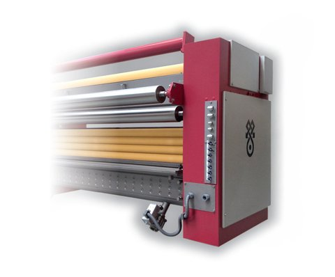

# 🧩 RollerDyeingMachine_v0.0.1.aasx

[← 장비 페이지](../README.md) · [⤓ AASX 다운로드](../AASX/RollerDyeingMachine_v0.0.1.aasx) · 544 KB

> 🤖 AASX 파일을 열어 자동으로 만든 열람 페이지입니다. 직접 고치지 말고 AASX를 다시 올리세요.

| 항목 | 내용 |
|---|---|
| AAS idShort | `DigitalNameplateAAS` |
| AAS id | https://admin-shell.io/idta/aas/DigitalNameplate/3/0 |
| 자산 종류 (assetKind) | Type |
| globalAssetId | https://admin-shell.io/idta/asset/DigitalNameplate/3/0 |
| 서브모델 | 1개 |
| 전체 요소 | 36개 |

## 서브모델 한눈에 보기

| # | 서브모델 | 요소 수 | semanticId |
|:-:|---|--:|---|
| 1 | [Nameplate](#sm-1) | 36 | https://admin-shell.io/idta/nameplate/3/0/Nameplate |

## 서브모델 상세

각 서브모델 이름을 누르면 펼쳐집니다. **굵은 글씨**는 하위 요소가 있는 묶음입니다.

<b>1. Nameplate</b> — 요소 36개

> Contains the nameplate information attached to the product

semanticId: `https://admin-shell.io/idta/nameplate/3/0/Nameplate`

| idShort | 종류 | 값 | semanticId |
|---|---|---|---|
| URIOfTheProduct | 속성 | https://www.domain-abc.com/Model-Nr-1234/Serial-Nr-5678 | 0112/2///61987#ABN590#002 |
| ManufacturerName | 다국어&nbsp;속성 | "Muster AG" | 0112/2///61987#ABA565#009 |
| ManufacturerProductDesignation | 다국어&nbsp;속성 | "ABC-123" | 0112/2///61987#ABA567#009 |
| AddressInformation | 묶음 |  | https://admin-shell.io/zvei/nameplate/1/0/ContactInformations/Address… |
| ManufacturerProductRoot | 다국어&nbsp;속성 | "flow meter" | 0112/2///61360_7#AAS011#001 |
| ManufacturerProductFamily | 다국어&nbsp;속성 | "Type ABC" | 0112/2///61987#ABP464#002 |
| ManufacturerProductType | 속성 | FM-ABC-1234 | 0112/2///61987#ABA300#008 |
| OrderCodeOfManufacturer | 속성 | FMABC1234 | 0112/2///61987#ABA950#008 |
| ProductArticleNumberOfManufacturer | 속성 | FM11-ABC22-123456 | 0112/2///61987#ABA581#007 |
| SerialNumber | 속성 | 12345678 | 0112/2///61987#ABA951#009 |
| YearOfConstruction | 속성 | 2022 | 0112/2///61987#ABP000#002 |
| DateOfManufacture | 속성 | 2022-01-01 | 0112/2///61987#ABB757#007 |
| HardwareVersion | 속성 | 1.0.0 | 0112/2///61987#ABA926#008 |
| FirmwareVersion | 속성 | 1.0.0 | 0112/2///61987#ABA302#006 |
| SoftwareVersion | 속성 | 1.0.0 | 0112/2///61987#ABA601#008 |
| CountryOfOrigin | 속성 | DE | 0112/2///61987#ABP462#001 |
| UniqueFacilityIdentifier | 속성 | 987654321 | https://admin-shell.io/idta/nameplate/3/0/UniqueFacilityIdentifier |
| CompanyLogo | 파일 |  | 0112/2///61987#ABP463#001 |
| **Markings** | 목록&nbsp;(1) |  | 0112/2///61360_7#AAS006#001 |
| &nbsp;&nbsp;&nbsp;└ **** | 묶음&nbsp;(6) |  | 0112/2///61360_7#AAS009#001 |
| &nbsp;&nbsp;&nbsp;&nbsp;&nbsp;&nbsp;└ MarkingName | 속성 | 0173-1#07-DAA603#004 | 0112/2///61987#ABA231#009 |
| &nbsp;&nbsp;&nbsp;&nbsp;&nbsp;&nbsp;└ DesignationOfCertificateOrApproval | 속성 | KEMA99IECEX1105/128 | 0112/2///61987#ABH783#003 |
| &nbsp;&nbsp;&nbsp;&nbsp;&nbsp;&nbsp;└ IssueDate | 속성 | 2022-01-01 | 0112/2///61987#ABO097#001 |
| &nbsp;&nbsp;&nbsp;&nbsp;&nbsp;&nbsp;└ ExpiryDate | 속성 | 2022-01-01 | 0112/2///61987#ABH830#002 |
| &nbsp;&nbsp;&nbsp;&nbsp;&nbsp;&nbsp;└ MarkingFile | 파일 |  | 0112/2///61987#ABO100#002 |
| &nbsp;&nbsp;&nbsp;&nbsp;&nbsp;&nbsp;└ MarkingAdditionalText | 속성 | 0044 | 0112/2///61987#ABB146#007 |
| **AssetSpecificProperties** | 묶음&nbsp;(4) |  | 0173-1#02-ABI218#003/0173-1#01-AGZ672#004 |
| &nbsp;&nbsp;&nbsp;└ ArbitraryProperty | 속성 |  | https://admin-shell.io/SMT/General/ArbitraryProp |
| &nbsp;&nbsp;&nbsp;└ ArbitraryMLP | 다국어&nbsp;속성 | "sample" | https://admin-shell.io/SMT/General/ArbitraryMLP |
| &nbsp;&nbsp;&nbsp;└ ArbitraryFile | 파일 |  | https://admin-shell.io/SMT/General/ArbitraryFile |
| &nbsp;&nbsp;&nbsp;└ **GuidelineSpecificProperties** | 목록&nbsp;(1) |  | 0173-1#02-ABI219#003/0173-1#01-AHD205#004 |
| &nbsp;&nbsp;&nbsp;&nbsp;&nbsp;&nbsp;└ **** | 묶음&nbsp;(4) |  | 0173-1#01-AHD205#004 |
| &nbsp;&nbsp;&nbsp;&nbsp;&nbsp;&nbsp;&nbsp;&nbsp;&nbsp;└ GuidelineForConformityDeclaration | 속성 |  | 0173-1#02-AAO856#002 |
| &nbsp;&nbsp;&nbsp;&nbsp;&nbsp;&nbsp;&nbsp;&nbsp;&nbsp;└ ArbitraryProperty | 속성 |  | https://admin-shell.io/SMT/General/ArbitraryProp |
| &nbsp;&nbsp;&nbsp;&nbsp;&nbsp;&nbsp;&nbsp;&nbsp;&nbsp;└ ArbitraryFile | 파일 |  | https://admin-shell.io/SMT/General/ArbitraryFile |
| &nbsp;&nbsp;&nbsp;&nbsp;&nbsp;&nbsp;&nbsp;&nbsp;&nbsp;└ ArbitraryMLP | 다국어&nbsp;속성 | "sample" | https://admin-shell.io/SMT/General/ArbitraryMLP |

