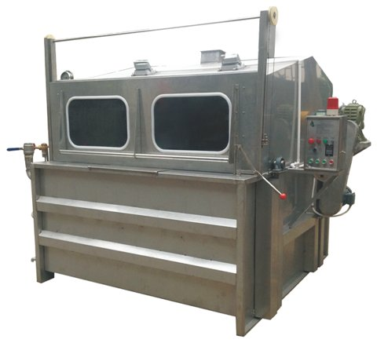

# 상압염색기

[전체 목록](../../../README.md) · 장비군: **염색 설비**

> 자동 생성 페이지입니다. 이 폴더에 파일을 올리면 내용이 갱신됩니다.

필수 산출물 1/3 · 개발계획서 없음 · 가이던스 없음 · AASX 있음

## 산출물

| 구분 | 파일 | 크기 | 보기 |
|---|---|---|---|
| 개발계획서 | 아직 없음 | | |
| 가이던스 | 아직 없음 | | |
| AASX | [AtmosphericDyeingMachine_v0.0.1_261005.aasx](AASX/AtmosphericDyeingMachine_v0.0.1_261005.aasx) | 669 KB | [열람 페이지](gen/AtmosphericDyeingMachine_v0.0.1_261005.md) |
| 시뮬레이션 | [상압염색기_그림_항목명_유지_v7.mp4](%EC%8B%9C%EB%AE%AC%EB%A0%88%EC%9D%B4%EC%85%98/%EC%83%81%EC%95%95%EC%97%BC%EC%83%89%EA%B8%B0_%EA%B7%B8%EB%A6%BC_%ED%95%AD%EB%AA%A9%EB%AA%85_%EC%9C%A0%EC%A7%80_v7.mp4) | 29.3 MB | 다운로드 후 재생 |
| 참고자료 | [참고링크.md](%EC%B0%B8%EA%B3%A0%EC%9E%90%EB%A3%8C/%EC%B0%B8%EA%B3%A0%EB%A7%81%ED%81%AC.md) | 7 KB | [보기](%EC%B0%B8%EA%B3%A0%EC%9E%90%EB%A3%8C/%EC%B0%B8%EA%B3%A0%EB%A7%81%ED%81%AC.md) |

## AAS 구성 — `AtmosphericDyeingMachine`

`AtmosphericDyeingMachine_v0.0.1_261005.aasx` 에서 읽은 서브모델 8개 · **[요소 전체 보기](gen/AtmosphericDyeingMachine_v0.0.1_261005.md)**:

| # | 서브모델 idShort |
|:-:|---|
| 1 | Nameplate |
| 2 | HandoverDocumentation |
| 3 | TechnicalData |
| 4 | OperationalData |
| 5 | ProcessParameters |
| 6 | PredictiveMaintenance |
| 7 | TimeSeries |
| 8 | ProcessVariablesForManufacturingKPICalculation |

변경 기록 (최근 7건)

| 날짜 | 변경 | 파일 |
|---|---|---|
| 2026-11-04 | 삭제 | 상압염색기_가이던스(자리표시).docx |
| 2026-11-04 | 삭제 | 상압염색기_개발계획서(자리표시).docx |
| 2026-11-03 | 추가 | AtmosphericDyeingMachine_v0.0.1_261005.aasx |
| 2026-11-03 | 추가 | 상압염색기_가이던스(자리표시).docx |
| 2026-11-03 | 추가 | 상압염색기_개발계획서(자리표시).docx |
| 2026-11-03 | 추가 | 상압염색기_그림_항목명_유지_v7.mp4 |
| 2026-11-03 | 추가 | 참고링크.md |

