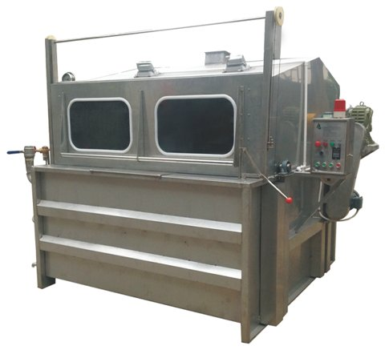

# AtmosphericDyeingMachine_v0.0.1_261005.aasx

[장비 페이지](../README.md) · [AASX 다운로드](../AASX/AtmosphericDyeingMachine_v0.0.1_261005.aasx) · 669 KB

> AASX 파일을 열어 자동으로 만든 열람 페이지입니다. 직접 고치지 말고 AASX를 다시 올리세요.

| 항목 | 내용 |
|---|---|
| AAS idShort | `AtmosphericDyeingMachine` |
| AAS id | https://www.smart-factory.kr/ids/aas/AtmosphericDyeingMachine/1/0 |
| 자산 종류 (assetKind) | Type |
| globalAssetId | https://www.smart-factory.kr/ids/asset/AWM300Example/1/0 |
| 설명 | 상압 권취식(윈치) 염색기의 제조데이터 표준 참조모델. AWM-300 관련 값은 비식별 합성 예시이다. |
| 서브모델 | 8개 |
| 전체 요소 | 322개 |

## 서브모델 한눈에 보기

| # | 서브모델 | 요소 수 | semanticId |
|:-:|---|--:|---|
| 1 | [Nameplate](#sm-1) | 22 | https://admin-shell.io/idta/nameplate/3/0/Nameplate |
| 2 | [HandoverDocumentation](#sm-2) | 25 | 0173-1#01-AHF578#003 |
| 3 | [TechnicalData](#sm-3) | 59 | 0173-1#01-AHX837#002 |
| 4 | [OperationalData](#sm-4) | 32 | https://www.smart-factory.kr/ids/sm/AtmosphericDyeingMachine/OperationalData/1/0 |
| 5 | [ProcessParameters](#sm-5) | 30 | https://admin-shell-io/idta/SubmodelTemplate/ProcessParameters/1/0 |
| 6 | [PredictiveMaintenance](#sm-6) | 29 | https://admin-shell.io/idta/SubmodelTemplate/PredictiveMaintenance/1/0 |
| 7 | [TimeSeries](#sm-7) | 45 | https://admin-shell.io/idta/TimeSeries/1/1 |
| 8 | [ProcessVariablesForManufacturingKPICalculation](#sm-8) | 80 | https://admin-shell.io/idta/SubmodelTemplate/ProcessVariablesForManufacturingKPICalculati… |

## 서브모델 상세

각 서브모델 이름을 누르면 펼쳐집니다. **굵은 글씨**는 하위 요소가 있는 묶음입니다.

<b>1. Nameplate</b> — 요소 22개

> 상압 권취식(윈치) 염색기 AWM-300의 Digital Nameplate 참조 구조. 값은 비식별 합성 예시이다.

semanticId: `https://admin-shell.io/idta/nameplate/3/0/Nameplate`

| idShort | 종류 | 값 | semanticId |
|---|---|---|---|
| URIOfTheProduct | 속성 | https://www.smart-factory.kr/ids/asset/AWM300Example/1/0 | 0112/2///61987#ABN590#002 |
| ManufacturerName | 다국어&nbsp;속성 | Example Textile Equipment | 0112/2///61987#ABA565#009 |
| ManufacturerProductDesignation | 다국어&nbsp;속성 | Atmospheric Winch Dyeing Machine | 0112/2///61987#ABA567#009 |
| ManufacturerProductRoot | 다국어&nbsp;속성 | Textile finishing machine | 0112/2///61360_7#AAS011#001 |
| ManufacturerProductFamily | 다국어&nbsp;속성 | AWM Series | 0112/2///61987#ABP464#002 |
| ManufacturerProductType | 속성 | AWM-300 | 0112/2///61987#ABA300#008 |
| OrderCodeOfManufacturer | 속성 | AWM-300-STD | 0112/2///61987#ABA950#008 |
| ProductArticleNumberOfManufacturer | 속성 | ART-AWM-300 | 0112/2///61987#ABA581#007 |
| SerialNumber | 속성 | AWM300-EX-0001 | 0112/2///61987#ABA951#009 |
| YearOfConstruction | 속성 | 2024 | 0112/2///61987#ABP000#002 |
| DateOfManufacture | 속성 | 2024-01-15 | 0112/2///61987#ABB757#007 |
| HardwareVersion | 속성 | 1.0 | 0112/2///61987#ABA926#008 |
| FirmwareVersion | 속성 | 1.0 | 0112/2///61987#ABA302#006 |
| SoftwareVersion | 속성 | 1.0 | 0112/2///61987#ABA601#008 |
| CountryOfOrigin | 속성 | KR | 0112/2///61987#ABP462#001 |
| UniqueFacilityIdentifier | 속성 | EXAMPLE-TEXTILE-PLANT-01 | https://admin-shell.io/idta/nameplate/3/0/UniqueFacilityIdentifier |
| CompanyLogo | 파일 | /aasx/files/images/company_logo.png | 0112/2///61987#ABP463#001 |
| **AddressInformation** | 묶음&nbsp;(4) |  | https://admin-shell.io/zvei/nameplate/1/0/ContactInformations/Address… |
| &nbsp;&nbsp;&nbsp;└ Street | 다국어&nbsp;속성 | 100 Example Street | 0173-1#02-AAO128#002 |
| &nbsp;&nbsp;&nbsp;└ Zipcode | 다국어&nbsp;속성 | 12345 | 0173-1#02-AAO129#002 |
| &nbsp;&nbsp;&nbsp;└ CityTown | 다국어&nbsp;속성 | Example City | 0173-1#02-AAO132#002 |
| &nbsp;&nbsp;&nbsp;└ NationalCode | 다국어&nbsp;속성 | KR | 0173-1#02-AAO134#002 |

<b>2. HandoverDocumentation</b> — 요소 25개

> 상압 권취식(윈치) 염색기 AWM-300의 Handover Documentation 참조 구조. 값은 비식별 합성 예시이다.

semanticId: `0173-1#01-AHF578#003`

| idShort | 종류 | 값 | semanticId |
|---|---|---|---|
| **Documents** | 목록&nbsp;(1) |  | 0173-1#02-ABI500#003 |
| &nbsp;&nbsp;&nbsp;└ **** | 묶음&nbsp;(3) |  | 0173-1#02-ABI500#003/0173-1#01-AHF579#003 |
| &nbsp;&nbsp;&nbsp;&nbsp;&nbsp;&nbsp;└ **DocumentIds** | 목록&nbsp;(1) |  | 0173-1#02-ABI501#003 |
| &nbsp;&nbsp;&nbsp;&nbsp;&nbsp;&nbsp;&nbsp;&nbsp;&nbsp;└ **** | 묶음&nbsp;(3) |  | 0173-1#02-ABI501#003/0173-1#01-AHF580#003 |
| &nbsp;&nbsp;&nbsp;&nbsp;&nbsp;&nbsp;&nbsp;&nbsp;&nbsp;&nbsp;&nbsp;&nbsp;└ DocumentDomainId | 속성 | ExampleTextileEquipment | 0173-1#02-ABH994#003 |
| &nbsp;&nbsp;&nbsp;&nbsp;&nbsp;&nbsp;&nbsp;&nbsp;&nbsp;&nbsp;&nbsp;&nbsp;└ DocumentIdentifier | 속성 | AWM-300-OP-001 | 0173-1#02-AAO099#004 |
| &nbsp;&nbsp;&nbsp;&nbsp;&nbsp;&nbsp;&nbsp;&nbsp;&nbsp;&nbsp;&nbsp;&nbsp;└ DocumentIsPrimary | 속성 | true | 0173-1#02-ABH995#003 |
| &nbsp;&nbsp;&nbsp;&nbsp;&nbsp;&nbsp;└ **DocumentClassifications** | 목록&nbsp;(1) |  | 0173-1#02-ABI502#003 |
| &nbsp;&nbsp;&nbsp;&nbsp;&nbsp;&nbsp;&nbsp;&nbsp;&nbsp;└ **** | 묶음&nbsp;(3) |  | 0173-1#02-ABI502#003/0173-1#01-AHF581#003 |
| &nbsp;&nbsp;&nbsp;&nbsp;&nbsp;&nbsp;&nbsp;&nbsp;&nbsp;&nbsp;&nbsp;&nbsp;└ ClassId | 속성 | 03-02 | 0173-1#02-ABH996#003 |
| &nbsp;&nbsp;&nbsp;&nbsp;&nbsp;&nbsp;&nbsp;&nbsp;&nbsp;&nbsp;&nbsp;&nbsp;└ ClassName | 다국어&nbsp;속성 | Operation | 0173-1#02-ABJ219#002 |
| &nbsp;&nbsp;&nbsp;&nbsp;&nbsp;&nbsp;&nbsp;&nbsp;&nbsp;&nbsp;&nbsp;&nbsp;└ ClassificationSystem | 속성 | VDI2770 | 0173-1#02-ABH997#003 |
| &nbsp;&nbsp;&nbsp;&nbsp;&nbsp;&nbsp;└ **DocumentVersions** | 목록&nbsp;(1) |  | 0173-1#02-ABI503#003 |
| &nbsp;&nbsp;&nbsp;&nbsp;&nbsp;&nbsp;&nbsp;&nbsp;&nbsp;└ **** | 묶음&nbsp;(9) |  | 0173-1#02-ABI503#003/0173-1#01-AHF582#003 |
| &nbsp;&nbsp;&nbsp;&nbsp;&nbsp;&nbsp;&nbsp;&nbsp;&nbsp;&nbsp;&nbsp;&nbsp;└ Version | 속성 | 1.0 | 0173-1#02-AAP003#005 |
| &nbsp;&nbsp;&nbsp;&nbsp;&nbsp;&nbsp;&nbsp;&nbsp;&nbsp;&nbsp;&nbsp;&nbsp;└ Title | 다국어&nbsp;속성 | 상압 권취식 염색기 운영정보 예시 | 0173-1#02-ABG940#003 |
| &nbsp;&nbsp;&nbsp;&nbsp;&nbsp;&nbsp;&nbsp;&nbsp;&nbsp;&nbsp;&nbsp;&nbsp;└ Description | 다국어&nbsp;속성 | 참조모델의 구성·운전·데이터 수집 범위를 설명하는 합성 문서 | 0173-1#02-AAN466#004 |
| &nbsp;&nbsp;&nbsp;&nbsp;&nbsp;&nbsp;&nbsp;&nbsp;&nbsp;&nbsp;&nbsp;&nbsp;└ StatusSetDate | 속성 | 2026-10-05 | 0173-1#02-ABI000#003 |
| &nbsp;&nbsp;&nbsp;&nbsp;&nbsp;&nbsp;&nbsp;&nbsp;&nbsp;&nbsp;&nbsp;&nbsp;└ StatusValue | 속성 | Released | 0173-1#02-ABI001#003 |
| &nbsp;&nbsp;&nbsp;&nbsp;&nbsp;&nbsp;&nbsp;&nbsp;&nbsp;&nbsp;&nbsp;&nbsp;└ OrganizationShortName | 속성 | ExampleTextileEquipment | https://api.eclass-cdp.com/0173-1-02-ABI002-003 |
| &nbsp;&nbsp;&nbsp;&nbsp;&nbsp;&nbsp;&nbsp;&nbsp;&nbsp;&nbsp;&nbsp;&nbsp;└ OrganizationOfficialName | 속성 | Example Textile Equipment | 0173-1#02-ABI004#003 |
| &nbsp;&nbsp;&nbsp;&nbsp;&nbsp;&nbsp;&nbsp;&nbsp;&nbsp;&nbsp;&nbsp;&nbsp;└ **Language** | 목록&nbsp;(1) |  | 0173-1#02-AAN468#008 |
| &nbsp;&nbsp;&nbsp;&nbsp;&nbsp;&nbsp;&nbsp;&nbsp;&nbsp;&nbsp;&nbsp;&nbsp;&nbsp;&nbsp;&nbsp;└  | 속성 | ko | 0173-1#02-AAN468#008 |
| &nbsp;&nbsp;&nbsp;&nbsp;&nbsp;&nbsp;&nbsp;&nbsp;&nbsp;&nbsp;&nbsp;&nbsp;└ **DigitalFiles** | 목록&nbsp;(1) |  | 0173-1#02-ABK126#002 |
| &nbsp;&nbsp;&nbsp;&nbsp;&nbsp;&nbsp;&nbsp;&nbsp;&nbsp;&nbsp;&nbsp;&nbsp;&nbsp;&nbsp;&nbsp;└  | 파일 | /aasx/files/documents/AtmosphericWinchDyeing_OperatingInformation_ko.txt | 0173-1#02-ABK126#002 |

<b>3. TechnicalData</b> — 요소 59개

> 상압 권취식(윈치) 염색기 AWM-300의 Technical Data 참조 구조. 값은 비식별 합성 예시이다.

semanticId: `0173-1#01-AHX837#002`

| idShort | 종류 | 값 | semanticId |
|---|---|---|---|
| **GeneralInformation** | 묶음&nbsp;(6) |  | 0173-1#02-ABK161#002/0173-1#01-AHX838#002 |
| &nbsp;&nbsp;&nbsp;└ ManufacturerName | 속성 | Example Textile Equipment | 0173-1#02-AAO677#004 |
| &nbsp;&nbsp;&nbsp;└ CompanyLogo | 파일 | /aasx/files/images/company_logo.png | 0173-1#02-ABI776#002 |
| &nbsp;&nbsp;&nbsp;└ ManufacturerProductDesignation | 다국어&nbsp;속성 | Atmospheric Winch Dyeing Machine | 0173-1#02-AAW338#003 |
| &nbsp;&nbsp;&nbsp;└ ManufacturerArticleNumber | 속성 | ART-AWM-300 | 0173-1#02-AAO676#005 |
| &nbsp;&nbsp;&nbsp;└ ManufacturerOrderCode | 속성 | AWM-300-STD | 0173-1#02-AAO227#004 |
| &nbsp;&nbsp;&nbsp;└ **ProductImages** | 목록&nbsp;(1) |  | 0173-1#02-ABM220#001 |
| &nbsp;&nbsp;&nbsp;&nbsp;&nbsp;&nbsp;└ **** | 묶음&nbsp;(2) |  | 0173-1#02-ABM220#001/0173-1#01-AHY911#001 |
| &nbsp;&nbsp;&nbsp;&nbsp;&nbsp;&nbsp;&nbsp;&nbsp;&nbsp;└ ImageFile | 파일 | /aasx/files/images/Jianye_AtmosphericRope_Reference.png | 0173-1#02-ABK291#002 |
| &nbsp;&nbsp;&nbsp;&nbsp;&nbsp;&nbsp;&nbsp;&nbsp;&nbsp;└ ImageNote | 다국어&nbsp;속성 | Reference photograph of a Jianye GE-series atmospheric rope dyeing machine; not… | 0173-1#02-ABL423#001 |
| **ProductClassifications** | 목록&nbsp;(1) |  | 0173-1#02-ABK162#002 |
| &nbsp;&nbsp;&nbsp;└ **** | 묶음&nbsp;(6) |  | 0173-1#02-ABK162#002/0173-1#01-AHX839#002 |
| &nbsp;&nbsp;&nbsp;&nbsp;&nbsp;&nbsp;└ ClassificationSystem | 속성 | ECLASS | 0173-1#02-ABL424#001 |
| &nbsp;&nbsp;&nbsp;&nbsp;&nbsp;&nbsp;└ ClassificationSystemVersion | 속성 | 16.0 | 0173-1#02-AAR710#003 |
| &nbsp;&nbsp;&nbsp;&nbsp;&nbsp;&nbsp;└ ClassificationSystemUrl | 속성 | https://eclass.eu | https://admin-shell.io/IDTA/TechnicalData/ProductClassifications/Prod… |
| &nbsp;&nbsp;&nbsp;&nbsp;&nbsp;&nbsp;└ ProductClassId | 속성 | 0173-1#01-AKJ695#012 | 0173-1#02-ABG776#003 |
| &nbsp;&nbsp;&nbsp;&nbsp;&nbsp;&nbsp;└ ProductClassCodedName | 속성 | 17-02-13-00 | 0173-1#02-ABK128#002 |
| &nbsp;&nbsp;&nbsp;&nbsp;&nbsp;&nbsp;└ ProductClassName | 다국어&nbsp;속성 | Machine for textile finishing | 0173-1#02-ABK273#002 |
| **TechnicalPropertyAreas** | 목록&nbsp;(1) |  | 0173-1#02-ABK163#002 |
| &nbsp;&nbsp;&nbsp;└ **** | 묶음&nbsp;(5) |  | 0173-1#02-ABL358#002/0173-1#01-AHX773#002 |
| &nbsp;&nbsp;&nbsp;&nbsp;&nbsp;&nbsp;└ **MachineOverview** | 묶음&nbsp;(2) |  | https://www.smart-factory.kr/ids/cd/MachineOverview/1/0 |
| &nbsp;&nbsp;&nbsp;&nbsp;&nbsp;&nbsp;&nbsp;&nbsp;&nbsp;└ **EquipmentDesign** | 묶음&nbsp;(4) |  | https://www.smart-factory.kr/ids/cd/EquipmentDesign/1/0 |
| &nbsp;&nbsp;&nbsp;&nbsp;&nbsp;&nbsp;&nbsp;&nbsp;&nbsp;&nbsp;&nbsp;&nbsp;└ DyeingMachineType | 속성 | AtmosphericWinch | https://www.smart-factory.kr/ids/cd/DyeingMachineType/1/0 |
| &nbsp;&nbsp;&nbsp;&nbsp;&nbsp;&nbsp;&nbsp;&nbsp;&nbsp;&nbsp;&nbsp;&nbsp;└ HeatingMethod | 속성 | IndirectSteamCoil | https://www.smart-factory.kr/ids/cd/HeatingMethod/1/0 |
| &nbsp;&nbsp;&nbsp;&nbsp;&nbsp;&nbsp;&nbsp;&nbsp;&nbsp;&nbsp;&nbsp;&nbsp;└ ControlSystemType | 속성 | PLC_HMI | https://www.smart-factory.kr/ids/cd/ControlSystemType/1/0 |
| &nbsp;&nbsp;&nbsp;&nbsp;&nbsp;&nbsp;&nbsp;&nbsp;&nbsp;&nbsp;&nbsp;&nbsp;└ MachineWeight | 속성 | 6500 | 0173-1#02-AAS707#005 |
| &nbsp;&nbsp;&nbsp;&nbsp;&nbsp;&nbsp;&nbsp;&nbsp;&nbsp;└ **TextileApplicability** | 묶음&nbsp;(2) |  | https://www.smart-factory.kr/ids/cd/TextileApplicability/1/0 |
| &nbsp;&nbsp;&nbsp;&nbsp;&nbsp;&nbsp;&nbsp;&nbsp;&nbsp;&nbsp;&nbsp;&nbsp;└ DyeingTarget | 속성 | RopeFormFabric | https://www.smart-factory.kr/ids/cd/DyeingTarget/1/0 |
| &nbsp;&nbsp;&nbsp;&nbsp;&nbsp;&nbsp;&nbsp;&nbsp;&nbsp;&nbsp;&nbsp;&nbsp;└ FiberApplicability | 속성 | CottonWovenFabric | https://www.smart-factory.kr/ids/cd/FiberApplicability/1/0 |
| &nbsp;&nbsp;&nbsp;&nbsp;&nbsp;&nbsp;└ **DyeingVesselSpecifications** | 묶음&nbsp;(2) |  | https://www.smart-factory.kr/ids/cd/DyeingVesselSpecifications/1/0 |
| &nbsp;&nbsp;&nbsp;&nbsp;&nbsp;&nbsp;&nbsp;&nbsp;&nbsp;└ **BatchAndBathCapacity** | 묶음&nbsp;(3) |  | https://www.smart-factory.kr/ids/cd/BatchAndBathCapacity/1/0 |
| &nbsp;&nbsp;&nbsp;&nbsp;&nbsp;&nbsp;&nbsp;&nbsp;&nbsp;&nbsp;&nbsp;&nbsp;└ NominalFabricLoad | 속성 | 300 | https://www.smart-factory.kr/ids/cd/NominalFabricLoad/1/0 |
| &nbsp;&nbsp;&nbsp;&nbsp;&nbsp;&nbsp;&nbsp;&nbsp;&nbsp;&nbsp;&nbsp;&nbsp;└ BathVolume | 속성 | 4.0 | 0173-1#02-BAE203#007 |
| &nbsp;&nbsp;&nbsp;&nbsp;&nbsp;&nbsp;&nbsp;&nbsp;&nbsp;&nbsp;&nbsp;&nbsp;└ LiquorRatio | 속성 | 1:10 | https://www.smart-factory.kr/ids/cd/LiquorRatio/1/0 |
| &nbsp;&nbsp;&nbsp;&nbsp;&nbsp;&nbsp;&nbsp;&nbsp;&nbsp;└ **ChamberAndFabricGeometry** | 묶음&nbsp;(2) |  | https://www.smart-factory.kr/ids/cd/ChamberAndFabricGeometry/1/0 |
| &nbsp;&nbsp;&nbsp;&nbsp;&nbsp;&nbsp;&nbsp;&nbsp;&nbsp;&nbsp;&nbsp;&nbsp;└ NumberOfChambers | 속성 | 1 | https://www.smart-factory.kr/ids/cd/NumberOfChambers/1/0 |
| &nbsp;&nbsp;&nbsp;&nbsp;&nbsp;&nbsp;&nbsp;&nbsp;&nbsp;&nbsp;&nbsp;&nbsp;└ MaxFabricWidth | 속성 | 1800 | https://www.smart-factory.kr/ids/cd/MaxFabricWidth/1/0 |
| &nbsp;&nbsp;&nbsp;&nbsp;&nbsp;&nbsp;└ **ThermalSpecifications** | 묶음&nbsp;(2) |  | https://www.smart-factory.kr/ids/cd/ThermalSpecifications/1/0 |
| &nbsp;&nbsp;&nbsp;&nbsp;&nbsp;&nbsp;&nbsp;&nbsp;&nbsp;└ **TemperatureEnvelope** | 묶음&nbsp;(2) |  | https://www.smart-factory.kr/ids/cd/TemperatureEnvelope/1/0 |
| &nbsp;&nbsp;&nbsp;&nbsp;&nbsp;&nbsp;&nbsp;&nbsp;&nbsp;&nbsp;&nbsp;&nbsp;└ MaxProcessTemperature | 속성 | 98 | 0173-1#02-AAN307#007 |
| &nbsp;&nbsp;&nbsp;&nbsp;&nbsp;&nbsp;&nbsp;&nbsp;&nbsp;&nbsp;&nbsp;&nbsp;└ MinProcessTemperature | 속성 | 5 | 0173-1#02-AAN309#007 |
| &nbsp;&nbsp;&nbsp;&nbsp;&nbsp;&nbsp;&nbsp;&nbsp;&nbsp;└ **ThermalDynamicsAndSteamSupply** | 묶음&nbsp;(3) |  | https://www.smart-factory.kr/ids/cd/ThermalDynamicsAndSteamSupply/1/0 |
| &nbsp;&nbsp;&nbsp;&nbsp;&nbsp;&nbsp;&nbsp;&nbsp;&nbsp;&nbsp;&nbsp;&nbsp;└ HeatingRate | 속성 | 2.0 | https://www.smart-factory.kr/ids/cd/HeatingRate/1/0 |
| &nbsp;&nbsp;&nbsp;&nbsp;&nbsp;&nbsp;&nbsp;&nbsp;&nbsp;&nbsp;&nbsp;&nbsp;└ CoolingRate | 속성 | 1.5 | https://www.smart-factory.kr/ids/cd/CoolingRate/1/0 |
| &nbsp;&nbsp;&nbsp;&nbsp;&nbsp;&nbsp;&nbsp;&nbsp;&nbsp;&nbsp;&nbsp;&nbsp;└ SteamSupplyPressure | 속성 | 0.5 | https://www.smart-factory.kr/ids/cd/SteamSupplyPressure/1/0 |
| &nbsp;&nbsp;&nbsp;&nbsp;&nbsp;&nbsp;└ **CirculationSpecifications** | 묶음&nbsp;(2) |  | https://www.smart-factory.kr/ids/cd/CirculationSpecifications/1/0 |
| &nbsp;&nbsp;&nbsp;&nbsp;&nbsp;&nbsp;&nbsp;&nbsp;&nbsp;└ **ReelAssembly** | 묶음&nbsp;(2) |  | https://www.smart-factory.kr/ids/cd/ReelAssembly/1/0 |
| &nbsp;&nbsp;&nbsp;&nbsp;&nbsp;&nbsp;&nbsp;&nbsp;&nbsp;&nbsp;&nbsp;&nbsp;└ ReelDiameter | 속성 | 600 | https://www.smart-factory.kr/ids/cd/ReelDiameter/1/0 |
| &nbsp;&nbsp;&nbsp;&nbsp;&nbsp;&nbsp;&nbsp;&nbsp;&nbsp;&nbsp;&nbsp;&nbsp;└ NumberOfReels | 속성 | 1 | https://www.smart-factory.kr/ids/cd/NumberOfReels/1/0 |
| &nbsp;&nbsp;&nbsp;&nbsp;&nbsp;&nbsp;&nbsp;&nbsp;&nbsp;└ **CirculationPerformance** | 묶음&nbsp;(2) |  | https://www.smart-factory.kr/ids/cd/CirculationPerformance/1/0 |
| &nbsp;&nbsp;&nbsp;&nbsp;&nbsp;&nbsp;&nbsp;&nbsp;&nbsp;&nbsp;&nbsp;&nbsp;└ ReelSpeed | 속성 | 1.0 | 0173-1#02-BAA610#007 |
| &nbsp;&nbsp;&nbsp;&nbsp;&nbsp;&nbsp;&nbsp;&nbsp;&nbsp;&nbsp;&nbsp;&nbsp;└ LiquorCirculationRate | 속성 | 20 | https://www.smart-factory.kr/ids/cd/LiquorCirculationRate/1/0 |
| &nbsp;&nbsp;&nbsp;&nbsp;&nbsp;&nbsp;└ **ElectricalAndInstallationSpecifications** | 묶음&nbsp;(2) |  | https://www.smart-factory.kr/ids/cd/ElectricalAndInstallationSpecific… |
| &nbsp;&nbsp;&nbsp;&nbsp;&nbsp;&nbsp;&nbsp;&nbsp;&nbsp;└ **PowerSupply** | 묶음&nbsp;(2) |  | https://www.smart-factory.kr/ids/cd/PowerSupply/1/0 |
| &nbsp;&nbsp;&nbsp;&nbsp;&nbsp;&nbsp;&nbsp;&nbsp;&nbsp;&nbsp;&nbsp;&nbsp;└ RatedVoltage | 속성 | 380 | 0173-1#02-ABM190#001 |
| &nbsp;&nbsp;&nbsp;&nbsp;&nbsp;&nbsp;&nbsp;&nbsp;&nbsp;&nbsp;&nbsp;&nbsp;└ RatedPowerInput | 속성 | 25000 | 0173-1#02-AAC970#010 |
| &nbsp;&nbsp;&nbsp;&nbsp;&nbsp;&nbsp;&nbsp;&nbsp;&nbsp;└ **ProtectionAndInstallation** | 묶음&nbsp;(2) |  | https://www.smart-factory.kr/ids/cd/ProtectionAndInstallation/1/0 |
| &nbsp;&nbsp;&nbsp;&nbsp;&nbsp;&nbsp;&nbsp;&nbsp;&nbsp;&nbsp;&nbsp;&nbsp;└ ProtectionClassIP | 속성 | IP54 | 0173-1#02-BAG975#017 |
| &nbsp;&nbsp;&nbsp;&nbsp;&nbsp;&nbsp;&nbsp;&nbsp;&nbsp;&nbsp;&nbsp;&nbsp;└ InstallationType | 속성 | IndoorFloorMounted | https://www.smart-factory.kr/ids/cd/InstallationType/1/0 |

<b>4. OperationalData</b> — 요소 32개

> 상압 권취식(윈치) 염색기 AWM-300의 Operational Data 참조 구조. 값은 비식별 합성 예시이다.

semanticId: `https://www.smart-factory.kr/ids/sm/AtmosphericDyeingMachine/OperationalData/1/0`

| idShort | 종류 | 값 | semanticId |
|---|---|---|---|
| **RuntimeStatus** | 묶음&nbsp;(2) |  | https://www.smart-factory.kr/ids/cd/RuntimeStatus/1/0 |
| &nbsp;&nbsp;&nbsp;└ **ControlExecution** | 묶음&nbsp;(2) |  | https://www.smart-factory.kr/ids/cd/ControlExecution/1/0 |
| &nbsp;&nbsp;&nbsp;&nbsp;&nbsp;&nbsp;└ DyeingOperationState | 속성 | Run | https://www.smart-factory.kr/ids/cd/DyeingOperationState/1/0 |
| &nbsp;&nbsp;&nbsp;&nbsp;&nbsp;&nbsp;└ DyeingOperationMode | 속성 | Auto | https://www.smart-factory.kr/ids/cd/DyeingOperationMode/1/0 |
| &nbsp;&nbsp;&nbsp;└ **RecipeExecution** | 묶음&nbsp;(2) |  | https://www.smart-factory.kr/ids/cd/RecipeExecution/1/0 |
| &nbsp;&nbsp;&nbsp;&nbsp;&nbsp;&nbsp;└ DyeingPhase | 속성 | Dyeing | https://www.smart-factory.kr/ids/cd/DyeingPhase/1/0 |
| &nbsp;&nbsp;&nbsp;&nbsp;&nbsp;&nbsp;└ CurrentRecipeId | 속성 | ATM-RCP-012 | https://www.smart-factory.kr/ids/cd/CurrentRecipeId/1/0 |
| **MeasuredValues** | 묶음&nbsp;(3) |  | https://www.smart-factory.kr/ids/cd/MeasuredValues/1/0 |
| &nbsp;&nbsp;&nbsp;└ **DyeBathConditions** | 묶음&nbsp;(3) |  | https://www.smart-factory.kr/ids/cd/DyeBathConditions/1/0 |
| &nbsp;&nbsp;&nbsp;&nbsp;&nbsp;&nbsp;└ MeasuredBathTemperature | 속성 | 60.0 | 0173-1#02-ABC736#004 |
| &nbsp;&nbsp;&nbsp;&nbsp;&nbsp;&nbsp;└ MeasuredBathPH | 속성 | 10.5 | 0173-1#02-BAB609#008 |
| &nbsp;&nbsp;&nbsp;&nbsp;&nbsp;&nbsp;└ MeasuredLiquorLevel | 속성 | 75.0 | https://www.smart-factory.kr/ids/cd/MeasuredLiquorLevel/1/0 |
| &nbsp;&nbsp;&nbsp;└ **FabricAndLiquorCirculationState** | 묶음&nbsp;(2) |  | https://www.smart-factory.kr/ids/cd/FabricAndLiquorCirculationState/1… |
| &nbsp;&nbsp;&nbsp;&nbsp;&nbsp;&nbsp;└ MeasuredCirculationFlow | 속성 | 18.0 | https://www.smart-factory.kr/ids/cd/MeasuredCirculationFlow/1/0 |
| &nbsp;&nbsp;&nbsp;&nbsp;&nbsp;&nbsp;└ MeasuredReelSpeed | 속성 | 0.9166667 | 0173-1#02-BAA610#007 |
| &nbsp;&nbsp;&nbsp;└ **CirculationPumpCondition** | 묶음&nbsp;(2) |  | https://www.smart-factory.kr/ids/cd/CirculationPumpCondition/1/0 |
| &nbsp;&nbsp;&nbsp;&nbsp;&nbsp;&nbsp;└ MeasuredPumpVibrationRMS | 속성 | 3.2 | https://www.smart-factory.kr/ids/cd/MeasuredPumpVibrationRMS/1/0 |
| &nbsp;&nbsp;&nbsp;&nbsp;&nbsp;&nbsp;└ MeasuredPumpMotorCurrent | 속성 | 8.1 | 0173-1#02-ABC231#004 |
| **Alarms** | 묶음&nbsp;(2) |  | https://www.smart-factory.kr/ids/cd/Alarms/1/0 |
| &nbsp;&nbsp;&nbsp;└ **ActiveAlarm** | 묶음&nbsp;(3) |  | https://www.smart-factory.kr/ids/cd/ActiveAlarm/1/0 |
| &nbsp;&nbsp;&nbsp;&nbsp;&nbsp;&nbsp;└ DyeingAlarmCode | 속성 | 0 | 0173-1#02-ABI766#002 |
| &nbsp;&nbsp;&nbsp;&nbsp;&nbsp;&nbsp;└ DyeingAlarmText | 다국어&nbsp;속성 | 정상 | https://www.smart-factory.kr/ids/cd/DyeingAlarmText/1/0 |
| &nbsp;&nbsp;&nbsp;&nbsp;&nbsp;&nbsp;└ DyeingAlarmSeverity | 속성 | None | https://www.smart-factory.kr/ids/cd/DyeingAlarmSeverity/1/0 |
| &nbsp;&nbsp;&nbsp;└ **AlarmHistory** | 묶음&nbsp;(1) |  | https://www.smart-factory.kr/ids/cd/AlarmHistory/1/0 |
| &nbsp;&nbsp;&nbsp;&nbsp;&nbsp;&nbsp;└ LastAlarmTimestamp | 속성 | 2026-09-29T09:14:22Z | https://www.smart-factory.kr/ids/cd/LastAlarmTimestamp/1/0 |
| **Counters** | 묶음&nbsp;(2) |  | https://www.smart-factory.kr/ids/cd/Counters/1/0 |
| &nbsp;&nbsp;&nbsp;└ **ProductionUsage** | 묶음&nbsp;(2) |  | https://www.smart-factory.kr/ids/cd/ProductionUsage/1/0 |
| &nbsp;&nbsp;&nbsp;&nbsp;&nbsp;&nbsp;└ CumulativeOperatingHours | 속성 | 11200 | https://www.smart-factory.kr/ids/cd/CumulativeOperatingHours/1/0 |
| &nbsp;&nbsp;&nbsp;&nbsp;&nbsp;&nbsp;└ CumulativeBatchCount | 속성 | 2600 | https://www.smart-factory.kr/ids/cd/CumulativeBatchCount/1/0 |
| &nbsp;&nbsp;&nbsp;└ **ResourceAndMaintenanceUsage** | 묶음&nbsp;(2) |  | https://www.smart-factory.kr/ids/cd/ResourceAndMaintenanceUsage/1/0 |
| &nbsp;&nbsp;&nbsp;&nbsp;&nbsp;&nbsp;└ CumulativeSteamConsumption | 속성 | 1800 | https://www.smart-factory.kr/ids/cd/CumulativeSteamConsumption/1/0 |
| &nbsp;&nbsp;&nbsp;&nbsp;&nbsp;&nbsp;└ MaintenanceCycleCount | 속성 | 22 | https://www.smart-factory.kr/ids/cd/MaintenanceCycleCount/1/0 |

<b>5. ProcessParameters</b> — 요소 30개

> 상압 권취식(윈치) 염색기 AWM-300의 Process Parameters Type 참조 구조. 값은 비식별 합성 예시이다.

semanticId: `https://admin-shell-io/idta/SubmodelTemplate/ProcessParameters/1/0`

| idShort | 종류 | 값 | semanticId |
|---|---|---|---|
| **Processes** | 묶음&nbsp;(1) |  | https://admin-shell.io/idta/ProcessParameters/Processes/1/0 |
| &nbsp;&nbsp;&nbsp;└ **Process__00__** | 묶음&nbsp;(8) |  | https://admin-shell.io/idta/ProcessParameters/Process/1/0 |
| &nbsp;&nbsp;&nbsp;&nbsp;&nbsp;&nbsp;└ ProcessId | 속성 | ATM-DYE-001 | https://admin-shell.io/idta/ProcessParameters/ProcessId/1/0 |
| &nbsp;&nbsp;&nbsp;&nbsp;&nbsp;&nbsp;└ ProcessName | 속성 | Cotton Reactive Winch Dyeing | https://admin-shell.io/idta/ProcessParameters/ProcessName/1/0 |
| &nbsp;&nbsp;&nbsp;&nbsp;&nbsp;&nbsp;└ ProcessDescription | 다국어&nbsp;속성 | 면 직물 300 kg, 상압 윈치, 반응성 염료 레시피 | https://admin-shell.io/idta/ProcessParameters/ProcessDescription/1/0 |
| &nbsp;&nbsp;&nbsp;&nbsp;&nbsp;&nbsp;└ PlannedProcessTime | 속성 | PT4H | https://admin-shell.io/idta/ProcessParameters/PlannedProcessTime/1/0 |
| &nbsp;&nbsp;&nbsp;&nbsp;&nbsp;&nbsp;└ **ProductParameters** | 묶음&nbsp;(4) |  | https://admin-shell.io/idta/ProcessParameters/ProductParameters/1/0 |
| &nbsp;&nbsp;&nbsp;&nbsp;&nbsp;&nbsp;&nbsp;&nbsp;&nbsp;└ FabricMaterial | 속성 | CottonWovenFabric | https://www.smart-factory.kr/ids/cd/FabricMaterial/1/0 |
| &nbsp;&nbsp;&nbsp;&nbsp;&nbsp;&nbsp;&nbsp;&nbsp;&nbsp;└ FabricWeight | 속성 | 200 | 0173-1#02-AAM375#008 |
| &nbsp;&nbsp;&nbsp;&nbsp;&nbsp;&nbsp;&nbsp;&nbsp;&nbsp;└ FabricLoad | 속성 | 300 | https://www.smart-factory.kr/ids/cd/FabricLoad/1/0 |
| &nbsp;&nbsp;&nbsp;&nbsp;&nbsp;&nbsp;&nbsp;&nbsp;&nbsp;└ DyeClass | 속성 | Reactive | https://www.smart-factory.kr/ids/cd/DyeClass/1/0 |
| &nbsp;&nbsp;&nbsp;&nbsp;&nbsp;&nbsp;└ **ProcessParameters** | 묶음&nbsp;(8) |  | https://admin-shell.io/idta/ProcessParameters/ProcessParameters/1/0 |
| &nbsp;&nbsp;&nbsp;&nbsp;&nbsp;&nbsp;&nbsp;&nbsp;&nbsp;└ RecipeId | 속성 | ATM-RCP-012 | https://www.smart-factory.kr/ids/cd/RecipeId/1/0 |
| &nbsp;&nbsp;&nbsp;&nbsp;&nbsp;&nbsp;&nbsp;&nbsp;&nbsp;└ TargetDyeingTemperature | 속성 | 60 | https://www.smart-factory.kr/ids/cd/TargetDyeingTemperature/1/0 |
| &nbsp;&nbsp;&nbsp;&nbsp;&nbsp;&nbsp;&nbsp;&nbsp;&nbsp;└ HeatingRateSetpoint | 속성 | 2.0 | https://www.smart-factory.kr/ids/cd/HeatingRateSetpoint/1/0 |
| &nbsp;&nbsp;&nbsp;&nbsp;&nbsp;&nbsp;&nbsp;&nbsp;&nbsp;└ LiquorRatioSetpoint | 속성 | 1:10 | https://www.smart-factory.kr/ids/cd/LiquorRatioSetpoint/1/0 |
| &nbsp;&nbsp;&nbsp;&nbsp;&nbsp;&nbsp;&nbsp;&nbsp;&nbsp;└ SaltConcentrationSetpoint | 속성 | 60 | https://www.smart-factory.kr/ids/cd/SaltConcentrationSetpoint/1/0 |
| &nbsp;&nbsp;&nbsp;&nbsp;&nbsp;&nbsp;&nbsp;&nbsp;&nbsp;└ AlkaliConcentrationSetpoint | 속성 | 20 | https://www.smart-factory.kr/ids/cd/AlkaliConcentrationSetpoint/1/0 |
| &nbsp;&nbsp;&nbsp;&nbsp;&nbsp;&nbsp;&nbsp;&nbsp;&nbsp;└ TargetPH | 속성 | 10.5 | https://www.smart-factory.kr/ids/cd/TargetPH/1/0 |
| &nbsp;&nbsp;&nbsp;&nbsp;&nbsp;&nbsp;&nbsp;&nbsp;&nbsp;└ DyeingHoldTime | 속성 | PT1H | https://www.smart-factory.kr/ids/cd/DyeingHoldTime/1/0 |
| &nbsp;&nbsp;&nbsp;&nbsp;&nbsp;&nbsp;└ **ResourceParameters** | 묶음&nbsp;(3) |  | https://admin-shell.io/idta/ProcessParameters/ResourceParameters/1/0 |
| &nbsp;&nbsp;&nbsp;&nbsp;&nbsp;&nbsp;&nbsp;&nbsp;&nbsp;└ DyeType | 속성 | BifunctionalReactiveDye | https://www.smart-factory.kr/ids/cd/DyeType/1/0 |
| &nbsp;&nbsp;&nbsp;&nbsp;&nbsp;&nbsp;&nbsp;&nbsp;&nbsp;└ CirculationMode | 속성 | WinchRopeCirculation | https://www.smart-factory.kr/ids/cd/CirculationMode/1/0 |
| &nbsp;&nbsp;&nbsp;&nbsp;&nbsp;&nbsp;&nbsp;&nbsp;&nbsp;└ **Consumables** | 묶음&nbsp;(3) |  | https://www.smart-factory.kr/ids/cd/Consumables/1/0 |
| &nbsp;&nbsp;&nbsp;&nbsp;&nbsp;&nbsp;&nbsp;&nbsp;&nbsp;&nbsp;&nbsp;&nbsp;└ Dyestuff | 속성 | ExampleReactiveDyeA | https://www.smart-factory.kr/ids/cd/Dyestuff/1/0 |
| &nbsp;&nbsp;&nbsp;&nbsp;&nbsp;&nbsp;&nbsp;&nbsp;&nbsp;&nbsp;&nbsp;&nbsp;└ Electrolyte | 속성 | SodiumSulphate | https://www.smart-factory.kr/ids/cd/Electrolyte/1/0 |
| &nbsp;&nbsp;&nbsp;&nbsp;&nbsp;&nbsp;&nbsp;&nbsp;&nbsp;&nbsp;&nbsp;&nbsp;└ Alkali | 속성 | SodiumCarbonate | https://www.smart-factory.kr/ids/cd/Alkali/1/0 |
| &nbsp;&nbsp;&nbsp;&nbsp;&nbsp;&nbsp;└ **ProcessBoM** | 묶음&nbsp;(2) |  | https://admin-shell.io/idta/ProcessParameters/ProcessBoM/1/0 |
| &nbsp;&nbsp;&nbsp;&nbsp;&nbsp;&nbsp;&nbsp;&nbsp;&nbsp;└ FabricInput | 속성 | FABRIC-GREIGE-EX001 | https://www.smart-factory.kr/ids/cd/FabricInput/1/0 |
| &nbsp;&nbsp;&nbsp;&nbsp;&nbsp;&nbsp;&nbsp;&nbsp;&nbsp;└ FabricOutput | 속성 | FABRIC-DYED-EX001 | https://www.smart-factory.kr/ids/cd/FabricOutput/1/0 |

<b>6. PredictiveMaintenance</b> — 요소 29개

> 상압 권취식(윈치) 염색기 AWM-300의 Predictive Maintenance 참조 구조. 값은 비식별 합성 예시이다.

semanticId: `https://admin-shell.io/idta/SubmodelTemplate/PredictiveMaintenance/1/0`

| idShort | 종류 | 값 | semanticId |
|---|---|---|---|
| **RemainingUsefulLifePrediction** | 묶음&nbsp;(7) |  | https://admin-shell.io/idta/PredictiveMaintenance/RemainingUsefulLife… |
| &nbsp;&nbsp;&nbsp;└ **RemainingUsefulLifetime** | 엔티티&nbsp;(6) |  | https://admin-shell.io/idta/PredictiveMaintenance/RemainingUsefulLife… |
| &nbsp;&nbsp;&nbsp;&nbsp;&nbsp;&nbsp;└ IndicationType | 속성 | Time | https://admin-shell.io/idta/PredictiveMaintenance/IndicationType/1/0 |
| &nbsp;&nbsp;&nbsp;&nbsp;&nbsp;&nbsp;└ DurationValue | 속성 | 600 | https://admin-shell.io/idta/PredictiveMaintenance/DurationValue/1/0 |
| &nbsp;&nbsp;&nbsp;&nbsp;&nbsp;&nbsp;└ EngineeringUnit | 속성 | h | https://admin-shell.io/idta/PredictiveMaintenance/EngineeringUnit/1/0 |
| &nbsp;&nbsp;&nbsp;&nbsp;&nbsp;&nbsp;└ StartValue | 속성 | 0 | https://admin-shell.io/idta/PredictiveMaintenance/StartValue/1/0 |
| &nbsp;&nbsp;&nbsp;&nbsp;&nbsp;&nbsp;└ StartDateTime | 속성 | 2026-09-30T12:00:02Z | https://admin-shell.io/idta/PredictiveMaintenance/StartDateTime/1/0 |
| &nbsp;&nbsp;&nbsp;&nbsp;&nbsp;&nbsp;└ Description | 속성 | 순환펌프 베어링의 진동 RMS 추세 기반 잔여운전시간 예시 | https://admin-shell.io/idta/PredictiveMaintenance/Description/1/0 |
| &nbsp;&nbsp;&nbsp;└ RemainingUsfulLifeDateTime | 속성 | 2026-10-30T12:00:02Z | https://admin-shell.io/idta/PredictiveMaintenance/RemainingUsfulLifeD… |
| &nbsp;&nbsp;&nbsp;└ ConfidenceInterval | 범위 | 450 ~ 750 | https://admin-shell.io/idta/PredictiveMaintenance/ConfidenceInterval/… |
| &nbsp;&nbsp;&nbsp;└ **ListRULBoundaryConditions** | 목록&nbsp;(1) |  | https://admin-shell.io/idta/PredictiveMaintenance/ListRULBoundaryCond… |
| &nbsp;&nbsp;&nbsp;&nbsp;&nbsp;&nbsp;└ **** | 묶음&nbsp;(7) |  | https://admin-shell.io/idta/PredictiveMaintenance/RULCondition/1/0 |
| &nbsp;&nbsp;&nbsp;&nbsp;&nbsp;&nbsp;&nbsp;&nbsp;&nbsp;└ ConditionName | 속성 | PumpVibrationRMS | https://admin-shell.io/idta/PredictiveMaintenance/ConditionName/1/0 |
| &nbsp;&nbsp;&nbsp;&nbsp;&nbsp;&nbsp;&nbsp;&nbsp;&nbsp;└ IsBoundaryConditionUsedInModel | 속성 | true | https://admin-shell.io/idta/PredictiveMaintenance/IsBoundaryCondition… |
| &nbsp;&nbsp;&nbsp;&nbsp;&nbsp;&nbsp;&nbsp;&nbsp;&nbsp;└ BoundaryValueRange | 속성 | 7.1 | https://admin-shell.io/idta/PredictiveMaintenance/BoundaryValueRange/… |
| &nbsp;&nbsp;&nbsp;&nbsp;&nbsp;&nbsp;&nbsp;&nbsp;&nbsp;└ BoundaryEngineeringUnit | 속성 | mm/s | https://admin-shell.io/idta/PredictiveMaintenance/BoundaryEngineering… |
| &nbsp;&nbsp;&nbsp;&nbsp;&nbsp;&nbsp;&nbsp;&nbsp;&nbsp;└ MeanValue | 속성 | 3.2 | https://admin-shell.io/idta/PredictiveMaintenance/MeanValue/1/0 |
| &nbsp;&nbsp;&nbsp;&nbsp;&nbsp;&nbsp;&nbsp;&nbsp;&nbsp;└ Standarddeviation | 속성 | 0.8 | https://admin-shell.io/idta/PredictiveMaintenance/Standarddeviation/1… |
| &nbsp;&nbsp;&nbsp;&nbsp;&nbsp;&nbsp;&nbsp;&nbsp;&nbsp;└ BoundaryDescription | 속성 | 펌프 베어링 하우징의 1초 진동속도 RMS에 대한 예측 유효 조건을 검토한다. 7.1 mm/s는 본 합성 예시의 상한 후보값이며 전체 유효 범… | https://admin-shell.io/idta/PredictiveMaintenance/BoundaryDescription… |
| &nbsp;&nbsp;&nbsp;└ **PredictionModelInformation** | 묶음&nbsp;(2) |  | https://admin-shell.io/idta/PredictiveMaintenance/PredictionModelInfo… |
| &nbsp;&nbsp;&nbsp;&nbsp;&nbsp;&nbsp;└ ModelType | 속성 | ModelTypeDataDriven | https://admin-shell.io/idta/PredictiveMaintenance/ModelType/1/0 |
| &nbsp;&nbsp;&nbsp;&nbsp;&nbsp;&nbsp;└ ModelDescription | 속성 | 진동 RMS 이력에 기반한 펌프 베어링 RUL 모델을 설계한다. 이 계획에는 합성 출력만 있으며 학습·실증 완료 모델은 제공하지 않는다. | https://admin-shell.io/idta/PredictiveMaintenance/ModelDescription/1/0 |
| &nbsp;&nbsp;&nbsp;└ **ListPreAlerts** | 목록&nbsp;(1) |  | https://admin-shell.io/idta/PredictiveMaintenance/ListPreAlerts/1/0 |
| &nbsp;&nbsp;&nbsp;&nbsp;&nbsp;&nbsp;└ **** | 묶음&nbsp;(2) |  | https://admin-shell.io/idta/PredictiveMaintenance/PreAlerts/1/0 |
| &nbsp;&nbsp;&nbsp;&nbsp;&nbsp;&nbsp;&nbsp;&nbsp;&nbsp;└ PreAlertMessage | 속성 | 순환펌프 베어링의 계획 점검을 준비한다. | https://admin-shell.io/idta/PredictiveMaintenance/PreAlertMessage/1/0 |
| &nbsp;&nbsp;&nbsp;&nbsp;&nbsp;&nbsp;&nbsp;&nbsp;&nbsp;└ PreAlertValue | 속성 | 1000 | https://admin-shell.io/idta/PredictiveMaintenance/PreAlertValue/1/0 |
| &nbsp;&nbsp;&nbsp;└ **AlertAfterExceedingRemainingUsableLife** | 묶음&nbsp;(2) |  | https://admin-shell.io/idta/PredictiveMaintenance/AlertAfterExceeding… |
| &nbsp;&nbsp;&nbsp;&nbsp;&nbsp;&nbsp;└ AlertMessage | 속성 | 잔여수명 초과 시 순환펌프 베어링을 점검·교체한다. | https://admin-shell.io/idta/PredictiveMaintenance/AlertMessage/1/0 |
| &nbsp;&nbsp;&nbsp;&nbsp;&nbsp;&nbsp;└ MaintenanceRequired | 속성 | false | https://admin-shell.io/idta/PredictiveMaintenance/MaintenanceRequired… |

<b>7. TimeSeries</b> — 요소 45개

> 상압 권취식(윈치) 염색기 AWM-300의 Time Series Data 참조 구조. 값은 비식별 합성 예시이다.

semanticId: `https://admin-shell.io/idta/TimeSeries/1/1`

| idShort | 종류 | 값 | semanticId |
|---|---|---|---|
| **Metadata** | 묶음&nbsp;(3) |  | https://admin-shell.io/idta/TimeSeries/Metadata/1/1 |
| &nbsp;&nbsp;&nbsp;└ Name | 다국어&nbsp;속성 | AWM-300 Dyeing Measurements | https://admin-shell.io/idta/TimeSeries/Metadata/Name/1/1 |
| &nbsp;&nbsp;&nbsp;└ Description | 다국어&nbsp;속성 | One-second features; synthetic three-record excerpt of batch AWM300-20260930-B0… | https://admin-shell.io/idta/TimeSeries/Metadata/Description/1/1 |
| &nbsp;&nbsp;&nbsp;└ **Record** | 묶음&nbsp;(7) |  | https://admin-shell.io/idta/TimeSeries/Record/1/1 |
| &nbsp;&nbsp;&nbsp;&nbsp;&nbsp;&nbsp;└ Time | 속성 | 0 | https://admin-shell.io/idta/TimeSeries/RelativePointInTime/1/1 |
| &nbsp;&nbsp;&nbsp;&nbsp;&nbsp;&nbsp;└ BathTemperature | 속성 | 59.9 | 0173-1#02-ABC736#004 |
| &nbsp;&nbsp;&nbsp;&nbsp;&nbsp;&nbsp;└ BathPH | 속성 | 10.5 | 0173-1#02-BAB609#008 |
| &nbsp;&nbsp;&nbsp;&nbsp;&nbsp;&nbsp;└ LiquorConductivity | 속성 | 45000 | 0173-1#02-AAC822#009 |
| &nbsp;&nbsp;&nbsp;&nbsp;&nbsp;&nbsp;└ ReelMotorCurrent | 속성 | 12.0 | 0173-1#02-ABC231#004 |
| &nbsp;&nbsp;&nbsp;&nbsp;&nbsp;&nbsp;└ PumpVibrationRMS | 속성 | 3.1 | https://www.smart-factory.kr/ids/cd/PumpVibrationRMS/1/0 |
| &nbsp;&nbsp;&nbsp;&nbsp;&nbsp;&nbsp;└ PumpMotorCurrent | 속성 | 8.0 | 0173-1#02-ABC231#004 |
| **Segments** | 묶음&nbsp;(1) |  | https://admin-shell.io/idta/TimeSeries/Segments/1/1 |
| &nbsp;&nbsp;&nbsp;└ **InternalSegment** | 묶음&nbsp;(8) |  | https://admin-shell.io/idta/TimeSeries/Segments/InternalSegment/1/1 |
| &nbsp;&nbsp;&nbsp;&nbsp;&nbsp;&nbsp;└ Name | 다국어&nbsp;속성 | AWM300-20260930-B003 excerpt | https://admin-shell.io/idta/TimeSeries/Segment/Name/1/1 |
| &nbsp;&nbsp;&nbsp;&nbsp;&nbsp;&nbsp;└ RecordCount | 속성 | 3 | https://admin-shell.io/idta/TimeSeries/Segment/RecordCount/1/1 |
| &nbsp;&nbsp;&nbsp;&nbsp;&nbsp;&nbsp;└ SamplingRate | 속성 | 1 | https://admin-shell.io/idta/TimeSeries/Segment/SamplingRate/1/1 |
| &nbsp;&nbsp;&nbsp;&nbsp;&nbsp;&nbsp;└ SamplingInterval | 속성 | 1 | https://admin-shell.io/idta/TimeSeries/Segment/SamplingInterval/1/1 |
| &nbsp;&nbsp;&nbsp;&nbsp;&nbsp;&nbsp;└ StartTime | 속성 | 2026-09-30T12:00:00Z | https://admin-shell.io/idta/TimeSeries/Segment/StartTime/1/1 |
| &nbsp;&nbsp;&nbsp;&nbsp;&nbsp;&nbsp;└ EndTime | 속성 | 2026-09-30T12:00:02Z | https://admin-shell.io/idta/TimeSeries/Segment/EndTime/1/1 |
| &nbsp;&nbsp;&nbsp;&nbsp;&nbsp;&nbsp;└ State | 속성 | completed | https://admin-shell.io/idta/TimeSeries/Segment/State/1/1 |
| &nbsp;&nbsp;&nbsp;&nbsp;&nbsp;&nbsp;└ **Records** | 묶음&nbsp;(3) |  | https://admin-shell.io/idta/TimeSeries/Records/1/1 |
| &nbsp;&nbsp;&nbsp;&nbsp;&nbsp;&nbsp;&nbsp;&nbsp;&nbsp;└ **Record__00__** | 묶음&nbsp;(7) |  | https://admin-shell.io/idta/TimeSeries/Record/1/1 |
| &nbsp;&nbsp;&nbsp;&nbsp;&nbsp;&nbsp;&nbsp;&nbsp;&nbsp;&nbsp;&nbsp;&nbsp;└ Time | 속성 | 0 | https://admin-shell.io/idta/TimeSeries/RelativePointInTime/1/1 |
| &nbsp;&nbsp;&nbsp;&nbsp;&nbsp;&nbsp;&nbsp;&nbsp;&nbsp;&nbsp;&nbsp;&nbsp;└ BathTemperature | 속성 | 59.9 | 0173-1#02-ABC736#004 |
| &nbsp;&nbsp;&nbsp;&nbsp;&nbsp;&nbsp;&nbsp;&nbsp;&nbsp;&nbsp;&nbsp;&nbsp;└ BathPH | 속성 | 10.5 | 0173-1#02-BAB609#008 |
| &nbsp;&nbsp;&nbsp;&nbsp;&nbsp;&nbsp;&nbsp;&nbsp;&nbsp;&nbsp;&nbsp;&nbsp;└ LiquorConductivity | 속성 | 45000 | 0173-1#02-AAC822#009 |
| &nbsp;&nbsp;&nbsp;&nbsp;&nbsp;&nbsp;&nbsp;&nbsp;&nbsp;&nbsp;&nbsp;&nbsp;└ ReelMotorCurrent | 속성 | 12.0 | 0173-1#02-ABC231#004 |
| &nbsp;&nbsp;&nbsp;&nbsp;&nbsp;&nbsp;&nbsp;&nbsp;&nbsp;&nbsp;&nbsp;&nbsp;└ PumpVibrationRMS | 속성 | 3.1 | https://www.smart-factory.kr/ids/cd/PumpVibrationRMS/1/0 |
| &nbsp;&nbsp;&nbsp;&nbsp;&nbsp;&nbsp;&nbsp;&nbsp;&nbsp;&nbsp;&nbsp;&nbsp;└ PumpMotorCurrent | 속성 | 8.0 | 0173-1#02-ABC231#004 |
| &nbsp;&nbsp;&nbsp;&nbsp;&nbsp;&nbsp;&nbsp;&nbsp;&nbsp;└ **Record__01__** | 묶음&nbsp;(7) |  | https://admin-shell.io/idta/TimeSeries/Record/1/1 |
| &nbsp;&nbsp;&nbsp;&nbsp;&nbsp;&nbsp;&nbsp;&nbsp;&nbsp;&nbsp;&nbsp;&nbsp;└ Time | 속성 | 1 | https://admin-shell.io/idta/TimeSeries/RelativePointInTime/1/1 |
| &nbsp;&nbsp;&nbsp;&nbsp;&nbsp;&nbsp;&nbsp;&nbsp;&nbsp;&nbsp;&nbsp;&nbsp;└ BathTemperature | 속성 | 60.0 | 0173-1#02-ABC736#004 |
| &nbsp;&nbsp;&nbsp;&nbsp;&nbsp;&nbsp;&nbsp;&nbsp;&nbsp;&nbsp;&nbsp;&nbsp;└ BathPH | 속성 | 10.5 | 0173-1#02-BAB609#008 |
| &nbsp;&nbsp;&nbsp;&nbsp;&nbsp;&nbsp;&nbsp;&nbsp;&nbsp;&nbsp;&nbsp;&nbsp;└ LiquorConductivity | 속성 | 45000 | 0173-1#02-AAC822#009 |
| &nbsp;&nbsp;&nbsp;&nbsp;&nbsp;&nbsp;&nbsp;&nbsp;&nbsp;&nbsp;&nbsp;&nbsp;└ ReelMotorCurrent | 속성 | 12.1 | 0173-1#02-ABC231#004 |
| &nbsp;&nbsp;&nbsp;&nbsp;&nbsp;&nbsp;&nbsp;&nbsp;&nbsp;&nbsp;&nbsp;&nbsp;└ PumpVibrationRMS | 속성 | 3.2 | https://www.smart-factory.kr/ids/cd/PumpVibrationRMS/1/0 |
| &nbsp;&nbsp;&nbsp;&nbsp;&nbsp;&nbsp;&nbsp;&nbsp;&nbsp;&nbsp;&nbsp;&nbsp;└ PumpMotorCurrent | 속성 | 8.1 | 0173-1#02-ABC231#004 |
| &nbsp;&nbsp;&nbsp;&nbsp;&nbsp;&nbsp;&nbsp;&nbsp;&nbsp;└ **Record__02__** | 묶음&nbsp;(7) |  | https://admin-shell.io/idta/TimeSeries/Record/1/1 |
| &nbsp;&nbsp;&nbsp;&nbsp;&nbsp;&nbsp;&nbsp;&nbsp;&nbsp;&nbsp;&nbsp;&nbsp;└ Time | 속성 | 2 | https://admin-shell.io/idta/TimeSeries/RelativePointInTime/1/1 |
| &nbsp;&nbsp;&nbsp;&nbsp;&nbsp;&nbsp;&nbsp;&nbsp;&nbsp;&nbsp;&nbsp;&nbsp;└ BathTemperature | 속성 | 60.1 | 0173-1#02-ABC736#004 |
| &nbsp;&nbsp;&nbsp;&nbsp;&nbsp;&nbsp;&nbsp;&nbsp;&nbsp;&nbsp;&nbsp;&nbsp;└ BathPH | 속성 | 10.5 | 0173-1#02-BAB609#008 |
| &nbsp;&nbsp;&nbsp;&nbsp;&nbsp;&nbsp;&nbsp;&nbsp;&nbsp;&nbsp;&nbsp;&nbsp;└ LiquorConductivity | 속성 | 45100 | 0173-1#02-AAC822#009 |
| &nbsp;&nbsp;&nbsp;&nbsp;&nbsp;&nbsp;&nbsp;&nbsp;&nbsp;&nbsp;&nbsp;&nbsp;└ ReelMotorCurrent | 속성 | 12.0 | 0173-1#02-ABC231#004 |
| &nbsp;&nbsp;&nbsp;&nbsp;&nbsp;&nbsp;&nbsp;&nbsp;&nbsp;&nbsp;&nbsp;&nbsp;└ PumpVibrationRMS | 속성 | 3.3 | https://www.smart-factory.kr/ids/cd/PumpVibrationRMS/1/0 |
| &nbsp;&nbsp;&nbsp;&nbsp;&nbsp;&nbsp;&nbsp;&nbsp;&nbsp;&nbsp;&nbsp;&nbsp;└ PumpMotorCurrent | 속성 | 8.0 | 0173-1#02-ABC231#004 |

<b>8. ProcessVariablesForManufacturingKPICalculation</b> — 요소 80개

> 상압 권취식(윈치) 염색기 AWM-300의 Process Variables for Manufacturing KPI Calculation 참조 구조. 값은 비식별 합성 예시이다.

semanticId: `https://admin-shell.io/idta/SubmodelTemplate/ProcessVariablesForManufacturingKPICalculation/1/0`

| idShort | 종류 | 값 | semanticId |
|---|---|---|---|
| **ActualPersonnelWorkTime** | 묶음&nbsp;(3) |  | http://www.w3id.org/hsu-aut/ISO22400-2#ActualPersonnelWorkTime |
| &nbsp;&nbsp;&nbsp;└ key | 속성 | APWT | https://admin-shell.io/idta/ProcessVariablesForManufacturingKPICalcul… |
| &nbsp;&nbsp;&nbsp;└ currentValue | 속성 | PT8H | https://admin-shell.io/idta/ProcessVariablesForManufacturingKPICalcul… |
| &nbsp;&nbsp;&nbsp;└ comment | 다국어&nbsp;속성 | 담당 작업자의 실제 작업시간 | https://admin-shell.io/idta/ProcessVariablesForManufacturingKPICalcul… |
| **ActualUnitProcessingTime** | 묶음&nbsp;(3) |  | http://www.w3id.org/hsu-aut/ISO22400-2#ActualUnitProcessingTime |
| &nbsp;&nbsp;&nbsp;└ key | 속성 | AUPT | https://admin-shell.io/idta/ProcessVariablesForManufacturingKPICalcul… |
| &nbsp;&nbsp;&nbsp;└ currentValue | 속성 | PT19H18M | https://admin-shell.io/idta/ProcessVariablesForManufacturingKPICalcul… |
| &nbsp;&nbsp;&nbsp;└ comment | 다국어&nbsp;속성 | 생산시간과 실제 설정시간의 합 | https://admin-shell.io/idta/ProcessVariablesForManufacturingKPICalcul… |
| **ActualUnitBusyTime** | 묶음&nbsp;(3) |  | http://www.w3id.org/hsu-aut/ISO22400-2#ActualUnitBusyTime |
| &nbsp;&nbsp;&nbsp;└ key | 속성 | AUBT | https://admin-shell.io/idta/ProcessVariablesForManufacturingKPICalcul… |
| &nbsp;&nbsp;&nbsp;└ currentValue | 속성 | PT21H | https://admin-shell.io/idta/ProcessVariablesForManufacturingKPICalcul… |
| &nbsp;&nbsp;&nbsp;└ comment | 다국어&nbsp;속성 | 생산·설정·고장·지연을 포함한 설비 점유시간 | https://admin-shell.io/idta/ProcessVariablesForManufacturingKPICalcul… |
| **ActualOrderExecutionTime** | 묶음&nbsp;(3) |  | http://www.w3id.org/hsu-aut/ISO22400-2#ActualOrderExecutionTime |
| &nbsp;&nbsp;&nbsp;└ key | 속성 | AOET | https://admin-shell.io/idta/ProcessVariablesForManufacturingKPICalcul… |
| &nbsp;&nbsp;&nbsp;└ currentValue | 속성 | PT21H54M | https://admin-shell.io/idta/ProcessVariablesForManufacturingKPICalcul… |
| &nbsp;&nbsp;&nbsp;└ comment | 다국어&nbsp;속성 | 설비 점유시간과 주문 대기·이송시간의 합 | https://admin-shell.io/idta/ProcessVariablesForManufacturingKPICalcul… |
| **ActualPersonnelAttendanceTime** | 묶음&nbsp;(3) |  | http://www.w3id.org/hsu-aut/ISO22400-2#ActualPersonnelAttendanceTime |
| &nbsp;&nbsp;&nbsp;└ key | 속성 | APAT | https://admin-shell.io/idta/ProcessVariablesForManufacturingKPICalcul… |
| &nbsp;&nbsp;&nbsp;└ currentValue | 속성 | PT8H30M | https://admin-shell.io/idta/ProcessVariablesForManufacturingKPICalcul… |
| &nbsp;&nbsp;&nbsp;└ comment | 다국어&nbsp;속성 | 담당 작업자의 실제 출근시간 | https://admin-shell.io/idta/ProcessVariablesForManufacturingKPICalcul… |
| **ActualProductionTime** | 묶음&nbsp;(3) |  | http://www.w3id.org/hsu-aut/ISO22400-2#ActualProductionTime |
| &nbsp;&nbsp;&nbsp;└ key | 속성 | APT | https://admin-shell.io/idta/ProcessVariablesForManufacturingKPICalcul… |
| &nbsp;&nbsp;&nbsp;└ currentValue | 속성 | PT18H30M | https://admin-shell.io/idta/ProcessVariablesForManufacturingKPICalcul… |
| &nbsp;&nbsp;&nbsp;└ comment | 다국어&nbsp;속성 | 실제 생산을 수행한 시간 | https://admin-shell.io/idta/ProcessVariablesForManufacturingKPICalcul… |
| **ActualQueuingTime** | 묶음&nbsp;(3) |  | http://www.w3id.org/hsu-aut/ISO22400-2#ActualQueuingTime |
| &nbsp;&nbsp;&nbsp;└ key | 속성 | AQT | https://admin-shell.io/idta/ProcessVariablesForManufacturingKPICalcul… |
| &nbsp;&nbsp;&nbsp;└ currentValue | 속성 | PT36M | https://admin-shell.io/idta/ProcessVariablesForManufacturingKPICalcul… |
| &nbsp;&nbsp;&nbsp;└ comment | 다국어&nbsp;속성 | 주문 실행 중 설비 점유 외 대기시간 | https://admin-shell.io/idta/ProcessVariablesForManufacturingKPICalcul… |
| **ActualUnitDownTime** | 묶음&nbsp;(3) |  | http://www.w3id.org/hsu-aut/ISO22400-2#ActualUnitDownTime |
| &nbsp;&nbsp;&nbsp;└ key | 속성 | ADOT | https://admin-shell.io/idta/ProcessVariablesForManufacturingKPICalcul… |
| &nbsp;&nbsp;&nbsp;└ currentValue | 속성 | PT1H12M | https://admin-shell.io/idta/ProcessVariablesForManufacturingKPICalcul… |
| &nbsp;&nbsp;&nbsp;└ comment | 다국어&nbsp;속성 | 고장으로 생산하지 못한 시간 | https://admin-shell.io/idta/ProcessVariablesForManufacturingKPICalcul… |
| **ActualUnitDelayTime** | 묶음&nbsp;(3) |  | http://www.w3id.org/hsu-aut/ISO22400-2#ActualUnitDelayTime |
| &nbsp;&nbsp;&nbsp;└ key | 속성 | ADET | https://admin-shell.io/idta/ProcessVariablesForManufacturingKPICalcul… |
| &nbsp;&nbsp;&nbsp;└ currentValue | 속성 | PT30M | https://admin-shell.io/idta/ProcessVariablesForManufacturingKPICalcul… |
| &nbsp;&nbsp;&nbsp;└ comment | 다국어&nbsp;속성 | 고장 외 사유로 지연된 시간 | https://admin-shell.io/idta/ProcessVariablesForManufacturingKPICalcul… |
| **ActualUnitSetupTime** | 묶음&nbsp;(3) |  | http://www.w3id.org/hsu-aut/ISO22400-2#ActualSetupTime |
| &nbsp;&nbsp;&nbsp;└ key | 속성 | AUST | https://admin-shell.io/idta/ProcessVariablesForManufacturingKPICalcul… |
| &nbsp;&nbsp;&nbsp;└ currentValue | 속성 | PT48M | https://admin-shell.io/idta/ProcessVariablesForManufacturingKPICalcul… |
| &nbsp;&nbsp;&nbsp;└ comment | 다국어&nbsp;속성 | 실제로 원단·레시피 전환을 설정한 시간 | https://admin-shell.io/idta/ProcessVariablesForManufacturingKPICalcul… |
| **ActualTransportTime** | 묶음&nbsp;(3) |  | http://www.w3id.org/hsu-aut/ISO22400-2#ActualTransportTime |
| &nbsp;&nbsp;&nbsp;└ key | 속성 | ATT | https://admin-shell.io/idta/ProcessVariablesForManufacturingKPICalcul… |
| &nbsp;&nbsp;&nbsp;└ currentValue | 속성 | PT18M | https://admin-shell.io/idta/ProcessVariablesForManufacturingKPICalcul… |
| &nbsp;&nbsp;&nbsp;└ comment | 다국어&nbsp;속성 | 주문 실행 중 설비 점유 외 이송시간 | https://admin-shell.io/idta/ProcessVariablesForManufacturingKPICalcul… |
| **GoodPart** | 묶음&nbsp;(3) |  | http://www.w3id.org/hsu-aut/ISO22400-2#GoodPart |
| &nbsp;&nbsp;&nbsp;└ key | 속성 | GP | https://admin-shell.io/idta/ProcessVariablesForManufacturingKPICalcul… |
| &nbsp;&nbsp;&nbsp;└ currentValue | 속성 | 38 | https://admin-shell.io/idta/ProcessVariablesForManufacturingKPICalcul… |
| &nbsp;&nbsp;&nbsp;└ comment | 다국어&nbsp;속성 | 최초 검사에서 합격한 개별 식별 원단 구간 수 | https://admin-shell.io/idta/ProcessVariablesForManufacturingKPICalcul… |
| **InspectedPart** | 묶음&nbsp;(3) |  | http://www.w3id.org/hsu-aut/ISO22400-2#InspectedPart |
| &nbsp;&nbsp;&nbsp;└ key | 속성 | IP | https://admin-shell.io/idta/ProcessVariablesForManufacturingKPICalcul… |
| &nbsp;&nbsp;&nbsp;└ currentValue | 속성 | 40 | https://admin-shell.io/idta/ProcessVariablesForManufacturingKPICalcul… |
| &nbsp;&nbsp;&nbsp;└ comment | 다국어&nbsp;속성 | 최초 검사한 개별 식별 원단 구간 수 | https://admin-shell.io/idta/ProcessVariablesForManufacturingKPICalcul… |
| **ScrapQuantity** | 묶음&nbsp;(3) |  | http://www.w3id.org/hsu-aut/ISO22400-2#ScrapQuantity |
| &nbsp;&nbsp;&nbsp;└ key | 속성 | SQ | https://admin-shell.io/idta/ProcessVariablesForManufacturingKPICalcul… |
| &nbsp;&nbsp;&nbsp;└ currentValue | 속성 | 30 | https://admin-shell.io/idta/ProcessVariablesForManufacturingKPICalcul… |
| &nbsp;&nbsp;&nbsp;└ comment | 다국어&nbsp;속성 | 최종 분류에서 폐기 대상인 건조 원단 질량 | https://admin-shell.io/idta/ProcessVariablesForManufacturingKPICalcul… |
| **GoodQuantity** | 묶음&nbsp;(3) |  | http://www.w3id.org/hsu-aut/ISO22400-2#GoodQuantity |
| &nbsp;&nbsp;&nbsp;└ key | 속성 | GQ | https://admin-shell.io/idta/ProcessVariablesForManufacturingKPICalcul… |
| &nbsp;&nbsp;&nbsp;└ currentValue | 속성 | 1140 | https://admin-shell.io/idta/ProcessVariablesForManufacturingKPICalcul… |
| &nbsp;&nbsp;&nbsp;└ comment | 다국어&nbsp;속성 | 최종 분류에서 양품인 건조 원단 질량 | https://admin-shell.io/idta/ProcessVariablesForManufacturingKPICalcul… |
| **ReworkQuantity** | 묶음&nbsp;(3) |  | http://www.w3id.org/hsu-aut/ISO22400-2#ReworkQuantity |
| &nbsp;&nbsp;&nbsp;└ key | 속성 | RQ | https://admin-shell.io/idta/ProcessVariablesForManufacturingKPICalcul… |
| &nbsp;&nbsp;&nbsp;└ currentValue | 속성 | 30 | https://admin-shell.io/idta/ProcessVariablesForManufacturingKPICalcul… |
| &nbsp;&nbsp;&nbsp;└ comment | 다국어&nbsp;속성 | 최종 분류에서 재작업 대기 중인 건조 원단 질량 | https://admin-shell.io/idta/ProcessVariablesForManufacturingKPICalcul… |
| **ProducedQuantity** | 묶음&nbsp;(3) |  | http://www.w3id.org/hsu-aut/ISO22400-2#ProducedQuantity |
| &nbsp;&nbsp;&nbsp;└ key | 속성 | PQ | https://admin-shell.io/idta/ProcessVariablesForManufacturingKPICalcul… |
| &nbsp;&nbsp;&nbsp;└ currentValue | 속성 | 1200 | https://admin-shell.io/idta/ProcessVariablesForManufacturingKPICalcul… |
| &nbsp;&nbsp;&nbsp;└ comment | 다국어&nbsp;속성 | 기간 내 생산 완료한 총 건조 원단 질량 | https://admin-shell.io/idta/ProcessVariablesForManufacturingKPICalcul… |
| **PlannedBusyTime** | 묶음&nbsp;(3) |  | http://www.w3id.org/hsu-aut/ISO22400-2#PlannedBusyTime |
| &nbsp;&nbsp;&nbsp;└ key | 속성 | PBT | https://admin-shell.io/idta/ProcessVariablesForManufacturingKPICalcul… |
| &nbsp;&nbsp;&nbsp;└ currentValue | 속성 | PT21H | https://admin-shell.io/idta/ProcessVariablesForManufacturingKPICalcul… |
| &nbsp;&nbsp;&nbsp;└ comment | 다국어&nbsp;속성 | 계획상 설비가 생산에 사용 가능한 점유시간 | https://admin-shell.io/idta/ProcessVariablesForManufacturingKPICalcul… |
| **PlannedRuntimePerItem** | 묶음&nbsp;(3) |  | http://www.w3id.org/hsu-aut/ISO22400-2#PlannedRuntimePerUnit |
| &nbsp;&nbsp;&nbsp;└ key | 속성 | PRI | https://admin-shell.io/idta/ProcessVariablesForManufacturingKPICalcul… |
| &nbsp;&nbsp;&nbsp;└ currentValue | 속성 | PT48S | https://admin-shell.io/idta/ProcessVariablesForManufacturingKPICalcul… |
| &nbsp;&nbsp;&nbsp;└ comment | 다국어&nbsp;속성 | 기준 배치 PT4H/300 kg에 따른 건조 원단 1 kg당 계획시간 | https://admin-shell.io/idta/ProcessVariablesForManufacturingKPICalcul… |
| **PlannedSetupTime** | 묶음&nbsp;(3) |  | http://www.w3id.org/hsu-aut/ISO22400-2#PlannedSetupTime |
| &nbsp;&nbsp;&nbsp;└ key | 속성 | PSUT | https://admin-shell.io/idta/ProcessVariablesForManufacturingKPICalcul… |
| &nbsp;&nbsp;&nbsp;└ currentValue | 속성 | PT1H | https://admin-shell.io/idta/ProcessVariablesForManufacturingKPICalcul… |
| &nbsp;&nbsp;&nbsp;└ comment | 다국어&nbsp;속성 | 주문을 위한 설비의 계획 설정시간 | https://admin-shell.io/idta/ProcessVariablesForManufacturingKPICalcul… |

