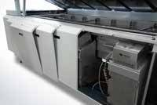

# 🧩 ReflowSolderingMachine_v0.0.1_261019.aasx

[← 장비 페이지](../README.md) · [⤓ AASX 다운로드](../AASX/ReflowSolderingMachine_v0.0.1_261019.aasx) · 10.9 MB

> 🤖 AASX 파일을 열어 자동으로 만든 열람 페이지입니다. 직접 고치지 말고 AASX를 다시 올리세요.

| 항목 | 내용 |
|---|---|
| AAS idShort | `ReflowSolderingMachineAAS` |
| AAS id | https://www.smart-factory.kr/ids/aas/ReflowSolderingMachineAAS/1/0 |
| 자산 종류 (assetKind) | Type |
| globalAssetId | https://www.smart-factory.kr/ids/asset/ReflowSolderingMachine/RSM-EX001/1/0 |
| 설명 | 솔더 페이스트 인쇄·부품 실장이 완료된 PCB를 처리하는 인라인 강제대류식 리플로우 납땜기계 Type1 참조모델입니다. 수치·기록·예측값은 비식별 합성 예시이며 참고 사진의 채택 사양을 뜻하지 않습니다. |
| 서브모델 | 8개 |
| 전체 요소 | 3,073개 |

## 서브모델 한눈에 보기

| # | 서브모델 | 요소 수 | semanticId |
|:-:|---|--:|---|
| 1 | [Nameplate](#sm-1) | 21 | https://admin-shell.io/idta/nameplate/3/0/Nameplate |
| 2 | [HandoverDocumentation](#sm-2) | 27 | 0173-1#01-AHF578#003 |
| 3 | [TechnicalData](#sm-3) | 84 | 0173-1#01-AHX837#002 |
| 4 | [OperationalData](#sm-4) | 80 | https://www.smart-factory.kr/ids/sm/ReflowSolderingMachineAAS/OperationalData/1/0 |
| 5 | [TimeSeries](#sm-5) | 2,665 | https://admin-shell.io/idta/TimeSeries/1/1 |
| 6 | [ProcessParameters](#sm-6) | 49 | https://admin-shell-io/idta/SubmodelTemplate/ProcessParameters/1/0 |
| 7 | [ProcessVariablesForManufacturingKPICalculation](#sm-7) | 76 | https://admin-shell.io/idta/SubmodelTemplate/ProcessVariablesForManufacturingKPICalculati… |
| 8 | [PredictiveMaintenance](#sm-8) | 71 | https://admin-shell.io/idta/SubmodelTemplate/PredictiveMaintenance/1/0 |

## 서브모델 상세

각 서브모델 이름을 누르면 펼쳐집니다. **굵은 글씨**는 하위 요소가 있는 묶음입니다.

<b>1. Nameplate</b> — 요소 21개

> 인라인 다존 강제대류식 리플로우 납땜기계의 Type1 참조 구조입니다. 장비 사양·운전 기록·예측 출력은 비식별 합성 예시입니다.

semanticId: `https://admin-shell.io/idta/nameplate/3/0/Nameplate`

| idShort | 종류 | 값 | semanticId |
|---|---|---|---|
| URIOfTheProduct | 속성 | https://www.smart-factory.kr/ids/asset/ReflowSolderingMachine/RSM-EX001/1/0 | 0112/2///61987#ABN590#002 |
| ManufacturerName | 다국어&nbsp;속성 | Example Manufacturer | 0112/2///61987#ABA565#009 |
| ManufacturerProductDesignation | 다국어&nbsp;속성 | Reflow Soldering Machine | 0112/2///61987#ABA567#009 |
| **AddressInformation** | 묶음&nbsp;(4) |  | https://admin-shell.io/zvei/nameplate/1/0/ContactInformations/Address… |
| &nbsp;&nbsp;&nbsp;└ Street | 다국어&nbsp;속성 | 1 Example-ro | 0173-1#02-AAO128#002 |
| &nbsp;&nbsp;&nbsp;└ Zipcode | 다국어&nbsp;속성 | 12345 | 0173-1#02-AAO129#002 |
| &nbsp;&nbsp;&nbsp;└ CityTown | 다국어&nbsp;속성 | Example City | 0173-1#02-AAO132#002 |
| &nbsp;&nbsp;&nbsp;└ NationalCode | 다국어&nbsp;속성 | KR | 0173-1#02-AAO134#002 |
| ManufacturerProductRoot | 다국어&nbsp;속성 | Inline reflow oven | 0112/2///61360_7#AAS011#001 |
| ManufacturerProductFamily | 다국어&nbsp;속성 | Forced-convection reflow soldering machine | 0112/2///61987#ABP464#002 |
| ManufacturerProductType | 속성 | RSM-8Z-EX | 0112/2///61987#ABA300#008 |
| OrderCodeOfManufacturer | 속성 | RSM-8Z-ORD-EX | 0112/2///61987#ABA950#008 |
| ProductArticleNumberOfManufacturer | 속성 | RSM-8Z-ART-EX | 0112/2///61987#ABA581#007 |
| SerialNumber | 속성 | RSM-EX001 | 0112/2///61987#ABA951#009 |
| YearOfConstruction | 속성 | 2026 | 0112/2///61987#ABP000#002 |
| DateOfManufacture | 속성 | 2026-10-01 | 0112/2///61987#ABB757#007 |
| HardwareVersion | 속성 | 1.0.0 | 0112/2///61987#ABA926#008 |
| FirmwareVersion | 속성 | 1.0.0 | 0112/2///61987#ABA302#006 |
| SoftwareVersion | 속성 | 1.0.0 | 0112/2///61987#ABA601#008 |
| CountryOfOrigin | 속성 | KR | 0112/2///61987#ABP462#001 |
| UniqueFacilityIdentifier | 속성 | RSM-EX-FACILITY-001 | https://admin-shell.io/idta/nameplate/3/0/UniqueFacilityIdentifier |

<b>2. HandoverDocumentation</b> — 요소 27개

> 인라인 다존 강제대류식 리플로우 납땜기계의 Type1 참조 구조입니다. 장비 사양·운전 기록·예측 출력은 비식별 합성 예시입니다.

semanticId: `0173-1#01-AHF578#003`

| idShort | 종류 | 값 | semanticId |
|---|---|---|---|
| **Documents** | 목록&nbsp;(1) |  | 0173-1#02-ABI500#003 |
| &nbsp;&nbsp;&nbsp;└ **** | 묶음&nbsp;(3) |  | 0173-1#02-ABI500#003/0173-1#01-AHF579#003 |
| &nbsp;&nbsp;&nbsp;&nbsp;&nbsp;&nbsp;└ **DocumentIds** | 목록&nbsp;(1) |  | 0173-1#02-ABI501#003 |
| &nbsp;&nbsp;&nbsp;&nbsp;&nbsp;&nbsp;&nbsp;&nbsp;&nbsp;└ **** | 묶음&nbsp;(3) |  | 0173-1#02-ABI501#003/0173-1#01-AHF580#003 |
| &nbsp;&nbsp;&nbsp;&nbsp;&nbsp;&nbsp;&nbsp;&nbsp;&nbsp;&nbsp;&nbsp;&nbsp;└ DocumentDomainId | 속성 | RSM-EX001-DOCUMENTS | 0173-1#02-ABH994#003 |
| &nbsp;&nbsp;&nbsp;&nbsp;&nbsp;&nbsp;&nbsp;&nbsp;&nbsp;&nbsp;&nbsp;&nbsp;└ DocumentIdentifier | 속성 | RSM-OP-EX001 | 0173-1#02-AAO099#004 |
| &nbsp;&nbsp;&nbsp;&nbsp;&nbsp;&nbsp;&nbsp;&nbsp;&nbsp;&nbsp;&nbsp;&nbsp;└ DocumentIsPrimary | 속성 | true | 0173-1#02-ABH995#003 |
| &nbsp;&nbsp;&nbsp;&nbsp;&nbsp;&nbsp;└ **DocumentClassifications** | 목록&nbsp;(1) |  | 0173-1#02-ABI502#003 |
| &nbsp;&nbsp;&nbsp;&nbsp;&nbsp;&nbsp;&nbsp;&nbsp;&nbsp;└ **** | 묶음&nbsp;(3) |  | 0173-1#02-ABI502#003/0173-1#01-AHF581#003 |
| &nbsp;&nbsp;&nbsp;&nbsp;&nbsp;&nbsp;&nbsp;&nbsp;&nbsp;&nbsp;&nbsp;&nbsp;└ ClassId | 속성 | 03-02 | 0173-1#02-ABH996#003 |
| &nbsp;&nbsp;&nbsp;&nbsp;&nbsp;&nbsp;&nbsp;&nbsp;&nbsp;&nbsp;&nbsp;&nbsp;└ ClassName | 다국어&nbsp;속성 | Operation | 0173-1#02-ABJ219#002 |
| &nbsp;&nbsp;&nbsp;&nbsp;&nbsp;&nbsp;&nbsp;&nbsp;&nbsp;&nbsp;&nbsp;&nbsp;└ ClassificationSystem | 속성 | VDI 2770 Blatt 1:2020 | 0173-1#02-ABH997#003 |
| &nbsp;&nbsp;&nbsp;&nbsp;&nbsp;&nbsp;└ **DocumentVersions** | 목록&nbsp;(1) |  | 0173-1#02-ABI503#003 |
| &nbsp;&nbsp;&nbsp;&nbsp;&nbsp;&nbsp;&nbsp;&nbsp;&nbsp;└ **** | 묶음&nbsp;(11) |  | 0173-1#02-ABI503#003/0173-1#01-AHF582#003 |
| &nbsp;&nbsp;&nbsp;&nbsp;&nbsp;&nbsp;&nbsp;&nbsp;&nbsp;&nbsp;&nbsp;&nbsp;└ **Language** | 목록&nbsp;(1) |  | 0173-1#02-AAN468#008 |
| &nbsp;&nbsp;&nbsp;&nbsp;&nbsp;&nbsp;&nbsp;&nbsp;&nbsp;&nbsp;&nbsp;&nbsp;&nbsp;&nbsp;&nbsp;└  | 속성 | ko | 0173-1#02-AAN468#008 |
| &nbsp;&nbsp;&nbsp;&nbsp;&nbsp;&nbsp;&nbsp;&nbsp;&nbsp;&nbsp;&nbsp;&nbsp;└ Version | 속성 | 1.0 | 0173-1#02-AAP003#005 |
| &nbsp;&nbsp;&nbsp;&nbsp;&nbsp;&nbsp;&nbsp;&nbsp;&nbsp;&nbsp;&nbsp;&nbsp;└ Title | 다국어&nbsp;속성 | 리플로우 납땜기계 운영정보 합성 예시 | 0173-1#02-ABG940#003 |
| &nbsp;&nbsp;&nbsp;&nbsp;&nbsp;&nbsp;&nbsp;&nbsp;&nbsp;&nbsp;&nbsp;&nbsp;└ Subtitle | 다국어&nbsp;속성 | Type 1 synthetic reference-model example | 0173-1#02-ABH998#003 |
| &nbsp;&nbsp;&nbsp;&nbsp;&nbsp;&nbsp;&nbsp;&nbsp;&nbsp;&nbsp;&nbsp;&nbsp;└ Description | 다국어&nbsp;속성 | Illustrative operating information for the synthetic RSM-EX001 reflow oven. Thi… | 0173-1#02-AAN466#004 |
| &nbsp;&nbsp;&nbsp;&nbsp;&nbsp;&nbsp;&nbsp;&nbsp;&nbsp;&nbsp;&nbsp;&nbsp;└ KeyWords | 다국어&nbsp;속성 | reflow, PCB, synthetic example, Type 1 | 0173-1#02-ABH999#003 |
| &nbsp;&nbsp;&nbsp;&nbsp;&nbsp;&nbsp;&nbsp;&nbsp;&nbsp;&nbsp;&nbsp;&nbsp;└ StatusSetDate | 속성 | 2026-10-19 | 0173-1#02-ABI000#003 |
| &nbsp;&nbsp;&nbsp;&nbsp;&nbsp;&nbsp;&nbsp;&nbsp;&nbsp;&nbsp;&nbsp;&nbsp;└ StatusValue | 속성 | InReview | 0173-1#02-ABI001#003 |
| &nbsp;&nbsp;&nbsp;&nbsp;&nbsp;&nbsp;&nbsp;&nbsp;&nbsp;&nbsp;&nbsp;&nbsp;└ OrganizationShortName | 속성 | Example Manufacturer | https://api.eclass-cdp.com/0173-1-02-ABI002-003 |
| &nbsp;&nbsp;&nbsp;&nbsp;&nbsp;&nbsp;&nbsp;&nbsp;&nbsp;&nbsp;&nbsp;&nbsp;└ OrganizationOfficialName | 속성 | Example Manufacturer | 0173-1#02-ABI004#003 |
| &nbsp;&nbsp;&nbsp;&nbsp;&nbsp;&nbsp;&nbsp;&nbsp;&nbsp;&nbsp;&nbsp;&nbsp;└ **DigitalFiles** | 목록&nbsp;(1) |  | 0173-1#02-ABK126#002 |
| &nbsp;&nbsp;&nbsp;&nbsp;&nbsp;&nbsp;&nbsp;&nbsp;&nbsp;&nbsp;&nbsp;&nbsp;&nbsp;&nbsp;&nbsp;└  | 파일 | /aasx/files/documents/Reflow_OperatingExample_ko.txt | 0173-1#02-ABK126#002 |

<b>3. TechnicalData</b> — 요소 84개

> 인라인 다존 강제대류식 리플로우 납땜기계의 Type1 참조 구조입니다. 장비 사양·운전 기록·예측 출력은 비식별 합성 예시입니다.

semanticId: `0173-1#01-AHX837#002`

| idShort | 종류 | 값 | semanticId |
|---|---|---|---|
| **GeneralInformation** | 묶음&nbsp;(5) |  | 0173-1#02-ABK161#002/0173-1#01-AHX838#002 |
| &nbsp;&nbsp;&nbsp;└ ManufacturerName | 속성 | Example Manufacturer | 0173-1#02-AAO677#004 |
| &nbsp;&nbsp;&nbsp;└ ManufacturerProductDesignation | 다국어&nbsp;속성 | Reflow Soldering Machine | 0173-1#02-AAW338#003 |
| &nbsp;&nbsp;&nbsp;└ ManufacturerArticleNumber | 속성 | RSM-8Z-ART-EX | 0173-1#02-AAO676#005 |
| &nbsp;&nbsp;&nbsp;└ ManufacturerOrderCode | 속성 | RSM-8Z-ORD-EX | 0173-1#02-AAO227#004 |
| &nbsp;&nbsp;&nbsp;└ **ProductImages** | 목록&nbsp;(1) |  | 0173-1#02-ABM220#001 |
| &nbsp;&nbsp;&nbsp;&nbsp;&nbsp;&nbsp;└ **** | 묶음&nbsp;(2) |  | 0173-1#02-ABM220#001/0173-1#01-AHY911#001 |
| &nbsp;&nbsp;&nbsp;&nbsp;&nbsp;&nbsp;&nbsp;&nbsp;&nbsp;└ ImageFile | 파일 | /aasx/files/images/Reflow_ConveyorReference.jpg | 0173-1#02-ABK291#002 |
| &nbsp;&nbsp;&nbsp;&nbsp;&nbsp;&nbsp;&nbsp;&nbsp;&nbsp;└ ImageNote | 다국어&nbsp;속성 | 리플로우 오븐의 컨베이어 구성 참고 실사진 | 0173-1#02-ABL423#001 |
| **ProductClassifications** | 목록&nbsp;(1) |  | 0173-1#02-ABK162#002 |
| &nbsp;&nbsp;&nbsp;└ **** | 묶음&nbsp;(5) |  | 0173-1#02-ABK162#002/0173-1#01-AHX839#002 |
| &nbsp;&nbsp;&nbsp;&nbsp;&nbsp;&nbsp;└ ClassificationSystem | 속성 | ECLASS | 0173-1#02-ABL424#001 |
| &nbsp;&nbsp;&nbsp;&nbsp;&nbsp;&nbsp;└ ClassificationSystemVersion | 속성 | 16.0 | 0173-1#02-AAR710#003 |
| &nbsp;&nbsp;&nbsp;&nbsp;&nbsp;&nbsp;└ ProductClassId | 속성 | 0173-1#01-ACK212#019 | 0173-1#02-ABG776#003 |
| &nbsp;&nbsp;&nbsp;&nbsp;&nbsp;&nbsp;└ ProductClassCodedName | 속성 | 36650210 | 0173-1#02-ABK128#002 |
| &nbsp;&nbsp;&nbsp;&nbsp;&nbsp;&nbsp;└ ProductClassName | 다국어&nbsp;속성 | Reflow soldering station (assembly- and handling technology) | 0173-1#02-ABK273#002 |
| **TechnicalPropertyAreas** | 목록&nbsp;(1) |  | 0173-1#02-ABK163#002 |
| &nbsp;&nbsp;&nbsp;└ **** | 묶음&nbsp;(5) |  | 0173-1#02-ABL358#002/0173-1#01-AHX773#002 |
| &nbsp;&nbsp;&nbsp;&nbsp;&nbsp;&nbsp;└ **EquipmentConfiguration** | 묶음&nbsp;(2) |  | https://www.smart-factory.kr/ids/cd/EquipmentConfiguration/1/0 |
| &nbsp;&nbsp;&nbsp;&nbsp;&nbsp;&nbsp;&nbsp;&nbsp;&nbsp;└ **EquipmentType** | 묶음&nbsp;(4) |  | https://www.smart-factory.kr/ids/cd/EquipmentType/1/0 |
| &nbsp;&nbsp;&nbsp;&nbsp;&nbsp;&nbsp;&nbsp;&nbsp;&nbsp;&nbsp;&nbsp;&nbsp;└ ReflowOvenType | 속성 | Forced-convection inline reflow oven | https://www.smart-factory.kr/ids/cd/ReflowOvenType/1/0 |
| &nbsp;&nbsp;&nbsp;&nbsp;&nbsp;&nbsp;&nbsp;&nbsp;&nbsp;&nbsp;&nbsp;&nbsp;└ HeatingMethod | 속성 | Forced hot-air convection (top and bottom) | https://www.smart-factory.kr/ids/cd/HeatingMethod/1/0 |
| &nbsp;&nbsp;&nbsp;&nbsp;&nbsp;&nbsp;&nbsp;&nbsp;&nbsp;&nbsp;&nbsp;&nbsp;└ SolderingProcessType | 속성 | Surface-mount reflow soldering | https://www.smart-factory.kr/ids/cd/SolderingProcessType/1/0 |
| &nbsp;&nbsp;&nbsp;&nbsp;&nbsp;&nbsp;&nbsp;&nbsp;&nbsp;&nbsp;&nbsp;&nbsp;└ InstallationType | 속성 | Indoor floor-standing inline | 0173-1#02-AAE979#012 |
| &nbsp;&nbsp;&nbsp;&nbsp;&nbsp;&nbsp;&nbsp;&nbsp;&nbsp;└ **InstallationEnvelope** | 묶음&nbsp;(4) |  | https://www.smart-factory.kr/ids/cd/InstallationEnvelope/1/0 |
| &nbsp;&nbsp;&nbsp;&nbsp;&nbsp;&nbsp;&nbsp;&nbsp;&nbsp;&nbsp;&nbsp;&nbsp;└ EquipmentNetMass | 속성 | 1850.0 | 0173-1#02-AAF040#010 |
| &nbsp;&nbsp;&nbsp;&nbsp;&nbsp;&nbsp;&nbsp;&nbsp;&nbsp;&nbsp;&nbsp;&nbsp;└ OverallLength | 속성 | 4200.0 | 0173-1#02-BAB146#011 |
| &nbsp;&nbsp;&nbsp;&nbsp;&nbsp;&nbsp;&nbsp;&nbsp;&nbsp;&nbsp;&nbsp;&nbsp;└ OverallWidth | 속성 | 1450.0 | 0173-1#02-BAA705#009 |
| &nbsp;&nbsp;&nbsp;&nbsp;&nbsp;&nbsp;&nbsp;&nbsp;&nbsp;&nbsp;&nbsp;&nbsp;└ OverallHeight | 속성 | 1500.0 | 0173-1#02-BAB707#009 |
| &nbsp;&nbsp;&nbsp;&nbsp;&nbsp;&nbsp;└ **ThermalSystem** | 묶음&nbsp;(2) |  | https://www.smart-factory.kr/ids/cd/ThermalSystem/1/0 |
| &nbsp;&nbsp;&nbsp;&nbsp;&nbsp;&nbsp;&nbsp;&nbsp;&nbsp;└ **ZoneConfiguration** | 묶음&nbsp;(5) |  | https://www.smart-factory.kr/ids/cd/ZoneConfiguration/1/0 |
| &nbsp;&nbsp;&nbsp;&nbsp;&nbsp;&nbsp;&nbsp;&nbsp;&nbsp;&nbsp;&nbsp;&nbsp;└ NumberOfHeatingZones | 속성 | 8 | 0173-1#02-AAP478#003 |
| &nbsp;&nbsp;&nbsp;&nbsp;&nbsp;&nbsp;&nbsp;&nbsp;&nbsp;&nbsp;&nbsp;&nbsp;└ NumberOfCoolingZones | 속성 | 2 | https://www.smart-factory.kr/ids/cd/NumberOfCoolingZones/1/0 |
| &nbsp;&nbsp;&nbsp;&nbsp;&nbsp;&nbsp;&nbsp;&nbsp;&nbsp;&nbsp;&nbsp;&nbsp;└ ZoneTemperatureSettingRange | 범위 | 100.0 ~ 300.0 | https://www.smart-factory.kr/ids/cd/ZoneTemperatureSettingRange/1/0 |
| &nbsp;&nbsp;&nbsp;&nbsp;&nbsp;&nbsp;&nbsp;&nbsp;&nbsp;&nbsp;&nbsp;&nbsp;└ MaxPeakTemperature | 속성 | 300.0 | https://www.smart-factory.kr/ids/cd/MaxPeakTemperature/1/0 |
| &nbsp;&nbsp;&nbsp;&nbsp;&nbsp;&nbsp;&nbsp;&nbsp;&nbsp;&nbsp;&nbsp;&nbsp;└ TemperatureControlAccuracy | 속성 | 1.5 | https://www.smart-factory.kr/ids/cd/TemperatureControlAccuracy/1/0 |
| &nbsp;&nbsp;&nbsp;&nbsp;&nbsp;&nbsp;&nbsp;&nbsp;&nbsp;└ **HeatingCapacity** | 묶음&nbsp;(5) |  | https://www.smart-factory.kr/ids/cd/HeatingCapacity/1/0 |
| &nbsp;&nbsp;&nbsp;&nbsp;&nbsp;&nbsp;&nbsp;&nbsp;&nbsp;&nbsp;&nbsp;&nbsp;└ TopHeaterRatedPower | 속성 | 36000.0 | 0173-1#02-AAC970#010 |
| &nbsp;&nbsp;&nbsp;&nbsp;&nbsp;&nbsp;&nbsp;&nbsp;&nbsp;&nbsp;&nbsp;&nbsp;└ BottomHeaterRatedPower | 속성 | 30000.0 | 0173-1#02-AAC970#010 |
| &nbsp;&nbsp;&nbsp;&nbsp;&nbsp;&nbsp;&nbsp;&nbsp;&nbsp;&nbsp;&nbsp;&nbsp;└ HeatingSystemRatedPower | 속성 | 66000.0 | 0173-1#02-AAC970#010 |
| &nbsp;&nbsp;&nbsp;&nbsp;&nbsp;&nbsp;&nbsp;&nbsp;&nbsp;&nbsp;&nbsp;&nbsp;└ AirCirculationMethod | 속성 | Independent zone forced convection | https://www.smart-factory.kr/ids/cd/AirCirculationMethod/1/0 |
| &nbsp;&nbsp;&nbsp;&nbsp;&nbsp;&nbsp;&nbsp;&nbsp;&nbsp;&nbsp;&nbsp;&nbsp;└ WarmUpTime | 속성 | PT15M | https://www.smart-factory.kr/ids/cd/WarmUpTime/1/0 |
| &nbsp;&nbsp;&nbsp;&nbsp;&nbsp;&nbsp;└ **ConveyorSystem** | 묶음&nbsp;(1) |  | https://www.smart-factory.kr/ids/cd/ConveyorSystem/1/0 |
| &nbsp;&nbsp;&nbsp;&nbsp;&nbsp;&nbsp;&nbsp;&nbsp;&nbsp;└ **TransportCapability** | 묶음&nbsp;(9) |  | https://www.smart-factory.kr/ids/cd/TransportCapability/1/0 |
| &nbsp;&nbsp;&nbsp;&nbsp;&nbsp;&nbsp;&nbsp;&nbsp;&nbsp;&nbsp;&nbsp;&nbsp;└ ConveyorType | 속성 | Edge rail and mesh belt | https://www.smart-factory.kr/ids/cd/ConveyorType/1/0 |
| &nbsp;&nbsp;&nbsp;&nbsp;&nbsp;&nbsp;&nbsp;&nbsp;&nbsp;&nbsp;&nbsp;&nbsp;└ ConveyorSpeedRange | 범위 | 300.0 ~ 1800.0 | https://www.smart-factory.kr/ids/cd/ConveyorSpeedRange/1/0 |
| &nbsp;&nbsp;&nbsp;&nbsp;&nbsp;&nbsp;&nbsp;&nbsp;&nbsp;&nbsp;&nbsp;&nbsp;└ MaxPCBWidth | 속성 | 508.0 | https://www.smart-factory.kr/ids/cd/MaxPCBWidth/1/0 |
| &nbsp;&nbsp;&nbsp;&nbsp;&nbsp;&nbsp;&nbsp;&nbsp;&nbsp;&nbsp;&nbsp;&nbsp;└ MinPCBWidth | 속성 | 50.0 | https://www.smart-factory.kr/ids/cd/MinPCBWidth/1/0 |
| &nbsp;&nbsp;&nbsp;&nbsp;&nbsp;&nbsp;&nbsp;&nbsp;&nbsp;&nbsp;&nbsp;&nbsp;└ MaxPCBPassageHeightTopClearance | 속성 | 30.0 | https://www.smart-factory.kr/ids/cd/MaxPCBPassageHeightTopClearance/1… |
| &nbsp;&nbsp;&nbsp;&nbsp;&nbsp;&nbsp;&nbsp;&nbsp;&nbsp;&nbsp;&nbsp;&nbsp;└ MaxPCBPassageHeightBottomClearance | 속성 | 25.0 | https://www.smart-factory.kr/ids/cd/MaxPCBPassageHeightBottomClearanc… |
| &nbsp;&nbsp;&nbsp;&nbsp;&nbsp;&nbsp;&nbsp;&nbsp;&nbsp;&nbsp;&nbsp;&nbsp;└ ConveyorRailWidthAdjustment | 속성 | Automatic motorized | https://www.smart-factory.kr/ids/cd/ConveyorRailWidthAdjustment/1/0 |
| &nbsp;&nbsp;&nbsp;&nbsp;&nbsp;&nbsp;&nbsp;&nbsp;&nbsp;&nbsp;&nbsp;&nbsp;└ ConveyorTransferDirection | 속성 | Left to right | https://www.smart-factory.kr/ids/cd/ConveyorTransferDirection/1/0 |
| &nbsp;&nbsp;&nbsp;&nbsp;&nbsp;&nbsp;&nbsp;&nbsp;&nbsp;&nbsp;&nbsp;&nbsp;└ ConveyorHeight | 속성 | 900.0 | https://www.smart-factory.kr/ids/cd/ConveyorHeight/1/0 |
| &nbsp;&nbsp;&nbsp;&nbsp;&nbsp;&nbsp;└ **AtmosphereAndFluxSystem** | 묶음&nbsp;(2) |  | https://www.smart-factory.kr/ids/cd/AtmosphereAndFluxSystem/1/0 |
| &nbsp;&nbsp;&nbsp;&nbsp;&nbsp;&nbsp;&nbsp;&nbsp;&nbsp;└ **GasSupply** | 묶음&nbsp;(5) |  | https://www.smart-factory.kr/ids/cd/GasSupply/1/0 |
| &nbsp;&nbsp;&nbsp;&nbsp;&nbsp;&nbsp;&nbsp;&nbsp;&nbsp;&nbsp;&nbsp;&nbsp;└ AtmosphereType | 속성 | Nitrogen (N2) | https://www.smart-factory.kr/ids/cd/AtmosphereType/1/0 |
| &nbsp;&nbsp;&nbsp;&nbsp;&nbsp;&nbsp;&nbsp;&nbsp;&nbsp;&nbsp;&nbsp;&nbsp;└ NitrogenConsumptionRate | 속성 | 18.0 | https://www.smart-factory.kr/ids/cd/NitrogenConsumptionRate/1/0 |
| &nbsp;&nbsp;&nbsp;&nbsp;&nbsp;&nbsp;&nbsp;&nbsp;&nbsp;&nbsp;&nbsp;&nbsp;└ SpecifiedResidualOxygenLevel | 속성 | 1000.0 | https://www.smart-factory.kr/ids/cd/SpecifiedResidualOxygenLevel/1/0 |
| &nbsp;&nbsp;&nbsp;&nbsp;&nbsp;&nbsp;&nbsp;&nbsp;&nbsp;&nbsp;&nbsp;&nbsp;└ NitrogenSupplyPressure | 속성 | 0.4 | https://www.smart-factory.kr/ids/cd/NitrogenSupplyPressure/1/0 |
| &nbsp;&nbsp;&nbsp;&nbsp;&nbsp;&nbsp;&nbsp;&nbsp;&nbsp;&nbsp;&nbsp;&nbsp;└ OxygenSensorSupported | 속성 | true | https://www.smart-factory.kr/ids/cd/OxygenSensorSupported/1/0 |
| &nbsp;&nbsp;&nbsp;&nbsp;&nbsp;&nbsp;&nbsp;&nbsp;&nbsp;└ **FluxRecovery** | 묶음&nbsp;(2) |  | https://www.smart-factory.kr/ids/cd/FluxRecovery/1/0 |
| &nbsp;&nbsp;&nbsp;&nbsp;&nbsp;&nbsp;&nbsp;&nbsp;&nbsp;&nbsp;&nbsp;&nbsp;└ FluxManagementMethod | 속성 | Cooled condensation flux collector | https://www.smart-factory.kr/ids/cd/FluxManagementMethod/1/0 |
| &nbsp;&nbsp;&nbsp;&nbsp;&nbsp;&nbsp;&nbsp;&nbsp;&nbsp;&nbsp;&nbsp;&nbsp;└ FluxCollectionCapacity | 속성 | 2.0 | https://www.smart-factory.kr/ids/cd/FluxCollectionCapacity/1/0 |
| &nbsp;&nbsp;&nbsp;&nbsp;&nbsp;&nbsp;└ **UtilityAndSafetySystem** | 묶음&nbsp;(3) |  | https://www.smart-factory.kr/ids/cd/UtilityAndSafetySystem/1/0 |
| &nbsp;&nbsp;&nbsp;&nbsp;&nbsp;&nbsp;&nbsp;&nbsp;&nbsp;└ **ExhaustConnections** | 묶음&nbsp;(5) |  | https://www.smart-factory.kr/ids/cd/ExhaustConnections/1/0 |
| &nbsp;&nbsp;&nbsp;&nbsp;&nbsp;&nbsp;&nbsp;&nbsp;&nbsp;&nbsp;&nbsp;&nbsp;└ ExhaustConnectionSize | 속성 | 2 x Ø150 mm | https://www.smart-factory.kr/ids/cd/ExhaustConnectionSize/1/0 |
| &nbsp;&nbsp;&nbsp;&nbsp;&nbsp;&nbsp;&nbsp;&nbsp;&nbsp;&nbsp;&nbsp;&nbsp;└ ExhaustFlowRateRequirement | 속성 | 20 | https://www.smart-factory.kr/ids/cd/ExhaustFlowRateRequirement/1/0 |
| &nbsp;&nbsp;&nbsp;&nbsp;&nbsp;&nbsp;&nbsp;&nbsp;&nbsp;&nbsp;&nbsp;&nbsp;└ FluxDrainagePortSize | 속성 | Rc 1/2 | https://www.smart-factory.kr/ids/cd/FluxDrainagePortSize/1/0 |
| &nbsp;&nbsp;&nbsp;&nbsp;&nbsp;&nbsp;&nbsp;&nbsp;&nbsp;&nbsp;&nbsp;&nbsp;└ FluxCondensateRecoverySupported | 속성 | true | https://www.smart-factory.kr/ids/cd/FluxCondensateRecoverySupported/1… |
| &nbsp;&nbsp;&nbsp;&nbsp;&nbsp;&nbsp;&nbsp;&nbsp;&nbsp;&nbsp;&nbsp;&nbsp;└ CoolingExhaustSupported | 속성 | true | https://www.smart-factory.kr/ids/cd/CoolingExhaustSupported/1/0 |
| &nbsp;&nbsp;&nbsp;&nbsp;&nbsp;&nbsp;&nbsp;&nbsp;&nbsp;└ **ElectricalSupply** | 묶음&nbsp;(7) |  | https://www.smart-factory.kr/ids/cd/ElectricalSupply/1/0 |
| &nbsp;&nbsp;&nbsp;&nbsp;&nbsp;&nbsp;&nbsp;&nbsp;&nbsp;&nbsp;&nbsp;&nbsp;└ PowerSupply | 속성 | 380 VAC ±10%, 3-phase, 60 Hz | https://www.smart-factory.kr/ids/cd/PowerSupply/1/0 |
| &nbsp;&nbsp;&nbsp;&nbsp;&nbsp;&nbsp;&nbsp;&nbsp;&nbsp;&nbsp;&nbsp;&nbsp;└ RatedPower | 속성 | 75000.0 | 0173-1#02-AAC970#010 |
| &nbsp;&nbsp;&nbsp;&nbsp;&nbsp;&nbsp;&nbsp;&nbsp;&nbsp;&nbsp;&nbsp;&nbsp;└ ControlPanelType | 속성 | PLC zone-temperature and conveyor control panel | https://www.smart-factory.kr/ids/cd/ControlPanelType/1/0 |
| &nbsp;&nbsp;&nbsp;&nbsp;&nbsp;&nbsp;&nbsp;&nbsp;&nbsp;&nbsp;&nbsp;&nbsp;└ RatedSupplyVoltage | 속성 | 380 | 0173-1#02-BAH005#008 |
| &nbsp;&nbsp;&nbsp;&nbsp;&nbsp;&nbsp;&nbsp;&nbsp;&nbsp;&nbsp;&nbsp;&nbsp;└ SupplyPhaseCount | 속성 | 3 | 0173-1#02-AAP621#003 |
| &nbsp;&nbsp;&nbsp;&nbsp;&nbsp;&nbsp;&nbsp;&nbsp;&nbsp;&nbsp;&nbsp;&nbsp;└ RatedSupplyFrequency | 속성 | 60 | 0173-1#02-BAA302#009 |
| &nbsp;&nbsp;&nbsp;&nbsp;&nbsp;&nbsp;&nbsp;&nbsp;&nbsp;&nbsp;&nbsp;&nbsp;└ SupplyVoltageTolerance | 속성 | 10 | https://www.smart-factory.kr/ids/cd/SupplyVoltageTolerance/1/0 |
| &nbsp;&nbsp;&nbsp;&nbsp;&nbsp;&nbsp;&nbsp;&nbsp;&nbsp;└ **SafetyFunctions** | 묶음&nbsp;(5) |  | https://www.smart-factory.kr/ids/cd/SafetyFunctions/1/0 |
| &nbsp;&nbsp;&nbsp;&nbsp;&nbsp;&nbsp;&nbsp;&nbsp;&nbsp;&nbsp;&nbsp;&nbsp;└ OverTemperatureProtectionSupported | 속성 | true | https://www.smart-factory.kr/ids/cd/OverTemperatureProtectionSupporte… |
| &nbsp;&nbsp;&nbsp;&nbsp;&nbsp;&nbsp;&nbsp;&nbsp;&nbsp;&nbsp;&nbsp;&nbsp;└ SupportedSafetyFunctions | 속성 | Over-temperature cutoff, emergency stop, door interlock | https://www.smart-factory.kr/ids/cd/SupportedSafetyFunctions/1/0 |
| &nbsp;&nbsp;&nbsp;&nbsp;&nbsp;&nbsp;&nbsp;&nbsp;&nbsp;&nbsp;&nbsp;&nbsp;└ EmergencyStopSupported | 속성 | true | https://www.smart-factory.kr/ids/cd/EmergencyStopSupported/1/0 |
| &nbsp;&nbsp;&nbsp;&nbsp;&nbsp;&nbsp;&nbsp;&nbsp;&nbsp;&nbsp;&nbsp;&nbsp;└ DoorInterlockSupported | 속성 | true | https://www.smart-factory.kr/ids/cd/DoorInterlockSupported/1/0 |
| &nbsp;&nbsp;&nbsp;&nbsp;&nbsp;&nbsp;&nbsp;&nbsp;&nbsp;&nbsp;&nbsp;&nbsp;└ GroundingRequired | 속성 | true | https://www.smart-factory.kr/ids/cd/GroundingRequired/1/0 |

<b>4. OperationalData</b> — 요소 80개

> 인라인 다존 강제대류식 리플로우 납땜기계의 Type1 참조 구조입니다. 장비 사양·운전 기록·예측 출력은 비식별 합성 예시입니다.

semanticId: `https://www.smart-factory.kr/ids/sm/ReflowSolderingMachineAAS/OperationalData/1/0`

| idShort | 종류 | 값 | semanticId |
|---|---|---|---|
| **EquipmentOperation** | 묶음&nbsp;(2) |  | https://www.smart-factory.kr/ids/cd/EquipmentOperation/1/0 |
| &nbsp;&nbsp;&nbsp;└ **OperatingState** | 묶음&nbsp;(7) |  | https://www.smart-factory.kr/ids/cd/OperatingState/1/0 |
| &nbsp;&nbsp;&nbsp;&nbsp;&nbsp;&nbsp;└ DeviceRunState | 속성 | Running | https://www.smart-factory.kr/ids/cd/DeviceRunState/1/0 |
| &nbsp;&nbsp;&nbsp;&nbsp;&nbsp;&nbsp;└ OperationMode | 속성 | Auto | 0173-1#02-AAP799#005 |
| &nbsp;&nbsp;&nbsp;&nbsp;&nbsp;&nbsp;└ ThermalProfileState | 속성 | ContinuousProduction | https://www.smart-factory.kr/ids/cd/ThermalProfileState/1/0 |
| &nbsp;&nbsp;&nbsp;&nbsp;&nbsp;&nbsp;└ ActiveThermalProfileId | 속성 | PROFILE-SAC305-EX01 | https://www.smart-factory.kr/ids/cd/ActiveThermalProfileId/1/0 |
| &nbsp;&nbsp;&nbsp;&nbsp;&nbsp;&nbsp;└ WarmUpState | 속성 | Ready | https://www.smart-factory.kr/ids/cd/WarmUpState/1/0 |
| &nbsp;&nbsp;&nbsp;&nbsp;&nbsp;&nbsp;└ ReflowAlarmCode | 속성 | NoAlarm | https://www.smart-factory.kr/ids/cd/ReflowAlarmCode/1/0 |
| &nbsp;&nbsp;&nbsp;&nbsp;&nbsp;&nbsp;└ OperationPermittedState | 속성 | Permitted | https://www.smart-factory.kr/ids/cd/OperationPermittedState/1/0 |
| &nbsp;&nbsp;&nbsp;└ **ProductionCounters** | 묶음&nbsp;(2) |  | https://www.smart-factory.kr/ids/cd/ProductionCounters/1/0 |
| &nbsp;&nbsp;&nbsp;&nbsp;&nbsp;&nbsp;└ ProcessedPCBCount | 속성 | 456 | https://www.smart-factory.kr/ids/cd/ProcessedPCBCount/1/0 |
| &nbsp;&nbsp;&nbsp;&nbsp;&nbsp;&nbsp;└ ProcessStartTimestamp | 속성 | 2026-10-18T00:30:00Z | https://www.smart-factory.kr/ids/cd/ProcessStartTimestamp/1/0 |
| **ThermalOperation** | 묶음&nbsp;(3) |  | https://www.smart-factory.kr/ids/cd/ThermalOperation/1/0 |
| &nbsp;&nbsp;&nbsp;└ **ZoneMeasurements** | 묶음&nbsp;(8) |  | https://www.smart-factory.kr/ids/cd/ZoneMeasurements/1/0 |
| &nbsp;&nbsp;&nbsp;&nbsp;&nbsp;&nbsp;└ ZoneTemperatureActualZone1 | 속성 | 150.172 | 0173-1#02-ABC736#004 |
| &nbsp;&nbsp;&nbsp;&nbsp;&nbsp;&nbsp;└ ZoneTemperatureActualZone2 | 속성 | 165.194 | 0173-1#02-ABC736#004 |
| &nbsp;&nbsp;&nbsp;&nbsp;&nbsp;&nbsp;└ ZoneTemperatureActualZone3 | 속성 | 180.2 | 0173-1#02-ABC736#004 |
| &nbsp;&nbsp;&nbsp;&nbsp;&nbsp;&nbsp;└ ZoneTemperatureActualZone4 | 속성 | 200.187 | 0173-1#02-ABC736#004 |
| &nbsp;&nbsp;&nbsp;&nbsp;&nbsp;&nbsp;└ ZoneTemperatureActualZone5 | 속성 | 215.158 | 0173-1#02-ABC736#004 |
| &nbsp;&nbsp;&nbsp;&nbsp;&nbsp;&nbsp;└ ZoneTemperatureActualZone6 | 속성 | 235.114 | 0173-1#02-ABC736#004 |
| &nbsp;&nbsp;&nbsp;&nbsp;&nbsp;&nbsp;└ ZoneTemperatureActualZone7 | 속성 | 255.06 | 0173-1#02-ABC736#004 |
| &nbsp;&nbsp;&nbsp;&nbsp;&nbsp;&nbsp;└ ZoneTemperatureActualZone8 | 속성 | 245.001 | 0173-1#02-ABC736#004 |
| &nbsp;&nbsp;&nbsp;└ **BoardProfileResults** | 묶음&nbsp;(7) |  | https://www.smart-factory.kr/ids/cd/BoardProfileResults/1/0 |
| &nbsp;&nbsp;&nbsp;&nbsp;&nbsp;&nbsp;└ PeakTemperatureActual | 속성 | 245.3 | https://www.smart-factory.kr/ids/cd/PeakTemperatureActual/1/0 |
| &nbsp;&nbsp;&nbsp;&nbsp;&nbsp;&nbsp;└ PeakTemperatureSetpoint | 속성 | 245.0 | https://www.smart-factory.kr/ids/cd/PeakTemperatureSetpoint/1/0 |
| &nbsp;&nbsp;&nbsp;&nbsp;&nbsp;&nbsp;└ PeakTemperatureDeviation | 속성 | 0.3 | https://www.smart-factory.kr/ids/cd/PeakTemperatureDeviation/1/0 |
| &nbsp;&nbsp;&nbsp;&nbsp;&nbsp;&nbsp;└ PCBProfileMeasurementId | 속성 | PROFILE-MEAS-EX001 | https://www.smart-factory.kr/ids/cd/PCBProfileMeasurementId/1/0 |
| &nbsp;&nbsp;&nbsp;&nbsp;&nbsp;&nbsp;└ PCBProfileMeasurementTimestamp | 속성 | 2026-10-18T10:00:00Z | https://www.smart-factory.kr/ids/cd/PCBProfileMeasurementTimestamp/1/0 |
| &nbsp;&nbsp;&nbsp;&nbsp;&nbsp;&nbsp;└ PCBProfileSampleBoardId | 속성 | PCB-PROFILE-EX001 | https://www.smart-factory.kr/ids/cd/PCBProfileSampleBoardId/1/0 |
| &nbsp;&nbsp;&nbsp;&nbsp;&nbsp;&nbsp;└ PCBProfileMeasurementChannels | 속성 | TC1:CenterJoint; TC2:HighMassJoint; TC3:SmallJoint | https://www.smart-factory.kr/ids/cd/PCBProfileMeasurementChannels/1/0 |
| &nbsp;&nbsp;&nbsp;└ **HeaterOperation** | 묶음&nbsp;(4) |  | https://www.smart-factory.kr/ids/cd/HeaterOperation/1/0 |
| &nbsp;&nbsp;&nbsp;&nbsp;&nbsp;&nbsp;└ TopHeaterPowerActual | 속성 | 28400 | 0173-1#02-ABC669#004 |
| &nbsp;&nbsp;&nbsp;&nbsp;&nbsp;&nbsp;└ BottomHeaterPowerActual | 속성 | 23100 | 0173-1#02-ABC669#004 |
| &nbsp;&nbsp;&nbsp;&nbsp;&nbsp;&nbsp;└ HeaterRunState | 속성 | Running | https://www.smart-factory.kr/ids/cd/HeaterRunState/1/0 |
| &nbsp;&nbsp;&nbsp;&nbsp;&nbsp;&nbsp;└ BlowerRunState | 속성 | Running | https://www.smart-factory.kr/ids/cd/BlowerRunState/1/0 |
| **ConveyorOperation** | 묶음&nbsp;(2) |  | https://www.smart-factory.kr/ids/cd/ConveyorOperation/1/0 |
| &nbsp;&nbsp;&nbsp;└ **SpeedControl** | 묶음&nbsp;(4) |  | https://www.smart-factory.kr/ids/cd/SpeedControl/1/0 |
| &nbsp;&nbsp;&nbsp;&nbsp;&nbsp;&nbsp;└ ConveyorSpeedActual | 속성 | 900 | https://www.smart-factory.kr/ids/cd/ConveyorSpeedActual/1/0 |
| &nbsp;&nbsp;&nbsp;&nbsp;&nbsp;&nbsp;└ ConveyorSpeedSetpoint | 속성 | 900 | https://www.smart-factory.kr/ids/cd/ConveyorSpeedSetpoint/1/0 |
| &nbsp;&nbsp;&nbsp;&nbsp;&nbsp;&nbsp;└ ConveyorSpeedDeviation | 속성 | 0 | https://www.smart-factory.kr/ids/cd/ConveyorSpeedDeviation/1/0 |
| &nbsp;&nbsp;&nbsp;&nbsp;&nbsp;&nbsp;└ ConveyorRunState | 속성 | Running | https://www.smart-factory.kr/ids/cd/ConveyorRunState/1/0 |
| &nbsp;&nbsp;&nbsp;└ **BoardHandling** | 묶음&nbsp;(3) |  | https://www.smart-factory.kr/ids/cd/BoardHandling/1/0 |
| &nbsp;&nbsp;&nbsp;&nbsp;&nbsp;&nbsp;└ ConveyorRailWidthActual | 속성 | 250.0 | https://www.smart-factory.kr/ids/cd/ConveyorRailWidthActual/1/0 |
| &nbsp;&nbsp;&nbsp;&nbsp;&nbsp;&nbsp;└ PCBPresenceAtEntry | 속성 | Clear | https://www.smart-factory.kr/ids/cd/PCBPresenceAtEntry/1/0 |
| &nbsp;&nbsp;&nbsp;&nbsp;&nbsp;&nbsp;└ PCBPresenceAtExit | 속성 | Clear | https://www.smart-factory.kr/ids/cd/PCBPresenceAtExit/1/0 |
| **AtmosphereOperation** | 묶음&nbsp;(2) |  | https://www.smart-factory.kr/ids/cd/AtmosphereOperation/1/0 |
| &nbsp;&nbsp;&nbsp;└ **GasMeasurements** | 묶음&nbsp;(4) |  | https://www.smart-factory.kr/ids/cd/GasMeasurements/1/0 |
| &nbsp;&nbsp;&nbsp;&nbsp;&nbsp;&nbsp;└ OxygenConcentrationActual | 속성 | 980.0 | https://www.smart-factory.kr/ids/cd/OxygenConcentrationActual/1/0 |
| &nbsp;&nbsp;&nbsp;&nbsp;&nbsp;&nbsp;└ OxygenConcentrationSetpoint | 속성 | 1000.0 | https://www.smart-factory.kr/ids/cd/OxygenConcentrationSetpoint/1/0 |
| &nbsp;&nbsp;&nbsp;&nbsp;&nbsp;&nbsp;└ NitrogenFlowActual | 속성 | 17.5 | https://www.smart-factory.kr/ids/cd/NitrogenFlowActual/1/0 |
| &nbsp;&nbsp;&nbsp;&nbsp;&nbsp;&nbsp;└ NitrogenSupplyPressureActual | 속성 | 0.39 | https://www.smart-factory.kr/ids/cd/NitrogenSupplyPressureActual/1/0 |
| &nbsp;&nbsp;&nbsp;└ **ExhaustAndFluxState** | 묶음&nbsp;(2) |  | https://www.smart-factory.kr/ids/cd/ExhaustAndFluxState/1/0 |
| &nbsp;&nbsp;&nbsp;&nbsp;&nbsp;&nbsp;└ ExhaustFanRunState | 속성 | Running | https://www.smart-factory.kr/ids/cd/ExhaustFanRunState/1/0 |
| &nbsp;&nbsp;&nbsp;&nbsp;&nbsp;&nbsp;└ FluxCollectorState | 속성 | Active | https://www.smart-factory.kr/ids/cd/FluxCollectorState/1/0 |
| **ElectricalAndSafetyOperation** | 묶음&nbsp;(1) |  | https://www.smart-factory.kr/ids/cd/ElectricalAndSafetyOperation/1/0 |
| &nbsp;&nbsp;&nbsp;└ **PowerAndInterlockState** | 묶음&nbsp;(5) |  | https://www.smart-factory.kr/ids/cd/PowerAndInterlockState/1/0 |
| &nbsp;&nbsp;&nbsp;&nbsp;&nbsp;&nbsp;└ TotalPowerConsumptionActual | 속성 | 58200 | 0173-1#02-ABC669#004 |
| &nbsp;&nbsp;&nbsp;&nbsp;&nbsp;&nbsp;└ ElectricalSupplyStatus | 속성 | Normal | https://www.smart-factory.kr/ids/cd/ElectricalSupplyStatus/1/0 |
| &nbsp;&nbsp;&nbsp;&nbsp;&nbsp;&nbsp;└ EmergencyStopStatus | 속성 | Released | https://www.smart-factory.kr/ids/cd/EmergencyStopStatus/1/0 |
| &nbsp;&nbsp;&nbsp;&nbsp;&nbsp;&nbsp;└ DoorInterlockState | 속성 | Closed | https://www.smart-factory.kr/ids/cd/DoorInterlockState/1/0 |
| &nbsp;&nbsp;&nbsp;&nbsp;&nbsp;&nbsp;└ OverTemperatureCutoffState | 속성 | Normal | https://www.smart-factory.kr/ids/cd/OverTemperatureCutoffState/1/0 |
| **ConditionMonitoring** | 묶음&nbsp;(1) |  | https://www.smart-factory.kr/ids/cd/ConditionMonitoring/1/0 |
| &nbsp;&nbsp;&nbsp;└ **WearFeatureMeasurements** | 묶음&nbsp;(4) |  | https://www.smart-factory.kr/ids/cd/WearFeatureMeasurements/1/0 |
| &nbsp;&nbsp;&nbsp;&nbsp;&nbsp;&nbsp;└ ConveyorDriveMotorCurrent | 속성 | 3.398037 | https://www.smart-factory.kr/ids/cd/ConveyorDriveMotorCurrent/1/0 |
| &nbsp;&nbsp;&nbsp;&nbsp;&nbsp;&nbsp;└ HeaterElementResistance | 속성 | 20.819886 | https://www.smart-factory.kr/ids/cd/HeaterElementResistance/1/0 |
| &nbsp;&nbsp;&nbsp;&nbsp;&nbsp;&nbsp;└ BlowerMotorVibrationRMS | 속성 | 2.018297 | https://www.smart-factory.kr/ids/cd/BlowerMotorVibrationRMS/1/0 |
| &nbsp;&nbsp;&nbsp;&nbsp;&nbsp;&nbsp;└ HeatingZoneTempRecoveryTime | 속성 | 11.913018 | https://www.smart-factory.kr/ids/cd/HeatingZoneTempRecoveryTime/1/0 |
| **KPIResults** | 묶음&nbsp;(3) |  | https://www.smart-factory.kr/ids/cd/KPIResults/1/0 |
| &nbsp;&nbsp;&nbsp;└ **PCBFirstPassYield** | 묶음&nbsp;(3) |  | https://www.smart-factory.kr/ids/cd/PCBFirstPassYield/1/0 |
| &nbsp;&nbsp;&nbsp;&nbsp;&nbsp;&nbsp;└ Key | 속성 | PCBFPY | https://admin-shell.io/idta/ProcessVariablesForManufacturingKPICalcul… |
| &nbsp;&nbsp;&nbsp;&nbsp;&nbsp;&nbsp;└ CurrentValue | 속성 | 0.970588235 | https://admin-shell.io/idta/ProcessVariablesForManufacturingKPICalcul… |
| &nbsp;&nbsp;&nbsp;&nbsp;&nbsp;&nbsp;└ Comment | 다국어&nbsp;속성 | 동일 PCB 모집단의 재작업 전 첫 검사 합격 비율; 접합점 수 기준이 아니다.; 합성 예시, 2026-10-18 UTC 일일 마감 | https://admin-shell.io/idta/ProcessVariablesForManufacturingKPICalcul… |
| &nbsp;&nbsp;&nbsp;└ **ThermalProfileConformanceRate** | 묶음&nbsp;(3) |  | https://www.smart-factory.kr/ids/cd/ThermalProfileConformanceRate/1/0 |
| &nbsp;&nbsp;&nbsp;&nbsp;&nbsp;&nbsp;└ Key | 속성 | TPCR | https://admin-shell.io/idta/ProcessVariablesForManufacturingKPICalcul… |
| &nbsp;&nbsp;&nbsp;&nbsp;&nbsp;&nbsp;└ CurrentValue | 속성 | 0.96 | https://admin-shell.io/idta/ProcessVariablesForManufacturingKPICalcul… |
| &nbsp;&nbsp;&nbsp;&nbsp;&nbsp;&nbsp;└ Comment | 다국어&nbsp;속성 | 프로파일 시험 25건 중 피크·TAL·승온률 조건을 함께 만족한 24건의 비율; 합성 예시, 2026-10-18 UTC 일일 마감 | https://admin-shell.io/idta/ProcessVariablesForManufacturingKPICalcul… |
| &nbsp;&nbsp;&nbsp;└ **ReflowZoneAvailability** | 묶음&nbsp;(3) |  | https://www.smart-factory.kr/ids/cd/ReflowZoneAvailability/1/0 |
| &nbsp;&nbsp;&nbsp;&nbsp;&nbsp;&nbsp;└ Key | 속성 | RZA | https://admin-shell.io/idta/ProcessVariablesForManufacturingKPICalcul… |
| &nbsp;&nbsp;&nbsp;&nbsp;&nbsp;&nbsp;└ CurrentValue | 속성 | 0.975 | https://admin-shell.io/idta/ProcessVariablesForManufacturingKPICalcul… |
| &nbsp;&nbsp;&nbsp;&nbsp;&nbsp;&nbsp;└ Comment | 다국어&nbsp;속성 | 10개 열구간의 동일 집계창에서 사용 가능 존·초 / 예정 존·초, 존별 가중치 동일; 합성 예시, 2026-10-18 UTC 일일 마감 | https://admin-shell.io/idta/ProcessVariablesForManufacturingKPICalcul… |

<b>5. TimeSeries</b> — 요소 2,665개

> 인라인 다존 강제대류식 리플로우 납땜기계의 Type1 참조 구조입니다. 장비 사양·운전 기록·예측 출력은 비식별 합성 예시입니다.

semanticId: `https://admin-shell.io/idta/TimeSeries/1/1`

| idShort | 종류 | 값 | semanticId |
|---|---|---|---|
| **Metadata** | 묶음&nbsp;(3) |  | https://admin-shell.io/idta/TimeSeries/Metadata/1/1 |
| &nbsp;&nbsp;&nbsp;└ Name | 다국어&nbsp;속성 | Reflow soldering operation time series | https://admin-shell.io/idta/TimeSeries/Metadata/Name/1/1 |
| &nbsp;&nbsp;&nbsp;└ Description | 다국어&nbsp;속성 | Time series data for reflow soldering machine operation values | https://admin-shell.io/idta/TimeSeries/Metadata/Description/1/1 |
| &nbsp;&nbsp;&nbsp;└ **Record** | 묶음&nbsp;(42) |  | https://admin-shell.io/idta/TimeSeries/Record/1/1 |
| &nbsp;&nbsp;&nbsp;&nbsp;&nbsp;&nbsp;└ Time | 속성 | 2026-10-18T12:15:30Z | https://admin-shell.io/idta/TimeSeries/UtcTime/1/1 |
| &nbsp;&nbsp;&nbsp;&nbsp;&nbsp;&nbsp;└ DeviceRunState | 속성 | Running | https://www.smart-factory.kr/ids/cd/DeviceRunState/1/0 |
| &nbsp;&nbsp;&nbsp;&nbsp;&nbsp;&nbsp;└ OperationMode | 속성 | Auto | 0173-1#02-AAP799#005 |
| &nbsp;&nbsp;&nbsp;&nbsp;&nbsp;&nbsp;└ ThermalProfileState | 속성 | ContinuousProduction | https://www.smart-factory.kr/ids/cd/ThermalProfileState/1/0 |
| &nbsp;&nbsp;&nbsp;&nbsp;&nbsp;&nbsp;└ ZoneTemperatureActualZone1 | 속성 | 150.172 | 0173-1#02-ABC736#004 |
| &nbsp;&nbsp;&nbsp;&nbsp;&nbsp;&nbsp;└ ZoneTemperatureActualZone2 | 속성 | 165.194 | 0173-1#02-ABC736#004 |
| &nbsp;&nbsp;&nbsp;&nbsp;&nbsp;&nbsp;└ ZoneTemperatureActualZone3 | 속성 | 180.2 | 0173-1#02-ABC736#004 |
| &nbsp;&nbsp;&nbsp;&nbsp;&nbsp;&nbsp;└ ZoneTemperatureActualZone4 | 속성 | 200.187 | 0173-1#02-ABC736#004 |
| &nbsp;&nbsp;&nbsp;&nbsp;&nbsp;&nbsp;└ ZoneTemperatureActualZone5 | 속성 | 215.158 | 0173-1#02-ABC736#004 |
| &nbsp;&nbsp;&nbsp;&nbsp;&nbsp;&nbsp;└ ZoneTemperatureActualZone6 | 속성 | 235.114 | 0173-1#02-ABC736#004 |
| &nbsp;&nbsp;&nbsp;&nbsp;&nbsp;&nbsp;└ ZoneTemperatureActualZone7 | 속성 | 255.06 | 0173-1#02-ABC736#004 |
| &nbsp;&nbsp;&nbsp;&nbsp;&nbsp;&nbsp;└ ZoneTemperatureActualZone8 | 속성 | 245.001 | 0173-1#02-ABC736#004 |
| &nbsp;&nbsp;&nbsp;&nbsp;&nbsp;&nbsp;└ PeakTemperatureActual | 속성 | 245.3 | https://www.smart-factory.kr/ids/cd/PeakTemperatureActual/1/0 |
| &nbsp;&nbsp;&nbsp;&nbsp;&nbsp;&nbsp;└ PeakTemperatureSetpoint | 속성 | 245.0 | https://www.smart-factory.kr/ids/cd/PeakTemperatureSetpoint/1/0 |
| &nbsp;&nbsp;&nbsp;&nbsp;&nbsp;&nbsp;└ PeakTemperatureDeviation | 속성 | 0.3 | https://www.smart-factory.kr/ids/cd/PeakTemperatureDeviation/1/0 |
| &nbsp;&nbsp;&nbsp;&nbsp;&nbsp;&nbsp;└ TopHeaterPowerActual | 속성 | 28400 | 0173-1#02-ABC669#004 |
| &nbsp;&nbsp;&nbsp;&nbsp;&nbsp;&nbsp;└ BottomHeaterPowerActual | 속성 | 23100 | 0173-1#02-ABC669#004 |
| &nbsp;&nbsp;&nbsp;&nbsp;&nbsp;&nbsp;└ ConveyorSpeedActual | 속성 | 900 | https://www.smart-factory.kr/ids/cd/ConveyorSpeedActual/1/0 |
| &nbsp;&nbsp;&nbsp;&nbsp;&nbsp;&nbsp;└ ConveyorSpeedSetpoint | 속성 | 900 | https://www.smart-factory.kr/ids/cd/ConveyorSpeedSetpoint/1/0 |
| &nbsp;&nbsp;&nbsp;&nbsp;&nbsp;&nbsp;└ ConveyorSpeedDeviation | 속성 | 0 | https://www.smart-factory.kr/ids/cd/ConveyorSpeedDeviation/1/0 |
| &nbsp;&nbsp;&nbsp;&nbsp;&nbsp;&nbsp;└ OxygenConcentrationActual | 속성 | 980.0 | https://www.smart-factory.kr/ids/cd/OxygenConcentrationActual/1/0 |
| &nbsp;&nbsp;&nbsp;&nbsp;&nbsp;&nbsp;└ OxygenConcentrationSetpoint | 속성 | 1000.0 | https://www.smart-factory.kr/ids/cd/OxygenConcentrationSetpoint/1/0 |
| &nbsp;&nbsp;&nbsp;&nbsp;&nbsp;&nbsp;└ NitrogenFlowActual | 속성 | 17.5 | https://www.smart-factory.kr/ids/cd/NitrogenFlowActual/1/0 |
| &nbsp;&nbsp;&nbsp;&nbsp;&nbsp;&nbsp;└ NitrogenSupplyPressureActual | 속성 | 0.39 | https://www.smart-factory.kr/ids/cd/NitrogenSupplyPressureActual/1/0 |
| &nbsp;&nbsp;&nbsp;&nbsp;&nbsp;&nbsp;└ HeaterRunState | 속성 | Running | https://www.smart-factory.kr/ids/cd/HeaterRunState/1/0 |
| &nbsp;&nbsp;&nbsp;&nbsp;&nbsp;&nbsp;└ BlowerRunState | 속성 | Running | https://www.smart-factory.kr/ids/cd/BlowerRunState/1/0 |
| &nbsp;&nbsp;&nbsp;&nbsp;&nbsp;&nbsp;└ ConveyorRunState | 속성 | Running | https://www.smart-factory.kr/ids/cd/ConveyorRunState/1/0 |
| &nbsp;&nbsp;&nbsp;&nbsp;&nbsp;&nbsp;└ ExhaustFanRunState | 속성 | Running | https://www.smart-factory.kr/ids/cd/ExhaustFanRunState/1/0 |
| &nbsp;&nbsp;&nbsp;&nbsp;&nbsp;&nbsp;└ ProcessedPCBCount | 속성 | 456 | https://www.smart-factory.kr/ids/cd/ProcessedPCBCount/1/0 |
| &nbsp;&nbsp;&nbsp;&nbsp;&nbsp;&nbsp;└ TotalPowerConsumptionActual | 속성 | 58200 | 0173-1#02-ABC669#004 |
| &nbsp;&nbsp;&nbsp;&nbsp;&nbsp;&nbsp;└ DoorInterlockState | 속성 | Closed | https://www.smart-factory.kr/ids/cd/DoorInterlockState/1/0 |
| &nbsp;&nbsp;&nbsp;&nbsp;&nbsp;&nbsp;└ OverTemperatureCutoffState | 속성 | Normal | https://www.smart-factory.kr/ids/cd/OverTemperatureCutoffState/1/0 |
| &nbsp;&nbsp;&nbsp;&nbsp;&nbsp;&nbsp;└ EmergencyStopStatus | 속성 | Released | https://www.smart-factory.kr/ids/cd/EmergencyStopStatus/1/0 |
| &nbsp;&nbsp;&nbsp;&nbsp;&nbsp;&nbsp;└ ReflowAlarmCode | 속성 | NoAlarm | https://www.smart-factory.kr/ids/cd/ReflowAlarmCode/1/0 |
| &nbsp;&nbsp;&nbsp;&nbsp;&nbsp;&nbsp;└ PCBProfileMeasurementId | 속성 | PROFILE-MEAS-EX001 | https://www.smart-factory.kr/ids/cd/PCBProfileMeasurementId/1/0 |
| &nbsp;&nbsp;&nbsp;&nbsp;&nbsp;&nbsp;└ PCBProfileMeasurementTimestamp | 속성 | 2026-10-18T10:00:00Z | https://www.smart-factory.kr/ids/cd/PCBProfileMeasurementTimestamp/1/0 |
| &nbsp;&nbsp;&nbsp;&nbsp;&nbsp;&nbsp;└ PCBProfileSampleBoardId | 속성 | PCB-PROFILE-EX001 | https://www.smart-factory.kr/ids/cd/PCBProfileSampleBoardId/1/0 |
| &nbsp;&nbsp;&nbsp;&nbsp;&nbsp;&nbsp;└ PCBProfileMeasurementChannels | 속성 | TC1:CenterJoint; TC2:HighMassJoint; TC3:SmallJoint | https://www.smart-factory.kr/ids/cd/PCBProfileMeasurementChannels/1/0 |
| &nbsp;&nbsp;&nbsp;&nbsp;&nbsp;&nbsp;└ ConveyorDriveMotorCurrent | 속성 | 3.398037 | https://www.smart-factory.kr/ids/cd/ConveyorDriveMotorCurrent/1/0 |
| &nbsp;&nbsp;&nbsp;&nbsp;&nbsp;&nbsp;└ HeaterElementResistance | 속성 | 20.819886 | https://www.smart-factory.kr/ids/cd/HeaterElementResistance/1/0 |
| &nbsp;&nbsp;&nbsp;&nbsp;&nbsp;&nbsp;└ BlowerMotorVibrationRMS | 속성 | 2.018297 | https://www.smart-factory.kr/ids/cd/BlowerMotorVibrationRMS/1/0 |
| &nbsp;&nbsp;&nbsp;&nbsp;&nbsp;&nbsp;└ HeatingZoneTempRecoveryTime | 속성 | 11.913018 | https://www.smart-factory.kr/ids/cd/HeatingZoneTempRecoveryTime/1/0 |
| **Segments** | 묶음&nbsp;(3) |  | https://admin-shell.io/idta/TimeSeries/Segments/1/1 |
| &nbsp;&nbsp;&nbsp;└ **ExternalSegment** | 묶음&nbsp;(12) |  | https://admin-shell.io/idta/TimeSeries/Segments/ExternalSegment/1/1 |
| &nbsp;&nbsp;&nbsp;&nbsp;&nbsp;&nbsp;└ Name | 다국어&nbsp;속성 | 합성 하루 CSV | https://admin-shell.io/idta/TimeSeries/Segment/Name/1/1 |
| &nbsp;&nbsp;&nbsp;&nbsp;&nbsp;&nbsp;└ Description | 다국어&nbsp;속성 | 비식별 합성 시계열 예시 | https://admin-shell.io/idta/TimeSeries/Segment/Description/1/1 |
| &nbsp;&nbsp;&nbsp;&nbsp;&nbsp;&nbsp;└ RecordCount | 속성 | 86400 | https://admin-shell.io/idta/TimeSeries/Segment/RecordCount/1/1 |
| &nbsp;&nbsp;&nbsp;&nbsp;&nbsp;&nbsp;└ StartTime | 속성 | 2026-10-18T00:00:00Z | https://admin-shell.io/idta/TimeSeries/Segment/StartTime/1/1 |
| &nbsp;&nbsp;&nbsp;&nbsp;&nbsp;&nbsp;└ EndTime | 속성 | 2026-10-18T23:59:59Z | https://admin-shell.io/idta/TimeSeries/Segment/EndTime/1/1 |
| &nbsp;&nbsp;&nbsp;&nbsp;&nbsp;&nbsp;└ Duration | 속성 | PT24H | https://admin-shell.io/idta/TimeSeries/Segment/Duration/1/1 |
| &nbsp;&nbsp;&nbsp;&nbsp;&nbsp;&nbsp;└ SamplingInterval | 속성 | 1 | https://admin-shell.io/idta/TimeSeries/Segment/SamplingInterval/1/1 |
| &nbsp;&nbsp;&nbsp;&nbsp;&nbsp;&nbsp;└ SamplingRate | 속성 | 1 | https://admin-shell.io/idta/TimeSeries/Segment/SamplingRate/1/1 |
| &nbsp;&nbsp;&nbsp;&nbsp;&nbsp;&nbsp;└ State | 속성 | completed | https://admin-shell.io/idta/TimeSeries/Segment/State/1/1 |
| &nbsp;&nbsp;&nbsp;&nbsp;&nbsp;&nbsp;└ LastUpdate | 속성 | 2026-10-19T00:00:05Z | https://admin-shell.io/idta/TimeSeries/Segment/LastUpdate/1/1 |
| &nbsp;&nbsp;&nbsp;&nbsp;&nbsp;&nbsp;└ File | 파일 | /aasx/files/timeseries/Reflow_TS_20261018.csv | https://admin-shell.io/idta/TimeSeries/File/1/1 |
| &nbsp;&nbsp;&nbsp;&nbsp;&nbsp;&nbsp;└ Blob | 바이너리 | application/gzip | https://admin-shell.io/idta/TimeSeries/Blob/1/1 |
| &nbsp;&nbsp;&nbsp;└ **LinkedSegment** | 묶음&nbsp;(12) |  | https://admin-shell.io/idta/TimeSeries/Segments/LinkedSegment/1/1 |
| &nbsp;&nbsp;&nbsp;&nbsp;&nbsp;&nbsp;└ Name | 다국어&nbsp;속성 | 동일 데이터의 로컬 API 조회 예시 | https://admin-shell.io/idta/TimeSeries/Segment/Name/1/1 |
| &nbsp;&nbsp;&nbsp;&nbsp;&nbsp;&nbsp;└ Description | 다국어&nbsp;속성 | 비식별 합성 시계열 예시 | https://admin-shell.io/idta/TimeSeries/Segment/Description/1/1 |
| &nbsp;&nbsp;&nbsp;&nbsp;&nbsp;&nbsp;└ RecordCount | 속성 | 86400 | https://admin-shell.io/idta/TimeSeries/Segment/RecordCount/1/1 |
| &nbsp;&nbsp;&nbsp;&nbsp;&nbsp;&nbsp;└ StartTime | 속성 | 2026-10-18T00:00:00Z | https://admin-shell.io/idta/TimeSeries/Segment/StartTime/1/1 |
| &nbsp;&nbsp;&nbsp;&nbsp;&nbsp;&nbsp;└ EndTime | 속성 | 2026-10-18T23:59:59Z | https://admin-shell.io/idta/TimeSeries/Segment/EndTime/1/1 |
| &nbsp;&nbsp;&nbsp;&nbsp;&nbsp;&nbsp;└ Duration | 속성 | PT24H | https://admin-shell.io/idta/TimeSeries/Segment/Duration/1/1 |
| &nbsp;&nbsp;&nbsp;&nbsp;&nbsp;&nbsp;└ SamplingInterval | 속성 | 1 | https://admin-shell.io/idta/TimeSeries/Segment/SamplingInterval/1/1 |
| &nbsp;&nbsp;&nbsp;&nbsp;&nbsp;&nbsp;└ SamplingRate | 속성 | 1 | https://admin-shell.io/idta/TimeSeries/Segment/SamplingRate/1/1 |
| &nbsp;&nbsp;&nbsp;&nbsp;&nbsp;&nbsp;└ State | 속성 | completed | https://admin-shell.io/idta/TimeSeries/Segment/State/1/1 |
| &nbsp;&nbsp;&nbsp;&nbsp;&nbsp;&nbsp;└ LastUpdate | 속성 | 2026-10-19T00:00:05Z | https://admin-shell.io/idta/TimeSeries/Segment/LastUpdate/1/1 |
| &nbsp;&nbsp;&nbsp;&nbsp;&nbsp;&nbsp;└ Endpoint | 속성 | http://127.0.0.1:8765/reflow/timeseries | https://admin-shell.io/idta/TimeSeries/Endpoint/1/1 |
| &nbsp;&nbsp;&nbsp;&nbsp;&nbsp;&nbsp;└ Query | 속성 | assetId=RSM-EX001&from=2026-10-18T00:00:00Z&to=2026-10-19T00:00:00Z | https://admin-shell.io/idta/TimeSeries/Query/1/1 |
| &nbsp;&nbsp;&nbsp;└ **InternalSegment** | 묶음&nbsp;(11) |  | https://admin-shell.io/idta/TimeSeries/Segments/InternalSegment/1/1 |
| &nbsp;&nbsp;&nbsp;&nbsp;&nbsp;&nbsp;└ Name | 다국어&nbsp;속성 | 최근 60초 내부 기록 | https://admin-shell.io/idta/TimeSeries/Segment/Name/1/1 |
| &nbsp;&nbsp;&nbsp;&nbsp;&nbsp;&nbsp;└ Description | 다국어&nbsp;속성 | 비식별 합성 시계열 예시 | https://admin-shell.io/idta/TimeSeries/Segment/Description/1/1 |
| &nbsp;&nbsp;&nbsp;&nbsp;&nbsp;&nbsp;└ RecordCount | 속성 | 60 | https://admin-shell.io/idta/TimeSeries/Segment/RecordCount/1/1 |
| &nbsp;&nbsp;&nbsp;&nbsp;&nbsp;&nbsp;└ StartTime | 속성 | 2026-10-18T12:14:31Z | https://admin-shell.io/idta/TimeSeries/Segment/StartTime/1/1 |
| &nbsp;&nbsp;&nbsp;&nbsp;&nbsp;&nbsp;└ EndTime | 속성 | 2026-10-18T12:15:30Z | https://admin-shell.io/idta/TimeSeries/Segment/EndTime/1/1 |
| &nbsp;&nbsp;&nbsp;&nbsp;&nbsp;&nbsp;└ Duration | 속성 | PT1M | https://admin-shell.io/idta/TimeSeries/Segment/Duration/1/1 |
| &nbsp;&nbsp;&nbsp;&nbsp;&nbsp;&nbsp;└ SamplingInterval | 속성 | 1 | https://admin-shell.io/idta/TimeSeries/Segment/SamplingInterval/1/1 |
| &nbsp;&nbsp;&nbsp;&nbsp;&nbsp;&nbsp;└ SamplingRate | 속성 | 1 | https://admin-shell.io/idta/TimeSeries/Segment/SamplingRate/1/1 |
| &nbsp;&nbsp;&nbsp;&nbsp;&nbsp;&nbsp;└ State | 속성 | completed | https://admin-shell.io/idta/TimeSeries/Segment/State/1/1 |
| &nbsp;&nbsp;&nbsp;&nbsp;&nbsp;&nbsp;└ LastUpdate | 속성 | 2026-10-18T12:15:31Z | https://admin-shell.io/idta/TimeSeries/Segment/LastUpdate/1/1 |
| &nbsp;&nbsp;&nbsp;&nbsp;&nbsp;&nbsp;└ **Records** | 묶음&nbsp;(60) |  | https://admin-shell.io/idta/TimeSeries/Records/1/1 |
| &nbsp;&nbsp;&nbsp;&nbsp;&nbsp;&nbsp;&nbsp;&nbsp;&nbsp;└ **Record__00__** | 묶음&nbsp;(42) |  | https://admin-shell.io/idta/TimeSeries/Record/1/1 |
| &nbsp;&nbsp;&nbsp;&nbsp;&nbsp;&nbsp;&nbsp;&nbsp;&nbsp;&nbsp;&nbsp;&nbsp;└ Time | 속성 | 2026-10-18T12:14:31Z | https://admin-shell.io/idta/TimeSeries/UtcTime/1/1 |
| &nbsp;&nbsp;&nbsp;&nbsp;&nbsp;&nbsp;&nbsp;&nbsp;&nbsp;&nbsp;&nbsp;&nbsp;└ DeviceRunState | 속성 | Running | https://www.smart-factory.kr/ids/cd/DeviceRunState/1/0 |
| &nbsp;&nbsp;&nbsp;&nbsp;&nbsp;&nbsp;&nbsp;&nbsp;&nbsp;&nbsp;&nbsp;&nbsp;└ OperationMode | 속성 | Auto | 0173-1#02-AAP799#005 |
| &nbsp;&nbsp;&nbsp;&nbsp;&nbsp;&nbsp;&nbsp;&nbsp;&nbsp;&nbsp;&nbsp;&nbsp;└ ThermalProfileState | 속성 | ContinuousProduction | https://www.smart-factory.kr/ids/cd/ThermalProfileState/1/0 |
| &nbsp;&nbsp;&nbsp;&nbsp;&nbsp;&nbsp;&nbsp;&nbsp;&nbsp;&nbsp;&nbsp;&nbsp;└ ZoneTemperatureActualZone1 | 속성 | 149.839 | 0173-1#02-ABC736#004 |
| &nbsp;&nbsp;&nbsp;&nbsp;&nbsp;&nbsp;&nbsp;&nbsp;&nbsp;&nbsp;&nbsp;&nbsp;└ ZoneTemperatureActualZone2 | 속성 | 164.882 | 0173-1#02-ABC736#004 |
| &nbsp;&nbsp;&nbsp;&nbsp;&nbsp;&nbsp;&nbsp;&nbsp;&nbsp;&nbsp;&nbsp;&nbsp;└ ZoneTemperatureActualZone3 | 속성 | 179.935 | 0173-1#02-ABC736#004 |
| &nbsp;&nbsp;&nbsp;&nbsp;&nbsp;&nbsp;&nbsp;&nbsp;&nbsp;&nbsp;&nbsp;&nbsp;└ ZoneTemperatureActualZone4 | 속성 | 199.994 | 0173-1#02-ABC736#004 |
| &nbsp;&nbsp;&nbsp;&nbsp;&nbsp;&nbsp;&nbsp;&nbsp;&nbsp;&nbsp;&nbsp;&nbsp;└ ZoneTemperatureActualZone5 | 속성 | 215.053 | 0173-1#02-ABC736#004 |
| &nbsp;&nbsp;&nbsp;&nbsp;&nbsp;&nbsp;&nbsp;&nbsp;&nbsp;&nbsp;&nbsp;&nbsp;└ ZoneTemperatureActualZone6 | 속성 | 235.108 | 0173-1#02-ABC736#004 |
| &nbsp;&nbsp;&nbsp;&nbsp;&nbsp;&nbsp;&nbsp;&nbsp;&nbsp;&nbsp;&nbsp;&nbsp;└ ZoneTemperatureActualZone7 | 속성 | 255.153 | 0173-1#02-ABC736#004 |
| &nbsp;&nbsp;&nbsp;&nbsp;&nbsp;&nbsp;&nbsp;&nbsp;&nbsp;&nbsp;&nbsp;&nbsp;└ ZoneTemperatureActualZone8 | 속성 | 245.184 | 0173-1#02-ABC736#004 |
| &nbsp;&nbsp;&nbsp;&nbsp;&nbsp;&nbsp;&nbsp;&nbsp;&nbsp;&nbsp;&nbsp;&nbsp;└ PeakTemperatureActual | 속성 | 245.3 | https://www.smart-factory.kr/ids/cd/PeakTemperatureActual/1/0 |
| &nbsp;&nbsp;&nbsp;&nbsp;&nbsp;&nbsp;&nbsp;&nbsp;&nbsp;&nbsp;&nbsp;&nbsp;└ PeakTemperatureSetpoint | 속성 | 245.0 | https://www.smart-factory.kr/ids/cd/PeakTemperatureSetpoint/1/0 |
| &nbsp;&nbsp;&nbsp;&nbsp;&nbsp;&nbsp;&nbsp;&nbsp;&nbsp;&nbsp;&nbsp;&nbsp;└ PeakTemperatureDeviation | 속성 | 0.3 | https://www.smart-factory.kr/ids/cd/PeakTemperatureDeviation/1/0 |
| &nbsp;&nbsp;&nbsp;&nbsp;&nbsp;&nbsp;&nbsp;&nbsp;&nbsp;&nbsp;&nbsp;&nbsp;└ TopHeaterPowerActual | 속성 | 28400 | 0173-1#02-ABC669#004 |
| &nbsp;&nbsp;&nbsp;&nbsp;&nbsp;&nbsp;&nbsp;&nbsp;&nbsp;&nbsp;&nbsp;&nbsp;└ BottomHeaterPowerActual | 속성 | 23100 | 0173-1#02-ABC669#004 |
| &nbsp;&nbsp;&nbsp;&nbsp;&nbsp;&nbsp;&nbsp;&nbsp;&nbsp;&nbsp;&nbsp;&nbsp;└ ConveyorSpeedActual | 속성 | 900 | https://www.smart-factory.kr/ids/cd/ConveyorSpeedActual/1/0 |
| &nbsp;&nbsp;&nbsp;&nbsp;&nbsp;&nbsp;&nbsp;&nbsp;&nbsp;&nbsp;&nbsp;&nbsp;└ ConveyorSpeedSetpoint | 속성 | 900 | https://www.smart-factory.kr/ids/cd/ConveyorSpeedSetpoint/1/0 |
| &nbsp;&nbsp;&nbsp;&nbsp;&nbsp;&nbsp;&nbsp;&nbsp;&nbsp;&nbsp;&nbsp;&nbsp;└ ConveyorSpeedDeviation | 속성 | 0 | https://www.smart-factory.kr/ids/cd/ConveyorSpeedDeviation/1/0 |
| &nbsp;&nbsp;&nbsp;&nbsp;&nbsp;&nbsp;&nbsp;&nbsp;&nbsp;&nbsp;&nbsp;&nbsp;└ OxygenConcentrationActual | 속성 | 980.0 | https://www.smart-factory.kr/ids/cd/OxygenConcentrationActual/1/0 |
| &nbsp;&nbsp;&nbsp;&nbsp;&nbsp;&nbsp;&nbsp;&nbsp;&nbsp;&nbsp;&nbsp;&nbsp;└ OxygenConcentrationSetpoint | 속성 | 1000.0 | https://www.smart-factory.kr/ids/cd/OxygenConcentrationSetpoint/1/0 |
| &nbsp;&nbsp;&nbsp;&nbsp;&nbsp;&nbsp;&nbsp;&nbsp;&nbsp;&nbsp;&nbsp;&nbsp;└ NitrogenFlowActual | 속성 | 17.5 | https://www.smart-factory.kr/ids/cd/NitrogenFlowActual/1/0 |
| &nbsp;&nbsp;&nbsp;&nbsp;&nbsp;&nbsp;&nbsp;&nbsp;&nbsp;&nbsp;&nbsp;&nbsp;└ NitrogenSupplyPressureActual | 속성 | 0.39 | https://www.smart-factory.kr/ids/cd/NitrogenSupplyPressureActual/1/0 |
| &nbsp;&nbsp;&nbsp;&nbsp;&nbsp;&nbsp;&nbsp;&nbsp;&nbsp;&nbsp;&nbsp;&nbsp;└ HeaterRunState | 속성 | Running | https://www.smart-factory.kr/ids/cd/HeaterRunState/1/0 |
| &nbsp;&nbsp;&nbsp;&nbsp;&nbsp;&nbsp;&nbsp;&nbsp;&nbsp;&nbsp;&nbsp;&nbsp;└ BlowerRunState | 속성 | Running | https://www.smart-factory.kr/ids/cd/BlowerRunState/1/0 |
| &nbsp;&nbsp;&nbsp;&nbsp;&nbsp;&nbsp;&nbsp;&nbsp;&nbsp;&nbsp;&nbsp;&nbsp;└ ConveyorRunState | 속성 | Running | https://www.smart-factory.kr/ids/cd/ConveyorRunState/1/0 |
| &nbsp;&nbsp;&nbsp;&nbsp;&nbsp;&nbsp;&nbsp;&nbsp;&nbsp;&nbsp;&nbsp;&nbsp;└ ExhaustFanRunState | 속성 | Running | https://www.smart-factory.kr/ids/cd/ExhaustFanRunState/1/0 |
| &nbsp;&nbsp;&nbsp;&nbsp;&nbsp;&nbsp;&nbsp;&nbsp;&nbsp;&nbsp;&nbsp;&nbsp;└ ProcessedPCBCount | 속성 | 455 | https://www.smart-factory.kr/ids/cd/ProcessedPCBCount/1/0 |
| &nbsp;&nbsp;&nbsp;&nbsp;&nbsp;&nbsp;&nbsp;&nbsp;&nbsp;&nbsp;&nbsp;&nbsp;└ TotalPowerConsumptionActual | 속성 | 58200 | 0173-1#02-ABC669#004 |
| &nbsp;&nbsp;&nbsp;&nbsp;&nbsp;&nbsp;&nbsp;&nbsp;&nbsp;&nbsp;&nbsp;&nbsp;└ DoorInterlockState | 속성 | Closed | https://www.smart-factory.kr/ids/cd/DoorInterlockState/1/0 |
| &nbsp;&nbsp;&nbsp;&nbsp;&nbsp;&nbsp;&nbsp;&nbsp;&nbsp;&nbsp;&nbsp;&nbsp;└ OverTemperatureCutoffState | 속성 | Normal | https://www.smart-factory.kr/ids/cd/OverTemperatureCutoffState/1/0 |
| &nbsp;&nbsp;&nbsp;&nbsp;&nbsp;&nbsp;&nbsp;&nbsp;&nbsp;&nbsp;&nbsp;&nbsp;└ EmergencyStopStatus | 속성 | Released | https://www.smart-factory.kr/ids/cd/EmergencyStopStatus/1/0 |
| &nbsp;&nbsp;&nbsp;&nbsp;&nbsp;&nbsp;&nbsp;&nbsp;&nbsp;&nbsp;&nbsp;&nbsp;└ ReflowAlarmCode | 속성 | NoAlarm | https://www.smart-factory.kr/ids/cd/ReflowAlarmCode/1/0 |
| &nbsp;&nbsp;&nbsp;&nbsp;&nbsp;&nbsp;&nbsp;&nbsp;&nbsp;&nbsp;&nbsp;&nbsp;└ PCBProfileMeasurementId | 속성 | PROFILE-MEAS-EX001 | https://www.smart-factory.kr/ids/cd/PCBProfileMeasurementId/1/0 |
| &nbsp;&nbsp;&nbsp;&nbsp;&nbsp;&nbsp;&nbsp;&nbsp;&nbsp;&nbsp;&nbsp;&nbsp;└ PCBProfileMeasurementTimestamp | 속성 | 2026-10-18T10:00:00Z | https://www.smart-factory.kr/ids/cd/PCBProfileMeasurementTimestamp/1/0 |
| &nbsp;&nbsp;&nbsp;&nbsp;&nbsp;&nbsp;&nbsp;&nbsp;&nbsp;&nbsp;&nbsp;&nbsp;└ PCBProfileSampleBoardId | 속성 | PCB-PROFILE-EX001 | https://www.smart-factory.kr/ids/cd/PCBProfileSampleBoardId/1/0 |
| &nbsp;&nbsp;&nbsp;&nbsp;&nbsp;&nbsp;&nbsp;&nbsp;&nbsp;&nbsp;&nbsp;&nbsp;└ PCBProfileMeasurementChannels | 속성 | TC1:CenterJoint; TC2:HighMassJoint; TC3:SmallJoint | https://www.smart-factory.kr/ids/cd/PCBProfileMeasurementChannels/1/0 |
| &nbsp;&nbsp;&nbsp;&nbsp;&nbsp;&nbsp;&nbsp;&nbsp;&nbsp;&nbsp;&nbsp;&nbsp;└ ConveyorDriveMotorCurrent | 속성 | 3.040915 | https://www.smart-factory.kr/ids/cd/ConveyorDriveMotorCurrent/1/0 |
| &nbsp;&nbsp;&nbsp;&nbsp;&nbsp;&nbsp;&nbsp;&nbsp;&nbsp;&nbsp;&nbsp;&nbsp;└ HeaterElementResistance | 속성 | 20.274861 | https://www.smart-factory.kr/ids/cd/HeaterElementResistance/1/0 |
| &nbsp;&nbsp;&nbsp;&nbsp;&nbsp;&nbsp;&nbsp;&nbsp;&nbsp;&nbsp;&nbsp;&nbsp;└ BlowerMotorVibrationRMS | 속성 | 1.735311 | https://www.smart-factory.kr/ids/cd/BlowerMotorVibrationRMS/1/0 |
| &nbsp;&nbsp;&nbsp;&nbsp;&nbsp;&nbsp;&nbsp;&nbsp;&nbsp;&nbsp;&nbsp;&nbsp;└ HeatingZoneTempRecoveryTime | 속성 | 13.100447 | https://www.smart-factory.kr/ids/cd/HeatingZoneTempRecoveryTime/1/0 |
| &nbsp;&nbsp;&nbsp;&nbsp;&nbsp;&nbsp;&nbsp;&nbsp;&nbsp;└ **Record__01__** | 묶음&nbsp;(42) |  | https://admin-shell.io/idta/TimeSeries/Record/1/1 |
| &nbsp;&nbsp;&nbsp;&nbsp;&nbsp;&nbsp;&nbsp;&nbsp;&nbsp;&nbsp;&nbsp;&nbsp;└ Time | 속성 | 2026-10-18T12:14:32Z | https://admin-shell.io/idta/TimeSeries/UtcTime/1/1 |
| &nbsp;&nbsp;&nbsp;&nbsp;&nbsp;&nbsp;&nbsp;&nbsp;&nbsp;&nbsp;&nbsp;&nbsp;└ DeviceRunState | 속성 | Running | https://www.smart-factory.kr/ids/cd/DeviceRunState/1/0 |
| &nbsp;&nbsp;&nbsp;&nbsp;&nbsp;&nbsp;&nbsp;&nbsp;&nbsp;&nbsp;&nbsp;&nbsp;└ OperationMode | 속성 | Auto | 0173-1#02-AAP799#005 |
| &nbsp;&nbsp;&nbsp;&nbsp;&nbsp;&nbsp;&nbsp;&nbsp;&nbsp;&nbsp;&nbsp;&nbsp;└ ThermalProfileState | 속성 | ContinuousProduction | https://www.smart-factory.kr/ids/cd/ThermalProfileState/1/0 |
| &nbsp;&nbsp;&nbsp;&nbsp;&nbsp;&nbsp;&nbsp;&nbsp;&nbsp;&nbsp;&nbsp;&nbsp;└ ZoneTemperatureActualZone1 | 속성 | 149.843 | 0173-1#02-ABC736#004 |
| &nbsp;&nbsp;&nbsp;&nbsp;&nbsp;&nbsp;&nbsp;&nbsp;&nbsp;&nbsp;&nbsp;&nbsp;└ ZoneTemperatureActualZone2 | 속성 | 164.887 | 0173-1#02-ABC736#004 |
| &nbsp;&nbsp;&nbsp;&nbsp;&nbsp;&nbsp;&nbsp;&nbsp;&nbsp;&nbsp;&nbsp;&nbsp;└ ZoneTemperatureActualZone3 | 속성 | 179.941 | 0173-1#02-ABC736#004 |
| &nbsp;&nbsp;&nbsp;&nbsp;&nbsp;&nbsp;&nbsp;&nbsp;&nbsp;&nbsp;&nbsp;&nbsp;└ ZoneTemperatureActualZone4 | 속성 | 200.0 | 0173-1#02-ABC736#004 |
| &nbsp;&nbsp;&nbsp;&nbsp;&nbsp;&nbsp;&nbsp;&nbsp;&nbsp;&nbsp;&nbsp;&nbsp;└ ZoneTemperatureActualZone5 | 속성 | 215.059 | 0173-1#02-ABC736#004 |
| &nbsp;&nbsp;&nbsp;&nbsp;&nbsp;&nbsp;&nbsp;&nbsp;&nbsp;&nbsp;&nbsp;&nbsp;└ ZoneTemperatureActualZone6 | 속성 | 235.113 | 0173-1#02-ABC736#004 |
| &nbsp;&nbsp;&nbsp;&nbsp;&nbsp;&nbsp;&nbsp;&nbsp;&nbsp;&nbsp;&nbsp;&nbsp;└ ZoneTemperatureActualZone7 | 속성 | 255.157 | 0173-1#02-ABC736#004 |
| &nbsp;&nbsp;&nbsp;&nbsp;&nbsp;&nbsp;&nbsp;&nbsp;&nbsp;&nbsp;&nbsp;&nbsp;└ ZoneTemperatureActualZone8 | 속성 | 245.187 | 0173-1#02-ABC736#004 |
| &nbsp;&nbsp;&nbsp;&nbsp;&nbsp;&nbsp;&nbsp;&nbsp;&nbsp;&nbsp;&nbsp;&nbsp;└ PeakTemperatureActual | 속성 | 245.3 | https://www.smart-factory.kr/ids/cd/PeakTemperatureActual/1/0 |
| &nbsp;&nbsp;&nbsp;&nbsp;&nbsp;&nbsp;&nbsp;&nbsp;&nbsp;&nbsp;&nbsp;&nbsp;└ PeakTemperatureSetpoint | 속성 | 245.0 | https://www.smart-factory.kr/ids/cd/PeakTemperatureSetpoint/1/0 |
| &nbsp;&nbsp;&nbsp;&nbsp;&nbsp;&nbsp;&nbsp;&nbsp;&nbsp;&nbsp;&nbsp;&nbsp;└ PeakTemperatureDeviation | 속성 | 0.3 | https://www.smart-factory.kr/ids/cd/PeakTemperatureDeviation/1/0 |
| &nbsp;&nbsp;&nbsp;&nbsp;&nbsp;&nbsp;&nbsp;&nbsp;&nbsp;&nbsp;&nbsp;&nbsp;└ TopHeaterPowerActual | 속성 | 28400 | 0173-1#02-ABC669#004 |
| &nbsp;&nbsp;&nbsp;&nbsp;&nbsp;&nbsp;&nbsp;&nbsp;&nbsp;&nbsp;&nbsp;&nbsp;└ BottomHeaterPowerActual | 속성 | 23100 | 0173-1#02-ABC669#004 |
| &nbsp;&nbsp;&nbsp;&nbsp;&nbsp;&nbsp;&nbsp;&nbsp;&nbsp;&nbsp;&nbsp;&nbsp;└ ConveyorSpeedActual | 속성 | 900 | https://www.smart-factory.kr/ids/cd/ConveyorSpeedActual/1/0 |
| &nbsp;&nbsp;&nbsp;&nbsp;&nbsp;&nbsp;&nbsp;&nbsp;&nbsp;&nbsp;&nbsp;&nbsp;└ ConveyorSpeedSetpoint | 속성 | 900 | https://www.smart-factory.kr/ids/cd/ConveyorSpeedSetpoint/1/0 |
| &nbsp;&nbsp;&nbsp;&nbsp;&nbsp;&nbsp;&nbsp;&nbsp;&nbsp;&nbsp;&nbsp;&nbsp;└ ConveyorSpeedDeviation | 속성 | 0 | https://www.smart-factory.kr/ids/cd/ConveyorSpeedDeviation/1/0 |
| &nbsp;&nbsp;&nbsp;&nbsp;&nbsp;&nbsp;&nbsp;&nbsp;&nbsp;&nbsp;&nbsp;&nbsp;└ OxygenConcentrationActual | 속성 | 980.0 | https://www.smart-factory.kr/ids/cd/OxygenConcentrationActual/1/0 |
| &nbsp;&nbsp;&nbsp;&nbsp;&nbsp;&nbsp;&nbsp;&nbsp;&nbsp;&nbsp;&nbsp;&nbsp;└ OxygenConcentrationSetpoint | 속성 | 1000.0 | https://www.smart-factory.kr/ids/cd/OxygenConcentrationSetpoint/1/0 |
| &nbsp;&nbsp;&nbsp;&nbsp;&nbsp;&nbsp;&nbsp;&nbsp;&nbsp;&nbsp;&nbsp;&nbsp;└ NitrogenFlowActual | 속성 | 17.5 | https://www.smart-factory.kr/ids/cd/NitrogenFlowActual/1/0 |
| &nbsp;&nbsp;&nbsp;&nbsp;&nbsp;&nbsp;&nbsp;&nbsp;&nbsp;&nbsp;&nbsp;&nbsp;└ NitrogenSupplyPressureActual | 속성 | 0.39 | https://www.smart-factory.kr/ids/cd/NitrogenSupplyPressureActual/1/0 |
| &nbsp;&nbsp;&nbsp;&nbsp;&nbsp;&nbsp;&nbsp;&nbsp;&nbsp;&nbsp;&nbsp;&nbsp;└ HeaterRunState | 속성 | Running | https://www.smart-factory.kr/ids/cd/HeaterRunState/1/0 |
| &nbsp;&nbsp;&nbsp;&nbsp;&nbsp;&nbsp;&nbsp;&nbsp;&nbsp;&nbsp;&nbsp;&nbsp;└ BlowerRunState | 속성 | Running | https://www.smart-factory.kr/ids/cd/BlowerRunState/1/0 |
| &nbsp;&nbsp;&nbsp;&nbsp;&nbsp;&nbsp;&nbsp;&nbsp;&nbsp;&nbsp;&nbsp;&nbsp;└ ConveyorRunState | 속성 | Running | https://www.smart-factory.kr/ids/cd/ConveyorRunState/1/0 |
| &nbsp;&nbsp;&nbsp;&nbsp;&nbsp;&nbsp;&nbsp;&nbsp;&nbsp;&nbsp;&nbsp;&nbsp;└ ExhaustFanRunState | 속성 | Running | https://www.smart-factory.kr/ids/cd/ExhaustFanRunState/1/0 |
| &nbsp;&nbsp;&nbsp;&nbsp;&nbsp;&nbsp;&nbsp;&nbsp;&nbsp;&nbsp;&nbsp;&nbsp;└ ProcessedPCBCount | 속성 | 455 | https://www.smart-factory.kr/ids/cd/ProcessedPCBCount/1/0 |
| &nbsp;&nbsp;&nbsp;&nbsp;&nbsp;&nbsp;&nbsp;&nbsp;&nbsp;&nbsp;&nbsp;&nbsp;└ TotalPowerConsumptionActual | 속성 | 58200 | 0173-1#02-ABC669#004 |
| &nbsp;&nbsp;&nbsp;&nbsp;&nbsp;&nbsp;&nbsp;&nbsp;&nbsp;&nbsp;&nbsp;&nbsp;└ DoorInterlockState | 속성 | Closed | https://www.smart-factory.kr/ids/cd/DoorInterlockState/1/0 |
| &nbsp;&nbsp;&nbsp;&nbsp;&nbsp;&nbsp;&nbsp;&nbsp;&nbsp;&nbsp;&nbsp;&nbsp;└ OverTemperatureCutoffState | 속성 | Normal | https://www.smart-factory.kr/ids/cd/OverTemperatureCutoffState/1/0 |
| &nbsp;&nbsp;&nbsp;&nbsp;&nbsp;&nbsp;&nbsp;&nbsp;&nbsp;&nbsp;&nbsp;&nbsp;└ EmergencyStopStatus | 속성 | Released | https://www.smart-factory.kr/ids/cd/EmergencyStopStatus/1/0 |
| &nbsp;&nbsp;&nbsp;&nbsp;&nbsp;&nbsp;&nbsp;&nbsp;&nbsp;&nbsp;&nbsp;&nbsp;└ ReflowAlarmCode | 속성 | NoAlarm | https://www.smart-factory.kr/ids/cd/ReflowAlarmCode/1/0 |
| &nbsp;&nbsp;&nbsp;&nbsp;&nbsp;&nbsp;&nbsp;&nbsp;&nbsp;&nbsp;&nbsp;&nbsp;└ PCBProfileMeasurementId | 속성 | PROFILE-MEAS-EX001 | https://www.smart-factory.kr/ids/cd/PCBProfileMeasurementId/1/0 |
| &nbsp;&nbsp;&nbsp;&nbsp;&nbsp;&nbsp;&nbsp;&nbsp;&nbsp;&nbsp;&nbsp;&nbsp;└ PCBProfileMeasurementTimestamp | 속성 | 2026-10-18T10:00:00Z | https://www.smart-factory.kr/ids/cd/PCBProfileMeasurementTimestamp/1/0 |
| &nbsp;&nbsp;&nbsp;&nbsp;&nbsp;&nbsp;&nbsp;&nbsp;&nbsp;&nbsp;&nbsp;&nbsp;└ PCBProfileSampleBoardId | 속성 | PCB-PROFILE-EX001 | https://www.smart-factory.kr/ids/cd/PCBProfileSampleBoardId/1/0 |
| &nbsp;&nbsp;&nbsp;&nbsp;&nbsp;&nbsp;&nbsp;&nbsp;&nbsp;&nbsp;&nbsp;&nbsp;└ PCBProfileMeasurementChannels | 속성 | TC1:CenterJoint; TC2:HighMassJoint; TC3:SmallJoint | https://www.smart-factory.kr/ids/cd/PCBProfileMeasurementChannels/1/0 |
| &nbsp;&nbsp;&nbsp;&nbsp;&nbsp;&nbsp;&nbsp;&nbsp;&nbsp;&nbsp;&nbsp;&nbsp;└ ConveyorDriveMotorCurrent | 속성 | 3.017776 | https://www.smart-factory.kr/ids/cd/ConveyorDriveMotorCurrent/1/0 |
| &nbsp;&nbsp;&nbsp;&nbsp;&nbsp;&nbsp;&nbsp;&nbsp;&nbsp;&nbsp;&nbsp;&nbsp;└ HeaterElementResistance | 속성 | 20.255814 | https://www.smart-factory.kr/ids/cd/HeaterElementResistance/1/0 |
| &nbsp;&nbsp;&nbsp;&nbsp;&nbsp;&nbsp;&nbsp;&nbsp;&nbsp;&nbsp;&nbsp;&nbsp;└ BlowerMotorVibrationRMS | 속성 | 1.719344 | https://www.smart-factory.kr/ids/cd/BlowerMotorVibrationRMS/1/0 |
| &nbsp;&nbsp;&nbsp;&nbsp;&nbsp;&nbsp;&nbsp;&nbsp;&nbsp;&nbsp;&nbsp;&nbsp;└ HeatingZoneTempRecoveryTime | 속성 | 13.118544 | https://www.smart-factory.kr/ids/cd/HeatingZoneTempRecoveryTime/1/0 |
| &nbsp;&nbsp;&nbsp;&nbsp;&nbsp;&nbsp;&nbsp;&nbsp;&nbsp;└ **Record__02__** | 묶음&nbsp;(42) |  | https://admin-shell.io/idta/TimeSeries/Record/1/1 |
| &nbsp;&nbsp;&nbsp;&nbsp;&nbsp;&nbsp;&nbsp;&nbsp;&nbsp;&nbsp;&nbsp;&nbsp;└ Time | 속성 | 2026-10-18T12:14:33Z | https://admin-shell.io/idta/TimeSeries/UtcTime/1/1 |
| &nbsp;&nbsp;&nbsp;&nbsp;&nbsp;&nbsp;&nbsp;&nbsp;&nbsp;&nbsp;&nbsp;&nbsp;└ DeviceRunState | 속성 | Running | https://www.smart-factory.kr/ids/cd/DeviceRunState/1/0 |
| &nbsp;&nbsp;&nbsp;&nbsp;&nbsp;&nbsp;&nbsp;&nbsp;&nbsp;&nbsp;&nbsp;&nbsp;└ OperationMode | 속성 | Auto | 0173-1#02-AAP799#005 |
| &nbsp;&nbsp;&nbsp;&nbsp;&nbsp;&nbsp;&nbsp;&nbsp;&nbsp;&nbsp;&nbsp;&nbsp;└ ThermalProfileState | 속성 | ContinuousProduction | https://www.smart-factory.kr/ids/cd/ThermalProfileState/1/0 |
| &nbsp;&nbsp;&nbsp;&nbsp;&nbsp;&nbsp;&nbsp;&nbsp;&nbsp;&nbsp;&nbsp;&nbsp;└ ZoneTemperatureActualZone1 | 속성 | 149.848 | 0173-1#02-ABC736#004 |
| &nbsp;&nbsp;&nbsp;&nbsp;&nbsp;&nbsp;&nbsp;&nbsp;&nbsp;&nbsp;&nbsp;&nbsp;└ ZoneTemperatureActualZone2 | 속성 | 164.893 | 0173-1#02-ABC736#004 |
| &nbsp;&nbsp;&nbsp;&nbsp;&nbsp;&nbsp;&nbsp;&nbsp;&nbsp;&nbsp;&nbsp;&nbsp;└ ZoneTemperatureActualZone3 | 속성 | 179.948 | 0173-1#02-ABC736#004 |
| &nbsp;&nbsp;&nbsp;&nbsp;&nbsp;&nbsp;&nbsp;&nbsp;&nbsp;&nbsp;&nbsp;&nbsp;└ ZoneTemperatureActualZone4 | 속성 | 200.007 | 0173-1#02-ABC736#004 |
| &nbsp;&nbsp;&nbsp;&nbsp;&nbsp;&nbsp;&nbsp;&nbsp;&nbsp;&nbsp;&nbsp;&nbsp;└ ZoneTemperatureActualZone5 | 속성 | 215.066 | 0173-1#02-ABC736#004 |
| &nbsp;&nbsp;&nbsp;&nbsp;&nbsp;&nbsp;&nbsp;&nbsp;&nbsp;&nbsp;&nbsp;&nbsp;└ ZoneTemperatureActualZone6 | 속성 | 235.119 | 0173-1#02-ABC736#004 |
| &nbsp;&nbsp;&nbsp;&nbsp;&nbsp;&nbsp;&nbsp;&nbsp;&nbsp;&nbsp;&nbsp;&nbsp;└ ZoneTemperatureActualZone7 | 속성 | 255.161 | 0173-1#02-ABC736#004 |
| &nbsp;&nbsp;&nbsp;&nbsp;&nbsp;&nbsp;&nbsp;&nbsp;&nbsp;&nbsp;&nbsp;&nbsp;└ ZoneTemperatureActualZone8 | 속성 | 245.189 | 0173-1#02-ABC736#004 |
| &nbsp;&nbsp;&nbsp;&nbsp;&nbsp;&nbsp;&nbsp;&nbsp;&nbsp;&nbsp;&nbsp;&nbsp;└ PeakTemperatureActual | 속성 | 245.3 | https://www.smart-factory.kr/ids/cd/PeakTemperatureActual/1/0 |
| &nbsp;&nbsp;&nbsp;&nbsp;&nbsp;&nbsp;&nbsp;&nbsp;&nbsp;&nbsp;&nbsp;&nbsp;└ PeakTemperatureSetpoint | 속성 | 245.0 | https://www.smart-factory.kr/ids/cd/PeakTemperatureSetpoint/1/0 |
| &nbsp;&nbsp;&nbsp;&nbsp;&nbsp;&nbsp;&nbsp;&nbsp;&nbsp;&nbsp;&nbsp;&nbsp;└ PeakTemperatureDeviation | 속성 | 0.3 | https://www.smart-factory.kr/ids/cd/PeakTemperatureDeviation/1/0 |
| &nbsp;&nbsp;&nbsp;&nbsp;&nbsp;&nbsp;&nbsp;&nbsp;&nbsp;&nbsp;&nbsp;&nbsp;└ TopHeaterPowerActual | 속성 | 28400 | 0173-1#02-ABC669#004 |
| &nbsp;&nbsp;&nbsp;&nbsp;&nbsp;&nbsp;&nbsp;&nbsp;&nbsp;&nbsp;&nbsp;&nbsp;└ BottomHeaterPowerActual | 속성 | 23100 | 0173-1#02-ABC669#004 |
| &nbsp;&nbsp;&nbsp;&nbsp;&nbsp;&nbsp;&nbsp;&nbsp;&nbsp;&nbsp;&nbsp;&nbsp;└ ConveyorSpeedActual | 속성 | 900 | https://www.smart-factory.kr/ids/cd/ConveyorSpeedActual/1/0 |
| &nbsp;&nbsp;&nbsp;&nbsp;&nbsp;&nbsp;&nbsp;&nbsp;&nbsp;&nbsp;&nbsp;&nbsp;└ ConveyorSpeedSetpoint | 속성 | 900 | https://www.smart-factory.kr/ids/cd/ConveyorSpeedSetpoint/1/0 |
| &nbsp;&nbsp;&nbsp;&nbsp;&nbsp;&nbsp;&nbsp;&nbsp;&nbsp;&nbsp;&nbsp;&nbsp;└ ConveyorSpeedDeviation | 속성 | 0 | https://www.smart-factory.kr/ids/cd/ConveyorSpeedDeviation/1/0 |
| &nbsp;&nbsp;&nbsp;&nbsp;&nbsp;&nbsp;&nbsp;&nbsp;&nbsp;&nbsp;&nbsp;&nbsp;└ OxygenConcentrationActual | 속성 | 980.0 | https://www.smart-factory.kr/ids/cd/OxygenConcentrationActual/1/0 |
| &nbsp;&nbsp;&nbsp;&nbsp;&nbsp;&nbsp;&nbsp;&nbsp;&nbsp;&nbsp;&nbsp;&nbsp;└ OxygenConcentrationSetpoint | 속성 | 1000.0 | https://www.smart-factory.kr/ids/cd/OxygenConcentrationSetpoint/1/0 |
| &nbsp;&nbsp;&nbsp;&nbsp;&nbsp;&nbsp;&nbsp;&nbsp;&nbsp;&nbsp;&nbsp;&nbsp;└ NitrogenFlowActual | 속성 | 17.5 | https://www.smart-factory.kr/ids/cd/NitrogenFlowActual/1/0 |
| &nbsp;&nbsp;&nbsp;&nbsp;&nbsp;&nbsp;&nbsp;&nbsp;&nbsp;&nbsp;&nbsp;&nbsp;└ NitrogenSupplyPressureActual | 속성 | 0.39 | https://www.smart-factory.kr/ids/cd/NitrogenSupplyPressureActual/1/0 |
| &nbsp;&nbsp;&nbsp;&nbsp;&nbsp;&nbsp;&nbsp;&nbsp;&nbsp;&nbsp;&nbsp;&nbsp;└ HeaterRunState | 속성 | Running | https://www.smart-factory.kr/ids/cd/HeaterRunState/1/0 |
| &nbsp;&nbsp;&nbsp;&nbsp;&nbsp;&nbsp;&nbsp;&nbsp;&nbsp;&nbsp;&nbsp;&nbsp;└ BlowerRunState | 속성 | Running | https://www.smart-factory.kr/ids/cd/BlowerRunState/1/0 |
| &nbsp;&nbsp;&nbsp;&nbsp;&nbsp;&nbsp;&nbsp;&nbsp;&nbsp;&nbsp;&nbsp;&nbsp;└ ConveyorRunState | 속성 | Running | https://www.smart-factory.kr/ids/cd/ConveyorRunState/1/0 |
| &nbsp;&nbsp;&nbsp;&nbsp;&nbsp;&nbsp;&nbsp;&nbsp;&nbsp;&nbsp;&nbsp;&nbsp;└ ExhaustFanRunState | 속성 | Running | https://www.smart-factory.kr/ids/cd/ExhaustFanRunState/1/0 |
| &nbsp;&nbsp;&nbsp;&nbsp;&nbsp;&nbsp;&nbsp;&nbsp;&nbsp;&nbsp;&nbsp;&nbsp;└ ProcessedPCBCount | 속성 | 455 | https://www.smart-factory.kr/ids/cd/ProcessedPCBCount/1/0 |
| &nbsp;&nbsp;&nbsp;&nbsp;&nbsp;&nbsp;&nbsp;&nbsp;&nbsp;&nbsp;&nbsp;&nbsp;└ TotalPowerConsumptionActual | 속성 | 58200 | 0173-1#02-ABC669#004 |
| &nbsp;&nbsp;&nbsp;&nbsp;&nbsp;&nbsp;&nbsp;&nbsp;&nbsp;&nbsp;&nbsp;&nbsp;└ DoorInterlockState | 속성 | Closed | https://www.smart-factory.kr/ids/cd/DoorInterlockState/1/0 |
| &nbsp;&nbsp;&nbsp;&nbsp;&nbsp;&nbsp;&nbsp;&nbsp;&nbsp;&nbsp;&nbsp;&nbsp;└ OverTemperatureCutoffState | 속성 | Normal | https://www.smart-factory.kr/ids/cd/OverTemperatureCutoffState/1/0 |
| &nbsp;&nbsp;&nbsp;&nbsp;&nbsp;&nbsp;&nbsp;&nbsp;&nbsp;&nbsp;&nbsp;&nbsp;└ EmergencyStopStatus | 속성 | Released | https://www.smart-factory.kr/ids/cd/EmergencyStopStatus/1/0 |
| &nbsp;&nbsp;&nbsp;&nbsp;&nbsp;&nbsp;&nbsp;&nbsp;&nbsp;&nbsp;&nbsp;&nbsp;└ ReflowAlarmCode | 속성 | NoAlarm | https://www.smart-factory.kr/ids/cd/ReflowAlarmCode/1/0 |
| &nbsp;&nbsp;&nbsp;&nbsp;&nbsp;&nbsp;&nbsp;&nbsp;&nbsp;&nbsp;&nbsp;&nbsp;└ PCBProfileMeasurementId | 속성 | PROFILE-MEAS-EX001 | https://www.smart-factory.kr/ids/cd/PCBProfileMeasurementId/1/0 |
| &nbsp;&nbsp;&nbsp;&nbsp;&nbsp;&nbsp;&nbsp;&nbsp;&nbsp;&nbsp;&nbsp;&nbsp;└ PCBProfileMeasurementTimestamp | 속성 | 2026-10-18T10:00:00Z | https://www.smart-factory.kr/ids/cd/PCBProfileMeasurementTimestamp/1/0 |
| &nbsp;&nbsp;&nbsp;&nbsp;&nbsp;&nbsp;&nbsp;&nbsp;&nbsp;&nbsp;&nbsp;&nbsp;└ PCBProfileSampleBoardId | 속성 | PCB-PROFILE-EX001 | https://www.smart-factory.kr/ids/cd/PCBProfileSampleBoardId/1/0 |
| &nbsp;&nbsp;&nbsp;&nbsp;&nbsp;&nbsp;&nbsp;&nbsp;&nbsp;&nbsp;&nbsp;&nbsp;└ PCBProfileMeasurementChannels | 속성 | TC1:CenterJoint; TC2:HighMassJoint; TC3:SmallJoint | https://www.smart-factory.kr/ids/cd/PCBProfileMeasurementChannels/1/0 |
| &nbsp;&nbsp;&nbsp;&nbsp;&nbsp;&nbsp;&nbsp;&nbsp;&nbsp;&nbsp;&nbsp;&nbsp;└ ConveyorDriveMotorCurrent | 속성 | 2.997794 | https://www.smart-factory.kr/ids/cd/ConveyorDriveMotorCurrent/1/0 |
| &nbsp;&nbsp;&nbsp;&nbsp;&nbsp;&nbsp;&nbsp;&nbsp;&nbsp;&nbsp;&nbsp;&nbsp;└ HeaterElementResistance | 속성 | 20.23761 | https://www.smart-factory.kr/ids/cd/HeaterElementResistance/1/0 |
| &nbsp;&nbsp;&nbsp;&nbsp;&nbsp;&nbsp;&nbsp;&nbsp;&nbsp;&nbsp;&nbsp;&nbsp;└ BlowerMotorVibrationRMS | 속성 | 1.703853 | https://www.smart-factory.kr/ids/cd/BlowerMotorVibrationRMS/1/0 |
| &nbsp;&nbsp;&nbsp;&nbsp;&nbsp;&nbsp;&nbsp;&nbsp;&nbsp;&nbsp;&nbsp;&nbsp;└ HeatingZoneTempRecoveryTime | 속성 | 13.134928 | https://www.smart-factory.kr/ids/cd/HeatingZoneTempRecoveryTime/1/0 |
| &nbsp;&nbsp;&nbsp;&nbsp;&nbsp;&nbsp;&nbsp;&nbsp;&nbsp;└ **Record__03__** | 묶음&nbsp;(42) |  | https://admin-shell.io/idta/TimeSeries/Record/1/1 |
| &nbsp;&nbsp;&nbsp;&nbsp;&nbsp;&nbsp;&nbsp;&nbsp;&nbsp;&nbsp;&nbsp;&nbsp;└ Time | 속성 | 2026-10-18T12:14:34Z | https://admin-shell.io/idta/TimeSeries/UtcTime/1/1 |
| &nbsp;&nbsp;&nbsp;&nbsp;&nbsp;&nbsp;&nbsp;&nbsp;&nbsp;&nbsp;&nbsp;&nbsp;└ DeviceRunState | 속성 | Running | https://www.smart-factory.kr/ids/cd/DeviceRunState/1/0 |
| &nbsp;&nbsp;&nbsp;&nbsp;&nbsp;&nbsp;&nbsp;&nbsp;&nbsp;&nbsp;&nbsp;&nbsp;└ OperationMode | 속성 | Auto | 0173-1#02-AAP799#005 |
| &nbsp;&nbsp;&nbsp;&nbsp;&nbsp;&nbsp;&nbsp;&nbsp;&nbsp;&nbsp;&nbsp;&nbsp;└ ThermalProfileState | 속성 | ContinuousProduction | https://www.smart-factory.kr/ids/cd/ThermalProfileState/1/0 |
| &nbsp;&nbsp;&nbsp;&nbsp;&nbsp;&nbsp;&nbsp;&nbsp;&nbsp;&nbsp;&nbsp;&nbsp;└ ZoneTemperatureActualZone1 | 속성 | 149.852 | 0173-1#02-ABC736#004 |
| &nbsp;&nbsp;&nbsp;&nbsp;&nbsp;&nbsp;&nbsp;&nbsp;&nbsp;&nbsp;&nbsp;&nbsp;└ ZoneTemperatureActualZone2 | 속성 | 164.899 | 0173-1#02-ABC736#004 |
| &nbsp;&nbsp;&nbsp;&nbsp;&nbsp;&nbsp;&nbsp;&nbsp;&nbsp;&nbsp;&nbsp;&nbsp;└ ZoneTemperatureActualZone3 | 속성 | 179.954 | 0173-1#02-ABC736#004 |
| &nbsp;&nbsp;&nbsp;&nbsp;&nbsp;&nbsp;&nbsp;&nbsp;&nbsp;&nbsp;&nbsp;&nbsp;└ ZoneTemperatureActualZone4 | 속성 | 200.014 | 0173-1#02-ABC736#004 |
| &nbsp;&nbsp;&nbsp;&nbsp;&nbsp;&nbsp;&nbsp;&nbsp;&nbsp;&nbsp;&nbsp;&nbsp;└ ZoneTemperatureActualZone5 | 속성 | 215.072 | 0173-1#02-ABC736#004 |
| &nbsp;&nbsp;&nbsp;&nbsp;&nbsp;&nbsp;&nbsp;&nbsp;&nbsp;&nbsp;&nbsp;&nbsp;└ ZoneTemperatureActualZone6 | 속성 | 235.124 | 0173-1#02-ABC736#004 |
| &nbsp;&nbsp;&nbsp;&nbsp;&nbsp;&nbsp;&nbsp;&nbsp;&nbsp;&nbsp;&nbsp;&nbsp;└ ZoneTemperatureActualZone7 | 속성 | 255.165 | 0173-1#02-ABC736#004 |
| &nbsp;&nbsp;&nbsp;&nbsp;&nbsp;&nbsp;&nbsp;&nbsp;&nbsp;&nbsp;&nbsp;&nbsp;└ ZoneTemperatureActualZone8 | 속성 | 245.191 | 0173-1#02-ABC736#004 |
| &nbsp;&nbsp;&nbsp;&nbsp;&nbsp;&nbsp;&nbsp;&nbsp;&nbsp;&nbsp;&nbsp;&nbsp;└ PeakTemperatureActual | 속성 | 245.3 | https://www.smart-factory.kr/ids/cd/PeakTemperatureActual/1/0 |
| &nbsp;&nbsp;&nbsp;&nbsp;&nbsp;&nbsp;&nbsp;&nbsp;&nbsp;&nbsp;&nbsp;&nbsp;└ PeakTemperatureSetpoint | 속성 | 245.0 | https://www.smart-factory.kr/ids/cd/PeakTemperatureSetpoint/1/0 |
| &nbsp;&nbsp;&nbsp;&nbsp;&nbsp;&nbsp;&nbsp;&nbsp;&nbsp;&nbsp;&nbsp;&nbsp;└ PeakTemperatureDeviation | 속성 | 0.3 | https://www.smart-factory.kr/ids/cd/PeakTemperatureDeviation/1/0 |
| &nbsp;&nbsp;&nbsp;&nbsp;&nbsp;&nbsp;&nbsp;&nbsp;&nbsp;&nbsp;&nbsp;&nbsp;└ TopHeaterPowerActual | 속성 | 28400 | 0173-1#02-ABC669#004 |
| &nbsp;&nbsp;&nbsp;&nbsp;&nbsp;&nbsp;&nbsp;&nbsp;&nbsp;&nbsp;&nbsp;&nbsp;└ BottomHeaterPowerActual | 속성 | 23100 | 0173-1#02-ABC669#004 |
| &nbsp;&nbsp;&nbsp;&nbsp;&nbsp;&nbsp;&nbsp;&nbsp;&nbsp;&nbsp;&nbsp;&nbsp;└ ConveyorSpeedActual | 속성 | 900 | https://www.smart-factory.kr/ids/cd/ConveyorSpeedActual/1/0 |
| &nbsp;&nbsp;&nbsp;&nbsp;&nbsp;&nbsp;&nbsp;&nbsp;&nbsp;&nbsp;&nbsp;&nbsp;└ ConveyorSpeedSetpoint | 속성 | 900 | https://www.smart-factory.kr/ids/cd/ConveyorSpeedSetpoint/1/0 |
| &nbsp;&nbsp;&nbsp;&nbsp;&nbsp;&nbsp;&nbsp;&nbsp;&nbsp;&nbsp;&nbsp;&nbsp;└ ConveyorSpeedDeviation | 속성 | 0 | https://www.smart-factory.kr/ids/cd/ConveyorSpeedDeviation/1/0 |
| &nbsp;&nbsp;&nbsp;&nbsp;&nbsp;&nbsp;&nbsp;&nbsp;&nbsp;&nbsp;&nbsp;&nbsp;└ OxygenConcentrationActual | 속성 | 980.0 | https://www.smart-factory.kr/ids/cd/OxygenConcentrationActual/1/0 |
| &nbsp;&nbsp;&nbsp;&nbsp;&nbsp;&nbsp;&nbsp;&nbsp;&nbsp;&nbsp;&nbsp;&nbsp;└ OxygenConcentrationSetpoint | 속성 | 1000.0 | https://www.smart-factory.kr/ids/cd/OxygenConcentrationSetpoint/1/0 |
| &nbsp;&nbsp;&nbsp;&nbsp;&nbsp;&nbsp;&nbsp;&nbsp;&nbsp;&nbsp;&nbsp;&nbsp;└ NitrogenFlowActual | 속성 | 17.5 | https://www.smart-factory.kr/ids/cd/NitrogenFlowActual/1/0 |
| &nbsp;&nbsp;&nbsp;&nbsp;&nbsp;&nbsp;&nbsp;&nbsp;&nbsp;&nbsp;&nbsp;&nbsp;└ NitrogenSupplyPressureActual | 속성 | 0.39 | https://www.smart-factory.kr/ids/cd/NitrogenSupplyPressureActual/1/0 |
| &nbsp;&nbsp;&nbsp;&nbsp;&nbsp;&nbsp;&nbsp;&nbsp;&nbsp;&nbsp;&nbsp;&nbsp;└ HeaterRunState | 속성 | Running | https://www.smart-factory.kr/ids/cd/HeaterRunState/1/0 |
| &nbsp;&nbsp;&nbsp;&nbsp;&nbsp;&nbsp;&nbsp;&nbsp;&nbsp;&nbsp;&nbsp;&nbsp;└ BlowerRunState | 속성 | Running | https://www.smart-factory.kr/ids/cd/BlowerRunState/1/0 |
| &nbsp;&nbsp;&nbsp;&nbsp;&nbsp;&nbsp;&nbsp;&nbsp;&nbsp;&nbsp;&nbsp;&nbsp;└ ConveyorRunState | 속성 | Running | https://www.smart-factory.kr/ids/cd/ConveyorRunState/1/0 |
| &nbsp;&nbsp;&nbsp;&nbsp;&nbsp;&nbsp;&nbsp;&nbsp;&nbsp;&nbsp;&nbsp;&nbsp;└ ExhaustFanRunState | 속성 | Running | https://www.smart-factory.kr/ids/cd/ExhaustFanRunState/1/0 |
| &nbsp;&nbsp;&nbsp;&nbsp;&nbsp;&nbsp;&nbsp;&nbsp;&nbsp;&nbsp;&nbsp;&nbsp;└ ProcessedPCBCount | 속성 | 455 | https://www.smart-factory.kr/ids/cd/ProcessedPCBCount/1/0 |
| &nbsp;&nbsp;&nbsp;&nbsp;&nbsp;&nbsp;&nbsp;&nbsp;&nbsp;&nbsp;&nbsp;&nbsp;└ TotalPowerConsumptionActual | 속성 | 58200 | 0173-1#02-ABC669#004 |
| &nbsp;&nbsp;&nbsp;&nbsp;&nbsp;&nbsp;&nbsp;&nbsp;&nbsp;&nbsp;&nbsp;&nbsp;└ DoorInterlockState | 속성 | Closed | https://www.smart-factory.kr/ids/cd/DoorInterlockState/1/0 |
| &nbsp;&nbsp;&nbsp;&nbsp;&nbsp;&nbsp;&nbsp;&nbsp;&nbsp;&nbsp;&nbsp;&nbsp;└ OverTemperatureCutoffState | 속성 | Normal | https://www.smart-factory.kr/ids/cd/OverTemperatureCutoffState/1/0 |
| &nbsp;&nbsp;&nbsp;&nbsp;&nbsp;&nbsp;&nbsp;&nbsp;&nbsp;&nbsp;&nbsp;&nbsp;└ EmergencyStopStatus | 속성 | Released | https://www.smart-factory.kr/ids/cd/EmergencyStopStatus/1/0 |
| &nbsp;&nbsp;&nbsp;&nbsp;&nbsp;&nbsp;&nbsp;&nbsp;&nbsp;&nbsp;&nbsp;&nbsp;└ ReflowAlarmCode | 속성 | NoAlarm | https://www.smart-factory.kr/ids/cd/ReflowAlarmCode/1/0 |
| &nbsp;&nbsp;&nbsp;&nbsp;&nbsp;&nbsp;&nbsp;&nbsp;&nbsp;&nbsp;&nbsp;&nbsp;└ PCBProfileMeasurementId | 속성 | PROFILE-MEAS-EX001 | https://www.smart-factory.kr/ids/cd/PCBProfileMeasurementId/1/0 |
| &nbsp;&nbsp;&nbsp;&nbsp;&nbsp;&nbsp;&nbsp;&nbsp;&nbsp;&nbsp;&nbsp;&nbsp;└ PCBProfileMeasurementTimestamp | 속성 | 2026-10-18T10:00:00Z | https://www.smart-factory.kr/ids/cd/PCBProfileMeasurementTimestamp/1/0 |
| &nbsp;&nbsp;&nbsp;&nbsp;&nbsp;&nbsp;&nbsp;&nbsp;&nbsp;&nbsp;&nbsp;&nbsp;└ PCBProfileSampleBoardId | 속성 | PCB-PROFILE-EX001 | https://www.smart-factory.kr/ids/cd/PCBProfileSampleBoardId/1/0 |
| &nbsp;&nbsp;&nbsp;&nbsp;&nbsp;&nbsp;&nbsp;&nbsp;&nbsp;&nbsp;&nbsp;&nbsp;└ PCBProfileMeasurementChannels | 속성 | TC1:CenterJoint; TC2:HighMassJoint; TC3:SmallJoint | https://www.smart-factory.kr/ids/cd/PCBProfileMeasurementChannels/1/0 |
| &nbsp;&nbsp;&nbsp;&nbsp;&nbsp;&nbsp;&nbsp;&nbsp;&nbsp;&nbsp;&nbsp;&nbsp;└ ConveyorDriveMotorCurrent | 속성 | 2.981133 | https://www.smart-factory.kr/ids/cd/ConveyorDriveMotorCurrent/1/0 |
| &nbsp;&nbsp;&nbsp;&nbsp;&nbsp;&nbsp;&nbsp;&nbsp;&nbsp;&nbsp;&nbsp;&nbsp;└ HeaterElementResistance | 속성 | 20.220315 | https://www.smart-factory.kr/ids/cd/HeaterElementResistance/1/0 |
| &nbsp;&nbsp;&nbsp;&nbsp;&nbsp;&nbsp;&nbsp;&nbsp;&nbsp;&nbsp;&nbsp;&nbsp;└ BlowerMotorVibrationRMS | 속성 | 1.688931 | https://www.smart-factory.kr/ids/cd/BlowerMotorVibrationRMS/1/0 |
| &nbsp;&nbsp;&nbsp;&nbsp;&nbsp;&nbsp;&nbsp;&nbsp;&nbsp;&nbsp;&nbsp;&nbsp;└ HeatingZoneTempRecoveryTime | 속성 | 13.149554 | https://www.smart-factory.kr/ids/cd/HeatingZoneTempRecoveryTime/1/0 |
| &nbsp;&nbsp;&nbsp;&nbsp;&nbsp;&nbsp;&nbsp;&nbsp;&nbsp;└ **Record__04__** | 묶음&nbsp;(42) |  | https://admin-shell.io/idta/TimeSeries/Record/1/1 |
| &nbsp;&nbsp;&nbsp;&nbsp;&nbsp;&nbsp;&nbsp;&nbsp;&nbsp;&nbsp;&nbsp;&nbsp;└ Time | 속성 | 2026-10-18T12:14:35Z | https://admin-shell.io/idta/TimeSeries/UtcTime/1/1 |
| &nbsp;&nbsp;&nbsp;&nbsp;&nbsp;&nbsp;&nbsp;&nbsp;&nbsp;&nbsp;&nbsp;&nbsp;└ DeviceRunState | 속성 | Running | https://www.smart-factory.kr/ids/cd/DeviceRunState/1/0 |
| &nbsp;&nbsp;&nbsp;&nbsp;&nbsp;&nbsp;&nbsp;&nbsp;&nbsp;&nbsp;&nbsp;&nbsp;└ OperationMode | 속성 | Auto | 0173-1#02-AAP799#005 |
| &nbsp;&nbsp;&nbsp;&nbsp;&nbsp;&nbsp;&nbsp;&nbsp;&nbsp;&nbsp;&nbsp;&nbsp;└ ThermalProfileState | 속성 | ContinuousProduction | https://www.smart-factory.kr/ids/cd/ThermalProfileState/1/0 |
| &nbsp;&nbsp;&nbsp;&nbsp;&nbsp;&nbsp;&nbsp;&nbsp;&nbsp;&nbsp;&nbsp;&nbsp;└ ZoneTemperatureActualZone1 | 속성 | 149.857 | 0173-1#02-ABC736#004 |
| &nbsp;&nbsp;&nbsp;&nbsp;&nbsp;&nbsp;&nbsp;&nbsp;&nbsp;&nbsp;&nbsp;&nbsp;└ ZoneTemperatureActualZone2 | 속성 | 164.904 | 0173-1#02-ABC736#004 |
| &nbsp;&nbsp;&nbsp;&nbsp;&nbsp;&nbsp;&nbsp;&nbsp;&nbsp;&nbsp;&nbsp;&nbsp;└ ZoneTemperatureActualZone3 | 속성 | 179.961 | 0173-1#02-ABC736#004 |
| &nbsp;&nbsp;&nbsp;&nbsp;&nbsp;&nbsp;&nbsp;&nbsp;&nbsp;&nbsp;&nbsp;&nbsp;└ ZoneTemperatureActualZone4 | 속성 | 200.02 | 0173-1#02-ABC736#004 |
| &nbsp;&nbsp;&nbsp;&nbsp;&nbsp;&nbsp;&nbsp;&nbsp;&nbsp;&nbsp;&nbsp;&nbsp;└ ZoneTemperatureActualZone5 | 속성 | 215.078 | 0173-1#02-ABC736#004 |
| &nbsp;&nbsp;&nbsp;&nbsp;&nbsp;&nbsp;&nbsp;&nbsp;&nbsp;&nbsp;&nbsp;&nbsp;└ ZoneTemperatureActualZone6 | 속성 | 235.129 | 0173-1#02-ABC736#004 |
| &nbsp;&nbsp;&nbsp;&nbsp;&nbsp;&nbsp;&nbsp;&nbsp;&nbsp;&nbsp;&nbsp;&nbsp;└ ZoneTemperatureActualZone7 | 속성 | 255.168 | 0173-1#02-ABC736#004 |
| &nbsp;&nbsp;&nbsp;&nbsp;&nbsp;&nbsp;&nbsp;&nbsp;&nbsp;&nbsp;&nbsp;&nbsp;└ ZoneTemperatureActualZone8 | 속성 | 245.193 | 0173-1#02-ABC736#004 |
| &nbsp;&nbsp;&nbsp;&nbsp;&nbsp;&nbsp;&nbsp;&nbsp;&nbsp;&nbsp;&nbsp;&nbsp;└ PeakTemperatureActual | 속성 | 245.3 | https://www.smart-factory.kr/ids/cd/PeakTemperatureActual/1/0 |
| &nbsp;&nbsp;&nbsp;&nbsp;&nbsp;&nbsp;&nbsp;&nbsp;&nbsp;&nbsp;&nbsp;&nbsp;└ PeakTemperatureSetpoint | 속성 | 245.0 | https://www.smart-factory.kr/ids/cd/PeakTemperatureSetpoint/1/0 |
| &nbsp;&nbsp;&nbsp;&nbsp;&nbsp;&nbsp;&nbsp;&nbsp;&nbsp;&nbsp;&nbsp;&nbsp;└ PeakTemperatureDeviation | 속성 | 0.3 | https://www.smart-factory.kr/ids/cd/PeakTemperatureDeviation/1/0 |
| &nbsp;&nbsp;&nbsp;&nbsp;&nbsp;&nbsp;&nbsp;&nbsp;&nbsp;&nbsp;&nbsp;&nbsp;└ TopHeaterPowerActual | 속성 | 28400 | 0173-1#02-ABC669#004 |
| &nbsp;&nbsp;&nbsp;&nbsp;&nbsp;&nbsp;&nbsp;&nbsp;&nbsp;&nbsp;&nbsp;&nbsp;└ BottomHeaterPowerActual | 속성 | 23100 | 0173-1#02-ABC669#004 |
| &nbsp;&nbsp;&nbsp;&nbsp;&nbsp;&nbsp;&nbsp;&nbsp;&nbsp;&nbsp;&nbsp;&nbsp;└ ConveyorSpeedActual | 속성 | 900 | https://www.smart-factory.kr/ids/cd/ConveyorSpeedActual/1/0 |
| &nbsp;&nbsp;&nbsp;&nbsp;&nbsp;&nbsp;&nbsp;&nbsp;&nbsp;&nbsp;&nbsp;&nbsp;└ ConveyorSpeedSetpoint | 속성 | 900 | https://www.smart-factory.kr/ids/cd/ConveyorSpeedSetpoint/1/0 |
| &nbsp;&nbsp;&nbsp;&nbsp;&nbsp;&nbsp;&nbsp;&nbsp;&nbsp;&nbsp;&nbsp;&nbsp;└ ConveyorSpeedDeviation | 속성 | 0 | https://www.smart-factory.kr/ids/cd/ConveyorSpeedDeviation/1/0 |
| &nbsp;&nbsp;&nbsp;&nbsp;&nbsp;&nbsp;&nbsp;&nbsp;&nbsp;&nbsp;&nbsp;&nbsp;└ OxygenConcentrationActual | 속성 | 980.0 | https://www.smart-factory.kr/ids/cd/OxygenConcentrationActual/1/0 |
| &nbsp;&nbsp;&nbsp;&nbsp;&nbsp;&nbsp;&nbsp;&nbsp;&nbsp;&nbsp;&nbsp;&nbsp;└ OxygenConcentrationSetpoint | 속성 | 1000.0 | https://www.smart-factory.kr/ids/cd/OxygenConcentrationSetpoint/1/0 |
| &nbsp;&nbsp;&nbsp;&nbsp;&nbsp;&nbsp;&nbsp;&nbsp;&nbsp;&nbsp;&nbsp;&nbsp;└ NitrogenFlowActual | 속성 | 17.5 | https://www.smart-factory.kr/ids/cd/NitrogenFlowActual/1/0 |
| &nbsp;&nbsp;&nbsp;&nbsp;&nbsp;&nbsp;&nbsp;&nbsp;&nbsp;&nbsp;&nbsp;&nbsp;└ NitrogenSupplyPressureActual | 속성 | 0.39 | https://www.smart-factory.kr/ids/cd/NitrogenSupplyPressureActual/1/0 |
| &nbsp;&nbsp;&nbsp;&nbsp;&nbsp;&nbsp;&nbsp;&nbsp;&nbsp;&nbsp;&nbsp;&nbsp;└ HeaterRunState | 속성 | Running | https://www.smart-factory.kr/ids/cd/HeaterRunState/1/0 |
| &nbsp;&nbsp;&nbsp;&nbsp;&nbsp;&nbsp;&nbsp;&nbsp;&nbsp;&nbsp;&nbsp;&nbsp;└ BlowerRunState | 속성 | Running | https://www.smart-factory.kr/ids/cd/BlowerRunState/1/0 |
| &nbsp;&nbsp;&nbsp;&nbsp;&nbsp;&nbsp;&nbsp;&nbsp;&nbsp;&nbsp;&nbsp;&nbsp;└ ConveyorRunState | 속성 | Running | https://www.smart-factory.kr/ids/cd/ConveyorRunState/1/0 |
| &nbsp;&nbsp;&nbsp;&nbsp;&nbsp;&nbsp;&nbsp;&nbsp;&nbsp;&nbsp;&nbsp;&nbsp;└ ExhaustFanRunState | 속성 | Running | https://www.smart-factory.kr/ids/cd/ExhaustFanRunState/1/0 |
| &nbsp;&nbsp;&nbsp;&nbsp;&nbsp;&nbsp;&nbsp;&nbsp;&nbsp;&nbsp;&nbsp;&nbsp;└ ProcessedPCBCount | 속성 | 455 | https://www.smart-factory.kr/ids/cd/ProcessedPCBCount/1/0 |
| &nbsp;&nbsp;&nbsp;&nbsp;&nbsp;&nbsp;&nbsp;&nbsp;&nbsp;&nbsp;&nbsp;&nbsp;└ TotalPowerConsumptionActual | 속성 | 58200 | 0173-1#02-ABC669#004 |
| &nbsp;&nbsp;&nbsp;&nbsp;&nbsp;&nbsp;&nbsp;&nbsp;&nbsp;&nbsp;&nbsp;&nbsp;└ DoorInterlockState | 속성 | Closed | https://www.smart-factory.kr/ids/cd/DoorInterlockState/1/0 |
| &nbsp;&nbsp;&nbsp;&nbsp;&nbsp;&nbsp;&nbsp;&nbsp;&nbsp;&nbsp;&nbsp;&nbsp;└ OverTemperatureCutoffState | 속성 | Normal | https://www.smart-factory.kr/ids/cd/OverTemperatureCutoffState/1/0 |
| &nbsp;&nbsp;&nbsp;&nbsp;&nbsp;&nbsp;&nbsp;&nbsp;&nbsp;&nbsp;&nbsp;&nbsp;└ EmergencyStopStatus | 속성 | Released | https://www.smart-factory.kr/ids/cd/EmergencyStopStatus/1/0 |
| &nbsp;&nbsp;&nbsp;&nbsp;&nbsp;&nbsp;&nbsp;&nbsp;&nbsp;&nbsp;&nbsp;&nbsp;└ ReflowAlarmCode | 속성 | NoAlarm | https://www.smart-factory.kr/ids/cd/ReflowAlarmCode/1/0 |
| &nbsp;&nbsp;&nbsp;&nbsp;&nbsp;&nbsp;&nbsp;&nbsp;&nbsp;&nbsp;&nbsp;&nbsp;└ PCBProfileMeasurementId | 속성 | PROFILE-MEAS-EX001 | https://www.smart-factory.kr/ids/cd/PCBProfileMeasurementId/1/0 |
| &nbsp;&nbsp;&nbsp;&nbsp;&nbsp;&nbsp;&nbsp;&nbsp;&nbsp;&nbsp;&nbsp;&nbsp;└ PCBProfileMeasurementTimestamp | 속성 | 2026-10-18T10:00:00Z | https://www.smart-factory.kr/ids/cd/PCBProfileMeasurementTimestamp/1/0 |
| &nbsp;&nbsp;&nbsp;&nbsp;&nbsp;&nbsp;&nbsp;&nbsp;&nbsp;&nbsp;&nbsp;&nbsp;└ PCBProfileSampleBoardId | 속성 | PCB-PROFILE-EX001 | https://www.smart-factory.kr/ids/cd/PCBProfileSampleBoardId/1/0 |
| &nbsp;&nbsp;&nbsp;&nbsp;&nbsp;&nbsp;&nbsp;&nbsp;&nbsp;&nbsp;&nbsp;&nbsp;└ PCBProfileMeasurementChannels | 속성 | TC1:CenterJoint; TC2:HighMassJoint; TC3:SmallJoint | https://www.smart-factory.kr/ids/cd/PCBProfileMeasurementChannels/1/0 |
| &nbsp;&nbsp;&nbsp;&nbsp;&nbsp;&nbsp;&nbsp;&nbsp;&nbsp;&nbsp;&nbsp;&nbsp;└ ConveyorDriveMotorCurrent | 속성 | 2.967931 | https://www.smart-factory.kr/ids/cd/ConveyorDriveMotorCurrent/1/0 |
| &nbsp;&nbsp;&nbsp;&nbsp;&nbsp;&nbsp;&nbsp;&nbsp;&nbsp;&nbsp;&nbsp;&nbsp;└ HeaterElementResistance | 속성 | 20.203987 | https://www.smart-factory.kr/ids/cd/HeaterElementResistance/1/0 |
| &nbsp;&nbsp;&nbsp;&nbsp;&nbsp;&nbsp;&nbsp;&nbsp;&nbsp;&nbsp;&nbsp;&nbsp;└ BlowerMotorVibrationRMS | 속성 | 1.674666 | https://www.smart-factory.kr/ids/cd/BlowerMotorVibrationRMS/1/0 |
| &nbsp;&nbsp;&nbsp;&nbsp;&nbsp;&nbsp;&nbsp;&nbsp;&nbsp;&nbsp;&nbsp;&nbsp;└ HeatingZoneTempRecoveryTime | 속성 | 13.162381 | https://www.smart-factory.kr/ids/cd/HeatingZoneTempRecoveryTime/1/0 |
| &nbsp;&nbsp;&nbsp;&nbsp;&nbsp;&nbsp;&nbsp;&nbsp;&nbsp;└ **Record__05__** | 묶음&nbsp;(42) |  | https://admin-shell.io/idta/TimeSeries/Record/1/1 |
| &nbsp;&nbsp;&nbsp;&nbsp;&nbsp;&nbsp;&nbsp;&nbsp;&nbsp;&nbsp;&nbsp;&nbsp;└ Time | 속성 | 2026-10-18T12:14:36Z | https://admin-shell.io/idta/TimeSeries/UtcTime/1/1 |
| &nbsp;&nbsp;&nbsp;&nbsp;&nbsp;&nbsp;&nbsp;&nbsp;&nbsp;&nbsp;&nbsp;&nbsp;└ DeviceRunState | 속성 | Running | https://www.smart-factory.kr/ids/cd/DeviceRunState/1/0 |
| &nbsp;&nbsp;&nbsp;&nbsp;&nbsp;&nbsp;&nbsp;&nbsp;&nbsp;&nbsp;&nbsp;&nbsp;└ OperationMode | 속성 | Auto | 0173-1#02-AAP799#005 |
| &nbsp;&nbsp;&nbsp;&nbsp;&nbsp;&nbsp;&nbsp;&nbsp;&nbsp;&nbsp;&nbsp;&nbsp;└ ThermalProfileState | 속성 | ContinuousProduction | https://www.smart-factory.kr/ids/cd/ThermalProfileState/1/0 |
| &nbsp;&nbsp;&nbsp;&nbsp;&nbsp;&nbsp;&nbsp;&nbsp;&nbsp;&nbsp;&nbsp;&nbsp;└ ZoneTemperatureActualZone1 | 속성 | 149.861 | 0173-1#02-ABC736#004 |
| &nbsp;&nbsp;&nbsp;&nbsp;&nbsp;&nbsp;&nbsp;&nbsp;&nbsp;&nbsp;&nbsp;&nbsp;└ ZoneTemperatureActualZone2 | 속성 | 164.91 | 0173-1#02-ABC736#004 |
| &nbsp;&nbsp;&nbsp;&nbsp;&nbsp;&nbsp;&nbsp;&nbsp;&nbsp;&nbsp;&nbsp;&nbsp;└ ZoneTemperatureActualZone3 | 속성 | 179.967 | 0173-1#02-ABC736#004 |
| &nbsp;&nbsp;&nbsp;&nbsp;&nbsp;&nbsp;&nbsp;&nbsp;&nbsp;&nbsp;&nbsp;&nbsp;└ ZoneTemperatureActualZone4 | 속성 | 200.027 | 0173-1#02-ABC736#004 |
| &nbsp;&nbsp;&nbsp;&nbsp;&nbsp;&nbsp;&nbsp;&nbsp;&nbsp;&nbsp;&nbsp;&nbsp;└ ZoneTemperatureActualZone5 | 속성 | 215.084 | 0173-1#02-ABC736#004 |
| &nbsp;&nbsp;&nbsp;&nbsp;&nbsp;&nbsp;&nbsp;&nbsp;&nbsp;&nbsp;&nbsp;&nbsp;└ ZoneTemperatureActualZone6 | 속성 | 235.134 | 0173-1#02-ABC736#004 |
| &nbsp;&nbsp;&nbsp;&nbsp;&nbsp;&nbsp;&nbsp;&nbsp;&nbsp;&nbsp;&nbsp;&nbsp;└ ZoneTemperatureActualZone7 | 속성 | 255.172 | 0173-1#02-ABC736#004 |
| &nbsp;&nbsp;&nbsp;&nbsp;&nbsp;&nbsp;&nbsp;&nbsp;&nbsp;&nbsp;&nbsp;&nbsp;└ ZoneTemperatureActualZone8 | 속성 | 245.194 | 0173-1#02-ABC736#004 |
| &nbsp;&nbsp;&nbsp;&nbsp;&nbsp;&nbsp;&nbsp;&nbsp;&nbsp;&nbsp;&nbsp;&nbsp;└ PeakTemperatureActual | 속성 | 245.3 | https://www.smart-factory.kr/ids/cd/PeakTemperatureActual/1/0 |
| &nbsp;&nbsp;&nbsp;&nbsp;&nbsp;&nbsp;&nbsp;&nbsp;&nbsp;&nbsp;&nbsp;&nbsp;└ PeakTemperatureSetpoint | 속성 | 245.0 | https://www.smart-factory.kr/ids/cd/PeakTemperatureSetpoint/1/0 |
| &nbsp;&nbsp;&nbsp;&nbsp;&nbsp;&nbsp;&nbsp;&nbsp;&nbsp;&nbsp;&nbsp;&nbsp;└ PeakTemperatureDeviation | 속성 | 0.3 | https://www.smart-factory.kr/ids/cd/PeakTemperatureDeviation/1/0 |
| &nbsp;&nbsp;&nbsp;&nbsp;&nbsp;&nbsp;&nbsp;&nbsp;&nbsp;&nbsp;&nbsp;&nbsp;└ TopHeaterPowerActual | 속성 | 28400 | 0173-1#02-ABC669#004 |
| &nbsp;&nbsp;&nbsp;&nbsp;&nbsp;&nbsp;&nbsp;&nbsp;&nbsp;&nbsp;&nbsp;&nbsp;└ BottomHeaterPowerActual | 속성 | 23100 | 0173-1#02-ABC669#004 |
| &nbsp;&nbsp;&nbsp;&nbsp;&nbsp;&nbsp;&nbsp;&nbsp;&nbsp;&nbsp;&nbsp;&nbsp;└ ConveyorSpeedActual | 속성 | 900 | https://www.smart-factory.kr/ids/cd/ConveyorSpeedActual/1/0 |
| &nbsp;&nbsp;&nbsp;&nbsp;&nbsp;&nbsp;&nbsp;&nbsp;&nbsp;&nbsp;&nbsp;&nbsp;└ ConveyorSpeedSetpoint | 속성 | 900 | https://www.smart-factory.kr/ids/cd/ConveyorSpeedSetpoint/1/0 |
| &nbsp;&nbsp;&nbsp;&nbsp;&nbsp;&nbsp;&nbsp;&nbsp;&nbsp;&nbsp;&nbsp;&nbsp;└ ConveyorSpeedDeviation | 속성 | 0 | https://www.smart-factory.kr/ids/cd/ConveyorSpeedDeviation/1/0 |
| &nbsp;&nbsp;&nbsp;&nbsp;&nbsp;&nbsp;&nbsp;&nbsp;&nbsp;&nbsp;&nbsp;&nbsp;└ OxygenConcentrationActual | 속성 | 980.0 | https://www.smart-factory.kr/ids/cd/OxygenConcentrationActual/1/0 |
| &nbsp;&nbsp;&nbsp;&nbsp;&nbsp;&nbsp;&nbsp;&nbsp;&nbsp;&nbsp;&nbsp;&nbsp;└ OxygenConcentrationSetpoint | 속성 | 1000.0 | https://www.smart-factory.kr/ids/cd/OxygenConcentrationSetpoint/1/0 |
| &nbsp;&nbsp;&nbsp;&nbsp;&nbsp;&nbsp;&nbsp;&nbsp;&nbsp;&nbsp;&nbsp;&nbsp;└ NitrogenFlowActual | 속성 | 17.5 | https://www.smart-factory.kr/ids/cd/NitrogenFlowActual/1/0 |
| &nbsp;&nbsp;&nbsp;&nbsp;&nbsp;&nbsp;&nbsp;&nbsp;&nbsp;&nbsp;&nbsp;&nbsp;└ NitrogenSupplyPressureActual | 속성 | 0.39 | https://www.smart-factory.kr/ids/cd/NitrogenSupplyPressureActual/1/0 |
| &nbsp;&nbsp;&nbsp;&nbsp;&nbsp;&nbsp;&nbsp;&nbsp;&nbsp;&nbsp;&nbsp;&nbsp;└ HeaterRunState | 속성 | Running | https://www.smart-factory.kr/ids/cd/HeaterRunState/1/0 |
| &nbsp;&nbsp;&nbsp;&nbsp;&nbsp;&nbsp;&nbsp;&nbsp;&nbsp;&nbsp;&nbsp;&nbsp;└ BlowerRunState | 속성 | Running | https://www.smart-factory.kr/ids/cd/BlowerRunState/1/0 |
| &nbsp;&nbsp;&nbsp;&nbsp;&nbsp;&nbsp;&nbsp;&nbsp;&nbsp;&nbsp;&nbsp;&nbsp;└ ConveyorRunState | 속성 | Running | https://www.smart-factory.kr/ids/cd/ConveyorRunState/1/0 |
| &nbsp;&nbsp;&nbsp;&nbsp;&nbsp;&nbsp;&nbsp;&nbsp;&nbsp;&nbsp;&nbsp;&nbsp;└ ExhaustFanRunState | 속성 | Running | https://www.smart-factory.kr/ids/cd/ExhaustFanRunState/1/0 |
| &nbsp;&nbsp;&nbsp;&nbsp;&nbsp;&nbsp;&nbsp;&nbsp;&nbsp;&nbsp;&nbsp;&nbsp;└ ProcessedPCBCount | 속성 | 455 | https://www.smart-factory.kr/ids/cd/ProcessedPCBCount/1/0 |
| &nbsp;&nbsp;&nbsp;&nbsp;&nbsp;&nbsp;&nbsp;&nbsp;&nbsp;&nbsp;&nbsp;&nbsp;└ TotalPowerConsumptionActual | 속성 | 58200 | 0173-1#02-ABC669#004 |
| &nbsp;&nbsp;&nbsp;&nbsp;&nbsp;&nbsp;&nbsp;&nbsp;&nbsp;&nbsp;&nbsp;&nbsp;└ DoorInterlockState | 속성 | Closed | https://www.smart-factory.kr/ids/cd/DoorInterlockState/1/0 |
| &nbsp;&nbsp;&nbsp;&nbsp;&nbsp;&nbsp;&nbsp;&nbsp;&nbsp;&nbsp;&nbsp;&nbsp;└ OverTemperatureCutoffState | 속성 | Normal | https://www.smart-factory.kr/ids/cd/OverTemperatureCutoffState/1/0 |
| &nbsp;&nbsp;&nbsp;&nbsp;&nbsp;&nbsp;&nbsp;&nbsp;&nbsp;&nbsp;&nbsp;&nbsp;└ EmergencyStopStatus | 속성 | Released | https://www.smart-factory.kr/ids/cd/EmergencyStopStatus/1/0 |
| &nbsp;&nbsp;&nbsp;&nbsp;&nbsp;&nbsp;&nbsp;&nbsp;&nbsp;&nbsp;&nbsp;&nbsp;└ ReflowAlarmCode | 속성 | NoAlarm | https://www.smart-factory.kr/ids/cd/ReflowAlarmCode/1/0 |
| &nbsp;&nbsp;&nbsp;&nbsp;&nbsp;&nbsp;&nbsp;&nbsp;&nbsp;&nbsp;&nbsp;&nbsp;└ PCBProfileMeasurementId | 속성 | PROFILE-MEAS-EX001 | https://www.smart-factory.kr/ids/cd/PCBProfileMeasurementId/1/0 |
| &nbsp;&nbsp;&nbsp;&nbsp;&nbsp;&nbsp;&nbsp;&nbsp;&nbsp;&nbsp;&nbsp;&nbsp;└ PCBProfileMeasurementTimestamp | 속성 | 2026-10-18T10:00:00Z | https://www.smart-factory.kr/ids/cd/PCBProfileMeasurementTimestamp/1/0 |
| &nbsp;&nbsp;&nbsp;&nbsp;&nbsp;&nbsp;&nbsp;&nbsp;&nbsp;&nbsp;&nbsp;&nbsp;└ PCBProfileSampleBoardId | 속성 | PCB-PROFILE-EX001 | https://www.smart-factory.kr/ids/cd/PCBProfileSampleBoardId/1/0 |
| &nbsp;&nbsp;&nbsp;&nbsp;&nbsp;&nbsp;&nbsp;&nbsp;&nbsp;&nbsp;&nbsp;&nbsp;└ PCBProfileMeasurementChannels | 속성 | TC1:CenterJoint; TC2:HighMassJoint; TC3:SmallJoint | https://www.smart-factory.kr/ids/cd/PCBProfileMeasurementChannels/1/0 |
| &nbsp;&nbsp;&nbsp;&nbsp;&nbsp;&nbsp;&nbsp;&nbsp;&nbsp;&nbsp;&nbsp;&nbsp;└ ConveyorDriveMotorCurrent | 속성 | 2.958298 | https://www.smart-factory.kr/ids/cd/ConveyorDriveMotorCurrent/1/0 |
| &nbsp;&nbsp;&nbsp;&nbsp;&nbsp;&nbsp;&nbsp;&nbsp;&nbsp;&nbsp;&nbsp;&nbsp;└ HeaterElementResistance | 속성 | 20.188683 | https://www.smart-factory.kr/ids/cd/HeaterElementResistance/1/0 |
| &nbsp;&nbsp;&nbsp;&nbsp;&nbsp;&nbsp;&nbsp;&nbsp;&nbsp;&nbsp;&nbsp;&nbsp;└ BlowerMotorVibrationRMS | 속성 | 1.661142 | https://www.smart-factory.kr/ids/cd/BlowerMotorVibrationRMS/1/0 |
| &nbsp;&nbsp;&nbsp;&nbsp;&nbsp;&nbsp;&nbsp;&nbsp;&nbsp;&nbsp;&nbsp;&nbsp;└ HeatingZoneTempRecoveryTime | 속성 | 13.173373 | https://www.smart-factory.kr/ids/cd/HeatingZoneTempRecoveryTime/1/0 |
| &nbsp;&nbsp;&nbsp;&nbsp;&nbsp;&nbsp;&nbsp;&nbsp;&nbsp;└ **Record__06__** | 묶음&nbsp;(42) |  | https://admin-shell.io/idta/TimeSeries/Record/1/1 |
| &nbsp;&nbsp;&nbsp;&nbsp;&nbsp;&nbsp;&nbsp;&nbsp;&nbsp;&nbsp;&nbsp;&nbsp;└ Time | 속성 | 2026-10-18T12:14:37Z | https://admin-shell.io/idta/TimeSeries/UtcTime/1/1 |
| &nbsp;&nbsp;&nbsp;&nbsp;&nbsp;&nbsp;&nbsp;&nbsp;&nbsp;&nbsp;&nbsp;&nbsp;└ DeviceRunState | 속성 | Running | https://www.smart-factory.kr/ids/cd/DeviceRunState/1/0 |
| &nbsp;&nbsp;&nbsp;&nbsp;&nbsp;&nbsp;&nbsp;&nbsp;&nbsp;&nbsp;&nbsp;&nbsp;└ OperationMode | 속성 | Auto | 0173-1#02-AAP799#005 |
| &nbsp;&nbsp;&nbsp;&nbsp;&nbsp;&nbsp;&nbsp;&nbsp;&nbsp;&nbsp;&nbsp;&nbsp;└ ThermalProfileState | 속성 | ContinuousProduction | https://www.smart-factory.kr/ids/cd/ThermalProfileState/1/0 |
| &nbsp;&nbsp;&nbsp;&nbsp;&nbsp;&nbsp;&nbsp;&nbsp;&nbsp;&nbsp;&nbsp;&nbsp;└ ZoneTemperatureActualZone1 | 속성 | 149.866 | 0173-1#02-ABC736#004 |
| &nbsp;&nbsp;&nbsp;&nbsp;&nbsp;&nbsp;&nbsp;&nbsp;&nbsp;&nbsp;&nbsp;&nbsp;└ ZoneTemperatureActualZone2 | 속성 | 164.916 | 0173-1#02-ABC736#004 |
| &nbsp;&nbsp;&nbsp;&nbsp;&nbsp;&nbsp;&nbsp;&nbsp;&nbsp;&nbsp;&nbsp;&nbsp;└ ZoneTemperatureActualZone3 | 속성 | 179.974 | 0173-1#02-ABC736#004 |
| &nbsp;&nbsp;&nbsp;&nbsp;&nbsp;&nbsp;&nbsp;&nbsp;&nbsp;&nbsp;&nbsp;&nbsp;└ ZoneTemperatureActualZone4 | 속성 | 200.033 | 0173-1#02-ABC736#004 |
| &nbsp;&nbsp;&nbsp;&nbsp;&nbsp;&nbsp;&nbsp;&nbsp;&nbsp;&nbsp;&nbsp;&nbsp;└ ZoneTemperatureActualZone5 | 속성 | 215.09 | 0173-1#02-ABC736#004 |
| &nbsp;&nbsp;&nbsp;&nbsp;&nbsp;&nbsp;&nbsp;&nbsp;&nbsp;&nbsp;&nbsp;&nbsp;└ ZoneTemperatureActualZone6 | 속성 | 235.139 | 0173-1#02-ABC736#004 |
| &nbsp;&nbsp;&nbsp;&nbsp;&nbsp;&nbsp;&nbsp;&nbsp;&nbsp;&nbsp;&nbsp;&nbsp;└ ZoneTemperatureActualZone7 | 속성 | 255.175 | 0173-1#02-ABC736#004 |
| &nbsp;&nbsp;&nbsp;&nbsp;&nbsp;&nbsp;&nbsp;&nbsp;&nbsp;&nbsp;&nbsp;&nbsp;└ ZoneTemperatureActualZone8 | 속성 | 245.196 | 0173-1#02-ABC736#004 |
| &nbsp;&nbsp;&nbsp;&nbsp;&nbsp;&nbsp;&nbsp;&nbsp;&nbsp;&nbsp;&nbsp;&nbsp;└ PeakTemperatureActual | 속성 | 245.3 | https://www.smart-factory.kr/ids/cd/PeakTemperatureActual/1/0 |
| &nbsp;&nbsp;&nbsp;&nbsp;&nbsp;&nbsp;&nbsp;&nbsp;&nbsp;&nbsp;&nbsp;&nbsp;└ PeakTemperatureSetpoint | 속성 | 245.0 | https://www.smart-factory.kr/ids/cd/PeakTemperatureSetpoint/1/0 |
| &nbsp;&nbsp;&nbsp;&nbsp;&nbsp;&nbsp;&nbsp;&nbsp;&nbsp;&nbsp;&nbsp;&nbsp;└ PeakTemperatureDeviation | 속성 | 0.3 | https://www.smart-factory.kr/ids/cd/PeakTemperatureDeviation/1/0 |
| &nbsp;&nbsp;&nbsp;&nbsp;&nbsp;&nbsp;&nbsp;&nbsp;&nbsp;&nbsp;&nbsp;&nbsp;└ TopHeaterPowerActual | 속성 | 28400 | 0173-1#02-ABC669#004 |
| &nbsp;&nbsp;&nbsp;&nbsp;&nbsp;&nbsp;&nbsp;&nbsp;&nbsp;&nbsp;&nbsp;&nbsp;└ BottomHeaterPowerActual | 속성 | 23100 | 0173-1#02-ABC669#004 |
| &nbsp;&nbsp;&nbsp;&nbsp;&nbsp;&nbsp;&nbsp;&nbsp;&nbsp;&nbsp;&nbsp;&nbsp;└ ConveyorSpeedActual | 속성 | 900 | https://www.smart-factory.kr/ids/cd/ConveyorSpeedActual/1/0 |
| &nbsp;&nbsp;&nbsp;&nbsp;&nbsp;&nbsp;&nbsp;&nbsp;&nbsp;&nbsp;&nbsp;&nbsp;└ ConveyorSpeedSetpoint | 속성 | 900 | https://www.smart-factory.kr/ids/cd/ConveyorSpeedSetpoint/1/0 |
| &nbsp;&nbsp;&nbsp;&nbsp;&nbsp;&nbsp;&nbsp;&nbsp;&nbsp;&nbsp;&nbsp;&nbsp;└ ConveyorSpeedDeviation | 속성 | 0 | https://www.smart-factory.kr/ids/cd/ConveyorSpeedDeviation/1/0 |
| &nbsp;&nbsp;&nbsp;&nbsp;&nbsp;&nbsp;&nbsp;&nbsp;&nbsp;&nbsp;&nbsp;&nbsp;└ OxygenConcentrationActual | 속성 | 980.0 | https://www.smart-factory.kr/ids/cd/OxygenConcentrationActual/1/0 |
| &nbsp;&nbsp;&nbsp;&nbsp;&nbsp;&nbsp;&nbsp;&nbsp;&nbsp;&nbsp;&nbsp;&nbsp;└ OxygenConcentrationSetpoint | 속성 | 1000.0 | https://www.smart-factory.kr/ids/cd/OxygenConcentrationSetpoint/1/0 |
| &nbsp;&nbsp;&nbsp;&nbsp;&nbsp;&nbsp;&nbsp;&nbsp;&nbsp;&nbsp;&nbsp;&nbsp;└ NitrogenFlowActual | 속성 | 17.5 | https://www.smart-factory.kr/ids/cd/NitrogenFlowActual/1/0 |
| &nbsp;&nbsp;&nbsp;&nbsp;&nbsp;&nbsp;&nbsp;&nbsp;&nbsp;&nbsp;&nbsp;&nbsp;└ NitrogenSupplyPressureActual | 속성 | 0.39 | https://www.smart-factory.kr/ids/cd/NitrogenSupplyPressureActual/1/0 |
| &nbsp;&nbsp;&nbsp;&nbsp;&nbsp;&nbsp;&nbsp;&nbsp;&nbsp;&nbsp;&nbsp;&nbsp;└ HeaterRunState | 속성 | Running | https://www.smart-factory.kr/ids/cd/HeaterRunState/1/0 |
| &nbsp;&nbsp;&nbsp;&nbsp;&nbsp;&nbsp;&nbsp;&nbsp;&nbsp;&nbsp;&nbsp;&nbsp;└ BlowerRunState | 속성 | Running | https://www.smart-factory.kr/ids/cd/BlowerRunState/1/0 |
| &nbsp;&nbsp;&nbsp;&nbsp;&nbsp;&nbsp;&nbsp;&nbsp;&nbsp;&nbsp;&nbsp;&nbsp;└ ConveyorRunState | 속성 | Running | https://www.smart-factory.kr/ids/cd/ConveyorRunState/1/0 |
| &nbsp;&nbsp;&nbsp;&nbsp;&nbsp;&nbsp;&nbsp;&nbsp;&nbsp;&nbsp;&nbsp;&nbsp;└ ExhaustFanRunState | 속성 | Running | https://www.smart-factory.kr/ids/cd/ExhaustFanRunState/1/0 |
| &nbsp;&nbsp;&nbsp;&nbsp;&nbsp;&nbsp;&nbsp;&nbsp;&nbsp;&nbsp;&nbsp;&nbsp;└ ProcessedPCBCount | 속성 | 455 | https://www.smart-factory.kr/ids/cd/ProcessedPCBCount/1/0 |
| &nbsp;&nbsp;&nbsp;&nbsp;&nbsp;&nbsp;&nbsp;&nbsp;&nbsp;&nbsp;&nbsp;&nbsp;└ TotalPowerConsumptionActual | 속성 | 58200 | 0173-1#02-ABC669#004 |
| &nbsp;&nbsp;&nbsp;&nbsp;&nbsp;&nbsp;&nbsp;&nbsp;&nbsp;&nbsp;&nbsp;&nbsp;└ DoorInterlockState | 속성 | Closed | https://www.smart-factory.kr/ids/cd/DoorInterlockState/1/0 |
| &nbsp;&nbsp;&nbsp;&nbsp;&nbsp;&nbsp;&nbsp;&nbsp;&nbsp;&nbsp;&nbsp;&nbsp;└ OverTemperatureCutoffState | 속성 | Normal | https://www.smart-factory.kr/ids/cd/OverTemperatureCutoffState/1/0 |
| &nbsp;&nbsp;&nbsp;&nbsp;&nbsp;&nbsp;&nbsp;&nbsp;&nbsp;&nbsp;&nbsp;&nbsp;└ EmergencyStopStatus | 속성 | Released | https://www.smart-factory.kr/ids/cd/EmergencyStopStatus/1/0 |
| &nbsp;&nbsp;&nbsp;&nbsp;&nbsp;&nbsp;&nbsp;&nbsp;&nbsp;&nbsp;&nbsp;&nbsp;└ ReflowAlarmCode | 속성 | NoAlarm | https://www.smart-factory.kr/ids/cd/ReflowAlarmCode/1/0 |
| &nbsp;&nbsp;&nbsp;&nbsp;&nbsp;&nbsp;&nbsp;&nbsp;&nbsp;&nbsp;&nbsp;&nbsp;└ PCBProfileMeasurementId | 속성 | PROFILE-MEAS-EX001 | https://www.smart-factory.kr/ids/cd/PCBProfileMeasurementId/1/0 |
| &nbsp;&nbsp;&nbsp;&nbsp;&nbsp;&nbsp;&nbsp;&nbsp;&nbsp;&nbsp;&nbsp;&nbsp;└ PCBProfileMeasurementTimestamp | 속성 | 2026-10-18T10:00:00Z | https://www.smart-factory.kr/ids/cd/PCBProfileMeasurementTimestamp/1/0 |
| &nbsp;&nbsp;&nbsp;&nbsp;&nbsp;&nbsp;&nbsp;&nbsp;&nbsp;&nbsp;&nbsp;&nbsp;└ PCBProfileSampleBoardId | 속성 | PCB-PROFILE-EX001 | https://www.smart-factory.kr/ids/cd/PCBProfileSampleBoardId/1/0 |
| &nbsp;&nbsp;&nbsp;&nbsp;&nbsp;&nbsp;&nbsp;&nbsp;&nbsp;&nbsp;&nbsp;&nbsp;└ PCBProfileMeasurementChannels | 속성 | TC1:CenterJoint; TC2:HighMassJoint; TC3:SmallJoint | https://www.smart-factory.kr/ids/cd/PCBProfileMeasurementChannels/1/0 |
| &nbsp;&nbsp;&nbsp;&nbsp;&nbsp;&nbsp;&nbsp;&nbsp;&nbsp;&nbsp;&nbsp;&nbsp;└ ConveyorDriveMotorCurrent | 속성 | 2.952313 | https://www.smart-factory.kr/ids/cd/ConveyorDriveMotorCurrent/1/0 |
| &nbsp;&nbsp;&nbsp;&nbsp;&nbsp;&nbsp;&nbsp;&nbsp;&nbsp;&nbsp;&nbsp;&nbsp;└ HeaterElementResistance | 속성 | 20.174456 | https://www.smart-factory.kr/ids/cd/HeaterElementResistance/1/0 |
| &nbsp;&nbsp;&nbsp;&nbsp;&nbsp;&nbsp;&nbsp;&nbsp;&nbsp;&nbsp;&nbsp;&nbsp;└ BlowerMotorVibrationRMS | 속성 | 1.648439 | https://www.smart-factory.kr/ids/cd/BlowerMotorVibrationRMS/1/0 |
| &nbsp;&nbsp;&nbsp;&nbsp;&nbsp;&nbsp;&nbsp;&nbsp;&nbsp;&nbsp;&nbsp;&nbsp;└ HeatingZoneTempRecoveryTime | 속성 | 13.182501 | https://www.smart-factory.kr/ids/cd/HeatingZoneTempRecoveryTime/1/0 |
| &nbsp;&nbsp;&nbsp;&nbsp;&nbsp;&nbsp;&nbsp;&nbsp;&nbsp;└ **Record__07__** | 묶음&nbsp;(42) |  | https://admin-shell.io/idta/TimeSeries/Record/1/1 |
| &nbsp;&nbsp;&nbsp;&nbsp;&nbsp;&nbsp;&nbsp;&nbsp;&nbsp;&nbsp;&nbsp;&nbsp;└ Time | 속성 | 2026-10-18T12:14:38Z | https://admin-shell.io/idta/TimeSeries/UtcTime/1/1 |
| &nbsp;&nbsp;&nbsp;&nbsp;&nbsp;&nbsp;&nbsp;&nbsp;&nbsp;&nbsp;&nbsp;&nbsp;└ DeviceRunState | 속성 | Running | https://www.smart-factory.kr/ids/cd/DeviceRunState/1/0 |
| &nbsp;&nbsp;&nbsp;&nbsp;&nbsp;&nbsp;&nbsp;&nbsp;&nbsp;&nbsp;&nbsp;&nbsp;└ OperationMode | 속성 | Auto | 0173-1#02-AAP799#005 |
| &nbsp;&nbsp;&nbsp;&nbsp;&nbsp;&nbsp;&nbsp;&nbsp;&nbsp;&nbsp;&nbsp;&nbsp;└ ThermalProfileState | 속성 | ContinuousProduction | https://www.smart-factory.kr/ids/cd/ThermalProfileState/1/0 |
| &nbsp;&nbsp;&nbsp;&nbsp;&nbsp;&nbsp;&nbsp;&nbsp;&nbsp;&nbsp;&nbsp;&nbsp;└ ZoneTemperatureActualZone1 | 속성 | 149.871 | 0173-1#02-ABC736#004 |
| &nbsp;&nbsp;&nbsp;&nbsp;&nbsp;&nbsp;&nbsp;&nbsp;&nbsp;&nbsp;&nbsp;&nbsp;└ ZoneTemperatureActualZone2 | 속성 | 164.922 | 0173-1#02-ABC736#004 |
| &nbsp;&nbsp;&nbsp;&nbsp;&nbsp;&nbsp;&nbsp;&nbsp;&nbsp;&nbsp;&nbsp;&nbsp;└ ZoneTemperatureActualZone3 | 속성 | 179.98 | 0173-1#02-ABC736#004 |
| &nbsp;&nbsp;&nbsp;&nbsp;&nbsp;&nbsp;&nbsp;&nbsp;&nbsp;&nbsp;&nbsp;&nbsp;└ ZoneTemperatureActualZone4 | 속성 | 200.04 | 0173-1#02-ABC736#004 |
| &nbsp;&nbsp;&nbsp;&nbsp;&nbsp;&nbsp;&nbsp;&nbsp;&nbsp;&nbsp;&nbsp;&nbsp;└ ZoneTemperatureActualZone5 | 속성 | 215.096 | 0173-1#02-ABC736#004 |
| &nbsp;&nbsp;&nbsp;&nbsp;&nbsp;&nbsp;&nbsp;&nbsp;&nbsp;&nbsp;&nbsp;&nbsp;└ ZoneTemperatureActualZone6 | 속성 | 235.144 | 0173-1#02-ABC736#004 |
| &nbsp;&nbsp;&nbsp;&nbsp;&nbsp;&nbsp;&nbsp;&nbsp;&nbsp;&nbsp;&nbsp;&nbsp;└ ZoneTemperatureActualZone7 | 속성 | 255.178 | 0173-1#02-ABC736#004 |
| &nbsp;&nbsp;&nbsp;&nbsp;&nbsp;&nbsp;&nbsp;&nbsp;&nbsp;&nbsp;&nbsp;&nbsp;└ ZoneTemperatureActualZone8 | 속성 | 245.197 | 0173-1#02-ABC736#004 |
| &nbsp;&nbsp;&nbsp;&nbsp;&nbsp;&nbsp;&nbsp;&nbsp;&nbsp;&nbsp;&nbsp;&nbsp;└ PeakTemperatureActual | 속성 | 245.3 | https://www.smart-factory.kr/ids/cd/PeakTemperatureActual/1/0 |
| &nbsp;&nbsp;&nbsp;&nbsp;&nbsp;&nbsp;&nbsp;&nbsp;&nbsp;&nbsp;&nbsp;&nbsp;└ PeakTemperatureSetpoint | 속성 | 245.0 | https://www.smart-factory.kr/ids/cd/PeakTemperatureSetpoint/1/0 |
| &nbsp;&nbsp;&nbsp;&nbsp;&nbsp;&nbsp;&nbsp;&nbsp;&nbsp;&nbsp;&nbsp;&nbsp;└ PeakTemperatureDeviation | 속성 | 0.3 | https://www.smart-factory.kr/ids/cd/PeakTemperatureDeviation/1/0 |
| &nbsp;&nbsp;&nbsp;&nbsp;&nbsp;&nbsp;&nbsp;&nbsp;&nbsp;&nbsp;&nbsp;&nbsp;└ TopHeaterPowerActual | 속성 | 28400 | 0173-1#02-ABC669#004 |
| &nbsp;&nbsp;&nbsp;&nbsp;&nbsp;&nbsp;&nbsp;&nbsp;&nbsp;&nbsp;&nbsp;&nbsp;└ BottomHeaterPowerActual | 속성 | 23100 | 0173-1#02-ABC669#004 |
| &nbsp;&nbsp;&nbsp;&nbsp;&nbsp;&nbsp;&nbsp;&nbsp;&nbsp;&nbsp;&nbsp;&nbsp;└ ConveyorSpeedActual | 속성 | 900 | https://www.smart-factory.kr/ids/cd/ConveyorSpeedActual/1/0 |
| &nbsp;&nbsp;&nbsp;&nbsp;&nbsp;&nbsp;&nbsp;&nbsp;&nbsp;&nbsp;&nbsp;&nbsp;└ ConveyorSpeedSetpoint | 속성 | 900 | https://www.smart-factory.kr/ids/cd/ConveyorSpeedSetpoint/1/0 |
| &nbsp;&nbsp;&nbsp;&nbsp;&nbsp;&nbsp;&nbsp;&nbsp;&nbsp;&nbsp;&nbsp;&nbsp;└ ConveyorSpeedDeviation | 속성 | 0 | https://www.smart-factory.kr/ids/cd/ConveyorSpeedDeviation/1/0 |
| &nbsp;&nbsp;&nbsp;&nbsp;&nbsp;&nbsp;&nbsp;&nbsp;&nbsp;&nbsp;&nbsp;&nbsp;└ OxygenConcentrationActual | 속성 | 980.0 | https://www.smart-factory.kr/ids/cd/OxygenConcentrationActual/1/0 |
| &nbsp;&nbsp;&nbsp;&nbsp;&nbsp;&nbsp;&nbsp;&nbsp;&nbsp;&nbsp;&nbsp;&nbsp;└ OxygenConcentrationSetpoint | 속성 | 1000.0 | https://www.smart-factory.kr/ids/cd/OxygenConcentrationSetpoint/1/0 |
| &nbsp;&nbsp;&nbsp;&nbsp;&nbsp;&nbsp;&nbsp;&nbsp;&nbsp;&nbsp;&nbsp;&nbsp;└ NitrogenFlowActual | 속성 | 17.5 | https://www.smart-factory.kr/ids/cd/NitrogenFlowActual/1/0 |
| &nbsp;&nbsp;&nbsp;&nbsp;&nbsp;&nbsp;&nbsp;&nbsp;&nbsp;&nbsp;&nbsp;&nbsp;└ NitrogenSupplyPressureActual | 속성 | 0.39 | https://www.smart-factory.kr/ids/cd/NitrogenSupplyPressureActual/1/0 |
| &nbsp;&nbsp;&nbsp;&nbsp;&nbsp;&nbsp;&nbsp;&nbsp;&nbsp;&nbsp;&nbsp;&nbsp;└ HeaterRunState | 속성 | Running | https://www.smart-factory.kr/ids/cd/HeaterRunState/1/0 |
| &nbsp;&nbsp;&nbsp;&nbsp;&nbsp;&nbsp;&nbsp;&nbsp;&nbsp;&nbsp;&nbsp;&nbsp;└ BlowerRunState | 속성 | Running | https://www.smart-factory.kr/ids/cd/BlowerRunState/1/0 |
| &nbsp;&nbsp;&nbsp;&nbsp;&nbsp;&nbsp;&nbsp;&nbsp;&nbsp;&nbsp;&nbsp;&nbsp;└ ConveyorRunState | 속성 | Running | https://www.smart-factory.kr/ids/cd/ConveyorRunState/1/0 |
| &nbsp;&nbsp;&nbsp;&nbsp;&nbsp;&nbsp;&nbsp;&nbsp;&nbsp;&nbsp;&nbsp;&nbsp;└ ExhaustFanRunState | 속성 | Running | https://www.smart-factory.kr/ids/cd/ExhaustFanRunState/1/0 |
| &nbsp;&nbsp;&nbsp;&nbsp;&nbsp;&nbsp;&nbsp;&nbsp;&nbsp;&nbsp;&nbsp;&nbsp;└ ProcessedPCBCount | 속성 | 455 | https://www.smart-factory.kr/ids/cd/ProcessedPCBCount/1/0 |
| &nbsp;&nbsp;&nbsp;&nbsp;&nbsp;&nbsp;&nbsp;&nbsp;&nbsp;&nbsp;&nbsp;&nbsp;└ TotalPowerConsumptionActual | 속성 | 58200 | 0173-1#02-ABC669#004 |
| &nbsp;&nbsp;&nbsp;&nbsp;&nbsp;&nbsp;&nbsp;&nbsp;&nbsp;&nbsp;&nbsp;&nbsp;└ DoorInterlockState | 속성 | Closed | https://www.smart-factory.kr/ids/cd/DoorInterlockState/1/0 |
| &nbsp;&nbsp;&nbsp;&nbsp;&nbsp;&nbsp;&nbsp;&nbsp;&nbsp;&nbsp;&nbsp;&nbsp;└ OverTemperatureCutoffState | 속성 | Normal | https://www.smart-factory.kr/ids/cd/OverTemperatureCutoffState/1/0 |
| &nbsp;&nbsp;&nbsp;&nbsp;&nbsp;&nbsp;&nbsp;&nbsp;&nbsp;&nbsp;&nbsp;&nbsp;└ EmergencyStopStatus | 속성 | Released | https://www.smart-factory.kr/ids/cd/EmergencyStopStatus/1/0 |
| &nbsp;&nbsp;&nbsp;&nbsp;&nbsp;&nbsp;&nbsp;&nbsp;&nbsp;&nbsp;&nbsp;&nbsp;└ ReflowAlarmCode | 속성 | NoAlarm | https://www.smart-factory.kr/ids/cd/ReflowAlarmCode/1/0 |
| &nbsp;&nbsp;&nbsp;&nbsp;&nbsp;&nbsp;&nbsp;&nbsp;&nbsp;&nbsp;&nbsp;&nbsp;└ PCBProfileMeasurementId | 속성 | PROFILE-MEAS-EX001 | https://www.smart-factory.kr/ids/cd/PCBProfileMeasurementId/1/0 |
| &nbsp;&nbsp;&nbsp;&nbsp;&nbsp;&nbsp;&nbsp;&nbsp;&nbsp;&nbsp;&nbsp;&nbsp;└ PCBProfileMeasurementTimestamp | 속성 | 2026-10-18T10:00:00Z | https://www.smart-factory.kr/ids/cd/PCBProfileMeasurementTimestamp/1/0 |
| &nbsp;&nbsp;&nbsp;&nbsp;&nbsp;&nbsp;&nbsp;&nbsp;&nbsp;&nbsp;&nbsp;&nbsp;└ PCBProfileSampleBoardId | 속성 | PCB-PROFILE-EX001 | https://www.smart-factory.kr/ids/cd/PCBProfileSampleBoardId/1/0 |
| &nbsp;&nbsp;&nbsp;&nbsp;&nbsp;&nbsp;&nbsp;&nbsp;&nbsp;&nbsp;&nbsp;&nbsp;└ PCBProfileMeasurementChannels | 속성 | TC1:CenterJoint; TC2:HighMassJoint; TC3:SmallJoint | https://www.smart-factory.kr/ids/cd/PCBProfileMeasurementChannels/1/0 |
| &nbsp;&nbsp;&nbsp;&nbsp;&nbsp;&nbsp;&nbsp;&nbsp;&nbsp;&nbsp;&nbsp;&nbsp;└ ConveyorDriveMotorCurrent | 속성 | 2.950025 | https://www.smart-factory.kr/ids/cd/ConveyorDriveMotorCurrent/1/0 |
| &nbsp;&nbsp;&nbsp;&nbsp;&nbsp;&nbsp;&nbsp;&nbsp;&nbsp;&nbsp;&nbsp;&nbsp;└ HeaterElementResistance | 속성 | 20.161354 | https://www.smart-factory.kr/ids/cd/HeaterElementResistance/1/0 |
| &nbsp;&nbsp;&nbsp;&nbsp;&nbsp;&nbsp;&nbsp;&nbsp;&nbsp;&nbsp;&nbsp;&nbsp;└ BlowerMotorVibrationRMS | 속성 | 1.636633 | https://www.smart-factory.kr/ids/cd/BlowerMotorVibrationRMS/1/0 |
| &nbsp;&nbsp;&nbsp;&nbsp;&nbsp;&nbsp;&nbsp;&nbsp;&nbsp;&nbsp;&nbsp;&nbsp;└ HeatingZoneTempRecoveryTime | 속성 | 13.189738 | https://www.smart-factory.kr/ids/cd/HeatingZoneTempRecoveryTime/1/0 |
| &nbsp;&nbsp;&nbsp;&nbsp;&nbsp;&nbsp;&nbsp;&nbsp;&nbsp;└ **Record__08__** | 묶음&nbsp;(42) |  | https://admin-shell.io/idta/TimeSeries/Record/1/1 |
| &nbsp;&nbsp;&nbsp;&nbsp;&nbsp;&nbsp;&nbsp;&nbsp;&nbsp;&nbsp;&nbsp;&nbsp;└ Time | 속성 | 2026-10-18T12:14:39Z | https://admin-shell.io/idta/TimeSeries/UtcTime/1/1 |
| &nbsp;&nbsp;&nbsp;&nbsp;&nbsp;&nbsp;&nbsp;&nbsp;&nbsp;&nbsp;&nbsp;&nbsp;└ DeviceRunState | 속성 | Running | https://www.smart-factory.kr/ids/cd/DeviceRunState/1/0 |
| &nbsp;&nbsp;&nbsp;&nbsp;&nbsp;&nbsp;&nbsp;&nbsp;&nbsp;&nbsp;&nbsp;&nbsp;└ OperationMode | 속성 | Auto | 0173-1#02-AAP799#005 |
| &nbsp;&nbsp;&nbsp;&nbsp;&nbsp;&nbsp;&nbsp;&nbsp;&nbsp;&nbsp;&nbsp;&nbsp;└ ThermalProfileState | 속성 | ContinuousProduction | https://www.smart-factory.kr/ids/cd/ThermalProfileState/1/0 |
| &nbsp;&nbsp;&nbsp;&nbsp;&nbsp;&nbsp;&nbsp;&nbsp;&nbsp;&nbsp;&nbsp;&nbsp;└ ZoneTemperatureActualZone1 | 속성 | 149.877 | 0173-1#02-ABC736#004 |
| &nbsp;&nbsp;&nbsp;&nbsp;&nbsp;&nbsp;&nbsp;&nbsp;&nbsp;&nbsp;&nbsp;&nbsp;└ ZoneTemperatureActualZone2 | 속성 | 164.929 | 0173-1#02-ABC736#004 |
| &nbsp;&nbsp;&nbsp;&nbsp;&nbsp;&nbsp;&nbsp;&nbsp;&nbsp;&nbsp;&nbsp;&nbsp;└ ZoneTemperatureActualZone3 | 속성 | 179.987 | 0173-1#02-ABC736#004 |
| &nbsp;&nbsp;&nbsp;&nbsp;&nbsp;&nbsp;&nbsp;&nbsp;&nbsp;&nbsp;&nbsp;&nbsp;└ ZoneTemperatureActualZone4 | 속성 | 200.046 | 0173-1#02-ABC736#004 |
| &nbsp;&nbsp;&nbsp;&nbsp;&nbsp;&nbsp;&nbsp;&nbsp;&nbsp;&nbsp;&nbsp;&nbsp;└ ZoneTemperatureActualZone5 | 속성 | 215.102 | 0173-1#02-ABC736#004 |
| &nbsp;&nbsp;&nbsp;&nbsp;&nbsp;&nbsp;&nbsp;&nbsp;&nbsp;&nbsp;&nbsp;&nbsp;└ ZoneTemperatureActualZone6 | 속성 | 235.148 | 0173-1#02-ABC736#004 |
| &nbsp;&nbsp;&nbsp;&nbsp;&nbsp;&nbsp;&nbsp;&nbsp;&nbsp;&nbsp;&nbsp;&nbsp;└ ZoneTemperatureActualZone7 | 속성 | 255.181 | 0173-1#02-ABC736#004 |
| &nbsp;&nbsp;&nbsp;&nbsp;&nbsp;&nbsp;&nbsp;&nbsp;&nbsp;&nbsp;&nbsp;&nbsp;└ ZoneTemperatureActualZone8 | 속성 | 245.198 | 0173-1#02-ABC736#004 |
| &nbsp;&nbsp;&nbsp;&nbsp;&nbsp;&nbsp;&nbsp;&nbsp;&nbsp;&nbsp;&nbsp;&nbsp;└ PeakTemperatureActual | 속성 | 245.3 | https://www.smart-factory.kr/ids/cd/PeakTemperatureActual/1/0 |
| &nbsp;&nbsp;&nbsp;&nbsp;&nbsp;&nbsp;&nbsp;&nbsp;&nbsp;&nbsp;&nbsp;&nbsp;└ PeakTemperatureSetpoint | 속성 | 245.0 | https://www.smart-factory.kr/ids/cd/PeakTemperatureSetpoint/1/0 |
| &nbsp;&nbsp;&nbsp;&nbsp;&nbsp;&nbsp;&nbsp;&nbsp;&nbsp;&nbsp;&nbsp;&nbsp;└ PeakTemperatureDeviation | 속성 | 0.3 | https://www.smart-factory.kr/ids/cd/PeakTemperatureDeviation/1/0 |
| &nbsp;&nbsp;&nbsp;&nbsp;&nbsp;&nbsp;&nbsp;&nbsp;&nbsp;&nbsp;&nbsp;&nbsp;└ TopHeaterPowerActual | 속성 | 28400 | 0173-1#02-ABC669#004 |
| &nbsp;&nbsp;&nbsp;&nbsp;&nbsp;&nbsp;&nbsp;&nbsp;&nbsp;&nbsp;&nbsp;&nbsp;└ BottomHeaterPowerActual | 속성 | 23100 | 0173-1#02-ABC669#004 |
| &nbsp;&nbsp;&nbsp;&nbsp;&nbsp;&nbsp;&nbsp;&nbsp;&nbsp;&nbsp;&nbsp;&nbsp;└ ConveyorSpeedActual | 속성 | 900 | https://www.smart-factory.kr/ids/cd/ConveyorSpeedActual/1/0 |
| &nbsp;&nbsp;&nbsp;&nbsp;&nbsp;&nbsp;&nbsp;&nbsp;&nbsp;&nbsp;&nbsp;&nbsp;└ ConveyorSpeedSetpoint | 속성 | 900 | https://www.smart-factory.kr/ids/cd/ConveyorSpeedSetpoint/1/0 |
| &nbsp;&nbsp;&nbsp;&nbsp;&nbsp;&nbsp;&nbsp;&nbsp;&nbsp;&nbsp;&nbsp;&nbsp;└ ConveyorSpeedDeviation | 속성 | 0 | https://www.smart-factory.kr/ids/cd/ConveyorSpeedDeviation/1/0 |
| &nbsp;&nbsp;&nbsp;&nbsp;&nbsp;&nbsp;&nbsp;&nbsp;&nbsp;&nbsp;&nbsp;&nbsp;└ OxygenConcentrationActual | 속성 | 980.0 | https://www.smart-factory.kr/ids/cd/OxygenConcentrationActual/1/0 |
| &nbsp;&nbsp;&nbsp;&nbsp;&nbsp;&nbsp;&nbsp;&nbsp;&nbsp;&nbsp;&nbsp;&nbsp;└ OxygenConcentrationSetpoint | 속성 | 1000.0 | https://www.smart-factory.kr/ids/cd/OxygenConcentrationSetpoint/1/0 |
| &nbsp;&nbsp;&nbsp;&nbsp;&nbsp;&nbsp;&nbsp;&nbsp;&nbsp;&nbsp;&nbsp;&nbsp;└ NitrogenFlowActual | 속성 | 17.5 | https://www.smart-factory.kr/ids/cd/NitrogenFlowActual/1/0 |
| &nbsp;&nbsp;&nbsp;&nbsp;&nbsp;&nbsp;&nbsp;&nbsp;&nbsp;&nbsp;&nbsp;&nbsp;└ NitrogenSupplyPressureActual | 속성 | 0.39 | https://www.smart-factory.kr/ids/cd/NitrogenSupplyPressureActual/1/0 |
| &nbsp;&nbsp;&nbsp;&nbsp;&nbsp;&nbsp;&nbsp;&nbsp;&nbsp;&nbsp;&nbsp;&nbsp;└ HeaterRunState | 속성 | Running | https://www.smart-factory.kr/ids/cd/HeaterRunState/1/0 |
| &nbsp;&nbsp;&nbsp;&nbsp;&nbsp;&nbsp;&nbsp;&nbsp;&nbsp;&nbsp;&nbsp;&nbsp;└ BlowerRunState | 속성 | Running | https://www.smart-factory.kr/ids/cd/BlowerRunState/1/0 |
| &nbsp;&nbsp;&nbsp;&nbsp;&nbsp;&nbsp;&nbsp;&nbsp;&nbsp;&nbsp;&nbsp;&nbsp;└ ConveyorRunState | 속성 | Running | https://www.smart-factory.kr/ids/cd/ConveyorRunState/1/0 |
| &nbsp;&nbsp;&nbsp;&nbsp;&nbsp;&nbsp;&nbsp;&nbsp;&nbsp;&nbsp;&nbsp;&nbsp;└ ExhaustFanRunState | 속성 | Running | https://www.smart-factory.kr/ids/cd/ExhaustFanRunState/1/0 |
| &nbsp;&nbsp;&nbsp;&nbsp;&nbsp;&nbsp;&nbsp;&nbsp;&nbsp;&nbsp;&nbsp;&nbsp;└ ProcessedPCBCount | 속성 | 455 | https://www.smart-factory.kr/ids/cd/ProcessedPCBCount/1/0 |
| &nbsp;&nbsp;&nbsp;&nbsp;&nbsp;&nbsp;&nbsp;&nbsp;&nbsp;&nbsp;&nbsp;&nbsp;└ TotalPowerConsumptionActual | 속성 | 58200 | 0173-1#02-ABC669#004 |
| &nbsp;&nbsp;&nbsp;&nbsp;&nbsp;&nbsp;&nbsp;&nbsp;&nbsp;&nbsp;&nbsp;&nbsp;└ DoorInterlockState | 속성 | Closed | https://www.smart-factory.kr/ids/cd/DoorInterlockState/1/0 |
| &nbsp;&nbsp;&nbsp;&nbsp;&nbsp;&nbsp;&nbsp;&nbsp;&nbsp;&nbsp;&nbsp;&nbsp;└ OverTemperatureCutoffState | 속성 | Normal | https://www.smart-factory.kr/ids/cd/OverTemperatureCutoffState/1/0 |
| &nbsp;&nbsp;&nbsp;&nbsp;&nbsp;&nbsp;&nbsp;&nbsp;&nbsp;&nbsp;&nbsp;&nbsp;└ EmergencyStopStatus | 속성 | Released | https://www.smart-factory.kr/ids/cd/EmergencyStopStatus/1/0 |
| &nbsp;&nbsp;&nbsp;&nbsp;&nbsp;&nbsp;&nbsp;&nbsp;&nbsp;&nbsp;&nbsp;&nbsp;└ ReflowAlarmCode | 속성 | NoAlarm | https://www.smart-factory.kr/ids/cd/ReflowAlarmCode/1/0 |
| &nbsp;&nbsp;&nbsp;&nbsp;&nbsp;&nbsp;&nbsp;&nbsp;&nbsp;&nbsp;&nbsp;&nbsp;└ PCBProfileMeasurementId | 속성 | PROFILE-MEAS-EX001 | https://www.smart-factory.kr/ids/cd/PCBProfileMeasurementId/1/0 |
| &nbsp;&nbsp;&nbsp;&nbsp;&nbsp;&nbsp;&nbsp;&nbsp;&nbsp;&nbsp;&nbsp;&nbsp;└ PCBProfileMeasurementTimestamp | 속성 | 2026-10-18T10:00:00Z | https://www.smart-factory.kr/ids/cd/PCBProfileMeasurementTimestamp/1/0 |
| &nbsp;&nbsp;&nbsp;&nbsp;&nbsp;&nbsp;&nbsp;&nbsp;&nbsp;&nbsp;&nbsp;&nbsp;└ PCBProfileSampleBoardId | 속성 | PCB-PROFILE-EX001 | https://www.smart-factory.kr/ids/cd/PCBProfileSampleBoardId/1/0 |
| &nbsp;&nbsp;&nbsp;&nbsp;&nbsp;&nbsp;&nbsp;&nbsp;&nbsp;&nbsp;&nbsp;&nbsp;└ PCBProfileMeasurementChannels | 속성 | TC1:CenterJoint; TC2:HighMassJoint; TC3:SmallJoint | https://www.smart-factory.kr/ids/cd/PCBProfileMeasurementChannels/1/0 |
| &nbsp;&nbsp;&nbsp;&nbsp;&nbsp;&nbsp;&nbsp;&nbsp;&nbsp;&nbsp;&nbsp;&nbsp;└ ConveyorDriveMotorCurrent | 속성 | 2.951453 | https://www.smart-factory.kr/ids/cd/ConveyorDriveMotorCurrent/1/0 |
| &nbsp;&nbsp;&nbsp;&nbsp;&nbsp;&nbsp;&nbsp;&nbsp;&nbsp;&nbsp;&nbsp;&nbsp;└ HeaterElementResistance | 속성 | 20.149425 | https://www.smart-factory.kr/ids/cd/HeaterElementResistance/1/0 |
| &nbsp;&nbsp;&nbsp;&nbsp;&nbsp;&nbsp;&nbsp;&nbsp;&nbsp;&nbsp;&nbsp;&nbsp;└ BlowerMotorVibrationRMS | 속성 | 1.625793 | https://www.smart-factory.kr/ids/cd/BlowerMotorVibrationRMS/1/0 |
| &nbsp;&nbsp;&nbsp;&nbsp;&nbsp;&nbsp;&nbsp;&nbsp;&nbsp;&nbsp;&nbsp;&nbsp;└ HeatingZoneTempRecoveryTime | 속성 | 13.195066 | https://www.smart-factory.kr/ids/cd/HeatingZoneTempRecoveryTime/1/0 |
| &nbsp;&nbsp;&nbsp;&nbsp;&nbsp;&nbsp;&nbsp;&nbsp;&nbsp;└ **Record__09__** | 묶음&nbsp;(42) |  | https://admin-shell.io/idta/TimeSeries/Record/1/1 |
| &nbsp;&nbsp;&nbsp;&nbsp;&nbsp;&nbsp;&nbsp;&nbsp;&nbsp;&nbsp;&nbsp;&nbsp;└ Time | 속성 | 2026-10-18T12:14:40Z | https://admin-shell.io/idta/TimeSeries/UtcTime/1/1 |
| &nbsp;&nbsp;&nbsp;&nbsp;&nbsp;&nbsp;&nbsp;&nbsp;&nbsp;&nbsp;&nbsp;&nbsp;└ DeviceRunState | 속성 | Running | https://www.smart-factory.kr/ids/cd/DeviceRunState/1/0 |
| &nbsp;&nbsp;&nbsp;&nbsp;&nbsp;&nbsp;&nbsp;&nbsp;&nbsp;&nbsp;&nbsp;&nbsp;└ OperationMode | 속성 | Auto | 0173-1#02-AAP799#005 |
| &nbsp;&nbsp;&nbsp;&nbsp;&nbsp;&nbsp;&nbsp;&nbsp;&nbsp;&nbsp;&nbsp;&nbsp;└ ThermalProfileState | 속성 | ContinuousProduction | https://www.smart-factory.kr/ids/cd/ThermalProfileState/1/0 |
| &nbsp;&nbsp;&nbsp;&nbsp;&nbsp;&nbsp;&nbsp;&nbsp;&nbsp;&nbsp;&nbsp;&nbsp;└ ZoneTemperatureActualZone1 | 속성 | 149.882 | 0173-1#02-ABC736#004 |
| &nbsp;&nbsp;&nbsp;&nbsp;&nbsp;&nbsp;&nbsp;&nbsp;&nbsp;&nbsp;&nbsp;&nbsp;└ ZoneTemperatureActualZone2 | 속성 | 164.935 | 0173-1#02-ABC736#004 |
| &nbsp;&nbsp;&nbsp;&nbsp;&nbsp;&nbsp;&nbsp;&nbsp;&nbsp;&nbsp;&nbsp;&nbsp;└ ZoneTemperatureActualZone3 | 속성 | 179.994 | 0173-1#02-ABC736#004 |
| &nbsp;&nbsp;&nbsp;&nbsp;&nbsp;&nbsp;&nbsp;&nbsp;&nbsp;&nbsp;&nbsp;&nbsp;└ ZoneTemperatureActualZone4 | 속성 | 200.053 | 0173-1#02-ABC736#004 |
| &nbsp;&nbsp;&nbsp;&nbsp;&nbsp;&nbsp;&nbsp;&nbsp;&nbsp;&nbsp;&nbsp;&nbsp;└ ZoneTemperatureActualZone5 | 속성 | 215.108 | 0173-1#02-ABC736#004 |
| &nbsp;&nbsp;&nbsp;&nbsp;&nbsp;&nbsp;&nbsp;&nbsp;&nbsp;&nbsp;&nbsp;&nbsp;└ ZoneTemperatureActualZone6 | 속성 | 235.153 | 0173-1#02-ABC736#004 |
| &nbsp;&nbsp;&nbsp;&nbsp;&nbsp;&nbsp;&nbsp;&nbsp;&nbsp;&nbsp;&nbsp;&nbsp;└ ZoneTemperatureActualZone7 | 속성 | 255.184 | 0173-1#02-ABC736#004 |
| &nbsp;&nbsp;&nbsp;&nbsp;&nbsp;&nbsp;&nbsp;&nbsp;&nbsp;&nbsp;&nbsp;&nbsp;└ ZoneTemperatureActualZone8 | 속성 | 245.199 | 0173-1#02-ABC736#004 |
| &nbsp;&nbsp;&nbsp;&nbsp;&nbsp;&nbsp;&nbsp;&nbsp;&nbsp;&nbsp;&nbsp;&nbsp;└ PeakTemperatureActual | 속성 | 245.3 | https://www.smart-factory.kr/ids/cd/PeakTemperatureActual/1/0 |
| &nbsp;&nbsp;&nbsp;&nbsp;&nbsp;&nbsp;&nbsp;&nbsp;&nbsp;&nbsp;&nbsp;&nbsp;└ PeakTemperatureSetpoint | 속성 | 245.0 | https://www.smart-factory.kr/ids/cd/PeakTemperatureSetpoint/1/0 |
| &nbsp;&nbsp;&nbsp;&nbsp;&nbsp;&nbsp;&nbsp;&nbsp;&nbsp;&nbsp;&nbsp;&nbsp;└ PeakTemperatureDeviation | 속성 | 0.3 | https://www.smart-factory.kr/ids/cd/PeakTemperatureDeviation/1/0 |
| &nbsp;&nbsp;&nbsp;&nbsp;&nbsp;&nbsp;&nbsp;&nbsp;&nbsp;&nbsp;&nbsp;&nbsp;└ TopHeaterPowerActual | 속성 | 28400 | 0173-1#02-ABC669#004 |
| &nbsp;&nbsp;&nbsp;&nbsp;&nbsp;&nbsp;&nbsp;&nbsp;&nbsp;&nbsp;&nbsp;&nbsp;└ BottomHeaterPowerActual | 속성 | 23100 | 0173-1#02-ABC669#004 |
| &nbsp;&nbsp;&nbsp;&nbsp;&nbsp;&nbsp;&nbsp;&nbsp;&nbsp;&nbsp;&nbsp;&nbsp;└ ConveyorSpeedActual | 속성 | 900 | https://www.smart-factory.kr/ids/cd/ConveyorSpeedActual/1/0 |
| &nbsp;&nbsp;&nbsp;&nbsp;&nbsp;&nbsp;&nbsp;&nbsp;&nbsp;&nbsp;&nbsp;&nbsp;└ ConveyorSpeedSetpoint | 속성 | 900 | https://www.smart-factory.kr/ids/cd/ConveyorSpeedSetpoint/1/0 |
| &nbsp;&nbsp;&nbsp;&nbsp;&nbsp;&nbsp;&nbsp;&nbsp;&nbsp;&nbsp;&nbsp;&nbsp;└ ConveyorSpeedDeviation | 속성 | 0 | https://www.smart-factory.kr/ids/cd/ConveyorSpeedDeviation/1/0 |
| &nbsp;&nbsp;&nbsp;&nbsp;&nbsp;&nbsp;&nbsp;&nbsp;&nbsp;&nbsp;&nbsp;&nbsp;└ OxygenConcentrationActual | 속성 | 980.0 | https://www.smart-factory.kr/ids/cd/OxygenConcentrationActual/1/0 |
| &nbsp;&nbsp;&nbsp;&nbsp;&nbsp;&nbsp;&nbsp;&nbsp;&nbsp;&nbsp;&nbsp;&nbsp;└ OxygenConcentrationSetpoint | 속성 | 1000.0 | https://www.smart-factory.kr/ids/cd/OxygenConcentrationSetpoint/1/0 |
| &nbsp;&nbsp;&nbsp;&nbsp;&nbsp;&nbsp;&nbsp;&nbsp;&nbsp;&nbsp;&nbsp;&nbsp;└ NitrogenFlowActual | 속성 | 17.5 | https://www.smart-factory.kr/ids/cd/NitrogenFlowActual/1/0 |
| &nbsp;&nbsp;&nbsp;&nbsp;&nbsp;&nbsp;&nbsp;&nbsp;&nbsp;&nbsp;&nbsp;&nbsp;└ NitrogenSupplyPressureActual | 속성 | 0.39 | https://www.smart-factory.kr/ids/cd/NitrogenSupplyPressureActual/1/0 |
| &nbsp;&nbsp;&nbsp;&nbsp;&nbsp;&nbsp;&nbsp;&nbsp;&nbsp;&nbsp;&nbsp;&nbsp;└ HeaterRunState | 속성 | Running | https://www.smart-factory.kr/ids/cd/HeaterRunState/1/0 |
| &nbsp;&nbsp;&nbsp;&nbsp;&nbsp;&nbsp;&nbsp;&nbsp;&nbsp;&nbsp;&nbsp;&nbsp;└ BlowerRunState | 속성 | Running | https://www.smart-factory.kr/ids/cd/BlowerRunState/1/0 |
| &nbsp;&nbsp;&nbsp;&nbsp;&nbsp;&nbsp;&nbsp;&nbsp;&nbsp;&nbsp;&nbsp;&nbsp;└ ConveyorRunState | 속성 | Running | https://www.smart-factory.kr/ids/cd/ConveyorRunState/1/0 |
| &nbsp;&nbsp;&nbsp;&nbsp;&nbsp;&nbsp;&nbsp;&nbsp;&nbsp;&nbsp;&nbsp;&nbsp;└ ExhaustFanRunState | 속성 | Running | https://www.smart-factory.kr/ids/cd/ExhaustFanRunState/1/0 |
| &nbsp;&nbsp;&nbsp;&nbsp;&nbsp;&nbsp;&nbsp;&nbsp;&nbsp;&nbsp;&nbsp;&nbsp;└ ProcessedPCBCount | 속성 | 455 | https://www.smart-factory.kr/ids/cd/ProcessedPCBCount/1/0 |
| &nbsp;&nbsp;&nbsp;&nbsp;&nbsp;&nbsp;&nbsp;&nbsp;&nbsp;&nbsp;&nbsp;&nbsp;└ TotalPowerConsumptionActual | 속성 | 58200 | 0173-1#02-ABC669#004 |
| &nbsp;&nbsp;&nbsp;&nbsp;&nbsp;&nbsp;&nbsp;&nbsp;&nbsp;&nbsp;&nbsp;&nbsp;└ DoorInterlockState | 속성 | Closed | https://www.smart-factory.kr/ids/cd/DoorInterlockState/1/0 |
| &nbsp;&nbsp;&nbsp;&nbsp;&nbsp;&nbsp;&nbsp;&nbsp;&nbsp;&nbsp;&nbsp;&nbsp;└ OverTemperatureCutoffState | 속성 | Normal | https://www.smart-factory.kr/ids/cd/OverTemperatureCutoffState/1/0 |
| &nbsp;&nbsp;&nbsp;&nbsp;&nbsp;&nbsp;&nbsp;&nbsp;&nbsp;&nbsp;&nbsp;&nbsp;└ EmergencyStopStatus | 속성 | Released | https://www.smart-factory.kr/ids/cd/EmergencyStopStatus/1/0 |
| &nbsp;&nbsp;&nbsp;&nbsp;&nbsp;&nbsp;&nbsp;&nbsp;&nbsp;&nbsp;&nbsp;&nbsp;└ ReflowAlarmCode | 속성 | NoAlarm | https://www.smart-factory.kr/ids/cd/ReflowAlarmCode/1/0 |
| &nbsp;&nbsp;&nbsp;&nbsp;&nbsp;&nbsp;&nbsp;&nbsp;&nbsp;&nbsp;&nbsp;&nbsp;└ PCBProfileMeasurementId | 속성 | PROFILE-MEAS-EX001 | https://www.smart-factory.kr/ids/cd/PCBProfileMeasurementId/1/0 |
| &nbsp;&nbsp;&nbsp;&nbsp;&nbsp;&nbsp;&nbsp;&nbsp;&nbsp;&nbsp;&nbsp;&nbsp;└ PCBProfileMeasurementTimestamp | 속성 | 2026-10-18T10:00:00Z | https://www.smart-factory.kr/ids/cd/PCBProfileMeasurementTimestamp/1/0 |
| &nbsp;&nbsp;&nbsp;&nbsp;&nbsp;&nbsp;&nbsp;&nbsp;&nbsp;&nbsp;&nbsp;&nbsp;└ PCBProfileSampleBoardId | 속성 | PCB-PROFILE-EX001 | https://www.smart-factory.kr/ids/cd/PCBProfileSampleBoardId/1/0 |
| &nbsp;&nbsp;&nbsp;&nbsp;&nbsp;&nbsp;&nbsp;&nbsp;&nbsp;&nbsp;&nbsp;&nbsp;└ PCBProfileMeasurementChannels | 속성 | TC1:CenterJoint; TC2:HighMassJoint; TC3:SmallJoint | https://www.smart-factory.kr/ids/cd/PCBProfileMeasurementChannels/1/0 |
| &nbsp;&nbsp;&nbsp;&nbsp;&nbsp;&nbsp;&nbsp;&nbsp;&nbsp;&nbsp;&nbsp;&nbsp;└ ConveyorDriveMotorCurrent | 속성 | 2.956586 | https://www.smart-factory.kr/ids/cd/ConveyorDriveMotorCurrent/1/0 |
| &nbsp;&nbsp;&nbsp;&nbsp;&nbsp;&nbsp;&nbsp;&nbsp;&nbsp;&nbsp;&nbsp;&nbsp;└ HeaterElementResistance | 속성 | 20.138708 | https://www.smart-factory.kr/ids/cd/HeaterElementResistance/1/0 |
| &nbsp;&nbsp;&nbsp;&nbsp;&nbsp;&nbsp;&nbsp;&nbsp;&nbsp;&nbsp;&nbsp;&nbsp;└ BlowerMotorVibrationRMS | 속성 | 1.615983 | https://www.smart-factory.kr/ids/cd/BlowerMotorVibrationRMS/1/0 |
| &nbsp;&nbsp;&nbsp;&nbsp;&nbsp;&nbsp;&nbsp;&nbsp;&nbsp;&nbsp;&nbsp;&nbsp;└ HeatingZoneTempRecoveryTime | 속성 | 13.198468 | https://www.smart-factory.kr/ids/cd/HeatingZoneTempRecoveryTime/1/0 |
| &nbsp;&nbsp;&nbsp;&nbsp;&nbsp;&nbsp;&nbsp;&nbsp;&nbsp;└ **Record__10__** | 묶음&nbsp;(42) |  | https://admin-shell.io/idta/TimeSeries/Record/1/1 |
| &nbsp;&nbsp;&nbsp;&nbsp;&nbsp;&nbsp;&nbsp;&nbsp;&nbsp;&nbsp;&nbsp;&nbsp;└ Time | 속성 | 2026-10-18T12:14:41Z | https://admin-shell.io/idta/TimeSeries/UtcTime/1/1 |
| &nbsp;&nbsp;&nbsp;&nbsp;&nbsp;&nbsp;&nbsp;&nbsp;&nbsp;&nbsp;&nbsp;&nbsp;└ DeviceRunState | 속성 | Running | https://www.smart-factory.kr/ids/cd/DeviceRunState/1/0 |
| &nbsp;&nbsp;&nbsp;&nbsp;&nbsp;&nbsp;&nbsp;&nbsp;&nbsp;&nbsp;&nbsp;&nbsp;└ OperationMode | 속성 | Auto | 0173-1#02-AAP799#005 |
| &nbsp;&nbsp;&nbsp;&nbsp;&nbsp;&nbsp;&nbsp;&nbsp;&nbsp;&nbsp;&nbsp;&nbsp;└ ThermalProfileState | 속성 | ContinuousProduction | https://www.smart-factory.kr/ids/cd/ThermalProfileState/1/0 |
| &nbsp;&nbsp;&nbsp;&nbsp;&nbsp;&nbsp;&nbsp;&nbsp;&nbsp;&nbsp;&nbsp;&nbsp;└ ZoneTemperatureActualZone1 | 속성 | 149.887 | 0173-1#02-ABC736#004 |
| &nbsp;&nbsp;&nbsp;&nbsp;&nbsp;&nbsp;&nbsp;&nbsp;&nbsp;&nbsp;&nbsp;&nbsp;└ ZoneTemperatureActualZone2 | 속성 | 164.941 | 0173-1#02-ABC736#004 |
| &nbsp;&nbsp;&nbsp;&nbsp;&nbsp;&nbsp;&nbsp;&nbsp;&nbsp;&nbsp;&nbsp;&nbsp;└ ZoneTemperatureActualZone3 | 속성 | 180.0 | 0173-1#02-ABC736#004 |
| &nbsp;&nbsp;&nbsp;&nbsp;&nbsp;&nbsp;&nbsp;&nbsp;&nbsp;&nbsp;&nbsp;&nbsp;└ ZoneTemperatureActualZone4 | 속성 | 200.059 | 0173-1#02-ABC736#004 |
| &nbsp;&nbsp;&nbsp;&nbsp;&nbsp;&nbsp;&nbsp;&nbsp;&nbsp;&nbsp;&nbsp;&nbsp;└ ZoneTemperatureActualZone5 | 속성 | 215.113 | 0173-1#02-ABC736#004 |
| &nbsp;&nbsp;&nbsp;&nbsp;&nbsp;&nbsp;&nbsp;&nbsp;&nbsp;&nbsp;&nbsp;&nbsp;└ ZoneTemperatureActualZone6 | 속성 | 235.157 | 0173-1#02-ABC736#004 |
| &nbsp;&nbsp;&nbsp;&nbsp;&nbsp;&nbsp;&nbsp;&nbsp;&nbsp;&nbsp;&nbsp;&nbsp;└ ZoneTemperatureActualZone7 | 속성 | 255.187 | 0173-1#02-ABC736#004 |
| &nbsp;&nbsp;&nbsp;&nbsp;&nbsp;&nbsp;&nbsp;&nbsp;&nbsp;&nbsp;&nbsp;&nbsp;└ ZoneTemperatureActualZone8 | 속성 | 245.2 | 0173-1#02-ABC736#004 |
| &nbsp;&nbsp;&nbsp;&nbsp;&nbsp;&nbsp;&nbsp;&nbsp;&nbsp;&nbsp;&nbsp;&nbsp;└ PeakTemperatureActual | 속성 | 245.3 | https://www.smart-factory.kr/ids/cd/PeakTemperatureActual/1/0 |
| &nbsp;&nbsp;&nbsp;&nbsp;&nbsp;&nbsp;&nbsp;&nbsp;&nbsp;&nbsp;&nbsp;&nbsp;└ PeakTemperatureSetpoint | 속성 | 245.0 | https://www.smart-factory.kr/ids/cd/PeakTemperatureSetpoint/1/0 |
| &nbsp;&nbsp;&nbsp;&nbsp;&nbsp;&nbsp;&nbsp;&nbsp;&nbsp;&nbsp;&nbsp;&nbsp;└ PeakTemperatureDeviation | 속성 | 0.3 | https://www.smart-factory.kr/ids/cd/PeakTemperatureDeviation/1/0 |
| &nbsp;&nbsp;&nbsp;&nbsp;&nbsp;&nbsp;&nbsp;&nbsp;&nbsp;&nbsp;&nbsp;&nbsp;└ TopHeaterPowerActual | 속성 | 28400 | 0173-1#02-ABC669#004 |
| &nbsp;&nbsp;&nbsp;&nbsp;&nbsp;&nbsp;&nbsp;&nbsp;&nbsp;&nbsp;&nbsp;&nbsp;└ BottomHeaterPowerActual | 속성 | 23100 | 0173-1#02-ABC669#004 |
| &nbsp;&nbsp;&nbsp;&nbsp;&nbsp;&nbsp;&nbsp;&nbsp;&nbsp;&nbsp;&nbsp;&nbsp;└ ConveyorSpeedActual | 속성 | 900 | https://www.smart-factory.kr/ids/cd/ConveyorSpeedActual/1/0 |
| &nbsp;&nbsp;&nbsp;&nbsp;&nbsp;&nbsp;&nbsp;&nbsp;&nbsp;&nbsp;&nbsp;&nbsp;└ ConveyorSpeedSetpoint | 속성 | 900 | https://www.smart-factory.kr/ids/cd/ConveyorSpeedSetpoint/1/0 |
| &nbsp;&nbsp;&nbsp;&nbsp;&nbsp;&nbsp;&nbsp;&nbsp;&nbsp;&nbsp;&nbsp;&nbsp;└ ConveyorSpeedDeviation | 속성 | 0 | https://www.smart-factory.kr/ids/cd/ConveyorSpeedDeviation/1/0 |
| &nbsp;&nbsp;&nbsp;&nbsp;&nbsp;&nbsp;&nbsp;&nbsp;&nbsp;&nbsp;&nbsp;&nbsp;└ OxygenConcentrationActual | 속성 | 980.0 | https://www.smart-factory.kr/ids/cd/OxygenConcentrationActual/1/0 |
| &nbsp;&nbsp;&nbsp;&nbsp;&nbsp;&nbsp;&nbsp;&nbsp;&nbsp;&nbsp;&nbsp;&nbsp;└ OxygenConcentrationSetpoint | 속성 | 1000.0 | https://www.smart-factory.kr/ids/cd/OxygenConcentrationSetpoint/1/0 |
| &nbsp;&nbsp;&nbsp;&nbsp;&nbsp;&nbsp;&nbsp;&nbsp;&nbsp;&nbsp;&nbsp;&nbsp;└ NitrogenFlowActual | 속성 | 17.5 | https://www.smart-factory.kr/ids/cd/NitrogenFlowActual/1/0 |
| &nbsp;&nbsp;&nbsp;&nbsp;&nbsp;&nbsp;&nbsp;&nbsp;&nbsp;&nbsp;&nbsp;&nbsp;└ NitrogenSupplyPressureActual | 속성 | 0.39 | https://www.smart-factory.kr/ids/cd/NitrogenSupplyPressureActual/1/0 |
| &nbsp;&nbsp;&nbsp;&nbsp;&nbsp;&nbsp;&nbsp;&nbsp;&nbsp;&nbsp;&nbsp;&nbsp;└ HeaterRunState | 속성 | Running | https://www.smart-factory.kr/ids/cd/HeaterRunState/1/0 |
| &nbsp;&nbsp;&nbsp;&nbsp;&nbsp;&nbsp;&nbsp;&nbsp;&nbsp;&nbsp;&nbsp;&nbsp;└ BlowerRunState | 속성 | Running | https://www.smart-factory.kr/ids/cd/BlowerRunState/1/0 |
| &nbsp;&nbsp;&nbsp;&nbsp;&nbsp;&nbsp;&nbsp;&nbsp;&nbsp;&nbsp;&nbsp;&nbsp;└ ConveyorRunState | 속성 | Running | https://www.smart-factory.kr/ids/cd/ConveyorRunState/1/0 |
| &nbsp;&nbsp;&nbsp;&nbsp;&nbsp;&nbsp;&nbsp;&nbsp;&nbsp;&nbsp;&nbsp;&nbsp;└ ExhaustFanRunState | 속성 | Running | https://www.smart-factory.kr/ids/cd/ExhaustFanRunState/1/0 |
| &nbsp;&nbsp;&nbsp;&nbsp;&nbsp;&nbsp;&nbsp;&nbsp;&nbsp;&nbsp;&nbsp;&nbsp;└ ProcessedPCBCount | 속성 | 455 | https://www.smart-factory.kr/ids/cd/ProcessedPCBCount/1/0 |
| &nbsp;&nbsp;&nbsp;&nbsp;&nbsp;&nbsp;&nbsp;&nbsp;&nbsp;&nbsp;&nbsp;&nbsp;└ TotalPowerConsumptionActual | 속성 | 58200 | 0173-1#02-ABC669#004 |
| &nbsp;&nbsp;&nbsp;&nbsp;&nbsp;&nbsp;&nbsp;&nbsp;&nbsp;&nbsp;&nbsp;&nbsp;└ DoorInterlockState | 속성 | Closed | https://www.smart-factory.kr/ids/cd/DoorInterlockState/1/0 |
| &nbsp;&nbsp;&nbsp;&nbsp;&nbsp;&nbsp;&nbsp;&nbsp;&nbsp;&nbsp;&nbsp;&nbsp;└ OverTemperatureCutoffState | 속성 | Normal | https://www.smart-factory.kr/ids/cd/OverTemperatureCutoffState/1/0 |
| &nbsp;&nbsp;&nbsp;&nbsp;&nbsp;&nbsp;&nbsp;&nbsp;&nbsp;&nbsp;&nbsp;&nbsp;└ EmergencyStopStatus | 속성 | Released | https://www.smart-factory.kr/ids/cd/EmergencyStopStatus/1/0 |
| &nbsp;&nbsp;&nbsp;&nbsp;&nbsp;&nbsp;&nbsp;&nbsp;&nbsp;&nbsp;&nbsp;&nbsp;└ ReflowAlarmCode | 속성 | NoAlarm | https://www.smart-factory.kr/ids/cd/ReflowAlarmCode/1/0 |
| &nbsp;&nbsp;&nbsp;&nbsp;&nbsp;&nbsp;&nbsp;&nbsp;&nbsp;&nbsp;&nbsp;&nbsp;└ PCBProfileMeasurementId | 속성 | PROFILE-MEAS-EX001 | https://www.smart-factory.kr/ids/cd/PCBProfileMeasurementId/1/0 |
| &nbsp;&nbsp;&nbsp;&nbsp;&nbsp;&nbsp;&nbsp;&nbsp;&nbsp;&nbsp;&nbsp;&nbsp;└ PCBProfileMeasurementTimestamp | 속성 | 2026-10-18T10:00:00Z | https://www.smart-factory.kr/ids/cd/PCBProfileMeasurementTimestamp/1/0 |
| &nbsp;&nbsp;&nbsp;&nbsp;&nbsp;&nbsp;&nbsp;&nbsp;&nbsp;&nbsp;&nbsp;&nbsp;└ PCBProfileSampleBoardId | 속성 | PCB-PROFILE-EX001 | https://www.smart-factory.kr/ids/cd/PCBProfileSampleBoardId/1/0 |
| &nbsp;&nbsp;&nbsp;&nbsp;&nbsp;&nbsp;&nbsp;&nbsp;&nbsp;&nbsp;&nbsp;&nbsp;└ PCBProfileMeasurementChannels | 속성 | TC1:CenterJoint; TC2:HighMassJoint; TC3:SmallJoint | https://www.smart-factory.kr/ids/cd/PCBProfileMeasurementChannels/1/0 |
| &nbsp;&nbsp;&nbsp;&nbsp;&nbsp;&nbsp;&nbsp;&nbsp;&nbsp;&nbsp;&nbsp;&nbsp;└ ConveyorDriveMotorCurrent | 속성 | 2.965381 | https://www.smart-factory.kr/ids/cd/ConveyorDriveMotorCurrent/1/0 |
| &nbsp;&nbsp;&nbsp;&nbsp;&nbsp;&nbsp;&nbsp;&nbsp;&nbsp;&nbsp;&nbsp;&nbsp;└ HeaterElementResistance | 속성 | 20.129241 | https://www.smart-factory.kr/ids/cd/HeaterElementResistance/1/0 |
| &nbsp;&nbsp;&nbsp;&nbsp;&nbsp;&nbsp;&nbsp;&nbsp;&nbsp;&nbsp;&nbsp;&nbsp;└ BlowerMotorVibrationRMS | 속성 | 1.607261 | https://www.smart-factory.kr/ids/cd/BlowerMotorVibrationRMS/1/0 |
| &nbsp;&nbsp;&nbsp;&nbsp;&nbsp;&nbsp;&nbsp;&nbsp;&nbsp;&nbsp;&nbsp;&nbsp;└ HeatingZoneTempRecoveryTime | 속성 | 13.199936 | https://www.smart-factory.kr/ids/cd/HeatingZoneTempRecoveryTime/1/0 |
| &nbsp;&nbsp;&nbsp;&nbsp;&nbsp;&nbsp;&nbsp;&nbsp;&nbsp;└ **Record__11__** | 묶음&nbsp;(42) |  | https://admin-shell.io/idta/TimeSeries/Record/1/1 |
| &nbsp;&nbsp;&nbsp;&nbsp;&nbsp;&nbsp;&nbsp;&nbsp;&nbsp;&nbsp;&nbsp;&nbsp;└ Time | 속성 | 2026-10-18T12:14:42Z | https://admin-shell.io/idta/TimeSeries/UtcTime/1/1 |
| &nbsp;&nbsp;&nbsp;&nbsp;&nbsp;&nbsp;&nbsp;&nbsp;&nbsp;&nbsp;&nbsp;&nbsp;└ DeviceRunState | 속성 | Running | https://www.smart-factory.kr/ids/cd/DeviceRunState/1/0 |
| &nbsp;&nbsp;&nbsp;&nbsp;&nbsp;&nbsp;&nbsp;&nbsp;&nbsp;&nbsp;&nbsp;&nbsp;└ OperationMode | 속성 | Auto | 0173-1#02-AAP799#005 |
| &nbsp;&nbsp;&nbsp;&nbsp;&nbsp;&nbsp;&nbsp;&nbsp;&nbsp;&nbsp;&nbsp;&nbsp;└ ThermalProfileState | 속성 | ContinuousProduction | https://www.smart-factory.kr/ids/cd/ThermalProfileState/1/0 |
| &nbsp;&nbsp;&nbsp;&nbsp;&nbsp;&nbsp;&nbsp;&nbsp;&nbsp;&nbsp;&nbsp;&nbsp;└ ZoneTemperatureActualZone1 | 속성 | 149.893 | 0173-1#02-ABC736#004 |
| &nbsp;&nbsp;&nbsp;&nbsp;&nbsp;&nbsp;&nbsp;&nbsp;&nbsp;&nbsp;&nbsp;&nbsp;└ ZoneTemperatureActualZone2 | 속성 | 164.948 | 0173-1#02-ABC736#004 |
| &nbsp;&nbsp;&nbsp;&nbsp;&nbsp;&nbsp;&nbsp;&nbsp;&nbsp;&nbsp;&nbsp;&nbsp;└ ZoneTemperatureActualZone3 | 속성 | 180.007 | 0173-1#02-ABC736#004 |
| &nbsp;&nbsp;&nbsp;&nbsp;&nbsp;&nbsp;&nbsp;&nbsp;&nbsp;&nbsp;&nbsp;&nbsp;└ ZoneTemperatureActualZone4 | 속성 | 200.066 | 0173-1#02-ABC736#004 |
| &nbsp;&nbsp;&nbsp;&nbsp;&nbsp;&nbsp;&nbsp;&nbsp;&nbsp;&nbsp;&nbsp;&nbsp;└ ZoneTemperatureActualZone5 | 속성 | 215.119 | 0173-1#02-ABC736#004 |
| &nbsp;&nbsp;&nbsp;&nbsp;&nbsp;&nbsp;&nbsp;&nbsp;&nbsp;&nbsp;&nbsp;&nbsp;└ ZoneTemperatureActualZone6 | 속성 | 235.161 | 0173-1#02-ABC736#004 |
| &nbsp;&nbsp;&nbsp;&nbsp;&nbsp;&nbsp;&nbsp;&nbsp;&nbsp;&nbsp;&nbsp;&nbsp;└ ZoneTemperatureActualZone7 | 속성 | 255.189 | 0173-1#02-ABC736#004 |
| &nbsp;&nbsp;&nbsp;&nbsp;&nbsp;&nbsp;&nbsp;&nbsp;&nbsp;&nbsp;&nbsp;&nbsp;└ ZoneTemperatureActualZone8 | 속성 | 245.2 | 0173-1#02-ABC736#004 |
| &nbsp;&nbsp;&nbsp;&nbsp;&nbsp;&nbsp;&nbsp;&nbsp;&nbsp;&nbsp;&nbsp;&nbsp;└ PeakTemperatureActual | 속성 | 245.3 | https://www.smart-factory.kr/ids/cd/PeakTemperatureActual/1/0 |
| &nbsp;&nbsp;&nbsp;&nbsp;&nbsp;&nbsp;&nbsp;&nbsp;&nbsp;&nbsp;&nbsp;&nbsp;└ PeakTemperatureSetpoint | 속성 | 245.0 | https://www.smart-factory.kr/ids/cd/PeakTemperatureSetpoint/1/0 |
| &nbsp;&nbsp;&nbsp;&nbsp;&nbsp;&nbsp;&nbsp;&nbsp;&nbsp;&nbsp;&nbsp;&nbsp;└ PeakTemperatureDeviation | 속성 | 0.3 | https://www.smart-factory.kr/ids/cd/PeakTemperatureDeviation/1/0 |
| &nbsp;&nbsp;&nbsp;&nbsp;&nbsp;&nbsp;&nbsp;&nbsp;&nbsp;&nbsp;&nbsp;&nbsp;└ TopHeaterPowerActual | 속성 | 28400 | 0173-1#02-ABC669#004 |
| &nbsp;&nbsp;&nbsp;&nbsp;&nbsp;&nbsp;&nbsp;&nbsp;&nbsp;&nbsp;&nbsp;&nbsp;└ BottomHeaterPowerActual | 속성 | 23100 | 0173-1#02-ABC669#004 |
| &nbsp;&nbsp;&nbsp;&nbsp;&nbsp;&nbsp;&nbsp;&nbsp;&nbsp;&nbsp;&nbsp;&nbsp;└ ConveyorSpeedActual | 속성 | 900 | https://www.smart-factory.kr/ids/cd/ConveyorSpeedActual/1/0 |
| &nbsp;&nbsp;&nbsp;&nbsp;&nbsp;&nbsp;&nbsp;&nbsp;&nbsp;&nbsp;&nbsp;&nbsp;└ ConveyorSpeedSetpoint | 속성 | 900 | https://www.smart-factory.kr/ids/cd/ConveyorSpeedSetpoint/1/0 |
| &nbsp;&nbsp;&nbsp;&nbsp;&nbsp;&nbsp;&nbsp;&nbsp;&nbsp;&nbsp;&nbsp;&nbsp;└ ConveyorSpeedDeviation | 속성 | 0 | https://www.smart-factory.kr/ids/cd/ConveyorSpeedDeviation/1/0 |
| &nbsp;&nbsp;&nbsp;&nbsp;&nbsp;&nbsp;&nbsp;&nbsp;&nbsp;&nbsp;&nbsp;&nbsp;└ OxygenConcentrationActual | 속성 | 980.0 | https://www.smart-factory.kr/ids/cd/OxygenConcentrationActual/1/0 |
| &nbsp;&nbsp;&nbsp;&nbsp;&nbsp;&nbsp;&nbsp;&nbsp;&nbsp;&nbsp;&nbsp;&nbsp;└ OxygenConcentrationSetpoint | 속성 | 1000.0 | https://www.smart-factory.kr/ids/cd/OxygenConcentrationSetpoint/1/0 |
| &nbsp;&nbsp;&nbsp;&nbsp;&nbsp;&nbsp;&nbsp;&nbsp;&nbsp;&nbsp;&nbsp;&nbsp;└ NitrogenFlowActual | 속성 | 17.5 | https://www.smart-factory.kr/ids/cd/NitrogenFlowActual/1/0 |
| &nbsp;&nbsp;&nbsp;&nbsp;&nbsp;&nbsp;&nbsp;&nbsp;&nbsp;&nbsp;&nbsp;&nbsp;└ NitrogenSupplyPressureActual | 속성 | 0.39 | https://www.smart-factory.kr/ids/cd/NitrogenSupplyPressureActual/1/0 |
| &nbsp;&nbsp;&nbsp;&nbsp;&nbsp;&nbsp;&nbsp;&nbsp;&nbsp;&nbsp;&nbsp;&nbsp;└ HeaterRunState | 속성 | Running | https://www.smart-factory.kr/ids/cd/HeaterRunState/1/0 |
| &nbsp;&nbsp;&nbsp;&nbsp;&nbsp;&nbsp;&nbsp;&nbsp;&nbsp;&nbsp;&nbsp;&nbsp;└ BlowerRunState | 속성 | Running | https://www.smart-factory.kr/ids/cd/BlowerRunState/1/0 |
| &nbsp;&nbsp;&nbsp;&nbsp;&nbsp;&nbsp;&nbsp;&nbsp;&nbsp;&nbsp;&nbsp;&nbsp;└ ConveyorRunState | 속성 | Running | https://www.smart-factory.kr/ids/cd/ConveyorRunState/1/0 |
| &nbsp;&nbsp;&nbsp;&nbsp;&nbsp;&nbsp;&nbsp;&nbsp;&nbsp;&nbsp;&nbsp;&nbsp;└ ExhaustFanRunState | 속성 | Running | https://www.smart-factory.kr/ids/cd/ExhaustFanRunState/1/0 |
| &nbsp;&nbsp;&nbsp;&nbsp;&nbsp;&nbsp;&nbsp;&nbsp;&nbsp;&nbsp;&nbsp;&nbsp;└ ProcessedPCBCount | 속성 | 455 | https://www.smart-factory.kr/ids/cd/ProcessedPCBCount/1/0 |
| &nbsp;&nbsp;&nbsp;&nbsp;&nbsp;&nbsp;&nbsp;&nbsp;&nbsp;&nbsp;&nbsp;&nbsp;└ TotalPowerConsumptionActual | 속성 | 58200 | 0173-1#02-ABC669#004 |
| &nbsp;&nbsp;&nbsp;&nbsp;&nbsp;&nbsp;&nbsp;&nbsp;&nbsp;&nbsp;&nbsp;&nbsp;└ DoorInterlockState | 속성 | Closed | https://www.smart-factory.kr/ids/cd/DoorInterlockState/1/0 |
| &nbsp;&nbsp;&nbsp;&nbsp;&nbsp;&nbsp;&nbsp;&nbsp;&nbsp;&nbsp;&nbsp;&nbsp;└ OverTemperatureCutoffState | 속성 | Normal | https://www.smart-factory.kr/ids/cd/OverTemperatureCutoffState/1/0 |
| &nbsp;&nbsp;&nbsp;&nbsp;&nbsp;&nbsp;&nbsp;&nbsp;&nbsp;&nbsp;&nbsp;&nbsp;└ EmergencyStopStatus | 속성 | Released | https://www.smart-factory.kr/ids/cd/EmergencyStopStatus/1/0 |
| &nbsp;&nbsp;&nbsp;&nbsp;&nbsp;&nbsp;&nbsp;&nbsp;&nbsp;&nbsp;&nbsp;&nbsp;└ ReflowAlarmCode | 속성 | NoAlarm | https://www.smart-factory.kr/ids/cd/ReflowAlarmCode/1/0 |
| &nbsp;&nbsp;&nbsp;&nbsp;&nbsp;&nbsp;&nbsp;&nbsp;&nbsp;&nbsp;&nbsp;&nbsp;└ PCBProfileMeasurementId | 속성 | PROFILE-MEAS-EX001 | https://www.smart-factory.kr/ids/cd/PCBProfileMeasurementId/1/0 |
| &nbsp;&nbsp;&nbsp;&nbsp;&nbsp;&nbsp;&nbsp;&nbsp;&nbsp;&nbsp;&nbsp;&nbsp;└ PCBProfileMeasurementTimestamp | 속성 | 2026-10-18T10:00:00Z | https://www.smart-factory.kr/ids/cd/PCBProfileMeasurementTimestamp/1/0 |
| &nbsp;&nbsp;&nbsp;&nbsp;&nbsp;&nbsp;&nbsp;&nbsp;&nbsp;&nbsp;&nbsp;&nbsp;└ PCBProfileSampleBoardId | 속성 | PCB-PROFILE-EX001 | https://www.smart-factory.kr/ids/cd/PCBProfileSampleBoardId/1/0 |
| &nbsp;&nbsp;&nbsp;&nbsp;&nbsp;&nbsp;&nbsp;&nbsp;&nbsp;&nbsp;&nbsp;&nbsp;└ PCBProfileMeasurementChannels | 속성 | TC1:CenterJoint; TC2:HighMassJoint; TC3:SmallJoint | https://www.smart-factory.kr/ids/cd/PCBProfileMeasurementChannels/1/0 |
| &nbsp;&nbsp;&nbsp;&nbsp;&nbsp;&nbsp;&nbsp;&nbsp;&nbsp;&nbsp;&nbsp;&nbsp;└ ConveyorDriveMotorCurrent | 속성 | 2.977765 | https://www.smart-factory.kr/ids/cd/ConveyorDriveMotorCurrent/1/0 |
| &nbsp;&nbsp;&nbsp;&nbsp;&nbsp;&nbsp;&nbsp;&nbsp;&nbsp;&nbsp;&nbsp;&nbsp;└ HeaterElementResistance | 속성 | 20.121056 | https://www.smart-factory.kr/ids/cd/HeaterElementResistance/1/0 |
| &nbsp;&nbsp;&nbsp;&nbsp;&nbsp;&nbsp;&nbsp;&nbsp;&nbsp;&nbsp;&nbsp;&nbsp;└ BlowerMotorVibrationRMS | 속성 | 1.59968 | https://www.smart-factory.kr/ids/cd/BlowerMotorVibrationRMS/1/0 |
| &nbsp;&nbsp;&nbsp;&nbsp;&nbsp;&nbsp;&nbsp;&nbsp;&nbsp;&nbsp;&nbsp;&nbsp;└ HeatingZoneTempRecoveryTime | 속성 | 13.199465 | https://www.smart-factory.kr/ids/cd/HeatingZoneTempRecoveryTime/1/0 |
| &nbsp;&nbsp;&nbsp;&nbsp;&nbsp;&nbsp;&nbsp;&nbsp;&nbsp;└ **Record__12__** | 묶음&nbsp;(42) |  | https://admin-shell.io/idta/TimeSeries/Record/1/1 |
| &nbsp;&nbsp;&nbsp;&nbsp;&nbsp;&nbsp;&nbsp;&nbsp;&nbsp;&nbsp;&nbsp;&nbsp;└ Time | 속성 | 2026-10-18T12:14:43Z | https://admin-shell.io/idta/TimeSeries/UtcTime/1/1 |
| &nbsp;&nbsp;&nbsp;&nbsp;&nbsp;&nbsp;&nbsp;&nbsp;&nbsp;&nbsp;&nbsp;&nbsp;└ DeviceRunState | 속성 | Running | https://www.smart-factory.kr/ids/cd/DeviceRunState/1/0 |
| &nbsp;&nbsp;&nbsp;&nbsp;&nbsp;&nbsp;&nbsp;&nbsp;&nbsp;&nbsp;&nbsp;&nbsp;└ OperationMode | 속성 | Auto | 0173-1#02-AAP799#005 |
| &nbsp;&nbsp;&nbsp;&nbsp;&nbsp;&nbsp;&nbsp;&nbsp;&nbsp;&nbsp;&nbsp;&nbsp;└ ThermalProfileState | 속성 | ContinuousProduction | https://www.smart-factory.kr/ids/cd/ThermalProfileState/1/0 |
| &nbsp;&nbsp;&nbsp;&nbsp;&nbsp;&nbsp;&nbsp;&nbsp;&nbsp;&nbsp;&nbsp;&nbsp;└ ZoneTemperatureActualZone1 | 속성 | 149.899 | 0173-1#02-ABC736#004 |
| &nbsp;&nbsp;&nbsp;&nbsp;&nbsp;&nbsp;&nbsp;&nbsp;&nbsp;&nbsp;&nbsp;&nbsp;└ ZoneTemperatureActualZone2 | 속성 | 164.954 | 0173-1#02-ABC736#004 |
| &nbsp;&nbsp;&nbsp;&nbsp;&nbsp;&nbsp;&nbsp;&nbsp;&nbsp;&nbsp;&nbsp;&nbsp;└ ZoneTemperatureActualZone3 | 속성 | 180.014 | 0173-1#02-ABC736#004 |
| &nbsp;&nbsp;&nbsp;&nbsp;&nbsp;&nbsp;&nbsp;&nbsp;&nbsp;&nbsp;&nbsp;&nbsp;└ ZoneTemperatureActualZone4 | 속성 | 200.072 | 0173-1#02-ABC736#004 |
| &nbsp;&nbsp;&nbsp;&nbsp;&nbsp;&nbsp;&nbsp;&nbsp;&nbsp;&nbsp;&nbsp;&nbsp;└ ZoneTemperatureActualZone5 | 속성 | 215.124 | 0173-1#02-ABC736#004 |
| &nbsp;&nbsp;&nbsp;&nbsp;&nbsp;&nbsp;&nbsp;&nbsp;&nbsp;&nbsp;&nbsp;&nbsp;└ ZoneTemperatureActualZone6 | 속성 | 235.165 | 0173-1#02-ABC736#004 |
| &nbsp;&nbsp;&nbsp;&nbsp;&nbsp;&nbsp;&nbsp;&nbsp;&nbsp;&nbsp;&nbsp;&nbsp;└ ZoneTemperatureActualZone7 | 속성 | 255.191 | 0173-1#02-ABC736#004 |
| &nbsp;&nbsp;&nbsp;&nbsp;&nbsp;&nbsp;&nbsp;&nbsp;&nbsp;&nbsp;&nbsp;&nbsp;└ ZoneTemperatureActualZone8 | 속성 | 245.2 | 0173-1#02-ABC736#004 |
| &nbsp;&nbsp;&nbsp;&nbsp;&nbsp;&nbsp;&nbsp;&nbsp;&nbsp;&nbsp;&nbsp;&nbsp;└ PeakTemperatureActual | 속성 | 245.3 | https://www.smart-factory.kr/ids/cd/PeakTemperatureActual/1/0 |
| &nbsp;&nbsp;&nbsp;&nbsp;&nbsp;&nbsp;&nbsp;&nbsp;&nbsp;&nbsp;&nbsp;&nbsp;└ PeakTemperatureSetpoint | 속성 | 245.0 | https://www.smart-factory.kr/ids/cd/PeakTemperatureSetpoint/1/0 |
| &nbsp;&nbsp;&nbsp;&nbsp;&nbsp;&nbsp;&nbsp;&nbsp;&nbsp;&nbsp;&nbsp;&nbsp;└ PeakTemperatureDeviation | 속성 | 0.3 | https://www.smart-factory.kr/ids/cd/PeakTemperatureDeviation/1/0 |
| &nbsp;&nbsp;&nbsp;&nbsp;&nbsp;&nbsp;&nbsp;&nbsp;&nbsp;&nbsp;&nbsp;&nbsp;└ TopHeaterPowerActual | 속성 | 28400 | 0173-1#02-ABC669#004 |
| &nbsp;&nbsp;&nbsp;&nbsp;&nbsp;&nbsp;&nbsp;&nbsp;&nbsp;&nbsp;&nbsp;&nbsp;└ BottomHeaterPowerActual | 속성 | 23100 | 0173-1#02-ABC669#004 |
| &nbsp;&nbsp;&nbsp;&nbsp;&nbsp;&nbsp;&nbsp;&nbsp;&nbsp;&nbsp;&nbsp;&nbsp;└ ConveyorSpeedActual | 속성 | 900 | https://www.smart-factory.kr/ids/cd/ConveyorSpeedActual/1/0 |
| &nbsp;&nbsp;&nbsp;&nbsp;&nbsp;&nbsp;&nbsp;&nbsp;&nbsp;&nbsp;&nbsp;&nbsp;└ ConveyorSpeedSetpoint | 속성 | 900 | https://www.smart-factory.kr/ids/cd/ConveyorSpeedSetpoint/1/0 |
| &nbsp;&nbsp;&nbsp;&nbsp;&nbsp;&nbsp;&nbsp;&nbsp;&nbsp;&nbsp;&nbsp;&nbsp;└ ConveyorSpeedDeviation | 속성 | 0 | https://www.smart-factory.kr/ids/cd/ConveyorSpeedDeviation/1/0 |
| &nbsp;&nbsp;&nbsp;&nbsp;&nbsp;&nbsp;&nbsp;&nbsp;&nbsp;&nbsp;&nbsp;&nbsp;└ OxygenConcentrationActual | 속성 | 980.0 | https://www.smart-factory.kr/ids/cd/OxygenConcentrationActual/1/0 |
| &nbsp;&nbsp;&nbsp;&nbsp;&nbsp;&nbsp;&nbsp;&nbsp;&nbsp;&nbsp;&nbsp;&nbsp;└ OxygenConcentrationSetpoint | 속성 | 1000.0 | https://www.smart-factory.kr/ids/cd/OxygenConcentrationSetpoint/1/0 |
| &nbsp;&nbsp;&nbsp;&nbsp;&nbsp;&nbsp;&nbsp;&nbsp;&nbsp;&nbsp;&nbsp;&nbsp;└ NitrogenFlowActual | 속성 | 17.5 | https://www.smart-factory.kr/ids/cd/NitrogenFlowActual/1/0 |
| &nbsp;&nbsp;&nbsp;&nbsp;&nbsp;&nbsp;&nbsp;&nbsp;&nbsp;&nbsp;&nbsp;&nbsp;└ NitrogenSupplyPressureActual | 속성 | 0.39 | https://www.smart-factory.kr/ids/cd/NitrogenSupplyPressureActual/1/0 |
| &nbsp;&nbsp;&nbsp;&nbsp;&nbsp;&nbsp;&nbsp;&nbsp;&nbsp;&nbsp;&nbsp;&nbsp;└ HeaterRunState | 속성 | Running | https://www.smart-factory.kr/ids/cd/HeaterRunState/1/0 |
| &nbsp;&nbsp;&nbsp;&nbsp;&nbsp;&nbsp;&nbsp;&nbsp;&nbsp;&nbsp;&nbsp;&nbsp;└ BlowerRunState | 속성 | Running | https://www.smart-factory.kr/ids/cd/BlowerRunState/1/0 |
| &nbsp;&nbsp;&nbsp;&nbsp;&nbsp;&nbsp;&nbsp;&nbsp;&nbsp;&nbsp;&nbsp;&nbsp;└ ConveyorRunState | 속성 | Running | https://www.smart-factory.kr/ids/cd/ConveyorRunState/1/0 |
| &nbsp;&nbsp;&nbsp;&nbsp;&nbsp;&nbsp;&nbsp;&nbsp;&nbsp;&nbsp;&nbsp;&nbsp;└ ExhaustFanRunState | 속성 | Running | https://www.smart-factory.kr/ids/cd/ExhaustFanRunState/1/0 |
| &nbsp;&nbsp;&nbsp;&nbsp;&nbsp;&nbsp;&nbsp;&nbsp;&nbsp;&nbsp;&nbsp;&nbsp;└ ProcessedPCBCount | 속성 | 455 | https://www.smart-factory.kr/ids/cd/ProcessedPCBCount/1/0 |
| &nbsp;&nbsp;&nbsp;&nbsp;&nbsp;&nbsp;&nbsp;&nbsp;&nbsp;&nbsp;&nbsp;&nbsp;└ TotalPowerConsumptionActual | 속성 | 58200 | 0173-1#02-ABC669#004 |
| &nbsp;&nbsp;&nbsp;&nbsp;&nbsp;&nbsp;&nbsp;&nbsp;&nbsp;&nbsp;&nbsp;&nbsp;└ DoorInterlockState | 속성 | Closed | https://www.smart-factory.kr/ids/cd/DoorInterlockState/1/0 |
| &nbsp;&nbsp;&nbsp;&nbsp;&nbsp;&nbsp;&nbsp;&nbsp;&nbsp;&nbsp;&nbsp;&nbsp;└ OverTemperatureCutoffState | 속성 | Normal | https://www.smart-factory.kr/ids/cd/OverTemperatureCutoffState/1/0 |
| &nbsp;&nbsp;&nbsp;&nbsp;&nbsp;&nbsp;&nbsp;&nbsp;&nbsp;&nbsp;&nbsp;&nbsp;└ EmergencyStopStatus | 속성 | Released | https://www.smart-factory.kr/ids/cd/EmergencyStopStatus/1/0 |
| &nbsp;&nbsp;&nbsp;&nbsp;&nbsp;&nbsp;&nbsp;&nbsp;&nbsp;&nbsp;&nbsp;&nbsp;└ ReflowAlarmCode | 속성 | NoAlarm | https://www.smart-factory.kr/ids/cd/ReflowAlarmCode/1/0 |
| &nbsp;&nbsp;&nbsp;&nbsp;&nbsp;&nbsp;&nbsp;&nbsp;&nbsp;&nbsp;&nbsp;&nbsp;└ PCBProfileMeasurementId | 속성 | PROFILE-MEAS-EX001 | https://www.smart-factory.kr/ids/cd/PCBProfileMeasurementId/1/0 |
| &nbsp;&nbsp;&nbsp;&nbsp;&nbsp;&nbsp;&nbsp;&nbsp;&nbsp;&nbsp;&nbsp;&nbsp;└ PCBProfileMeasurementTimestamp | 속성 | 2026-10-18T10:00:00Z | https://www.smart-factory.kr/ids/cd/PCBProfileMeasurementTimestamp/1/0 |
| &nbsp;&nbsp;&nbsp;&nbsp;&nbsp;&nbsp;&nbsp;&nbsp;&nbsp;&nbsp;&nbsp;&nbsp;└ PCBProfileSampleBoardId | 속성 | PCB-PROFILE-EX001 | https://www.smart-factory.kr/ids/cd/PCBProfileSampleBoardId/1/0 |
| &nbsp;&nbsp;&nbsp;&nbsp;&nbsp;&nbsp;&nbsp;&nbsp;&nbsp;&nbsp;&nbsp;&nbsp;└ PCBProfileMeasurementChannels | 속성 | TC1:CenterJoint; TC2:HighMassJoint; TC3:SmallJoint | https://www.smart-factory.kr/ids/cd/PCBProfileMeasurementChannels/1/0 |
| &nbsp;&nbsp;&nbsp;&nbsp;&nbsp;&nbsp;&nbsp;&nbsp;&nbsp;&nbsp;&nbsp;&nbsp;└ ConveyorDriveMotorCurrent | 속성 | 2.993637 | https://www.smart-factory.kr/ids/cd/ConveyorDriveMotorCurrent/1/0 |
| &nbsp;&nbsp;&nbsp;&nbsp;&nbsp;&nbsp;&nbsp;&nbsp;&nbsp;&nbsp;&nbsp;&nbsp;└ HeaterElementResistance | 속성 | 20.114183 | https://www.smart-factory.kr/ids/cd/HeaterElementResistance/1/0 |
| &nbsp;&nbsp;&nbsp;&nbsp;&nbsp;&nbsp;&nbsp;&nbsp;&nbsp;&nbsp;&nbsp;&nbsp;└ BlowerMotorVibrationRMS | 속성 | 1.593283 | https://www.smart-factory.kr/ids/cd/BlowerMotorVibrationRMS/1/0 |
| &nbsp;&nbsp;&nbsp;&nbsp;&nbsp;&nbsp;&nbsp;&nbsp;&nbsp;&nbsp;&nbsp;&nbsp;└ HeatingZoneTempRecoveryTime | 속성 | 13.197058 | https://www.smart-factory.kr/ids/cd/HeatingZoneTempRecoveryTime/1/0 |
| &nbsp;&nbsp;&nbsp;&nbsp;&nbsp;&nbsp;&nbsp;&nbsp;&nbsp;└ **Record__13__** | 묶음&nbsp;(42) |  | https://admin-shell.io/idta/TimeSeries/Record/1/1 |
| &nbsp;&nbsp;&nbsp;&nbsp;&nbsp;&nbsp;&nbsp;&nbsp;&nbsp;&nbsp;&nbsp;&nbsp;└ Time | 속성 | 2026-10-18T12:14:44Z | https://admin-shell.io/idta/TimeSeries/UtcTime/1/1 |
| &nbsp;&nbsp;&nbsp;&nbsp;&nbsp;&nbsp;&nbsp;&nbsp;&nbsp;&nbsp;&nbsp;&nbsp;└ DeviceRunState | 속성 | Running | https://www.smart-factory.kr/ids/cd/DeviceRunState/1/0 |
| &nbsp;&nbsp;&nbsp;&nbsp;&nbsp;&nbsp;&nbsp;&nbsp;&nbsp;&nbsp;&nbsp;&nbsp;└ OperationMode | 속성 | Auto | 0173-1#02-AAP799#005 |
| &nbsp;&nbsp;&nbsp;&nbsp;&nbsp;&nbsp;&nbsp;&nbsp;&nbsp;&nbsp;&nbsp;&nbsp;└ ThermalProfileState | 속성 | ContinuousProduction | https://www.smart-factory.kr/ids/cd/ThermalProfileState/1/0 |
| &nbsp;&nbsp;&nbsp;&nbsp;&nbsp;&nbsp;&nbsp;&nbsp;&nbsp;&nbsp;&nbsp;&nbsp;└ ZoneTemperatureActualZone1 | 속성 | 149.904 | 0173-1#02-ABC736#004 |
| &nbsp;&nbsp;&nbsp;&nbsp;&nbsp;&nbsp;&nbsp;&nbsp;&nbsp;&nbsp;&nbsp;&nbsp;└ ZoneTemperatureActualZone2 | 속성 | 164.961 | 0173-1#02-ABC736#004 |
| &nbsp;&nbsp;&nbsp;&nbsp;&nbsp;&nbsp;&nbsp;&nbsp;&nbsp;&nbsp;&nbsp;&nbsp;└ ZoneTemperatureActualZone3 | 속성 | 180.02 | 0173-1#02-ABC736#004 |
| &nbsp;&nbsp;&nbsp;&nbsp;&nbsp;&nbsp;&nbsp;&nbsp;&nbsp;&nbsp;&nbsp;&nbsp;└ ZoneTemperatureActualZone4 | 속성 | 200.078 | 0173-1#02-ABC736#004 |
| &nbsp;&nbsp;&nbsp;&nbsp;&nbsp;&nbsp;&nbsp;&nbsp;&nbsp;&nbsp;&nbsp;&nbsp;└ ZoneTemperatureActualZone5 | 속성 | 215.129 | 0173-1#02-ABC736#004 |
| &nbsp;&nbsp;&nbsp;&nbsp;&nbsp;&nbsp;&nbsp;&nbsp;&nbsp;&nbsp;&nbsp;&nbsp;└ ZoneTemperatureActualZone6 | 속성 | 235.168 | 0173-1#02-ABC736#004 |
| &nbsp;&nbsp;&nbsp;&nbsp;&nbsp;&nbsp;&nbsp;&nbsp;&nbsp;&nbsp;&nbsp;&nbsp;└ ZoneTemperatureActualZone7 | 속성 | 255.193 | 0173-1#02-ABC736#004 |
| &nbsp;&nbsp;&nbsp;&nbsp;&nbsp;&nbsp;&nbsp;&nbsp;&nbsp;&nbsp;&nbsp;&nbsp;└ ZoneTemperatureActualZone8 | 속성 | 245.2 | 0173-1#02-ABC736#004 |
| &nbsp;&nbsp;&nbsp;&nbsp;&nbsp;&nbsp;&nbsp;&nbsp;&nbsp;&nbsp;&nbsp;&nbsp;└ PeakTemperatureActual | 속성 | 245.3 | https://www.smart-factory.kr/ids/cd/PeakTemperatureActual/1/0 |
| &nbsp;&nbsp;&nbsp;&nbsp;&nbsp;&nbsp;&nbsp;&nbsp;&nbsp;&nbsp;&nbsp;&nbsp;└ PeakTemperatureSetpoint | 속성 | 245.0 | https://www.smart-factory.kr/ids/cd/PeakTemperatureSetpoint/1/0 |
| &nbsp;&nbsp;&nbsp;&nbsp;&nbsp;&nbsp;&nbsp;&nbsp;&nbsp;&nbsp;&nbsp;&nbsp;└ PeakTemperatureDeviation | 속성 | 0.3 | https://www.smart-factory.kr/ids/cd/PeakTemperatureDeviation/1/0 |
| &nbsp;&nbsp;&nbsp;&nbsp;&nbsp;&nbsp;&nbsp;&nbsp;&nbsp;&nbsp;&nbsp;&nbsp;└ TopHeaterPowerActual | 속성 | 28400 | 0173-1#02-ABC669#004 |
| &nbsp;&nbsp;&nbsp;&nbsp;&nbsp;&nbsp;&nbsp;&nbsp;&nbsp;&nbsp;&nbsp;&nbsp;└ BottomHeaterPowerActual | 속성 | 23100 | 0173-1#02-ABC669#004 |
| &nbsp;&nbsp;&nbsp;&nbsp;&nbsp;&nbsp;&nbsp;&nbsp;&nbsp;&nbsp;&nbsp;&nbsp;└ ConveyorSpeedActual | 속성 | 900 | https://www.smart-factory.kr/ids/cd/ConveyorSpeedActual/1/0 |
| &nbsp;&nbsp;&nbsp;&nbsp;&nbsp;&nbsp;&nbsp;&nbsp;&nbsp;&nbsp;&nbsp;&nbsp;└ ConveyorSpeedSetpoint | 속성 | 900 | https://www.smart-factory.kr/ids/cd/ConveyorSpeedSetpoint/1/0 |
| &nbsp;&nbsp;&nbsp;&nbsp;&nbsp;&nbsp;&nbsp;&nbsp;&nbsp;&nbsp;&nbsp;&nbsp;└ ConveyorSpeedDeviation | 속성 | 0 | https://www.smart-factory.kr/ids/cd/ConveyorSpeedDeviation/1/0 |
| &nbsp;&nbsp;&nbsp;&nbsp;&nbsp;&nbsp;&nbsp;&nbsp;&nbsp;&nbsp;&nbsp;&nbsp;└ OxygenConcentrationActual | 속성 | 980.0 | https://www.smart-factory.kr/ids/cd/OxygenConcentrationActual/1/0 |
| &nbsp;&nbsp;&nbsp;&nbsp;&nbsp;&nbsp;&nbsp;&nbsp;&nbsp;&nbsp;&nbsp;&nbsp;└ OxygenConcentrationSetpoint | 속성 | 1000.0 | https://www.smart-factory.kr/ids/cd/OxygenConcentrationSetpoint/1/0 |
| &nbsp;&nbsp;&nbsp;&nbsp;&nbsp;&nbsp;&nbsp;&nbsp;&nbsp;&nbsp;&nbsp;&nbsp;└ NitrogenFlowActual | 속성 | 17.5 | https://www.smart-factory.kr/ids/cd/NitrogenFlowActual/1/0 |
| &nbsp;&nbsp;&nbsp;&nbsp;&nbsp;&nbsp;&nbsp;&nbsp;&nbsp;&nbsp;&nbsp;&nbsp;└ NitrogenSupplyPressureActual | 속성 | 0.39 | https://www.smart-factory.kr/ids/cd/NitrogenSupplyPressureActual/1/0 |
| &nbsp;&nbsp;&nbsp;&nbsp;&nbsp;&nbsp;&nbsp;&nbsp;&nbsp;&nbsp;&nbsp;&nbsp;└ HeaterRunState | 속성 | Running | https://www.smart-factory.kr/ids/cd/HeaterRunState/1/0 |
| &nbsp;&nbsp;&nbsp;&nbsp;&nbsp;&nbsp;&nbsp;&nbsp;&nbsp;&nbsp;&nbsp;&nbsp;└ BlowerRunState | 속성 | Running | https://www.smart-factory.kr/ids/cd/BlowerRunState/1/0 |
| &nbsp;&nbsp;&nbsp;&nbsp;&nbsp;&nbsp;&nbsp;&nbsp;&nbsp;&nbsp;&nbsp;&nbsp;└ ConveyorRunState | 속성 | Running | https://www.smart-factory.kr/ids/cd/ConveyorRunState/1/0 |
| &nbsp;&nbsp;&nbsp;&nbsp;&nbsp;&nbsp;&nbsp;&nbsp;&nbsp;&nbsp;&nbsp;&nbsp;└ ExhaustFanRunState | 속성 | Running | https://www.smart-factory.kr/ids/cd/ExhaustFanRunState/1/0 |
| &nbsp;&nbsp;&nbsp;&nbsp;&nbsp;&nbsp;&nbsp;&nbsp;&nbsp;&nbsp;&nbsp;&nbsp;└ ProcessedPCBCount | 속성 | 455 | https://www.smart-factory.kr/ids/cd/ProcessedPCBCount/1/0 |
| &nbsp;&nbsp;&nbsp;&nbsp;&nbsp;&nbsp;&nbsp;&nbsp;&nbsp;&nbsp;&nbsp;&nbsp;└ TotalPowerConsumptionActual | 속성 | 58200 | 0173-1#02-ABC669#004 |
| &nbsp;&nbsp;&nbsp;&nbsp;&nbsp;&nbsp;&nbsp;&nbsp;&nbsp;&nbsp;&nbsp;&nbsp;└ DoorInterlockState | 속성 | Closed | https://www.smart-factory.kr/ids/cd/DoorInterlockState/1/0 |
| &nbsp;&nbsp;&nbsp;&nbsp;&nbsp;&nbsp;&nbsp;&nbsp;&nbsp;&nbsp;&nbsp;&nbsp;└ OverTemperatureCutoffState | 속성 | Normal | https://www.smart-factory.kr/ids/cd/OverTemperatureCutoffState/1/0 |
| &nbsp;&nbsp;&nbsp;&nbsp;&nbsp;&nbsp;&nbsp;&nbsp;&nbsp;&nbsp;&nbsp;&nbsp;└ EmergencyStopStatus | 속성 | Released | https://www.smart-factory.kr/ids/cd/EmergencyStopStatus/1/0 |
| &nbsp;&nbsp;&nbsp;&nbsp;&nbsp;&nbsp;&nbsp;&nbsp;&nbsp;&nbsp;&nbsp;&nbsp;└ ReflowAlarmCode | 속성 | NoAlarm | https://www.smart-factory.kr/ids/cd/ReflowAlarmCode/1/0 |
| &nbsp;&nbsp;&nbsp;&nbsp;&nbsp;&nbsp;&nbsp;&nbsp;&nbsp;&nbsp;&nbsp;&nbsp;└ PCBProfileMeasurementId | 속성 | PROFILE-MEAS-EX001 | https://www.smart-factory.kr/ids/cd/PCBProfileMeasurementId/1/0 |
| &nbsp;&nbsp;&nbsp;&nbsp;&nbsp;&nbsp;&nbsp;&nbsp;&nbsp;&nbsp;&nbsp;&nbsp;└ PCBProfileMeasurementTimestamp | 속성 | 2026-10-18T10:00:00Z | https://www.smart-factory.kr/ids/cd/PCBProfileMeasurementTimestamp/1/0 |
| &nbsp;&nbsp;&nbsp;&nbsp;&nbsp;&nbsp;&nbsp;&nbsp;&nbsp;&nbsp;&nbsp;&nbsp;└ PCBProfileSampleBoardId | 속성 | PCB-PROFILE-EX001 | https://www.smart-factory.kr/ids/cd/PCBProfileSampleBoardId/1/0 |
| &nbsp;&nbsp;&nbsp;&nbsp;&nbsp;&nbsp;&nbsp;&nbsp;&nbsp;&nbsp;&nbsp;&nbsp;└ PCBProfileMeasurementChannels | 속성 | TC1:CenterJoint; TC2:HighMassJoint; TC3:SmallJoint | https://www.smart-factory.kr/ids/cd/PCBProfileMeasurementChannels/1/0 |
| &nbsp;&nbsp;&nbsp;&nbsp;&nbsp;&nbsp;&nbsp;&nbsp;&nbsp;&nbsp;&nbsp;&nbsp;└ ConveyorDriveMotorCurrent | 속성 | 3.012864 | https://www.smart-factory.kr/ids/cd/ConveyorDriveMotorCurrent/1/0 |
| &nbsp;&nbsp;&nbsp;&nbsp;&nbsp;&nbsp;&nbsp;&nbsp;&nbsp;&nbsp;&nbsp;&nbsp;└ HeaterElementResistance | 속성 | 20.108644 | https://www.smart-factory.kr/ids/cd/HeaterElementResistance/1/0 |
| &nbsp;&nbsp;&nbsp;&nbsp;&nbsp;&nbsp;&nbsp;&nbsp;&nbsp;&nbsp;&nbsp;&nbsp;└ BlowerMotorVibrationRMS | 속성 | 1.588109 | https://www.smart-factory.kr/ids/cd/BlowerMotorVibrationRMS/1/0 |
| &nbsp;&nbsp;&nbsp;&nbsp;&nbsp;&nbsp;&nbsp;&nbsp;&nbsp;&nbsp;&nbsp;&nbsp;└ HeatingZoneTempRecoveryTime | 속성 | 13.19272 | https://www.smart-factory.kr/ids/cd/HeatingZoneTempRecoveryTime/1/0 |
| &nbsp;&nbsp;&nbsp;&nbsp;&nbsp;&nbsp;&nbsp;&nbsp;&nbsp;└ **Record__14__** | 묶음&nbsp;(42) |  | https://admin-shell.io/idta/TimeSeries/Record/1/1 |
| &nbsp;&nbsp;&nbsp;&nbsp;&nbsp;&nbsp;&nbsp;&nbsp;&nbsp;&nbsp;&nbsp;&nbsp;└ Time | 속성 | 2026-10-18T12:14:45Z | https://admin-shell.io/idta/TimeSeries/UtcTime/1/1 |
| &nbsp;&nbsp;&nbsp;&nbsp;&nbsp;&nbsp;&nbsp;&nbsp;&nbsp;&nbsp;&nbsp;&nbsp;└ DeviceRunState | 속성 | Running | https://www.smart-factory.kr/ids/cd/DeviceRunState/1/0 |
| &nbsp;&nbsp;&nbsp;&nbsp;&nbsp;&nbsp;&nbsp;&nbsp;&nbsp;&nbsp;&nbsp;&nbsp;└ OperationMode | 속성 | Auto | 0173-1#02-AAP799#005 |
| &nbsp;&nbsp;&nbsp;&nbsp;&nbsp;&nbsp;&nbsp;&nbsp;&nbsp;&nbsp;&nbsp;&nbsp;└ ThermalProfileState | 속성 | ContinuousProduction | https://www.smart-factory.kr/ids/cd/ThermalProfileState/1/0 |
| &nbsp;&nbsp;&nbsp;&nbsp;&nbsp;&nbsp;&nbsp;&nbsp;&nbsp;&nbsp;&nbsp;&nbsp;└ ZoneTemperatureActualZone1 | 속성 | 149.91 | 0173-1#02-ABC736#004 |
| &nbsp;&nbsp;&nbsp;&nbsp;&nbsp;&nbsp;&nbsp;&nbsp;&nbsp;&nbsp;&nbsp;&nbsp;└ ZoneTemperatureActualZone2 | 속성 | 164.967 | 0173-1#02-ABC736#004 |
| &nbsp;&nbsp;&nbsp;&nbsp;&nbsp;&nbsp;&nbsp;&nbsp;&nbsp;&nbsp;&nbsp;&nbsp;└ ZoneTemperatureActualZone3 | 속성 | 180.027 | 0173-1#02-ABC736#004 |
| &nbsp;&nbsp;&nbsp;&nbsp;&nbsp;&nbsp;&nbsp;&nbsp;&nbsp;&nbsp;&nbsp;&nbsp;└ ZoneTemperatureActualZone4 | 속성 | 200.084 | 0173-1#02-ABC736#004 |
| &nbsp;&nbsp;&nbsp;&nbsp;&nbsp;&nbsp;&nbsp;&nbsp;&nbsp;&nbsp;&nbsp;&nbsp;└ ZoneTemperatureActualZone5 | 속성 | 215.134 | 0173-1#02-ABC736#004 |
| &nbsp;&nbsp;&nbsp;&nbsp;&nbsp;&nbsp;&nbsp;&nbsp;&nbsp;&nbsp;&nbsp;&nbsp;└ ZoneTemperatureActualZone6 | 속성 | 235.172 | 0173-1#02-ABC736#004 |
| &nbsp;&nbsp;&nbsp;&nbsp;&nbsp;&nbsp;&nbsp;&nbsp;&nbsp;&nbsp;&nbsp;&nbsp;└ ZoneTemperatureActualZone7 | 속성 | 255.194 | 0173-1#02-ABC736#004 |
| &nbsp;&nbsp;&nbsp;&nbsp;&nbsp;&nbsp;&nbsp;&nbsp;&nbsp;&nbsp;&nbsp;&nbsp;└ ZoneTemperatureActualZone8 | 속성 | 245.2 | 0173-1#02-ABC736#004 |
| &nbsp;&nbsp;&nbsp;&nbsp;&nbsp;&nbsp;&nbsp;&nbsp;&nbsp;&nbsp;&nbsp;&nbsp;└ PeakTemperatureActual | 속성 | 245.3 | https://www.smart-factory.kr/ids/cd/PeakTemperatureActual/1/0 |
| &nbsp;&nbsp;&nbsp;&nbsp;&nbsp;&nbsp;&nbsp;&nbsp;&nbsp;&nbsp;&nbsp;&nbsp;└ PeakTemperatureSetpoint | 속성 | 245.0 | https://www.smart-factory.kr/ids/cd/PeakTemperatureSetpoint/1/0 |
| &nbsp;&nbsp;&nbsp;&nbsp;&nbsp;&nbsp;&nbsp;&nbsp;&nbsp;&nbsp;&nbsp;&nbsp;└ PeakTemperatureDeviation | 속성 | 0.3 | https://www.smart-factory.kr/ids/cd/PeakTemperatureDeviation/1/0 |
| &nbsp;&nbsp;&nbsp;&nbsp;&nbsp;&nbsp;&nbsp;&nbsp;&nbsp;&nbsp;&nbsp;&nbsp;└ TopHeaterPowerActual | 속성 | 28400 | 0173-1#02-ABC669#004 |
| &nbsp;&nbsp;&nbsp;&nbsp;&nbsp;&nbsp;&nbsp;&nbsp;&nbsp;&nbsp;&nbsp;&nbsp;└ BottomHeaterPowerActual | 속성 | 23100 | 0173-1#02-ABC669#004 |
| &nbsp;&nbsp;&nbsp;&nbsp;&nbsp;&nbsp;&nbsp;&nbsp;&nbsp;&nbsp;&nbsp;&nbsp;└ ConveyorSpeedActual | 속성 | 900 | https://www.smart-factory.kr/ids/cd/ConveyorSpeedActual/1/0 |
| &nbsp;&nbsp;&nbsp;&nbsp;&nbsp;&nbsp;&nbsp;&nbsp;&nbsp;&nbsp;&nbsp;&nbsp;└ ConveyorSpeedSetpoint | 속성 | 900 | https://www.smart-factory.kr/ids/cd/ConveyorSpeedSetpoint/1/0 |
| &nbsp;&nbsp;&nbsp;&nbsp;&nbsp;&nbsp;&nbsp;&nbsp;&nbsp;&nbsp;&nbsp;&nbsp;└ ConveyorSpeedDeviation | 속성 | 0 | https://www.smart-factory.kr/ids/cd/ConveyorSpeedDeviation/1/0 |
| &nbsp;&nbsp;&nbsp;&nbsp;&nbsp;&nbsp;&nbsp;&nbsp;&nbsp;&nbsp;&nbsp;&nbsp;└ OxygenConcentrationActual | 속성 | 980.0 | https://www.smart-factory.kr/ids/cd/OxygenConcentrationActual/1/0 |
| &nbsp;&nbsp;&nbsp;&nbsp;&nbsp;&nbsp;&nbsp;&nbsp;&nbsp;&nbsp;&nbsp;&nbsp;└ OxygenConcentrationSetpoint | 속성 | 1000.0 | https://www.smart-factory.kr/ids/cd/OxygenConcentrationSetpoint/1/0 |
| &nbsp;&nbsp;&nbsp;&nbsp;&nbsp;&nbsp;&nbsp;&nbsp;&nbsp;&nbsp;&nbsp;&nbsp;└ NitrogenFlowActual | 속성 | 17.5 | https://www.smart-factory.kr/ids/cd/NitrogenFlowActual/1/0 |
| &nbsp;&nbsp;&nbsp;&nbsp;&nbsp;&nbsp;&nbsp;&nbsp;&nbsp;&nbsp;&nbsp;&nbsp;└ NitrogenSupplyPressureActual | 속성 | 0.39 | https://www.smart-factory.kr/ids/cd/NitrogenSupplyPressureActual/1/0 |
| &nbsp;&nbsp;&nbsp;&nbsp;&nbsp;&nbsp;&nbsp;&nbsp;&nbsp;&nbsp;&nbsp;&nbsp;└ HeaterRunState | 속성 | Running | https://www.smart-factory.kr/ids/cd/HeaterRunState/1/0 |
| &nbsp;&nbsp;&nbsp;&nbsp;&nbsp;&nbsp;&nbsp;&nbsp;&nbsp;&nbsp;&nbsp;&nbsp;└ BlowerRunState | 속성 | Running | https://www.smart-factory.kr/ids/cd/BlowerRunState/1/0 |
| &nbsp;&nbsp;&nbsp;&nbsp;&nbsp;&nbsp;&nbsp;&nbsp;&nbsp;&nbsp;&nbsp;&nbsp;└ ConveyorRunState | 속성 | Running | https://www.smart-factory.kr/ids/cd/ConveyorRunState/1/0 |
| &nbsp;&nbsp;&nbsp;&nbsp;&nbsp;&nbsp;&nbsp;&nbsp;&nbsp;&nbsp;&nbsp;&nbsp;└ ExhaustFanRunState | 속성 | Running | https://www.smart-factory.kr/ids/cd/ExhaustFanRunState/1/0 |
| &nbsp;&nbsp;&nbsp;&nbsp;&nbsp;&nbsp;&nbsp;&nbsp;&nbsp;&nbsp;&nbsp;&nbsp;└ ProcessedPCBCount | 속성 | 455 | https://www.smart-factory.kr/ids/cd/ProcessedPCBCount/1/0 |
| &nbsp;&nbsp;&nbsp;&nbsp;&nbsp;&nbsp;&nbsp;&nbsp;&nbsp;&nbsp;&nbsp;&nbsp;└ TotalPowerConsumptionActual | 속성 | 58200 | 0173-1#02-ABC669#004 |
| &nbsp;&nbsp;&nbsp;&nbsp;&nbsp;&nbsp;&nbsp;&nbsp;&nbsp;&nbsp;&nbsp;&nbsp;└ DoorInterlockState | 속성 | Closed | https://www.smart-factory.kr/ids/cd/DoorInterlockState/1/0 |
| &nbsp;&nbsp;&nbsp;&nbsp;&nbsp;&nbsp;&nbsp;&nbsp;&nbsp;&nbsp;&nbsp;&nbsp;└ OverTemperatureCutoffState | 속성 | Normal | https://www.smart-factory.kr/ids/cd/OverTemperatureCutoffState/1/0 |
| &nbsp;&nbsp;&nbsp;&nbsp;&nbsp;&nbsp;&nbsp;&nbsp;&nbsp;&nbsp;&nbsp;&nbsp;└ EmergencyStopStatus | 속성 | Released | https://www.smart-factory.kr/ids/cd/EmergencyStopStatus/1/0 |
| &nbsp;&nbsp;&nbsp;&nbsp;&nbsp;&nbsp;&nbsp;&nbsp;&nbsp;&nbsp;&nbsp;&nbsp;└ ReflowAlarmCode | 속성 | NoAlarm | https://www.smart-factory.kr/ids/cd/ReflowAlarmCode/1/0 |
| &nbsp;&nbsp;&nbsp;&nbsp;&nbsp;&nbsp;&nbsp;&nbsp;&nbsp;&nbsp;&nbsp;&nbsp;└ PCBProfileMeasurementId | 속성 | PROFILE-MEAS-EX001 | https://www.smart-factory.kr/ids/cd/PCBProfileMeasurementId/1/0 |
| &nbsp;&nbsp;&nbsp;&nbsp;&nbsp;&nbsp;&nbsp;&nbsp;&nbsp;&nbsp;&nbsp;&nbsp;└ PCBProfileMeasurementTimestamp | 속성 | 2026-10-18T10:00:00Z | https://www.smart-factory.kr/ids/cd/PCBProfileMeasurementTimestamp/1/0 |
| &nbsp;&nbsp;&nbsp;&nbsp;&nbsp;&nbsp;&nbsp;&nbsp;&nbsp;&nbsp;&nbsp;&nbsp;└ PCBProfileSampleBoardId | 속성 | PCB-PROFILE-EX001 | https://www.smart-factory.kr/ids/cd/PCBProfileSampleBoardId/1/0 |
| &nbsp;&nbsp;&nbsp;&nbsp;&nbsp;&nbsp;&nbsp;&nbsp;&nbsp;&nbsp;&nbsp;&nbsp;└ PCBProfileMeasurementChannels | 속성 | TC1:CenterJoint; TC2:HighMassJoint; TC3:SmallJoint | https://www.smart-factory.kr/ids/cd/PCBProfileMeasurementChannels/1/0 |
| &nbsp;&nbsp;&nbsp;&nbsp;&nbsp;&nbsp;&nbsp;&nbsp;&nbsp;&nbsp;&nbsp;&nbsp;└ ConveyorDriveMotorCurrent | 속성 | 3.035289 | https://www.smart-factory.kr/ids/cd/ConveyorDriveMotorCurrent/1/0 |
| &nbsp;&nbsp;&nbsp;&nbsp;&nbsp;&nbsp;&nbsp;&nbsp;&nbsp;&nbsp;&nbsp;&nbsp;└ HeaterElementResistance | 속성 | 20.104458 | https://www.smart-factory.kr/ids/cd/HeaterElementResistance/1/0 |
| &nbsp;&nbsp;&nbsp;&nbsp;&nbsp;&nbsp;&nbsp;&nbsp;&nbsp;&nbsp;&nbsp;&nbsp;└ BlowerMotorVibrationRMS | 속성 | 1.584188 | https://www.smart-factory.kr/ids/cd/BlowerMotorVibrationRMS/1/0 |
| &nbsp;&nbsp;&nbsp;&nbsp;&nbsp;&nbsp;&nbsp;&nbsp;&nbsp;&nbsp;&nbsp;&nbsp;└ HeatingZoneTempRecoveryTime | 속성 | 13.186463 | https://www.smart-factory.kr/ids/cd/HeatingZoneTempRecoveryTime/1/0 |
| &nbsp;&nbsp;&nbsp;&nbsp;&nbsp;&nbsp;&nbsp;&nbsp;&nbsp;└ **Record__15__** | 묶음&nbsp;(42) |  | https://admin-shell.io/idta/TimeSeries/Record/1/1 |
| &nbsp;&nbsp;&nbsp;&nbsp;&nbsp;&nbsp;&nbsp;&nbsp;&nbsp;&nbsp;&nbsp;&nbsp;└ Time | 속성 | 2026-10-18T12:14:46Z | https://admin-shell.io/idta/TimeSeries/UtcTime/1/1 |
| &nbsp;&nbsp;&nbsp;&nbsp;&nbsp;&nbsp;&nbsp;&nbsp;&nbsp;&nbsp;&nbsp;&nbsp;└ DeviceRunState | 속성 | Running | https://www.smart-factory.kr/ids/cd/DeviceRunState/1/0 |
| &nbsp;&nbsp;&nbsp;&nbsp;&nbsp;&nbsp;&nbsp;&nbsp;&nbsp;&nbsp;&nbsp;&nbsp;└ OperationMode | 속성 | Auto | 0173-1#02-AAP799#005 |
| &nbsp;&nbsp;&nbsp;&nbsp;&nbsp;&nbsp;&nbsp;&nbsp;&nbsp;&nbsp;&nbsp;&nbsp;└ ThermalProfileState | 속성 | ContinuousProduction | https://www.smart-factory.kr/ids/cd/ThermalProfileState/1/0 |
| &nbsp;&nbsp;&nbsp;&nbsp;&nbsp;&nbsp;&nbsp;&nbsp;&nbsp;&nbsp;&nbsp;&nbsp;└ ZoneTemperatureActualZone1 | 속성 | 149.916 | 0173-1#02-ABC736#004 |
| &nbsp;&nbsp;&nbsp;&nbsp;&nbsp;&nbsp;&nbsp;&nbsp;&nbsp;&nbsp;&nbsp;&nbsp;└ ZoneTemperatureActualZone2 | 속성 | 164.974 | 0173-1#02-ABC736#004 |
| &nbsp;&nbsp;&nbsp;&nbsp;&nbsp;&nbsp;&nbsp;&nbsp;&nbsp;&nbsp;&nbsp;&nbsp;└ ZoneTemperatureActualZone3 | 속성 | 180.033 | 0173-1#02-ABC736#004 |
| &nbsp;&nbsp;&nbsp;&nbsp;&nbsp;&nbsp;&nbsp;&nbsp;&nbsp;&nbsp;&nbsp;&nbsp;└ ZoneTemperatureActualZone4 | 속성 | 200.09 | 0173-1#02-ABC736#004 |
| &nbsp;&nbsp;&nbsp;&nbsp;&nbsp;&nbsp;&nbsp;&nbsp;&nbsp;&nbsp;&nbsp;&nbsp;└ ZoneTemperatureActualZone5 | 속성 | 215.139 | 0173-1#02-ABC736#004 |
| &nbsp;&nbsp;&nbsp;&nbsp;&nbsp;&nbsp;&nbsp;&nbsp;&nbsp;&nbsp;&nbsp;&nbsp;└ ZoneTemperatureActualZone6 | 속성 | 235.175 | 0173-1#02-ABC736#004 |
| &nbsp;&nbsp;&nbsp;&nbsp;&nbsp;&nbsp;&nbsp;&nbsp;&nbsp;&nbsp;&nbsp;&nbsp;└ ZoneTemperatureActualZone7 | 속성 | 255.196 | 0173-1#02-ABC736#004 |
| &nbsp;&nbsp;&nbsp;&nbsp;&nbsp;&nbsp;&nbsp;&nbsp;&nbsp;&nbsp;&nbsp;&nbsp;└ ZoneTemperatureActualZone8 | 속성 | 245.199 | 0173-1#02-ABC736#004 |
| &nbsp;&nbsp;&nbsp;&nbsp;&nbsp;&nbsp;&nbsp;&nbsp;&nbsp;&nbsp;&nbsp;&nbsp;└ PeakTemperatureActual | 속성 | 245.3 | https://www.smart-factory.kr/ids/cd/PeakTemperatureActual/1/0 |
| &nbsp;&nbsp;&nbsp;&nbsp;&nbsp;&nbsp;&nbsp;&nbsp;&nbsp;&nbsp;&nbsp;&nbsp;└ PeakTemperatureSetpoint | 속성 | 245.0 | https://www.smart-factory.kr/ids/cd/PeakTemperatureSetpoint/1/0 |
| &nbsp;&nbsp;&nbsp;&nbsp;&nbsp;&nbsp;&nbsp;&nbsp;&nbsp;&nbsp;&nbsp;&nbsp;└ PeakTemperatureDeviation | 속성 | 0.3 | https://www.smart-factory.kr/ids/cd/PeakTemperatureDeviation/1/0 |
| &nbsp;&nbsp;&nbsp;&nbsp;&nbsp;&nbsp;&nbsp;&nbsp;&nbsp;&nbsp;&nbsp;&nbsp;└ TopHeaterPowerActual | 속성 | 28400 | 0173-1#02-ABC669#004 |
| &nbsp;&nbsp;&nbsp;&nbsp;&nbsp;&nbsp;&nbsp;&nbsp;&nbsp;&nbsp;&nbsp;&nbsp;└ BottomHeaterPowerActual | 속성 | 23100 | 0173-1#02-ABC669#004 |
| &nbsp;&nbsp;&nbsp;&nbsp;&nbsp;&nbsp;&nbsp;&nbsp;&nbsp;&nbsp;&nbsp;&nbsp;└ ConveyorSpeedActual | 속성 | 900 | https://www.smart-factory.kr/ids/cd/ConveyorSpeedActual/1/0 |
| &nbsp;&nbsp;&nbsp;&nbsp;&nbsp;&nbsp;&nbsp;&nbsp;&nbsp;&nbsp;&nbsp;&nbsp;└ ConveyorSpeedSetpoint | 속성 | 900 | https://www.smart-factory.kr/ids/cd/ConveyorSpeedSetpoint/1/0 |
| &nbsp;&nbsp;&nbsp;&nbsp;&nbsp;&nbsp;&nbsp;&nbsp;&nbsp;&nbsp;&nbsp;&nbsp;└ ConveyorSpeedDeviation | 속성 | 0 | https://www.smart-factory.kr/ids/cd/ConveyorSpeedDeviation/1/0 |
| &nbsp;&nbsp;&nbsp;&nbsp;&nbsp;&nbsp;&nbsp;&nbsp;&nbsp;&nbsp;&nbsp;&nbsp;└ OxygenConcentrationActual | 속성 | 980.0 | https://www.smart-factory.kr/ids/cd/OxygenConcentrationActual/1/0 |
| &nbsp;&nbsp;&nbsp;&nbsp;&nbsp;&nbsp;&nbsp;&nbsp;&nbsp;&nbsp;&nbsp;&nbsp;└ OxygenConcentrationSetpoint | 속성 | 1000.0 | https://www.smart-factory.kr/ids/cd/OxygenConcentrationSetpoint/1/0 |
| &nbsp;&nbsp;&nbsp;&nbsp;&nbsp;&nbsp;&nbsp;&nbsp;&nbsp;&nbsp;&nbsp;&nbsp;└ NitrogenFlowActual | 속성 | 17.5 | https://www.smart-factory.kr/ids/cd/NitrogenFlowActual/1/0 |
| &nbsp;&nbsp;&nbsp;&nbsp;&nbsp;&nbsp;&nbsp;&nbsp;&nbsp;&nbsp;&nbsp;&nbsp;└ NitrogenSupplyPressureActual | 속성 | 0.39 | https://www.smart-factory.kr/ids/cd/NitrogenSupplyPressureActual/1/0 |
| &nbsp;&nbsp;&nbsp;&nbsp;&nbsp;&nbsp;&nbsp;&nbsp;&nbsp;&nbsp;&nbsp;&nbsp;└ HeaterRunState | 속성 | Running | https://www.smart-factory.kr/ids/cd/HeaterRunState/1/0 |
| &nbsp;&nbsp;&nbsp;&nbsp;&nbsp;&nbsp;&nbsp;&nbsp;&nbsp;&nbsp;&nbsp;&nbsp;└ BlowerRunState | 속성 | Running | https://www.smart-factory.kr/ids/cd/BlowerRunState/1/0 |
| &nbsp;&nbsp;&nbsp;&nbsp;&nbsp;&nbsp;&nbsp;&nbsp;&nbsp;&nbsp;&nbsp;&nbsp;└ ConveyorRunState | 속성 | Running | https://www.smart-factory.kr/ids/cd/ConveyorRunState/1/0 |
| &nbsp;&nbsp;&nbsp;&nbsp;&nbsp;&nbsp;&nbsp;&nbsp;&nbsp;&nbsp;&nbsp;&nbsp;└ ExhaustFanRunState | 속성 | Running | https://www.smart-factory.kr/ids/cd/ExhaustFanRunState/1/0 |
| &nbsp;&nbsp;&nbsp;&nbsp;&nbsp;&nbsp;&nbsp;&nbsp;&nbsp;&nbsp;&nbsp;&nbsp;└ ProcessedPCBCount | 속성 | 455 | https://www.smart-factory.kr/ids/cd/ProcessedPCBCount/1/0 |
| &nbsp;&nbsp;&nbsp;&nbsp;&nbsp;&nbsp;&nbsp;&nbsp;&nbsp;&nbsp;&nbsp;&nbsp;└ TotalPowerConsumptionActual | 속성 | 58200 | 0173-1#02-ABC669#004 |
| &nbsp;&nbsp;&nbsp;&nbsp;&nbsp;&nbsp;&nbsp;&nbsp;&nbsp;&nbsp;&nbsp;&nbsp;└ DoorInterlockState | 속성 | Closed | https://www.smart-factory.kr/ids/cd/DoorInterlockState/1/0 |
| &nbsp;&nbsp;&nbsp;&nbsp;&nbsp;&nbsp;&nbsp;&nbsp;&nbsp;&nbsp;&nbsp;&nbsp;└ OverTemperatureCutoffState | 속성 | Normal | https://www.smart-factory.kr/ids/cd/OverTemperatureCutoffState/1/0 |
| &nbsp;&nbsp;&nbsp;&nbsp;&nbsp;&nbsp;&nbsp;&nbsp;&nbsp;&nbsp;&nbsp;&nbsp;└ EmergencyStopStatus | 속성 | Released | https://www.smart-factory.kr/ids/cd/EmergencyStopStatus/1/0 |
| &nbsp;&nbsp;&nbsp;&nbsp;&nbsp;&nbsp;&nbsp;&nbsp;&nbsp;&nbsp;&nbsp;&nbsp;└ ReflowAlarmCode | 속성 | NoAlarm | https://www.smart-factory.kr/ids/cd/ReflowAlarmCode/1/0 |
| &nbsp;&nbsp;&nbsp;&nbsp;&nbsp;&nbsp;&nbsp;&nbsp;&nbsp;&nbsp;&nbsp;&nbsp;└ PCBProfileMeasurementId | 속성 | PROFILE-MEAS-EX001 | https://www.smart-factory.kr/ids/cd/PCBProfileMeasurementId/1/0 |
| &nbsp;&nbsp;&nbsp;&nbsp;&nbsp;&nbsp;&nbsp;&nbsp;&nbsp;&nbsp;&nbsp;&nbsp;└ PCBProfileMeasurementTimestamp | 속성 | 2026-10-18T10:00:00Z | https://www.smart-factory.kr/ids/cd/PCBProfileMeasurementTimestamp/1/0 |
| &nbsp;&nbsp;&nbsp;&nbsp;&nbsp;&nbsp;&nbsp;&nbsp;&nbsp;&nbsp;&nbsp;&nbsp;└ PCBProfileSampleBoardId | 속성 | PCB-PROFILE-EX001 | https://www.smart-factory.kr/ids/cd/PCBProfileSampleBoardId/1/0 |
| &nbsp;&nbsp;&nbsp;&nbsp;&nbsp;&nbsp;&nbsp;&nbsp;&nbsp;&nbsp;&nbsp;&nbsp;└ PCBProfileMeasurementChannels | 속성 | TC1:CenterJoint; TC2:HighMassJoint; TC3:SmallJoint | https://www.smart-factory.kr/ids/cd/PCBProfileMeasurementChannels/1/0 |
| &nbsp;&nbsp;&nbsp;&nbsp;&nbsp;&nbsp;&nbsp;&nbsp;&nbsp;&nbsp;&nbsp;&nbsp;└ ConveyorDriveMotorCurrent | 속성 | 3.060726 | https://www.smart-factory.kr/ids/cd/ConveyorDriveMotorCurrent/1/0 |
| &nbsp;&nbsp;&nbsp;&nbsp;&nbsp;&nbsp;&nbsp;&nbsp;&nbsp;&nbsp;&nbsp;&nbsp;└ HeaterElementResistance | 속성 | 20.101641 | https://www.smart-factory.kr/ids/cd/HeaterElementResistance/1/0 |
| &nbsp;&nbsp;&nbsp;&nbsp;&nbsp;&nbsp;&nbsp;&nbsp;&nbsp;&nbsp;&nbsp;&nbsp;└ BlowerMotorVibrationRMS | 속성 | 1.581543 | https://www.smart-factory.kr/ids/cd/BlowerMotorVibrationRMS/1/0 |
| &nbsp;&nbsp;&nbsp;&nbsp;&nbsp;&nbsp;&nbsp;&nbsp;&nbsp;&nbsp;&nbsp;&nbsp;└ HeatingZoneTempRecoveryTime | 속성 | 13.178305 | https://www.smart-factory.kr/ids/cd/HeatingZoneTempRecoveryTime/1/0 |
| &nbsp;&nbsp;&nbsp;&nbsp;&nbsp;&nbsp;&nbsp;&nbsp;&nbsp;└ **Record__16__** | 묶음&nbsp;(42) |  | https://admin-shell.io/idta/TimeSeries/Record/1/1 |
| &nbsp;&nbsp;&nbsp;&nbsp;&nbsp;&nbsp;&nbsp;&nbsp;&nbsp;&nbsp;&nbsp;&nbsp;└ Time | 속성 | 2026-10-18T12:14:47Z | https://admin-shell.io/idta/TimeSeries/UtcTime/1/1 |
| &nbsp;&nbsp;&nbsp;&nbsp;&nbsp;&nbsp;&nbsp;&nbsp;&nbsp;&nbsp;&nbsp;&nbsp;└ DeviceRunState | 속성 | Running | https://www.smart-factory.kr/ids/cd/DeviceRunState/1/0 |
| &nbsp;&nbsp;&nbsp;&nbsp;&nbsp;&nbsp;&nbsp;&nbsp;&nbsp;&nbsp;&nbsp;&nbsp;└ OperationMode | 속성 | Auto | 0173-1#02-AAP799#005 |
| &nbsp;&nbsp;&nbsp;&nbsp;&nbsp;&nbsp;&nbsp;&nbsp;&nbsp;&nbsp;&nbsp;&nbsp;└ ThermalProfileState | 속성 | ContinuousProduction | https://www.smart-factory.kr/ids/cd/ThermalProfileState/1/0 |
| &nbsp;&nbsp;&nbsp;&nbsp;&nbsp;&nbsp;&nbsp;&nbsp;&nbsp;&nbsp;&nbsp;&nbsp;└ ZoneTemperatureActualZone1 | 속성 | 149.922 | 0173-1#02-ABC736#004 |
| &nbsp;&nbsp;&nbsp;&nbsp;&nbsp;&nbsp;&nbsp;&nbsp;&nbsp;&nbsp;&nbsp;&nbsp;└ ZoneTemperatureActualZone2 | 속성 | 164.98 | 0173-1#02-ABC736#004 |
| &nbsp;&nbsp;&nbsp;&nbsp;&nbsp;&nbsp;&nbsp;&nbsp;&nbsp;&nbsp;&nbsp;&nbsp;└ ZoneTemperatureActualZone3 | 속성 | 180.04 | 0173-1#02-ABC736#004 |
| &nbsp;&nbsp;&nbsp;&nbsp;&nbsp;&nbsp;&nbsp;&nbsp;&nbsp;&nbsp;&nbsp;&nbsp;└ ZoneTemperatureActualZone4 | 속성 | 200.096 | 0173-1#02-ABC736#004 |
| &nbsp;&nbsp;&nbsp;&nbsp;&nbsp;&nbsp;&nbsp;&nbsp;&nbsp;&nbsp;&nbsp;&nbsp;└ ZoneTemperatureActualZone5 | 속성 | 215.144 | 0173-1#02-ABC736#004 |
| &nbsp;&nbsp;&nbsp;&nbsp;&nbsp;&nbsp;&nbsp;&nbsp;&nbsp;&nbsp;&nbsp;&nbsp;└ ZoneTemperatureActualZone6 | 속성 | 235.178 | 0173-1#02-ABC736#004 |
| &nbsp;&nbsp;&nbsp;&nbsp;&nbsp;&nbsp;&nbsp;&nbsp;&nbsp;&nbsp;&nbsp;&nbsp;└ ZoneTemperatureActualZone7 | 속성 | 255.197 | 0173-1#02-ABC736#004 |
| &nbsp;&nbsp;&nbsp;&nbsp;&nbsp;&nbsp;&nbsp;&nbsp;&nbsp;&nbsp;&nbsp;&nbsp;└ ZoneTemperatureActualZone8 | 속성 | 245.198 | 0173-1#02-ABC736#004 |
| &nbsp;&nbsp;&nbsp;&nbsp;&nbsp;&nbsp;&nbsp;&nbsp;&nbsp;&nbsp;&nbsp;&nbsp;└ PeakTemperatureActual | 속성 | 245.3 | https://www.smart-factory.kr/ids/cd/PeakTemperatureActual/1/0 |
| &nbsp;&nbsp;&nbsp;&nbsp;&nbsp;&nbsp;&nbsp;&nbsp;&nbsp;&nbsp;&nbsp;&nbsp;└ PeakTemperatureSetpoint | 속성 | 245.0 | https://www.smart-factory.kr/ids/cd/PeakTemperatureSetpoint/1/0 |
| &nbsp;&nbsp;&nbsp;&nbsp;&nbsp;&nbsp;&nbsp;&nbsp;&nbsp;&nbsp;&nbsp;&nbsp;└ PeakTemperatureDeviation | 속성 | 0.3 | https://www.smart-factory.kr/ids/cd/PeakTemperatureDeviation/1/0 |
| &nbsp;&nbsp;&nbsp;&nbsp;&nbsp;&nbsp;&nbsp;&nbsp;&nbsp;&nbsp;&nbsp;&nbsp;└ TopHeaterPowerActual | 속성 | 28400 | 0173-1#02-ABC669#004 |
| &nbsp;&nbsp;&nbsp;&nbsp;&nbsp;&nbsp;&nbsp;&nbsp;&nbsp;&nbsp;&nbsp;&nbsp;└ BottomHeaterPowerActual | 속성 | 23100 | 0173-1#02-ABC669#004 |
| &nbsp;&nbsp;&nbsp;&nbsp;&nbsp;&nbsp;&nbsp;&nbsp;&nbsp;&nbsp;&nbsp;&nbsp;└ ConveyorSpeedActual | 속성 | 900 | https://www.smart-factory.kr/ids/cd/ConveyorSpeedActual/1/0 |
| &nbsp;&nbsp;&nbsp;&nbsp;&nbsp;&nbsp;&nbsp;&nbsp;&nbsp;&nbsp;&nbsp;&nbsp;└ ConveyorSpeedSetpoint | 속성 | 900 | https://www.smart-factory.kr/ids/cd/ConveyorSpeedSetpoint/1/0 |
| &nbsp;&nbsp;&nbsp;&nbsp;&nbsp;&nbsp;&nbsp;&nbsp;&nbsp;&nbsp;&nbsp;&nbsp;└ ConveyorSpeedDeviation | 속성 | 0 | https://www.smart-factory.kr/ids/cd/ConveyorSpeedDeviation/1/0 |
| &nbsp;&nbsp;&nbsp;&nbsp;&nbsp;&nbsp;&nbsp;&nbsp;&nbsp;&nbsp;&nbsp;&nbsp;└ OxygenConcentrationActual | 속성 | 980.0 | https://www.smart-factory.kr/ids/cd/OxygenConcentrationActual/1/0 |
| &nbsp;&nbsp;&nbsp;&nbsp;&nbsp;&nbsp;&nbsp;&nbsp;&nbsp;&nbsp;&nbsp;&nbsp;└ OxygenConcentrationSetpoint | 속성 | 1000.0 | https://www.smart-factory.kr/ids/cd/OxygenConcentrationSetpoint/1/0 |
| &nbsp;&nbsp;&nbsp;&nbsp;&nbsp;&nbsp;&nbsp;&nbsp;&nbsp;&nbsp;&nbsp;&nbsp;└ NitrogenFlowActual | 속성 | 17.5 | https://www.smart-factory.kr/ids/cd/NitrogenFlowActual/1/0 |
| &nbsp;&nbsp;&nbsp;&nbsp;&nbsp;&nbsp;&nbsp;&nbsp;&nbsp;&nbsp;&nbsp;&nbsp;└ NitrogenSupplyPressureActual | 속성 | 0.39 | https://www.smart-factory.kr/ids/cd/NitrogenSupplyPressureActual/1/0 |
| &nbsp;&nbsp;&nbsp;&nbsp;&nbsp;&nbsp;&nbsp;&nbsp;&nbsp;&nbsp;&nbsp;&nbsp;└ HeaterRunState | 속성 | Running | https://www.smart-factory.kr/ids/cd/HeaterRunState/1/0 |
| &nbsp;&nbsp;&nbsp;&nbsp;&nbsp;&nbsp;&nbsp;&nbsp;&nbsp;&nbsp;&nbsp;&nbsp;└ BlowerRunState | 속성 | Running | https://www.smart-factory.kr/ids/cd/BlowerRunState/1/0 |
| &nbsp;&nbsp;&nbsp;&nbsp;&nbsp;&nbsp;&nbsp;&nbsp;&nbsp;&nbsp;&nbsp;&nbsp;└ ConveyorRunState | 속성 | Running | https://www.smart-factory.kr/ids/cd/ConveyorRunState/1/0 |
| &nbsp;&nbsp;&nbsp;&nbsp;&nbsp;&nbsp;&nbsp;&nbsp;&nbsp;&nbsp;&nbsp;&nbsp;└ ExhaustFanRunState | 속성 | Running | https://www.smart-factory.kr/ids/cd/ExhaustFanRunState/1/0 |
| &nbsp;&nbsp;&nbsp;&nbsp;&nbsp;&nbsp;&nbsp;&nbsp;&nbsp;&nbsp;&nbsp;&nbsp;└ ProcessedPCBCount | 속성 | 455 | https://www.smart-factory.kr/ids/cd/ProcessedPCBCount/1/0 |
| &nbsp;&nbsp;&nbsp;&nbsp;&nbsp;&nbsp;&nbsp;&nbsp;&nbsp;&nbsp;&nbsp;&nbsp;└ TotalPowerConsumptionActual | 속성 | 58200 | 0173-1#02-ABC669#004 |
| &nbsp;&nbsp;&nbsp;&nbsp;&nbsp;&nbsp;&nbsp;&nbsp;&nbsp;&nbsp;&nbsp;&nbsp;└ DoorInterlockState | 속성 | Closed | https://www.smart-factory.kr/ids/cd/DoorInterlockState/1/0 |
| &nbsp;&nbsp;&nbsp;&nbsp;&nbsp;&nbsp;&nbsp;&nbsp;&nbsp;&nbsp;&nbsp;&nbsp;└ OverTemperatureCutoffState | 속성 | Normal | https://www.smart-factory.kr/ids/cd/OverTemperatureCutoffState/1/0 |
| &nbsp;&nbsp;&nbsp;&nbsp;&nbsp;&nbsp;&nbsp;&nbsp;&nbsp;&nbsp;&nbsp;&nbsp;└ EmergencyStopStatus | 속성 | Released | https://www.smart-factory.kr/ids/cd/EmergencyStopStatus/1/0 |
| &nbsp;&nbsp;&nbsp;&nbsp;&nbsp;&nbsp;&nbsp;&nbsp;&nbsp;&nbsp;&nbsp;&nbsp;└ ReflowAlarmCode | 속성 | NoAlarm | https://www.smart-factory.kr/ids/cd/ReflowAlarmCode/1/0 |
| &nbsp;&nbsp;&nbsp;&nbsp;&nbsp;&nbsp;&nbsp;&nbsp;&nbsp;&nbsp;&nbsp;&nbsp;└ PCBProfileMeasurementId | 속성 | PROFILE-MEAS-EX001 | https://www.smart-factory.kr/ids/cd/PCBProfileMeasurementId/1/0 |
| &nbsp;&nbsp;&nbsp;&nbsp;&nbsp;&nbsp;&nbsp;&nbsp;&nbsp;&nbsp;&nbsp;&nbsp;└ PCBProfileMeasurementTimestamp | 속성 | 2026-10-18T10:00:00Z | https://www.smart-factory.kr/ids/cd/PCBProfileMeasurementTimestamp/1/0 |
| &nbsp;&nbsp;&nbsp;&nbsp;&nbsp;&nbsp;&nbsp;&nbsp;&nbsp;&nbsp;&nbsp;&nbsp;└ PCBProfileSampleBoardId | 속성 | PCB-PROFILE-EX001 | https://www.smart-factory.kr/ids/cd/PCBProfileSampleBoardId/1/0 |
| &nbsp;&nbsp;&nbsp;&nbsp;&nbsp;&nbsp;&nbsp;&nbsp;&nbsp;&nbsp;&nbsp;&nbsp;└ PCBProfileMeasurementChannels | 속성 | TC1:CenterJoint; TC2:HighMassJoint; TC3:SmallJoint | https://www.smart-factory.kr/ids/cd/PCBProfileMeasurementChannels/1/0 |
| &nbsp;&nbsp;&nbsp;&nbsp;&nbsp;&nbsp;&nbsp;&nbsp;&nbsp;&nbsp;&nbsp;&nbsp;└ ConveyorDriveMotorCurrent | 속성 | 3.088964 | https://www.smart-factory.kr/ids/cd/ConveyorDriveMotorCurrent/1/0 |
| &nbsp;&nbsp;&nbsp;&nbsp;&nbsp;&nbsp;&nbsp;&nbsp;&nbsp;&nbsp;&nbsp;&nbsp;└ HeaterElementResistance | 속성 | 20.100202 | https://www.smart-factory.kr/ids/cd/HeaterElementResistance/1/0 |
| &nbsp;&nbsp;&nbsp;&nbsp;&nbsp;&nbsp;&nbsp;&nbsp;&nbsp;&nbsp;&nbsp;&nbsp;└ BlowerMotorVibrationRMS | 속성 | 1.58019 | https://www.smart-factory.kr/ids/cd/BlowerMotorVibrationRMS/1/0 |
| &nbsp;&nbsp;&nbsp;&nbsp;&nbsp;&nbsp;&nbsp;&nbsp;&nbsp;&nbsp;&nbsp;&nbsp;└ HeatingZoneTempRecoveryTime | 속성 | 13.168269 | https://www.smart-factory.kr/ids/cd/HeatingZoneTempRecoveryTime/1/0 |
| &nbsp;&nbsp;&nbsp;&nbsp;&nbsp;&nbsp;&nbsp;&nbsp;&nbsp;└ **Record__17__** | 묶음&nbsp;(42) |  | https://admin-shell.io/idta/TimeSeries/Record/1/1 |
| &nbsp;&nbsp;&nbsp;&nbsp;&nbsp;&nbsp;&nbsp;&nbsp;&nbsp;&nbsp;&nbsp;&nbsp;└ Time | 속성 | 2026-10-18T12:14:48Z | https://admin-shell.io/idta/TimeSeries/UtcTime/1/1 |
| &nbsp;&nbsp;&nbsp;&nbsp;&nbsp;&nbsp;&nbsp;&nbsp;&nbsp;&nbsp;&nbsp;&nbsp;└ DeviceRunState | 속성 | Running | https://www.smart-factory.kr/ids/cd/DeviceRunState/1/0 |
| &nbsp;&nbsp;&nbsp;&nbsp;&nbsp;&nbsp;&nbsp;&nbsp;&nbsp;&nbsp;&nbsp;&nbsp;└ OperationMode | 속성 | Auto | 0173-1#02-AAP799#005 |
| &nbsp;&nbsp;&nbsp;&nbsp;&nbsp;&nbsp;&nbsp;&nbsp;&nbsp;&nbsp;&nbsp;&nbsp;└ ThermalProfileState | 속성 | ContinuousProduction | https://www.smart-factory.kr/ids/cd/ThermalProfileState/1/0 |
| &nbsp;&nbsp;&nbsp;&nbsp;&nbsp;&nbsp;&nbsp;&nbsp;&nbsp;&nbsp;&nbsp;&nbsp;└ ZoneTemperatureActualZone1 | 속성 | 149.929 | 0173-1#02-ABC736#004 |
| &nbsp;&nbsp;&nbsp;&nbsp;&nbsp;&nbsp;&nbsp;&nbsp;&nbsp;&nbsp;&nbsp;&nbsp;└ ZoneTemperatureActualZone2 | 속성 | 164.987 | 0173-1#02-ABC736#004 |
| &nbsp;&nbsp;&nbsp;&nbsp;&nbsp;&nbsp;&nbsp;&nbsp;&nbsp;&nbsp;&nbsp;&nbsp;└ ZoneTemperatureActualZone3 | 속성 | 180.046 | 0173-1#02-ABC736#004 |
| &nbsp;&nbsp;&nbsp;&nbsp;&nbsp;&nbsp;&nbsp;&nbsp;&nbsp;&nbsp;&nbsp;&nbsp;└ ZoneTemperatureActualZone4 | 속성 | 200.102 | 0173-1#02-ABC736#004 |
| &nbsp;&nbsp;&nbsp;&nbsp;&nbsp;&nbsp;&nbsp;&nbsp;&nbsp;&nbsp;&nbsp;&nbsp;└ ZoneTemperatureActualZone5 | 속성 | 215.148 | 0173-1#02-ABC736#004 |
| &nbsp;&nbsp;&nbsp;&nbsp;&nbsp;&nbsp;&nbsp;&nbsp;&nbsp;&nbsp;&nbsp;&nbsp;└ ZoneTemperatureActualZone6 | 속성 | 235.181 | 0173-1#02-ABC736#004 |
| &nbsp;&nbsp;&nbsp;&nbsp;&nbsp;&nbsp;&nbsp;&nbsp;&nbsp;&nbsp;&nbsp;&nbsp;└ ZoneTemperatureActualZone7 | 속성 | 255.198 | 0173-1#02-ABC736#004 |
| &nbsp;&nbsp;&nbsp;&nbsp;&nbsp;&nbsp;&nbsp;&nbsp;&nbsp;&nbsp;&nbsp;&nbsp;└ ZoneTemperatureActualZone8 | 속성 | 245.197 | 0173-1#02-ABC736#004 |
| &nbsp;&nbsp;&nbsp;&nbsp;&nbsp;&nbsp;&nbsp;&nbsp;&nbsp;&nbsp;&nbsp;&nbsp;└ PeakTemperatureActual | 속성 | 245.3 | https://www.smart-factory.kr/ids/cd/PeakTemperatureActual/1/0 |
| &nbsp;&nbsp;&nbsp;&nbsp;&nbsp;&nbsp;&nbsp;&nbsp;&nbsp;&nbsp;&nbsp;&nbsp;└ PeakTemperatureSetpoint | 속성 | 245.0 | https://www.smart-factory.kr/ids/cd/PeakTemperatureSetpoint/1/0 |
| &nbsp;&nbsp;&nbsp;&nbsp;&nbsp;&nbsp;&nbsp;&nbsp;&nbsp;&nbsp;&nbsp;&nbsp;└ PeakTemperatureDeviation | 속성 | 0.3 | https://www.smart-factory.kr/ids/cd/PeakTemperatureDeviation/1/0 |
| &nbsp;&nbsp;&nbsp;&nbsp;&nbsp;&nbsp;&nbsp;&nbsp;&nbsp;&nbsp;&nbsp;&nbsp;└ TopHeaterPowerActual | 속성 | 28400 | 0173-1#02-ABC669#004 |
| &nbsp;&nbsp;&nbsp;&nbsp;&nbsp;&nbsp;&nbsp;&nbsp;&nbsp;&nbsp;&nbsp;&nbsp;└ BottomHeaterPowerActual | 속성 | 23100 | 0173-1#02-ABC669#004 |
| &nbsp;&nbsp;&nbsp;&nbsp;&nbsp;&nbsp;&nbsp;&nbsp;&nbsp;&nbsp;&nbsp;&nbsp;└ ConveyorSpeedActual | 속성 | 900 | https://www.smart-factory.kr/ids/cd/ConveyorSpeedActual/1/0 |
| &nbsp;&nbsp;&nbsp;&nbsp;&nbsp;&nbsp;&nbsp;&nbsp;&nbsp;&nbsp;&nbsp;&nbsp;└ ConveyorSpeedSetpoint | 속성 | 900 | https://www.smart-factory.kr/ids/cd/ConveyorSpeedSetpoint/1/0 |
| &nbsp;&nbsp;&nbsp;&nbsp;&nbsp;&nbsp;&nbsp;&nbsp;&nbsp;&nbsp;&nbsp;&nbsp;└ ConveyorSpeedDeviation | 속성 | 0 | https://www.smart-factory.kr/ids/cd/ConveyorSpeedDeviation/1/0 |
| &nbsp;&nbsp;&nbsp;&nbsp;&nbsp;&nbsp;&nbsp;&nbsp;&nbsp;&nbsp;&nbsp;&nbsp;└ OxygenConcentrationActual | 속성 | 980.0 | https://www.smart-factory.kr/ids/cd/OxygenConcentrationActual/1/0 |
| &nbsp;&nbsp;&nbsp;&nbsp;&nbsp;&nbsp;&nbsp;&nbsp;&nbsp;&nbsp;&nbsp;&nbsp;└ OxygenConcentrationSetpoint | 속성 | 1000.0 | https://www.smart-factory.kr/ids/cd/OxygenConcentrationSetpoint/1/0 |
| &nbsp;&nbsp;&nbsp;&nbsp;&nbsp;&nbsp;&nbsp;&nbsp;&nbsp;&nbsp;&nbsp;&nbsp;└ NitrogenFlowActual | 속성 | 17.5 | https://www.smart-factory.kr/ids/cd/NitrogenFlowActual/1/0 |
| &nbsp;&nbsp;&nbsp;&nbsp;&nbsp;&nbsp;&nbsp;&nbsp;&nbsp;&nbsp;&nbsp;&nbsp;└ NitrogenSupplyPressureActual | 속성 | 0.39 | https://www.smart-factory.kr/ids/cd/NitrogenSupplyPressureActual/1/0 |
| &nbsp;&nbsp;&nbsp;&nbsp;&nbsp;&nbsp;&nbsp;&nbsp;&nbsp;&nbsp;&nbsp;&nbsp;└ HeaterRunState | 속성 | Running | https://www.smart-factory.kr/ids/cd/HeaterRunState/1/0 |
| &nbsp;&nbsp;&nbsp;&nbsp;&nbsp;&nbsp;&nbsp;&nbsp;&nbsp;&nbsp;&nbsp;&nbsp;└ BlowerRunState | 속성 | Running | https://www.smart-factory.kr/ids/cd/BlowerRunState/1/0 |
| &nbsp;&nbsp;&nbsp;&nbsp;&nbsp;&nbsp;&nbsp;&nbsp;&nbsp;&nbsp;&nbsp;&nbsp;└ ConveyorRunState | 속성 | Running | https://www.smart-factory.kr/ids/cd/ConveyorRunState/1/0 |
| &nbsp;&nbsp;&nbsp;&nbsp;&nbsp;&nbsp;&nbsp;&nbsp;&nbsp;&nbsp;&nbsp;&nbsp;└ ExhaustFanRunState | 속성 | Running | https://www.smart-factory.kr/ids/cd/ExhaustFanRunState/1/0 |
| &nbsp;&nbsp;&nbsp;&nbsp;&nbsp;&nbsp;&nbsp;&nbsp;&nbsp;&nbsp;&nbsp;&nbsp;└ ProcessedPCBCount | 속성 | 455 | https://www.smart-factory.kr/ids/cd/ProcessedPCBCount/1/0 |
| &nbsp;&nbsp;&nbsp;&nbsp;&nbsp;&nbsp;&nbsp;&nbsp;&nbsp;&nbsp;&nbsp;&nbsp;└ TotalPowerConsumptionActual | 속성 | 58200 | 0173-1#02-ABC669#004 |
| &nbsp;&nbsp;&nbsp;&nbsp;&nbsp;&nbsp;&nbsp;&nbsp;&nbsp;&nbsp;&nbsp;&nbsp;└ DoorInterlockState | 속성 | Closed | https://www.smart-factory.kr/ids/cd/DoorInterlockState/1/0 |
| &nbsp;&nbsp;&nbsp;&nbsp;&nbsp;&nbsp;&nbsp;&nbsp;&nbsp;&nbsp;&nbsp;&nbsp;└ OverTemperatureCutoffState | 속성 | Normal | https://www.smart-factory.kr/ids/cd/OverTemperatureCutoffState/1/0 |
| &nbsp;&nbsp;&nbsp;&nbsp;&nbsp;&nbsp;&nbsp;&nbsp;&nbsp;&nbsp;&nbsp;&nbsp;└ EmergencyStopStatus | 속성 | Released | https://www.smart-factory.kr/ids/cd/EmergencyStopStatus/1/0 |
| &nbsp;&nbsp;&nbsp;&nbsp;&nbsp;&nbsp;&nbsp;&nbsp;&nbsp;&nbsp;&nbsp;&nbsp;└ ReflowAlarmCode | 속성 | NoAlarm | https://www.smart-factory.kr/ids/cd/ReflowAlarmCode/1/0 |
| &nbsp;&nbsp;&nbsp;&nbsp;&nbsp;&nbsp;&nbsp;&nbsp;&nbsp;&nbsp;&nbsp;&nbsp;└ PCBProfileMeasurementId | 속성 | PROFILE-MEAS-EX001 | https://www.smart-factory.kr/ids/cd/PCBProfileMeasurementId/1/0 |
| &nbsp;&nbsp;&nbsp;&nbsp;&nbsp;&nbsp;&nbsp;&nbsp;&nbsp;&nbsp;&nbsp;&nbsp;└ PCBProfileMeasurementTimestamp | 속성 | 2026-10-18T10:00:00Z | https://www.smart-factory.kr/ids/cd/PCBProfileMeasurementTimestamp/1/0 |
| &nbsp;&nbsp;&nbsp;&nbsp;&nbsp;&nbsp;&nbsp;&nbsp;&nbsp;&nbsp;&nbsp;&nbsp;└ PCBProfileSampleBoardId | 속성 | PCB-PROFILE-EX001 | https://www.smart-factory.kr/ids/cd/PCBProfileSampleBoardId/1/0 |
| &nbsp;&nbsp;&nbsp;&nbsp;&nbsp;&nbsp;&nbsp;&nbsp;&nbsp;&nbsp;&nbsp;&nbsp;└ PCBProfileMeasurementChannels | 속성 | TC1:CenterJoint; TC2:HighMassJoint; TC3:SmallJoint | https://www.smart-factory.kr/ids/cd/PCBProfileMeasurementChannels/1/0 |
| &nbsp;&nbsp;&nbsp;&nbsp;&nbsp;&nbsp;&nbsp;&nbsp;&nbsp;&nbsp;&nbsp;&nbsp;└ ConveyorDriveMotorCurrent | 속성 | 3.119772 | https://www.smart-factory.kr/ids/cd/ConveyorDriveMotorCurrent/1/0 |
| &nbsp;&nbsp;&nbsp;&nbsp;&nbsp;&nbsp;&nbsp;&nbsp;&nbsp;&nbsp;&nbsp;&nbsp;└ HeaterElementResistance | 속성 | 20.100146 | https://www.smart-factory.kr/ids/cd/HeaterElementResistance/1/0 |
| &nbsp;&nbsp;&nbsp;&nbsp;&nbsp;&nbsp;&nbsp;&nbsp;&nbsp;&nbsp;&nbsp;&nbsp;└ BlowerMotorVibrationRMS | 속성 | 1.580137 | https://www.smart-factory.kr/ids/cd/BlowerMotorVibrationRMS/1/0 |
| &nbsp;&nbsp;&nbsp;&nbsp;&nbsp;&nbsp;&nbsp;&nbsp;&nbsp;&nbsp;&nbsp;&nbsp;└ HeatingZoneTempRecoveryTime | 속성 | 13.156382 | https://www.smart-factory.kr/ids/cd/HeatingZoneTempRecoveryTime/1/0 |
| &nbsp;&nbsp;&nbsp;&nbsp;&nbsp;&nbsp;&nbsp;&nbsp;&nbsp;└ **Record__18__** | 묶음&nbsp;(42) |  | https://admin-shell.io/idta/TimeSeries/Record/1/1 |
| &nbsp;&nbsp;&nbsp;&nbsp;&nbsp;&nbsp;&nbsp;&nbsp;&nbsp;&nbsp;&nbsp;&nbsp;└ Time | 속성 | 2026-10-18T12:14:49Z | https://admin-shell.io/idta/TimeSeries/UtcTime/1/1 |
| &nbsp;&nbsp;&nbsp;&nbsp;&nbsp;&nbsp;&nbsp;&nbsp;&nbsp;&nbsp;&nbsp;&nbsp;└ DeviceRunState | 속성 | Running | https://www.smart-factory.kr/ids/cd/DeviceRunState/1/0 |
| &nbsp;&nbsp;&nbsp;&nbsp;&nbsp;&nbsp;&nbsp;&nbsp;&nbsp;&nbsp;&nbsp;&nbsp;└ OperationMode | 속성 | Auto | 0173-1#02-AAP799#005 |
| &nbsp;&nbsp;&nbsp;&nbsp;&nbsp;&nbsp;&nbsp;&nbsp;&nbsp;&nbsp;&nbsp;&nbsp;└ ThermalProfileState | 속성 | ContinuousProduction | https://www.smart-factory.kr/ids/cd/ThermalProfileState/1/0 |
| &nbsp;&nbsp;&nbsp;&nbsp;&nbsp;&nbsp;&nbsp;&nbsp;&nbsp;&nbsp;&nbsp;&nbsp;└ ZoneTemperatureActualZone1 | 속성 | 149.935 | 0173-1#02-ABC736#004 |
| &nbsp;&nbsp;&nbsp;&nbsp;&nbsp;&nbsp;&nbsp;&nbsp;&nbsp;&nbsp;&nbsp;&nbsp;└ ZoneTemperatureActualZone2 | 속성 | 164.994 | 0173-1#02-ABC736#004 |
| &nbsp;&nbsp;&nbsp;&nbsp;&nbsp;&nbsp;&nbsp;&nbsp;&nbsp;&nbsp;&nbsp;&nbsp;└ ZoneTemperatureActualZone3 | 속성 | 180.053 | 0173-1#02-ABC736#004 |
| &nbsp;&nbsp;&nbsp;&nbsp;&nbsp;&nbsp;&nbsp;&nbsp;&nbsp;&nbsp;&nbsp;&nbsp;└ ZoneTemperatureActualZone4 | 속성 | 200.108 | 0173-1#02-ABC736#004 |
| &nbsp;&nbsp;&nbsp;&nbsp;&nbsp;&nbsp;&nbsp;&nbsp;&nbsp;&nbsp;&nbsp;&nbsp;└ ZoneTemperatureActualZone5 | 속성 | 215.153 | 0173-1#02-ABC736#004 |
| &nbsp;&nbsp;&nbsp;&nbsp;&nbsp;&nbsp;&nbsp;&nbsp;&nbsp;&nbsp;&nbsp;&nbsp;└ ZoneTemperatureActualZone6 | 속성 | 235.184 | 0173-1#02-ABC736#004 |
| &nbsp;&nbsp;&nbsp;&nbsp;&nbsp;&nbsp;&nbsp;&nbsp;&nbsp;&nbsp;&nbsp;&nbsp;└ ZoneTemperatureActualZone7 | 속성 | 255.199 | 0173-1#02-ABC736#004 |
| &nbsp;&nbsp;&nbsp;&nbsp;&nbsp;&nbsp;&nbsp;&nbsp;&nbsp;&nbsp;&nbsp;&nbsp;└ ZoneTemperatureActualZone8 | 속성 | 245.196 | 0173-1#02-ABC736#004 |
| &nbsp;&nbsp;&nbsp;&nbsp;&nbsp;&nbsp;&nbsp;&nbsp;&nbsp;&nbsp;&nbsp;&nbsp;└ PeakTemperatureActual | 속성 | 245.3 | https://www.smart-factory.kr/ids/cd/PeakTemperatureActual/1/0 |
| &nbsp;&nbsp;&nbsp;&nbsp;&nbsp;&nbsp;&nbsp;&nbsp;&nbsp;&nbsp;&nbsp;&nbsp;└ PeakTemperatureSetpoint | 속성 | 245.0 | https://www.smart-factory.kr/ids/cd/PeakTemperatureSetpoint/1/0 |
| &nbsp;&nbsp;&nbsp;&nbsp;&nbsp;&nbsp;&nbsp;&nbsp;&nbsp;&nbsp;&nbsp;&nbsp;└ PeakTemperatureDeviation | 속성 | 0.3 | https://www.smart-factory.kr/ids/cd/PeakTemperatureDeviation/1/0 |
| &nbsp;&nbsp;&nbsp;&nbsp;&nbsp;&nbsp;&nbsp;&nbsp;&nbsp;&nbsp;&nbsp;&nbsp;└ TopHeaterPowerActual | 속성 | 28400 | 0173-1#02-ABC669#004 |
| &nbsp;&nbsp;&nbsp;&nbsp;&nbsp;&nbsp;&nbsp;&nbsp;&nbsp;&nbsp;&nbsp;&nbsp;└ BottomHeaterPowerActual | 속성 | 23100 | 0173-1#02-ABC669#004 |
| &nbsp;&nbsp;&nbsp;&nbsp;&nbsp;&nbsp;&nbsp;&nbsp;&nbsp;&nbsp;&nbsp;&nbsp;└ ConveyorSpeedActual | 속성 | 900 | https://www.smart-factory.kr/ids/cd/ConveyorSpeedActual/1/0 |
| &nbsp;&nbsp;&nbsp;&nbsp;&nbsp;&nbsp;&nbsp;&nbsp;&nbsp;&nbsp;&nbsp;&nbsp;└ ConveyorSpeedSetpoint | 속성 | 900 | https://www.smart-factory.kr/ids/cd/ConveyorSpeedSetpoint/1/0 |
| &nbsp;&nbsp;&nbsp;&nbsp;&nbsp;&nbsp;&nbsp;&nbsp;&nbsp;&nbsp;&nbsp;&nbsp;└ ConveyorSpeedDeviation | 속성 | 0 | https://www.smart-factory.kr/ids/cd/ConveyorSpeedDeviation/1/0 |
| &nbsp;&nbsp;&nbsp;&nbsp;&nbsp;&nbsp;&nbsp;&nbsp;&nbsp;&nbsp;&nbsp;&nbsp;└ OxygenConcentrationActual | 속성 | 980.0 | https://www.smart-factory.kr/ids/cd/OxygenConcentrationActual/1/0 |
| &nbsp;&nbsp;&nbsp;&nbsp;&nbsp;&nbsp;&nbsp;&nbsp;&nbsp;&nbsp;&nbsp;&nbsp;└ OxygenConcentrationSetpoint | 속성 | 1000.0 | https://www.smart-factory.kr/ids/cd/OxygenConcentrationSetpoint/1/0 |
| &nbsp;&nbsp;&nbsp;&nbsp;&nbsp;&nbsp;&nbsp;&nbsp;&nbsp;&nbsp;&nbsp;&nbsp;└ NitrogenFlowActual | 속성 | 17.5 | https://www.smart-factory.kr/ids/cd/NitrogenFlowActual/1/0 |
| &nbsp;&nbsp;&nbsp;&nbsp;&nbsp;&nbsp;&nbsp;&nbsp;&nbsp;&nbsp;&nbsp;&nbsp;└ NitrogenSupplyPressureActual | 속성 | 0.39 | https://www.smart-factory.kr/ids/cd/NitrogenSupplyPressureActual/1/0 |
| &nbsp;&nbsp;&nbsp;&nbsp;&nbsp;&nbsp;&nbsp;&nbsp;&nbsp;&nbsp;&nbsp;&nbsp;└ HeaterRunState | 속성 | Running | https://www.smart-factory.kr/ids/cd/HeaterRunState/1/0 |
| &nbsp;&nbsp;&nbsp;&nbsp;&nbsp;&nbsp;&nbsp;&nbsp;&nbsp;&nbsp;&nbsp;&nbsp;└ BlowerRunState | 속성 | Running | https://www.smart-factory.kr/ids/cd/BlowerRunState/1/0 |
| &nbsp;&nbsp;&nbsp;&nbsp;&nbsp;&nbsp;&nbsp;&nbsp;&nbsp;&nbsp;&nbsp;&nbsp;└ ConveyorRunState | 속성 | Running | https://www.smart-factory.kr/ids/cd/ConveyorRunState/1/0 |
| &nbsp;&nbsp;&nbsp;&nbsp;&nbsp;&nbsp;&nbsp;&nbsp;&nbsp;&nbsp;&nbsp;&nbsp;└ ExhaustFanRunState | 속성 | Running | https://www.smart-factory.kr/ids/cd/ExhaustFanRunState/1/0 |
| &nbsp;&nbsp;&nbsp;&nbsp;&nbsp;&nbsp;&nbsp;&nbsp;&nbsp;&nbsp;&nbsp;&nbsp;└ ProcessedPCBCount | 속성 | 455 | https://www.smart-factory.kr/ids/cd/ProcessedPCBCount/1/0 |
| &nbsp;&nbsp;&nbsp;&nbsp;&nbsp;&nbsp;&nbsp;&nbsp;&nbsp;&nbsp;&nbsp;&nbsp;└ TotalPowerConsumptionActual | 속성 | 58200 | 0173-1#02-ABC669#004 |
| &nbsp;&nbsp;&nbsp;&nbsp;&nbsp;&nbsp;&nbsp;&nbsp;&nbsp;&nbsp;&nbsp;&nbsp;└ DoorInterlockState | 속성 | Closed | https://www.smart-factory.kr/ids/cd/DoorInterlockState/1/0 |
| &nbsp;&nbsp;&nbsp;&nbsp;&nbsp;&nbsp;&nbsp;&nbsp;&nbsp;&nbsp;&nbsp;&nbsp;└ OverTemperatureCutoffState | 속성 | Normal | https://www.smart-factory.kr/ids/cd/OverTemperatureCutoffState/1/0 |
| &nbsp;&nbsp;&nbsp;&nbsp;&nbsp;&nbsp;&nbsp;&nbsp;&nbsp;&nbsp;&nbsp;&nbsp;└ EmergencyStopStatus | 속성 | Released | https://www.smart-factory.kr/ids/cd/EmergencyStopStatus/1/0 |
| &nbsp;&nbsp;&nbsp;&nbsp;&nbsp;&nbsp;&nbsp;&nbsp;&nbsp;&nbsp;&nbsp;&nbsp;└ ReflowAlarmCode | 속성 | NoAlarm | https://www.smart-factory.kr/ids/cd/ReflowAlarmCode/1/0 |
| &nbsp;&nbsp;&nbsp;&nbsp;&nbsp;&nbsp;&nbsp;&nbsp;&nbsp;&nbsp;&nbsp;&nbsp;└ PCBProfileMeasurementId | 속성 | PROFILE-MEAS-EX001 | https://www.smart-factory.kr/ids/cd/PCBProfileMeasurementId/1/0 |
| &nbsp;&nbsp;&nbsp;&nbsp;&nbsp;&nbsp;&nbsp;&nbsp;&nbsp;&nbsp;&nbsp;&nbsp;└ PCBProfileMeasurementTimestamp | 속성 | 2026-10-18T10:00:00Z | https://www.smart-factory.kr/ids/cd/PCBProfileMeasurementTimestamp/1/0 |
| &nbsp;&nbsp;&nbsp;&nbsp;&nbsp;&nbsp;&nbsp;&nbsp;&nbsp;&nbsp;&nbsp;&nbsp;└ PCBProfileSampleBoardId | 속성 | PCB-PROFILE-EX001 | https://www.smart-factory.kr/ids/cd/PCBProfileSampleBoardId/1/0 |
| &nbsp;&nbsp;&nbsp;&nbsp;&nbsp;&nbsp;&nbsp;&nbsp;&nbsp;&nbsp;&nbsp;&nbsp;└ PCBProfileMeasurementChannels | 속성 | TC1:CenterJoint; TC2:HighMassJoint; TC3:SmallJoint | https://www.smart-factory.kr/ids/cd/PCBProfileMeasurementChannels/1/0 |
| &nbsp;&nbsp;&nbsp;&nbsp;&nbsp;&nbsp;&nbsp;&nbsp;&nbsp;&nbsp;&nbsp;&nbsp;└ ConveyorDriveMotorCurrent | 속성 | 3.152894 | https://www.smart-factory.kr/ids/cd/ConveyorDriveMotorCurrent/1/0 |
| &nbsp;&nbsp;&nbsp;&nbsp;&nbsp;&nbsp;&nbsp;&nbsp;&nbsp;&nbsp;&nbsp;&nbsp;└ HeaterElementResistance | 속성 | 20.101473 | https://www.smart-factory.kr/ids/cd/HeaterElementResistance/1/0 |
| &nbsp;&nbsp;&nbsp;&nbsp;&nbsp;&nbsp;&nbsp;&nbsp;&nbsp;&nbsp;&nbsp;&nbsp;└ BlowerMotorVibrationRMS | 속성 | 1.581385 | https://www.smart-factory.kr/ids/cd/BlowerMotorVibrationRMS/1/0 |
| &nbsp;&nbsp;&nbsp;&nbsp;&nbsp;&nbsp;&nbsp;&nbsp;&nbsp;&nbsp;&nbsp;&nbsp;└ HeatingZoneTempRecoveryTime | 속성 | 13.142677 | https://www.smart-factory.kr/ids/cd/HeatingZoneTempRecoveryTime/1/0 |
| &nbsp;&nbsp;&nbsp;&nbsp;&nbsp;&nbsp;&nbsp;&nbsp;&nbsp;└ **Record__19__** | 묶음&nbsp;(42) |  | https://admin-shell.io/idta/TimeSeries/Record/1/1 |
| &nbsp;&nbsp;&nbsp;&nbsp;&nbsp;&nbsp;&nbsp;&nbsp;&nbsp;&nbsp;&nbsp;&nbsp;└ Time | 속성 | 2026-10-18T12:14:50Z | https://admin-shell.io/idta/TimeSeries/UtcTime/1/1 |
| &nbsp;&nbsp;&nbsp;&nbsp;&nbsp;&nbsp;&nbsp;&nbsp;&nbsp;&nbsp;&nbsp;&nbsp;└ DeviceRunState | 속성 | Running | https://www.smart-factory.kr/ids/cd/DeviceRunState/1/0 |
| &nbsp;&nbsp;&nbsp;&nbsp;&nbsp;&nbsp;&nbsp;&nbsp;&nbsp;&nbsp;&nbsp;&nbsp;└ OperationMode | 속성 | Auto | 0173-1#02-AAP799#005 |
| &nbsp;&nbsp;&nbsp;&nbsp;&nbsp;&nbsp;&nbsp;&nbsp;&nbsp;&nbsp;&nbsp;&nbsp;└ ThermalProfileState | 속성 | ContinuousProduction | https://www.smart-factory.kr/ids/cd/ThermalProfileState/1/0 |
| &nbsp;&nbsp;&nbsp;&nbsp;&nbsp;&nbsp;&nbsp;&nbsp;&nbsp;&nbsp;&nbsp;&nbsp;└ ZoneTemperatureActualZone1 | 속성 | 149.941 | 0173-1#02-ABC736#004 |
| &nbsp;&nbsp;&nbsp;&nbsp;&nbsp;&nbsp;&nbsp;&nbsp;&nbsp;&nbsp;&nbsp;&nbsp;└ ZoneTemperatureActualZone2 | 속성 | 165.0 | 0173-1#02-ABC736#004 |
| &nbsp;&nbsp;&nbsp;&nbsp;&nbsp;&nbsp;&nbsp;&nbsp;&nbsp;&nbsp;&nbsp;&nbsp;└ ZoneTemperatureActualZone3 | 속성 | 180.059 | 0173-1#02-ABC736#004 |
| &nbsp;&nbsp;&nbsp;&nbsp;&nbsp;&nbsp;&nbsp;&nbsp;&nbsp;&nbsp;&nbsp;&nbsp;└ ZoneTemperatureActualZone4 | 속성 | 200.113 | 0173-1#02-ABC736#004 |
| &nbsp;&nbsp;&nbsp;&nbsp;&nbsp;&nbsp;&nbsp;&nbsp;&nbsp;&nbsp;&nbsp;&nbsp;└ ZoneTemperatureActualZone5 | 속성 | 215.157 | 0173-1#02-ABC736#004 |
| &nbsp;&nbsp;&nbsp;&nbsp;&nbsp;&nbsp;&nbsp;&nbsp;&nbsp;&nbsp;&nbsp;&nbsp;└ ZoneTemperatureActualZone6 | 속성 | 235.187 | 0173-1#02-ABC736#004 |
| &nbsp;&nbsp;&nbsp;&nbsp;&nbsp;&nbsp;&nbsp;&nbsp;&nbsp;&nbsp;&nbsp;&nbsp;└ ZoneTemperatureActualZone7 | 속성 | 255.2 | 0173-1#02-ABC736#004 |
| &nbsp;&nbsp;&nbsp;&nbsp;&nbsp;&nbsp;&nbsp;&nbsp;&nbsp;&nbsp;&nbsp;&nbsp;└ ZoneTemperatureActualZone8 | 속성 | 245.195 | 0173-1#02-ABC736#004 |
| &nbsp;&nbsp;&nbsp;&nbsp;&nbsp;&nbsp;&nbsp;&nbsp;&nbsp;&nbsp;&nbsp;&nbsp;└ PeakTemperatureActual | 속성 | 245.3 | https://www.smart-factory.kr/ids/cd/PeakTemperatureActual/1/0 |
| &nbsp;&nbsp;&nbsp;&nbsp;&nbsp;&nbsp;&nbsp;&nbsp;&nbsp;&nbsp;&nbsp;&nbsp;└ PeakTemperatureSetpoint | 속성 | 245.0 | https://www.smart-factory.kr/ids/cd/PeakTemperatureSetpoint/1/0 |
| &nbsp;&nbsp;&nbsp;&nbsp;&nbsp;&nbsp;&nbsp;&nbsp;&nbsp;&nbsp;&nbsp;&nbsp;└ PeakTemperatureDeviation | 속성 | 0.3 | https://www.smart-factory.kr/ids/cd/PeakTemperatureDeviation/1/0 |
| &nbsp;&nbsp;&nbsp;&nbsp;&nbsp;&nbsp;&nbsp;&nbsp;&nbsp;&nbsp;&nbsp;&nbsp;└ TopHeaterPowerActual | 속성 | 28400 | 0173-1#02-ABC669#004 |
| &nbsp;&nbsp;&nbsp;&nbsp;&nbsp;&nbsp;&nbsp;&nbsp;&nbsp;&nbsp;&nbsp;&nbsp;└ BottomHeaterPowerActual | 속성 | 23100 | 0173-1#02-ABC669#004 |
| &nbsp;&nbsp;&nbsp;&nbsp;&nbsp;&nbsp;&nbsp;&nbsp;&nbsp;&nbsp;&nbsp;&nbsp;└ ConveyorSpeedActual | 속성 | 900 | https://www.smart-factory.kr/ids/cd/ConveyorSpeedActual/1/0 |
| &nbsp;&nbsp;&nbsp;&nbsp;&nbsp;&nbsp;&nbsp;&nbsp;&nbsp;&nbsp;&nbsp;&nbsp;└ ConveyorSpeedSetpoint | 속성 | 900 | https://www.smart-factory.kr/ids/cd/ConveyorSpeedSetpoint/1/0 |
| &nbsp;&nbsp;&nbsp;&nbsp;&nbsp;&nbsp;&nbsp;&nbsp;&nbsp;&nbsp;&nbsp;&nbsp;└ ConveyorSpeedDeviation | 속성 | 0 | https://www.smart-factory.kr/ids/cd/ConveyorSpeedDeviation/1/0 |
| &nbsp;&nbsp;&nbsp;&nbsp;&nbsp;&nbsp;&nbsp;&nbsp;&nbsp;&nbsp;&nbsp;&nbsp;└ OxygenConcentrationActual | 속성 | 980.0 | https://www.smart-factory.kr/ids/cd/OxygenConcentrationActual/1/0 |
| &nbsp;&nbsp;&nbsp;&nbsp;&nbsp;&nbsp;&nbsp;&nbsp;&nbsp;&nbsp;&nbsp;&nbsp;└ OxygenConcentrationSetpoint | 속성 | 1000.0 | https://www.smart-factory.kr/ids/cd/OxygenConcentrationSetpoint/1/0 |
| &nbsp;&nbsp;&nbsp;&nbsp;&nbsp;&nbsp;&nbsp;&nbsp;&nbsp;&nbsp;&nbsp;&nbsp;└ NitrogenFlowActual | 속성 | 17.5 | https://www.smart-factory.kr/ids/cd/NitrogenFlowActual/1/0 |
| &nbsp;&nbsp;&nbsp;&nbsp;&nbsp;&nbsp;&nbsp;&nbsp;&nbsp;&nbsp;&nbsp;&nbsp;└ NitrogenSupplyPressureActual | 속성 | 0.39 | https://www.smart-factory.kr/ids/cd/NitrogenSupplyPressureActual/1/0 |
| &nbsp;&nbsp;&nbsp;&nbsp;&nbsp;&nbsp;&nbsp;&nbsp;&nbsp;&nbsp;&nbsp;&nbsp;└ HeaterRunState | 속성 | Running | https://www.smart-factory.kr/ids/cd/HeaterRunState/1/0 |
| &nbsp;&nbsp;&nbsp;&nbsp;&nbsp;&nbsp;&nbsp;&nbsp;&nbsp;&nbsp;&nbsp;&nbsp;└ BlowerRunState | 속성 | Running | https://www.smart-factory.kr/ids/cd/BlowerRunState/1/0 |
| &nbsp;&nbsp;&nbsp;&nbsp;&nbsp;&nbsp;&nbsp;&nbsp;&nbsp;&nbsp;&nbsp;&nbsp;└ ConveyorRunState | 속성 | Running | https://www.smart-factory.kr/ids/cd/ConveyorRunState/1/0 |
| &nbsp;&nbsp;&nbsp;&nbsp;&nbsp;&nbsp;&nbsp;&nbsp;&nbsp;&nbsp;&nbsp;&nbsp;└ ExhaustFanRunState | 속성 | Running | https://www.smart-factory.kr/ids/cd/ExhaustFanRunState/1/0 |
| &nbsp;&nbsp;&nbsp;&nbsp;&nbsp;&nbsp;&nbsp;&nbsp;&nbsp;&nbsp;&nbsp;&nbsp;└ ProcessedPCBCount | 속성 | 455 | https://www.smart-factory.kr/ids/cd/ProcessedPCBCount/1/0 |
| &nbsp;&nbsp;&nbsp;&nbsp;&nbsp;&nbsp;&nbsp;&nbsp;&nbsp;&nbsp;&nbsp;&nbsp;└ TotalPowerConsumptionActual | 속성 | 58200 | 0173-1#02-ABC669#004 |
| &nbsp;&nbsp;&nbsp;&nbsp;&nbsp;&nbsp;&nbsp;&nbsp;&nbsp;&nbsp;&nbsp;&nbsp;└ DoorInterlockState | 속성 | Closed | https://www.smart-factory.kr/ids/cd/DoorInterlockState/1/0 |
| &nbsp;&nbsp;&nbsp;&nbsp;&nbsp;&nbsp;&nbsp;&nbsp;&nbsp;&nbsp;&nbsp;&nbsp;└ OverTemperatureCutoffState | 속성 | Normal | https://www.smart-factory.kr/ids/cd/OverTemperatureCutoffState/1/0 |
| &nbsp;&nbsp;&nbsp;&nbsp;&nbsp;&nbsp;&nbsp;&nbsp;&nbsp;&nbsp;&nbsp;&nbsp;└ EmergencyStopStatus | 속성 | Released | https://www.smart-factory.kr/ids/cd/EmergencyStopStatus/1/0 |
| &nbsp;&nbsp;&nbsp;&nbsp;&nbsp;&nbsp;&nbsp;&nbsp;&nbsp;&nbsp;&nbsp;&nbsp;└ ReflowAlarmCode | 속성 | NoAlarm | https://www.smart-factory.kr/ids/cd/ReflowAlarmCode/1/0 |
| &nbsp;&nbsp;&nbsp;&nbsp;&nbsp;&nbsp;&nbsp;&nbsp;&nbsp;&nbsp;&nbsp;&nbsp;└ PCBProfileMeasurementId | 속성 | PROFILE-MEAS-EX001 | https://www.smart-factory.kr/ids/cd/PCBProfileMeasurementId/1/0 |
| &nbsp;&nbsp;&nbsp;&nbsp;&nbsp;&nbsp;&nbsp;&nbsp;&nbsp;&nbsp;&nbsp;&nbsp;└ PCBProfileMeasurementTimestamp | 속성 | 2026-10-18T10:00:00Z | https://www.smart-factory.kr/ids/cd/PCBProfileMeasurementTimestamp/1/0 |
| &nbsp;&nbsp;&nbsp;&nbsp;&nbsp;&nbsp;&nbsp;&nbsp;&nbsp;&nbsp;&nbsp;&nbsp;└ PCBProfileSampleBoardId | 속성 | PCB-PROFILE-EX001 | https://www.smart-factory.kr/ids/cd/PCBProfileSampleBoardId/1/0 |
| &nbsp;&nbsp;&nbsp;&nbsp;&nbsp;&nbsp;&nbsp;&nbsp;&nbsp;&nbsp;&nbsp;&nbsp;└ PCBProfileMeasurementChannels | 속성 | TC1:CenterJoint; TC2:HighMassJoint; TC3:SmallJoint | https://www.smart-factory.kr/ids/cd/PCBProfileMeasurementChannels/1/0 |
| &nbsp;&nbsp;&nbsp;&nbsp;&nbsp;&nbsp;&nbsp;&nbsp;&nbsp;&nbsp;&nbsp;&nbsp;└ ConveyorDriveMotorCurrent | 속성 | 3.188056 | https://www.smart-factory.kr/ids/cd/ConveyorDriveMotorCurrent/1/0 |
| &nbsp;&nbsp;&nbsp;&nbsp;&nbsp;&nbsp;&nbsp;&nbsp;&nbsp;&nbsp;&nbsp;&nbsp;└ HeaterElementResistance | 속성 | 20.104179 | https://www.smart-factory.kr/ids/cd/HeaterElementResistance/1/0 |
| &nbsp;&nbsp;&nbsp;&nbsp;&nbsp;&nbsp;&nbsp;&nbsp;&nbsp;&nbsp;&nbsp;&nbsp;└ BlowerMotorVibrationRMS | 속성 | 1.583926 | https://www.smart-factory.kr/ids/cd/BlowerMotorVibrationRMS/1/0 |
| &nbsp;&nbsp;&nbsp;&nbsp;&nbsp;&nbsp;&nbsp;&nbsp;&nbsp;&nbsp;&nbsp;&nbsp;└ HeatingZoneTempRecoveryTime | 속성 | 13.127193 | https://www.smart-factory.kr/ids/cd/HeatingZoneTempRecoveryTime/1/0 |
| &nbsp;&nbsp;&nbsp;&nbsp;&nbsp;&nbsp;&nbsp;&nbsp;&nbsp;└ **Record__20__** | 묶음&nbsp;(42) |  | https://admin-shell.io/idta/TimeSeries/Record/1/1 |
| &nbsp;&nbsp;&nbsp;&nbsp;&nbsp;&nbsp;&nbsp;&nbsp;&nbsp;&nbsp;&nbsp;&nbsp;└ Time | 속성 | 2026-10-18T12:14:51Z | https://admin-shell.io/idta/TimeSeries/UtcTime/1/1 |
| &nbsp;&nbsp;&nbsp;&nbsp;&nbsp;&nbsp;&nbsp;&nbsp;&nbsp;&nbsp;&nbsp;&nbsp;└ DeviceRunState | 속성 | Running | https://www.smart-factory.kr/ids/cd/DeviceRunState/1/0 |
| &nbsp;&nbsp;&nbsp;&nbsp;&nbsp;&nbsp;&nbsp;&nbsp;&nbsp;&nbsp;&nbsp;&nbsp;└ OperationMode | 속성 | Auto | 0173-1#02-AAP799#005 |
| &nbsp;&nbsp;&nbsp;&nbsp;&nbsp;&nbsp;&nbsp;&nbsp;&nbsp;&nbsp;&nbsp;&nbsp;└ ThermalProfileState | 속성 | ContinuousProduction | https://www.smart-factory.kr/ids/cd/ThermalProfileState/1/0 |
| &nbsp;&nbsp;&nbsp;&nbsp;&nbsp;&nbsp;&nbsp;&nbsp;&nbsp;&nbsp;&nbsp;&nbsp;└ ZoneTemperatureActualZone1 | 속성 | 149.948 | 0173-1#02-ABC736#004 |
| &nbsp;&nbsp;&nbsp;&nbsp;&nbsp;&nbsp;&nbsp;&nbsp;&nbsp;&nbsp;&nbsp;&nbsp;└ ZoneTemperatureActualZone2 | 속성 | 165.007 | 0173-1#02-ABC736#004 |
| &nbsp;&nbsp;&nbsp;&nbsp;&nbsp;&nbsp;&nbsp;&nbsp;&nbsp;&nbsp;&nbsp;&nbsp;└ ZoneTemperatureActualZone3 | 속성 | 180.066 | 0173-1#02-ABC736#004 |
| &nbsp;&nbsp;&nbsp;&nbsp;&nbsp;&nbsp;&nbsp;&nbsp;&nbsp;&nbsp;&nbsp;&nbsp;└ ZoneTemperatureActualZone4 | 속성 | 200.119 | 0173-1#02-ABC736#004 |
| &nbsp;&nbsp;&nbsp;&nbsp;&nbsp;&nbsp;&nbsp;&nbsp;&nbsp;&nbsp;&nbsp;&nbsp;└ ZoneTemperatureActualZone5 | 속성 | 215.161 | 0173-1#02-ABC736#004 |
| &nbsp;&nbsp;&nbsp;&nbsp;&nbsp;&nbsp;&nbsp;&nbsp;&nbsp;&nbsp;&nbsp;&nbsp;└ ZoneTemperatureActualZone6 | 속성 | 235.189 | 0173-1#02-ABC736#004 |
| &nbsp;&nbsp;&nbsp;&nbsp;&nbsp;&nbsp;&nbsp;&nbsp;&nbsp;&nbsp;&nbsp;&nbsp;└ ZoneTemperatureActualZone7 | 속성 | 255.2 | 0173-1#02-ABC736#004 |
| &nbsp;&nbsp;&nbsp;&nbsp;&nbsp;&nbsp;&nbsp;&nbsp;&nbsp;&nbsp;&nbsp;&nbsp;└ ZoneTemperatureActualZone8 | 속성 | 245.193 | 0173-1#02-ABC736#004 |
| &nbsp;&nbsp;&nbsp;&nbsp;&nbsp;&nbsp;&nbsp;&nbsp;&nbsp;&nbsp;&nbsp;&nbsp;└ PeakTemperatureActual | 속성 | 245.3 | https://www.smart-factory.kr/ids/cd/PeakTemperatureActual/1/0 |
| &nbsp;&nbsp;&nbsp;&nbsp;&nbsp;&nbsp;&nbsp;&nbsp;&nbsp;&nbsp;&nbsp;&nbsp;└ PeakTemperatureSetpoint | 속성 | 245.0 | https://www.smart-factory.kr/ids/cd/PeakTemperatureSetpoint/1/0 |
| &nbsp;&nbsp;&nbsp;&nbsp;&nbsp;&nbsp;&nbsp;&nbsp;&nbsp;&nbsp;&nbsp;&nbsp;└ PeakTemperatureDeviation | 속성 | 0.3 | https://www.smart-factory.kr/ids/cd/PeakTemperatureDeviation/1/0 |
| &nbsp;&nbsp;&nbsp;&nbsp;&nbsp;&nbsp;&nbsp;&nbsp;&nbsp;&nbsp;&nbsp;&nbsp;└ TopHeaterPowerActual | 속성 | 28400 | 0173-1#02-ABC669#004 |
| &nbsp;&nbsp;&nbsp;&nbsp;&nbsp;&nbsp;&nbsp;&nbsp;&nbsp;&nbsp;&nbsp;&nbsp;└ BottomHeaterPowerActual | 속성 | 23100 | 0173-1#02-ABC669#004 |
| &nbsp;&nbsp;&nbsp;&nbsp;&nbsp;&nbsp;&nbsp;&nbsp;&nbsp;&nbsp;&nbsp;&nbsp;└ ConveyorSpeedActual | 속성 | 900 | https://www.smart-factory.kr/ids/cd/ConveyorSpeedActual/1/0 |
| &nbsp;&nbsp;&nbsp;&nbsp;&nbsp;&nbsp;&nbsp;&nbsp;&nbsp;&nbsp;&nbsp;&nbsp;└ ConveyorSpeedSetpoint | 속성 | 900 | https://www.smart-factory.kr/ids/cd/ConveyorSpeedSetpoint/1/0 |
| &nbsp;&nbsp;&nbsp;&nbsp;&nbsp;&nbsp;&nbsp;&nbsp;&nbsp;&nbsp;&nbsp;&nbsp;└ ConveyorSpeedDeviation | 속성 | 0 | https://www.smart-factory.kr/ids/cd/ConveyorSpeedDeviation/1/0 |
| &nbsp;&nbsp;&nbsp;&nbsp;&nbsp;&nbsp;&nbsp;&nbsp;&nbsp;&nbsp;&nbsp;&nbsp;└ OxygenConcentrationActual | 속성 | 980.0 | https://www.smart-factory.kr/ids/cd/OxygenConcentrationActual/1/0 |
| &nbsp;&nbsp;&nbsp;&nbsp;&nbsp;&nbsp;&nbsp;&nbsp;&nbsp;&nbsp;&nbsp;&nbsp;└ OxygenConcentrationSetpoint | 속성 | 1000.0 | https://www.smart-factory.kr/ids/cd/OxygenConcentrationSetpoint/1/0 |
| &nbsp;&nbsp;&nbsp;&nbsp;&nbsp;&nbsp;&nbsp;&nbsp;&nbsp;&nbsp;&nbsp;&nbsp;└ NitrogenFlowActual | 속성 | 17.5 | https://www.smart-factory.kr/ids/cd/NitrogenFlowActual/1/0 |
| &nbsp;&nbsp;&nbsp;&nbsp;&nbsp;&nbsp;&nbsp;&nbsp;&nbsp;&nbsp;&nbsp;&nbsp;└ NitrogenSupplyPressureActual | 속성 | 0.39 | https://www.smart-factory.kr/ids/cd/NitrogenSupplyPressureActual/1/0 |
| &nbsp;&nbsp;&nbsp;&nbsp;&nbsp;&nbsp;&nbsp;&nbsp;&nbsp;&nbsp;&nbsp;&nbsp;└ HeaterRunState | 속성 | Running | https://www.smart-factory.kr/ids/cd/HeaterRunState/1/0 |
| &nbsp;&nbsp;&nbsp;&nbsp;&nbsp;&nbsp;&nbsp;&nbsp;&nbsp;&nbsp;&nbsp;&nbsp;└ BlowerRunState | 속성 | Running | https://www.smart-factory.kr/ids/cd/BlowerRunState/1/0 |
| &nbsp;&nbsp;&nbsp;&nbsp;&nbsp;&nbsp;&nbsp;&nbsp;&nbsp;&nbsp;&nbsp;&nbsp;└ ConveyorRunState | 속성 | Running | https://www.smart-factory.kr/ids/cd/ConveyorRunState/1/0 |
| &nbsp;&nbsp;&nbsp;&nbsp;&nbsp;&nbsp;&nbsp;&nbsp;&nbsp;&nbsp;&nbsp;&nbsp;└ ExhaustFanRunState | 속성 | Running | https://www.smart-factory.kr/ids/cd/ExhaustFanRunState/1/0 |
| &nbsp;&nbsp;&nbsp;&nbsp;&nbsp;&nbsp;&nbsp;&nbsp;&nbsp;&nbsp;&nbsp;&nbsp;└ ProcessedPCBCount | 속성 | 455 | https://www.smart-factory.kr/ids/cd/ProcessedPCBCount/1/0 |
| &nbsp;&nbsp;&nbsp;&nbsp;&nbsp;&nbsp;&nbsp;&nbsp;&nbsp;&nbsp;&nbsp;&nbsp;└ TotalPowerConsumptionActual | 속성 | 58200 | 0173-1#02-ABC669#004 |
| &nbsp;&nbsp;&nbsp;&nbsp;&nbsp;&nbsp;&nbsp;&nbsp;&nbsp;&nbsp;&nbsp;&nbsp;└ DoorInterlockState | 속성 | Closed | https://www.smart-factory.kr/ids/cd/DoorInterlockState/1/0 |
| &nbsp;&nbsp;&nbsp;&nbsp;&nbsp;&nbsp;&nbsp;&nbsp;&nbsp;&nbsp;&nbsp;&nbsp;└ OverTemperatureCutoffState | 속성 | Normal | https://www.smart-factory.kr/ids/cd/OverTemperatureCutoffState/1/0 |
| &nbsp;&nbsp;&nbsp;&nbsp;&nbsp;&nbsp;&nbsp;&nbsp;&nbsp;&nbsp;&nbsp;&nbsp;└ EmergencyStopStatus | 속성 | Released | https://www.smart-factory.kr/ids/cd/EmergencyStopStatus/1/0 |
| &nbsp;&nbsp;&nbsp;&nbsp;&nbsp;&nbsp;&nbsp;&nbsp;&nbsp;&nbsp;&nbsp;&nbsp;└ ReflowAlarmCode | 속성 | NoAlarm | https://www.smart-factory.kr/ids/cd/ReflowAlarmCode/1/0 |
| &nbsp;&nbsp;&nbsp;&nbsp;&nbsp;&nbsp;&nbsp;&nbsp;&nbsp;&nbsp;&nbsp;&nbsp;└ PCBProfileMeasurementId | 속성 | PROFILE-MEAS-EX001 | https://www.smart-factory.kr/ids/cd/PCBProfileMeasurementId/1/0 |
| &nbsp;&nbsp;&nbsp;&nbsp;&nbsp;&nbsp;&nbsp;&nbsp;&nbsp;&nbsp;&nbsp;&nbsp;└ PCBProfileMeasurementTimestamp | 속성 | 2026-10-18T10:00:00Z | https://www.smart-factory.kr/ids/cd/PCBProfileMeasurementTimestamp/1/0 |
| &nbsp;&nbsp;&nbsp;&nbsp;&nbsp;&nbsp;&nbsp;&nbsp;&nbsp;&nbsp;&nbsp;&nbsp;└ PCBProfileSampleBoardId | 속성 | PCB-PROFILE-EX001 | https://www.smart-factory.kr/ids/cd/PCBProfileSampleBoardId/1/0 |
| &nbsp;&nbsp;&nbsp;&nbsp;&nbsp;&nbsp;&nbsp;&nbsp;&nbsp;&nbsp;&nbsp;&nbsp;└ PCBProfileMeasurementChannels | 속성 | TC1:CenterJoint; TC2:HighMassJoint; TC3:SmallJoint | https://www.smart-factory.kr/ids/cd/PCBProfileMeasurementChannels/1/0 |
| &nbsp;&nbsp;&nbsp;&nbsp;&nbsp;&nbsp;&nbsp;&nbsp;&nbsp;&nbsp;&nbsp;&nbsp;└ ConveyorDriveMotorCurrent | 속성 | 3.22497 | https://www.smart-factory.kr/ids/cd/ConveyorDriveMotorCurrent/1/0 |
| &nbsp;&nbsp;&nbsp;&nbsp;&nbsp;&nbsp;&nbsp;&nbsp;&nbsp;&nbsp;&nbsp;&nbsp;└ HeaterElementResistance | 속성 | 20.108254 | https://www.smart-factory.kr/ids/cd/HeaterElementResistance/1/0 |
| &nbsp;&nbsp;&nbsp;&nbsp;&nbsp;&nbsp;&nbsp;&nbsp;&nbsp;&nbsp;&nbsp;&nbsp;└ BlowerMotorVibrationRMS | 속성 | 1.587744 | https://www.smart-factory.kr/ids/cd/BlowerMotorVibrationRMS/1/0 |
| &nbsp;&nbsp;&nbsp;&nbsp;&nbsp;&nbsp;&nbsp;&nbsp;&nbsp;&nbsp;&nbsp;&nbsp;└ HeatingZoneTempRecoveryTime | 속성 | 13.109971 | https://www.smart-factory.kr/ids/cd/HeatingZoneTempRecoveryTime/1/0 |
| &nbsp;&nbsp;&nbsp;&nbsp;&nbsp;&nbsp;&nbsp;&nbsp;&nbsp;└ **Record__21__** | 묶음&nbsp;(42) |  | https://admin-shell.io/idta/TimeSeries/Record/1/1 |
| &nbsp;&nbsp;&nbsp;&nbsp;&nbsp;&nbsp;&nbsp;&nbsp;&nbsp;&nbsp;&nbsp;&nbsp;└ Time | 속성 | 2026-10-18T12:14:52Z | https://admin-shell.io/idta/TimeSeries/UtcTime/1/1 |
| &nbsp;&nbsp;&nbsp;&nbsp;&nbsp;&nbsp;&nbsp;&nbsp;&nbsp;&nbsp;&nbsp;&nbsp;└ DeviceRunState | 속성 | Running | https://www.smart-factory.kr/ids/cd/DeviceRunState/1/0 |
| &nbsp;&nbsp;&nbsp;&nbsp;&nbsp;&nbsp;&nbsp;&nbsp;&nbsp;&nbsp;&nbsp;&nbsp;└ OperationMode | 속성 | Auto | 0173-1#02-AAP799#005 |
| &nbsp;&nbsp;&nbsp;&nbsp;&nbsp;&nbsp;&nbsp;&nbsp;&nbsp;&nbsp;&nbsp;&nbsp;└ ThermalProfileState | 속성 | ContinuousProduction | https://www.smart-factory.kr/ids/cd/ThermalProfileState/1/0 |
| &nbsp;&nbsp;&nbsp;&nbsp;&nbsp;&nbsp;&nbsp;&nbsp;&nbsp;&nbsp;&nbsp;&nbsp;└ ZoneTemperatureActualZone1 | 속성 | 149.954 | 0173-1#02-ABC736#004 |
| &nbsp;&nbsp;&nbsp;&nbsp;&nbsp;&nbsp;&nbsp;&nbsp;&nbsp;&nbsp;&nbsp;&nbsp;└ ZoneTemperatureActualZone2 | 속성 | 165.014 | 0173-1#02-ABC736#004 |
| &nbsp;&nbsp;&nbsp;&nbsp;&nbsp;&nbsp;&nbsp;&nbsp;&nbsp;&nbsp;&nbsp;&nbsp;└ ZoneTemperatureActualZone3 | 속성 | 180.072 | 0173-1#02-ABC736#004 |
| &nbsp;&nbsp;&nbsp;&nbsp;&nbsp;&nbsp;&nbsp;&nbsp;&nbsp;&nbsp;&nbsp;&nbsp;└ ZoneTemperatureActualZone4 | 속성 | 200.124 | 0173-1#02-ABC736#004 |
| &nbsp;&nbsp;&nbsp;&nbsp;&nbsp;&nbsp;&nbsp;&nbsp;&nbsp;&nbsp;&nbsp;&nbsp;└ ZoneTemperatureActualZone5 | 속성 | 215.165 | 0173-1#02-ABC736#004 |
| &nbsp;&nbsp;&nbsp;&nbsp;&nbsp;&nbsp;&nbsp;&nbsp;&nbsp;&nbsp;&nbsp;&nbsp;└ ZoneTemperatureActualZone6 | 속성 | 235.191 | 0173-1#02-ABC736#004 |
| &nbsp;&nbsp;&nbsp;&nbsp;&nbsp;&nbsp;&nbsp;&nbsp;&nbsp;&nbsp;&nbsp;&nbsp;└ ZoneTemperatureActualZone7 | 속성 | 255.2 | 0173-1#02-ABC736#004 |
| &nbsp;&nbsp;&nbsp;&nbsp;&nbsp;&nbsp;&nbsp;&nbsp;&nbsp;&nbsp;&nbsp;&nbsp;└ ZoneTemperatureActualZone8 | 속성 | 245.191 | 0173-1#02-ABC736#004 |
| &nbsp;&nbsp;&nbsp;&nbsp;&nbsp;&nbsp;&nbsp;&nbsp;&nbsp;&nbsp;&nbsp;&nbsp;└ PeakTemperatureActual | 속성 | 245.3 | https://www.smart-factory.kr/ids/cd/PeakTemperatureActual/1/0 |
| &nbsp;&nbsp;&nbsp;&nbsp;&nbsp;&nbsp;&nbsp;&nbsp;&nbsp;&nbsp;&nbsp;&nbsp;└ PeakTemperatureSetpoint | 속성 | 245.0 | https://www.smart-factory.kr/ids/cd/PeakTemperatureSetpoint/1/0 |
| &nbsp;&nbsp;&nbsp;&nbsp;&nbsp;&nbsp;&nbsp;&nbsp;&nbsp;&nbsp;&nbsp;&nbsp;└ PeakTemperatureDeviation | 속성 | 0.3 | https://www.smart-factory.kr/ids/cd/PeakTemperatureDeviation/1/0 |
| &nbsp;&nbsp;&nbsp;&nbsp;&nbsp;&nbsp;&nbsp;&nbsp;&nbsp;&nbsp;&nbsp;&nbsp;└ TopHeaterPowerActual | 속성 | 28400 | 0173-1#02-ABC669#004 |
| &nbsp;&nbsp;&nbsp;&nbsp;&nbsp;&nbsp;&nbsp;&nbsp;&nbsp;&nbsp;&nbsp;&nbsp;└ BottomHeaterPowerActual | 속성 | 23100 | 0173-1#02-ABC669#004 |
| &nbsp;&nbsp;&nbsp;&nbsp;&nbsp;&nbsp;&nbsp;&nbsp;&nbsp;&nbsp;&nbsp;&nbsp;└ ConveyorSpeedActual | 속성 | 900 | https://www.smart-factory.kr/ids/cd/ConveyorSpeedActual/1/0 |
| &nbsp;&nbsp;&nbsp;&nbsp;&nbsp;&nbsp;&nbsp;&nbsp;&nbsp;&nbsp;&nbsp;&nbsp;└ ConveyorSpeedSetpoint | 속성 | 900 | https://www.smart-factory.kr/ids/cd/ConveyorSpeedSetpoint/1/0 |
| &nbsp;&nbsp;&nbsp;&nbsp;&nbsp;&nbsp;&nbsp;&nbsp;&nbsp;&nbsp;&nbsp;&nbsp;└ ConveyorSpeedDeviation | 속성 | 0 | https://www.smart-factory.kr/ids/cd/ConveyorSpeedDeviation/1/0 |
| &nbsp;&nbsp;&nbsp;&nbsp;&nbsp;&nbsp;&nbsp;&nbsp;&nbsp;&nbsp;&nbsp;&nbsp;└ OxygenConcentrationActual | 속성 | 980.0 | https://www.smart-factory.kr/ids/cd/OxygenConcentrationActual/1/0 |
| &nbsp;&nbsp;&nbsp;&nbsp;&nbsp;&nbsp;&nbsp;&nbsp;&nbsp;&nbsp;&nbsp;&nbsp;└ OxygenConcentrationSetpoint | 속성 | 1000.0 | https://www.smart-factory.kr/ids/cd/OxygenConcentrationSetpoint/1/0 |
| &nbsp;&nbsp;&nbsp;&nbsp;&nbsp;&nbsp;&nbsp;&nbsp;&nbsp;&nbsp;&nbsp;&nbsp;└ NitrogenFlowActual | 속성 | 17.5 | https://www.smart-factory.kr/ids/cd/NitrogenFlowActual/1/0 |
| &nbsp;&nbsp;&nbsp;&nbsp;&nbsp;&nbsp;&nbsp;&nbsp;&nbsp;&nbsp;&nbsp;&nbsp;└ NitrogenSupplyPressureActual | 속성 | 0.39 | https://www.smart-factory.kr/ids/cd/NitrogenSupplyPressureActual/1/0 |
| &nbsp;&nbsp;&nbsp;&nbsp;&nbsp;&nbsp;&nbsp;&nbsp;&nbsp;&nbsp;&nbsp;&nbsp;└ HeaterRunState | 속성 | Running | https://www.smart-factory.kr/ids/cd/HeaterRunState/1/0 |
| &nbsp;&nbsp;&nbsp;&nbsp;&nbsp;&nbsp;&nbsp;&nbsp;&nbsp;&nbsp;&nbsp;&nbsp;└ BlowerRunState | 속성 | Running | https://www.smart-factory.kr/ids/cd/BlowerRunState/1/0 |
| &nbsp;&nbsp;&nbsp;&nbsp;&nbsp;&nbsp;&nbsp;&nbsp;&nbsp;&nbsp;&nbsp;&nbsp;└ ConveyorRunState | 속성 | Running | https://www.smart-factory.kr/ids/cd/ConveyorRunState/1/0 |
| &nbsp;&nbsp;&nbsp;&nbsp;&nbsp;&nbsp;&nbsp;&nbsp;&nbsp;&nbsp;&nbsp;&nbsp;└ ExhaustFanRunState | 속성 | Running | https://www.smart-factory.kr/ids/cd/ExhaustFanRunState/1/0 |
| &nbsp;&nbsp;&nbsp;&nbsp;&nbsp;&nbsp;&nbsp;&nbsp;&nbsp;&nbsp;&nbsp;&nbsp;└ ProcessedPCBCount | 속성 | 455 | https://www.smart-factory.kr/ids/cd/ProcessedPCBCount/1/0 |
| &nbsp;&nbsp;&nbsp;&nbsp;&nbsp;&nbsp;&nbsp;&nbsp;&nbsp;&nbsp;&nbsp;&nbsp;└ TotalPowerConsumptionActual | 속성 | 58200 | 0173-1#02-ABC669#004 |
| &nbsp;&nbsp;&nbsp;&nbsp;&nbsp;&nbsp;&nbsp;&nbsp;&nbsp;&nbsp;&nbsp;&nbsp;└ DoorInterlockState | 속성 | Closed | https://www.smart-factory.kr/ids/cd/DoorInterlockState/1/0 |
| &nbsp;&nbsp;&nbsp;&nbsp;&nbsp;&nbsp;&nbsp;&nbsp;&nbsp;&nbsp;&nbsp;&nbsp;└ OverTemperatureCutoffState | 속성 | Normal | https://www.smart-factory.kr/ids/cd/OverTemperatureCutoffState/1/0 |
| &nbsp;&nbsp;&nbsp;&nbsp;&nbsp;&nbsp;&nbsp;&nbsp;&nbsp;&nbsp;&nbsp;&nbsp;└ EmergencyStopStatus | 속성 | Released | https://www.smart-factory.kr/ids/cd/EmergencyStopStatus/1/0 |
| &nbsp;&nbsp;&nbsp;&nbsp;&nbsp;&nbsp;&nbsp;&nbsp;&nbsp;&nbsp;&nbsp;&nbsp;└ ReflowAlarmCode | 속성 | NoAlarm | https://www.smart-factory.kr/ids/cd/ReflowAlarmCode/1/0 |
| &nbsp;&nbsp;&nbsp;&nbsp;&nbsp;&nbsp;&nbsp;&nbsp;&nbsp;&nbsp;&nbsp;&nbsp;└ PCBProfileMeasurementId | 속성 | PROFILE-MEAS-EX001 | https://www.smart-factory.kr/ids/cd/PCBProfileMeasurementId/1/0 |
| &nbsp;&nbsp;&nbsp;&nbsp;&nbsp;&nbsp;&nbsp;&nbsp;&nbsp;&nbsp;&nbsp;&nbsp;└ PCBProfileMeasurementTimestamp | 속성 | 2026-10-18T10:00:00Z | https://www.smart-factory.kr/ids/cd/PCBProfileMeasurementTimestamp/1/0 |
| &nbsp;&nbsp;&nbsp;&nbsp;&nbsp;&nbsp;&nbsp;&nbsp;&nbsp;&nbsp;&nbsp;&nbsp;└ PCBProfileSampleBoardId | 속성 | PCB-PROFILE-EX001 | https://www.smart-factory.kr/ids/cd/PCBProfileSampleBoardId/1/0 |
| &nbsp;&nbsp;&nbsp;&nbsp;&nbsp;&nbsp;&nbsp;&nbsp;&nbsp;&nbsp;&nbsp;&nbsp;└ PCBProfileMeasurementChannels | 속성 | TC1:CenterJoint; TC2:HighMassJoint; TC3:SmallJoint | https://www.smart-factory.kr/ids/cd/PCBProfileMeasurementChannels/1/0 |
| &nbsp;&nbsp;&nbsp;&nbsp;&nbsp;&nbsp;&nbsp;&nbsp;&nbsp;&nbsp;&nbsp;&nbsp;└ ConveyorDriveMotorCurrent | 속성 | 3.263328 | https://www.smart-factory.kr/ids/cd/ConveyorDriveMotorCurrent/1/0 |
| &nbsp;&nbsp;&nbsp;&nbsp;&nbsp;&nbsp;&nbsp;&nbsp;&nbsp;&nbsp;&nbsp;&nbsp;└ HeaterElementResistance | 속성 | 20.113684 | https://www.smart-factory.kr/ids/cd/HeaterElementResistance/1/0 |
| &nbsp;&nbsp;&nbsp;&nbsp;&nbsp;&nbsp;&nbsp;&nbsp;&nbsp;&nbsp;&nbsp;&nbsp;└ BlowerMotorVibrationRMS | 속성 | 1.592818 | https://www.smart-factory.kr/ids/cd/BlowerMotorVibrationRMS/1/0 |
| &nbsp;&nbsp;&nbsp;&nbsp;&nbsp;&nbsp;&nbsp;&nbsp;&nbsp;&nbsp;&nbsp;&nbsp;└ HeatingZoneTempRecoveryTime | 속성 | 13.09106 | https://www.smart-factory.kr/ids/cd/HeatingZoneTempRecoveryTime/1/0 |
| &nbsp;&nbsp;&nbsp;&nbsp;&nbsp;&nbsp;&nbsp;&nbsp;&nbsp;└ **Record__22__** | 묶음&nbsp;(42) |  | https://admin-shell.io/idta/TimeSeries/Record/1/1 |
| &nbsp;&nbsp;&nbsp;&nbsp;&nbsp;&nbsp;&nbsp;&nbsp;&nbsp;&nbsp;&nbsp;&nbsp;└ Time | 속성 | 2026-10-18T12:14:53Z | https://admin-shell.io/idta/TimeSeries/UtcTime/1/1 |
| &nbsp;&nbsp;&nbsp;&nbsp;&nbsp;&nbsp;&nbsp;&nbsp;&nbsp;&nbsp;&nbsp;&nbsp;└ DeviceRunState | 속성 | Running | https://www.smart-factory.kr/ids/cd/DeviceRunState/1/0 |
| &nbsp;&nbsp;&nbsp;&nbsp;&nbsp;&nbsp;&nbsp;&nbsp;&nbsp;&nbsp;&nbsp;&nbsp;└ OperationMode | 속성 | Auto | 0173-1#02-AAP799#005 |
| &nbsp;&nbsp;&nbsp;&nbsp;&nbsp;&nbsp;&nbsp;&nbsp;&nbsp;&nbsp;&nbsp;&nbsp;└ ThermalProfileState | 속성 | ContinuousProduction | https://www.smart-factory.kr/ids/cd/ThermalProfileState/1/0 |
| &nbsp;&nbsp;&nbsp;&nbsp;&nbsp;&nbsp;&nbsp;&nbsp;&nbsp;&nbsp;&nbsp;&nbsp;└ ZoneTemperatureActualZone1 | 속성 | 149.961 | 0173-1#02-ABC736#004 |
| &nbsp;&nbsp;&nbsp;&nbsp;&nbsp;&nbsp;&nbsp;&nbsp;&nbsp;&nbsp;&nbsp;&nbsp;└ ZoneTemperatureActualZone2 | 속성 | 165.02 | 0173-1#02-ABC736#004 |
| &nbsp;&nbsp;&nbsp;&nbsp;&nbsp;&nbsp;&nbsp;&nbsp;&nbsp;&nbsp;&nbsp;&nbsp;└ ZoneTemperatureActualZone3 | 속성 | 180.078 | 0173-1#02-ABC736#004 |
| &nbsp;&nbsp;&nbsp;&nbsp;&nbsp;&nbsp;&nbsp;&nbsp;&nbsp;&nbsp;&nbsp;&nbsp;└ ZoneTemperatureActualZone4 | 속성 | 200.129 | 0173-1#02-ABC736#004 |
| &nbsp;&nbsp;&nbsp;&nbsp;&nbsp;&nbsp;&nbsp;&nbsp;&nbsp;&nbsp;&nbsp;&nbsp;└ ZoneTemperatureActualZone5 | 속성 | 215.168 | 0173-1#02-ABC736#004 |
| &nbsp;&nbsp;&nbsp;&nbsp;&nbsp;&nbsp;&nbsp;&nbsp;&nbsp;&nbsp;&nbsp;&nbsp;└ ZoneTemperatureActualZone6 | 속성 | 235.193 | 0173-1#02-ABC736#004 |
| &nbsp;&nbsp;&nbsp;&nbsp;&nbsp;&nbsp;&nbsp;&nbsp;&nbsp;&nbsp;&nbsp;&nbsp;└ ZoneTemperatureActualZone7 | 속성 | 255.2 | 0173-1#02-ABC736#004 |
| &nbsp;&nbsp;&nbsp;&nbsp;&nbsp;&nbsp;&nbsp;&nbsp;&nbsp;&nbsp;&nbsp;&nbsp;└ ZoneTemperatureActualZone8 | 속성 | 245.189 | 0173-1#02-ABC736#004 |
| &nbsp;&nbsp;&nbsp;&nbsp;&nbsp;&nbsp;&nbsp;&nbsp;&nbsp;&nbsp;&nbsp;&nbsp;└ PeakTemperatureActual | 속성 | 245.3 | https://www.smart-factory.kr/ids/cd/PeakTemperatureActual/1/0 |
| &nbsp;&nbsp;&nbsp;&nbsp;&nbsp;&nbsp;&nbsp;&nbsp;&nbsp;&nbsp;&nbsp;&nbsp;└ PeakTemperatureSetpoint | 속성 | 245.0 | https://www.smart-factory.kr/ids/cd/PeakTemperatureSetpoint/1/0 |
| &nbsp;&nbsp;&nbsp;&nbsp;&nbsp;&nbsp;&nbsp;&nbsp;&nbsp;&nbsp;&nbsp;&nbsp;└ PeakTemperatureDeviation | 속성 | 0.3 | https://www.smart-factory.kr/ids/cd/PeakTemperatureDeviation/1/0 |
| &nbsp;&nbsp;&nbsp;&nbsp;&nbsp;&nbsp;&nbsp;&nbsp;&nbsp;&nbsp;&nbsp;&nbsp;└ TopHeaterPowerActual | 속성 | 28400 | 0173-1#02-ABC669#004 |
| &nbsp;&nbsp;&nbsp;&nbsp;&nbsp;&nbsp;&nbsp;&nbsp;&nbsp;&nbsp;&nbsp;&nbsp;└ BottomHeaterPowerActual | 속성 | 23100 | 0173-1#02-ABC669#004 |
| &nbsp;&nbsp;&nbsp;&nbsp;&nbsp;&nbsp;&nbsp;&nbsp;&nbsp;&nbsp;&nbsp;&nbsp;└ ConveyorSpeedActual | 속성 | 900 | https://www.smart-factory.kr/ids/cd/ConveyorSpeedActual/1/0 |
| &nbsp;&nbsp;&nbsp;&nbsp;&nbsp;&nbsp;&nbsp;&nbsp;&nbsp;&nbsp;&nbsp;&nbsp;└ ConveyorSpeedSetpoint | 속성 | 900 | https://www.smart-factory.kr/ids/cd/ConveyorSpeedSetpoint/1/0 |
| &nbsp;&nbsp;&nbsp;&nbsp;&nbsp;&nbsp;&nbsp;&nbsp;&nbsp;&nbsp;&nbsp;&nbsp;└ ConveyorSpeedDeviation | 속성 | 0 | https://www.smart-factory.kr/ids/cd/ConveyorSpeedDeviation/1/0 |
| &nbsp;&nbsp;&nbsp;&nbsp;&nbsp;&nbsp;&nbsp;&nbsp;&nbsp;&nbsp;&nbsp;&nbsp;└ OxygenConcentrationActual | 속성 | 980.0 | https://www.smart-factory.kr/ids/cd/OxygenConcentrationActual/1/0 |
| &nbsp;&nbsp;&nbsp;&nbsp;&nbsp;&nbsp;&nbsp;&nbsp;&nbsp;&nbsp;&nbsp;&nbsp;└ OxygenConcentrationSetpoint | 속성 | 1000.0 | https://www.smart-factory.kr/ids/cd/OxygenConcentrationSetpoint/1/0 |
| &nbsp;&nbsp;&nbsp;&nbsp;&nbsp;&nbsp;&nbsp;&nbsp;&nbsp;&nbsp;&nbsp;&nbsp;└ NitrogenFlowActual | 속성 | 17.5 | https://www.smart-factory.kr/ids/cd/NitrogenFlowActual/1/0 |
| &nbsp;&nbsp;&nbsp;&nbsp;&nbsp;&nbsp;&nbsp;&nbsp;&nbsp;&nbsp;&nbsp;&nbsp;└ NitrogenSupplyPressureActual | 속성 | 0.39 | https://www.smart-factory.kr/ids/cd/NitrogenSupplyPressureActual/1/0 |
| &nbsp;&nbsp;&nbsp;&nbsp;&nbsp;&nbsp;&nbsp;&nbsp;&nbsp;&nbsp;&nbsp;&nbsp;└ HeaterRunState | 속성 | Running | https://www.smart-factory.kr/ids/cd/HeaterRunState/1/0 |
| &nbsp;&nbsp;&nbsp;&nbsp;&nbsp;&nbsp;&nbsp;&nbsp;&nbsp;&nbsp;&nbsp;&nbsp;└ BlowerRunState | 속성 | Running | https://www.smart-factory.kr/ids/cd/BlowerRunState/1/0 |
| &nbsp;&nbsp;&nbsp;&nbsp;&nbsp;&nbsp;&nbsp;&nbsp;&nbsp;&nbsp;&nbsp;&nbsp;└ ConveyorRunState | 속성 | Running | https://www.smart-factory.kr/ids/cd/ConveyorRunState/1/0 |
| &nbsp;&nbsp;&nbsp;&nbsp;&nbsp;&nbsp;&nbsp;&nbsp;&nbsp;&nbsp;&nbsp;&nbsp;└ ExhaustFanRunState | 속성 | Running | https://www.smart-factory.kr/ids/cd/ExhaustFanRunState/1/0 |
| &nbsp;&nbsp;&nbsp;&nbsp;&nbsp;&nbsp;&nbsp;&nbsp;&nbsp;&nbsp;&nbsp;&nbsp;└ ProcessedPCBCount | 속성 | 455 | https://www.smart-factory.kr/ids/cd/ProcessedPCBCount/1/0 |
| &nbsp;&nbsp;&nbsp;&nbsp;&nbsp;&nbsp;&nbsp;&nbsp;&nbsp;&nbsp;&nbsp;&nbsp;└ TotalPowerConsumptionActual | 속성 | 58200 | 0173-1#02-ABC669#004 |
| &nbsp;&nbsp;&nbsp;&nbsp;&nbsp;&nbsp;&nbsp;&nbsp;&nbsp;&nbsp;&nbsp;&nbsp;└ DoorInterlockState | 속성 | Closed | https://www.smart-factory.kr/ids/cd/DoorInterlockState/1/0 |
| &nbsp;&nbsp;&nbsp;&nbsp;&nbsp;&nbsp;&nbsp;&nbsp;&nbsp;&nbsp;&nbsp;&nbsp;└ OverTemperatureCutoffState | 속성 | Normal | https://www.smart-factory.kr/ids/cd/OverTemperatureCutoffState/1/0 |
| &nbsp;&nbsp;&nbsp;&nbsp;&nbsp;&nbsp;&nbsp;&nbsp;&nbsp;&nbsp;&nbsp;&nbsp;└ EmergencyStopStatus | 속성 | Released | https://www.smart-factory.kr/ids/cd/EmergencyStopStatus/1/0 |
| &nbsp;&nbsp;&nbsp;&nbsp;&nbsp;&nbsp;&nbsp;&nbsp;&nbsp;&nbsp;&nbsp;&nbsp;└ ReflowAlarmCode | 속성 | NoAlarm | https://www.smart-factory.kr/ids/cd/ReflowAlarmCode/1/0 |
| &nbsp;&nbsp;&nbsp;&nbsp;&nbsp;&nbsp;&nbsp;&nbsp;&nbsp;&nbsp;&nbsp;&nbsp;└ PCBProfileMeasurementId | 속성 | PROFILE-MEAS-EX001 | https://www.smart-factory.kr/ids/cd/PCBProfileMeasurementId/1/0 |
| &nbsp;&nbsp;&nbsp;&nbsp;&nbsp;&nbsp;&nbsp;&nbsp;&nbsp;&nbsp;&nbsp;&nbsp;└ PCBProfileMeasurementTimestamp | 속성 | 2026-10-18T10:00:00Z | https://www.smart-factory.kr/ids/cd/PCBProfileMeasurementTimestamp/1/0 |
| &nbsp;&nbsp;&nbsp;&nbsp;&nbsp;&nbsp;&nbsp;&nbsp;&nbsp;&nbsp;&nbsp;&nbsp;└ PCBProfileSampleBoardId | 속성 | PCB-PROFILE-EX001 | https://www.smart-factory.kr/ids/cd/PCBProfileSampleBoardId/1/0 |
| &nbsp;&nbsp;&nbsp;&nbsp;&nbsp;&nbsp;&nbsp;&nbsp;&nbsp;&nbsp;&nbsp;&nbsp;└ PCBProfileMeasurementChannels | 속성 | TC1:CenterJoint; TC2:HighMassJoint; TC3:SmallJoint | https://www.smart-factory.kr/ids/cd/PCBProfileMeasurementChannels/1/0 |
| &nbsp;&nbsp;&nbsp;&nbsp;&nbsp;&nbsp;&nbsp;&nbsp;&nbsp;&nbsp;&nbsp;&nbsp;└ ConveyorDriveMotorCurrent | 속성 | 3.302816 | https://www.smart-factory.kr/ids/cd/ConveyorDriveMotorCurrent/1/0 |
| &nbsp;&nbsp;&nbsp;&nbsp;&nbsp;&nbsp;&nbsp;&nbsp;&nbsp;&nbsp;&nbsp;&nbsp;└ HeaterElementResistance | 속성 | 20.12045 | https://www.smart-factory.kr/ids/cd/HeaterElementResistance/1/0 |
| &nbsp;&nbsp;&nbsp;&nbsp;&nbsp;&nbsp;&nbsp;&nbsp;&nbsp;&nbsp;&nbsp;&nbsp;└ BlowerMotorVibrationRMS | 속성 | 1.599117 | https://www.smart-factory.kr/ids/cd/BlowerMotorVibrationRMS/1/0 |
| &nbsp;&nbsp;&nbsp;&nbsp;&nbsp;&nbsp;&nbsp;&nbsp;&nbsp;&nbsp;&nbsp;&nbsp;└ HeatingZoneTempRecoveryTime | 속성 | 13.070513 | https://www.smart-factory.kr/ids/cd/HeatingZoneTempRecoveryTime/1/0 |
| &nbsp;&nbsp;&nbsp;&nbsp;&nbsp;&nbsp;&nbsp;&nbsp;&nbsp;└ **Record__23__** | 묶음&nbsp;(42) |  | https://admin-shell.io/idta/TimeSeries/Record/1/1 |
| &nbsp;&nbsp;&nbsp;&nbsp;&nbsp;&nbsp;&nbsp;&nbsp;&nbsp;&nbsp;&nbsp;&nbsp;└ Time | 속성 | 2026-10-18T12:14:54Z | https://admin-shell.io/idta/TimeSeries/UtcTime/1/1 |
| &nbsp;&nbsp;&nbsp;&nbsp;&nbsp;&nbsp;&nbsp;&nbsp;&nbsp;&nbsp;&nbsp;&nbsp;└ DeviceRunState | 속성 | Running | https://www.smart-factory.kr/ids/cd/DeviceRunState/1/0 |
| &nbsp;&nbsp;&nbsp;&nbsp;&nbsp;&nbsp;&nbsp;&nbsp;&nbsp;&nbsp;&nbsp;&nbsp;└ OperationMode | 속성 | Auto | 0173-1#02-AAP799#005 |
| &nbsp;&nbsp;&nbsp;&nbsp;&nbsp;&nbsp;&nbsp;&nbsp;&nbsp;&nbsp;&nbsp;&nbsp;└ ThermalProfileState | 속성 | ContinuousProduction | https://www.smart-factory.kr/ids/cd/ThermalProfileState/1/0 |
| &nbsp;&nbsp;&nbsp;&nbsp;&nbsp;&nbsp;&nbsp;&nbsp;&nbsp;&nbsp;&nbsp;&nbsp;└ ZoneTemperatureActualZone1 | 속성 | 149.967 | 0173-1#02-ABC736#004 |
| &nbsp;&nbsp;&nbsp;&nbsp;&nbsp;&nbsp;&nbsp;&nbsp;&nbsp;&nbsp;&nbsp;&nbsp;└ ZoneTemperatureActualZone2 | 속성 | 165.027 | 0173-1#02-ABC736#004 |
| &nbsp;&nbsp;&nbsp;&nbsp;&nbsp;&nbsp;&nbsp;&nbsp;&nbsp;&nbsp;&nbsp;&nbsp;└ ZoneTemperatureActualZone3 | 속성 | 180.084 | 0173-1#02-ABC736#004 |
| &nbsp;&nbsp;&nbsp;&nbsp;&nbsp;&nbsp;&nbsp;&nbsp;&nbsp;&nbsp;&nbsp;&nbsp;└ ZoneTemperatureActualZone4 | 속성 | 200.134 | 0173-1#02-ABC736#004 |
| &nbsp;&nbsp;&nbsp;&nbsp;&nbsp;&nbsp;&nbsp;&nbsp;&nbsp;&nbsp;&nbsp;&nbsp;└ ZoneTemperatureActualZone5 | 속성 | 215.172 | 0173-1#02-ABC736#004 |
| &nbsp;&nbsp;&nbsp;&nbsp;&nbsp;&nbsp;&nbsp;&nbsp;&nbsp;&nbsp;&nbsp;&nbsp;└ ZoneTemperatureActualZone6 | 속성 | 235.194 | 0173-1#02-ABC736#004 |
| &nbsp;&nbsp;&nbsp;&nbsp;&nbsp;&nbsp;&nbsp;&nbsp;&nbsp;&nbsp;&nbsp;&nbsp;└ ZoneTemperatureActualZone7 | 속성 | 255.2 | 0173-1#02-ABC736#004 |
| &nbsp;&nbsp;&nbsp;&nbsp;&nbsp;&nbsp;&nbsp;&nbsp;&nbsp;&nbsp;&nbsp;&nbsp;└ ZoneTemperatureActualZone8 | 속성 | 245.187 | 0173-1#02-ABC736#004 |
| &nbsp;&nbsp;&nbsp;&nbsp;&nbsp;&nbsp;&nbsp;&nbsp;&nbsp;&nbsp;&nbsp;&nbsp;└ PeakTemperatureActual | 속성 | 245.3 | https://www.smart-factory.kr/ids/cd/PeakTemperatureActual/1/0 |
| &nbsp;&nbsp;&nbsp;&nbsp;&nbsp;&nbsp;&nbsp;&nbsp;&nbsp;&nbsp;&nbsp;&nbsp;└ PeakTemperatureSetpoint | 속성 | 245.0 | https://www.smart-factory.kr/ids/cd/PeakTemperatureSetpoint/1/0 |
| &nbsp;&nbsp;&nbsp;&nbsp;&nbsp;&nbsp;&nbsp;&nbsp;&nbsp;&nbsp;&nbsp;&nbsp;└ PeakTemperatureDeviation | 속성 | 0.3 | https://www.smart-factory.kr/ids/cd/PeakTemperatureDeviation/1/0 |
| &nbsp;&nbsp;&nbsp;&nbsp;&nbsp;&nbsp;&nbsp;&nbsp;&nbsp;&nbsp;&nbsp;&nbsp;└ TopHeaterPowerActual | 속성 | 28400 | 0173-1#02-ABC669#004 |
| &nbsp;&nbsp;&nbsp;&nbsp;&nbsp;&nbsp;&nbsp;&nbsp;&nbsp;&nbsp;&nbsp;&nbsp;└ BottomHeaterPowerActual | 속성 | 23100 | 0173-1#02-ABC669#004 |
| &nbsp;&nbsp;&nbsp;&nbsp;&nbsp;&nbsp;&nbsp;&nbsp;&nbsp;&nbsp;&nbsp;&nbsp;└ ConveyorSpeedActual | 속성 | 900 | https://www.smart-factory.kr/ids/cd/ConveyorSpeedActual/1/0 |
| &nbsp;&nbsp;&nbsp;&nbsp;&nbsp;&nbsp;&nbsp;&nbsp;&nbsp;&nbsp;&nbsp;&nbsp;└ ConveyorSpeedSetpoint | 속성 | 900 | https://www.smart-factory.kr/ids/cd/ConveyorSpeedSetpoint/1/0 |
| &nbsp;&nbsp;&nbsp;&nbsp;&nbsp;&nbsp;&nbsp;&nbsp;&nbsp;&nbsp;&nbsp;&nbsp;└ ConveyorSpeedDeviation | 속성 | 0 | https://www.smart-factory.kr/ids/cd/ConveyorSpeedDeviation/1/0 |
| &nbsp;&nbsp;&nbsp;&nbsp;&nbsp;&nbsp;&nbsp;&nbsp;&nbsp;&nbsp;&nbsp;&nbsp;└ OxygenConcentrationActual | 속성 | 980.0 | https://www.smart-factory.kr/ids/cd/OxygenConcentrationActual/1/0 |
| &nbsp;&nbsp;&nbsp;&nbsp;&nbsp;&nbsp;&nbsp;&nbsp;&nbsp;&nbsp;&nbsp;&nbsp;└ OxygenConcentrationSetpoint | 속성 | 1000.0 | https://www.smart-factory.kr/ids/cd/OxygenConcentrationSetpoint/1/0 |
| &nbsp;&nbsp;&nbsp;&nbsp;&nbsp;&nbsp;&nbsp;&nbsp;&nbsp;&nbsp;&nbsp;&nbsp;└ NitrogenFlowActual | 속성 | 17.5 | https://www.smart-factory.kr/ids/cd/NitrogenFlowActual/1/0 |
| &nbsp;&nbsp;&nbsp;&nbsp;&nbsp;&nbsp;&nbsp;&nbsp;&nbsp;&nbsp;&nbsp;&nbsp;└ NitrogenSupplyPressureActual | 속성 | 0.39 | https://www.smart-factory.kr/ids/cd/NitrogenSupplyPressureActual/1/0 |
| &nbsp;&nbsp;&nbsp;&nbsp;&nbsp;&nbsp;&nbsp;&nbsp;&nbsp;&nbsp;&nbsp;&nbsp;└ HeaterRunState | 속성 | Running | https://www.smart-factory.kr/ids/cd/HeaterRunState/1/0 |
| &nbsp;&nbsp;&nbsp;&nbsp;&nbsp;&nbsp;&nbsp;&nbsp;&nbsp;&nbsp;&nbsp;&nbsp;└ BlowerRunState | 속성 | Running | https://www.smart-factory.kr/ids/cd/BlowerRunState/1/0 |
| &nbsp;&nbsp;&nbsp;&nbsp;&nbsp;&nbsp;&nbsp;&nbsp;&nbsp;&nbsp;&nbsp;&nbsp;└ ConveyorRunState | 속성 | Running | https://www.smart-factory.kr/ids/cd/ConveyorRunState/1/0 |
| &nbsp;&nbsp;&nbsp;&nbsp;&nbsp;&nbsp;&nbsp;&nbsp;&nbsp;&nbsp;&nbsp;&nbsp;└ ExhaustFanRunState | 속성 | Running | https://www.smart-factory.kr/ids/cd/ExhaustFanRunState/1/0 |
| &nbsp;&nbsp;&nbsp;&nbsp;&nbsp;&nbsp;&nbsp;&nbsp;&nbsp;&nbsp;&nbsp;&nbsp;└ ProcessedPCBCount | 속성 | 455 | https://www.smart-factory.kr/ids/cd/ProcessedPCBCount/1/0 |
| &nbsp;&nbsp;&nbsp;&nbsp;&nbsp;&nbsp;&nbsp;&nbsp;&nbsp;&nbsp;&nbsp;&nbsp;└ TotalPowerConsumptionActual | 속성 | 58200 | 0173-1#02-ABC669#004 |
| &nbsp;&nbsp;&nbsp;&nbsp;&nbsp;&nbsp;&nbsp;&nbsp;&nbsp;&nbsp;&nbsp;&nbsp;└ DoorInterlockState | 속성 | Closed | https://www.smart-factory.kr/ids/cd/DoorInterlockState/1/0 |
| &nbsp;&nbsp;&nbsp;&nbsp;&nbsp;&nbsp;&nbsp;&nbsp;&nbsp;&nbsp;&nbsp;&nbsp;└ OverTemperatureCutoffState | 속성 | Normal | https://www.smart-factory.kr/ids/cd/OverTemperatureCutoffState/1/0 |
| &nbsp;&nbsp;&nbsp;&nbsp;&nbsp;&nbsp;&nbsp;&nbsp;&nbsp;&nbsp;&nbsp;&nbsp;└ EmergencyStopStatus | 속성 | Released | https://www.smart-factory.kr/ids/cd/EmergencyStopStatus/1/0 |
| &nbsp;&nbsp;&nbsp;&nbsp;&nbsp;&nbsp;&nbsp;&nbsp;&nbsp;&nbsp;&nbsp;&nbsp;└ ReflowAlarmCode | 속성 | NoAlarm | https://www.smart-factory.kr/ids/cd/ReflowAlarmCode/1/0 |
| &nbsp;&nbsp;&nbsp;&nbsp;&nbsp;&nbsp;&nbsp;&nbsp;&nbsp;&nbsp;&nbsp;&nbsp;└ PCBProfileMeasurementId | 속성 | PROFILE-MEAS-EX001 | https://www.smart-factory.kr/ids/cd/PCBProfileMeasurementId/1/0 |
| &nbsp;&nbsp;&nbsp;&nbsp;&nbsp;&nbsp;&nbsp;&nbsp;&nbsp;&nbsp;&nbsp;&nbsp;└ PCBProfileMeasurementTimestamp | 속성 | 2026-10-18T10:00:00Z | https://www.smart-factory.kr/ids/cd/PCBProfileMeasurementTimestamp/1/0 |
| &nbsp;&nbsp;&nbsp;&nbsp;&nbsp;&nbsp;&nbsp;&nbsp;&nbsp;&nbsp;&nbsp;&nbsp;└ PCBProfileSampleBoardId | 속성 | PCB-PROFILE-EX001 | https://www.smart-factory.kr/ids/cd/PCBProfileSampleBoardId/1/0 |
| &nbsp;&nbsp;&nbsp;&nbsp;&nbsp;&nbsp;&nbsp;&nbsp;&nbsp;&nbsp;&nbsp;&nbsp;└ PCBProfileMeasurementChannels | 속성 | TC1:CenterJoint; TC2:HighMassJoint; TC3:SmallJoint | https://www.smart-factory.kr/ids/cd/PCBProfileMeasurementChannels/1/0 |
| &nbsp;&nbsp;&nbsp;&nbsp;&nbsp;&nbsp;&nbsp;&nbsp;&nbsp;&nbsp;&nbsp;&nbsp;└ ConveyorDriveMotorCurrent | 속성 | 3.343106 | https://www.smart-factory.kr/ids/cd/ConveyorDriveMotorCurrent/1/0 |
| &nbsp;&nbsp;&nbsp;&nbsp;&nbsp;&nbsp;&nbsp;&nbsp;&nbsp;&nbsp;&nbsp;&nbsp;└ HeaterElementResistance | 속성 | 20.12853 | https://www.smart-factory.kr/ids/cd/HeaterElementResistance/1/0 |
| &nbsp;&nbsp;&nbsp;&nbsp;&nbsp;&nbsp;&nbsp;&nbsp;&nbsp;&nbsp;&nbsp;&nbsp;└ BlowerMotorVibrationRMS | 속성 | 1.606604 | https://www.smart-factory.kr/ids/cd/BlowerMotorVibrationRMS/1/0 |
| &nbsp;&nbsp;&nbsp;&nbsp;&nbsp;&nbsp;&nbsp;&nbsp;&nbsp;&nbsp;&nbsp;&nbsp;└ HeatingZoneTempRecoveryTime | 속성 | 13.048385 | https://www.smart-factory.kr/ids/cd/HeatingZoneTempRecoveryTime/1/0 |
| &nbsp;&nbsp;&nbsp;&nbsp;&nbsp;&nbsp;&nbsp;&nbsp;&nbsp;└ **Record__24__** | 묶음&nbsp;(42) |  | https://admin-shell.io/idta/TimeSeries/Record/1/1 |
| &nbsp;&nbsp;&nbsp;&nbsp;&nbsp;&nbsp;&nbsp;&nbsp;&nbsp;&nbsp;&nbsp;&nbsp;└ Time | 속성 | 2026-10-18T12:14:55Z | https://admin-shell.io/idta/TimeSeries/UtcTime/1/1 |
| &nbsp;&nbsp;&nbsp;&nbsp;&nbsp;&nbsp;&nbsp;&nbsp;&nbsp;&nbsp;&nbsp;&nbsp;└ DeviceRunState | 속성 | Running | https://www.smart-factory.kr/ids/cd/DeviceRunState/1/0 |
| &nbsp;&nbsp;&nbsp;&nbsp;&nbsp;&nbsp;&nbsp;&nbsp;&nbsp;&nbsp;&nbsp;&nbsp;└ OperationMode | 속성 | Auto | 0173-1#02-AAP799#005 |
| &nbsp;&nbsp;&nbsp;&nbsp;&nbsp;&nbsp;&nbsp;&nbsp;&nbsp;&nbsp;&nbsp;&nbsp;└ ThermalProfileState | 속성 | ContinuousProduction | https://www.smart-factory.kr/ids/cd/ThermalProfileState/1/0 |
| &nbsp;&nbsp;&nbsp;&nbsp;&nbsp;&nbsp;&nbsp;&nbsp;&nbsp;&nbsp;&nbsp;&nbsp;└ ZoneTemperatureActualZone1 | 속성 | 149.974 | 0173-1#02-ABC736#004 |
| &nbsp;&nbsp;&nbsp;&nbsp;&nbsp;&nbsp;&nbsp;&nbsp;&nbsp;&nbsp;&nbsp;&nbsp;└ ZoneTemperatureActualZone2 | 속성 | 165.033 | 0173-1#02-ABC736#004 |
| &nbsp;&nbsp;&nbsp;&nbsp;&nbsp;&nbsp;&nbsp;&nbsp;&nbsp;&nbsp;&nbsp;&nbsp;└ ZoneTemperatureActualZone3 | 속성 | 180.09 | 0173-1#02-ABC736#004 |
| &nbsp;&nbsp;&nbsp;&nbsp;&nbsp;&nbsp;&nbsp;&nbsp;&nbsp;&nbsp;&nbsp;&nbsp;└ ZoneTemperatureActualZone4 | 속성 | 200.139 | 0173-1#02-ABC736#004 |
| &nbsp;&nbsp;&nbsp;&nbsp;&nbsp;&nbsp;&nbsp;&nbsp;&nbsp;&nbsp;&nbsp;&nbsp;└ ZoneTemperatureActualZone5 | 속성 | 215.175 | 0173-1#02-ABC736#004 |
| &nbsp;&nbsp;&nbsp;&nbsp;&nbsp;&nbsp;&nbsp;&nbsp;&nbsp;&nbsp;&nbsp;&nbsp;└ ZoneTemperatureActualZone6 | 속성 | 235.196 | 0173-1#02-ABC736#004 |
| &nbsp;&nbsp;&nbsp;&nbsp;&nbsp;&nbsp;&nbsp;&nbsp;&nbsp;&nbsp;&nbsp;&nbsp;└ ZoneTemperatureActualZone7 | 속성 | 255.199 | 0173-1#02-ABC736#004 |
| &nbsp;&nbsp;&nbsp;&nbsp;&nbsp;&nbsp;&nbsp;&nbsp;&nbsp;&nbsp;&nbsp;&nbsp;└ ZoneTemperatureActualZone8 | 속성 | 245.184 | 0173-1#02-ABC736#004 |
| &nbsp;&nbsp;&nbsp;&nbsp;&nbsp;&nbsp;&nbsp;&nbsp;&nbsp;&nbsp;&nbsp;&nbsp;└ PeakTemperatureActual | 속성 | 245.3 | https://www.smart-factory.kr/ids/cd/PeakTemperatureActual/1/0 |
| &nbsp;&nbsp;&nbsp;&nbsp;&nbsp;&nbsp;&nbsp;&nbsp;&nbsp;&nbsp;&nbsp;&nbsp;└ PeakTemperatureSetpoint | 속성 | 245.0 | https://www.smart-factory.kr/ids/cd/PeakTemperatureSetpoint/1/0 |
| &nbsp;&nbsp;&nbsp;&nbsp;&nbsp;&nbsp;&nbsp;&nbsp;&nbsp;&nbsp;&nbsp;&nbsp;└ PeakTemperatureDeviation | 속성 | 0.3 | https://www.smart-factory.kr/ids/cd/PeakTemperatureDeviation/1/0 |
| &nbsp;&nbsp;&nbsp;&nbsp;&nbsp;&nbsp;&nbsp;&nbsp;&nbsp;&nbsp;&nbsp;&nbsp;└ TopHeaterPowerActual | 속성 | 28400 | 0173-1#02-ABC669#004 |
| &nbsp;&nbsp;&nbsp;&nbsp;&nbsp;&nbsp;&nbsp;&nbsp;&nbsp;&nbsp;&nbsp;&nbsp;└ BottomHeaterPowerActual | 속성 | 23100 | 0173-1#02-ABC669#004 |
| &nbsp;&nbsp;&nbsp;&nbsp;&nbsp;&nbsp;&nbsp;&nbsp;&nbsp;&nbsp;&nbsp;&nbsp;└ ConveyorSpeedActual | 속성 | 900 | https://www.smart-factory.kr/ids/cd/ConveyorSpeedActual/1/0 |
| &nbsp;&nbsp;&nbsp;&nbsp;&nbsp;&nbsp;&nbsp;&nbsp;&nbsp;&nbsp;&nbsp;&nbsp;└ ConveyorSpeedSetpoint | 속성 | 900 | https://www.smart-factory.kr/ids/cd/ConveyorSpeedSetpoint/1/0 |
| &nbsp;&nbsp;&nbsp;&nbsp;&nbsp;&nbsp;&nbsp;&nbsp;&nbsp;&nbsp;&nbsp;&nbsp;└ ConveyorSpeedDeviation | 속성 | 0 | https://www.smart-factory.kr/ids/cd/ConveyorSpeedDeviation/1/0 |
| &nbsp;&nbsp;&nbsp;&nbsp;&nbsp;&nbsp;&nbsp;&nbsp;&nbsp;&nbsp;&nbsp;&nbsp;└ OxygenConcentrationActual | 속성 | 980.0 | https://www.smart-factory.kr/ids/cd/OxygenConcentrationActual/1/0 |
| &nbsp;&nbsp;&nbsp;&nbsp;&nbsp;&nbsp;&nbsp;&nbsp;&nbsp;&nbsp;&nbsp;&nbsp;└ OxygenConcentrationSetpoint | 속성 | 1000.0 | https://www.smart-factory.kr/ids/cd/OxygenConcentrationSetpoint/1/0 |
| &nbsp;&nbsp;&nbsp;&nbsp;&nbsp;&nbsp;&nbsp;&nbsp;&nbsp;&nbsp;&nbsp;&nbsp;└ NitrogenFlowActual | 속성 | 17.5 | https://www.smart-factory.kr/ids/cd/NitrogenFlowActual/1/0 |
| &nbsp;&nbsp;&nbsp;&nbsp;&nbsp;&nbsp;&nbsp;&nbsp;&nbsp;&nbsp;&nbsp;&nbsp;└ NitrogenSupplyPressureActual | 속성 | 0.39 | https://www.smart-factory.kr/ids/cd/NitrogenSupplyPressureActual/1/0 |
| &nbsp;&nbsp;&nbsp;&nbsp;&nbsp;&nbsp;&nbsp;&nbsp;&nbsp;&nbsp;&nbsp;&nbsp;└ HeaterRunState | 속성 | Running | https://www.smart-factory.kr/ids/cd/HeaterRunState/1/0 |
| &nbsp;&nbsp;&nbsp;&nbsp;&nbsp;&nbsp;&nbsp;&nbsp;&nbsp;&nbsp;&nbsp;&nbsp;└ BlowerRunState | 속성 | Running | https://www.smart-factory.kr/ids/cd/BlowerRunState/1/0 |
| &nbsp;&nbsp;&nbsp;&nbsp;&nbsp;&nbsp;&nbsp;&nbsp;&nbsp;&nbsp;&nbsp;&nbsp;└ ConveyorRunState | 속성 | Running | https://www.smart-factory.kr/ids/cd/ConveyorRunState/1/0 |
| &nbsp;&nbsp;&nbsp;&nbsp;&nbsp;&nbsp;&nbsp;&nbsp;&nbsp;&nbsp;&nbsp;&nbsp;└ ExhaustFanRunState | 속성 | Running | https://www.smart-factory.kr/ids/cd/ExhaustFanRunState/1/0 |
| &nbsp;&nbsp;&nbsp;&nbsp;&nbsp;&nbsp;&nbsp;&nbsp;&nbsp;&nbsp;&nbsp;&nbsp;└ ProcessedPCBCount | 속성 | 455 | https://www.smart-factory.kr/ids/cd/ProcessedPCBCount/1/0 |
| &nbsp;&nbsp;&nbsp;&nbsp;&nbsp;&nbsp;&nbsp;&nbsp;&nbsp;&nbsp;&nbsp;&nbsp;└ TotalPowerConsumptionActual | 속성 | 58200 | 0173-1#02-ABC669#004 |
| &nbsp;&nbsp;&nbsp;&nbsp;&nbsp;&nbsp;&nbsp;&nbsp;&nbsp;&nbsp;&nbsp;&nbsp;└ DoorInterlockState | 속성 | Closed | https://www.smart-factory.kr/ids/cd/DoorInterlockState/1/0 |
| &nbsp;&nbsp;&nbsp;&nbsp;&nbsp;&nbsp;&nbsp;&nbsp;&nbsp;&nbsp;&nbsp;&nbsp;└ OverTemperatureCutoffState | 속성 | Normal | https://www.smart-factory.kr/ids/cd/OverTemperatureCutoffState/1/0 |
| &nbsp;&nbsp;&nbsp;&nbsp;&nbsp;&nbsp;&nbsp;&nbsp;&nbsp;&nbsp;&nbsp;&nbsp;└ EmergencyStopStatus | 속성 | Released | https://www.smart-factory.kr/ids/cd/EmergencyStopStatus/1/0 |
| &nbsp;&nbsp;&nbsp;&nbsp;&nbsp;&nbsp;&nbsp;&nbsp;&nbsp;&nbsp;&nbsp;&nbsp;└ ReflowAlarmCode | 속성 | NoAlarm | https://www.smart-factory.kr/ids/cd/ReflowAlarmCode/1/0 |
| &nbsp;&nbsp;&nbsp;&nbsp;&nbsp;&nbsp;&nbsp;&nbsp;&nbsp;&nbsp;&nbsp;&nbsp;└ PCBProfileMeasurementId | 속성 | PROFILE-MEAS-EX001 | https://www.smart-factory.kr/ids/cd/PCBProfileMeasurementId/1/0 |
| &nbsp;&nbsp;&nbsp;&nbsp;&nbsp;&nbsp;&nbsp;&nbsp;&nbsp;&nbsp;&nbsp;&nbsp;└ PCBProfileMeasurementTimestamp | 속성 | 2026-10-18T10:00:00Z | https://www.smart-factory.kr/ids/cd/PCBProfileMeasurementTimestamp/1/0 |
| &nbsp;&nbsp;&nbsp;&nbsp;&nbsp;&nbsp;&nbsp;&nbsp;&nbsp;&nbsp;&nbsp;&nbsp;└ PCBProfileSampleBoardId | 속성 | PCB-PROFILE-EX001 | https://www.smart-factory.kr/ids/cd/PCBProfileSampleBoardId/1/0 |
| &nbsp;&nbsp;&nbsp;&nbsp;&nbsp;&nbsp;&nbsp;&nbsp;&nbsp;&nbsp;&nbsp;&nbsp;└ PCBProfileMeasurementChannels | 속성 | TC1:CenterJoint; TC2:HighMassJoint; TC3:SmallJoint | https://www.smart-factory.kr/ids/cd/PCBProfileMeasurementChannels/1/0 |
| &nbsp;&nbsp;&nbsp;&nbsp;&nbsp;&nbsp;&nbsp;&nbsp;&nbsp;&nbsp;&nbsp;&nbsp;└ ConveyorDriveMotorCurrent | 속성 | 3.383865 | https://www.smart-factory.kr/ids/cd/ConveyorDriveMotorCurrent/1/0 |
| &nbsp;&nbsp;&nbsp;&nbsp;&nbsp;&nbsp;&nbsp;&nbsp;&nbsp;&nbsp;&nbsp;&nbsp;└ HeaterElementResistance | 속성 | 20.137894 | https://www.smart-factory.kr/ids/cd/HeaterElementResistance/1/0 |
| &nbsp;&nbsp;&nbsp;&nbsp;&nbsp;&nbsp;&nbsp;&nbsp;&nbsp;&nbsp;&nbsp;&nbsp;└ BlowerMotorVibrationRMS | 속성 | 1.615235 | https://www.smart-factory.kr/ids/cd/BlowerMotorVibrationRMS/1/0 |
| &nbsp;&nbsp;&nbsp;&nbsp;&nbsp;&nbsp;&nbsp;&nbsp;&nbsp;&nbsp;&nbsp;&nbsp;└ HeatingZoneTempRecoveryTime | 속성 | 13.024738 | https://www.smart-factory.kr/ids/cd/HeatingZoneTempRecoveryTime/1/0 |
| &nbsp;&nbsp;&nbsp;&nbsp;&nbsp;&nbsp;&nbsp;&nbsp;&nbsp;└ **Record__25__** | 묶음&nbsp;(42) |  | https://admin-shell.io/idta/TimeSeries/Record/1/1 |
| &nbsp;&nbsp;&nbsp;&nbsp;&nbsp;&nbsp;&nbsp;&nbsp;&nbsp;&nbsp;&nbsp;&nbsp;└ Time | 속성 | 2026-10-18T12:14:56Z | https://admin-shell.io/idta/TimeSeries/UtcTime/1/1 |
| &nbsp;&nbsp;&nbsp;&nbsp;&nbsp;&nbsp;&nbsp;&nbsp;&nbsp;&nbsp;&nbsp;&nbsp;└ DeviceRunState | 속성 | Running | https://www.smart-factory.kr/ids/cd/DeviceRunState/1/0 |
| &nbsp;&nbsp;&nbsp;&nbsp;&nbsp;&nbsp;&nbsp;&nbsp;&nbsp;&nbsp;&nbsp;&nbsp;└ OperationMode | 속성 | Auto | 0173-1#02-AAP799#005 |
| &nbsp;&nbsp;&nbsp;&nbsp;&nbsp;&nbsp;&nbsp;&nbsp;&nbsp;&nbsp;&nbsp;&nbsp;└ ThermalProfileState | 속성 | ContinuousProduction | https://www.smart-factory.kr/ids/cd/ThermalProfileState/1/0 |
| &nbsp;&nbsp;&nbsp;&nbsp;&nbsp;&nbsp;&nbsp;&nbsp;&nbsp;&nbsp;&nbsp;&nbsp;└ ZoneTemperatureActualZone1 | 속성 | 149.98 | 0173-1#02-ABC736#004 |
| &nbsp;&nbsp;&nbsp;&nbsp;&nbsp;&nbsp;&nbsp;&nbsp;&nbsp;&nbsp;&nbsp;&nbsp;└ ZoneTemperatureActualZone2 | 속성 | 165.04 | 0173-1#02-ABC736#004 |
| &nbsp;&nbsp;&nbsp;&nbsp;&nbsp;&nbsp;&nbsp;&nbsp;&nbsp;&nbsp;&nbsp;&nbsp;└ ZoneTemperatureActualZone3 | 속성 | 180.096 | 0173-1#02-ABC736#004 |
| &nbsp;&nbsp;&nbsp;&nbsp;&nbsp;&nbsp;&nbsp;&nbsp;&nbsp;&nbsp;&nbsp;&nbsp;└ ZoneTemperatureActualZone4 | 속성 | 200.144 | 0173-1#02-ABC736#004 |
| &nbsp;&nbsp;&nbsp;&nbsp;&nbsp;&nbsp;&nbsp;&nbsp;&nbsp;&nbsp;&nbsp;&nbsp;└ ZoneTemperatureActualZone5 | 속성 | 215.178 | 0173-1#02-ABC736#004 |
| &nbsp;&nbsp;&nbsp;&nbsp;&nbsp;&nbsp;&nbsp;&nbsp;&nbsp;&nbsp;&nbsp;&nbsp;└ ZoneTemperatureActualZone6 | 속성 | 235.197 | 0173-1#02-ABC736#004 |
| &nbsp;&nbsp;&nbsp;&nbsp;&nbsp;&nbsp;&nbsp;&nbsp;&nbsp;&nbsp;&nbsp;&nbsp;└ ZoneTemperatureActualZone7 | 속성 | 255.198 | 0173-1#02-ABC736#004 |
| &nbsp;&nbsp;&nbsp;&nbsp;&nbsp;&nbsp;&nbsp;&nbsp;&nbsp;&nbsp;&nbsp;&nbsp;└ ZoneTemperatureActualZone8 | 속성 | 245.182 | 0173-1#02-ABC736#004 |
| &nbsp;&nbsp;&nbsp;&nbsp;&nbsp;&nbsp;&nbsp;&nbsp;&nbsp;&nbsp;&nbsp;&nbsp;└ PeakTemperatureActual | 속성 | 245.3 | https://www.smart-factory.kr/ids/cd/PeakTemperatureActual/1/0 |
| &nbsp;&nbsp;&nbsp;&nbsp;&nbsp;&nbsp;&nbsp;&nbsp;&nbsp;&nbsp;&nbsp;&nbsp;└ PeakTemperatureSetpoint | 속성 | 245.0 | https://www.smart-factory.kr/ids/cd/PeakTemperatureSetpoint/1/0 |
| &nbsp;&nbsp;&nbsp;&nbsp;&nbsp;&nbsp;&nbsp;&nbsp;&nbsp;&nbsp;&nbsp;&nbsp;└ PeakTemperatureDeviation | 속성 | 0.3 | https://www.smart-factory.kr/ids/cd/PeakTemperatureDeviation/1/0 |
| &nbsp;&nbsp;&nbsp;&nbsp;&nbsp;&nbsp;&nbsp;&nbsp;&nbsp;&nbsp;&nbsp;&nbsp;└ TopHeaterPowerActual | 속성 | 28400 | 0173-1#02-ABC669#004 |
| &nbsp;&nbsp;&nbsp;&nbsp;&nbsp;&nbsp;&nbsp;&nbsp;&nbsp;&nbsp;&nbsp;&nbsp;└ BottomHeaterPowerActual | 속성 | 23100 | 0173-1#02-ABC669#004 |
| &nbsp;&nbsp;&nbsp;&nbsp;&nbsp;&nbsp;&nbsp;&nbsp;&nbsp;&nbsp;&nbsp;&nbsp;└ ConveyorSpeedActual | 속성 | 900 | https://www.smart-factory.kr/ids/cd/ConveyorSpeedActual/1/0 |
| &nbsp;&nbsp;&nbsp;&nbsp;&nbsp;&nbsp;&nbsp;&nbsp;&nbsp;&nbsp;&nbsp;&nbsp;└ ConveyorSpeedSetpoint | 속성 | 900 | https://www.smart-factory.kr/ids/cd/ConveyorSpeedSetpoint/1/0 |
| &nbsp;&nbsp;&nbsp;&nbsp;&nbsp;&nbsp;&nbsp;&nbsp;&nbsp;&nbsp;&nbsp;&nbsp;└ ConveyorSpeedDeviation | 속성 | 0 | https://www.smart-factory.kr/ids/cd/ConveyorSpeedDeviation/1/0 |
| &nbsp;&nbsp;&nbsp;&nbsp;&nbsp;&nbsp;&nbsp;&nbsp;&nbsp;&nbsp;&nbsp;&nbsp;└ OxygenConcentrationActual | 속성 | 980.0 | https://www.smart-factory.kr/ids/cd/OxygenConcentrationActual/1/0 |
| &nbsp;&nbsp;&nbsp;&nbsp;&nbsp;&nbsp;&nbsp;&nbsp;&nbsp;&nbsp;&nbsp;&nbsp;└ OxygenConcentrationSetpoint | 속성 | 1000.0 | https://www.smart-factory.kr/ids/cd/OxygenConcentrationSetpoint/1/0 |
| &nbsp;&nbsp;&nbsp;&nbsp;&nbsp;&nbsp;&nbsp;&nbsp;&nbsp;&nbsp;&nbsp;&nbsp;└ NitrogenFlowActual | 속성 | 17.5 | https://www.smart-factory.kr/ids/cd/NitrogenFlowActual/1/0 |
| &nbsp;&nbsp;&nbsp;&nbsp;&nbsp;&nbsp;&nbsp;&nbsp;&nbsp;&nbsp;&nbsp;&nbsp;└ NitrogenSupplyPressureActual | 속성 | 0.39 | https://www.smart-factory.kr/ids/cd/NitrogenSupplyPressureActual/1/0 |
| &nbsp;&nbsp;&nbsp;&nbsp;&nbsp;&nbsp;&nbsp;&nbsp;&nbsp;&nbsp;&nbsp;&nbsp;└ HeaterRunState | 속성 | Running | https://www.smart-factory.kr/ids/cd/HeaterRunState/1/0 |
| &nbsp;&nbsp;&nbsp;&nbsp;&nbsp;&nbsp;&nbsp;&nbsp;&nbsp;&nbsp;&nbsp;&nbsp;└ BlowerRunState | 속성 | Running | https://www.smart-factory.kr/ids/cd/BlowerRunState/1/0 |
| &nbsp;&nbsp;&nbsp;&nbsp;&nbsp;&nbsp;&nbsp;&nbsp;&nbsp;&nbsp;&nbsp;&nbsp;└ ConveyorRunState | 속성 | Running | https://www.smart-factory.kr/ids/cd/ConveyorRunState/1/0 |
| &nbsp;&nbsp;&nbsp;&nbsp;&nbsp;&nbsp;&nbsp;&nbsp;&nbsp;&nbsp;&nbsp;&nbsp;└ ExhaustFanRunState | 속성 | Running | https://www.smart-factory.kr/ids/cd/ExhaustFanRunState/1/0 |
| &nbsp;&nbsp;&nbsp;&nbsp;&nbsp;&nbsp;&nbsp;&nbsp;&nbsp;&nbsp;&nbsp;&nbsp;└ ProcessedPCBCount | 속성 | 455 | https://www.smart-factory.kr/ids/cd/ProcessedPCBCount/1/0 |
| &nbsp;&nbsp;&nbsp;&nbsp;&nbsp;&nbsp;&nbsp;&nbsp;&nbsp;&nbsp;&nbsp;&nbsp;└ TotalPowerConsumptionActual | 속성 | 58200 | 0173-1#02-ABC669#004 |
| &nbsp;&nbsp;&nbsp;&nbsp;&nbsp;&nbsp;&nbsp;&nbsp;&nbsp;&nbsp;&nbsp;&nbsp;└ DoorInterlockState | 속성 | Closed | https://www.smart-factory.kr/ids/cd/DoorInterlockState/1/0 |
| &nbsp;&nbsp;&nbsp;&nbsp;&nbsp;&nbsp;&nbsp;&nbsp;&nbsp;&nbsp;&nbsp;&nbsp;└ OverTemperatureCutoffState | 속성 | Normal | https://www.smart-factory.kr/ids/cd/OverTemperatureCutoffState/1/0 |
| &nbsp;&nbsp;&nbsp;&nbsp;&nbsp;&nbsp;&nbsp;&nbsp;&nbsp;&nbsp;&nbsp;&nbsp;└ EmergencyStopStatus | 속성 | Released | https://www.smart-factory.kr/ids/cd/EmergencyStopStatus/1/0 |
| &nbsp;&nbsp;&nbsp;&nbsp;&nbsp;&nbsp;&nbsp;&nbsp;&nbsp;&nbsp;&nbsp;&nbsp;└ ReflowAlarmCode | 속성 | NoAlarm | https://www.smart-factory.kr/ids/cd/ReflowAlarmCode/1/0 |
| &nbsp;&nbsp;&nbsp;&nbsp;&nbsp;&nbsp;&nbsp;&nbsp;&nbsp;&nbsp;&nbsp;&nbsp;└ PCBProfileMeasurementId | 속성 | PROFILE-MEAS-EX001 | https://www.smart-factory.kr/ids/cd/PCBProfileMeasurementId/1/0 |
| &nbsp;&nbsp;&nbsp;&nbsp;&nbsp;&nbsp;&nbsp;&nbsp;&nbsp;&nbsp;&nbsp;&nbsp;└ PCBProfileMeasurementTimestamp | 속성 | 2026-10-18T10:00:00Z | https://www.smart-factory.kr/ids/cd/PCBProfileMeasurementTimestamp/1/0 |
| &nbsp;&nbsp;&nbsp;&nbsp;&nbsp;&nbsp;&nbsp;&nbsp;&nbsp;&nbsp;&nbsp;&nbsp;└ PCBProfileSampleBoardId | 속성 | PCB-PROFILE-EX001 | https://www.smart-factory.kr/ids/cd/PCBProfileSampleBoardId/1/0 |
| &nbsp;&nbsp;&nbsp;&nbsp;&nbsp;&nbsp;&nbsp;&nbsp;&nbsp;&nbsp;&nbsp;&nbsp;└ PCBProfileMeasurementChannels | 속성 | TC1:CenterJoint; TC2:HighMassJoint; TC3:SmallJoint | https://www.smart-factory.kr/ids/cd/PCBProfileMeasurementChannels/1/0 |
| &nbsp;&nbsp;&nbsp;&nbsp;&nbsp;&nbsp;&nbsp;&nbsp;&nbsp;&nbsp;&nbsp;&nbsp;└ ConveyorDriveMotorCurrent | 속성 | 3.424759 | https://www.smart-factory.kr/ids/cd/ConveyorDriveMotorCurrent/1/0 |
| &nbsp;&nbsp;&nbsp;&nbsp;&nbsp;&nbsp;&nbsp;&nbsp;&nbsp;&nbsp;&nbsp;&nbsp;└ HeaterElementResistance | 속성 | 20.148511 | https://www.smart-factory.kr/ids/cd/HeaterElementResistance/1/0 |
| &nbsp;&nbsp;&nbsp;&nbsp;&nbsp;&nbsp;&nbsp;&nbsp;&nbsp;&nbsp;&nbsp;&nbsp;└ BlowerMotorVibrationRMS | 속성 | 1.624959 | https://www.smart-factory.kr/ids/cd/BlowerMotorVibrationRMS/1/0 |
| &nbsp;&nbsp;&nbsp;&nbsp;&nbsp;&nbsp;&nbsp;&nbsp;&nbsp;&nbsp;&nbsp;&nbsp;└ HeatingZoneTempRecoveryTime | 속성 | 12.999639 | https://www.smart-factory.kr/ids/cd/HeatingZoneTempRecoveryTime/1/0 |
| &nbsp;&nbsp;&nbsp;&nbsp;&nbsp;&nbsp;&nbsp;&nbsp;&nbsp;└ **Record__26__** | 묶음&nbsp;(42) |  | https://admin-shell.io/idta/TimeSeries/Record/1/1 |
| &nbsp;&nbsp;&nbsp;&nbsp;&nbsp;&nbsp;&nbsp;&nbsp;&nbsp;&nbsp;&nbsp;&nbsp;└ Time | 속성 | 2026-10-18T12:14:57Z | https://admin-shell.io/idta/TimeSeries/UtcTime/1/1 |
| &nbsp;&nbsp;&nbsp;&nbsp;&nbsp;&nbsp;&nbsp;&nbsp;&nbsp;&nbsp;&nbsp;&nbsp;└ DeviceRunState | 속성 | Running | https://www.smart-factory.kr/ids/cd/DeviceRunState/1/0 |
| &nbsp;&nbsp;&nbsp;&nbsp;&nbsp;&nbsp;&nbsp;&nbsp;&nbsp;&nbsp;&nbsp;&nbsp;└ OperationMode | 속성 | Auto | 0173-1#02-AAP799#005 |
| &nbsp;&nbsp;&nbsp;&nbsp;&nbsp;&nbsp;&nbsp;&nbsp;&nbsp;&nbsp;&nbsp;&nbsp;└ ThermalProfileState | 속성 | ContinuousProduction | https://www.smart-factory.kr/ids/cd/ThermalProfileState/1/0 |
| &nbsp;&nbsp;&nbsp;&nbsp;&nbsp;&nbsp;&nbsp;&nbsp;&nbsp;&nbsp;&nbsp;&nbsp;└ ZoneTemperatureActualZone1 | 속성 | 149.987 | 0173-1#02-ABC736#004 |
| &nbsp;&nbsp;&nbsp;&nbsp;&nbsp;&nbsp;&nbsp;&nbsp;&nbsp;&nbsp;&nbsp;&nbsp;└ ZoneTemperatureActualZone2 | 속성 | 165.046 | 0173-1#02-ABC736#004 |
| &nbsp;&nbsp;&nbsp;&nbsp;&nbsp;&nbsp;&nbsp;&nbsp;&nbsp;&nbsp;&nbsp;&nbsp;└ ZoneTemperatureActualZone3 | 속성 | 180.102 | 0173-1#02-ABC736#004 |
| &nbsp;&nbsp;&nbsp;&nbsp;&nbsp;&nbsp;&nbsp;&nbsp;&nbsp;&nbsp;&nbsp;&nbsp;└ ZoneTemperatureActualZone4 | 속성 | 200.148 | 0173-1#02-ABC736#004 |
| &nbsp;&nbsp;&nbsp;&nbsp;&nbsp;&nbsp;&nbsp;&nbsp;&nbsp;&nbsp;&nbsp;&nbsp;└ ZoneTemperatureActualZone5 | 속성 | 215.181 | 0173-1#02-ABC736#004 |
| &nbsp;&nbsp;&nbsp;&nbsp;&nbsp;&nbsp;&nbsp;&nbsp;&nbsp;&nbsp;&nbsp;&nbsp;└ ZoneTemperatureActualZone6 | 속성 | 235.198 | 0173-1#02-ABC736#004 |
| &nbsp;&nbsp;&nbsp;&nbsp;&nbsp;&nbsp;&nbsp;&nbsp;&nbsp;&nbsp;&nbsp;&nbsp;└ ZoneTemperatureActualZone7 | 속성 | 255.197 | 0173-1#02-ABC736#004 |
| &nbsp;&nbsp;&nbsp;&nbsp;&nbsp;&nbsp;&nbsp;&nbsp;&nbsp;&nbsp;&nbsp;&nbsp;└ ZoneTemperatureActualZone8 | 속성 | 245.179 | 0173-1#02-ABC736#004 |
| &nbsp;&nbsp;&nbsp;&nbsp;&nbsp;&nbsp;&nbsp;&nbsp;&nbsp;&nbsp;&nbsp;&nbsp;└ PeakTemperatureActual | 속성 | 245.3 | https://www.smart-factory.kr/ids/cd/PeakTemperatureActual/1/0 |
| &nbsp;&nbsp;&nbsp;&nbsp;&nbsp;&nbsp;&nbsp;&nbsp;&nbsp;&nbsp;&nbsp;&nbsp;└ PeakTemperatureSetpoint | 속성 | 245.0 | https://www.smart-factory.kr/ids/cd/PeakTemperatureSetpoint/1/0 |
| &nbsp;&nbsp;&nbsp;&nbsp;&nbsp;&nbsp;&nbsp;&nbsp;&nbsp;&nbsp;&nbsp;&nbsp;└ PeakTemperatureDeviation | 속성 | 0.3 | https://www.smart-factory.kr/ids/cd/PeakTemperatureDeviation/1/0 |
| &nbsp;&nbsp;&nbsp;&nbsp;&nbsp;&nbsp;&nbsp;&nbsp;&nbsp;&nbsp;&nbsp;&nbsp;└ TopHeaterPowerActual | 속성 | 28400 | 0173-1#02-ABC669#004 |
| &nbsp;&nbsp;&nbsp;&nbsp;&nbsp;&nbsp;&nbsp;&nbsp;&nbsp;&nbsp;&nbsp;&nbsp;└ BottomHeaterPowerActual | 속성 | 23100 | 0173-1#02-ABC669#004 |
| &nbsp;&nbsp;&nbsp;&nbsp;&nbsp;&nbsp;&nbsp;&nbsp;&nbsp;&nbsp;&nbsp;&nbsp;└ ConveyorSpeedActual | 속성 | 900 | https://www.smart-factory.kr/ids/cd/ConveyorSpeedActual/1/0 |
| &nbsp;&nbsp;&nbsp;&nbsp;&nbsp;&nbsp;&nbsp;&nbsp;&nbsp;&nbsp;&nbsp;&nbsp;└ ConveyorSpeedSetpoint | 속성 | 900 | https://www.smart-factory.kr/ids/cd/ConveyorSpeedSetpoint/1/0 |
| &nbsp;&nbsp;&nbsp;&nbsp;&nbsp;&nbsp;&nbsp;&nbsp;&nbsp;&nbsp;&nbsp;&nbsp;└ ConveyorSpeedDeviation | 속성 | 0 | https://www.smart-factory.kr/ids/cd/ConveyorSpeedDeviation/1/0 |
| &nbsp;&nbsp;&nbsp;&nbsp;&nbsp;&nbsp;&nbsp;&nbsp;&nbsp;&nbsp;&nbsp;&nbsp;└ OxygenConcentrationActual | 속성 | 980.0 | https://www.smart-factory.kr/ids/cd/OxygenConcentrationActual/1/0 |
| &nbsp;&nbsp;&nbsp;&nbsp;&nbsp;&nbsp;&nbsp;&nbsp;&nbsp;&nbsp;&nbsp;&nbsp;└ OxygenConcentrationSetpoint | 속성 | 1000.0 | https://www.smart-factory.kr/ids/cd/OxygenConcentrationSetpoint/1/0 |
| &nbsp;&nbsp;&nbsp;&nbsp;&nbsp;&nbsp;&nbsp;&nbsp;&nbsp;&nbsp;&nbsp;&nbsp;└ NitrogenFlowActual | 속성 | 17.5 | https://www.smart-factory.kr/ids/cd/NitrogenFlowActual/1/0 |
| &nbsp;&nbsp;&nbsp;&nbsp;&nbsp;&nbsp;&nbsp;&nbsp;&nbsp;&nbsp;&nbsp;&nbsp;└ NitrogenSupplyPressureActual | 속성 | 0.39 | https://www.smart-factory.kr/ids/cd/NitrogenSupplyPressureActual/1/0 |
| &nbsp;&nbsp;&nbsp;&nbsp;&nbsp;&nbsp;&nbsp;&nbsp;&nbsp;&nbsp;&nbsp;&nbsp;└ HeaterRunState | 속성 | Running | https://www.smart-factory.kr/ids/cd/HeaterRunState/1/0 |
| &nbsp;&nbsp;&nbsp;&nbsp;&nbsp;&nbsp;&nbsp;&nbsp;&nbsp;&nbsp;&nbsp;&nbsp;└ BlowerRunState | 속성 | Running | https://www.smart-factory.kr/ids/cd/BlowerRunState/1/0 |
| &nbsp;&nbsp;&nbsp;&nbsp;&nbsp;&nbsp;&nbsp;&nbsp;&nbsp;&nbsp;&nbsp;&nbsp;└ ConveyorRunState | 속성 | Running | https://www.smart-factory.kr/ids/cd/ConveyorRunState/1/0 |
| &nbsp;&nbsp;&nbsp;&nbsp;&nbsp;&nbsp;&nbsp;&nbsp;&nbsp;&nbsp;&nbsp;&nbsp;└ ExhaustFanRunState | 속성 | Running | https://www.smart-factory.kr/ids/cd/ExhaustFanRunState/1/0 |
| &nbsp;&nbsp;&nbsp;&nbsp;&nbsp;&nbsp;&nbsp;&nbsp;&nbsp;&nbsp;&nbsp;&nbsp;└ ProcessedPCBCount | 속성 | 455 | https://www.smart-factory.kr/ids/cd/ProcessedPCBCount/1/0 |
| &nbsp;&nbsp;&nbsp;&nbsp;&nbsp;&nbsp;&nbsp;&nbsp;&nbsp;&nbsp;&nbsp;&nbsp;└ TotalPowerConsumptionActual | 속성 | 58200 | 0173-1#02-ABC669#004 |
| &nbsp;&nbsp;&nbsp;&nbsp;&nbsp;&nbsp;&nbsp;&nbsp;&nbsp;&nbsp;&nbsp;&nbsp;└ DoorInterlockState | 속성 | Closed | https://www.smart-factory.kr/ids/cd/DoorInterlockState/1/0 |
| &nbsp;&nbsp;&nbsp;&nbsp;&nbsp;&nbsp;&nbsp;&nbsp;&nbsp;&nbsp;&nbsp;&nbsp;└ OverTemperatureCutoffState | 속성 | Normal | https://www.smart-factory.kr/ids/cd/OverTemperatureCutoffState/1/0 |
| &nbsp;&nbsp;&nbsp;&nbsp;&nbsp;&nbsp;&nbsp;&nbsp;&nbsp;&nbsp;&nbsp;&nbsp;└ EmergencyStopStatus | 속성 | Released | https://www.smart-factory.kr/ids/cd/EmergencyStopStatus/1/0 |
| &nbsp;&nbsp;&nbsp;&nbsp;&nbsp;&nbsp;&nbsp;&nbsp;&nbsp;&nbsp;&nbsp;&nbsp;└ ReflowAlarmCode | 속성 | NoAlarm | https://www.smart-factory.kr/ids/cd/ReflowAlarmCode/1/0 |
| &nbsp;&nbsp;&nbsp;&nbsp;&nbsp;&nbsp;&nbsp;&nbsp;&nbsp;&nbsp;&nbsp;&nbsp;└ PCBProfileMeasurementId | 속성 | PROFILE-MEAS-EX001 | https://www.smart-factory.kr/ids/cd/PCBProfileMeasurementId/1/0 |
| &nbsp;&nbsp;&nbsp;&nbsp;&nbsp;&nbsp;&nbsp;&nbsp;&nbsp;&nbsp;&nbsp;&nbsp;└ PCBProfileMeasurementTimestamp | 속성 | 2026-10-18T10:00:00Z | https://www.smart-factory.kr/ids/cd/PCBProfileMeasurementTimestamp/1/0 |
| &nbsp;&nbsp;&nbsp;&nbsp;&nbsp;&nbsp;&nbsp;&nbsp;&nbsp;&nbsp;&nbsp;&nbsp;└ PCBProfileSampleBoardId | 속성 | PCB-PROFILE-EX001 | https://www.smart-factory.kr/ids/cd/PCBProfileSampleBoardId/1/0 |
| &nbsp;&nbsp;&nbsp;&nbsp;&nbsp;&nbsp;&nbsp;&nbsp;&nbsp;&nbsp;&nbsp;&nbsp;└ PCBProfileMeasurementChannels | 속성 | TC1:CenterJoint; TC2:HighMassJoint; TC3:SmallJoint | https://www.smart-factory.kr/ids/cd/PCBProfileMeasurementChannels/1/0 |
| &nbsp;&nbsp;&nbsp;&nbsp;&nbsp;&nbsp;&nbsp;&nbsp;&nbsp;&nbsp;&nbsp;&nbsp;└ ConveyorDriveMotorCurrent | 속성 | 3.465447 | https://www.smart-factory.kr/ids/cd/ConveyorDriveMotorCurrent/1/0 |
| &nbsp;&nbsp;&nbsp;&nbsp;&nbsp;&nbsp;&nbsp;&nbsp;&nbsp;&nbsp;&nbsp;&nbsp;└ HeaterElementResistance | 속성 | 20.160344 | https://www.smart-factory.kr/ids/cd/HeaterElementResistance/1/0 |
| &nbsp;&nbsp;&nbsp;&nbsp;&nbsp;&nbsp;&nbsp;&nbsp;&nbsp;&nbsp;&nbsp;&nbsp;└ BlowerMotorVibrationRMS | 속성 | 1.635718 | https://www.smart-factory.kr/ids/cd/BlowerMotorVibrationRMS/1/0 |
| &nbsp;&nbsp;&nbsp;&nbsp;&nbsp;&nbsp;&nbsp;&nbsp;&nbsp;&nbsp;&nbsp;&nbsp;└ HeatingZoneTempRecoveryTime | 속성 | 12.973155 | https://www.smart-factory.kr/ids/cd/HeatingZoneTempRecoveryTime/1/0 |
| &nbsp;&nbsp;&nbsp;&nbsp;&nbsp;&nbsp;&nbsp;&nbsp;&nbsp;└ **Record__27__** | 묶음&nbsp;(42) |  | https://admin-shell.io/idta/TimeSeries/Record/1/1 |
| &nbsp;&nbsp;&nbsp;&nbsp;&nbsp;&nbsp;&nbsp;&nbsp;&nbsp;&nbsp;&nbsp;&nbsp;└ Time | 속성 | 2026-10-18T12:14:58Z | https://admin-shell.io/idta/TimeSeries/UtcTime/1/1 |
| &nbsp;&nbsp;&nbsp;&nbsp;&nbsp;&nbsp;&nbsp;&nbsp;&nbsp;&nbsp;&nbsp;&nbsp;└ DeviceRunState | 속성 | Running | https://www.smart-factory.kr/ids/cd/DeviceRunState/1/0 |
| &nbsp;&nbsp;&nbsp;&nbsp;&nbsp;&nbsp;&nbsp;&nbsp;&nbsp;&nbsp;&nbsp;&nbsp;└ OperationMode | 속성 | Auto | 0173-1#02-AAP799#005 |
| &nbsp;&nbsp;&nbsp;&nbsp;&nbsp;&nbsp;&nbsp;&nbsp;&nbsp;&nbsp;&nbsp;&nbsp;└ ThermalProfileState | 속성 | ContinuousProduction | https://www.smart-factory.kr/ids/cd/ThermalProfileState/1/0 |
| &nbsp;&nbsp;&nbsp;&nbsp;&nbsp;&nbsp;&nbsp;&nbsp;&nbsp;&nbsp;&nbsp;&nbsp;└ ZoneTemperatureActualZone1 | 속성 | 149.994 | 0173-1#02-ABC736#004 |
| &nbsp;&nbsp;&nbsp;&nbsp;&nbsp;&nbsp;&nbsp;&nbsp;&nbsp;&nbsp;&nbsp;&nbsp;└ ZoneTemperatureActualZone2 | 속성 | 165.053 | 0173-1#02-ABC736#004 |
| &nbsp;&nbsp;&nbsp;&nbsp;&nbsp;&nbsp;&nbsp;&nbsp;&nbsp;&nbsp;&nbsp;&nbsp;└ ZoneTemperatureActualZone3 | 속성 | 180.108 | 0173-1#02-ABC736#004 |
| &nbsp;&nbsp;&nbsp;&nbsp;&nbsp;&nbsp;&nbsp;&nbsp;&nbsp;&nbsp;&nbsp;&nbsp;└ ZoneTemperatureActualZone4 | 속성 | 200.153 | 0173-1#02-ABC736#004 |
| &nbsp;&nbsp;&nbsp;&nbsp;&nbsp;&nbsp;&nbsp;&nbsp;&nbsp;&nbsp;&nbsp;&nbsp;└ ZoneTemperatureActualZone5 | 속성 | 215.184 | 0173-1#02-ABC736#004 |
| &nbsp;&nbsp;&nbsp;&nbsp;&nbsp;&nbsp;&nbsp;&nbsp;&nbsp;&nbsp;&nbsp;&nbsp;└ ZoneTemperatureActualZone6 | 속성 | 235.199 | 0173-1#02-ABC736#004 |
| &nbsp;&nbsp;&nbsp;&nbsp;&nbsp;&nbsp;&nbsp;&nbsp;&nbsp;&nbsp;&nbsp;&nbsp;└ ZoneTemperatureActualZone7 | 속성 | 255.196 | 0173-1#02-ABC736#004 |
| &nbsp;&nbsp;&nbsp;&nbsp;&nbsp;&nbsp;&nbsp;&nbsp;&nbsp;&nbsp;&nbsp;&nbsp;└ ZoneTemperatureActualZone8 | 속성 | 245.176 | 0173-1#02-ABC736#004 |
| &nbsp;&nbsp;&nbsp;&nbsp;&nbsp;&nbsp;&nbsp;&nbsp;&nbsp;&nbsp;&nbsp;&nbsp;└ PeakTemperatureActual | 속성 | 245.3 | https://www.smart-factory.kr/ids/cd/PeakTemperatureActual/1/0 |
| &nbsp;&nbsp;&nbsp;&nbsp;&nbsp;&nbsp;&nbsp;&nbsp;&nbsp;&nbsp;&nbsp;&nbsp;└ PeakTemperatureSetpoint | 속성 | 245.0 | https://www.smart-factory.kr/ids/cd/PeakTemperatureSetpoint/1/0 |
| &nbsp;&nbsp;&nbsp;&nbsp;&nbsp;&nbsp;&nbsp;&nbsp;&nbsp;&nbsp;&nbsp;&nbsp;└ PeakTemperatureDeviation | 속성 | 0.3 | https://www.smart-factory.kr/ids/cd/PeakTemperatureDeviation/1/0 |
| &nbsp;&nbsp;&nbsp;&nbsp;&nbsp;&nbsp;&nbsp;&nbsp;&nbsp;&nbsp;&nbsp;&nbsp;└ TopHeaterPowerActual | 속성 | 28400 | 0173-1#02-ABC669#004 |
| &nbsp;&nbsp;&nbsp;&nbsp;&nbsp;&nbsp;&nbsp;&nbsp;&nbsp;&nbsp;&nbsp;&nbsp;└ BottomHeaterPowerActual | 속성 | 23100 | 0173-1#02-ABC669#004 |
| &nbsp;&nbsp;&nbsp;&nbsp;&nbsp;&nbsp;&nbsp;&nbsp;&nbsp;&nbsp;&nbsp;&nbsp;└ ConveyorSpeedActual | 속성 | 900 | https://www.smart-factory.kr/ids/cd/ConveyorSpeedActual/1/0 |
| &nbsp;&nbsp;&nbsp;&nbsp;&nbsp;&nbsp;&nbsp;&nbsp;&nbsp;&nbsp;&nbsp;&nbsp;└ ConveyorSpeedSetpoint | 속성 | 900 | https://www.smart-factory.kr/ids/cd/ConveyorSpeedSetpoint/1/0 |
| &nbsp;&nbsp;&nbsp;&nbsp;&nbsp;&nbsp;&nbsp;&nbsp;&nbsp;&nbsp;&nbsp;&nbsp;└ ConveyorSpeedDeviation | 속성 | 0 | https://www.smart-factory.kr/ids/cd/ConveyorSpeedDeviation/1/0 |
| &nbsp;&nbsp;&nbsp;&nbsp;&nbsp;&nbsp;&nbsp;&nbsp;&nbsp;&nbsp;&nbsp;&nbsp;└ OxygenConcentrationActual | 속성 | 980.0 | https://www.smart-factory.kr/ids/cd/OxygenConcentrationActual/1/0 |
| &nbsp;&nbsp;&nbsp;&nbsp;&nbsp;&nbsp;&nbsp;&nbsp;&nbsp;&nbsp;&nbsp;&nbsp;└ OxygenConcentrationSetpoint | 속성 | 1000.0 | https://www.smart-factory.kr/ids/cd/OxygenConcentrationSetpoint/1/0 |
| &nbsp;&nbsp;&nbsp;&nbsp;&nbsp;&nbsp;&nbsp;&nbsp;&nbsp;&nbsp;&nbsp;&nbsp;└ NitrogenFlowActual | 속성 | 17.5 | https://www.smart-factory.kr/ids/cd/NitrogenFlowActual/1/0 |
| &nbsp;&nbsp;&nbsp;&nbsp;&nbsp;&nbsp;&nbsp;&nbsp;&nbsp;&nbsp;&nbsp;&nbsp;└ NitrogenSupplyPressureActual | 속성 | 0.39 | https://www.smart-factory.kr/ids/cd/NitrogenSupplyPressureActual/1/0 |
| &nbsp;&nbsp;&nbsp;&nbsp;&nbsp;&nbsp;&nbsp;&nbsp;&nbsp;&nbsp;&nbsp;&nbsp;└ HeaterRunState | 속성 | Running | https://www.smart-factory.kr/ids/cd/HeaterRunState/1/0 |
| &nbsp;&nbsp;&nbsp;&nbsp;&nbsp;&nbsp;&nbsp;&nbsp;&nbsp;&nbsp;&nbsp;&nbsp;└ BlowerRunState | 속성 | Running | https://www.smart-factory.kr/ids/cd/BlowerRunState/1/0 |
| &nbsp;&nbsp;&nbsp;&nbsp;&nbsp;&nbsp;&nbsp;&nbsp;&nbsp;&nbsp;&nbsp;&nbsp;└ ConveyorRunState | 속성 | Running | https://www.smart-factory.kr/ids/cd/ConveyorRunState/1/0 |
| &nbsp;&nbsp;&nbsp;&nbsp;&nbsp;&nbsp;&nbsp;&nbsp;&nbsp;&nbsp;&nbsp;&nbsp;└ ExhaustFanRunState | 속성 | Running | https://www.smart-factory.kr/ids/cd/ExhaustFanRunState/1/0 |
| &nbsp;&nbsp;&nbsp;&nbsp;&nbsp;&nbsp;&nbsp;&nbsp;&nbsp;&nbsp;&nbsp;&nbsp;└ ProcessedPCBCount | 속성 | 455 | https://www.smart-factory.kr/ids/cd/ProcessedPCBCount/1/0 |
| &nbsp;&nbsp;&nbsp;&nbsp;&nbsp;&nbsp;&nbsp;&nbsp;&nbsp;&nbsp;&nbsp;&nbsp;└ TotalPowerConsumptionActual | 속성 | 58200 | 0173-1#02-ABC669#004 |
| &nbsp;&nbsp;&nbsp;&nbsp;&nbsp;&nbsp;&nbsp;&nbsp;&nbsp;&nbsp;&nbsp;&nbsp;└ DoorInterlockState | 속성 | Closed | https://www.smart-factory.kr/ids/cd/DoorInterlockState/1/0 |
| &nbsp;&nbsp;&nbsp;&nbsp;&nbsp;&nbsp;&nbsp;&nbsp;&nbsp;&nbsp;&nbsp;&nbsp;└ OverTemperatureCutoffState | 속성 | Normal | https://www.smart-factory.kr/ids/cd/OverTemperatureCutoffState/1/0 |
| &nbsp;&nbsp;&nbsp;&nbsp;&nbsp;&nbsp;&nbsp;&nbsp;&nbsp;&nbsp;&nbsp;&nbsp;└ EmergencyStopStatus | 속성 | Released | https://www.smart-factory.kr/ids/cd/EmergencyStopStatus/1/0 |
| &nbsp;&nbsp;&nbsp;&nbsp;&nbsp;&nbsp;&nbsp;&nbsp;&nbsp;&nbsp;&nbsp;&nbsp;└ ReflowAlarmCode | 속성 | NoAlarm | https://www.smart-factory.kr/ids/cd/ReflowAlarmCode/1/0 |
| &nbsp;&nbsp;&nbsp;&nbsp;&nbsp;&nbsp;&nbsp;&nbsp;&nbsp;&nbsp;&nbsp;&nbsp;└ PCBProfileMeasurementId | 속성 | PROFILE-MEAS-EX001 | https://www.smart-factory.kr/ids/cd/PCBProfileMeasurementId/1/0 |
| &nbsp;&nbsp;&nbsp;&nbsp;&nbsp;&nbsp;&nbsp;&nbsp;&nbsp;&nbsp;&nbsp;&nbsp;└ PCBProfileMeasurementTimestamp | 속성 | 2026-10-18T10:00:00Z | https://www.smart-factory.kr/ids/cd/PCBProfileMeasurementTimestamp/1/0 |
| &nbsp;&nbsp;&nbsp;&nbsp;&nbsp;&nbsp;&nbsp;&nbsp;&nbsp;&nbsp;&nbsp;&nbsp;└ PCBProfileSampleBoardId | 속성 | PCB-PROFILE-EX001 | https://www.smart-factory.kr/ids/cd/PCBProfileSampleBoardId/1/0 |
| &nbsp;&nbsp;&nbsp;&nbsp;&nbsp;&nbsp;&nbsp;&nbsp;&nbsp;&nbsp;&nbsp;&nbsp;└ PCBProfileMeasurementChannels | 속성 | TC1:CenterJoint; TC2:HighMassJoint; TC3:SmallJoint | https://www.smart-factory.kr/ids/cd/PCBProfileMeasurementChannels/1/0 |
| &nbsp;&nbsp;&nbsp;&nbsp;&nbsp;&nbsp;&nbsp;&nbsp;&nbsp;&nbsp;&nbsp;&nbsp;└ ConveyorDriveMotorCurrent | 속성 | 3.505595 | https://www.smart-factory.kr/ids/cd/ConveyorDriveMotorCurrent/1/0 |
| &nbsp;&nbsp;&nbsp;&nbsp;&nbsp;&nbsp;&nbsp;&nbsp;&nbsp;&nbsp;&nbsp;&nbsp;└ HeaterElementResistance | 속성 | 20.173352 | https://www.smart-factory.kr/ids/cd/HeaterElementResistance/1/0 |
| &nbsp;&nbsp;&nbsp;&nbsp;&nbsp;&nbsp;&nbsp;&nbsp;&nbsp;&nbsp;&nbsp;&nbsp;└ BlowerMotorVibrationRMS | 속성 | 1.647448 | https://www.smart-factory.kr/ids/cd/BlowerMotorVibrationRMS/1/0 |
| &nbsp;&nbsp;&nbsp;&nbsp;&nbsp;&nbsp;&nbsp;&nbsp;&nbsp;&nbsp;&nbsp;&nbsp;└ HeatingZoneTempRecoveryTime | 속성 | 12.945361 | https://www.smart-factory.kr/ids/cd/HeatingZoneTempRecoveryTime/1/0 |
| &nbsp;&nbsp;&nbsp;&nbsp;&nbsp;&nbsp;&nbsp;&nbsp;&nbsp;└ **Record__28__** | 묶음&nbsp;(42) |  | https://admin-shell.io/idta/TimeSeries/Record/1/1 |
| &nbsp;&nbsp;&nbsp;&nbsp;&nbsp;&nbsp;&nbsp;&nbsp;&nbsp;&nbsp;&nbsp;&nbsp;└ Time | 속성 | 2026-10-18T12:14:59Z | https://admin-shell.io/idta/TimeSeries/UtcTime/1/1 |
| &nbsp;&nbsp;&nbsp;&nbsp;&nbsp;&nbsp;&nbsp;&nbsp;&nbsp;&nbsp;&nbsp;&nbsp;└ DeviceRunState | 속성 | Running | https://www.smart-factory.kr/ids/cd/DeviceRunState/1/0 |
| &nbsp;&nbsp;&nbsp;&nbsp;&nbsp;&nbsp;&nbsp;&nbsp;&nbsp;&nbsp;&nbsp;&nbsp;└ OperationMode | 속성 | Auto | 0173-1#02-AAP799#005 |
| &nbsp;&nbsp;&nbsp;&nbsp;&nbsp;&nbsp;&nbsp;&nbsp;&nbsp;&nbsp;&nbsp;&nbsp;└ ThermalProfileState | 속성 | ContinuousProduction | https://www.smart-factory.kr/ids/cd/ThermalProfileState/1/0 |
| &nbsp;&nbsp;&nbsp;&nbsp;&nbsp;&nbsp;&nbsp;&nbsp;&nbsp;&nbsp;&nbsp;&nbsp;└ ZoneTemperatureActualZone1 | 속성 | 150.0 | 0173-1#02-ABC736#004 |
| &nbsp;&nbsp;&nbsp;&nbsp;&nbsp;&nbsp;&nbsp;&nbsp;&nbsp;&nbsp;&nbsp;&nbsp;└ ZoneTemperatureActualZone2 | 속성 | 165.059 | 0173-1#02-ABC736#004 |
| &nbsp;&nbsp;&nbsp;&nbsp;&nbsp;&nbsp;&nbsp;&nbsp;&nbsp;&nbsp;&nbsp;&nbsp;└ ZoneTemperatureActualZone3 | 속성 | 180.113 | 0173-1#02-ABC736#004 |
| &nbsp;&nbsp;&nbsp;&nbsp;&nbsp;&nbsp;&nbsp;&nbsp;&nbsp;&nbsp;&nbsp;&nbsp;└ ZoneTemperatureActualZone4 | 속성 | 200.157 | 0173-1#02-ABC736#004 |
| &nbsp;&nbsp;&nbsp;&nbsp;&nbsp;&nbsp;&nbsp;&nbsp;&nbsp;&nbsp;&nbsp;&nbsp;└ ZoneTemperatureActualZone5 | 속성 | 215.187 | 0173-1#02-ABC736#004 |
| &nbsp;&nbsp;&nbsp;&nbsp;&nbsp;&nbsp;&nbsp;&nbsp;&nbsp;&nbsp;&nbsp;&nbsp;└ ZoneTemperatureActualZone6 | 속성 | 235.2 | 0173-1#02-ABC736#004 |
| &nbsp;&nbsp;&nbsp;&nbsp;&nbsp;&nbsp;&nbsp;&nbsp;&nbsp;&nbsp;&nbsp;&nbsp;└ ZoneTemperatureActualZone7 | 속성 | 255.195 | 0173-1#02-ABC736#004 |
| &nbsp;&nbsp;&nbsp;&nbsp;&nbsp;&nbsp;&nbsp;&nbsp;&nbsp;&nbsp;&nbsp;&nbsp;└ ZoneTemperatureActualZone8 | 속성 | 245.173 | 0173-1#02-ABC736#004 |
| &nbsp;&nbsp;&nbsp;&nbsp;&nbsp;&nbsp;&nbsp;&nbsp;&nbsp;&nbsp;&nbsp;&nbsp;└ PeakTemperatureActual | 속성 | 245.3 | https://www.smart-factory.kr/ids/cd/PeakTemperatureActual/1/0 |
| &nbsp;&nbsp;&nbsp;&nbsp;&nbsp;&nbsp;&nbsp;&nbsp;&nbsp;&nbsp;&nbsp;&nbsp;└ PeakTemperatureSetpoint | 속성 | 245.0 | https://www.smart-factory.kr/ids/cd/PeakTemperatureSetpoint/1/0 |
| &nbsp;&nbsp;&nbsp;&nbsp;&nbsp;&nbsp;&nbsp;&nbsp;&nbsp;&nbsp;&nbsp;&nbsp;└ PeakTemperatureDeviation | 속성 | 0.3 | https://www.smart-factory.kr/ids/cd/PeakTemperatureDeviation/1/0 |
| &nbsp;&nbsp;&nbsp;&nbsp;&nbsp;&nbsp;&nbsp;&nbsp;&nbsp;&nbsp;&nbsp;&nbsp;└ TopHeaterPowerActual | 속성 | 28400 | 0173-1#02-ABC669#004 |
| &nbsp;&nbsp;&nbsp;&nbsp;&nbsp;&nbsp;&nbsp;&nbsp;&nbsp;&nbsp;&nbsp;&nbsp;└ BottomHeaterPowerActual | 속성 | 23100 | 0173-1#02-ABC669#004 |
| &nbsp;&nbsp;&nbsp;&nbsp;&nbsp;&nbsp;&nbsp;&nbsp;&nbsp;&nbsp;&nbsp;&nbsp;└ ConveyorSpeedActual | 속성 | 900 | https://www.smart-factory.kr/ids/cd/ConveyorSpeedActual/1/0 |
| &nbsp;&nbsp;&nbsp;&nbsp;&nbsp;&nbsp;&nbsp;&nbsp;&nbsp;&nbsp;&nbsp;&nbsp;└ ConveyorSpeedSetpoint | 속성 | 900 | https://www.smart-factory.kr/ids/cd/ConveyorSpeedSetpoint/1/0 |
| &nbsp;&nbsp;&nbsp;&nbsp;&nbsp;&nbsp;&nbsp;&nbsp;&nbsp;&nbsp;&nbsp;&nbsp;└ ConveyorSpeedDeviation | 속성 | 0 | https://www.smart-factory.kr/ids/cd/ConveyorSpeedDeviation/1/0 |
| &nbsp;&nbsp;&nbsp;&nbsp;&nbsp;&nbsp;&nbsp;&nbsp;&nbsp;&nbsp;&nbsp;&nbsp;└ OxygenConcentrationActual | 속성 | 980.0 | https://www.smart-factory.kr/ids/cd/OxygenConcentrationActual/1/0 |
| &nbsp;&nbsp;&nbsp;&nbsp;&nbsp;&nbsp;&nbsp;&nbsp;&nbsp;&nbsp;&nbsp;&nbsp;└ OxygenConcentrationSetpoint | 속성 | 1000.0 | https://www.smart-factory.kr/ids/cd/OxygenConcentrationSetpoint/1/0 |
| &nbsp;&nbsp;&nbsp;&nbsp;&nbsp;&nbsp;&nbsp;&nbsp;&nbsp;&nbsp;&nbsp;&nbsp;└ NitrogenFlowActual | 속성 | 17.5 | https://www.smart-factory.kr/ids/cd/NitrogenFlowActual/1/0 |
| &nbsp;&nbsp;&nbsp;&nbsp;&nbsp;&nbsp;&nbsp;&nbsp;&nbsp;&nbsp;&nbsp;&nbsp;└ NitrogenSupplyPressureActual | 속성 | 0.39 | https://www.smart-factory.kr/ids/cd/NitrogenSupplyPressureActual/1/0 |
| &nbsp;&nbsp;&nbsp;&nbsp;&nbsp;&nbsp;&nbsp;&nbsp;&nbsp;&nbsp;&nbsp;&nbsp;└ HeaterRunState | 속성 | Running | https://www.smart-factory.kr/ids/cd/HeaterRunState/1/0 |
| &nbsp;&nbsp;&nbsp;&nbsp;&nbsp;&nbsp;&nbsp;&nbsp;&nbsp;&nbsp;&nbsp;&nbsp;└ BlowerRunState | 속성 | Running | https://www.smart-factory.kr/ids/cd/BlowerRunState/1/0 |
| &nbsp;&nbsp;&nbsp;&nbsp;&nbsp;&nbsp;&nbsp;&nbsp;&nbsp;&nbsp;&nbsp;&nbsp;└ ConveyorRunState | 속성 | Running | https://www.smart-factory.kr/ids/cd/ConveyorRunState/1/0 |
| &nbsp;&nbsp;&nbsp;&nbsp;&nbsp;&nbsp;&nbsp;&nbsp;&nbsp;&nbsp;&nbsp;&nbsp;└ ExhaustFanRunState | 속성 | Running | https://www.smart-factory.kr/ids/cd/ExhaustFanRunState/1/0 |
| &nbsp;&nbsp;&nbsp;&nbsp;&nbsp;&nbsp;&nbsp;&nbsp;&nbsp;&nbsp;&nbsp;&nbsp;└ ProcessedPCBCount | 속성 | 455 | https://www.smart-factory.kr/ids/cd/ProcessedPCBCount/1/0 |
| &nbsp;&nbsp;&nbsp;&nbsp;&nbsp;&nbsp;&nbsp;&nbsp;&nbsp;&nbsp;&nbsp;&nbsp;└ TotalPowerConsumptionActual | 속성 | 58200 | 0173-1#02-ABC669#004 |
| &nbsp;&nbsp;&nbsp;&nbsp;&nbsp;&nbsp;&nbsp;&nbsp;&nbsp;&nbsp;&nbsp;&nbsp;└ DoorInterlockState | 속성 | Closed | https://www.smart-factory.kr/ids/cd/DoorInterlockState/1/0 |
| &nbsp;&nbsp;&nbsp;&nbsp;&nbsp;&nbsp;&nbsp;&nbsp;&nbsp;&nbsp;&nbsp;&nbsp;└ OverTemperatureCutoffState | 속성 | Normal | https://www.smart-factory.kr/ids/cd/OverTemperatureCutoffState/1/0 |
| &nbsp;&nbsp;&nbsp;&nbsp;&nbsp;&nbsp;&nbsp;&nbsp;&nbsp;&nbsp;&nbsp;&nbsp;└ EmergencyStopStatus | 속성 | Released | https://www.smart-factory.kr/ids/cd/EmergencyStopStatus/1/0 |
| &nbsp;&nbsp;&nbsp;&nbsp;&nbsp;&nbsp;&nbsp;&nbsp;&nbsp;&nbsp;&nbsp;&nbsp;└ ReflowAlarmCode | 속성 | NoAlarm | https://www.smart-factory.kr/ids/cd/ReflowAlarmCode/1/0 |
| &nbsp;&nbsp;&nbsp;&nbsp;&nbsp;&nbsp;&nbsp;&nbsp;&nbsp;&nbsp;&nbsp;&nbsp;└ PCBProfileMeasurementId | 속성 | PROFILE-MEAS-EX001 | https://www.smart-factory.kr/ids/cd/PCBProfileMeasurementId/1/0 |
| &nbsp;&nbsp;&nbsp;&nbsp;&nbsp;&nbsp;&nbsp;&nbsp;&nbsp;&nbsp;&nbsp;&nbsp;└ PCBProfileMeasurementTimestamp | 속성 | 2026-10-18T10:00:00Z | https://www.smart-factory.kr/ids/cd/PCBProfileMeasurementTimestamp/1/0 |
| &nbsp;&nbsp;&nbsp;&nbsp;&nbsp;&nbsp;&nbsp;&nbsp;&nbsp;&nbsp;&nbsp;&nbsp;└ PCBProfileSampleBoardId | 속성 | PCB-PROFILE-EX001 | https://www.smart-factory.kr/ids/cd/PCBProfileSampleBoardId/1/0 |
| &nbsp;&nbsp;&nbsp;&nbsp;&nbsp;&nbsp;&nbsp;&nbsp;&nbsp;&nbsp;&nbsp;&nbsp;└ PCBProfileMeasurementChannels | 속성 | TC1:CenterJoint; TC2:HighMassJoint; TC3:SmallJoint | https://www.smart-factory.kr/ids/cd/PCBProfileMeasurementChannels/1/0 |
| &nbsp;&nbsp;&nbsp;&nbsp;&nbsp;&nbsp;&nbsp;&nbsp;&nbsp;&nbsp;&nbsp;&nbsp;└ ConveyorDriveMotorCurrent | 속성 | 3.544871 | https://www.smart-factory.kr/ids/cd/ConveyorDriveMotorCurrent/1/0 |
| &nbsp;&nbsp;&nbsp;&nbsp;&nbsp;&nbsp;&nbsp;&nbsp;&nbsp;&nbsp;&nbsp;&nbsp;└ HeaterElementResistance | 속성 | 20.187489 | https://www.smart-factory.kr/ids/cd/HeaterElementResistance/1/0 |
| &nbsp;&nbsp;&nbsp;&nbsp;&nbsp;&nbsp;&nbsp;&nbsp;&nbsp;&nbsp;&nbsp;&nbsp;└ BlowerMotorVibrationRMS | 속성 | 1.660081 | https://www.smart-factory.kr/ids/cd/BlowerMotorVibrationRMS/1/0 |
| &nbsp;&nbsp;&nbsp;&nbsp;&nbsp;&nbsp;&nbsp;&nbsp;&nbsp;&nbsp;&nbsp;&nbsp;└ HeatingZoneTempRecoveryTime | 속성 | 12.916334 | https://www.smart-factory.kr/ids/cd/HeatingZoneTempRecoveryTime/1/0 |
| &nbsp;&nbsp;&nbsp;&nbsp;&nbsp;&nbsp;&nbsp;&nbsp;&nbsp;└ **Record__29__** | 묶음&nbsp;(42) |  | https://admin-shell.io/idta/TimeSeries/Record/1/1 |
| &nbsp;&nbsp;&nbsp;&nbsp;&nbsp;&nbsp;&nbsp;&nbsp;&nbsp;&nbsp;&nbsp;&nbsp;└ Time | 속성 | 2026-10-18T12:15:00Z | https://admin-shell.io/idta/TimeSeries/UtcTime/1/1 |
| &nbsp;&nbsp;&nbsp;&nbsp;&nbsp;&nbsp;&nbsp;&nbsp;&nbsp;&nbsp;&nbsp;&nbsp;└ DeviceRunState | 속성 | Running | https://www.smart-factory.kr/ids/cd/DeviceRunState/1/0 |
| &nbsp;&nbsp;&nbsp;&nbsp;&nbsp;&nbsp;&nbsp;&nbsp;&nbsp;&nbsp;&nbsp;&nbsp;└ OperationMode | 속성 | Auto | 0173-1#02-AAP799#005 |
| &nbsp;&nbsp;&nbsp;&nbsp;&nbsp;&nbsp;&nbsp;&nbsp;&nbsp;&nbsp;&nbsp;&nbsp;└ ThermalProfileState | 속성 | ContinuousProduction | https://www.smart-factory.kr/ids/cd/ThermalProfileState/1/0 |
| &nbsp;&nbsp;&nbsp;&nbsp;&nbsp;&nbsp;&nbsp;&nbsp;&nbsp;&nbsp;&nbsp;&nbsp;└ ZoneTemperatureActualZone1 | 속성 | 150.007 | 0173-1#02-ABC736#004 |
| &nbsp;&nbsp;&nbsp;&nbsp;&nbsp;&nbsp;&nbsp;&nbsp;&nbsp;&nbsp;&nbsp;&nbsp;└ ZoneTemperatureActualZone2 | 속성 | 165.066 | 0173-1#02-ABC736#004 |
| &nbsp;&nbsp;&nbsp;&nbsp;&nbsp;&nbsp;&nbsp;&nbsp;&nbsp;&nbsp;&nbsp;&nbsp;└ ZoneTemperatureActualZone3 | 속성 | 180.119 | 0173-1#02-ABC736#004 |
| &nbsp;&nbsp;&nbsp;&nbsp;&nbsp;&nbsp;&nbsp;&nbsp;&nbsp;&nbsp;&nbsp;&nbsp;└ ZoneTemperatureActualZone4 | 속성 | 200.161 | 0173-1#02-ABC736#004 |
| &nbsp;&nbsp;&nbsp;&nbsp;&nbsp;&nbsp;&nbsp;&nbsp;&nbsp;&nbsp;&nbsp;&nbsp;└ ZoneTemperatureActualZone5 | 속성 | 215.189 | 0173-1#02-ABC736#004 |
| &nbsp;&nbsp;&nbsp;&nbsp;&nbsp;&nbsp;&nbsp;&nbsp;&nbsp;&nbsp;&nbsp;&nbsp;└ ZoneTemperatureActualZone6 | 속성 | 235.2 | 0173-1#02-ABC736#004 |
| &nbsp;&nbsp;&nbsp;&nbsp;&nbsp;&nbsp;&nbsp;&nbsp;&nbsp;&nbsp;&nbsp;&nbsp;└ ZoneTemperatureActualZone7 | 속성 | 255.193 | 0173-1#02-ABC736#004 |
| &nbsp;&nbsp;&nbsp;&nbsp;&nbsp;&nbsp;&nbsp;&nbsp;&nbsp;&nbsp;&nbsp;&nbsp;└ ZoneTemperatureActualZone8 | 속성 | 245.169 | 0173-1#02-ABC736#004 |
| &nbsp;&nbsp;&nbsp;&nbsp;&nbsp;&nbsp;&nbsp;&nbsp;&nbsp;&nbsp;&nbsp;&nbsp;└ PeakTemperatureActual | 속성 | 245.3 | https://www.smart-factory.kr/ids/cd/PeakTemperatureActual/1/0 |
| &nbsp;&nbsp;&nbsp;&nbsp;&nbsp;&nbsp;&nbsp;&nbsp;&nbsp;&nbsp;&nbsp;&nbsp;└ PeakTemperatureSetpoint | 속성 | 245.0 | https://www.smart-factory.kr/ids/cd/PeakTemperatureSetpoint/1/0 |
| &nbsp;&nbsp;&nbsp;&nbsp;&nbsp;&nbsp;&nbsp;&nbsp;&nbsp;&nbsp;&nbsp;&nbsp;└ PeakTemperatureDeviation | 속성 | 0.3 | https://www.smart-factory.kr/ids/cd/PeakTemperatureDeviation/1/0 |
| &nbsp;&nbsp;&nbsp;&nbsp;&nbsp;&nbsp;&nbsp;&nbsp;&nbsp;&nbsp;&nbsp;&nbsp;└ TopHeaterPowerActual | 속성 | 28400 | 0173-1#02-ABC669#004 |
| &nbsp;&nbsp;&nbsp;&nbsp;&nbsp;&nbsp;&nbsp;&nbsp;&nbsp;&nbsp;&nbsp;&nbsp;└ BottomHeaterPowerActual | 속성 | 23100 | 0173-1#02-ABC669#004 |
| &nbsp;&nbsp;&nbsp;&nbsp;&nbsp;&nbsp;&nbsp;&nbsp;&nbsp;&nbsp;&nbsp;&nbsp;└ ConveyorSpeedActual | 속성 | 900 | https://www.smart-factory.kr/ids/cd/ConveyorSpeedActual/1/0 |
| &nbsp;&nbsp;&nbsp;&nbsp;&nbsp;&nbsp;&nbsp;&nbsp;&nbsp;&nbsp;&nbsp;&nbsp;└ ConveyorSpeedSetpoint | 속성 | 900 | https://www.smart-factory.kr/ids/cd/ConveyorSpeedSetpoint/1/0 |
| &nbsp;&nbsp;&nbsp;&nbsp;&nbsp;&nbsp;&nbsp;&nbsp;&nbsp;&nbsp;&nbsp;&nbsp;└ ConveyorSpeedDeviation | 속성 | 0 | https://www.smart-factory.kr/ids/cd/ConveyorSpeedDeviation/1/0 |
| &nbsp;&nbsp;&nbsp;&nbsp;&nbsp;&nbsp;&nbsp;&nbsp;&nbsp;&nbsp;&nbsp;&nbsp;└ OxygenConcentrationActual | 속성 | 980.0 | https://www.smart-factory.kr/ids/cd/OxygenConcentrationActual/1/0 |
| &nbsp;&nbsp;&nbsp;&nbsp;&nbsp;&nbsp;&nbsp;&nbsp;&nbsp;&nbsp;&nbsp;&nbsp;└ OxygenConcentrationSetpoint | 속성 | 1000.0 | https://www.smart-factory.kr/ids/cd/OxygenConcentrationSetpoint/1/0 |
| &nbsp;&nbsp;&nbsp;&nbsp;&nbsp;&nbsp;&nbsp;&nbsp;&nbsp;&nbsp;&nbsp;&nbsp;└ NitrogenFlowActual | 속성 | 17.5 | https://www.smart-factory.kr/ids/cd/NitrogenFlowActual/1/0 |
| &nbsp;&nbsp;&nbsp;&nbsp;&nbsp;&nbsp;&nbsp;&nbsp;&nbsp;&nbsp;&nbsp;&nbsp;└ NitrogenSupplyPressureActual | 속성 | 0.39 | https://www.smart-factory.kr/ids/cd/NitrogenSupplyPressureActual/1/0 |
| &nbsp;&nbsp;&nbsp;&nbsp;&nbsp;&nbsp;&nbsp;&nbsp;&nbsp;&nbsp;&nbsp;&nbsp;└ HeaterRunState | 속성 | Running | https://www.smart-factory.kr/ids/cd/HeaterRunState/1/0 |
| &nbsp;&nbsp;&nbsp;&nbsp;&nbsp;&nbsp;&nbsp;&nbsp;&nbsp;&nbsp;&nbsp;&nbsp;└ BlowerRunState | 속성 | Running | https://www.smart-factory.kr/ids/cd/BlowerRunState/1/0 |
| &nbsp;&nbsp;&nbsp;&nbsp;&nbsp;&nbsp;&nbsp;&nbsp;&nbsp;&nbsp;&nbsp;&nbsp;└ ConveyorRunState | 속성 | Running | https://www.smart-factory.kr/ids/cd/ConveyorRunState/1/0 |
| &nbsp;&nbsp;&nbsp;&nbsp;&nbsp;&nbsp;&nbsp;&nbsp;&nbsp;&nbsp;&nbsp;&nbsp;└ ExhaustFanRunState | 속성 | Running | https://www.smart-factory.kr/ids/cd/ExhaustFanRunState/1/0 |
| &nbsp;&nbsp;&nbsp;&nbsp;&nbsp;&nbsp;&nbsp;&nbsp;&nbsp;&nbsp;&nbsp;&nbsp;└ ProcessedPCBCount | 속성 | 455 | https://www.smart-factory.kr/ids/cd/ProcessedPCBCount/1/0 |
| &nbsp;&nbsp;&nbsp;&nbsp;&nbsp;&nbsp;&nbsp;&nbsp;&nbsp;&nbsp;&nbsp;&nbsp;└ TotalPowerConsumptionActual | 속성 | 58200 | 0173-1#02-ABC669#004 |
| &nbsp;&nbsp;&nbsp;&nbsp;&nbsp;&nbsp;&nbsp;&nbsp;&nbsp;&nbsp;&nbsp;&nbsp;└ DoorInterlockState | 속성 | Closed | https://www.smart-factory.kr/ids/cd/DoorInterlockState/1/0 |
| &nbsp;&nbsp;&nbsp;&nbsp;&nbsp;&nbsp;&nbsp;&nbsp;&nbsp;&nbsp;&nbsp;&nbsp;└ OverTemperatureCutoffState | 속성 | Normal | https://www.smart-factory.kr/ids/cd/OverTemperatureCutoffState/1/0 |
| &nbsp;&nbsp;&nbsp;&nbsp;&nbsp;&nbsp;&nbsp;&nbsp;&nbsp;&nbsp;&nbsp;&nbsp;└ EmergencyStopStatus | 속성 | Released | https://www.smart-factory.kr/ids/cd/EmergencyStopStatus/1/0 |
| &nbsp;&nbsp;&nbsp;&nbsp;&nbsp;&nbsp;&nbsp;&nbsp;&nbsp;&nbsp;&nbsp;&nbsp;└ ReflowAlarmCode | 속성 | NoAlarm | https://www.smart-factory.kr/ids/cd/ReflowAlarmCode/1/0 |
| &nbsp;&nbsp;&nbsp;&nbsp;&nbsp;&nbsp;&nbsp;&nbsp;&nbsp;&nbsp;&nbsp;&nbsp;└ PCBProfileMeasurementId | 속성 | PROFILE-MEAS-EX001 | https://www.smart-factory.kr/ids/cd/PCBProfileMeasurementId/1/0 |
| &nbsp;&nbsp;&nbsp;&nbsp;&nbsp;&nbsp;&nbsp;&nbsp;&nbsp;&nbsp;&nbsp;&nbsp;└ PCBProfileMeasurementTimestamp | 속성 | 2026-10-18T10:00:00Z | https://www.smart-factory.kr/ids/cd/PCBProfileMeasurementTimestamp/1/0 |
| &nbsp;&nbsp;&nbsp;&nbsp;&nbsp;&nbsp;&nbsp;&nbsp;&nbsp;&nbsp;&nbsp;&nbsp;└ PCBProfileSampleBoardId | 속성 | PCB-PROFILE-EX001 | https://www.smart-factory.kr/ids/cd/PCBProfileSampleBoardId/1/0 |
| &nbsp;&nbsp;&nbsp;&nbsp;&nbsp;&nbsp;&nbsp;&nbsp;&nbsp;&nbsp;&nbsp;&nbsp;└ PCBProfileMeasurementChannels | 속성 | TC1:CenterJoint; TC2:HighMassJoint; TC3:SmallJoint | https://www.smart-factory.kr/ids/cd/PCBProfileMeasurementChannels/1/0 |
| &nbsp;&nbsp;&nbsp;&nbsp;&nbsp;&nbsp;&nbsp;&nbsp;&nbsp;&nbsp;&nbsp;&nbsp;└ ConveyorDriveMotorCurrent | 속성 | 3.582951 | https://www.smart-factory.kr/ids/cd/ConveyorDriveMotorCurrent/1/0 |
| &nbsp;&nbsp;&nbsp;&nbsp;&nbsp;&nbsp;&nbsp;&nbsp;&nbsp;&nbsp;&nbsp;&nbsp;└ HeaterElementResistance | 속성 | 20.202708 | https://www.smart-factory.kr/ids/cd/HeaterElementResistance/1/0 |
| &nbsp;&nbsp;&nbsp;&nbsp;&nbsp;&nbsp;&nbsp;&nbsp;&nbsp;&nbsp;&nbsp;&nbsp;└ BlowerMotorVibrationRMS | 속성 | 1.673542 | https://www.smart-factory.kr/ids/cd/BlowerMotorVibrationRMS/1/0 |
| &nbsp;&nbsp;&nbsp;&nbsp;&nbsp;&nbsp;&nbsp;&nbsp;&nbsp;&nbsp;&nbsp;&nbsp;└ HeatingZoneTempRecoveryTime | 속성 | 12.886154 | https://www.smart-factory.kr/ids/cd/HeatingZoneTempRecoveryTime/1/0 |
| &nbsp;&nbsp;&nbsp;&nbsp;&nbsp;&nbsp;&nbsp;&nbsp;&nbsp;└ **Record__30__** | 묶음&nbsp;(42) |  | https://admin-shell.io/idta/TimeSeries/Record/1/1 |
| &nbsp;&nbsp;&nbsp;&nbsp;&nbsp;&nbsp;&nbsp;&nbsp;&nbsp;&nbsp;&nbsp;&nbsp;└ Time | 속성 | 2026-10-18T12:15:01Z | https://admin-shell.io/idta/TimeSeries/UtcTime/1/1 |
| &nbsp;&nbsp;&nbsp;&nbsp;&nbsp;&nbsp;&nbsp;&nbsp;&nbsp;&nbsp;&nbsp;&nbsp;└ DeviceRunState | 속성 | Running | https://www.smart-factory.kr/ids/cd/DeviceRunState/1/0 |
| &nbsp;&nbsp;&nbsp;&nbsp;&nbsp;&nbsp;&nbsp;&nbsp;&nbsp;&nbsp;&nbsp;&nbsp;└ OperationMode | 속성 | Auto | 0173-1#02-AAP799#005 |
| &nbsp;&nbsp;&nbsp;&nbsp;&nbsp;&nbsp;&nbsp;&nbsp;&nbsp;&nbsp;&nbsp;&nbsp;└ ThermalProfileState | 속성 | ContinuousProduction | https://www.smart-factory.kr/ids/cd/ThermalProfileState/1/0 |
| &nbsp;&nbsp;&nbsp;&nbsp;&nbsp;&nbsp;&nbsp;&nbsp;&nbsp;&nbsp;&nbsp;&nbsp;└ ZoneTemperatureActualZone1 | 속성 | 150.014 | 0173-1#02-ABC736#004 |
| &nbsp;&nbsp;&nbsp;&nbsp;&nbsp;&nbsp;&nbsp;&nbsp;&nbsp;&nbsp;&nbsp;&nbsp;└ ZoneTemperatureActualZone2 | 속성 | 165.072 | 0173-1#02-ABC736#004 |
| &nbsp;&nbsp;&nbsp;&nbsp;&nbsp;&nbsp;&nbsp;&nbsp;&nbsp;&nbsp;&nbsp;&nbsp;└ ZoneTemperatureActualZone3 | 속성 | 180.124 | 0173-1#02-ABC736#004 |
| &nbsp;&nbsp;&nbsp;&nbsp;&nbsp;&nbsp;&nbsp;&nbsp;&nbsp;&nbsp;&nbsp;&nbsp;└ ZoneTemperatureActualZone4 | 속성 | 200.165 | 0173-1#02-ABC736#004 |
| &nbsp;&nbsp;&nbsp;&nbsp;&nbsp;&nbsp;&nbsp;&nbsp;&nbsp;&nbsp;&nbsp;&nbsp;└ ZoneTemperatureActualZone5 | 속성 | 215.191 | 0173-1#02-ABC736#004 |
| &nbsp;&nbsp;&nbsp;&nbsp;&nbsp;&nbsp;&nbsp;&nbsp;&nbsp;&nbsp;&nbsp;&nbsp;└ ZoneTemperatureActualZone6 | 속성 | 235.2 | 0173-1#02-ABC736#004 |
| &nbsp;&nbsp;&nbsp;&nbsp;&nbsp;&nbsp;&nbsp;&nbsp;&nbsp;&nbsp;&nbsp;&nbsp;└ ZoneTemperatureActualZone7 | 속성 | 255.191 | 0173-1#02-ABC736#004 |
| &nbsp;&nbsp;&nbsp;&nbsp;&nbsp;&nbsp;&nbsp;&nbsp;&nbsp;&nbsp;&nbsp;&nbsp;└ ZoneTemperatureActualZone8 | 속성 | 245.165 | 0173-1#02-ABC736#004 |
| &nbsp;&nbsp;&nbsp;&nbsp;&nbsp;&nbsp;&nbsp;&nbsp;&nbsp;&nbsp;&nbsp;&nbsp;└ PeakTemperatureActual | 속성 | 245.3 | https://www.smart-factory.kr/ids/cd/PeakTemperatureActual/1/0 |
| &nbsp;&nbsp;&nbsp;&nbsp;&nbsp;&nbsp;&nbsp;&nbsp;&nbsp;&nbsp;&nbsp;&nbsp;└ PeakTemperatureSetpoint | 속성 | 245.0 | https://www.smart-factory.kr/ids/cd/PeakTemperatureSetpoint/1/0 |
| &nbsp;&nbsp;&nbsp;&nbsp;&nbsp;&nbsp;&nbsp;&nbsp;&nbsp;&nbsp;&nbsp;&nbsp;└ PeakTemperatureDeviation | 속성 | 0.3 | https://www.smart-factory.kr/ids/cd/PeakTemperatureDeviation/1/0 |
| &nbsp;&nbsp;&nbsp;&nbsp;&nbsp;&nbsp;&nbsp;&nbsp;&nbsp;&nbsp;&nbsp;&nbsp;└ TopHeaterPowerActual | 속성 | 28400 | 0173-1#02-ABC669#004 |
| &nbsp;&nbsp;&nbsp;&nbsp;&nbsp;&nbsp;&nbsp;&nbsp;&nbsp;&nbsp;&nbsp;&nbsp;└ BottomHeaterPowerActual | 속성 | 23100 | 0173-1#02-ABC669#004 |
| &nbsp;&nbsp;&nbsp;&nbsp;&nbsp;&nbsp;&nbsp;&nbsp;&nbsp;&nbsp;&nbsp;&nbsp;└ ConveyorSpeedActual | 속성 | 900 | https://www.smart-factory.kr/ids/cd/ConveyorSpeedActual/1/0 |
| &nbsp;&nbsp;&nbsp;&nbsp;&nbsp;&nbsp;&nbsp;&nbsp;&nbsp;&nbsp;&nbsp;&nbsp;└ ConveyorSpeedSetpoint | 속성 | 900 | https://www.smart-factory.kr/ids/cd/ConveyorSpeedSetpoint/1/0 |
| &nbsp;&nbsp;&nbsp;&nbsp;&nbsp;&nbsp;&nbsp;&nbsp;&nbsp;&nbsp;&nbsp;&nbsp;└ ConveyorSpeedDeviation | 속성 | 0 | https://www.smart-factory.kr/ids/cd/ConveyorSpeedDeviation/1/0 |
| &nbsp;&nbsp;&nbsp;&nbsp;&nbsp;&nbsp;&nbsp;&nbsp;&nbsp;&nbsp;&nbsp;&nbsp;└ OxygenConcentrationActual | 속성 | 980.0 | https://www.smart-factory.kr/ids/cd/OxygenConcentrationActual/1/0 |
| &nbsp;&nbsp;&nbsp;&nbsp;&nbsp;&nbsp;&nbsp;&nbsp;&nbsp;&nbsp;&nbsp;&nbsp;└ OxygenConcentrationSetpoint | 속성 | 1000.0 | https://www.smart-factory.kr/ids/cd/OxygenConcentrationSetpoint/1/0 |
| &nbsp;&nbsp;&nbsp;&nbsp;&nbsp;&nbsp;&nbsp;&nbsp;&nbsp;&nbsp;&nbsp;&nbsp;└ NitrogenFlowActual | 속성 | 17.5 | https://www.smart-factory.kr/ids/cd/NitrogenFlowActual/1/0 |
| &nbsp;&nbsp;&nbsp;&nbsp;&nbsp;&nbsp;&nbsp;&nbsp;&nbsp;&nbsp;&nbsp;&nbsp;└ NitrogenSupplyPressureActual | 속성 | 0.39 | https://www.smart-factory.kr/ids/cd/NitrogenSupplyPressureActual/1/0 |
| &nbsp;&nbsp;&nbsp;&nbsp;&nbsp;&nbsp;&nbsp;&nbsp;&nbsp;&nbsp;&nbsp;&nbsp;└ HeaterRunState | 속성 | Running | https://www.smart-factory.kr/ids/cd/HeaterRunState/1/0 |
| &nbsp;&nbsp;&nbsp;&nbsp;&nbsp;&nbsp;&nbsp;&nbsp;&nbsp;&nbsp;&nbsp;&nbsp;└ BlowerRunState | 속성 | Running | https://www.smart-factory.kr/ids/cd/BlowerRunState/1/0 |
| &nbsp;&nbsp;&nbsp;&nbsp;&nbsp;&nbsp;&nbsp;&nbsp;&nbsp;&nbsp;&nbsp;&nbsp;└ ConveyorRunState | 속성 | Running | https://www.smart-factory.kr/ids/cd/ConveyorRunState/1/0 |
| &nbsp;&nbsp;&nbsp;&nbsp;&nbsp;&nbsp;&nbsp;&nbsp;&nbsp;&nbsp;&nbsp;&nbsp;└ ExhaustFanRunState | 속성 | Running | https://www.smart-factory.kr/ids/cd/ExhaustFanRunState/1/0 |
| &nbsp;&nbsp;&nbsp;&nbsp;&nbsp;&nbsp;&nbsp;&nbsp;&nbsp;&nbsp;&nbsp;&nbsp;└ ProcessedPCBCount | 속성 | 455 | https://www.smart-factory.kr/ids/cd/ProcessedPCBCount/1/0 |
| &nbsp;&nbsp;&nbsp;&nbsp;&nbsp;&nbsp;&nbsp;&nbsp;&nbsp;&nbsp;&nbsp;&nbsp;└ TotalPowerConsumptionActual | 속성 | 58200 | 0173-1#02-ABC669#004 |
| &nbsp;&nbsp;&nbsp;&nbsp;&nbsp;&nbsp;&nbsp;&nbsp;&nbsp;&nbsp;&nbsp;&nbsp;└ DoorInterlockState | 속성 | Closed | https://www.smart-factory.kr/ids/cd/DoorInterlockState/1/0 |
| &nbsp;&nbsp;&nbsp;&nbsp;&nbsp;&nbsp;&nbsp;&nbsp;&nbsp;&nbsp;&nbsp;&nbsp;└ OverTemperatureCutoffState | 속성 | Normal | https://www.smart-factory.kr/ids/cd/OverTemperatureCutoffState/1/0 |
| &nbsp;&nbsp;&nbsp;&nbsp;&nbsp;&nbsp;&nbsp;&nbsp;&nbsp;&nbsp;&nbsp;&nbsp;└ EmergencyStopStatus | 속성 | Released | https://www.smart-factory.kr/ids/cd/EmergencyStopStatus/1/0 |
| &nbsp;&nbsp;&nbsp;&nbsp;&nbsp;&nbsp;&nbsp;&nbsp;&nbsp;&nbsp;&nbsp;&nbsp;└ ReflowAlarmCode | 속성 | NoAlarm | https://www.smart-factory.kr/ids/cd/ReflowAlarmCode/1/0 |
| &nbsp;&nbsp;&nbsp;&nbsp;&nbsp;&nbsp;&nbsp;&nbsp;&nbsp;&nbsp;&nbsp;&nbsp;└ PCBProfileMeasurementId | 속성 | PROFILE-MEAS-EX001 | https://www.smart-factory.kr/ids/cd/PCBProfileMeasurementId/1/0 |
| &nbsp;&nbsp;&nbsp;&nbsp;&nbsp;&nbsp;&nbsp;&nbsp;&nbsp;&nbsp;&nbsp;&nbsp;└ PCBProfileMeasurementTimestamp | 속성 | 2026-10-18T10:00:00Z | https://www.smart-factory.kr/ids/cd/PCBProfileMeasurementTimestamp/1/0 |
| &nbsp;&nbsp;&nbsp;&nbsp;&nbsp;&nbsp;&nbsp;&nbsp;&nbsp;&nbsp;&nbsp;&nbsp;└ PCBProfileSampleBoardId | 속성 | PCB-PROFILE-EX001 | https://www.smart-factory.kr/ids/cd/PCBProfileSampleBoardId/1/0 |
| &nbsp;&nbsp;&nbsp;&nbsp;&nbsp;&nbsp;&nbsp;&nbsp;&nbsp;&nbsp;&nbsp;&nbsp;└ PCBProfileMeasurementChannels | 속성 | TC1:CenterJoint; TC2:HighMassJoint; TC3:SmallJoint | https://www.smart-factory.kr/ids/cd/PCBProfileMeasurementChannels/1/0 |
| &nbsp;&nbsp;&nbsp;&nbsp;&nbsp;&nbsp;&nbsp;&nbsp;&nbsp;&nbsp;&nbsp;&nbsp;└ ConveyorDriveMotorCurrent | 속성 | 3.61952 | https://www.smart-factory.kr/ids/cd/ConveyorDriveMotorCurrent/1/0 |
| &nbsp;&nbsp;&nbsp;&nbsp;&nbsp;&nbsp;&nbsp;&nbsp;&nbsp;&nbsp;&nbsp;&nbsp;└ HeaterElementResistance | 속성 | 20.218955 | https://www.smart-factory.kr/ids/cd/HeaterElementResistance/1/0 |
| &nbsp;&nbsp;&nbsp;&nbsp;&nbsp;&nbsp;&nbsp;&nbsp;&nbsp;&nbsp;&nbsp;&nbsp;└ BlowerMotorVibrationRMS | 속성 | 1.68775 | https://www.smart-factory.kr/ids/cd/BlowerMotorVibrationRMS/1/0 |
| &nbsp;&nbsp;&nbsp;&nbsp;&nbsp;&nbsp;&nbsp;&nbsp;&nbsp;&nbsp;&nbsp;&nbsp;└ HeatingZoneTempRecoveryTime | 속성 | 12.854904 | https://www.smart-factory.kr/ids/cd/HeatingZoneTempRecoveryTime/1/0 |
| &nbsp;&nbsp;&nbsp;&nbsp;&nbsp;&nbsp;&nbsp;&nbsp;&nbsp;└ **Record__31__** | 묶음&nbsp;(42) |  | https://admin-shell.io/idta/TimeSeries/Record/1/1 |
| &nbsp;&nbsp;&nbsp;&nbsp;&nbsp;&nbsp;&nbsp;&nbsp;&nbsp;&nbsp;&nbsp;&nbsp;└ Time | 속성 | 2026-10-18T12:15:02Z | https://admin-shell.io/idta/TimeSeries/UtcTime/1/1 |
| &nbsp;&nbsp;&nbsp;&nbsp;&nbsp;&nbsp;&nbsp;&nbsp;&nbsp;&nbsp;&nbsp;&nbsp;└ DeviceRunState | 속성 | Running | https://www.smart-factory.kr/ids/cd/DeviceRunState/1/0 |
| &nbsp;&nbsp;&nbsp;&nbsp;&nbsp;&nbsp;&nbsp;&nbsp;&nbsp;&nbsp;&nbsp;&nbsp;└ OperationMode | 속성 | Auto | 0173-1#02-AAP799#005 |
| &nbsp;&nbsp;&nbsp;&nbsp;&nbsp;&nbsp;&nbsp;&nbsp;&nbsp;&nbsp;&nbsp;&nbsp;└ ThermalProfileState | 속성 | ContinuousProduction | https://www.smart-factory.kr/ids/cd/ThermalProfileState/1/0 |
| &nbsp;&nbsp;&nbsp;&nbsp;&nbsp;&nbsp;&nbsp;&nbsp;&nbsp;&nbsp;&nbsp;&nbsp;└ ZoneTemperatureActualZone1 | 속성 | 150.02 | 0173-1#02-ABC736#004 |
| &nbsp;&nbsp;&nbsp;&nbsp;&nbsp;&nbsp;&nbsp;&nbsp;&nbsp;&nbsp;&nbsp;&nbsp;└ ZoneTemperatureActualZone2 | 속성 | 165.078 | 0173-1#02-ABC736#004 |
| &nbsp;&nbsp;&nbsp;&nbsp;&nbsp;&nbsp;&nbsp;&nbsp;&nbsp;&nbsp;&nbsp;&nbsp;└ ZoneTemperatureActualZone3 | 속성 | 180.129 | 0173-1#02-ABC736#004 |
| &nbsp;&nbsp;&nbsp;&nbsp;&nbsp;&nbsp;&nbsp;&nbsp;&nbsp;&nbsp;&nbsp;&nbsp;└ ZoneTemperatureActualZone4 | 속성 | 200.168 | 0173-1#02-ABC736#004 |
| &nbsp;&nbsp;&nbsp;&nbsp;&nbsp;&nbsp;&nbsp;&nbsp;&nbsp;&nbsp;&nbsp;&nbsp;└ ZoneTemperatureActualZone5 | 속성 | 215.193 | 0173-1#02-ABC736#004 |
| &nbsp;&nbsp;&nbsp;&nbsp;&nbsp;&nbsp;&nbsp;&nbsp;&nbsp;&nbsp;&nbsp;&nbsp;└ ZoneTemperatureActualZone6 | 속성 | 235.2 | 0173-1#02-ABC736#004 |
| &nbsp;&nbsp;&nbsp;&nbsp;&nbsp;&nbsp;&nbsp;&nbsp;&nbsp;&nbsp;&nbsp;&nbsp;└ ZoneTemperatureActualZone7 | 속성 | 255.189 | 0173-1#02-ABC736#004 |
| &nbsp;&nbsp;&nbsp;&nbsp;&nbsp;&nbsp;&nbsp;&nbsp;&nbsp;&nbsp;&nbsp;&nbsp;└ ZoneTemperatureActualZone8 | 속성 | 245.162 | 0173-1#02-ABC736#004 |
| &nbsp;&nbsp;&nbsp;&nbsp;&nbsp;&nbsp;&nbsp;&nbsp;&nbsp;&nbsp;&nbsp;&nbsp;└ PeakTemperatureActual | 속성 | 245.3 | https://www.smart-factory.kr/ids/cd/PeakTemperatureActual/1/0 |
| &nbsp;&nbsp;&nbsp;&nbsp;&nbsp;&nbsp;&nbsp;&nbsp;&nbsp;&nbsp;&nbsp;&nbsp;└ PeakTemperatureSetpoint | 속성 | 245.0 | https://www.smart-factory.kr/ids/cd/PeakTemperatureSetpoint/1/0 |
| &nbsp;&nbsp;&nbsp;&nbsp;&nbsp;&nbsp;&nbsp;&nbsp;&nbsp;&nbsp;&nbsp;&nbsp;└ PeakTemperatureDeviation | 속성 | 0.3 | https://www.smart-factory.kr/ids/cd/PeakTemperatureDeviation/1/0 |
| &nbsp;&nbsp;&nbsp;&nbsp;&nbsp;&nbsp;&nbsp;&nbsp;&nbsp;&nbsp;&nbsp;&nbsp;└ TopHeaterPowerActual | 속성 | 28400 | 0173-1#02-ABC669#004 |
| &nbsp;&nbsp;&nbsp;&nbsp;&nbsp;&nbsp;&nbsp;&nbsp;&nbsp;&nbsp;&nbsp;&nbsp;└ BottomHeaterPowerActual | 속성 | 23100 | 0173-1#02-ABC669#004 |
| &nbsp;&nbsp;&nbsp;&nbsp;&nbsp;&nbsp;&nbsp;&nbsp;&nbsp;&nbsp;&nbsp;&nbsp;└ ConveyorSpeedActual | 속성 | 900 | https://www.smart-factory.kr/ids/cd/ConveyorSpeedActual/1/0 |
| &nbsp;&nbsp;&nbsp;&nbsp;&nbsp;&nbsp;&nbsp;&nbsp;&nbsp;&nbsp;&nbsp;&nbsp;└ ConveyorSpeedSetpoint | 속성 | 900 | https://www.smart-factory.kr/ids/cd/ConveyorSpeedSetpoint/1/0 |
| &nbsp;&nbsp;&nbsp;&nbsp;&nbsp;&nbsp;&nbsp;&nbsp;&nbsp;&nbsp;&nbsp;&nbsp;└ ConveyorSpeedDeviation | 속성 | 0 | https://www.smart-factory.kr/ids/cd/ConveyorSpeedDeviation/1/0 |
| &nbsp;&nbsp;&nbsp;&nbsp;&nbsp;&nbsp;&nbsp;&nbsp;&nbsp;&nbsp;&nbsp;&nbsp;└ OxygenConcentrationActual | 속성 | 980.0 | https://www.smart-factory.kr/ids/cd/OxygenConcentrationActual/1/0 |
| &nbsp;&nbsp;&nbsp;&nbsp;&nbsp;&nbsp;&nbsp;&nbsp;&nbsp;&nbsp;&nbsp;&nbsp;└ OxygenConcentrationSetpoint | 속성 | 1000.0 | https://www.smart-factory.kr/ids/cd/OxygenConcentrationSetpoint/1/0 |
| &nbsp;&nbsp;&nbsp;&nbsp;&nbsp;&nbsp;&nbsp;&nbsp;&nbsp;&nbsp;&nbsp;&nbsp;└ NitrogenFlowActual | 속성 | 17.5 | https://www.smart-factory.kr/ids/cd/NitrogenFlowActual/1/0 |
| &nbsp;&nbsp;&nbsp;&nbsp;&nbsp;&nbsp;&nbsp;&nbsp;&nbsp;&nbsp;&nbsp;&nbsp;└ NitrogenSupplyPressureActual | 속성 | 0.39 | https://www.smart-factory.kr/ids/cd/NitrogenSupplyPressureActual/1/0 |
| &nbsp;&nbsp;&nbsp;&nbsp;&nbsp;&nbsp;&nbsp;&nbsp;&nbsp;&nbsp;&nbsp;&nbsp;└ HeaterRunState | 속성 | Running | https://www.smart-factory.kr/ids/cd/HeaterRunState/1/0 |
| &nbsp;&nbsp;&nbsp;&nbsp;&nbsp;&nbsp;&nbsp;&nbsp;&nbsp;&nbsp;&nbsp;&nbsp;└ BlowerRunState | 속성 | Running | https://www.smart-factory.kr/ids/cd/BlowerRunState/1/0 |
| &nbsp;&nbsp;&nbsp;&nbsp;&nbsp;&nbsp;&nbsp;&nbsp;&nbsp;&nbsp;&nbsp;&nbsp;└ ConveyorRunState | 속성 | Running | https://www.smart-factory.kr/ids/cd/ConveyorRunState/1/0 |
| &nbsp;&nbsp;&nbsp;&nbsp;&nbsp;&nbsp;&nbsp;&nbsp;&nbsp;&nbsp;&nbsp;&nbsp;└ ExhaustFanRunState | 속성 | Running | https://www.smart-factory.kr/ids/cd/ExhaustFanRunState/1/0 |
| &nbsp;&nbsp;&nbsp;&nbsp;&nbsp;&nbsp;&nbsp;&nbsp;&nbsp;&nbsp;&nbsp;&nbsp;└ ProcessedPCBCount | 속성 | 455 | https://www.smart-factory.kr/ids/cd/ProcessedPCBCount/1/0 |
| &nbsp;&nbsp;&nbsp;&nbsp;&nbsp;&nbsp;&nbsp;&nbsp;&nbsp;&nbsp;&nbsp;&nbsp;└ TotalPowerConsumptionActual | 속성 | 58200 | 0173-1#02-ABC669#004 |
| &nbsp;&nbsp;&nbsp;&nbsp;&nbsp;&nbsp;&nbsp;&nbsp;&nbsp;&nbsp;&nbsp;&nbsp;└ DoorInterlockState | 속성 | Closed | https://www.smart-factory.kr/ids/cd/DoorInterlockState/1/0 |
| &nbsp;&nbsp;&nbsp;&nbsp;&nbsp;&nbsp;&nbsp;&nbsp;&nbsp;&nbsp;&nbsp;&nbsp;└ OverTemperatureCutoffState | 속성 | Normal | https://www.smart-factory.kr/ids/cd/OverTemperatureCutoffState/1/0 |
| &nbsp;&nbsp;&nbsp;&nbsp;&nbsp;&nbsp;&nbsp;&nbsp;&nbsp;&nbsp;&nbsp;&nbsp;└ EmergencyStopStatus | 속성 | Released | https://www.smart-factory.kr/ids/cd/EmergencyStopStatus/1/0 |
| &nbsp;&nbsp;&nbsp;&nbsp;&nbsp;&nbsp;&nbsp;&nbsp;&nbsp;&nbsp;&nbsp;&nbsp;└ ReflowAlarmCode | 속성 | NoAlarm | https://www.smart-factory.kr/ids/cd/ReflowAlarmCode/1/0 |
| &nbsp;&nbsp;&nbsp;&nbsp;&nbsp;&nbsp;&nbsp;&nbsp;&nbsp;&nbsp;&nbsp;&nbsp;└ PCBProfileMeasurementId | 속성 | PROFILE-MEAS-EX001 | https://www.smart-factory.kr/ids/cd/PCBProfileMeasurementId/1/0 |
| &nbsp;&nbsp;&nbsp;&nbsp;&nbsp;&nbsp;&nbsp;&nbsp;&nbsp;&nbsp;&nbsp;&nbsp;└ PCBProfileMeasurementTimestamp | 속성 | 2026-10-18T10:00:00Z | https://www.smart-factory.kr/ids/cd/PCBProfileMeasurementTimestamp/1/0 |
| &nbsp;&nbsp;&nbsp;&nbsp;&nbsp;&nbsp;&nbsp;&nbsp;&nbsp;&nbsp;&nbsp;&nbsp;└ PCBProfileSampleBoardId | 속성 | PCB-PROFILE-EX001 | https://www.smart-factory.kr/ids/cd/PCBProfileSampleBoardId/1/0 |
| &nbsp;&nbsp;&nbsp;&nbsp;&nbsp;&nbsp;&nbsp;&nbsp;&nbsp;&nbsp;&nbsp;&nbsp;└ PCBProfileMeasurementChannels | 속성 | TC1:CenterJoint; TC2:HighMassJoint; TC3:SmallJoint | https://www.smart-factory.kr/ids/cd/PCBProfileMeasurementChannels/1/0 |
| &nbsp;&nbsp;&nbsp;&nbsp;&nbsp;&nbsp;&nbsp;&nbsp;&nbsp;&nbsp;&nbsp;&nbsp;└ ConveyorDriveMotorCurrent | 속성 | 3.654275 | https://www.smart-factory.kr/ids/cd/ConveyorDriveMotorCurrent/1/0 |
| &nbsp;&nbsp;&nbsp;&nbsp;&nbsp;&nbsp;&nbsp;&nbsp;&nbsp;&nbsp;&nbsp;&nbsp;└ HeaterElementResistance | 속성 | 20.236175 | https://www.smart-factory.kr/ids/cd/HeaterElementResistance/1/0 |
| &nbsp;&nbsp;&nbsp;&nbsp;&nbsp;&nbsp;&nbsp;&nbsp;&nbsp;&nbsp;&nbsp;&nbsp;└ BlowerMotorVibrationRMS | 속성 | 1.702622 | https://www.smart-factory.kr/ids/cd/BlowerMotorVibrationRMS/1/0 |
| &nbsp;&nbsp;&nbsp;&nbsp;&nbsp;&nbsp;&nbsp;&nbsp;&nbsp;&nbsp;&nbsp;&nbsp;└ HeatingZoneTempRecoveryTime | 속성 | 12.822672 | https://www.smart-factory.kr/ids/cd/HeatingZoneTempRecoveryTime/1/0 |
| &nbsp;&nbsp;&nbsp;&nbsp;&nbsp;&nbsp;&nbsp;&nbsp;&nbsp;└ **Record__32__** | 묶음&nbsp;(42) |  | https://admin-shell.io/idta/TimeSeries/Record/1/1 |
| &nbsp;&nbsp;&nbsp;&nbsp;&nbsp;&nbsp;&nbsp;&nbsp;&nbsp;&nbsp;&nbsp;&nbsp;└ Time | 속성 | 2026-10-18T12:15:03Z | https://admin-shell.io/idta/TimeSeries/UtcTime/1/1 |
| &nbsp;&nbsp;&nbsp;&nbsp;&nbsp;&nbsp;&nbsp;&nbsp;&nbsp;&nbsp;&nbsp;&nbsp;└ DeviceRunState | 속성 | Running | https://www.smart-factory.kr/ids/cd/DeviceRunState/1/0 |
| &nbsp;&nbsp;&nbsp;&nbsp;&nbsp;&nbsp;&nbsp;&nbsp;&nbsp;&nbsp;&nbsp;&nbsp;└ OperationMode | 속성 | Auto | 0173-1#02-AAP799#005 |
| &nbsp;&nbsp;&nbsp;&nbsp;&nbsp;&nbsp;&nbsp;&nbsp;&nbsp;&nbsp;&nbsp;&nbsp;└ ThermalProfileState | 속성 | ContinuousProduction | https://www.smart-factory.kr/ids/cd/ThermalProfileState/1/0 |
| &nbsp;&nbsp;&nbsp;&nbsp;&nbsp;&nbsp;&nbsp;&nbsp;&nbsp;&nbsp;&nbsp;&nbsp;└ ZoneTemperatureActualZone1 | 속성 | 150.027 | 0173-1#02-ABC736#004 |
| &nbsp;&nbsp;&nbsp;&nbsp;&nbsp;&nbsp;&nbsp;&nbsp;&nbsp;&nbsp;&nbsp;&nbsp;└ ZoneTemperatureActualZone2 | 속성 | 165.084 | 0173-1#02-ABC736#004 |
| &nbsp;&nbsp;&nbsp;&nbsp;&nbsp;&nbsp;&nbsp;&nbsp;&nbsp;&nbsp;&nbsp;&nbsp;└ ZoneTemperatureActualZone3 | 속성 | 180.134 | 0173-1#02-ABC736#004 |
| &nbsp;&nbsp;&nbsp;&nbsp;&nbsp;&nbsp;&nbsp;&nbsp;&nbsp;&nbsp;&nbsp;&nbsp;└ ZoneTemperatureActualZone4 | 속성 | 200.172 | 0173-1#02-ABC736#004 |
| &nbsp;&nbsp;&nbsp;&nbsp;&nbsp;&nbsp;&nbsp;&nbsp;&nbsp;&nbsp;&nbsp;&nbsp;└ ZoneTemperatureActualZone5 | 속성 | 215.194 | 0173-1#02-ABC736#004 |
| &nbsp;&nbsp;&nbsp;&nbsp;&nbsp;&nbsp;&nbsp;&nbsp;&nbsp;&nbsp;&nbsp;&nbsp;└ ZoneTemperatureActualZone6 | 속성 | 235.2 | 0173-1#02-ABC736#004 |
| &nbsp;&nbsp;&nbsp;&nbsp;&nbsp;&nbsp;&nbsp;&nbsp;&nbsp;&nbsp;&nbsp;&nbsp;└ ZoneTemperatureActualZone7 | 속성 | 255.187 | 0173-1#02-ABC736#004 |
| &nbsp;&nbsp;&nbsp;&nbsp;&nbsp;&nbsp;&nbsp;&nbsp;&nbsp;&nbsp;&nbsp;&nbsp;└ ZoneTemperatureActualZone8 | 속성 | 245.158 | 0173-1#02-ABC736#004 |
| &nbsp;&nbsp;&nbsp;&nbsp;&nbsp;&nbsp;&nbsp;&nbsp;&nbsp;&nbsp;&nbsp;&nbsp;└ PeakTemperatureActual | 속성 | 245.3 | https://www.smart-factory.kr/ids/cd/PeakTemperatureActual/1/0 |
| &nbsp;&nbsp;&nbsp;&nbsp;&nbsp;&nbsp;&nbsp;&nbsp;&nbsp;&nbsp;&nbsp;&nbsp;└ PeakTemperatureSetpoint | 속성 | 245.0 | https://www.smart-factory.kr/ids/cd/PeakTemperatureSetpoint/1/0 |
| &nbsp;&nbsp;&nbsp;&nbsp;&nbsp;&nbsp;&nbsp;&nbsp;&nbsp;&nbsp;&nbsp;&nbsp;└ PeakTemperatureDeviation | 속성 | 0.3 | https://www.smart-factory.kr/ids/cd/PeakTemperatureDeviation/1/0 |
| &nbsp;&nbsp;&nbsp;&nbsp;&nbsp;&nbsp;&nbsp;&nbsp;&nbsp;&nbsp;&nbsp;&nbsp;└ TopHeaterPowerActual | 속성 | 28400 | 0173-1#02-ABC669#004 |
| &nbsp;&nbsp;&nbsp;&nbsp;&nbsp;&nbsp;&nbsp;&nbsp;&nbsp;&nbsp;&nbsp;&nbsp;└ BottomHeaterPowerActual | 속성 | 23100 | 0173-1#02-ABC669#004 |
| &nbsp;&nbsp;&nbsp;&nbsp;&nbsp;&nbsp;&nbsp;&nbsp;&nbsp;&nbsp;&nbsp;&nbsp;└ ConveyorSpeedActual | 속성 | 900 | https://www.smart-factory.kr/ids/cd/ConveyorSpeedActual/1/0 |
| &nbsp;&nbsp;&nbsp;&nbsp;&nbsp;&nbsp;&nbsp;&nbsp;&nbsp;&nbsp;&nbsp;&nbsp;└ ConveyorSpeedSetpoint | 속성 | 900 | https://www.smart-factory.kr/ids/cd/ConveyorSpeedSetpoint/1/0 |
| &nbsp;&nbsp;&nbsp;&nbsp;&nbsp;&nbsp;&nbsp;&nbsp;&nbsp;&nbsp;&nbsp;&nbsp;└ ConveyorSpeedDeviation | 속성 | 0 | https://www.smart-factory.kr/ids/cd/ConveyorSpeedDeviation/1/0 |
| &nbsp;&nbsp;&nbsp;&nbsp;&nbsp;&nbsp;&nbsp;&nbsp;&nbsp;&nbsp;&nbsp;&nbsp;└ OxygenConcentrationActual | 속성 | 980.0 | https://www.smart-factory.kr/ids/cd/OxygenConcentrationActual/1/0 |
| &nbsp;&nbsp;&nbsp;&nbsp;&nbsp;&nbsp;&nbsp;&nbsp;&nbsp;&nbsp;&nbsp;&nbsp;└ OxygenConcentrationSetpoint | 속성 | 1000.0 | https://www.smart-factory.kr/ids/cd/OxygenConcentrationSetpoint/1/0 |
| &nbsp;&nbsp;&nbsp;&nbsp;&nbsp;&nbsp;&nbsp;&nbsp;&nbsp;&nbsp;&nbsp;&nbsp;└ NitrogenFlowActual | 속성 | 17.5 | https://www.smart-factory.kr/ids/cd/NitrogenFlowActual/1/0 |
| &nbsp;&nbsp;&nbsp;&nbsp;&nbsp;&nbsp;&nbsp;&nbsp;&nbsp;&nbsp;&nbsp;&nbsp;└ NitrogenSupplyPressureActual | 속성 | 0.39 | https://www.smart-factory.kr/ids/cd/NitrogenSupplyPressureActual/1/0 |
| &nbsp;&nbsp;&nbsp;&nbsp;&nbsp;&nbsp;&nbsp;&nbsp;&nbsp;&nbsp;&nbsp;&nbsp;└ HeaterRunState | 속성 | Running | https://www.smart-factory.kr/ids/cd/HeaterRunState/1/0 |
| &nbsp;&nbsp;&nbsp;&nbsp;&nbsp;&nbsp;&nbsp;&nbsp;&nbsp;&nbsp;&nbsp;&nbsp;└ BlowerRunState | 속성 | Running | https://www.smart-factory.kr/ids/cd/BlowerRunState/1/0 |
| &nbsp;&nbsp;&nbsp;&nbsp;&nbsp;&nbsp;&nbsp;&nbsp;&nbsp;&nbsp;&nbsp;&nbsp;└ ConveyorRunState | 속성 | Running | https://www.smart-factory.kr/ids/cd/ConveyorRunState/1/0 |
| &nbsp;&nbsp;&nbsp;&nbsp;&nbsp;&nbsp;&nbsp;&nbsp;&nbsp;&nbsp;&nbsp;&nbsp;└ ExhaustFanRunState | 속성 | Running | https://www.smart-factory.kr/ids/cd/ExhaustFanRunState/1/0 |
| &nbsp;&nbsp;&nbsp;&nbsp;&nbsp;&nbsp;&nbsp;&nbsp;&nbsp;&nbsp;&nbsp;&nbsp;└ ProcessedPCBCount | 속성 | 455 | https://www.smart-factory.kr/ids/cd/ProcessedPCBCount/1/0 |
| &nbsp;&nbsp;&nbsp;&nbsp;&nbsp;&nbsp;&nbsp;&nbsp;&nbsp;&nbsp;&nbsp;&nbsp;└ TotalPowerConsumptionActual | 속성 | 58200 | 0173-1#02-ABC669#004 |
| &nbsp;&nbsp;&nbsp;&nbsp;&nbsp;&nbsp;&nbsp;&nbsp;&nbsp;&nbsp;&nbsp;&nbsp;└ DoorInterlockState | 속성 | Closed | https://www.smart-factory.kr/ids/cd/DoorInterlockState/1/0 |
| &nbsp;&nbsp;&nbsp;&nbsp;&nbsp;&nbsp;&nbsp;&nbsp;&nbsp;&nbsp;&nbsp;&nbsp;└ OverTemperatureCutoffState | 속성 | Normal | https://www.smart-factory.kr/ids/cd/OverTemperatureCutoffState/1/0 |
| &nbsp;&nbsp;&nbsp;&nbsp;&nbsp;&nbsp;&nbsp;&nbsp;&nbsp;&nbsp;&nbsp;&nbsp;└ EmergencyStopStatus | 속성 | Released | https://www.smart-factory.kr/ids/cd/EmergencyStopStatus/1/0 |
| &nbsp;&nbsp;&nbsp;&nbsp;&nbsp;&nbsp;&nbsp;&nbsp;&nbsp;&nbsp;&nbsp;&nbsp;└ ReflowAlarmCode | 속성 | NoAlarm | https://www.smart-factory.kr/ids/cd/ReflowAlarmCode/1/0 |
| &nbsp;&nbsp;&nbsp;&nbsp;&nbsp;&nbsp;&nbsp;&nbsp;&nbsp;&nbsp;&nbsp;&nbsp;└ PCBProfileMeasurementId | 속성 | PROFILE-MEAS-EX001 | https://www.smart-factory.kr/ids/cd/PCBProfileMeasurementId/1/0 |
| &nbsp;&nbsp;&nbsp;&nbsp;&nbsp;&nbsp;&nbsp;&nbsp;&nbsp;&nbsp;&nbsp;&nbsp;└ PCBProfileMeasurementTimestamp | 속성 | 2026-10-18T10:00:00Z | https://www.smart-factory.kr/ids/cd/PCBProfileMeasurementTimestamp/1/0 |
| &nbsp;&nbsp;&nbsp;&nbsp;&nbsp;&nbsp;&nbsp;&nbsp;&nbsp;&nbsp;&nbsp;&nbsp;└ PCBProfileSampleBoardId | 속성 | PCB-PROFILE-EX001 | https://www.smart-factory.kr/ids/cd/PCBProfileSampleBoardId/1/0 |
| &nbsp;&nbsp;&nbsp;&nbsp;&nbsp;&nbsp;&nbsp;&nbsp;&nbsp;&nbsp;&nbsp;&nbsp;└ PCBProfileMeasurementChannels | 속성 | TC1:CenterJoint; TC2:HighMassJoint; TC3:SmallJoint | https://www.smart-factory.kr/ids/cd/PCBProfileMeasurementChannels/1/0 |
| &nbsp;&nbsp;&nbsp;&nbsp;&nbsp;&nbsp;&nbsp;&nbsp;&nbsp;&nbsp;&nbsp;&nbsp;└ ConveyorDriveMotorCurrent | 속성 | 3.686931 | https://www.smart-factory.kr/ids/cd/ConveyorDriveMotorCurrent/1/0 |
| &nbsp;&nbsp;&nbsp;&nbsp;&nbsp;&nbsp;&nbsp;&nbsp;&nbsp;&nbsp;&nbsp;&nbsp;└ HeaterElementResistance | 속성 | 20.254307 | https://www.smart-factory.kr/ids/cd/HeaterElementResistance/1/0 |
| &nbsp;&nbsp;&nbsp;&nbsp;&nbsp;&nbsp;&nbsp;&nbsp;&nbsp;&nbsp;&nbsp;&nbsp;└ BlowerMotorVibrationRMS | 속성 | 1.71807 | https://www.smart-factory.kr/ids/cd/BlowerMotorVibrationRMS/1/0 |
| &nbsp;&nbsp;&nbsp;&nbsp;&nbsp;&nbsp;&nbsp;&nbsp;&nbsp;&nbsp;&nbsp;&nbsp;└ HeatingZoneTempRecoveryTime | 속성 | 12.789546 | https://www.smart-factory.kr/ids/cd/HeatingZoneTempRecoveryTime/1/0 |
| &nbsp;&nbsp;&nbsp;&nbsp;&nbsp;&nbsp;&nbsp;&nbsp;&nbsp;└ **Record__33__** | 묶음&nbsp;(42) |  | https://admin-shell.io/idta/TimeSeries/Record/1/1 |
| &nbsp;&nbsp;&nbsp;&nbsp;&nbsp;&nbsp;&nbsp;&nbsp;&nbsp;&nbsp;&nbsp;&nbsp;└ Time | 속성 | 2026-10-18T12:15:04Z | https://admin-shell.io/idta/TimeSeries/UtcTime/1/1 |
| &nbsp;&nbsp;&nbsp;&nbsp;&nbsp;&nbsp;&nbsp;&nbsp;&nbsp;&nbsp;&nbsp;&nbsp;└ DeviceRunState | 속성 | Running | https://www.smart-factory.kr/ids/cd/DeviceRunState/1/0 |
| &nbsp;&nbsp;&nbsp;&nbsp;&nbsp;&nbsp;&nbsp;&nbsp;&nbsp;&nbsp;&nbsp;&nbsp;└ OperationMode | 속성 | Auto | 0173-1#02-AAP799#005 |
| &nbsp;&nbsp;&nbsp;&nbsp;&nbsp;&nbsp;&nbsp;&nbsp;&nbsp;&nbsp;&nbsp;&nbsp;└ ThermalProfileState | 속성 | ContinuousProduction | https://www.smart-factory.kr/ids/cd/ThermalProfileState/1/0 |
| &nbsp;&nbsp;&nbsp;&nbsp;&nbsp;&nbsp;&nbsp;&nbsp;&nbsp;&nbsp;&nbsp;&nbsp;└ ZoneTemperatureActualZone1 | 속성 | 150.033 | 0173-1#02-ABC736#004 |
| &nbsp;&nbsp;&nbsp;&nbsp;&nbsp;&nbsp;&nbsp;&nbsp;&nbsp;&nbsp;&nbsp;&nbsp;└ ZoneTemperatureActualZone2 | 속성 | 165.09 | 0173-1#02-ABC736#004 |
| &nbsp;&nbsp;&nbsp;&nbsp;&nbsp;&nbsp;&nbsp;&nbsp;&nbsp;&nbsp;&nbsp;&nbsp;└ ZoneTemperatureActualZone3 | 속성 | 180.139 | 0173-1#02-ABC736#004 |
| &nbsp;&nbsp;&nbsp;&nbsp;&nbsp;&nbsp;&nbsp;&nbsp;&nbsp;&nbsp;&nbsp;&nbsp;└ ZoneTemperatureActualZone4 | 속성 | 200.175 | 0173-1#02-ABC736#004 |
| &nbsp;&nbsp;&nbsp;&nbsp;&nbsp;&nbsp;&nbsp;&nbsp;&nbsp;&nbsp;&nbsp;&nbsp;└ ZoneTemperatureActualZone5 | 속성 | 215.196 | 0173-1#02-ABC736#004 |
| &nbsp;&nbsp;&nbsp;&nbsp;&nbsp;&nbsp;&nbsp;&nbsp;&nbsp;&nbsp;&nbsp;&nbsp;└ ZoneTemperatureActualZone6 | 속성 | 235.199 | 0173-1#02-ABC736#004 |
| &nbsp;&nbsp;&nbsp;&nbsp;&nbsp;&nbsp;&nbsp;&nbsp;&nbsp;&nbsp;&nbsp;&nbsp;└ ZoneTemperatureActualZone7 | 속성 | 255.184 | 0173-1#02-ABC736#004 |
| &nbsp;&nbsp;&nbsp;&nbsp;&nbsp;&nbsp;&nbsp;&nbsp;&nbsp;&nbsp;&nbsp;&nbsp;└ ZoneTemperatureActualZone8 | 속성 | 245.153 | 0173-1#02-ABC736#004 |
| &nbsp;&nbsp;&nbsp;&nbsp;&nbsp;&nbsp;&nbsp;&nbsp;&nbsp;&nbsp;&nbsp;&nbsp;└ PeakTemperatureActual | 속성 | 245.3 | https://www.smart-factory.kr/ids/cd/PeakTemperatureActual/1/0 |
| &nbsp;&nbsp;&nbsp;&nbsp;&nbsp;&nbsp;&nbsp;&nbsp;&nbsp;&nbsp;&nbsp;&nbsp;└ PeakTemperatureSetpoint | 속성 | 245.0 | https://www.smart-factory.kr/ids/cd/PeakTemperatureSetpoint/1/0 |
| &nbsp;&nbsp;&nbsp;&nbsp;&nbsp;&nbsp;&nbsp;&nbsp;&nbsp;&nbsp;&nbsp;&nbsp;└ PeakTemperatureDeviation | 속성 | 0.3 | https://www.smart-factory.kr/ids/cd/PeakTemperatureDeviation/1/0 |
| &nbsp;&nbsp;&nbsp;&nbsp;&nbsp;&nbsp;&nbsp;&nbsp;&nbsp;&nbsp;&nbsp;&nbsp;└ TopHeaterPowerActual | 속성 | 28400 | 0173-1#02-ABC669#004 |
| &nbsp;&nbsp;&nbsp;&nbsp;&nbsp;&nbsp;&nbsp;&nbsp;&nbsp;&nbsp;&nbsp;&nbsp;└ BottomHeaterPowerActual | 속성 | 23100 | 0173-1#02-ABC669#004 |
| &nbsp;&nbsp;&nbsp;&nbsp;&nbsp;&nbsp;&nbsp;&nbsp;&nbsp;&nbsp;&nbsp;&nbsp;└ ConveyorSpeedActual | 속성 | 900 | https://www.smart-factory.kr/ids/cd/ConveyorSpeedActual/1/0 |
| &nbsp;&nbsp;&nbsp;&nbsp;&nbsp;&nbsp;&nbsp;&nbsp;&nbsp;&nbsp;&nbsp;&nbsp;└ ConveyorSpeedSetpoint | 속성 | 900 | https://www.smart-factory.kr/ids/cd/ConveyorSpeedSetpoint/1/0 |
| &nbsp;&nbsp;&nbsp;&nbsp;&nbsp;&nbsp;&nbsp;&nbsp;&nbsp;&nbsp;&nbsp;&nbsp;└ ConveyorSpeedDeviation | 속성 | 0 | https://www.smart-factory.kr/ids/cd/ConveyorSpeedDeviation/1/0 |
| &nbsp;&nbsp;&nbsp;&nbsp;&nbsp;&nbsp;&nbsp;&nbsp;&nbsp;&nbsp;&nbsp;&nbsp;└ OxygenConcentrationActual | 속성 | 980.0 | https://www.smart-factory.kr/ids/cd/OxygenConcentrationActual/1/0 |
| &nbsp;&nbsp;&nbsp;&nbsp;&nbsp;&nbsp;&nbsp;&nbsp;&nbsp;&nbsp;&nbsp;&nbsp;└ OxygenConcentrationSetpoint | 속성 | 1000.0 | https://www.smart-factory.kr/ids/cd/OxygenConcentrationSetpoint/1/0 |
| &nbsp;&nbsp;&nbsp;&nbsp;&nbsp;&nbsp;&nbsp;&nbsp;&nbsp;&nbsp;&nbsp;&nbsp;└ NitrogenFlowActual | 속성 | 17.5 | https://www.smart-factory.kr/ids/cd/NitrogenFlowActual/1/0 |
| &nbsp;&nbsp;&nbsp;&nbsp;&nbsp;&nbsp;&nbsp;&nbsp;&nbsp;&nbsp;&nbsp;&nbsp;└ NitrogenSupplyPressureActual | 속성 | 0.39 | https://www.smart-factory.kr/ids/cd/NitrogenSupplyPressureActual/1/0 |
| &nbsp;&nbsp;&nbsp;&nbsp;&nbsp;&nbsp;&nbsp;&nbsp;&nbsp;&nbsp;&nbsp;&nbsp;└ HeaterRunState | 속성 | Running | https://www.smart-factory.kr/ids/cd/HeaterRunState/1/0 |
| &nbsp;&nbsp;&nbsp;&nbsp;&nbsp;&nbsp;&nbsp;&nbsp;&nbsp;&nbsp;&nbsp;&nbsp;└ BlowerRunState | 속성 | Running | https://www.smart-factory.kr/ids/cd/BlowerRunState/1/0 |
| &nbsp;&nbsp;&nbsp;&nbsp;&nbsp;&nbsp;&nbsp;&nbsp;&nbsp;&nbsp;&nbsp;&nbsp;└ ConveyorRunState | 속성 | Running | https://www.smart-factory.kr/ids/cd/ConveyorRunState/1/0 |
| &nbsp;&nbsp;&nbsp;&nbsp;&nbsp;&nbsp;&nbsp;&nbsp;&nbsp;&nbsp;&nbsp;&nbsp;└ ExhaustFanRunState | 속성 | Running | https://www.smart-factory.kr/ids/cd/ExhaustFanRunState/1/0 |
| &nbsp;&nbsp;&nbsp;&nbsp;&nbsp;&nbsp;&nbsp;&nbsp;&nbsp;&nbsp;&nbsp;&nbsp;└ ProcessedPCBCount | 속성 | 455 | https://www.smart-factory.kr/ids/cd/ProcessedPCBCount/1/0 |
| &nbsp;&nbsp;&nbsp;&nbsp;&nbsp;&nbsp;&nbsp;&nbsp;&nbsp;&nbsp;&nbsp;&nbsp;└ TotalPowerConsumptionActual | 속성 | 58200 | 0173-1#02-ABC669#004 |
| &nbsp;&nbsp;&nbsp;&nbsp;&nbsp;&nbsp;&nbsp;&nbsp;&nbsp;&nbsp;&nbsp;&nbsp;└ DoorInterlockState | 속성 | Closed | https://www.smart-factory.kr/ids/cd/DoorInterlockState/1/0 |
| &nbsp;&nbsp;&nbsp;&nbsp;&nbsp;&nbsp;&nbsp;&nbsp;&nbsp;&nbsp;&nbsp;&nbsp;└ OverTemperatureCutoffState | 속성 | Normal | https://www.smart-factory.kr/ids/cd/OverTemperatureCutoffState/1/0 |
| &nbsp;&nbsp;&nbsp;&nbsp;&nbsp;&nbsp;&nbsp;&nbsp;&nbsp;&nbsp;&nbsp;&nbsp;└ EmergencyStopStatus | 속성 | Released | https://www.smart-factory.kr/ids/cd/EmergencyStopStatus/1/0 |
| &nbsp;&nbsp;&nbsp;&nbsp;&nbsp;&nbsp;&nbsp;&nbsp;&nbsp;&nbsp;&nbsp;&nbsp;└ ReflowAlarmCode | 속성 | NoAlarm | https://www.smart-factory.kr/ids/cd/ReflowAlarmCode/1/0 |
| &nbsp;&nbsp;&nbsp;&nbsp;&nbsp;&nbsp;&nbsp;&nbsp;&nbsp;&nbsp;&nbsp;&nbsp;└ PCBProfileMeasurementId | 속성 | PROFILE-MEAS-EX001 | https://www.smart-factory.kr/ids/cd/PCBProfileMeasurementId/1/0 |
| &nbsp;&nbsp;&nbsp;&nbsp;&nbsp;&nbsp;&nbsp;&nbsp;&nbsp;&nbsp;&nbsp;&nbsp;└ PCBProfileMeasurementTimestamp | 속성 | 2026-10-18T10:00:00Z | https://www.smart-factory.kr/ids/cd/PCBProfileMeasurementTimestamp/1/0 |
| &nbsp;&nbsp;&nbsp;&nbsp;&nbsp;&nbsp;&nbsp;&nbsp;&nbsp;&nbsp;&nbsp;&nbsp;└ PCBProfileSampleBoardId | 속성 | PCB-PROFILE-EX001 | https://www.smart-factory.kr/ids/cd/PCBProfileSampleBoardId/1/0 |
| &nbsp;&nbsp;&nbsp;&nbsp;&nbsp;&nbsp;&nbsp;&nbsp;&nbsp;&nbsp;&nbsp;&nbsp;└ PCBProfileMeasurementChannels | 속성 | TC1:CenterJoint; TC2:HighMassJoint; TC3:SmallJoint | https://www.smart-factory.kr/ids/cd/PCBProfileMeasurementChannels/1/0 |
| &nbsp;&nbsp;&nbsp;&nbsp;&nbsp;&nbsp;&nbsp;&nbsp;&nbsp;&nbsp;&nbsp;&nbsp;└ ConveyorDriveMotorCurrent | 속성 | 3.717217 | https://www.smart-factory.kr/ids/cd/ConveyorDriveMotorCurrent/1/0 |
| &nbsp;&nbsp;&nbsp;&nbsp;&nbsp;&nbsp;&nbsp;&nbsp;&nbsp;&nbsp;&nbsp;&nbsp;└ HeaterElementResistance | 속성 | 20.273288 | https://www.smart-factory.kr/ids/cd/HeaterElementResistance/1/0 |
| &nbsp;&nbsp;&nbsp;&nbsp;&nbsp;&nbsp;&nbsp;&nbsp;&nbsp;&nbsp;&nbsp;&nbsp;└ BlowerMotorVibrationRMS | 속성 | 1.734002 | https://www.smart-factory.kr/ids/cd/BlowerMotorVibrationRMS/1/0 |
| &nbsp;&nbsp;&nbsp;&nbsp;&nbsp;&nbsp;&nbsp;&nbsp;&nbsp;&nbsp;&nbsp;&nbsp;└ HeatingZoneTempRecoveryTime | 속성 | 12.755618 | https://www.smart-factory.kr/ids/cd/HeatingZoneTempRecoveryTime/1/0 |
| &nbsp;&nbsp;&nbsp;&nbsp;&nbsp;&nbsp;&nbsp;&nbsp;&nbsp;└ **Record__34__** | 묶음&nbsp;(42) |  | https://admin-shell.io/idta/TimeSeries/Record/1/1 |
| &nbsp;&nbsp;&nbsp;&nbsp;&nbsp;&nbsp;&nbsp;&nbsp;&nbsp;&nbsp;&nbsp;&nbsp;└ Time | 속성 | 2026-10-18T12:15:05Z | https://admin-shell.io/idta/TimeSeries/UtcTime/1/1 |
| &nbsp;&nbsp;&nbsp;&nbsp;&nbsp;&nbsp;&nbsp;&nbsp;&nbsp;&nbsp;&nbsp;&nbsp;└ DeviceRunState | 속성 | Running | https://www.smart-factory.kr/ids/cd/DeviceRunState/1/0 |
| &nbsp;&nbsp;&nbsp;&nbsp;&nbsp;&nbsp;&nbsp;&nbsp;&nbsp;&nbsp;&nbsp;&nbsp;└ OperationMode | 속성 | Auto | 0173-1#02-AAP799#005 |
| &nbsp;&nbsp;&nbsp;&nbsp;&nbsp;&nbsp;&nbsp;&nbsp;&nbsp;&nbsp;&nbsp;&nbsp;└ ThermalProfileState | 속성 | ContinuousProduction | https://www.smart-factory.kr/ids/cd/ThermalProfileState/1/0 |
| &nbsp;&nbsp;&nbsp;&nbsp;&nbsp;&nbsp;&nbsp;&nbsp;&nbsp;&nbsp;&nbsp;&nbsp;└ ZoneTemperatureActualZone1 | 속성 | 150.04 | 0173-1#02-ABC736#004 |
| &nbsp;&nbsp;&nbsp;&nbsp;&nbsp;&nbsp;&nbsp;&nbsp;&nbsp;&nbsp;&nbsp;&nbsp;└ ZoneTemperatureActualZone2 | 속성 | 165.096 | 0173-1#02-ABC736#004 |
| &nbsp;&nbsp;&nbsp;&nbsp;&nbsp;&nbsp;&nbsp;&nbsp;&nbsp;&nbsp;&nbsp;&nbsp;└ ZoneTemperatureActualZone3 | 속성 | 180.144 | 0173-1#02-ABC736#004 |
| &nbsp;&nbsp;&nbsp;&nbsp;&nbsp;&nbsp;&nbsp;&nbsp;&nbsp;&nbsp;&nbsp;&nbsp;└ ZoneTemperatureActualZone4 | 속성 | 200.178 | 0173-1#02-ABC736#004 |
| &nbsp;&nbsp;&nbsp;&nbsp;&nbsp;&nbsp;&nbsp;&nbsp;&nbsp;&nbsp;&nbsp;&nbsp;└ ZoneTemperatureActualZone5 | 속성 | 215.197 | 0173-1#02-ABC736#004 |
| &nbsp;&nbsp;&nbsp;&nbsp;&nbsp;&nbsp;&nbsp;&nbsp;&nbsp;&nbsp;&nbsp;&nbsp;└ ZoneTemperatureActualZone6 | 속성 | 235.198 | 0173-1#02-ABC736#004 |
| &nbsp;&nbsp;&nbsp;&nbsp;&nbsp;&nbsp;&nbsp;&nbsp;&nbsp;&nbsp;&nbsp;&nbsp;└ ZoneTemperatureActualZone7 | 속성 | 255.182 | 0173-1#02-ABC736#004 |
| &nbsp;&nbsp;&nbsp;&nbsp;&nbsp;&nbsp;&nbsp;&nbsp;&nbsp;&nbsp;&nbsp;&nbsp;└ ZoneTemperatureActualZone8 | 속성 | 245.149 | 0173-1#02-ABC736#004 |
| &nbsp;&nbsp;&nbsp;&nbsp;&nbsp;&nbsp;&nbsp;&nbsp;&nbsp;&nbsp;&nbsp;&nbsp;└ PeakTemperatureActual | 속성 | 245.3 | https://www.smart-factory.kr/ids/cd/PeakTemperatureActual/1/0 |
| &nbsp;&nbsp;&nbsp;&nbsp;&nbsp;&nbsp;&nbsp;&nbsp;&nbsp;&nbsp;&nbsp;&nbsp;└ PeakTemperatureSetpoint | 속성 | 245.0 | https://www.smart-factory.kr/ids/cd/PeakTemperatureSetpoint/1/0 |
| &nbsp;&nbsp;&nbsp;&nbsp;&nbsp;&nbsp;&nbsp;&nbsp;&nbsp;&nbsp;&nbsp;&nbsp;└ PeakTemperatureDeviation | 속성 | 0.3 | https://www.smart-factory.kr/ids/cd/PeakTemperatureDeviation/1/0 |
| &nbsp;&nbsp;&nbsp;&nbsp;&nbsp;&nbsp;&nbsp;&nbsp;&nbsp;&nbsp;&nbsp;&nbsp;└ TopHeaterPowerActual | 속성 | 28400 | 0173-1#02-ABC669#004 |
| &nbsp;&nbsp;&nbsp;&nbsp;&nbsp;&nbsp;&nbsp;&nbsp;&nbsp;&nbsp;&nbsp;&nbsp;└ BottomHeaterPowerActual | 속성 | 23100 | 0173-1#02-ABC669#004 |
| &nbsp;&nbsp;&nbsp;&nbsp;&nbsp;&nbsp;&nbsp;&nbsp;&nbsp;&nbsp;&nbsp;&nbsp;└ ConveyorSpeedActual | 속성 | 900 | https://www.smart-factory.kr/ids/cd/ConveyorSpeedActual/1/0 |
| &nbsp;&nbsp;&nbsp;&nbsp;&nbsp;&nbsp;&nbsp;&nbsp;&nbsp;&nbsp;&nbsp;&nbsp;└ ConveyorSpeedSetpoint | 속성 | 900 | https://www.smart-factory.kr/ids/cd/ConveyorSpeedSetpoint/1/0 |
| &nbsp;&nbsp;&nbsp;&nbsp;&nbsp;&nbsp;&nbsp;&nbsp;&nbsp;&nbsp;&nbsp;&nbsp;└ ConveyorSpeedDeviation | 속성 | 0 | https://www.smart-factory.kr/ids/cd/ConveyorSpeedDeviation/1/0 |
| &nbsp;&nbsp;&nbsp;&nbsp;&nbsp;&nbsp;&nbsp;&nbsp;&nbsp;&nbsp;&nbsp;&nbsp;└ OxygenConcentrationActual | 속성 | 980.0 | https://www.smart-factory.kr/ids/cd/OxygenConcentrationActual/1/0 |
| &nbsp;&nbsp;&nbsp;&nbsp;&nbsp;&nbsp;&nbsp;&nbsp;&nbsp;&nbsp;&nbsp;&nbsp;└ OxygenConcentrationSetpoint | 속성 | 1000.0 | https://www.smart-factory.kr/ids/cd/OxygenConcentrationSetpoint/1/0 |
| &nbsp;&nbsp;&nbsp;&nbsp;&nbsp;&nbsp;&nbsp;&nbsp;&nbsp;&nbsp;&nbsp;&nbsp;└ NitrogenFlowActual | 속성 | 17.5 | https://www.smart-factory.kr/ids/cd/NitrogenFlowActual/1/0 |
| &nbsp;&nbsp;&nbsp;&nbsp;&nbsp;&nbsp;&nbsp;&nbsp;&nbsp;&nbsp;&nbsp;&nbsp;└ NitrogenSupplyPressureActual | 속성 | 0.39 | https://www.smart-factory.kr/ids/cd/NitrogenSupplyPressureActual/1/0 |
| &nbsp;&nbsp;&nbsp;&nbsp;&nbsp;&nbsp;&nbsp;&nbsp;&nbsp;&nbsp;&nbsp;&nbsp;└ HeaterRunState | 속성 | Running | https://www.smart-factory.kr/ids/cd/HeaterRunState/1/0 |
| &nbsp;&nbsp;&nbsp;&nbsp;&nbsp;&nbsp;&nbsp;&nbsp;&nbsp;&nbsp;&nbsp;&nbsp;└ BlowerRunState | 속성 | Running | https://www.smart-factory.kr/ids/cd/BlowerRunState/1/0 |
| &nbsp;&nbsp;&nbsp;&nbsp;&nbsp;&nbsp;&nbsp;&nbsp;&nbsp;&nbsp;&nbsp;&nbsp;└ ConveyorRunState | 속성 | Running | https://www.smart-factory.kr/ids/cd/ConveyorRunState/1/0 |
| &nbsp;&nbsp;&nbsp;&nbsp;&nbsp;&nbsp;&nbsp;&nbsp;&nbsp;&nbsp;&nbsp;&nbsp;└ ExhaustFanRunState | 속성 | Running | https://www.smart-factory.kr/ids/cd/ExhaustFanRunState/1/0 |
| &nbsp;&nbsp;&nbsp;&nbsp;&nbsp;&nbsp;&nbsp;&nbsp;&nbsp;&nbsp;&nbsp;&nbsp;└ ProcessedPCBCount | 속성 | 455 | https://www.smart-factory.kr/ids/cd/ProcessedPCBCount/1/0 |
| &nbsp;&nbsp;&nbsp;&nbsp;&nbsp;&nbsp;&nbsp;&nbsp;&nbsp;&nbsp;&nbsp;&nbsp;└ TotalPowerConsumptionActual | 속성 | 58200 | 0173-1#02-ABC669#004 |
| &nbsp;&nbsp;&nbsp;&nbsp;&nbsp;&nbsp;&nbsp;&nbsp;&nbsp;&nbsp;&nbsp;&nbsp;└ DoorInterlockState | 속성 | Closed | https://www.smart-factory.kr/ids/cd/DoorInterlockState/1/0 |
| &nbsp;&nbsp;&nbsp;&nbsp;&nbsp;&nbsp;&nbsp;&nbsp;&nbsp;&nbsp;&nbsp;&nbsp;└ OverTemperatureCutoffState | 속성 | Normal | https://www.smart-factory.kr/ids/cd/OverTemperatureCutoffState/1/0 |
| &nbsp;&nbsp;&nbsp;&nbsp;&nbsp;&nbsp;&nbsp;&nbsp;&nbsp;&nbsp;&nbsp;&nbsp;└ EmergencyStopStatus | 속성 | Released | https://www.smart-factory.kr/ids/cd/EmergencyStopStatus/1/0 |
| &nbsp;&nbsp;&nbsp;&nbsp;&nbsp;&nbsp;&nbsp;&nbsp;&nbsp;&nbsp;&nbsp;&nbsp;└ ReflowAlarmCode | 속성 | NoAlarm | https://www.smart-factory.kr/ids/cd/ReflowAlarmCode/1/0 |
| &nbsp;&nbsp;&nbsp;&nbsp;&nbsp;&nbsp;&nbsp;&nbsp;&nbsp;&nbsp;&nbsp;&nbsp;└ PCBProfileMeasurementId | 속성 | PROFILE-MEAS-EX001 | https://www.smart-factory.kr/ids/cd/PCBProfileMeasurementId/1/0 |
| &nbsp;&nbsp;&nbsp;&nbsp;&nbsp;&nbsp;&nbsp;&nbsp;&nbsp;&nbsp;&nbsp;&nbsp;└ PCBProfileMeasurementTimestamp | 속성 | 2026-10-18T10:00:00Z | https://www.smart-factory.kr/ids/cd/PCBProfileMeasurementTimestamp/1/0 |
| &nbsp;&nbsp;&nbsp;&nbsp;&nbsp;&nbsp;&nbsp;&nbsp;&nbsp;&nbsp;&nbsp;&nbsp;└ PCBProfileSampleBoardId | 속성 | PCB-PROFILE-EX001 | https://www.smart-factory.kr/ids/cd/PCBProfileSampleBoardId/1/0 |
| &nbsp;&nbsp;&nbsp;&nbsp;&nbsp;&nbsp;&nbsp;&nbsp;&nbsp;&nbsp;&nbsp;&nbsp;└ PCBProfileMeasurementChannels | 속성 | TC1:CenterJoint; TC2:HighMassJoint; TC3:SmallJoint | https://www.smart-factory.kr/ids/cd/PCBProfileMeasurementChannels/1/0 |
| &nbsp;&nbsp;&nbsp;&nbsp;&nbsp;&nbsp;&nbsp;&nbsp;&nbsp;&nbsp;&nbsp;&nbsp;└ ConveyorDriveMotorCurrent | 속성 | 3.744883 | https://www.smart-factory.kr/ids/cd/ConveyorDriveMotorCurrent/1/0 |
| &nbsp;&nbsp;&nbsp;&nbsp;&nbsp;&nbsp;&nbsp;&nbsp;&nbsp;&nbsp;&nbsp;&nbsp;└ HeaterElementResistance | 속성 | 20.293055 | https://www.smart-factory.kr/ids/cd/HeaterElementResistance/1/0 |
| &nbsp;&nbsp;&nbsp;&nbsp;&nbsp;&nbsp;&nbsp;&nbsp;&nbsp;&nbsp;&nbsp;&nbsp;└ BlowerMotorVibrationRMS | 속성 | 1.750325 | https://www.smart-factory.kr/ids/cd/BlowerMotorVibrationRMS/1/0 |
| &nbsp;&nbsp;&nbsp;&nbsp;&nbsp;&nbsp;&nbsp;&nbsp;&nbsp;&nbsp;&nbsp;&nbsp;└ HeatingZoneTempRecoveryTime | 속성 | 12.720982 | https://www.smart-factory.kr/ids/cd/HeatingZoneTempRecoveryTime/1/0 |
| &nbsp;&nbsp;&nbsp;&nbsp;&nbsp;&nbsp;&nbsp;&nbsp;&nbsp;└ **Record__35__** | 묶음&nbsp;(42) |  | https://admin-shell.io/idta/TimeSeries/Record/1/1 |
| &nbsp;&nbsp;&nbsp;&nbsp;&nbsp;&nbsp;&nbsp;&nbsp;&nbsp;&nbsp;&nbsp;&nbsp;└ Time | 속성 | 2026-10-18T12:15:06Z | https://admin-shell.io/idta/TimeSeries/UtcTime/1/1 |
| &nbsp;&nbsp;&nbsp;&nbsp;&nbsp;&nbsp;&nbsp;&nbsp;&nbsp;&nbsp;&nbsp;&nbsp;└ DeviceRunState | 속성 | Running | https://www.smart-factory.kr/ids/cd/DeviceRunState/1/0 |
| &nbsp;&nbsp;&nbsp;&nbsp;&nbsp;&nbsp;&nbsp;&nbsp;&nbsp;&nbsp;&nbsp;&nbsp;└ OperationMode | 속성 | Auto | 0173-1#02-AAP799#005 |
| &nbsp;&nbsp;&nbsp;&nbsp;&nbsp;&nbsp;&nbsp;&nbsp;&nbsp;&nbsp;&nbsp;&nbsp;└ ThermalProfileState | 속성 | ContinuousProduction | https://www.smart-factory.kr/ids/cd/ThermalProfileState/1/0 |
| &nbsp;&nbsp;&nbsp;&nbsp;&nbsp;&nbsp;&nbsp;&nbsp;&nbsp;&nbsp;&nbsp;&nbsp;└ ZoneTemperatureActualZone1 | 속성 | 150.046 | 0173-1#02-ABC736#004 |
| &nbsp;&nbsp;&nbsp;&nbsp;&nbsp;&nbsp;&nbsp;&nbsp;&nbsp;&nbsp;&nbsp;&nbsp;└ ZoneTemperatureActualZone2 | 속성 | 165.102 | 0173-1#02-ABC736#004 |
| &nbsp;&nbsp;&nbsp;&nbsp;&nbsp;&nbsp;&nbsp;&nbsp;&nbsp;&nbsp;&nbsp;&nbsp;└ ZoneTemperatureActualZone3 | 속성 | 180.148 | 0173-1#02-ABC736#004 |
| &nbsp;&nbsp;&nbsp;&nbsp;&nbsp;&nbsp;&nbsp;&nbsp;&nbsp;&nbsp;&nbsp;&nbsp;└ ZoneTemperatureActualZone4 | 속성 | 200.181 | 0173-1#02-ABC736#004 |
| &nbsp;&nbsp;&nbsp;&nbsp;&nbsp;&nbsp;&nbsp;&nbsp;&nbsp;&nbsp;&nbsp;&nbsp;└ ZoneTemperatureActualZone5 | 속성 | 215.198 | 0173-1#02-ABC736#004 |
| &nbsp;&nbsp;&nbsp;&nbsp;&nbsp;&nbsp;&nbsp;&nbsp;&nbsp;&nbsp;&nbsp;&nbsp;└ ZoneTemperatureActualZone6 | 속성 | 235.197 | 0173-1#02-ABC736#004 |
| &nbsp;&nbsp;&nbsp;&nbsp;&nbsp;&nbsp;&nbsp;&nbsp;&nbsp;&nbsp;&nbsp;&nbsp;└ ZoneTemperatureActualZone7 | 속성 | 255.179 | 0173-1#02-ABC736#004 |
| &nbsp;&nbsp;&nbsp;&nbsp;&nbsp;&nbsp;&nbsp;&nbsp;&nbsp;&nbsp;&nbsp;&nbsp;└ ZoneTemperatureActualZone8 | 속성 | 245.144 | 0173-1#02-ABC736#004 |
| &nbsp;&nbsp;&nbsp;&nbsp;&nbsp;&nbsp;&nbsp;&nbsp;&nbsp;&nbsp;&nbsp;&nbsp;└ PeakTemperatureActual | 속성 | 245.3 | https://www.smart-factory.kr/ids/cd/PeakTemperatureActual/1/0 |
| &nbsp;&nbsp;&nbsp;&nbsp;&nbsp;&nbsp;&nbsp;&nbsp;&nbsp;&nbsp;&nbsp;&nbsp;└ PeakTemperatureSetpoint | 속성 | 245.0 | https://www.smart-factory.kr/ids/cd/PeakTemperatureSetpoint/1/0 |
| &nbsp;&nbsp;&nbsp;&nbsp;&nbsp;&nbsp;&nbsp;&nbsp;&nbsp;&nbsp;&nbsp;&nbsp;└ PeakTemperatureDeviation | 속성 | 0.3 | https://www.smart-factory.kr/ids/cd/PeakTemperatureDeviation/1/0 |
| &nbsp;&nbsp;&nbsp;&nbsp;&nbsp;&nbsp;&nbsp;&nbsp;&nbsp;&nbsp;&nbsp;&nbsp;└ TopHeaterPowerActual | 속성 | 28400 | 0173-1#02-ABC669#004 |
| &nbsp;&nbsp;&nbsp;&nbsp;&nbsp;&nbsp;&nbsp;&nbsp;&nbsp;&nbsp;&nbsp;&nbsp;└ BottomHeaterPowerActual | 속성 | 23100 | 0173-1#02-ABC669#004 |
| &nbsp;&nbsp;&nbsp;&nbsp;&nbsp;&nbsp;&nbsp;&nbsp;&nbsp;&nbsp;&nbsp;&nbsp;└ ConveyorSpeedActual | 속성 | 900 | https://www.smart-factory.kr/ids/cd/ConveyorSpeedActual/1/0 |
| &nbsp;&nbsp;&nbsp;&nbsp;&nbsp;&nbsp;&nbsp;&nbsp;&nbsp;&nbsp;&nbsp;&nbsp;└ ConveyorSpeedSetpoint | 속성 | 900 | https://www.smart-factory.kr/ids/cd/ConveyorSpeedSetpoint/1/0 |
| &nbsp;&nbsp;&nbsp;&nbsp;&nbsp;&nbsp;&nbsp;&nbsp;&nbsp;&nbsp;&nbsp;&nbsp;└ ConveyorSpeedDeviation | 속성 | 0 | https://www.smart-factory.kr/ids/cd/ConveyorSpeedDeviation/1/0 |
| &nbsp;&nbsp;&nbsp;&nbsp;&nbsp;&nbsp;&nbsp;&nbsp;&nbsp;&nbsp;&nbsp;&nbsp;└ OxygenConcentrationActual | 속성 | 980.0 | https://www.smart-factory.kr/ids/cd/OxygenConcentrationActual/1/0 |
| &nbsp;&nbsp;&nbsp;&nbsp;&nbsp;&nbsp;&nbsp;&nbsp;&nbsp;&nbsp;&nbsp;&nbsp;└ OxygenConcentrationSetpoint | 속성 | 1000.0 | https://www.smart-factory.kr/ids/cd/OxygenConcentrationSetpoint/1/0 |
| &nbsp;&nbsp;&nbsp;&nbsp;&nbsp;&nbsp;&nbsp;&nbsp;&nbsp;&nbsp;&nbsp;&nbsp;└ NitrogenFlowActual | 속성 | 17.5 | https://www.smart-factory.kr/ids/cd/NitrogenFlowActual/1/0 |
| &nbsp;&nbsp;&nbsp;&nbsp;&nbsp;&nbsp;&nbsp;&nbsp;&nbsp;&nbsp;&nbsp;&nbsp;└ NitrogenSupplyPressureActual | 속성 | 0.39 | https://www.smart-factory.kr/ids/cd/NitrogenSupplyPressureActual/1/0 |
| &nbsp;&nbsp;&nbsp;&nbsp;&nbsp;&nbsp;&nbsp;&nbsp;&nbsp;&nbsp;&nbsp;&nbsp;└ HeaterRunState | 속성 | Running | https://www.smart-factory.kr/ids/cd/HeaterRunState/1/0 |
| &nbsp;&nbsp;&nbsp;&nbsp;&nbsp;&nbsp;&nbsp;&nbsp;&nbsp;&nbsp;&nbsp;&nbsp;└ BlowerRunState | 속성 | Running | https://www.smart-factory.kr/ids/cd/BlowerRunState/1/0 |
| &nbsp;&nbsp;&nbsp;&nbsp;&nbsp;&nbsp;&nbsp;&nbsp;&nbsp;&nbsp;&nbsp;&nbsp;└ ConveyorRunState | 속성 | Running | https://www.smart-factory.kr/ids/cd/ConveyorRunState/1/0 |
| &nbsp;&nbsp;&nbsp;&nbsp;&nbsp;&nbsp;&nbsp;&nbsp;&nbsp;&nbsp;&nbsp;&nbsp;└ ExhaustFanRunState | 속성 | Running | https://www.smart-factory.kr/ids/cd/ExhaustFanRunState/1/0 |
| &nbsp;&nbsp;&nbsp;&nbsp;&nbsp;&nbsp;&nbsp;&nbsp;&nbsp;&nbsp;&nbsp;&nbsp;└ ProcessedPCBCount | 속성 | 455 | https://www.smart-factory.kr/ids/cd/ProcessedPCBCount/1/0 |
| &nbsp;&nbsp;&nbsp;&nbsp;&nbsp;&nbsp;&nbsp;&nbsp;&nbsp;&nbsp;&nbsp;&nbsp;└ TotalPowerConsumptionActual | 속성 | 58200 | 0173-1#02-ABC669#004 |
| &nbsp;&nbsp;&nbsp;&nbsp;&nbsp;&nbsp;&nbsp;&nbsp;&nbsp;&nbsp;&nbsp;&nbsp;└ DoorInterlockState | 속성 | Closed | https://www.smart-factory.kr/ids/cd/DoorInterlockState/1/0 |
| &nbsp;&nbsp;&nbsp;&nbsp;&nbsp;&nbsp;&nbsp;&nbsp;&nbsp;&nbsp;&nbsp;&nbsp;└ OverTemperatureCutoffState | 속성 | Normal | https://www.smart-factory.kr/ids/cd/OverTemperatureCutoffState/1/0 |
| &nbsp;&nbsp;&nbsp;&nbsp;&nbsp;&nbsp;&nbsp;&nbsp;&nbsp;&nbsp;&nbsp;&nbsp;└ EmergencyStopStatus | 속성 | Released | https://www.smart-factory.kr/ids/cd/EmergencyStopStatus/1/0 |
| &nbsp;&nbsp;&nbsp;&nbsp;&nbsp;&nbsp;&nbsp;&nbsp;&nbsp;&nbsp;&nbsp;&nbsp;└ ReflowAlarmCode | 속성 | NoAlarm | https://www.smart-factory.kr/ids/cd/ReflowAlarmCode/1/0 |
| &nbsp;&nbsp;&nbsp;&nbsp;&nbsp;&nbsp;&nbsp;&nbsp;&nbsp;&nbsp;&nbsp;&nbsp;└ PCBProfileMeasurementId | 속성 | PROFILE-MEAS-EX001 | https://www.smart-factory.kr/ids/cd/PCBProfileMeasurementId/1/0 |
| &nbsp;&nbsp;&nbsp;&nbsp;&nbsp;&nbsp;&nbsp;&nbsp;&nbsp;&nbsp;&nbsp;&nbsp;└ PCBProfileMeasurementTimestamp | 속성 | 2026-10-18T10:00:00Z | https://www.smart-factory.kr/ids/cd/PCBProfileMeasurementTimestamp/1/0 |
| &nbsp;&nbsp;&nbsp;&nbsp;&nbsp;&nbsp;&nbsp;&nbsp;&nbsp;&nbsp;&nbsp;&nbsp;└ PCBProfileSampleBoardId | 속성 | PCB-PROFILE-EX001 | https://www.smart-factory.kr/ids/cd/PCBProfileSampleBoardId/1/0 |
| &nbsp;&nbsp;&nbsp;&nbsp;&nbsp;&nbsp;&nbsp;&nbsp;&nbsp;&nbsp;&nbsp;&nbsp;└ PCBProfileMeasurementChannels | 속성 | TC1:CenterJoint; TC2:HighMassJoint; TC3:SmallJoint | https://www.smart-factory.kr/ids/cd/PCBProfileMeasurementChannels/1/0 |
| &nbsp;&nbsp;&nbsp;&nbsp;&nbsp;&nbsp;&nbsp;&nbsp;&nbsp;&nbsp;&nbsp;&nbsp;└ ConveyorDriveMotorCurrent | 속성 | 3.769701 | https://www.smart-factory.kr/ids/cd/ConveyorDriveMotorCurrent/1/0 |
| &nbsp;&nbsp;&nbsp;&nbsp;&nbsp;&nbsp;&nbsp;&nbsp;&nbsp;&nbsp;&nbsp;&nbsp;└ HeaterElementResistance | 속성 | 20.313537 | https://www.smart-factory.kr/ids/cd/HeaterElementResistance/1/0 |
| &nbsp;&nbsp;&nbsp;&nbsp;&nbsp;&nbsp;&nbsp;&nbsp;&nbsp;&nbsp;&nbsp;&nbsp;└ BlowerMotorVibrationRMS | 속성 | 1.766942 | https://www.smart-factory.kr/ids/cd/BlowerMotorVibrationRMS/1/0 |
| &nbsp;&nbsp;&nbsp;&nbsp;&nbsp;&nbsp;&nbsp;&nbsp;&nbsp;&nbsp;&nbsp;&nbsp;└ HeatingZoneTempRecoveryTime | 속성 | 12.685734 | https://www.smart-factory.kr/ids/cd/HeatingZoneTempRecoveryTime/1/0 |
| &nbsp;&nbsp;&nbsp;&nbsp;&nbsp;&nbsp;&nbsp;&nbsp;&nbsp;└ **Record__36__** | 묶음&nbsp;(42) |  | https://admin-shell.io/idta/TimeSeries/Record/1/1 |
| &nbsp;&nbsp;&nbsp;&nbsp;&nbsp;&nbsp;&nbsp;&nbsp;&nbsp;&nbsp;&nbsp;&nbsp;└ Time | 속성 | 2026-10-18T12:15:07Z | https://admin-shell.io/idta/TimeSeries/UtcTime/1/1 |
| &nbsp;&nbsp;&nbsp;&nbsp;&nbsp;&nbsp;&nbsp;&nbsp;&nbsp;&nbsp;&nbsp;&nbsp;└ DeviceRunState | 속성 | Running | https://www.smart-factory.kr/ids/cd/DeviceRunState/1/0 |
| &nbsp;&nbsp;&nbsp;&nbsp;&nbsp;&nbsp;&nbsp;&nbsp;&nbsp;&nbsp;&nbsp;&nbsp;└ OperationMode | 속성 | Auto | 0173-1#02-AAP799#005 |
| &nbsp;&nbsp;&nbsp;&nbsp;&nbsp;&nbsp;&nbsp;&nbsp;&nbsp;&nbsp;&nbsp;&nbsp;└ ThermalProfileState | 속성 | ContinuousProduction | https://www.smart-factory.kr/ids/cd/ThermalProfileState/1/0 |
| &nbsp;&nbsp;&nbsp;&nbsp;&nbsp;&nbsp;&nbsp;&nbsp;&nbsp;&nbsp;&nbsp;&nbsp;└ ZoneTemperatureActualZone1 | 속성 | 150.053 | 0173-1#02-ABC736#004 |
| &nbsp;&nbsp;&nbsp;&nbsp;&nbsp;&nbsp;&nbsp;&nbsp;&nbsp;&nbsp;&nbsp;&nbsp;└ ZoneTemperatureActualZone2 | 속성 | 165.108 | 0173-1#02-ABC736#004 |
| &nbsp;&nbsp;&nbsp;&nbsp;&nbsp;&nbsp;&nbsp;&nbsp;&nbsp;&nbsp;&nbsp;&nbsp;└ ZoneTemperatureActualZone3 | 속성 | 180.153 | 0173-1#02-ABC736#004 |
| &nbsp;&nbsp;&nbsp;&nbsp;&nbsp;&nbsp;&nbsp;&nbsp;&nbsp;&nbsp;&nbsp;&nbsp;└ ZoneTemperatureActualZone4 | 속성 | 200.184 | 0173-1#02-ABC736#004 |
| &nbsp;&nbsp;&nbsp;&nbsp;&nbsp;&nbsp;&nbsp;&nbsp;&nbsp;&nbsp;&nbsp;&nbsp;└ ZoneTemperatureActualZone5 | 속성 | 215.199 | 0173-1#02-ABC736#004 |
| &nbsp;&nbsp;&nbsp;&nbsp;&nbsp;&nbsp;&nbsp;&nbsp;&nbsp;&nbsp;&nbsp;&nbsp;└ ZoneTemperatureActualZone6 | 속성 | 235.196 | 0173-1#02-ABC736#004 |
| &nbsp;&nbsp;&nbsp;&nbsp;&nbsp;&nbsp;&nbsp;&nbsp;&nbsp;&nbsp;&nbsp;&nbsp;└ ZoneTemperatureActualZone7 | 속성 | 255.176 | 0173-1#02-ABC736#004 |
| &nbsp;&nbsp;&nbsp;&nbsp;&nbsp;&nbsp;&nbsp;&nbsp;&nbsp;&nbsp;&nbsp;&nbsp;└ ZoneTemperatureActualZone8 | 속성 | 245.14 | 0173-1#02-ABC736#004 |
| &nbsp;&nbsp;&nbsp;&nbsp;&nbsp;&nbsp;&nbsp;&nbsp;&nbsp;&nbsp;&nbsp;&nbsp;└ PeakTemperatureActual | 속성 | 245.3 | https://www.smart-factory.kr/ids/cd/PeakTemperatureActual/1/0 |
| &nbsp;&nbsp;&nbsp;&nbsp;&nbsp;&nbsp;&nbsp;&nbsp;&nbsp;&nbsp;&nbsp;&nbsp;└ PeakTemperatureSetpoint | 속성 | 245.0 | https://www.smart-factory.kr/ids/cd/PeakTemperatureSetpoint/1/0 |
| &nbsp;&nbsp;&nbsp;&nbsp;&nbsp;&nbsp;&nbsp;&nbsp;&nbsp;&nbsp;&nbsp;&nbsp;└ PeakTemperatureDeviation | 속성 | 0.3 | https://www.smart-factory.kr/ids/cd/PeakTemperatureDeviation/1/0 |
| &nbsp;&nbsp;&nbsp;&nbsp;&nbsp;&nbsp;&nbsp;&nbsp;&nbsp;&nbsp;&nbsp;&nbsp;└ TopHeaterPowerActual | 속성 | 28400 | 0173-1#02-ABC669#004 |
| &nbsp;&nbsp;&nbsp;&nbsp;&nbsp;&nbsp;&nbsp;&nbsp;&nbsp;&nbsp;&nbsp;&nbsp;└ BottomHeaterPowerActual | 속성 | 23100 | 0173-1#02-ABC669#004 |
| &nbsp;&nbsp;&nbsp;&nbsp;&nbsp;&nbsp;&nbsp;&nbsp;&nbsp;&nbsp;&nbsp;&nbsp;└ ConveyorSpeedActual | 속성 | 900 | https://www.smart-factory.kr/ids/cd/ConveyorSpeedActual/1/0 |
| &nbsp;&nbsp;&nbsp;&nbsp;&nbsp;&nbsp;&nbsp;&nbsp;&nbsp;&nbsp;&nbsp;&nbsp;└ ConveyorSpeedSetpoint | 속성 | 900 | https://www.smart-factory.kr/ids/cd/ConveyorSpeedSetpoint/1/0 |
| &nbsp;&nbsp;&nbsp;&nbsp;&nbsp;&nbsp;&nbsp;&nbsp;&nbsp;&nbsp;&nbsp;&nbsp;└ ConveyorSpeedDeviation | 속성 | 0 | https://www.smart-factory.kr/ids/cd/ConveyorSpeedDeviation/1/0 |
| &nbsp;&nbsp;&nbsp;&nbsp;&nbsp;&nbsp;&nbsp;&nbsp;&nbsp;&nbsp;&nbsp;&nbsp;└ OxygenConcentrationActual | 속성 | 980.0 | https://www.smart-factory.kr/ids/cd/OxygenConcentrationActual/1/0 |
| &nbsp;&nbsp;&nbsp;&nbsp;&nbsp;&nbsp;&nbsp;&nbsp;&nbsp;&nbsp;&nbsp;&nbsp;└ OxygenConcentrationSetpoint | 속성 | 1000.0 | https://www.smart-factory.kr/ids/cd/OxygenConcentrationSetpoint/1/0 |
| &nbsp;&nbsp;&nbsp;&nbsp;&nbsp;&nbsp;&nbsp;&nbsp;&nbsp;&nbsp;&nbsp;&nbsp;└ NitrogenFlowActual | 속성 | 17.5 | https://www.smart-factory.kr/ids/cd/NitrogenFlowActual/1/0 |
| &nbsp;&nbsp;&nbsp;&nbsp;&nbsp;&nbsp;&nbsp;&nbsp;&nbsp;&nbsp;&nbsp;&nbsp;└ NitrogenSupplyPressureActual | 속성 | 0.39 | https://www.smart-factory.kr/ids/cd/NitrogenSupplyPressureActual/1/0 |
| &nbsp;&nbsp;&nbsp;&nbsp;&nbsp;&nbsp;&nbsp;&nbsp;&nbsp;&nbsp;&nbsp;&nbsp;└ HeaterRunState | 속성 | Running | https://www.smart-factory.kr/ids/cd/HeaterRunState/1/0 |
| &nbsp;&nbsp;&nbsp;&nbsp;&nbsp;&nbsp;&nbsp;&nbsp;&nbsp;&nbsp;&nbsp;&nbsp;└ BlowerRunState | 속성 | Running | https://www.smart-factory.kr/ids/cd/BlowerRunState/1/0 |
| &nbsp;&nbsp;&nbsp;&nbsp;&nbsp;&nbsp;&nbsp;&nbsp;&nbsp;&nbsp;&nbsp;&nbsp;└ ConveyorRunState | 속성 | Running | https://www.smart-factory.kr/ids/cd/ConveyorRunState/1/0 |
| &nbsp;&nbsp;&nbsp;&nbsp;&nbsp;&nbsp;&nbsp;&nbsp;&nbsp;&nbsp;&nbsp;&nbsp;└ ExhaustFanRunState | 속성 | Running | https://www.smart-factory.kr/ids/cd/ExhaustFanRunState/1/0 |
| &nbsp;&nbsp;&nbsp;&nbsp;&nbsp;&nbsp;&nbsp;&nbsp;&nbsp;&nbsp;&nbsp;&nbsp;└ ProcessedPCBCount | 속성 | 455 | https://www.smart-factory.kr/ids/cd/ProcessedPCBCount/1/0 |
| &nbsp;&nbsp;&nbsp;&nbsp;&nbsp;&nbsp;&nbsp;&nbsp;&nbsp;&nbsp;&nbsp;&nbsp;└ TotalPowerConsumptionActual | 속성 | 58200 | 0173-1#02-ABC669#004 |
| &nbsp;&nbsp;&nbsp;&nbsp;&nbsp;&nbsp;&nbsp;&nbsp;&nbsp;&nbsp;&nbsp;&nbsp;└ DoorInterlockState | 속성 | Closed | https://www.smart-factory.kr/ids/cd/DoorInterlockState/1/0 |
| &nbsp;&nbsp;&nbsp;&nbsp;&nbsp;&nbsp;&nbsp;&nbsp;&nbsp;&nbsp;&nbsp;&nbsp;└ OverTemperatureCutoffState | 속성 | Normal | https://www.smart-factory.kr/ids/cd/OverTemperatureCutoffState/1/0 |
| &nbsp;&nbsp;&nbsp;&nbsp;&nbsp;&nbsp;&nbsp;&nbsp;&nbsp;&nbsp;&nbsp;&nbsp;└ EmergencyStopStatus | 속성 | Released | https://www.smart-factory.kr/ids/cd/EmergencyStopStatus/1/0 |
| &nbsp;&nbsp;&nbsp;&nbsp;&nbsp;&nbsp;&nbsp;&nbsp;&nbsp;&nbsp;&nbsp;&nbsp;└ ReflowAlarmCode | 속성 | NoAlarm | https://www.smart-factory.kr/ids/cd/ReflowAlarmCode/1/0 |
| &nbsp;&nbsp;&nbsp;&nbsp;&nbsp;&nbsp;&nbsp;&nbsp;&nbsp;&nbsp;&nbsp;&nbsp;└ PCBProfileMeasurementId | 속성 | PROFILE-MEAS-EX001 | https://www.smart-factory.kr/ids/cd/PCBProfileMeasurementId/1/0 |
| &nbsp;&nbsp;&nbsp;&nbsp;&nbsp;&nbsp;&nbsp;&nbsp;&nbsp;&nbsp;&nbsp;&nbsp;└ PCBProfileMeasurementTimestamp | 속성 | 2026-10-18T10:00:00Z | https://www.smart-factory.kr/ids/cd/PCBProfileMeasurementTimestamp/1/0 |
| &nbsp;&nbsp;&nbsp;&nbsp;&nbsp;&nbsp;&nbsp;&nbsp;&nbsp;&nbsp;&nbsp;&nbsp;└ PCBProfileSampleBoardId | 속성 | PCB-PROFILE-EX001 | https://www.smart-factory.kr/ids/cd/PCBProfileSampleBoardId/1/0 |
| &nbsp;&nbsp;&nbsp;&nbsp;&nbsp;&nbsp;&nbsp;&nbsp;&nbsp;&nbsp;&nbsp;&nbsp;└ PCBProfileMeasurementChannels | 속성 | TC1:CenterJoint; TC2:HighMassJoint; TC3:SmallJoint | https://www.smart-factory.kr/ids/cd/PCBProfileMeasurementChannels/1/0 |
| &nbsp;&nbsp;&nbsp;&nbsp;&nbsp;&nbsp;&nbsp;&nbsp;&nbsp;&nbsp;&nbsp;&nbsp;└ ConveyorDriveMotorCurrent | 속성 | 3.791465 | https://www.smart-factory.kr/ids/cd/ConveyorDriveMotorCurrent/1/0 |
| &nbsp;&nbsp;&nbsp;&nbsp;&nbsp;&nbsp;&nbsp;&nbsp;&nbsp;&nbsp;&nbsp;&nbsp;└ HeaterElementResistance | 속성 | 20.334664 | https://www.smart-factory.kr/ids/cd/HeaterElementResistance/1/0 |
| &nbsp;&nbsp;&nbsp;&nbsp;&nbsp;&nbsp;&nbsp;&nbsp;&nbsp;&nbsp;&nbsp;&nbsp;└ BlowerMotorVibrationRMS | 속성 | 1.783754 | https://www.smart-factory.kr/ids/cd/BlowerMotorVibrationRMS/1/0 |
| &nbsp;&nbsp;&nbsp;&nbsp;&nbsp;&nbsp;&nbsp;&nbsp;&nbsp;&nbsp;&nbsp;&nbsp;└ HeatingZoneTempRecoveryTime | 속성 | 12.649971 | https://www.smart-factory.kr/ids/cd/HeatingZoneTempRecoveryTime/1/0 |
| &nbsp;&nbsp;&nbsp;&nbsp;&nbsp;&nbsp;&nbsp;&nbsp;&nbsp;└ **Record__37__** | 묶음&nbsp;(42) |  | https://admin-shell.io/idta/TimeSeries/Record/1/1 |
| &nbsp;&nbsp;&nbsp;&nbsp;&nbsp;&nbsp;&nbsp;&nbsp;&nbsp;&nbsp;&nbsp;&nbsp;└ Time | 속성 | 2026-10-18T12:15:08Z | https://admin-shell.io/idta/TimeSeries/UtcTime/1/1 |
| &nbsp;&nbsp;&nbsp;&nbsp;&nbsp;&nbsp;&nbsp;&nbsp;&nbsp;&nbsp;&nbsp;&nbsp;└ DeviceRunState | 속성 | Running | https://www.smart-factory.kr/ids/cd/DeviceRunState/1/0 |
| &nbsp;&nbsp;&nbsp;&nbsp;&nbsp;&nbsp;&nbsp;&nbsp;&nbsp;&nbsp;&nbsp;&nbsp;└ OperationMode | 속성 | Auto | 0173-1#02-AAP799#005 |
| &nbsp;&nbsp;&nbsp;&nbsp;&nbsp;&nbsp;&nbsp;&nbsp;&nbsp;&nbsp;&nbsp;&nbsp;└ ThermalProfileState | 속성 | ContinuousProduction | https://www.smart-factory.kr/ids/cd/ThermalProfileState/1/0 |
| &nbsp;&nbsp;&nbsp;&nbsp;&nbsp;&nbsp;&nbsp;&nbsp;&nbsp;&nbsp;&nbsp;&nbsp;└ ZoneTemperatureActualZone1 | 속성 | 150.059 | 0173-1#02-ABC736#004 |
| &nbsp;&nbsp;&nbsp;&nbsp;&nbsp;&nbsp;&nbsp;&nbsp;&nbsp;&nbsp;&nbsp;&nbsp;└ ZoneTemperatureActualZone2 | 속성 | 165.113 | 0173-1#02-ABC736#004 |
| &nbsp;&nbsp;&nbsp;&nbsp;&nbsp;&nbsp;&nbsp;&nbsp;&nbsp;&nbsp;&nbsp;&nbsp;└ ZoneTemperatureActualZone3 | 속성 | 180.157 | 0173-1#02-ABC736#004 |
| &nbsp;&nbsp;&nbsp;&nbsp;&nbsp;&nbsp;&nbsp;&nbsp;&nbsp;&nbsp;&nbsp;&nbsp;└ ZoneTemperatureActualZone4 | 속성 | 200.187 | 0173-1#02-ABC736#004 |
| &nbsp;&nbsp;&nbsp;&nbsp;&nbsp;&nbsp;&nbsp;&nbsp;&nbsp;&nbsp;&nbsp;&nbsp;└ ZoneTemperatureActualZone5 | 속성 | 215.2 | 0173-1#02-ABC736#004 |
| &nbsp;&nbsp;&nbsp;&nbsp;&nbsp;&nbsp;&nbsp;&nbsp;&nbsp;&nbsp;&nbsp;&nbsp;└ ZoneTemperatureActualZone6 | 속성 | 235.195 | 0173-1#02-ABC736#004 |
| &nbsp;&nbsp;&nbsp;&nbsp;&nbsp;&nbsp;&nbsp;&nbsp;&nbsp;&nbsp;&nbsp;&nbsp;└ ZoneTemperatureActualZone7 | 속성 | 255.173 | 0173-1#02-ABC736#004 |
| &nbsp;&nbsp;&nbsp;&nbsp;&nbsp;&nbsp;&nbsp;&nbsp;&nbsp;&nbsp;&nbsp;&nbsp;└ ZoneTemperatureActualZone8 | 속성 | 245.135 | 0173-1#02-ABC736#004 |
| &nbsp;&nbsp;&nbsp;&nbsp;&nbsp;&nbsp;&nbsp;&nbsp;&nbsp;&nbsp;&nbsp;&nbsp;└ PeakTemperatureActual | 속성 | 245.3 | https://www.smart-factory.kr/ids/cd/PeakTemperatureActual/1/0 |
| &nbsp;&nbsp;&nbsp;&nbsp;&nbsp;&nbsp;&nbsp;&nbsp;&nbsp;&nbsp;&nbsp;&nbsp;└ PeakTemperatureSetpoint | 속성 | 245.0 | https://www.smart-factory.kr/ids/cd/PeakTemperatureSetpoint/1/0 |
| &nbsp;&nbsp;&nbsp;&nbsp;&nbsp;&nbsp;&nbsp;&nbsp;&nbsp;&nbsp;&nbsp;&nbsp;└ PeakTemperatureDeviation | 속성 | 0.3 | https://www.smart-factory.kr/ids/cd/PeakTemperatureDeviation/1/0 |
| &nbsp;&nbsp;&nbsp;&nbsp;&nbsp;&nbsp;&nbsp;&nbsp;&nbsp;&nbsp;&nbsp;&nbsp;└ TopHeaterPowerActual | 속성 | 28400 | 0173-1#02-ABC669#004 |
| &nbsp;&nbsp;&nbsp;&nbsp;&nbsp;&nbsp;&nbsp;&nbsp;&nbsp;&nbsp;&nbsp;&nbsp;└ BottomHeaterPowerActual | 속성 | 23100 | 0173-1#02-ABC669#004 |
| &nbsp;&nbsp;&nbsp;&nbsp;&nbsp;&nbsp;&nbsp;&nbsp;&nbsp;&nbsp;&nbsp;&nbsp;└ ConveyorSpeedActual | 속성 | 900 | https://www.smart-factory.kr/ids/cd/ConveyorSpeedActual/1/0 |
| &nbsp;&nbsp;&nbsp;&nbsp;&nbsp;&nbsp;&nbsp;&nbsp;&nbsp;&nbsp;&nbsp;&nbsp;└ ConveyorSpeedSetpoint | 속성 | 900 | https://www.smart-factory.kr/ids/cd/ConveyorSpeedSetpoint/1/0 |
| &nbsp;&nbsp;&nbsp;&nbsp;&nbsp;&nbsp;&nbsp;&nbsp;&nbsp;&nbsp;&nbsp;&nbsp;└ ConveyorSpeedDeviation | 속성 | 0 | https://www.smart-factory.kr/ids/cd/ConveyorSpeedDeviation/1/0 |
| &nbsp;&nbsp;&nbsp;&nbsp;&nbsp;&nbsp;&nbsp;&nbsp;&nbsp;&nbsp;&nbsp;&nbsp;└ OxygenConcentrationActual | 속성 | 980.0 | https://www.smart-factory.kr/ids/cd/OxygenConcentrationActual/1/0 |
| &nbsp;&nbsp;&nbsp;&nbsp;&nbsp;&nbsp;&nbsp;&nbsp;&nbsp;&nbsp;&nbsp;&nbsp;└ OxygenConcentrationSetpoint | 속성 | 1000.0 | https://www.smart-factory.kr/ids/cd/OxygenConcentrationSetpoint/1/0 |
| &nbsp;&nbsp;&nbsp;&nbsp;&nbsp;&nbsp;&nbsp;&nbsp;&nbsp;&nbsp;&nbsp;&nbsp;└ NitrogenFlowActual | 속성 | 17.5 | https://www.smart-factory.kr/ids/cd/NitrogenFlowActual/1/0 |
| &nbsp;&nbsp;&nbsp;&nbsp;&nbsp;&nbsp;&nbsp;&nbsp;&nbsp;&nbsp;&nbsp;&nbsp;└ NitrogenSupplyPressureActual | 속성 | 0.39 | https://www.smart-factory.kr/ids/cd/NitrogenSupplyPressureActual/1/0 |
| &nbsp;&nbsp;&nbsp;&nbsp;&nbsp;&nbsp;&nbsp;&nbsp;&nbsp;&nbsp;&nbsp;&nbsp;└ HeaterRunState | 속성 | Running | https://www.smart-factory.kr/ids/cd/HeaterRunState/1/0 |
| &nbsp;&nbsp;&nbsp;&nbsp;&nbsp;&nbsp;&nbsp;&nbsp;&nbsp;&nbsp;&nbsp;&nbsp;└ BlowerRunState | 속성 | Running | https://www.smart-factory.kr/ids/cd/BlowerRunState/1/0 |
| &nbsp;&nbsp;&nbsp;&nbsp;&nbsp;&nbsp;&nbsp;&nbsp;&nbsp;&nbsp;&nbsp;&nbsp;└ ConveyorRunState | 속성 | Running | https://www.smart-factory.kr/ids/cd/ConveyorRunState/1/0 |
| &nbsp;&nbsp;&nbsp;&nbsp;&nbsp;&nbsp;&nbsp;&nbsp;&nbsp;&nbsp;&nbsp;&nbsp;└ ExhaustFanRunState | 속성 | Running | https://www.smart-factory.kr/ids/cd/ExhaustFanRunState/1/0 |
| &nbsp;&nbsp;&nbsp;&nbsp;&nbsp;&nbsp;&nbsp;&nbsp;&nbsp;&nbsp;&nbsp;&nbsp;└ ProcessedPCBCount | 속성 | 455 | https://www.smart-factory.kr/ids/cd/ProcessedPCBCount/1/0 |
| &nbsp;&nbsp;&nbsp;&nbsp;&nbsp;&nbsp;&nbsp;&nbsp;&nbsp;&nbsp;&nbsp;&nbsp;└ TotalPowerConsumptionActual | 속성 | 58200 | 0173-1#02-ABC669#004 |
| &nbsp;&nbsp;&nbsp;&nbsp;&nbsp;&nbsp;&nbsp;&nbsp;&nbsp;&nbsp;&nbsp;&nbsp;└ DoorInterlockState | 속성 | Closed | https://www.smart-factory.kr/ids/cd/DoorInterlockState/1/0 |
| &nbsp;&nbsp;&nbsp;&nbsp;&nbsp;&nbsp;&nbsp;&nbsp;&nbsp;&nbsp;&nbsp;&nbsp;└ OverTemperatureCutoffState | 속성 | Normal | https://www.smart-factory.kr/ids/cd/OverTemperatureCutoffState/1/0 |
| &nbsp;&nbsp;&nbsp;&nbsp;&nbsp;&nbsp;&nbsp;&nbsp;&nbsp;&nbsp;&nbsp;&nbsp;└ EmergencyStopStatus | 속성 | Released | https://www.smart-factory.kr/ids/cd/EmergencyStopStatus/1/0 |
| &nbsp;&nbsp;&nbsp;&nbsp;&nbsp;&nbsp;&nbsp;&nbsp;&nbsp;&nbsp;&nbsp;&nbsp;└ ReflowAlarmCode | 속성 | NoAlarm | https://www.smart-factory.kr/ids/cd/ReflowAlarmCode/1/0 |
| &nbsp;&nbsp;&nbsp;&nbsp;&nbsp;&nbsp;&nbsp;&nbsp;&nbsp;&nbsp;&nbsp;&nbsp;└ PCBProfileMeasurementId | 속성 | PROFILE-MEAS-EX001 | https://www.smart-factory.kr/ids/cd/PCBProfileMeasurementId/1/0 |
| &nbsp;&nbsp;&nbsp;&nbsp;&nbsp;&nbsp;&nbsp;&nbsp;&nbsp;&nbsp;&nbsp;&nbsp;└ PCBProfileMeasurementTimestamp | 속성 | 2026-10-18T10:00:00Z | https://www.smart-factory.kr/ids/cd/PCBProfileMeasurementTimestamp/1/0 |
| &nbsp;&nbsp;&nbsp;&nbsp;&nbsp;&nbsp;&nbsp;&nbsp;&nbsp;&nbsp;&nbsp;&nbsp;└ PCBProfileSampleBoardId | 속성 | PCB-PROFILE-EX001 | https://www.smart-factory.kr/ids/cd/PCBProfileSampleBoardId/1/0 |
| &nbsp;&nbsp;&nbsp;&nbsp;&nbsp;&nbsp;&nbsp;&nbsp;&nbsp;&nbsp;&nbsp;&nbsp;└ PCBProfileMeasurementChannels | 속성 | TC1:CenterJoint; TC2:HighMassJoint; TC3:SmallJoint | https://www.smart-factory.kr/ids/cd/PCBProfileMeasurementChannels/1/0 |
| &nbsp;&nbsp;&nbsp;&nbsp;&nbsp;&nbsp;&nbsp;&nbsp;&nbsp;&nbsp;&nbsp;&nbsp;└ ConveyorDriveMotorCurrent | 속성 | 3.809997 | https://www.smart-factory.kr/ids/cd/ConveyorDriveMotorCurrent/1/0 |
| &nbsp;&nbsp;&nbsp;&nbsp;&nbsp;&nbsp;&nbsp;&nbsp;&nbsp;&nbsp;&nbsp;&nbsp;└ HeaterElementResistance | 속성 | 20.356363 | https://www.smart-factory.kr/ids/cd/HeaterElementResistance/1/0 |
| &nbsp;&nbsp;&nbsp;&nbsp;&nbsp;&nbsp;&nbsp;&nbsp;&nbsp;&nbsp;&nbsp;&nbsp;└ BlowerMotorVibrationRMS | 속성 | 1.800662 | https://www.smart-factory.kr/ids/cd/BlowerMotorVibrationRMS/1/0 |
| &nbsp;&nbsp;&nbsp;&nbsp;&nbsp;&nbsp;&nbsp;&nbsp;&nbsp;&nbsp;&nbsp;&nbsp;└ HeatingZoneTempRecoveryTime | 속성 | 12.613794 | https://www.smart-factory.kr/ids/cd/HeatingZoneTempRecoveryTime/1/0 |
| &nbsp;&nbsp;&nbsp;&nbsp;&nbsp;&nbsp;&nbsp;&nbsp;&nbsp;└ **Record__38__** | 묶음&nbsp;(42) |  | https://admin-shell.io/idta/TimeSeries/Record/1/1 |
| &nbsp;&nbsp;&nbsp;&nbsp;&nbsp;&nbsp;&nbsp;&nbsp;&nbsp;&nbsp;&nbsp;&nbsp;└ Time | 속성 | 2026-10-18T12:15:09Z | https://admin-shell.io/idta/TimeSeries/UtcTime/1/1 |
| &nbsp;&nbsp;&nbsp;&nbsp;&nbsp;&nbsp;&nbsp;&nbsp;&nbsp;&nbsp;&nbsp;&nbsp;└ DeviceRunState | 속성 | Running | https://www.smart-factory.kr/ids/cd/DeviceRunState/1/0 |
| &nbsp;&nbsp;&nbsp;&nbsp;&nbsp;&nbsp;&nbsp;&nbsp;&nbsp;&nbsp;&nbsp;&nbsp;└ OperationMode | 속성 | Auto | 0173-1#02-AAP799#005 |
| &nbsp;&nbsp;&nbsp;&nbsp;&nbsp;&nbsp;&nbsp;&nbsp;&nbsp;&nbsp;&nbsp;&nbsp;└ ThermalProfileState | 속성 | ContinuousProduction | https://www.smart-factory.kr/ids/cd/ThermalProfileState/1/0 |
| &nbsp;&nbsp;&nbsp;&nbsp;&nbsp;&nbsp;&nbsp;&nbsp;&nbsp;&nbsp;&nbsp;&nbsp;└ ZoneTemperatureActualZone1 | 속성 | 150.066 | 0173-1#02-ABC736#004 |
| &nbsp;&nbsp;&nbsp;&nbsp;&nbsp;&nbsp;&nbsp;&nbsp;&nbsp;&nbsp;&nbsp;&nbsp;└ ZoneTemperatureActualZone2 | 속성 | 165.119 | 0173-1#02-ABC736#004 |
| &nbsp;&nbsp;&nbsp;&nbsp;&nbsp;&nbsp;&nbsp;&nbsp;&nbsp;&nbsp;&nbsp;&nbsp;└ ZoneTemperatureActualZone3 | 속성 | 180.161 | 0173-1#02-ABC736#004 |
| &nbsp;&nbsp;&nbsp;&nbsp;&nbsp;&nbsp;&nbsp;&nbsp;&nbsp;&nbsp;&nbsp;&nbsp;└ ZoneTemperatureActualZone4 | 속성 | 200.189 | 0173-1#02-ABC736#004 |
| &nbsp;&nbsp;&nbsp;&nbsp;&nbsp;&nbsp;&nbsp;&nbsp;&nbsp;&nbsp;&nbsp;&nbsp;└ ZoneTemperatureActualZone5 | 속성 | 215.2 | 0173-1#02-ABC736#004 |
| &nbsp;&nbsp;&nbsp;&nbsp;&nbsp;&nbsp;&nbsp;&nbsp;&nbsp;&nbsp;&nbsp;&nbsp;└ ZoneTemperatureActualZone6 | 속성 | 235.193 | 0173-1#02-ABC736#004 |
| &nbsp;&nbsp;&nbsp;&nbsp;&nbsp;&nbsp;&nbsp;&nbsp;&nbsp;&nbsp;&nbsp;&nbsp;└ ZoneTemperatureActualZone7 | 속성 | 255.169 | 0173-1#02-ABC736#004 |
| &nbsp;&nbsp;&nbsp;&nbsp;&nbsp;&nbsp;&nbsp;&nbsp;&nbsp;&nbsp;&nbsp;&nbsp;└ ZoneTemperatureActualZone8 | 속성 | 245.13 | 0173-1#02-ABC736#004 |
| &nbsp;&nbsp;&nbsp;&nbsp;&nbsp;&nbsp;&nbsp;&nbsp;&nbsp;&nbsp;&nbsp;&nbsp;└ PeakTemperatureActual | 속성 | 245.3 | https://www.smart-factory.kr/ids/cd/PeakTemperatureActual/1/0 |
| &nbsp;&nbsp;&nbsp;&nbsp;&nbsp;&nbsp;&nbsp;&nbsp;&nbsp;&nbsp;&nbsp;&nbsp;└ PeakTemperatureSetpoint | 속성 | 245.0 | https://www.smart-factory.kr/ids/cd/PeakTemperatureSetpoint/1/0 |
| &nbsp;&nbsp;&nbsp;&nbsp;&nbsp;&nbsp;&nbsp;&nbsp;&nbsp;&nbsp;&nbsp;&nbsp;└ PeakTemperatureDeviation | 속성 | 0.3 | https://www.smart-factory.kr/ids/cd/PeakTemperatureDeviation/1/0 |
| &nbsp;&nbsp;&nbsp;&nbsp;&nbsp;&nbsp;&nbsp;&nbsp;&nbsp;&nbsp;&nbsp;&nbsp;└ TopHeaterPowerActual | 속성 | 28400 | 0173-1#02-ABC669#004 |
| &nbsp;&nbsp;&nbsp;&nbsp;&nbsp;&nbsp;&nbsp;&nbsp;&nbsp;&nbsp;&nbsp;&nbsp;└ BottomHeaterPowerActual | 속성 | 23100 | 0173-1#02-ABC669#004 |
| &nbsp;&nbsp;&nbsp;&nbsp;&nbsp;&nbsp;&nbsp;&nbsp;&nbsp;&nbsp;&nbsp;&nbsp;└ ConveyorSpeedActual | 속성 | 900 | https://www.smart-factory.kr/ids/cd/ConveyorSpeedActual/1/0 |
| &nbsp;&nbsp;&nbsp;&nbsp;&nbsp;&nbsp;&nbsp;&nbsp;&nbsp;&nbsp;&nbsp;&nbsp;└ ConveyorSpeedSetpoint | 속성 | 900 | https://www.smart-factory.kr/ids/cd/ConveyorSpeedSetpoint/1/0 |
| &nbsp;&nbsp;&nbsp;&nbsp;&nbsp;&nbsp;&nbsp;&nbsp;&nbsp;&nbsp;&nbsp;&nbsp;└ ConveyorSpeedDeviation | 속성 | 0 | https://www.smart-factory.kr/ids/cd/ConveyorSpeedDeviation/1/0 |
| &nbsp;&nbsp;&nbsp;&nbsp;&nbsp;&nbsp;&nbsp;&nbsp;&nbsp;&nbsp;&nbsp;&nbsp;└ OxygenConcentrationActual | 속성 | 980.0 | https://www.smart-factory.kr/ids/cd/OxygenConcentrationActual/1/0 |
| &nbsp;&nbsp;&nbsp;&nbsp;&nbsp;&nbsp;&nbsp;&nbsp;&nbsp;&nbsp;&nbsp;&nbsp;└ OxygenConcentrationSetpoint | 속성 | 1000.0 | https://www.smart-factory.kr/ids/cd/OxygenConcentrationSetpoint/1/0 |
| &nbsp;&nbsp;&nbsp;&nbsp;&nbsp;&nbsp;&nbsp;&nbsp;&nbsp;&nbsp;&nbsp;&nbsp;└ NitrogenFlowActual | 속성 | 17.5 | https://www.smart-factory.kr/ids/cd/NitrogenFlowActual/1/0 |
| &nbsp;&nbsp;&nbsp;&nbsp;&nbsp;&nbsp;&nbsp;&nbsp;&nbsp;&nbsp;&nbsp;&nbsp;└ NitrogenSupplyPressureActual | 속성 | 0.39 | https://www.smart-factory.kr/ids/cd/NitrogenSupplyPressureActual/1/0 |
| &nbsp;&nbsp;&nbsp;&nbsp;&nbsp;&nbsp;&nbsp;&nbsp;&nbsp;&nbsp;&nbsp;&nbsp;└ HeaterRunState | 속성 | Running | https://www.smart-factory.kr/ids/cd/HeaterRunState/1/0 |
| &nbsp;&nbsp;&nbsp;&nbsp;&nbsp;&nbsp;&nbsp;&nbsp;&nbsp;&nbsp;&nbsp;&nbsp;└ BlowerRunState | 속성 | Running | https://www.smart-factory.kr/ids/cd/BlowerRunState/1/0 |
| &nbsp;&nbsp;&nbsp;&nbsp;&nbsp;&nbsp;&nbsp;&nbsp;&nbsp;&nbsp;&nbsp;&nbsp;└ ConveyorRunState | 속성 | Running | https://www.smart-factory.kr/ids/cd/ConveyorRunState/1/0 |
| &nbsp;&nbsp;&nbsp;&nbsp;&nbsp;&nbsp;&nbsp;&nbsp;&nbsp;&nbsp;&nbsp;&nbsp;└ ExhaustFanRunState | 속성 | Running | https://www.smart-factory.kr/ids/cd/ExhaustFanRunState/1/0 |
| &nbsp;&nbsp;&nbsp;&nbsp;&nbsp;&nbsp;&nbsp;&nbsp;&nbsp;&nbsp;&nbsp;&nbsp;└ ProcessedPCBCount | 속성 | 455 | https://www.smart-factory.kr/ids/cd/ProcessedPCBCount/1/0 |
| &nbsp;&nbsp;&nbsp;&nbsp;&nbsp;&nbsp;&nbsp;&nbsp;&nbsp;&nbsp;&nbsp;&nbsp;└ TotalPowerConsumptionActual | 속성 | 58200 | 0173-1#02-ABC669#004 |
| &nbsp;&nbsp;&nbsp;&nbsp;&nbsp;&nbsp;&nbsp;&nbsp;&nbsp;&nbsp;&nbsp;&nbsp;└ DoorInterlockState | 속성 | Closed | https://www.smart-factory.kr/ids/cd/DoorInterlockState/1/0 |
| &nbsp;&nbsp;&nbsp;&nbsp;&nbsp;&nbsp;&nbsp;&nbsp;&nbsp;&nbsp;&nbsp;&nbsp;└ OverTemperatureCutoffState | 속성 | Normal | https://www.smart-factory.kr/ids/cd/OverTemperatureCutoffState/1/0 |
| &nbsp;&nbsp;&nbsp;&nbsp;&nbsp;&nbsp;&nbsp;&nbsp;&nbsp;&nbsp;&nbsp;&nbsp;└ EmergencyStopStatus | 속성 | Released | https://www.smart-factory.kr/ids/cd/EmergencyStopStatus/1/0 |
| &nbsp;&nbsp;&nbsp;&nbsp;&nbsp;&nbsp;&nbsp;&nbsp;&nbsp;&nbsp;&nbsp;&nbsp;└ ReflowAlarmCode | 속성 | NoAlarm | https://www.smart-factory.kr/ids/cd/ReflowAlarmCode/1/0 |
| &nbsp;&nbsp;&nbsp;&nbsp;&nbsp;&nbsp;&nbsp;&nbsp;&nbsp;&nbsp;&nbsp;&nbsp;└ PCBProfileMeasurementId | 속성 | PROFILE-MEAS-EX001 | https://www.smart-factory.kr/ids/cd/PCBProfileMeasurementId/1/0 |
| &nbsp;&nbsp;&nbsp;&nbsp;&nbsp;&nbsp;&nbsp;&nbsp;&nbsp;&nbsp;&nbsp;&nbsp;└ PCBProfileMeasurementTimestamp | 속성 | 2026-10-18T10:00:00Z | https://www.smart-factory.kr/ids/cd/PCBProfileMeasurementTimestamp/1/0 |
| &nbsp;&nbsp;&nbsp;&nbsp;&nbsp;&nbsp;&nbsp;&nbsp;&nbsp;&nbsp;&nbsp;&nbsp;└ PCBProfileSampleBoardId | 속성 | PCB-PROFILE-EX001 | https://www.smart-factory.kr/ids/cd/PCBProfileSampleBoardId/1/0 |
| &nbsp;&nbsp;&nbsp;&nbsp;&nbsp;&nbsp;&nbsp;&nbsp;&nbsp;&nbsp;&nbsp;&nbsp;└ PCBProfileMeasurementChannels | 속성 | TC1:CenterJoint; TC2:HighMassJoint; TC3:SmallJoint | https://www.smart-factory.kr/ids/cd/PCBProfileMeasurementChannels/1/0 |
| &nbsp;&nbsp;&nbsp;&nbsp;&nbsp;&nbsp;&nbsp;&nbsp;&nbsp;&nbsp;&nbsp;&nbsp;└ ConveyorDriveMotorCurrent | 속성 | 3.825142 | https://www.smart-factory.kr/ids/cd/ConveyorDriveMotorCurrent/1/0 |
| &nbsp;&nbsp;&nbsp;&nbsp;&nbsp;&nbsp;&nbsp;&nbsp;&nbsp;&nbsp;&nbsp;&nbsp;└ HeaterElementResistance | 속성 | 20.378558 | https://www.smart-factory.kr/ids/cd/HeaterElementResistance/1/0 |
| &nbsp;&nbsp;&nbsp;&nbsp;&nbsp;&nbsp;&nbsp;&nbsp;&nbsp;&nbsp;&nbsp;&nbsp;└ BlowerMotorVibrationRMS | 속성 | 1.817567 | https://www.smart-factory.kr/ids/cd/BlowerMotorVibrationRMS/1/0 |
| &nbsp;&nbsp;&nbsp;&nbsp;&nbsp;&nbsp;&nbsp;&nbsp;&nbsp;&nbsp;&nbsp;&nbsp;└ HeatingZoneTempRecoveryTime | 속성 | 12.577301 | https://www.smart-factory.kr/ids/cd/HeatingZoneTempRecoveryTime/1/0 |
| &nbsp;&nbsp;&nbsp;&nbsp;&nbsp;&nbsp;&nbsp;&nbsp;&nbsp;└ **Record__39__** | 묶음&nbsp;(42) |  | https://admin-shell.io/idta/TimeSeries/Record/1/1 |
| &nbsp;&nbsp;&nbsp;&nbsp;&nbsp;&nbsp;&nbsp;&nbsp;&nbsp;&nbsp;&nbsp;&nbsp;└ Time | 속성 | 2026-10-18T12:15:10Z | https://admin-shell.io/idta/TimeSeries/UtcTime/1/1 |
| &nbsp;&nbsp;&nbsp;&nbsp;&nbsp;&nbsp;&nbsp;&nbsp;&nbsp;&nbsp;&nbsp;&nbsp;└ DeviceRunState | 속성 | Running | https://www.smart-factory.kr/ids/cd/DeviceRunState/1/0 |
| &nbsp;&nbsp;&nbsp;&nbsp;&nbsp;&nbsp;&nbsp;&nbsp;&nbsp;&nbsp;&nbsp;&nbsp;└ OperationMode | 속성 | Auto | 0173-1#02-AAP799#005 |
| &nbsp;&nbsp;&nbsp;&nbsp;&nbsp;&nbsp;&nbsp;&nbsp;&nbsp;&nbsp;&nbsp;&nbsp;└ ThermalProfileState | 속성 | ContinuousProduction | https://www.smart-factory.kr/ids/cd/ThermalProfileState/1/0 |
| &nbsp;&nbsp;&nbsp;&nbsp;&nbsp;&nbsp;&nbsp;&nbsp;&nbsp;&nbsp;&nbsp;&nbsp;└ ZoneTemperatureActualZone1 | 속성 | 150.072 | 0173-1#02-ABC736#004 |
| &nbsp;&nbsp;&nbsp;&nbsp;&nbsp;&nbsp;&nbsp;&nbsp;&nbsp;&nbsp;&nbsp;&nbsp;└ ZoneTemperatureActualZone2 | 속성 | 165.124 | 0173-1#02-ABC736#004 |
| &nbsp;&nbsp;&nbsp;&nbsp;&nbsp;&nbsp;&nbsp;&nbsp;&nbsp;&nbsp;&nbsp;&nbsp;└ ZoneTemperatureActualZone3 | 속성 | 180.165 | 0173-1#02-ABC736#004 |
| &nbsp;&nbsp;&nbsp;&nbsp;&nbsp;&nbsp;&nbsp;&nbsp;&nbsp;&nbsp;&nbsp;&nbsp;└ ZoneTemperatureActualZone4 | 속성 | 200.191 | 0173-1#02-ABC736#004 |
| &nbsp;&nbsp;&nbsp;&nbsp;&nbsp;&nbsp;&nbsp;&nbsp;&nbsp;&nbsp;&nbsp;&nbsp;└ ZoneTemperatureActualZone5 | 속성 | 215.2 | 0173-1#02-ABC736#004 |
| &nbsp;&nbsp;&nbsp;&nbsp;&nbsp;&nbsp;&nbsp;&nbsp;&nbsp;&nbsp;&nbsp;&nbsp;└ ZoneTemperatureActualZone6 | 속성 | 235.191 | 0173-1#02-ABC736#004 |
| &nbsp;&nbsp;&nbsp;&nbsp;&nbsp;&nbsp;&nbsp;&nbsp;&nbsp;&nbsp;&nbsp;&nbsp;└ ZoneTemperatureActualZone7 | 속성 | 255.165 | 0173-1#02-ABC736#004 |
| &nbsp;&nbsp;&nbsp;&nbsp;&nbsp;&nbsp;&nbsp;&nbsp;&nbsp;&nbsp;&nbsp;&nbsp;└ ZoneTemperatureActualZone8 | 속성 | 245.125 | 0173-1#02-ABC736#004 |
| &nbsp;&nbsp;&nbsp;&nbsp;&nbsp;&nbsp;&nbsp;&nbsp;&nbsp;&nbsp;&nbsp;&nbsp;└ PeakTemperatureActual | 속성 | 245.3 | https://www.smart-factory.kr/ids/cd/PeakTemperatureActual/1/0 |
| &nbsp;&nbsp;&nbsp;&nbsp;&nbsp;&nbsp;&nbsp;&nbsp;&nbsp;&nbsp;&nbsp;&nbsp;└ PeakTemperatureSetpoint | 속성 | 245.0 | https://www.smart-factory.kr/ids/cd/PeakTemperatureSetpoint/1/0 |
| &nbsp;&nbsp;&nbsp;&nbsp;&nbsp;&nbsp;&nbsp;&nbsp;&nbsp;&nbsp;&nbsp;&nbsp;└ PeakTemperatureDeviation | 속성 | 0.3 | https://www.smart-factory.kr/ids/cd/PeakTemperatureDeviation/1/0 |
| &nbsp;&nbsp;&nbsp;&nbsp;&nbsp;&nbsp;&nbsp;&nbsp;&nbsp;&nbsp;&nbsp;&nbsp;└ TopHeaterPowerActual | 속성 | 28400 | 0173-1#02-ABC669#004 |
| &nbsp;&nbsp;&nbsp;&nbsp;&nbsp;&nbsp;&nbsp;&nbsp;&nbsp;&nbsp;&nbsp;&nbsp;└ BottomHeaterPowerActual | 속성 | 23100 | 0173-1#02-ABC669#004 |
| &nbsp;&nbsp;&nbsp;&nbsp;&nbsp;&nbsp;&nbsp;&nbsp;&nbsp;&nbsp;&nbsp;&nbsp;└ ConveyorSpeedActual | 속성 | 900 | https://www.smart-factory.kr/ids/cd/ConveyorSpeedActual/1/0 |
| &nbsp;&nbsp;&nbsp;&nbsp;&nbsp;&nbsp;&nbsp;&nbsp;&nbsp;&nbsp;&nbsp;&nbsp;└ ConveyorSpeedSetpoint | 속성 | 900 | https://www.smart-factory.kr/ids/cd/ConveyorSpeedSetpoint/1/0 |
| &nbsp;&nbsp;&nbsp;&nbsp;&nbsp;&nbsp;&nbsp;&nbsp;&nbsp;&nbsp;&nbsp;&nbsp;└ ConveyorSpeedDeviation | 속성 | 0 | https://www.smart-factory.kr/ids/cd/ConveyorSpeedDeviation/1/0 |
| &nbsp;&nbsp;&nbsp;&nbsp;&nbsp;&nbsp;&nbsp;&nbsp;&nbsp;&nbsp;&nbsp;&nbsp;└ OxygenConcentrationActual | 속성 | 980.0 | https://www.smart-factory.kr/ids/cd/OxygenConcentrationActual/1/0 |
| &nbsp;&nbsp;&nbsp;&nbsp;&nbsp;&nbsp;&nbsp;&nbsp;&nbsp;&nbsp;&nbsp;&nbsp;└ OxygenConcentrationSetpoint | 속성 | 1000.0 | https://www.smart-factory.kr/ids/cd/OxygenConcentrationSetpoint/1/0 |
| &nbsp;&nbsp;&nbsp;&nbsp;&nbsp;&nbsp;&nbsp;&nbsp;&nbsp;&nbsp;&nbsp;&nbsp;└ NitrogenFlowActual | 속성 | 17.5 | https://www.smart-factory.kr/ids/cd/NitrogenFlowActual/1/0 |
| &nbsp;&nbsp;&nbsp;&nbsp;&nbsp;&nbsp;&nbsp;&nbsp;&nbsp;&nbsp;&nbsp;&nbsp;└ NitrogenSupplyPressureActual | 속성 | 0.39 | https://www.smart-factory.kr/ids/cd/NitrogenSupplyPressureActual/1/0 |
| &nbsp;&nbsp;&nbsp;&nbsp;&nbsp;&nbsp;&nbsp;&nbsp;&nbsp;&nbsp;&nbsp;&nbsp;└ HeaterRunState | 속성 | Running | https://www.smart-factory.kr/ids/cd/HeaterRunState/1/0 |

_요소가 많아 일부(877개)는 생략했습니다. 전체 내용은 AASX를 내려받아 AASX Package Explorer로 확인하세요._

<b>6. ProcessParameters</b> — 요소 49개

> 인라인 다존 강제대류식 리플로우 납땜기계의 Type1 참조 구조입니다. 장비 사양·운전 기록·예측 출력은 비식별 합성 예시입니다.

semanticId: `https://admin-shell-io/idta/SubmodelTemplate/ProcessParameters/1/0`

_요소가 많아 일부(49개)는 생략했습니다. 전체 내용은 AASX를 내려받아 AASX Package Explorer로 확인하세요._

<b>7. ProcessVariablesForManufacturingKPICalculation</b> — 요소 76개

> 인라인 다존 강제대류식 리플로우 납땜기계의 Type1 참조 구조입니다. 장비 사양·운전 기록·예측 출력은 비식별 합성 예시입니다.

semanticId: `https://admin-shell.io/idta/SubmodelTemplate/ProcessVariablesForManufacturingKPICalculation/1/0`

_요소가 많아 일부(76개)는 생략했습니다. 전체 내용은 AASX를 내려받아 AASX Package Explorer로 확인하세요._

<b>8. PredictiveMaintenance</b> — 요소 71개

> 인라인 다존 강제대류식 리플로우 납땜기계의 Type1 참조 구조입니다. 장비 사양·운전 기록·예측 출력은 비식별 합성 예시입니다.

semanticId: `https://admin-shell.io/idta/SubmodelTemplate/PredictiveMaintenance/1/0`

_요소가 많아 일부(71개)는 생략했습니다. 전체 내용은 AASX를 내려받아 AASX Package Explorer로 확인하세요._

