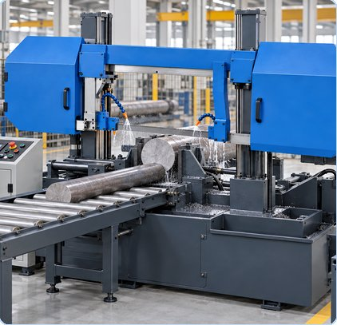

# 띠톱기계

[전체 목록](../../../README.md) · 장비군: **절단·정밀가공 설비**

> 자동 생성 페이지입니다. 이 폴더에 파일을 올리면 내용이 갱신됩니다.

필수 산출물 1/3 · 개발계획서 없음 · 가이던스 없음 · AASX 있음

> [!WARNING]
> **확인 필요**
>
> - AASX 파일 이름 규칙 위반: `BandSawMachine_AAS_v0.0.1.aasx` (예: `AirDryer_v0.0.1.aasx`)
> - 내용이 완전히 같은 AASX: `BandSawMachine_AAS_v0.0.1.aasx`, `BandSawMachine_v0.0.1_260930.aasx`. 하나만 남기세요

## 산출물

| 구분 | 파일 | 크기 | 보기 |
|---|---|---|---|
| 개발계획서 | 아직 없음 | | |
| 가이던스 | 아직 없음 | | |
| AASX | [BandSawMachine_AAS_v0.0.1.aasx](AASX/BandSawMachine_AAS_v0.0.1.aasx) | 2.4 MB | [열람 페이지](gen/BandSawMachine_AAS_v0.0.1.md) |
| AASX | [BandSawMachine_v0.0.1_260930.aasx](AASX/BandSawMachine_v0.0.1_260930.aasx) | 2.4 MB | [열람 페이지](gen/BandSawMachine_v0.0.1_260930.md) |

## AAS 구성 — `BandSawMachineAAS`

`BandSawMachine_AAS_v0.0.1.aasx` 에서 읽은 서브모델 7개 · **[요소 전체 보기](gen/BandSawMachine_AAS_v0.0.1.md)**:

| # | 서브모델 idShort |
|:-:|---|
| 1 | DigitalNameplate |
| 2 | HandoverDocumentation |
| 3 | TechnicalData |
| 4 | OperationalData |
| 5 | TimeSeries |
| 6 | ProcessParameters |
| 7 | PredictiveMaintenance |

변경 기록 (최근 6건)

| 날짜 | 변경 | 파일 |
|---|---|---|
| 2026-11-04 | 삭제 | 띠톱기계_가이던스(자리표시).docx |
| 2026-11-04 | 삭제 | 띠톱기계_개발계획서(자리표시).docx |
| 2026-11-03 | 추가 | BandSawMachine_AAS_v0.0.1.aasx |
| 2026-11-03 | 추가 | BandSawMachine_v0.0.1_260930.aasx |
| 2026-11-03 | 추가 | 띠톱기계_가이던스(자리표시).docx |
| 2026-11-03 | 추가 | 띠톱기계_개발계획서(자리표시).docx |

