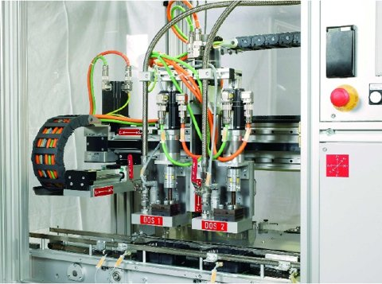

# 유압 주입기

[← 전체 목록](../../../README.md) · 장비군: **주입·충전 설비**

> 🤖 자동 생성 페이지입니다. 이 폴더에 파일을 올리면 내용이 갱신됩니다.

| 항목 | 내용 |
|---|---|
| 상태 | 🟡 작성 중 |
| 최근 올린 사람 | Claude |
| 수정일 | 2026-11-03 |

> [!WARNING]
> **확인 필요**
>
> - AASX 파일 이름 규칙 위반: `HydraulicInjector_v0.0.1_20261026.aasx` (예: `AirDryer_v0.0.1.aasx`)

## 산출물

| 구분 | 파일 | 크기 | 바로 보기 |
|---|---|---|---|
| 📄 개발계획서 | _아직 없음_ | | |
| 📘 가이던스 | _아직 없음_ | | |
| 🧩 AASX | [HydraulicInjector_v0.0.1_20261026.aasx](AASX/HydraulicInjector_v0.0.1_20261026.aasx) | 2.3 MB | [👁 열람 페이지](gen/HydraulicInjector_v0.0.1_20261026.md) |

## AAS 구성 — `HydraulicInjectorAAS`

`HydraulicInjector_v0.0.1_20261026.aasx` 에서 읽은 서브모델 8개 · **[👁 요소 전체 펼쳐 보기](gen/HydraulicInjector_v0.0.1_20261026.md)**:

| # | 서브모델 idShort |
|:-:|---|
| 1 | Nameplate |
| 2 | HandoverDocumentation |
| 3 | TechnicalData |
| 4 | OperationalData |
| 5 | TimeSeries |
| 6 | ProcessParameters |
| 7 | PredictiveMaintenance |
| 8 | ProcessVariablesForManufacturingKPICalculation |
