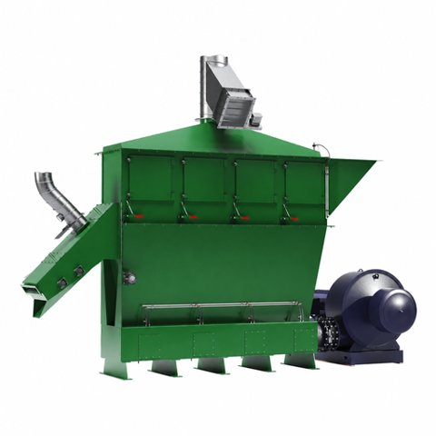

# FoundrySandReclaimer_AAS_v0.0.1.aasx

[장비 페이지](../README.md) · [AASX 다운로드](../AASX/FoundrySandReclaimer_AAS_v0.0.1.aasx) · 1.7 MB

> AASX 파일을 열어 자동으로 만든 열람 페이지입니다. 직접 고치지 말고 AASX를 다시 올리세요.

| 항목 | 내용 |
|---|---|
| AAS idShort | `FoundrySandReclaimerAAS` |
| AAS id | https://www.smart-factory.kr/ids/aas/FoundrySandReclaimerAAS/1/0 |
| 자산 종류 (assetKind) | Type |
| globalAssetId | https://www.smart-factory.kr/ids/asset/FoundrySandReclaimer/ExR-30/1/0 |
| 설명 | 비식별 기계식 마찰재생 주물사 리클레이머 타입 참조모델이며 실물 자산 승인 정보가 아니다. |
| 서브모델 | 6개 |
| 전체 요소 | 1,652개 |

## 서브모델 한눈에 보기

| # | 서브모델 | 요소 수 | semanticId |
|:-:|---|--:|---|
| 1 | [Nameplate](#sm-1) | 34 | https://admin-shell.io/idta/nameplate/3/0/Nameplate |
| 2 | [HandoverDocumentation](#sm-2) | 38 | 0173-1#01-AHF578#003 |
| 3 | [TechnicalData](#sm-3) | 65 | 0173-1#01-AHX837#002 |
| 4 | [OperationalData](#sm-4) | 48 | https://www.smart-factory.kr/ids/sm/FoundrySandReclaimerAAS/OperationalData/1/0 |
| 5 | [TimeSeries](#sm-5) | 1,384 | https://admin-shell.io/idta/TimeSeries/1/1 |
| 6 | [ReclaimerPredictiveMaintenance](#sm-6) | 83 | https://www.smart-factory.kr/ids/sm/FoundrySandReclaimerAAS/ReclaimerPredictiveMaintenanc… |

## 서브모델 상세

각 서브모델 이름을 누르면 펼쳐집니다. **굵은 글씨**는 하위 요소가 있는 묶음입니다.

<b>1. Nameplate</b> — 요소 34개

> Contains the nameplate information attached to the product

semanticId: `https://admin-shell.io/idta/nameplate/3/0/Nameplate`

| idShort | 종류 | 값 | semanticId |
|---|---|---|---|
| URIOfTheProduct | 속성 | https://www.smart-factory.kr/ids/asset/FoundrySandReclaimer/ExR-30/1/0 | 0112/2///61987#ABN590#002 |
| ManufacturerName | 다국어&nbsp;속성 | Example Manufacturer Co., Ltd. | 0112/2///61987#ABA565#009 |
| ManufacturerProductDesignation | 다국어&nbsp;속성 | Mechanical Attrition Foundry Sand Reclaimer ExR-30 | 0112/2///61987#ABA567#009 |
| **AddressInformation** | 묶음&nbsp;(4) |  | https://admin-shell.io/zvei/nameplate/1/0/ContactInformations/Address… |
| &nbsp;&nbsp;&nbsp;└ Street | 다국어&nbsp;속성 | 123 Foundry-ro | 0173-1#02-AAO128#002 |
| &nbsp;&nbsp;&nbsp;└ Zipcode | 다국어&nbsp;속성 | 12345 | 0173-1#02-AAO129#002 |
| &nbsp;&nbsp;&nbsp;└ CityTown | 다국어&nbsp;속성 | Changwon | 0173-1#02-AAO132#002 |
| &nbsp;&nbsp;&nbsp;└ NationalCode | 다국어&nbsp;속성 | KR | 0173-1#02-AAO134#002 |
| OrderCodeOfManufacturer | 속성 | EX-RCL-30 | 0112/2///61987#ABA950#008 |
| ProductArticleNumberOfManufacturer | 속성 | RCL-30-ART | 0112/2///61987#ABA581#007 |
| SerialNumber | 속성 | RCL-SN-2026-0001 | 0112/2///61987#ABA951#009 |
| ManufacturerProductRoot | 다국어&nbsp;속성 | "flow meter" | 0112/2///61360_7#AAS011#001 |
| ManufacturerProductFamily | 다국어&nbsp;속성 | "Type ABC" | 0112/2///61987#ABP464#002 |
| ManufacturerProductType | 속성 | FM-ABC-1234 | 0112/2///61987#ABA300#008 |
| YearOfConstruction | 속성 | 2022 | 0112/2///61987#ABP000#002 |
| DateOfManufacture | 속성 | 2022-01-01 | 0112/2///61987#ABB757#007 |
| HardwareVersion | 속성 | 1.0.0 | 0112/2///61987#ABA926#008 |
| FirmwareVersion | 속성 | 1.0.0 | 0112/2///61987#ABA302#006 |
| SoftwareVersion | 속성 | 1.0.0 | 0112/2///61987#ABA601#008 |
| CountryOfOrigin | 속성 | DE | 0112/2///61987#ABP462#001 |
| UniqueFacilityIdentifier | 속성 | 987654321 | https://admin-shell.io/idta/nameplate/3/0/UniqueFacilityIdentifier |
| CompanyLogo | 파일 | /aasx/Thumbnail.png | 0112/2///61987#ABP463#001 |
| **Markings** | 목록&nbsp;(1) |  | 0112/2///61360_7#AAS006#001 |
| &nbsp;&nbsp;&nbsp;└ **** | 묶음&nbsp;(6) |  | 0112/2///61360_7#AAS009#001 |
| &nbsp;&nbsp;&nbsp;&nbsp;&nbsp;&nbsp;└ MarkingName | 속성 | 0173-1#07-DAA603#004 | 0112/2///61987#ABA231#009 |
| &nbsp;&nbsp;&nbsp;&nbsp;&nbsp;&nbsp;└ DesignationOfCertificateOrApproval | 속성 | KEMA99IECEX1105/128 | 0112/2///61987#ABH783#003 |
| &nbsp;&nbsp;&nbsp;&nbsp;&nbsp;&nbsp;└ IssueDate | 속성 | 2022-01-01 | 0112/2///61987#ABO097#001 |
| &nbsp;&nbsp;&nbsp;&nbsp;&nbsp;&nbsp;└ ExpiryDate | 속성 | 2022-01-01 | 0112/2///61987#ABH830#002 |
| &nbsp;&nbsp;&nbsp;&nbsp;&nbsp;&nbsp;└ MarkingFile | 파일 | /aasx/files/idta/example_markings.png | 0112/2///61987#ABO100#002 |
| &nbsp;&nbsp;&nbsp;&nbsp;&nbsp;&nbsp;└ MarkingAdditionalText | 속성 | 0044 | 0112/2///61987#ABB146#007 |
| **AssetSpecificProperties** | 묶음&nbsp;(1) |  | 0173-1#02-ABI218#003/0173-1#01-AGZ672#004 |
| &nbsp;&nbsp;&nbsp;└ **GuidelineSpecificProperties** | 목록&nbsp;(1) |  | 0173-1#02-ABI219#003/0173-1#01-AHD205#004 |
| &nbsp;&nbsp;&nbsp;&nbsp;&nbsp;&nbsp;└ **** | 묶음&nbsp;(1) |  | 0173-1#01-AHD205#004 |
| &nbsp;&nbsp;&nbsp;&nbsp;&nbsp;&nbsp;&nbsp;&nbsp;&nbsp;└ GuidelineForConformityDeclaration | 속성 | EXAMPLE-GUIDELINE-NOT-VERIFIED | 0173-1#02-AAO856#002 |

<b>2. HandoverDocumentation</b> — 요소 38개

> The Submodel defines a set meta data for the handover of documentation from the manufacturer to the operator for industrial equipment

semanticId: `0173-1#01-AHF578#003`

| idShort | 종류 | 값 | semanticId |
|---|---|---|---|
| **Documents** | 목록&nbsp;(1) |  | 0173-1#02-ABI500#003 |
| &nbsp;&nbsp;&nbsp;└ **** | 묶음&nbsp;(4) |  | 0173-1#02-ABI500#003/0173-1#01-AHF579#003 |
| &nbsp;&nbsp;&nbsp;&nbsp;&nbsp;&nbsp;└ **DocumentIds** | 목록&nbsp;(1) |  | 0173-1#02-ABI501#003 |
| &nbsp;&nbsp;&nbsp;&nbsp;&nbsp;&nbsp;&nbsp;&nbsp;&nbsp;└ **** | 묶음&nbsp;(3) |  | 0173-1#02-ABI501#003/0173-1#01-AHF580#003 |
| &nbsp;&nbsp;&nbsp;&nbsp;&nbsp;&nbsp;&nbsp;&nbsp;&nbsp;&nbsp;&nbsp;&nbsp;└ DocumentDomainId | 속성 | AAS-REFERENCE | 0173-1#02-ABH994#003 |
| &nbsp;&nbsp;&nbsp;&nbsp;&nbsp;&nbsp;&nbsp;&nbsp;&nbsp;&nbsp;&nbsp;&nbsp;└ DocumentIdentifier | 속성 | RCL-OM-001 | 0173-1#02-AAO099#004 |
| &nbsp;&nbsp;&nbsp;&nbsp;&nbsp;&nbsp;&nbsp;&nbsp;&nbsp;&nbsp;&nbsp;&nbsp;└ DocumentIsPrimary | 속성 | true | 0173-1#02-ABH995#003 |
| &nbsp;&nbsp;&nbsp;&nbsp;&nbsp;&nbsp;└ **DocumentClassifications** | 목록&nbsp;(1) |  | 0173-1#02-ABI502#003 |
| &nbsp;&nbsp;&nbsp;&nbsp;&nbsp;&nbsp;&nbsp;&nbsp;&nbsp;└ **** | 묶음&nbsp;(3) |  | 0173-1#02-ABI502#003/0173-1#01-AHF581#003 |
| &nbsp;&nbsp;&nbsp;&nbsp;&nbsp;&nbsp;&nbsp;&nbsp;&nbsp;&nbsp;&nbsp;&nbsp;└ ClassId | 속성 | 03-02 | 0173-1#02-ABH996#003 |
| &nbsp;&nbsp;&nbsp;&nbsp;&nbsp;&nbsp;&nbsp;&nbsp;&nbsp;&nbsp;&nbsp;&nbsp;└ ClassName | 다국어&nbsp;속성 | Operation manual | 0173-1#02-ABJ219#002 |
| &nbsp;&nbsp;&nbsp;&nbsp;&nbsp;&nbsp;&nbsp;&nbsp;&nbsp;&nbsp;&nbsp;&nbsp;└ ClassificationSystem | 속성 | VDI 2770 | 0173-1#02-ABH997#003 |
| &nbsp;&nbsp;&nbsp;&nbsp;&nbsp;&nbsp;└ **DocumentVersions** | 목록&nbsp;(1) |  | 0173-1#02-ABI503#003 |
| &nbsp;&nbsp;&nbsp;&nbsp;&nbsp;&nbsp;&nbsp;&nbsp;&nbsp;└ **** | 묶음&nbsp;(15) |  | 0173-1#02-ABI503#003/0173-1#01-AHF582#003 |
| &nbsp;&nbsp;&nbsp;&nbsp;&nbsp;&nbsp;&nbsp;&nbsp;&nbsp;&nbsp;&nbsp;&nbsp;└ **Language** | 목록&nbsp;(1) |  | 0173-1#02-AAN468#008 |
| &nbsp;&nbsp;&nbsp;&nbsp;&nbsp;&nbsp;&nbsp;&nbsp;&nbsp;&nbsp;&nbsp;&nbsp;&nbsp;&nbsp;&nbsp;└  | 속성 | en | 0173-1#02-AAN468#008 |
| &nbsp;&nbsp;&nbsp;&nbsp;&nbsp;&nbsp;&nbsp;&nbsp;&nbsp;&nbsp;&nbsp;&nbsp;└ Version | 속성 | 1.0 | 0173-1#02-AAP003#005 |
| &nbsp;&nbsp;&nbsp;&nbsp;&nbsp;&nbsp;&nbsp;&nbsp;&nbsp;&nbsp;&nbsp;&nbsp;└ Title | 다국어&nbsp;속성 | Foundry Sand Reclaimer ExR-30 Operation and Maintenance Manual | 0173-1#02-ABG940#003 |
| &nbsp;&nbsp;&nbsp;&nbsp;&nbsp;&nbsp;&nbsp;&nbsp;&nbsp;&nbsp;&nbsp;&nbsp;└ Subtitle | 다국어&nbsp;속성 | 운전 점검 및 유지보수를 위한 참조모델 예시 문서 | 0173-1#02-ABH998#003 |
| &nbsp;&nbsp;&nbsp;&nbsp;&nbsp;&nbsp;&nbsp;&nbsp;&nbsp;&nbsp;&nbsp;&nbsp;└ Description | 다국어&nbsp;속성 | Deidentified HWP-derived reference; not an OEM manual, safety instruction, or o… | 0173-1#02-AAN466#004 |
| &nbsp;&nbsp;&nbsp;&nbsp;&nbsp;&nbsp;&nbsp;&nbsp;&nbsp;&nbsp;&nbsp;&nbsp;└ KeyWords | 다국어&nbsp;속성 | foundry sand reclaimer, reference example, deidentified | 0173-1#02-ABH999#003 |
| &nbsp;&nbsp;&nbsp;&nbsp;&nbsp;&nbsp;&nbsp;&nbsp;&nbsp;&nbsp;&nbsp;&nbsp;└ StatusSetDate | 속성 | 2026-08-08 | 0173-1#02-ABI000#003 |
| &nbsp;&nbsp;&nbsp;&nbsp;&nbsp;&nbsp;&nbsp;&nbsp;&nbsp;&nbsp;&nbsp;&nbsp;└ StatusValue | 속성 | Example | 0173-1#02-ABI001#003 |
| &nbsp;&nbsp;&nbsp;&nbsp;&nbsp;&nbsp;&nbsp;&nbsp;&nbsp;&nbsp;&nbsp;&nbsp;└ OrganizationShortName | 속성 | AAS-REF | https://api.eclass-cdp.com/0173-1-02-ABI002-003 |
| &nbsp;&nbsp;&nbsp;&nbsp;&nbsp;&nbsp;&nbsp;&nbsp;&nbsp;&nbsp;&nbsp;&nbsp;└ OrganizationOfficialName | 속성 | AAS reference model example | 0173-1#02-ABI004#003 |
| &nbsp;&nbsp;&nbsp;&nbsp;&nbsp;&nbsp;&nbsp;&nbsp;&nbsp;&nbsp;&nbsp;&nbsp;└ **RefersToEntities** | 목록&nbsp;(1) |  | 0173-1#02-ABK288#002 |
| &nbsp;&nbsp;&nbsp;&nbsp;&nbsp;&nbsp;&nbsp;&nbsp;&nbsp;&nbsp;&nbsp;&nbsp;&nbsp;&nbsp;&nbsp;└  | 참조 | https://www.smart-factory.kr/ids/sm/FoundrySandReclaimerAAS/HandoverDocumentati… | 0173-1#02-ABK288#002 |
| &nbsp;&nbsp;&nbsp;&nbsp;&nbsp;&nbsp;&nbsp;&nbsp;&nbsp;&nbsp;&nbsp;&nbsp;└ **BasedOnReferences** | 목록&nbsp;(1) |  | 0173-1#02-ABK289#002 |
| &nbsp;&nbsp;&nbsp;&nbsp;&nbsp;&nbsp;&nbsp;&nbsp;&nbsp;&nbsp;&nbsp;&nbsp;&nbsp;&nbsp;&nbsp;└  | 참조 |  | 0173-1#02-ABK289#002 |
| &nbsp;&nbsp;&nbsp;&nbsp;&nbsp;&nbsp;&nbsp;&nbsp;&nbsp;&nbsp;&nbsp;&nbsp;└ **TranslationOfEntities** | 목록&nbsp;(1) |  | 0173-1#02-ABK290#002 |
| &nbsp;&nbsp;&nbsp;&nbsp;&nbsp;&nbsp;&nbsp;&nbsp;&nbsp;&nbsp;&nbsp;&nbsp;&nbsp;&nbsp;&nbsp;└  | 참조 |  | 0173-1#02-ABK290#002 |
| &nbsp;&nbsp;&nbsp;&nbsp;&nbsp;&nbsp;&nbsp;&nbsp;&nbsp;&nbsp;&nbsp;&nbsp;└ **DigitalFiles** | 목록&nbsp;(1) |  | 0173-1#02-ABK126#002 |
| &nbsp;&nbsp;&nbsp;&nbsp;&nbsp;&nbsp;&nbsp;&nbsp;&nbsp;&nbsp;&nbsp;&nbsp;&nbsp;&nbsp;&nbsp;└  | 파일 | /aasx/files/documents/FoundrySandReclaimer_DevelopmentPlan.hwp | 0173-1#02-ABK126#002 |
| &nbsp;&nbsp;&nbsp;&nbsp;&nbsp;&nbsp;&nbsp;&nbsp;&nbsp;&nbsp;&nbsp;&nbsp;└ PreviewFile | 파일 | /aasx/Thumbnail.png | 0173-1#02-ABK127#002 |
| &nbsp;&nbsp;&nbsp;&nbsp;&nbsp;&nbsp;└ **DocumentedEntities** | 목록&nbsp;(1) |  | https://admin-shell.io/vdi/2770/1/0/Document/DocumentedEntities |
| &nbsp;&nbsp;&nbsp;&nbsp;&nbsp;&nbsp;&nbsp;&nbsp;&nbsp;└  | 참조 | https://www.smart-factory.kr/ids/sm/FoundrySandReclaimerAAS/HandoverDocumentati… | https://admin-shell.io/vdi/2770/1/0/Document/DocumentedEntity |
| **Entities** | 목록&nbsp;(1) |  | https://admin-shell.io/vdi/2770/1/0/EntitiesForDocumentation |
| &nbsp;&nbsp;&nbsp;└  | 엔티티 |  | https://admin-shell.io/vdi/2770/1/0/EntityForDocumentation |

<b>3. TechnicalData</b> — 요소 65개

> 기술 데이터 서브모델

semanticId: `0173-1#01-AHX837#002`

| idShort | 종류 | 값 | semanticId |
|---|---|---|---|
| **GeneralInformation** | 묶음&nbsp;(6) |  | 0173-1#02-ABK161#002/0173-1#01-AHX838#002 |
| &nbsp;&nbsp;&nbsp;└ ManufacturerName | 속성 | Example Manufacturer Co., Ltd. | 0173-1#02-AAO677#004 |
| &nbsp;&nbsp;&nbsp;└ ManufacturerProductDesignation | 다국어&nbsp;속성 | Example Manufacturer Co., Ltd. Foundry Sand Reclaimer ExR-30 | 0173-1#02-AAW338#003 |
| &nbsp;&nbsp;&nbsp;└ ManufacturerArticleNumber | 속성 | RCL-30-ART | 0173-1#02-AAO676#005 |
| &nbsp;&nbsp;&nbsp;└ ManufacturerOrderCode | 속성 | EX-RCL-30 | 0173-1#02-AAO227#004 |
| &nbsp;&nbsp;&nbsp;└ **ProductImages** | 목록&nbsp;(1) |  | 0173-1#02-ABM220#001 |
| &nbsp;&nbsp;&nbsp;&nbsp;&nbsp;&nbsp;└ **** | 묶음&nbsp;(2) |  | 0173-1#02-ABM220#001/0173-1#01-AHY911#001 |
| &nbsp;&nbsp;&nbsp;&nbsp;&nbsp;&nbsp;&nbsp;&nbsp;&nbsp;└ ImageFile | 파일 | /aasx/files/images/RECLAIMER_ProductImage.jpg | 0173-1#02-ABK291#002 |
| &nbsp;&nbsp;&nbsp;&nbsp;&nbsp;&nbsp;&nbsp;&nbsp;&nbsp;└ ImageNote | 다국어&nbsp;속성 | Front view of Example Manufacturer Co., Ltd. foundry sand reclaimer | 0173-1#02-ABL423#001 |
| &nbsp;&nbsp;&nbsp;└ CompanyLogo | 파일 | /aasx/Thumbnail.png | 0173-1#02-ABI776#002 |
| **ProductClassifications** | 목록&nbsp;(1) |  | 0173-1#02-ABK162#002 |
| &nbsp;&nbsp;&nbsp;└ **** | 묶음&nbsp;(7) |  | 0173-1#02-ABK162#002/0173-1#01-AHX839#002 |
| &nbsp;&nbsp;&nbsp;&nbsp;&nbsp;&nbsp;└ ClassificationSystem | 속성 | ECLASS | 0173-1#02-ABL424#001 |
| &nbsp;&nbsp;&nbsp;&nbsp;&nbsp;&nbsp;└ ClassificationSystemVersion | 속성 | ECLASS 16.0 | 0173-1#02-AAR710#003 |
| &nbsp;&nbsp;&nbsp;&nbsp;&nbsp;&nbsp;└ ProductClassId | 속성 | 0173-1#01-AHW659#004 | 0173-1#02-ABG776#003 |
| &nbsp;&nbsp;&nbsp;&nbsp;&nbsp;&nbsp;└ ProductClassCodedName | 속성 | 40-22-03-07 | 0173-1#02-ABK128#002 |
| &nbsp;&nbsp;&nbsp;&nbsp;&nbsp;&nbsp;└ ProductClassName | 다국어&nbsp;속성 | Regeneration device | 0173-1#02-ABK273#002 |
| &nbsp;&nbsp;&nbsp;&nbsp;&nbsp;&nbsp;└ ClassificationSystemUrl | 속성 | https://eclass.eu | https://admin-shell.io/IDTA/TechnicalData/ProductClassifications/Prod… |
| &nbsp;&nbsp;&nbsp;&nbsp;&nbsp;&nbsp;└ ReferenceToTechnicalPropertyArea | 참조 | https://admin-shell.io/idta/SubmodelTemplate/TechnicalData/2/0 / TechnicalPrope… | 0173-1#02-ABL358#002 |
| **TechnicalPropertyAreas** | 목록&nbsp;(1) |  | 0173-1#02-ABK163#002 |
| &nbsp;&nbsp;&nbsp;└ **** | 묶음&nbsp;(1) |  | 0173-1#02-ABL358#002/0173-1#01-AHX773#002 |
| &nbsp;&nbsp;&nbsp;&nbsp;&nbsp;&nbsp;└ **ReclaimerSystem** | 묶음&nbsp;(6) |  | https://www.smart-factory.kr/ids/cd/ReclaimerSystem/1/0 |
| &nbsp;&nbsp;&nbsp;&nbsp;&nbsp;&nbsp;&nbsp;&nbsp;&nbsp;└ **ReclaimerCommonTechnicalPropertyAreas** | 묶음&nbsp;(4) |  | https://www.smart-factory.kr/ids/cd/ReclaimerCommonTechnicalPropertyA… |
| &nbsp;&nbsp;&nbsp;&nbsp;&nbsp;&nbsp;&nbsp;&nbsp;&nbsp;&nbsp;&nbsp;&nbsp;└ ReclaimerType | 속성 | Mechanical attrition reclaimer | https://www.smart-factory.kr/ids/cd/ReclaimerType/1/0 |
| &nbsp;&nbsp;&nbsp;&nbsp;&nbsp;&nbsp;&nbsp;&nbsp;&nbsp;&nbsp;&nbsp;&nbsp;└ ApplicableSandType | 속성 | No-bake used foundry sand | https://www.smart-factory.kr/ids/cd/ApplicableSandType/1/0 |
| &nbsp;&nbsp;&nbsp;&nbsp;&nbsp;&nbsp;&nbsp;&nbsp;&nbsp;&nbsp;&nbsp;&nbsp;└ ReclaimingUnitConfiguration | 속성 | crushing + attrition + classification + cooling + dust collection | https://www.smart-factory.kr/ids/cd/ReclaimingUnitConfiguration/1/0 |
| &nbsp;&nbsp;&nbsp;&nbsp;&nbsp;&nbsp;&nbsp;&nbsp;&nbsp;&nbsp;&nbsp;&nbsp;└ OperationType | 속성 | continuous | https://www.smart-factory.kr/ids/cd/OperationType/1/0 |
| &nbsp;&nbsp;&nbsp;&nbsp;&nbsp;&nbsp;&nbsp;&nbsp;&nbsp;└ **ReclaimingPerformanceTechnicalPropertyAreas** | 묶음&nbsp;(6) |  | https://www.smart-factory.kr/ids/cd/ReclaimingPerformanceTechnicalPro… |
| &nbsp;&nbsp;&nbsp;&nbsp;&nbsp;&nbsp;&nbsp;&nbsp;&nbsp;&nbsp;&nbsp;&nbsp;└ ProcessingCapacity | 속성 | 30 | https://www.smart-factory.kr/ids/cd/ProcessingCapacity/1/0 |
| &nbsp;&nbsp;&nbsp;&nbsp;&nbsp;&nbsp;&nbsp;&nbsp;&nbsp;&nbsp;&nbsp;&nbsp;└ ReclamationRate | 속성 | 95 | https://www.smart-factory.kr/ids/cd/ReclamationRate/1/0 |
| &nbsp;&nbsp;&nbsp;&nbsp;&nbsp;&nbsp;&nbsp;&nbsp;&nbsp;&nbsp;&nbsp;&nbsp;└ ReclaimedSandTemperature | 속성 | 45 | https://www.smart-factory.kr/ids/cd/ReclaimedSandTemperature/1/0 |
| &nbsp;&nbsp;&nbsp;&nbsp;&nbsp;&nbsp;&nbsp;&nbsp;&nbsp;&nbsp;&nbsp;&nbsp;└ SandGrainSize | 속성 | 55 | https://www.smart-factory.kr/ids/cd/SandGrainSize/1/0 |
| &nbsp;&nbsp;&nbsp;&nbsp;&nbsp;&nbsp;&nbsp;&nbsp;&nbsp;&nbsp;&nbsp;&nbsp;└ ResidualBinderLimit | 속성 | 0.5 | https://www.smart-factory.kr/ids/cd/ResidualBinderLimit/1/0 |
| &nbsp;&nbsp;&nbsp;&nbsp;&nbsp;&nbsp;&nbsp;&nbsp;&nbsp;&nbsp;&nbsp;&nbsp;└ SandMoistureRange | 범위 | 0.2 ~ 1.0 | https://www.smart-factory.kr/ids/cd/SandMoistureRange/1/0 |
| &nbsp;&nbsp;&nbsp;&nbsp;&nbsp;&nbsp;&nbsp;&nbsp;&nbsp;└ **RotorAndDriveTechnicalPropertyAreas** | 묶음&nbsp;(6) |  | https://www.smart-factory.kr/ids/cd/RotorAndDriveTechnicalPropertyAre… |
| &nbsp;&nbsp;&nbsp;&nbsp;&nbsp;&nbsp;&nbsp;&nbsp;&nbsp;&nbsp;&nbsp;&nbsp;└ DriveMotorPower | 속성 | 75 | 0173-1#02-AAG926#005 |
| &nbsp;&nbsp;&nbsp;&nbsp;&nbsp;&nbsp;&nbsp;&nbsp;&nbsp;&nbsp;&nbsp;&nbsp;└ RotorSpeed | 속성 | 720 | https://www.smart-factory.kr/ids/cd/RotorSpeed/1/0 |
| &nbsp;&nbsp;&nbsp;&nbsp;&nbsp;&nbsp;&nbsp;&nbsp;&nbsp;&nbsp;&nbsp;&nbsp;└ RotorSpeedRange | 범위 | 500 ~ 800 | https://www.smart-factory.kr/ids/cd/RotorSpeedRange/1/0 |
| &nbsp;&nbsp;&nbsp;&nbsp;&nbsp;&nbsp;&nbsp;&nbsp;&nbsp;&nbsp;&nbsp;&nbsp;└ LinerMaterial | 속성 | wear-resistant alloy steel | https://www.smart-factory.kr/ids/cd/LinerMaterial/1/0 |
| &nbsp;&nbsp;&nbsp;&nbsp;&nbsp;&nbsp;&nbsp;&nbsp;&nbsp;&nbsp;&nbsp;&nbsp;└ RotorVibrationLimit | 범위 | 0 ~ 4.5 | https://www.smart-factory.kr/ids/cd/RotorVibrationLimit/1/0 |
| &nbsp;&nbsp;&nbsp;&nbsp;&nbsp;&nbsp;&nbsp;&nbsp;&nbsp;&nbsp;&nbsp;&nbsp;└ BearingLubricationType | 속성 | grease lubrication | https://www.smart-factory.kr/ids/cd/BearingLubricationType/1/0 |
| &nbsp;&nbsp;&nbsp;&nbsp;&nbsp;&nbsp;&nbsp;&nbsp;&nbsp;└ **ClassificationAndDustCollectionTechnicalPropertyAreas** | 묶음&nbsp;(5) |  | https://www.smart-factory.kr/ids/cd/ClassificationAndDustCollectionTe… |
| &nbsp;&nbsp;&nbsp;&nbsp;&nbsp;&nbsp;&nbsp;&nbsp;&nbsp;&nbsp;&nbsp;&nbsp;└ ClassifierAirflow | 속성 | 180 | https://www.smart-factory.kr/ids/cd/ClassifierAirflow/1/0 |
| &nbsp;&nbsp;&nbsp;&nbsp;&nbsp;&nbsp;&nbsp;&nbsp;&nbsp;&nbsp;&nbsp;&nbsp;└ ClassifierPressureRange | 범위 | 0.5 ~ 2.0 | https://www.smart-factory.kr/ids/cd/ClassifierPressureRange/1/0 |
| &nbsp;&nbsp;&nbsp;&nbsp;&nbsp;&nbsp;&nbsp;&nbsp;&nbsp;&nbsp;&nbsp;&nbsp;└ DustCollectionCapacity | 속성 | 240 | https://www.smart-factory.kr/ids/cd/DustCollectionCapacity/1/0 |
| &nbsp;&nbsp;&nbsp;&nbsp;&nbsp;&nbsp;&nbsp;&nbsp;&nbsp;&nbsp;&nbsp;&nbsp;└ DustLoadRange | 범위 | 0 ~ 85 | https://www.smart-factory.kr/ids/cd/DustLoadRange/1/0 |
| &nbsp;&nbsp;&nbsp;&nbsp;&nbsp;&nbsp;&nbsp;&nbsp;&nbsp;&nbsp;&nbsp;&nbsp;└ FilterCleaningMethod | 속성 | pulse jet cleaning | https://www.smart-factory.kr/ids/cd/FilterCleaningMethod/1/0 |
| &nbsp;&nbsp;&nbsp;&nbsp;&nbsp;&nbsp;&nbsp;&nbsp;&nbsp;└ **CoolingAndDischargeTechnicalPropertyAreas** | 묶음&nbsp;(4) |  | https://www.smart-factory.kr/ids/cd/CoolingAndDischargeTechnicalPrope… |
| &nbsp;&nbsp;&nbsp;&nbsp;&nbsp;&nbsp;&nbsp;&nbsp;&nbsp;&nbsp;&nbsp;&nbsp;└ CoolingAirflow | 속성 | 90 | https://www.smart-factory.kr/ids/cd/CoolingAirflow/1/0 |
| &nbsp;&nbsp;&nbsp;&nbsp;&nbsp;&nbsp;&nbsp;&nbsp;&nbsp;&nbsp;&nbsp;&nbsp;└ TargetDischargeTemperature | 속성 | 45 | https://www.smart-factory.kr/ids/cd/TargetDischargeTemperature/1/0 |
| &nbsp;&nbsp;&nbsp;&nbsp;&nbsp;&nbsp;&nbsp;&nbsp;&nbsp;&nbsp;&nbsp;&nbsp;└ DischargeGateType | 속성 | motorized slide gate | https://www.smart-factory.kr/ids/cd/DischargeGateType/1/0 |
| &nbsp;&nbsp;&nbsp;&nbsp;&nbsp;&nbsp;&nbsp;&nbsp;&nbsp;&nbsp;&nbsp;&nbsp;└ DischargeConveyorType | 속성 | enclosed screw conveyor | https://www.smart-factory.kr/ids/cd/DischargeConveyorType/1/0 |
| &nbsp;&nbsp;&nbsp;&nbsp;&nbsp;&nbsp;&nbsp;&nbsp;&nbsp;└ **InstallationElectricalAndSafetyTechnicalPropertyAreas** | 묶음&nbsp;(9) |  | https://www.smart-factory.kr/ids/cd/InstallationElectricalAndSafetyTe… |
| &nbsp;&nbsp;&nbsp;&nbsp;&nbsp;&nbsp;&nbsp;&nbsp;&nbsp;&nbsp;&nbsp;&nbsp;└ MachineDimensions | 속성 | 4500 x 2200 x 3800 | https://www.smart-factory.kr/ids/cd/MachineDimensions/1/0 |
| &nbsp;&nbsp;&nbsp;&nbsp;&nbsp;&nbsp;&nbsp;&nbsp;&nbsp;&nbsp;&nbsp;&nbsp;└ RatedVoltage | 범위 | 380 ~ 415 | https://www.smart-factory.kr/ids/cd/RatedVoltage/1/0 |
| &nbsp;&nbsp;&nbsp;&nbsp;&nbsp;&nbsp;&nbsp;&nbsp;&nbsp;&nbsp;&nbsp;&nbsp;└ ControlVoltage | 속성 | 24 | https://www.smart-factory.kr/ids/cd/ControlVoltage/1/0 |
| &nbsp;&nbsp;&nbsp;&nbsp;&nbsp;&nbsp;&nbsp;&nbsp;&nbsp;&nbsp;&nbsp;&nbsp;└ IPRating | 속성 | IP54 | 0173-1#02-AAV695#003 |
| &nbsp;&nbsp;&nbsp;&nbsp;&nbsp;&nbsp;&nbsp;&nbsp;&nbsp;&nbsp;&nbsp;&nbsp;└ ExplosionPreventionMeasure | 속성 | grounding + spark detection + dust collector interlock | https://www.smart-factory.kr/ids/cd/ExplosionPreventionMeasure/1/0 |
| &nbsp;&nbsp;&nbsp;&nbsp;&nbsp;&nbsp;&nbsp;&nbsp;&nbsp;&nbsp;&nbsp;&nbsp;└ EmergencyStopCircuitType | 속성 | dual-channel safety relay | https://www.smart-factory.kr/ids/cd/EmergencyStopCircuitType/1/0 |
| &nbsp;&nbsp;&nbsp;&nbsp;&nbsp;&nbsp;&nbsp;&nbsp;&nbsp;&nbsp;&nbsp;&nbsp;└ MachineLength | 속성 | 4500 | https://www.smart-factory.kr/ids/cd/MachineLength/1/0 |
| &nbsp;&nbsp;&nbsp;&nbsp;&nbsp;&nbsp;&nbsp;&nbsp;&nbsp;&nbsp;&nbsp;&nbsp;└ MachineWidth | 속성 | 2200 | https://www.smart-factory.kr/ids/cd/MachineWidth/1/0 |
| &nbsp;&nbsp;&nbsp;&nbsp;&nbsp;&nbsp;&nbsp;&nbsp;&nbsp;&nbsp;&nbsp;&nbsp;└ MachineHeight | 속성 | 3800 | https://www.smart-factory.kr/ids/cd/MachineHeight/1/0 |
| **FurtherInformation** | 묶음&nbsp;(2) |  | 0173-1#02-ABK164#002 |
| &nbsp;&nbsp;&nbsp;└ TextStatement | 다국어&nbsp;속성 | Statement by the manufacturer in text form, e.g. scope of validity of the state… | 0173-1#02-ABK134#002 |
| &nbsp;&nbsp;&nbsp;└ ValidDate | 속성 | 2027-09-13 | 0173-1#02-ABL775#001 |

<b>4. OperationalData</b> — 요소 48개

> 운영 데이터 서브모델

semanticId: `https://www.smart-factory.kr/ids/sm/FoundrySandReclaimerAAS/OperationalData/1/0`

| idShort | 종류 | 값 | semanticId |
|---|---|---|---|
| **ReclaimerOperationData** | 묶음&nbsp;(5) |  | https://www.smart-factory.kr/ids/cd/ReclaimerOperationData/1/0 |
| &nbsp;&nbsp;&nbsp;└ **ReclaimProcessMonitoring** | 묶음&nbsp;(11) |  | https://www.smart-factory.kr/ids/cd/ReclaimProcessMonitoring/1/0 |
| &nbsp;&nbsp;&nbsp;&nbsp;&nbsp;&nbsp;└ CurrentThroughput | 속성 | 28.5 | https://www.smart-factory.kr/ids/cd/CurrentThroughput/1/0 |
| &nbsp;&nbsp;&nbsp;&nbsp;&nbsp;&nbsp;└ FeedSandFlowRate | 속성 | 30.2 | https://www.smart-factory.kr/ids/cd/FeedSandFlowRate/1/0 |
| &nbsp;&nbsp;&nbsp;&nbsp;&nbsp;&nbsp;└ DischargeSandFlowRate | 속성 | 28.8 | https://www.smart-factory.kr/ids/cd/DischargeSandFlowRate/1/0 |
| &nbsp;&nbsp;&nbsp;&nbsp;&nbsp;&nbsp;└ ReclaimedSandTemperature | 속성 | 44 | https://www.smart-factory.kr/ids/cd/ReclaimedSandTemperature/1/0 |
| &nbsp;&nbsp;&nbsp;&nbsp;&nbsp;&nbsp;└ SandMoistureContent | 속성 | 0.8 | https://www.smart-factory.kr/ids/cd/SandMoistureContent/1/0 |
| &nbsp;&nbsp;&nbsp;&nbsp;&nbsp;&nbsp;└ SandGrainSizeActual | 속성 | 55 | https://www.smart-factory.kr/ids/cd/SandGrainSizeActual/1/0 |
| &nbsp;&nbsp;&nbsp;&nbsp;&nbsp;&nbsp;└ ResidualBinderLevel | 속성 | 0.35 | https://www.smart-factory.kr/ids/cd/ResidualBinderLevel/1/0 |
| &nbsp;&nbsp;&nbsp;&nbsp;&nbsp;&nbsp;└ ReclamationEfficiency | 속성 | 94.5 | https://www.smart-factory.kr/ids/cd/ReclamationEfficiency/1/0 |
| &nbsp;&nbsp;&nbsp;&nbsp;&nbsp;&nbsp;└ OversizeReturnRate | 속성 | 3.2 | https://www.smart-factory.kr/ids/cd/OversizeReturnRate/1/0 |
| &nbsp;&nbsp;&nbsp;&nbsp;&nbsp;&nbsp;└ ReclaimerOperatingMode | 속성 | Auto | https://www.smart-factory.kr/ids/cd/ReclaimerOperatingMode/1/0 |
| &nbsp;&nbsp;&nbsp;&nbsp;&nbsp;&nbsp;└ FeedSandFlowRateSetpoint | 속성 | 30.0 | https://www.smart-factory.kr/ids/cd/FeedSandFlowRateSetpoint/1/0 |
| &nbsp;&nbsp;&nbsp;└ **RotorDriveMonitoring** | 묶음&nbsp;(8) |  | https://www.smart-factory.kr/ids/cd/RotorDriveMonitoring/1/0 |
| &nbsp;&nbsp;&nbsp;&nbsp;&nbsp;&nbsp;└ RotorSpeedActual | 속성 | 718 | https://www.smart-factory.kr/ids/cd/RotorSpeedActual/1/0 |
| &nbsp;&nbsp;&nbsp;&nbsp;&nbsp;&nbsp;└ RotorMotorCurrent | 속성 | 118 | https://www.smart-factory.kr/ids/cd/RotorMotorCurrent/1/0 |
| &nbsp;&nbsp;&nbsp;&nbsp;&nbsp;&nbsp;└ RotorTorque | 속성 | 620 | 0173-1#02-ABC236#004 |
| &nbsp;&nbsp;&nbsp;&nbsp;&nbsp;&nbsp;└ RotorVibration | 속성 | 2.6 | https://www.smart-factory.kr/ids/cd/RotorVibration/1/0 |
| &nbsp;&nbsp;&nbsp;&nbsp;&nbsp;&nbsp;└ RotorBearingTemperature | 속성 | 61 | 0173-1#02-ABC150#004 |
| &nbsp;&nbsp;&nbsp;&nbsp;&nbsp;&nbsp;└ DrivePowerConsumption | 속성 | 68 | 0173-1#02-AAC969#010 |
| &nbsp;&nbsp;&nbsp;&nbsp;&nbsp;&nbsp;└ RotorChamberPressure | 속성 | -0.4 | https://www.smart-factory.kr/ids/cd/RotorChamberPressure/1/0 |
| &nbsp;&nbsp;&nbsp;&nbsp;&nbsp;&nbsp;└ RotorSpeedSetpoint | 속성 | 720 | https://www.smart-factory.kr/ids/cd/RotorSpeedSetpoint/1/0 |
| &nbsp;&nbsp;&nbsp;└ **ClassificationAndDustMonitoring** | 묶음&nbsp;(9) |  | https://www.smart-factory.kr/ids/cd/ClassificationAndDustMonitoring/1… |
| &nbsp;&nbsp;&nbsp;&nbsp;&nbsp;&nbsp;└ ClassifierAirflowActual | 속성 | 176 | https://www.smart-factory.kr/ids/cd/ClassifierAirflowActual/1/0 |
| &nbsp;&nbsp;&nbsp;&nbsp;&nbsp;&nbsp;└ ClassifierPressure | 속성 | 1.2 | https://www.smart-factory.kr/ids/cd/ClassifierPressure/1/0 |
| &nbsp;&nbsp;&nbsp;&nbsp;&nbsp;&nbsp;└ DustCollectorDifferentialPressure | 속성 | 1.8 | https://www.smart-factory.kr/ids/cd/DustCollectorDifferentialPressure… |
| &nbsp;&nbsp;&nbsp;&nbsp;&nbsp;&nbsp;└ DustLoad | 속성 | 68 | https://www.smart-factory.kr/ids/cd/DustLoad/1/0 |
| &nbsp;&nbsp;&nbsp;&nbsp;&nbsp;&nbsp;└ DustDischargeValveState | 속성 | Open | https://www.smart-factory.kr/ids/cd/DustDischargeValveState/1/0 |
| &nbsp;&nbsp;&nbsp;&nbsp;&nbsp;&nbsp;└ SparkDetectionState | 속성 | Normal | https://www.smart-factory.kr/ids/cd/SparkDetectionState/1/0 |
| &nbsp;&nbsp;&nbsp;&nbsp;&nbsp;&nbsp;└ FilterPulseCount | 속성 | 1240 | https://www.smart-factory.kr/ids/cd/FilterPulseCount/1/0 |
| &nbsp;&nbsp;&nbsp;&nbsp;&nbsp;&nbsp;└ ClassifierAirflowSetpoint | 속성 | 180 | https://www.smart-factory.kr/ids/cd/ClassifierAirflowSetpoint/1/0 |
| &nbsp;&nbsp;&nbsp;&nbsp;&nbsp;&nbsp;└ DustCollectorDifferentialPressureAlarmLimit | 속성 | 2.0 | https://www.smart-factory.kr/ids/cd/DustCollectorDifferentialPressure… |
| &nbsp;&nbsp;&nbsp;└ **CoolingAndDischargeMonitoring** | 묶음&nbsp;(6) |  | https://www.smart-factory.kr/ids/cd/CoolingAndDischargeMonitoring/1/0 |
| &nbsp;&nbsp;&nbsp;&nbsp;&nbsp;&nbsp;└ CoolingAirTemperature | 속성 | 28 | https://www.smart-factory.kr/ids/cd/CoolingAirTemperature/1/0 |
| &nbsp;&nbsp;&nbsp;&nbsp;&nbsp;&nbsp;└ DischargeSandTemperature | 속성 | 44 | https://www.smart-factory.kr/ids/cd/DischargeSandTemperature/1/0 |
| &nbsp;&nbsp;&nbsp;&nbsp;&nbsp;&nbsp;└ DischargeGateState | 속성 | Open | https://www.smart-factory.kr/ids/cd/DischargeGateState/1/0 |
| &nbsp;&nbsp;&nbsp;&nbsp;&nbsp;&nbsp;└ DischargeConveyorRunningState | 속성 | Running | https://www.smart-factory.kr/ids/cd/DischargeConveyorRunningState/1/0 |
| &nbsp;&nbsp;&nbsp;&nbsp;&nbsp;&nbsp;└ OutletBlockageDetected | 속성 | false | https://www.smart-factory.kr/ids/cd/OutletBlockageDetected/1/0 |
| &nbsp;&nbsp;&nbsp;&nbsp;&nbsp;&nbsp;└ DischargeSandTemperatureSetpoint | 속성 | 45 | https://www.smart-factory.kr/ids/cd/DischargeSandTemperatureSetpoint/… |
| &nbsp;&nbsp;&nbsp;└ **SafetyAndAlarmMonitoring** | 묶음&nbsp;(8) |  | https://www.smart-factory.kr/ids/cd/SafetyAndAlarmMonitoring/1/0 |
| &nbsp;&nbsp;&nbsp;&nbsp;&nbsp;&nbsp;└ EmergencyStopState | 속성 | Normal | https://www.smart-factory.kr/ids/cd/EmergencyStopState/1/0 |
| &nbsp;&nbsp;&nbsp;&nbsp;&nbsp;&nbsp;└ GuardDoorInterlockState | 속성 | Locked | https://www.smart-factory.kr/ids/cd/GuardDoorInterlockState/1/0 |
| &nbsp;&nbsp;&nbsp;&nbsp;&nbsp;&nbsp;└ OvertemperatureAlarmState | 속성 | false | https://www.smart-factory.kr/ids/cd/OvertemperatureAlarmState/1/0 |
| &nbsp;&nbsp;&nbsp;&nbsp;&nbsp;&nbsp;└ DustExplosionInterlockState | 속성 | Active | https://www.smart-factory.kr/ids/cd/DustExplosionInterlockState/1/0 |
| &nbsp;&nbsp;&nbsp;&nbsp;&nbsp;&nbsp;└ ReclaimerAlarmCode | 속성 | NONE | https://www.smart-factory.kr/ids/cd/ReclaimerAlarmCode/1/0 |
| &nbsp;&nbsp;&nbsp;&nbsp;&nbsp;&nbsp;└ OperatingHours | 속성 | 8420 | https://www.smart-factory.kr/ids/cd/OperatingHours/1/0 |
| &nbsp;&nbsp;&nbsp;&nbsp;&nbsp;&nbsp;└ RotorVibrationAlarmLimit | 속성 | 4.5 | https://www.smart-factory.kr/ids/cd/RotorVibrationAlarmLimit/1/0 |
| &nbsp;&nbsp;&nbsp;&nbsp;&nbsp;&nbsp;└ BearingTemperatureAlarmLimit | 속성 | 85 | https://www.smart-factory.kr/ids/cd/BearingTemperatureAlarmLimit/1/0 |

<b>5. TimeSeries</b> — 요소 1,384개

> 시계열 데이터 서브모델

semanticId: `https://admin-shell.io/idta/TimeSeries/1/1`

| idShort | 종류 | 값 | semanticId |
|---|---|---|---|
| **Metadata** | 묶음&nbsp;(3) |  | https://admin-shell.io/idta/TimeSeries/Metadata/1/1 |
| &nbsp;&nbsp;&nbsp;└ Name | 다국어&nbsp;속성 | Foundry sand reclaimer operation time series | https://admin-shell.io/idta/TimeSeries/Metadata/Name/1/1 |
| &nbsp;&nbsp;&nbsp;└ Description | 다국어&nbsp;속성 | Time series data for foundry sand reclaiming operation values | https://admin-shell.io/idta/TimeSeries/Metadata/Description/1/1 |
| &nbsp;&nbsp;&nbsp;└ **Record** | 묶음&nbsp;(21) |  | https://admin-shell.io/idta/TimeSeries/Record/1/1 |
| &nbsp;&nbsp;&nbsp;&nbsp;&nbsp;&nbsp;└ UtcTime | 속성 | 2026-06-22T08:15:00Z | https://www.smart-factory.kr/ids/cd/UtcTime/1/1 |
| &nbsp;&nbsp;&nbsp;&nbsp;&nbsp;&nbsp;└ CurrentThroughput | 속성 | 28.5 | https://www.smart-factory.kr/ids/cd/CurrentThroughput/1/0 |
| &nbsp;&nbsp;&nbsp;&nbsp;&nbsp;&nbsp;└ FeedSandFlowRate | 속성 | 30.2 | https://www.smart-factory.kr/ids/cd/FeedSandFlowRate/1/0 |
| &nbsp;&nbsp;&nbsp;&nbsp;&nbsp;&nbsp;└ ReclaimedSandTemperature | 속성 | 44 | https://www.smart-factory.kr/ids/cd/ReclaimedSandTemperature/1/0 |
| &nbsp;&nbsp;&nbsp;&nbsp;&nbsp;&nbsp;└ SandMoistureContent | 속성 | 0.8 | https://www.smart-factory.kr/ids/cd/SandMoistureContent/1/0 |
| &nbsp;&nbsp;&nbsp;&nbsp;&nbsp;&nbsp;└ SandGrainSizeActual | 속성 | 55 | https://www.smart-factory.kr/ids/cd/SandGrainSizeActual/1/0 |
| &nbsp;&nbsp;&nbsp;&nbsp;&nbsp;&nbsp;└ ResidualBinderLevel | 속성 | 0.35 | https://www.smart-factory.kr/ids/cd/ResidualBinderLevel/1/0 |
| &nbsp;&nbsp;&nbsp;&nbsp;&nbsp;&nbsp;└ RotorSpeedActual | 속성 | 718 | https://www.smart-factory.kr/ids/cd/RotorSpeedActual/1/0 |
| &nbsp;&nbsp;&nbsp;&nbsp;&nbsp;&nbsp;└ RotorMotorCurrent | 속성 | 118 | https://www.smart-factory.kr/ids/cd/RotorMotorCurrent/1/0 |
| &nbsp;&nbsp;&nbsp;&nbsp;&nbsp;&nbsp;└ RotorTorque | 속성 | 620 | 0173-1#02-ABC236#004 |
| &nbsp;&nbsp;&nbsp;&nbsp;&nbsp;&nbsp;└ RotorVibration | 속성 | 2.6 | https://www.smart-factory.kr/ids/cd/RotorVibration/1/0 |
| &nbsp;&nbsp;&nbsp;&nbsp;&nbsp;&nbsp;└ RotorBearingTemperature | 속성 | 61 | 0173-1#02-ABC150#004 |
| &nbsp;&nbsp;&nbsp;&nbsp;&nbsp;&nbsp;└ ClassifierAirflowActual | 속성 | 176 | https://www.smart-factory.kr/ids/cd/ClassifierAirflowActual/1/0 |
| &nbsp;&nbsp;&nbsp;&nbsp;&nbsp;&nbsp;└ ClassifierPressure | 속성 | 1.2 | https://www.smart-factory.kr/ids/cd/ClassifierPressure/1/0 |
| &nbsp;&nbsp;&nbsp;&nbsp;&nbsp;&nbsp;└ DustCollectorDifferentialPressure | 속성 | 1.8 | https://www.smart-factory.kr/ids/cd/DustCollectorDifferentialPressure… |
| &nbsp;&nbsp;&nbsp;&nbsp;&nbsp;&nbsp;└ DustLoad | 속성 | 68 | https://www.smart-factory.kr/ids/cd/DustLoad/1/0 |
| &nbsp;&nbsp;&nbsp;&nbsp;&nbsp;&nbsp;└ DischargeSandTemperature | 속성 | 44 | https://www.smart-factory.kr/ids/cd/DischargeSandTemperature/1/0 |
| &nbsp;&nbsp;&nbsp;&nbsp;&nbsp;&nbsp;└ EmergencyStopState | 속성 | Normal | https://www.smart-factory.kr/ids/cd/EmergencyStopState/1/0 |
| &nbsp;&nbsp;&nbsp;&nbsp;&nbsp;&nbsp;└ GuardDoorInterlockState | 속성 | Locked | https://www.smart-factory.kr/ids/cd/GuardDoorInterlockState/1/0 |
| &nbsp;&nbsp;&nbsp;&nbsp;&nbsp;&nbsp;└ ReclaimerAlarmCode | 속성 | NONE | https://www.smart-factory.kr/ids/cd/ReclaimerAlarmCode/1/0 |
| &nbsp;&nbsp;&nbsp;&nbsp;&nbsp;&nbsp;└ Time | 속성 | 0 | https://admin-shell.io/idta/TimeSeries/RelativePointInTime/1/1 |
| **Segments** | 묶음&nbsp;(3) |  | https://admin-shell.io/idta/TimeSeries/Segments/1/1 |
| &nbsp;&nbsp;&nbsp;└ **ExternalSegment** | 묶음&nbsp;(12) |  | https://admin-shell.io/idta/TimeSeries/Segments/ExternalSegment/1/1 |
| &nbsp;&nbsp;&nbsp;&nbsp;&nbsp;&nbsp;└ Name | 다국어&nbsp;속성 | Reclaimer historian file data | https://admin-shell.io/idta/TimeSeries/Segment/Name/1/1 |
| &nbsp;&nbsp;&nbsp;&nbsp;&nbsp;&nbsp;└ Description | 다국어&nbsp;속성 | Foundry sand reclaimer time series data stored in external CSV file | https://admin-shell.io/idta/TimeSeries/Segment/Description/1/1 |
| &nbsp;&nbsp;&nbsp;&nbsp;&nbsp;&nbsp;└ RecordCount | 속성 | 60 | https://admin-shell.io/idta/TimeSeries/Segment/RecordCount/1/1 |
| &nbsp;&nbsp;&nbsp;&nbsp;&nbsp;&nbsp;└ StartTime | 속성 | 2026-06-22T08:15:00Z | https://admin-shell.io/idta/TimeSeries/Segment/StartTime/1/1 |
| &nbsp;&nbsp;&nbsp;&nbsp;&nbsp;&nbsp;└ EndTime | 속성 | 2026-06-22T08:15:59Z | https://admin-shell.io/idta/TimeSeries/Segment/EndTime/1/1 |
| &nbsp;&nbsp;&nbsp;&nbsp;&nbsp;&nbsp;└ Duration | 속성 | PT59S | https://admin-shell.io/idta/TimeSeries/Segment/Duration/1/1 |
| &nbsp;&nbsp;&nbsp;&nbsp;&nbsp;&nbsp;└ SamplingInterval | 속성 | 1 | https://admin-shell.io/idta/TimeSeries/Segment/SamplingInterval/1/1 |
| &nbsp;&nbsp;&nbsp;&nbsp;&nbsp;&nbsp;└ SamplingRate | 속성 | 1 | https://admin-shell.io/idta/TimeSeries/Segment/SamplingRate/1/1 |
| &nbsp;&nbsp;&nbsp;&nbsp;&nbsp;&nbsp;└ State | 속성 | completed | https://admin-shell.io/idta/TimeSeries/Segment/State/1/1 |
| &nbsp;&nbsp;&nbsp;&nbsp;&nbsp;&nbsp;└ LastUpdate | 속성 | 2026-06-22T08:16:00Z | https://admin-shell.io/idta/TimeSeries/Segment/LastUpdate/1/1 |
| &nbsp;&nbsp;&nbsp;&nbsp;&nbsp;&nbsp;└ File | 파일 | /aasx/files/timeseries/RCL_TS_20260622.csv | https://admin-shell.io/idta/TimeSeries/File/1/1 |
| &nbsp;&nbsp;&nbsp;&nbsp;&nbsp;&nbsp;└ Blob | 바이너리 | application/json | https://admin-shell.io/idta/TimeSeries/Blob/1/1 |
| &nbsp;&nbsp;&nbsp;└ **LinkedSegment** | 묶음&nbsp;(12) |  | https://admin-shell.io/idta/TimeSeries/Segments/LinkedSegment/1/1 |
| &nbsp;&nbsp;&nbsp;&nbsp;&nbsp;&nbsp;└ Name | 다국어&nbsp;속성 | Reclaimer historian API data | https://admin-shell.io/idta/TimeSeries/Segment/Name/1/1 |
| &nbsp;&nbsp;&nbsp;&nbsp;&nbsp;&nbsp;└ Description | 다국어&nbsp;속성 | Illustrative OPC UA connection settings only. Endpoint and query results have n… | https://admin-shell.io/idta/TimeSeries/Segment/Description/1/1 |
| &nbsp;&nbsp;&nbsp;&nbsp;&nbsp;&nbsp;└ SamplingInterval | 속성 | 1 | https://admin-shell.io/idta/TimeSeries/Segment/SamplingInterval/1/1 |
| &nbsp;&nbsp;&nbsp;&nbsp;&nbsp;&nbsp;└ SamplingRate | 속성 | 1 | https://admin-shell.io/idta/TimeSeries/Segment/SamplingRate/1/1 |
| &nbsp;&nbsp;&nbsp;&nbsp;&nbsp;&nbsp;└ Endpoint | 속성 | opc.tcp://192.168.0.100:4840 | https://admin-shell.io/idta/TimeSeries/Endpoint/1/1 |
| &nbsp;&nbsp;&nbsp;&nbsp;&nbsp;&nbsp;└ Query | 속성 | ns=2;s=Reclaimer.Process.RotorSpeed | https://admin-shell.io/idta/TimeSeries/Query/1/1 |
| &nbsp;&nbsp;&nbsp;&nbsp;&nbsp;&nbsp;└ RecordCount | 속성 | 3600 | https://admin-shell.io/idta/TimeSeries/Segment/RecordCount/1/1 |
| &nbsp;&nbsp;&nbsp;&nbsp;&nbsp;&nbsp;└ StartTime | 속성 | 2026-06-20T11:00:00+09:00 | https://admin-shell.io/idta/TimeSeries/Segment/StartTime/1/1 |
| &nbsp;&nbsp;&nbsp;&nbsp;&nbsp;&nbsp;└ EndTime | 속성 | 2026-06-20T12:00:00+09:00 | https://admin-shell.io/idta/TimeSeries/Segment/EndTime/1/1 |
| &nbsp;&nbsp;&nbsp;&nbsp;&nbsp;&nbsp;└ Duration | 속성 | PT1H | https://admin-shell.io/idta/TimeSeries/Segment/Duration/1/1 |
| &nbsp;&nbsp;&nbsp;&nbsp;&nbsp;&nbsp;└ State | 속성 | completed | https://admin-shell.io/idta/TimeSeries/Segment/State/1/1 |
| &nbsp;&nbsp;&nbsp;&nbsp;&nbsp;&nbsp;└ LastUpdate | 속성 | 2026-08-17T10:10:05+09:00 | https://admin-shell.io/idta/TimeSeries/Segment/LastUpdate/1/1 |
| &nbsp;&nbsp;&nbsp;└ **InternalSegment** | 묶음&nbsp;(11) |  | https://admin-shell.io/idta/TimeSeries/Segments/InternalSegment/1/1 |
| &nbsp;&nbsp;&nbsp;&nbsp;&nbsp;&nbsp;└ Name | 다국어&nbsp;속성 | Recent reclaimer operation data | https://admin-shell.io/idta/TimeSeries/Segment/Name/1/1 |
| &nbsp;&nbsp;&nbsp;&nbsp;&nbsp;&nbsp;└ Description | 다국어&nbsp;속성 | Recent foundry sand reclaimer operation records stored directly in AAS | https://admin-shell.io/idta/TimeSeries/Segment/Description/1/1 |
| &nbsp;&nbsp;&nbsp;&nbsp;&nbsp;&nbsp;└ RecordCount | 속성 | 60 | https://admin-shell.io/idta/TimeSeries/Segment/RecordCount/1/1 |
| &nbsp;&nbsp;&nbsp;&nbsp;&nbsp;&nbsp;└ StartTime | 속성 | 2026-06-22T08:15:00Z | https://admin-shell.io/idta/TimeSeries/Segment/StartTime/1/1 |
| &nbsp;&nbsp;&nbsp;&nbsp;&nbsp;&nbsp;└ EndTime | 속성 | 2026-06-22T08:15:59Z | https://admin-shell.io/idta/TimeSeries/Segment/EndTime/1/1 |
| &nbsp;&nbsp;&nbsp;&nbsp;&nbsp;&nbsp;└ Duration | 속성 | PT59S | https://admin-shell.io/idta/TimeSeries/Segment/Duration/1/1 |
| &nbsp;&nbsp;&nbsp;&nbsp;&nbsp;&nbsp;└ SamplingInterval | 속성 | 1 | https://admin-shell.io/idta/TimeSeries/Segment/SamplingInterval/1/1 |
| &nbsp;&nbsp;&nbsp;&nbsp;&nbsp;&nbsp;└ SamplingRate | 속성 | 1 | https://admin-shell.io/idta/TimeSeries/Segment/SamplingRate/1/1 |
| &nbsp;&nbsp;&nbsp;&nbsp;&nbsp;&nbsp;└ State | 속성 | completed | https://admin-shell.io/idta/TimeSeries/Segment/State/1/1 |
| &nbsp;&nbsp;&nbsp;&nbsp;&nbsp;&nbsp;└ LastUpdate | 속성 | 2026-06-22T08:16:00Z | https://admin-shell.io/idta/TimeSeries/Segment/LastUpdate/1/1 |
| &nbsp;&nbsp;&nbsp;&nbsp;&nbsp;&nbsp;└ **Records** | 묶음&nbsp;(60) |  | https://admin-shell.io/idta/TimeSeries/Records/1/1 |
| &nbsp;&nbsp;&nbsp;&nbsp;&nbsp;&nbsp;&nbsp;&nbsp;&nbsp;└ **Record000** | 묶음&nbsp;(21) |  | https://admin-shell.io/idta/TimeSeries/Record/1/1 |
| &nbsp;&nbsp;&nbsp;&nbsp;&nbsp;&nbsp;&nbsp;&nbsp;&nbsp;&nbsp;&nbsp;&nbsp;└ UtcTime | 속성 | 2026-06-22T08:15:00Z | https://www.smart-factory.kr/ids/cd/UtcTime/1/1 |
| &nbsp;&nbsp;&nbsp;&nbsp;&nbsp;&nbsp;&nbsp;&nbsp;&nbsp;&nbsp;&nbsp;&nbsp;└ CurrentThroughput | 속성 | 28.5 | https://www.smart-factory.kr/ids/cd/CurrentThroughput/1/0 |
| &nbsp;&nbsp;&nbsp;&nbsp;&nbsp;&nbsp;&nbsp;&nbsp;&nbsp;&nbsp;&nbsp;&nbsp;└ FeedSandFlowRate | 속성 | 30.2 | https://www.smart-factory.kr/ids/cd/FeedSandFlowRate/1/0 |
| &nbsp;&nbsp;&nbsp;&nbsp;&nbsp;&nbsp;&nbsp;&nbsp;&nbsp;&nbsp;&nbsp;&nbsp;└ ReclaimedSandTemperature | 속성 | 44 | https://www.smart-factory.kr/ids/cd/ReclaimedSandTemperature/1/0 |
| &nbsp;&nbsp;&nbsp;&nbsp;&nbsp;&nbsp;&nbsp;&nbsp;&nbsp;&nbsp;&nbsp;&nbsp;└ SandMoistureContent | 속성 | 0.8 | https://www.smart-factory.kr/ids/cd/SandMoistureContent/1/0 |
| &nbsp;&nbsp;&nbsp;&nbsp;&nbsp;&nbsp;&nbsp;&nbsp;&nbsp;&nbsp;&nbsp;&nbsp;└ SandGrainSizeActual | 속성 | 55 | https://www.smart-factory.kr/ids/cd/SandGrainSizeActual/1/0 |
| &nbsp;&nbsp;&nbsp;&nbsp;&nbsp;&nbsp;&nbsp;&nbsp;&nbsp;&nbsp;&nbsp;&nbsp;└ ResidualBinderLevel | 속성 | 0.35 | https://www.smart-factory.kr/ids/cd/ResidualBinderLevel/1/0 |
| &nbsp;&nbsp;&nbsp;&nbsp;&nbsp;&nbsp;&nbsp;&nbsp;&nbsp;&nbsp;&nbsp;&nbsp;└ RotorSpeedActual | 속성 | 718 | https://www.smart-factory.kr/ids/cd/RotorSpeedActual/1/0 |
| &nbsp;&nbsp;&nbsp;&nbsp;&nbsp;&nbsp;&nbsp;&nbsp;&nbsp;&nbsp;&nbsp;&nbsp;└ RotorMotorCurrent | 속성 | 118.00 | https://www.smart-factory.kr/ids/cd/RotorMotorCurrent/1/0 |
| &nbsp;&nbsp;&nbsp;&nbsp;&nbsp;&nbsp;&nbsp;&nbsp;&nbsp;&nbsp;&nbsp;&nbsp;└ RotorTorque | 속성 | 620 | 0173-1#02-ABC236#004 |
| &nbsp;&nbsp;&nbsp;&nbsp;&nbsp;&nbsp;&nbsp;&nbsp;&nbsp;&nbsp;&nbsp;&nbsp;└ RotorVibration | 속성 | 2.600 | https://www.smart-factory.kr/ids/cd/RotorVibration/1/0 |
| &nbsp;&nbsp;&nbsp;&nbsp;&nbsp;&nbsp;&nbsp;&nbsp;&nbsp;&nbsp;&nbsp;&nbsp;└ RotorBearingTemperature | 속성 | 61 | 0173-1#02-ABC150#004 |
| &nbsp;&nbsp;&nbsp;&nbsp;&nbsp;&nbsp;&nbsp;&nbsp;&nbsp;&nbsp;&nbsp;&nbsp;└ ClassifierAirflowActual | 속성 | 176 | https://www.smart-factory.kr/ids/cd/ClassifierAirflowActual/1/0 |
| &nbsp;&nbsp;&nbsp;&nbsp;&nbsp;&nbsp;&nbsp;&nbsp;&nbsp;&nbsp;&nbsp;&nbsp;└ ClassifierPressure | 속성 | 1.2 | https://www.smart-factory.kr/ids/cd/ClassifierPressure/1/0 |
| &nbsp;&nbsp;&nbsp;&nbsp;&nbsp;&nbsp;&nbsp;&nbsp;&nbsp;&nbsp;&nbsp;&nbsp;└ DustCollectorDifferentialPressure | 속성 | 1.8 | https://www.smart-factory.kr/ids/cd/DustCollectorDifferentialPressure… |
| &nbsp;&nbsp;&nbsp;&nbsp;&nbsp;&nbsp;&nbsp;&nbsp;&nbsp;&nbsp;&nbsp;&nbsp;└ DustLoad | 속성 | 68 | https://www.smart-factory.kr/ids/cd/DustLoad/1/0 |
| &nbsp;&nbsp;&nbsp;&nbsp;&nbsp;&nbsp;&nbsp;&nbsp;&nbsp;&nbsp;&nbsp;&nbsp;└ DischargeSandTemperature | 속성 | 44 | https://www.smart-factory.kr/ids/cd/DischargeSandTemperature/1/0 |
| &nbsp;&nbsp;&nbsp;&nbsp;&nbsp;&nbsp;&nbsp;&nbsp;&nbsp;&nbsp;&nbsp;&nbsp;└ EmergencyStopState | 속성 | Normal | https://www.smart-factory.kr/ids/cd/EmergencyStopState/1/0 |
| &nbsp;&nbsp;&nbsp;&nbsp;&nbsp;&nbsp;&nbsp;&nbsp;&nbsp;&nbsp;&nbsp;&nbsp;└ GuardDoorInterlockState | 속성 | Locked | https://www.smart-factory.kr/ids/cd/GuardDoorInterlockState/1/0 |
| &nbsp;&nbsp;&nbsp;&nbsp;&nbsp;&nbsp;&nbsp;&nbsp;&nbsp;&nbsp;&nbsp;&nbsp;└ ReclaimerAlarmCode | 속성 | NONE | https://www.smart-factory.kr/ids/cd/ReclaimerAlarmCode/1/0 |
| &nbsp;&nbsp;&nbsp;&nbsp;&nbsp;&nbsp;&nbsp;&nbsp;&nbsp;&nbsp;&nbsp;&nbsp;└ Time | 속성 | 0 | https://admin-shell.io/idta/TimeSeries/RelativePointInTime/1/1 |
| &nbsp;&nbsp;&nbsp;&nbsp;&nbsp;&nbsp;&nbsp;&nbsp;&nbsp;└ **Record001** | 묶음&nbsp;(21) |  | https://admin-shell.io/idta/TimeSeries/Record/1/1 |
| &nbsp;&nbsp;&nbsp;&nbsp;&nbsp;&nbsp;&nbsp;&nbsp;&nbsp;&nbsp;&nbsp;&nbsp;└ UtcTime | 속성 | 2026-06-22T08:15:01Z | https://www.smart-factory.kr/ids/cd/UtcTime/1/1 |
| &nbsp;&nbsp;&nbsp;&nbsp;&nbsp;&nbsp;&nbsp;&nbsp;&nbsp;&nbsp;&nbsp;&nbsp;└ CurrentThroughput | 속성 | 28.5 | https://www.smart-factory.kr/ids/cd/CurrentThroughput/1/0 |
| &nbsp;&nbsp;&nbsp;&nbsp;&nbsp;&nbsp;&nbsp;&nbsp;&nbsp;&nbsp;&nbsp;&nbsp;└ FeedSandFlowRate | 속성 | 30.2 | https://www.smart-factory.kr/ids/cd/FeedSandFlowRate/1/0 |
| &nbsp;&nbsp;&nbsp;&nbsp;&nbsp;&nbsp;&nbsp;&nbsp;&nbsp;&nbsp;&nbsp;&nbsp;└ ReclaimedSandTemperature | 속성 | 44 | https://www.smart-factory.kr/ids/cd/ReclaimedSandTemperature/1/0 |
| &nbsp;&nbsp;&nbsp;&nbsp;&nbsp;&nbsp;&nbsp;&nbsp;&nbsp;&nbsp;&nbsp;&nbsp;└ SandMoistureContent | 속성 | 0.8 | https://www.smart-factory.kr/ids/cd/SandMoistureContent/1/0 |
| &nbsp;&nbsp;&nbsp;&nbsp;&nbsp;&nbsp;&nbsp;&nbsp;&nbsp;&nbsp;&nbsp;&nbsp;└ SandGrainSizeActual | 속성 | 55 | https://www.smart-factory.kr/ids/cd/SandGrainSizeActual/1/0 |
| &nbsp;&nbsp;&nbsp;&nbsp;&nbsp;&nbsp;&nbsp;&nbsp;&nbsp;&nbsp;&nbsp;&nbsp;└ ResidualBinderLevel | 속성 | 0.35 | https://www.smart-factory.kr/ids/cd/ResidualBinderLevel/1/0 |
| &nbsp;&nbsp;&nbsp;&nbsp;&nbsp;&nbsp;&nbsp;&nbsp;&nbsp;&nbsp;&nbsp;&nbsp;└ RotorSpeedActual | 속성 | 718 | https://www.smart-factory.kr/ids/cd/RotorSpeedActual/1/0 |
| &nbsp;&nbsp;&nbsp;&nbsp;&nbsp;&nbsp;&nbsp;&nbsp;&nbsp;&nbsp;&nbsp;&nbsp;└ RotorMotorCurrent | 속성 | 118.01 | https://www.smart-factory.kr/ids/cd/RotorMotorCurrent/1/0 |
| &nbsp;&nbsp;&nbsp;&nbsp;&nbsp;&nbsp;&nbsp;&nbsp;&nbsp;&nbsp;&nbsp;&nbsp;└ RotorTorque | 속성 | 620 | 0173-1#02-ABC236#004 |
| &nbsp;&nbsp;&nbsp;&nbsp;&nbsp;&nbsp;&nbsp;&nbsp;&nbsp;&nbsp;&nbsp;&nbsp;└ RotorVibration | 속성 | 2.601 | https://www.smart-factory.kr/ids/cd/RotorVibration/1/0 |
| &nbsp;&nbsp;&nbsp;&nbsp;&nbsp;&nbsp;&nbsp;&nbsp;&nbsp;&nbsp;&nbsp;&nbsp;└ RotorBearingTemperature | 속성 | 61 | 0173-1#02-ABC150#004 |
| &nbsp;&nbsp;&nbsp;&nbsp;&nbsp;&nbsp;&nbsp;&nbsp;&nbsp;&nbsp;&nbsp;&nbsp;└ ClassifierAirflowActual | 속성 | 176 | https://www.smart-factory.kr/ids/cd/ClassifierAirflowActual/1/0 |
| &nbsp;&nbsp;&nbsp;&nbsp;&nbsp;&nbsp;&nbsp;&nbsp;&nbsp;&nbsp;&nbsp;&nbsp;└ ClassifierPressure | 속성 | 1.2 | https://www.smart-factory.kr/ids/cd/ClassifierPressure/1/0 |
| &nbsp;&nbsp;&nbsp;&nbsp;&nbsp;&nbsp;&nbsp;&nbsp;&nbsp;&nbsp;&nbsp;&nbsp;└ DustCollectorDifferentialPressure | 속성 | 1.8 | https://www.smart-factory.kr/ids/cd/DustCollectorDifferentialPressure… |
| &nbsp;&nbsp;&nbsp;&nbsp;&nbsp;&nbsp;&nbsp;&nbsp;&nbsp;&nbsp;&nbsp;&nbsp;└ DustLoad | 속성 | 68 | https://www.smart-factory.kr/ids/cd/DustLoad/1/0 |
| &nbsp;&nbsp;&nbsp;&nbsp;&nbsp;&nbsp;&nbsp;&nbsp;&nbsp;&nbsp;&nbsp;&nbsp;└ DischargeSandTemperature | 속성 | 44 | https://www.smart-factory.kr/ids/cd/DischargeSandTemperature/1/0 |
| &nbsp;&nbsp;&nbsp;&nbsp;&nbsp;&nbsp;&nbsp;&nbsp;&nbsp;&nbsp;&nbsp;&nbsp;└ EmergencyStopState | 속성 | Normal | https://www.smart-factory.kr/ids/cd/EmergencyStopState/1/0 |
| &nbsp;&nbsp;&nbsp;&nbsp;&nbsp;&nbsp;&nbsp;&nbsp;&nbsp;&nbsp;&nbsp;&nbsp;└ GuardDoorInterlockState | 속성 | Locked | https://www.smart-factory.kr/ids/cd/GuardDoorInterlockState/1/0 |
| &nbsp;&nbsp;&nbsp;&nbsp;&nbsp;&nbsp;&nbsp;&nbsp;&nbsp;&nbsp;&nbsp;&nbsp;└ ReclaimerAlarmCode | 속성 | NONE | https://www.smart-factory.kr/ids/cd/ReclaimerAlarmCode/1/0 |
| &nbsp;&nbsp;&nbsp;&nbsp;&nbsp;&nbsp;&nbsp;&nbsp;&nbsp;&nbsp;&nbsp;&nbsp;└ Time | 속성 | 1 | https://admin-shell.io/idta/TimeSeries/RelativePointInTime/1/1 |
| &nbsp;&nbsp;&nbsp;&nbsp;&nbsp;&nbsp;&nbsp;&nbsp;&nbsp;└ **Record002** | 묶음&nbsp;(21) |  | https://admin-shell.io/idta/TimeSeries/Record/1/1 |
| &nbsp;&nbsp;&nbsp;&nbsp;&nbsp;&nbsp;&nbsp;&nbsp;&nbsp;&nbsp;&nbsp;&nbsp;└ UtcTime | 속성 | 2026-06-22T08:15:02Z | https://www.smart-factory.kr/ids/cd/UtcTime/1/1 |
| &nbsp;&nbsp;&nbsp;&nbsp;&nbsp;&nbsp;&nbsp;&nbsp;&nbsp;&nbsp;&nbsp;&nbsp;└ CurrentThroughput | 속성 | 28.5 | https://www.smart-factory.kr/ids/cd/CurrentThroughput/1/0 |
| &nbsp;&nbsp;&nbsp;&nbsp;&nbsp;&nbsp;&nbsp;&nbsp;&nbsp;&nbsp;&nbsp;&nbsp;└ FeedSandFlowRate | 속성 | 30.2 | https://www.smart-factory.kr/ids/cd/FeedSandFlowRate/1/0 |
| &nbsp;&nbsp;&nbsp;&nbsp;&nbsp;&nbsp;&nbsp;&nbsp;&nbsp;&nbsp;&nbsp;&nbsp;└ ReclaimedSandTemperature | 속성 | 44 | https://www.smart-factory.kr/ids/cd/ReclaimedSandTemperature/1/0 |
| &nbsp;&nbsp;&nbsp;&nbsp;&nbsp;&nbsp;&nbsp;&nbsp;&nbsp;&nbsp;&nbsp;&nbsp;└ SandMoistureContent | 속성 | 0.8 | https://www.smart-factory.kr/ids/cd/SandMoistureContent/1/0 |
| &nbsp;&nbsp;&nbsp;&nbsp;&nbsp;&nbsp;&nbsp;&nbsp;&nbsp;&nbsp;&nbsp;&nbsp;└ SandGrainSizeActual | 속성 | 55 | https://www.smart-factory.kr/ids/cd/SandGrainSizeActual/1/0 |
| &nbsp;&nbsp;&nbsp;&nbsp;&nbsp;&nbsp;&nbsp;&nbsp;&nbsp;&nbsp;&nbsp;&nbsp;└ ResidualBinderLevel | 속성 | 0.35 | https://www.smart-factory.kr/ids/cd/ResidualBinderLevel/1/0 |
| &nbsp;&nbsp;&nbsp;&nbsp;&nbsp;&nbsp;&nbsp;&nbsp;&nbsp;&nbsp;&nbsp;&nbsp;└ RotorSpeedActual | 속성 | 718 | https://www.smart-factory.kr/ids/cd/RotorSpeedActual/1/0 |
| &nbsp;&nbsp;&nbsp;&nbsp;&nbsp;&nbsp;&nbsp;&nbsp;&nbsp;&nbsp;&nbsp;&nbsp;└ RotorMotorCurrent | 속성 | 118.02 | https://www.smart-factory.kr/ids/cd/RotorMotorCurrent/1/0 |
| &nbsp;&nbsp;&nbsp;&nbsp;&nbsp;&nbsp;&nbsp;&nbsp;&nbsp;&nbsp;&nbsp;&nbsp;└ RotorTorque | 속성 | 620 | 0173-1#02-ABC236#004 |
| &nbsp;&nbsp;&nbsp;&nbsp;&nbsp;&nbsp;&nbsp;&nbsp;&nbsp;&nbsp;&nbsp;&nbsp;└ RotorVibration | 속성 | 2.602 | https://www.smart-factory.kr/ids/cd/RotorVibration/1/0 |
| &nbsp;&nbsp;&nbsp;&nbsp;&nbsp;&nbsp;&nbsp;&nbsp;&nbsp;&nbsp;&nbsp;&nbsp;└ RotorBearingTemperature | 속성 | 61 | 0173-1#02-ABC150#004 |
| &nbsp;&nbsp;&nbsp;&nbsp;&nbsp;&nbsp;&nbsp;&nbsp;&nbsp;&nbsp;&nbsp;&nbsp;└ ClassifierAirflowActual | 속성 | 176 | https://www.smart-factory.kr/ids/cd/ClassifierAirflowActual/1/0 |
| &nbsp;&nbsp;&nbsp;&nbsp;&nbsp;&nbsp;&nbsp;&nbsp;&nbsp;&nbsp;&nbsp;&nbsp;└ ClassifierPressure | 속성 | 1.2 | https://www.smart-factory.kr/ids/cd/ClassifierPressure/1/0 |
| &nbsp;&nbsp;&nbsp;&nbsp;&nbsp;&nbsp;&nbsp;&nbsp;&nbsp;&nbsp;&nbsp;&nbsp;└ DustCollectorDifferentialPressure | 속성 | 1.8 | https://www.smart-factory.kr/ids/cd/DustCollectorDifferentialPressure… |
| &nbsp;&nbsp;&nbsp;&nbsp;&nbsp;&nbsp;&nbsp;&nbsp;&nbsp;&nbsp;&nbsp;&nbsp;└ DustLoad | 속성 | 68 | https://www.smart-factory.kr/ids/cd/DustLoad/1/0 |
| &nbsp;&nbsp;&nbsp;&nbsp;&nbsp;&nbsp;&nbsp;&nbsp;&nbsp;&nbsp;&nbsp;&nbsp;└ DischargeSandTemperature | 속성 | 44 | https://www.smart-factory.kr/ids/cd/DischargeSandTemperature/1/0 |
| &nbsp;&nbsp;&nbsp;&nbsp;&nbsp;&nbsp;&nbsp;&nbsp;&nbsp;&nbsp;&nbsp;&nbsp;└ EmergencyStopState | 속성 | Normal | https://www.smart-factory.kr/ids/cd/EmergencyStopState/1/0 |
| &nbsp;&nbsp;&nbsp;&nbsp;&nbsp;&nbsp;&nbsp;&nbsp;&nbsp;&nbsp;&nbsp;&nbsp;└ GuardDoorInterlockState | 속성 | Locked | https://www.smart-factory.kr/ids/cd/GuardDoorInterlockState/1/0 |
| &nbsp;&nbsp;&nbsp;&nbsp;&nbsp;&nbsp;&nbsp;&nbsp;&nbsp;&nbsp;&nbsp;&nbsp;└ ReclaimerAlarmCode | 속성 | NONE | https://www.smart-factory.kr/ids/cd/ReclaimerAlarmCode/1/0 |
| &nbsp;&nbsp;&nbsp;&nbsp;&nbsp;&nbsp;&nbsp;&nbsp;&nbsp;&nbsp;&nbsp;&nbsp;└ Time | 속성 | 2 | https://admin-shell.io/idta/TimeSeries/RelativePointInTime/1/1 |
| &nbsp;&nbsp;&nbsp;&nbsp;&nbsp;&nbsp;&nbsp;&nbsp;&nbsp;└ **Record003** | 묶음&nbsp;(21) |  | https://admin-shell.io/idta/TimeSeries/Record/1/1 |
| &nbsp;&nbsp;&nbsp;&nbsp;&nbsp;&nbsp;&nbsp;&nbsp;&nbsp;&nbsp;&nbsp;&nbsp;└ UtcTime | 속성 | 2026-06-22T08:15:03Z | https://www.smart-factory.kr/ids/cd/UtcTime/1/1 |
| &nbsp;&nbsp;&nbsp;&nbsp;&nbsp;&nbsp;&nbsp;&nbsp;&nbsp;&nbsp;&nbsp;&nbsp;└ CurrentThroughput | 속성 | 28.5 | https://www.smart-factory.kr/ids/cd/CurrentThroughput/1/0 |
| &nbsp;&nbsp;&nbsp;&nbsp;&nbsp;&nbsp;&nbsp;&nbsp;&nbsp;&nbsp;&nbsp;&nbsp;└ FeedSandFlowRate | 속성 | 30.2 | https://www.smart-factory.kr/ids/cd/FeedSandFlowRate/1/0 |
| &nbsp;&nbsp;&nbsp;&nbsp;&nbsp;&nbsp;&nbsp;&nbsp;&nbsp;&nbsp;&nbsp;&nbsp;└ ReclaimedSandTemperature | 속성 | 44 | https://www.smart-factory.kr/ids/cd/ReclaimedSandTemperature/1/0 |
| &nbsp;&nbsp;&nbsp;&nbsp;&nbsp;&nbsp;&nbsp;&nbsp;&nbsp;&nbsp;&nbsp;&nbsp;└ SandMoistureContent | 속성 | 0.8 | https://www.smart-factory.kr/ids/cd/SandMoistureContent/1/0 |
| &nbsp;&nbsp;&nbsp;&nbsp;&nbsp;&nbsp;&nbsp;&nbsp;&nbsp;&nbsp;&nbsp;&nbsp;└ SandGrainSizeActual | 속성 | 55 | https://www.smart-factory.kr/ids/cd/SandGrainSizeActual/1/0 |
| &nbsp;&nbsp;&nbsp;&nbsp;&nbsp;&nbsp;&nbsp;&nbsp;&nbsp;&nbsp;&nbsp;&nbsp;└ ResidualBinderLevel | 속성 | 0.35 | https://www.smart-factory.kr/ids/cd/ResidualBinderLevel/1/0 |
| &nbsp;&nbsp;&nbsp;&nbsp;&nbsp;&nbsp;&nbsp;&nbsp;&nbsp;&nbsp;&nbsp;&nbsp;└ RotorSpeedActual | 속성 | 718 | https://www.smart-factory.kr/ids/cd/RotorSpeedActual/1/0 |
| &nbsp;&nbsp;&nbsp;&nbsp;&nbsp;&nbsp;&nbsp;&nbsp;&nbsp;&nbsp;&nbsp;&nbsp;└ RotorMotorCurrent | 속성 | 118.03 | https://www.smart-factory.kr/ids/cd/RotorMotorCurrent/1/0 |
| &nbsp;&nbsp;&nbsp;&nbsp;&nbsp;&nbsp;&nbsp;&nbsp;&nbsp;&nbsp;&nbsp;&nbsp;└ RotorTorque | 속성 | 620 | 0173-1#02-ABC236#004 |
| &nbsp;&nbsp;&nbsp;&nbsp;&nbsp;&nbsp;&nbsp;&nbsp;&nbsp;&nbsp;&nbsp;&nbsp;└ RotorVibration | 속성 | 2.603 | https://www.smart-factory.kr/ids/cd/RotorVibration/1/0 |
| &nbsp;&nbsp;&nbsp;&nbsp;&nbsp;&nbsp;&nbsp;&nbsp;&nbsp;&nbsp;&nbsp;&nbsp;└ RotorBearingTemperature | 속성 | 61 | 0173-1#02-ABC150#004 |
| &nbsp;&nbsp;&nbsp;&nbsp;&nbsp;&nbsp;&nbsp;&nbsp;&nbsp;&nbsp;&nbsp;&nbsp;└ ClassifierAirflowActual | 속성 | 176 | https://www.smart-factory.kr/ids/cd/ClassifierAirflowActual/1/0 |
| &nbsp;&nbsp;&nbsp;&nbsp;&nbsp;&nbsp;&nbsp;&nbsp;&nbsp;&nbsp;&nbsp;&nbsp;└ ClassifierPressure | 속성 | 1.2 | https://www.smart-factory.kr/ids/cd/ClassifierPressure/1/0 |
| &nbsp;&nbsp;&nbsp;&nbsp;&nbsp;&nbsp;&nbsp;&nbsp;&nbsp;&nbsp;&nbsp;&nbsp;└ DustCollectorDifferentialPressure | 속성 | 1.8 | https://www.smart-factory.kr/ids/cd/DustCollectorDifferentialPressure… |
| &nbsp;&nbsp;&nbsp;&nbsp;&nbsp;&nbsp;&nbsp;&nbsp;&nbsp;&nbsp;&nbsp;&nbsp;└ DustLoad | 속성 | 68 | https://www.smart-factory.kr/ids/cd/DustLoad/1/0 |
| &nbsp;&nbsp;&nbsp;&nbsp;&nbsp;&nbsp;&nbsp;&nbsp;&nbsp;&nbsp;&nbsp;&nbsp;└ DischargeSandTemperature | 속성 | 44 | https://www.smart-factory.kr/ids/cd/DischargeSandTemperature/1/0 |
| &nbsp;&nbsp;&nbsp;&nbsp;&nbsp;&nbsp;&nbsp;&nbsp;&nbsp;&nbsp;&nbsp;&nbsp;└ EmergencyStopState | 속성 | Normal | https://www.smart-factory.kr/ids/cd/EmergencyStopState/1/0 |
| &nbsp;&nbsp;&nbsp;&nbsp;&nbsp;&nbsp;&nbsp;&nbsp;&nbsp;&nbsp;&nbsp;&nbsp;└ GuardDoorInterlockState | 속성 | Locked | https://www.smart-factory.kr/ids/cd/GuardDoorInterlockState/1/0 |
| &nbsp;&nbsp;&nbsp;&nbsp;&nbsp;&nbsp;&nbsp;&nbsp;&nbsp;&nbsp;&nbsp;&nbsp;└ ReclaimerAlarmCode | 속성 | NONE | https://www.smart-factory.kr/ids/cd/ReclaimerAlarmCode/1/0 |
| &nbsp;&nbsp;&nbsp;&nbsp;&nbsp;&nbsp;&nbsp;&nbsp;&nbsp;&nbsp;&nbsp;&nbsp;└ Time | 속성 | 3 | https://admin-shell.io/idta/TimeSeries/RelativePointInTime/1/1 |
| &nbsp;&nbsp;&nbsp;&nbsp;&nbsp;&nbsp;&nbsp;&nbsp;&nbsp;└ **Record004** | 묶음&nbsp;(21) |  | https://admin-shell.io/idta/TimeSeries/Record/1/1 |
| &nbsp;&nbsp;&nbsp;&nbsp;&nbsp;&nbsp;&nbsp;&nbsp;&nbsp;&nbsp;&nbsp;&nbsp;└ UtcTime | 속성 | 2026-06-22T08:15:04Z | https://www.smart-factory.kr/ids/cd/UtcTime/1/1 |
| &nbsp;&nbsp;&nbsp;&nbsp;&nbsp;&nbsp;&nbsp;&nbsp;&nbsp;&nbsp;&nbsp;&nbsp;└ CurrentThroughput | 속성 | 28.5 | https://www.smart-factory.kr/ids/cd/CurrentThroughput/1/0 |
| &nbsp;&nbsp;&nbsp;&nbsp;&nbsp;&nbsp;&nbsp;&nbsp;&nbsp;&nbsp;&nbsp;&nbsp;└ FeedSandFlowRate | 속성 | 30.2 | https://www.smart-factory.kr/ids/cd/FeedSandFlowRate/1/0 |
| &nbsp;&nbsp;&nbsp;&nbsp;&nbsp;&nbsp;&nbsp;&nbsp;&nbsp;&nbsp;&nbsp;&nbsp;└ ReclaimedSandTemperature | 속성 | 44 | https://www.smart-factory.kr/ids/cd/ReclaimedSandTemperature/1/0 |
| &nbsp;&nbsp;&nbsp;&nbsp;&nbsp;&nbsp;&nbsp;&nbsp;&nbsp;&nbsp;&nbsp;&nbsp;└ SandMoistureContent | 속성 | 0.8 | https://www.smart-factory.kr/ids/cd/SandMoistureContent/1/0 |
| &nbsp;&nbsp;&nbsp;&nbsp;&nbsp;&nbsp;&nbsp;&nbsp;&nbsp;&nbsp;&nbsp;&nbsp;└ SandGrainSizeActual | 속성 | 55 | https://www.smart-factory.kr/ids/cd/SandGrainSizeActual/1/0 |
| &nbsp;&nbsp;&nbsp;&nbsp;&nbsp;&nbsp;&nbsp;&nbsp;&nbsp;&nbsp;&nbsp;&nbsp;└ ResidualBinderLevel | 속성 | 0.35 | https://www.smart-factory.kr/ids/cd/ResidualBinderLevel/1/0 |
| &nbsp;&nbsp;&nbsp;&nbsp;&nbsp;&nbsp;&nbsp;&nbsp;&nbsp;&nbsp;&nbsp;&nbsp;└ RotorSpeedActual | 속성 | 718 | https://www.smart-factory.kr/ids/cd/RotorSpeedActual/1/0 |
| &nbsp;&nbsp;&nbsp;&nbsp;&nbsp;&nbsp;&nbsp;&nbsp;&nbsp;&nbsp;&nbsp;&nbsp;└ RotorMotorCurrent | 속성 | 118.04 | https://www.smart-factory.kr/ids/cd/RotorMotorCurrent/1/0 |
| &nbsp;&nbsp;&nbsp;&nbsp;&nbsp;&nbsp;&nbsp;&nbsp;&nbsp;&nbsp;&nbsp;&nbsp;└ RotorTorque | 속성 | 620 | 0173-1#02-ABC236#004 |
| &nbsp;&nbsp;&nbsp;&nbsp;&nbsp;&nbsp;&nbsp;&nbsp;&nbsp;&nbsp;&nbsp;&nbsp;└ RotorVibration | 속성 | 2.604 | https://www.smart-factory.kr/ids/cd/RotorVibration/1/0 |
| &nbsp;&nbsp;&nbsp;&nbsp;&nbsp;&nbsp;&nbsp;&nbsp;&nbsp;&nbsp;&nbsp;&nbsp;└ RotorBearingTemperature | 속성 | 61 | 0173-1#02-ABC150#004 |
| &nbsp;&nbsp;&nbsp;&nbsp;&nbsp;&nbsp;&nbsp;&nbsp;&nbsp;&nbsp;&nbsp;&nbsp;└ ClassifierAirflowActual | 속성 | 176 | https://www.smart-factory.kr/ids/cd/ClassifierAirflowActual/1/0 |
| &nbsp;&nbsp;&nbsp;&nbsp;&nbsp;&nbsp;&nbsp;&nbsp;&nbsp;&nbsp;&nbsp;&nbsp;└ ClassifierPressure | 속성 | 1.2 | https://www.smart-factory.kr/ids/cd/ClassifierPressure/1/0 |
| &nbsp;&nbsp;&nbsp;&nbsp;&nbsp;&nbsp;&nbsp;&nbsp;&nbsp;&nbsp;&nbsp;&nbsp;└ DustCollectorDifferentialPressure | 속성 | 1.8 | https://www.smart-factory.kr/ids/cd/DustCollectorDifferentialPressure… |
| &nbsp;&nbsp;&nbsp;&nbsp;&nbsp;&nbsp;&nbsp;&nbsp;&nbsp;&nbsp;&nbsp;&nbsp;└ DustLoad | 속성 | 68 | https://www.smart-factory.kr/ids/cd/DustLoad/1/0 |
| &nbsp;&nbsp;&nbsp;&nbsp;&nbsp;&nbsp;&nbsp;&nbsp;&nbsp;&nbsp;&nbsp;&nbsp;└ DischargeSandTemperature | 속성 | 44 | https://www.smart-factory.kr/ids/cd/DischargeSandTemperature/1/0 |
| &nbsp;&nbsp;&nbsp;&nbsp;&nbsp;&nbsp;&nbsp;&nbsp;&nbsp;&nbsp;&nbsp;&nbsp;└ EmergencyStopState | 속성 | Normal | https://www.smart-factory.kr/ids/cd/EmergencyStopState/1/0 |
| &nbsp;&nbsp;&nbsp;&nbsp;&nbsp;&nbsp;&nbsp;&nbsp;&nbsp;&nbsp;&nbsp;&nbsp;└ GuardDoorInterlockState | 속성 | Locked | https://www.smart-factory.kr/ids/cd/GuardDoorInterlockState/1/0 |
| &nbsp;&nbsp;&nbsp;&nbsp;&nbsp;&nbsp;&nbsp;&nbsp;&nbsp;&nbsp;&nbsp;&nbsp;└ ReclaimerAlarmCode | 속성 | NONE | https://www.smart-factory.kr/ids/cd/ReclaimerAlarmCode/1/0 |
| &nbsp;&nbsp;&nbsp;&nbsp;&nbsp;&nbsp;&nbsp;&nbsp;&nbsp;&nbsp;&nbsp;&nbsp;└ Time | 속성 | 4 | https://admin-shell.io/idta/TimeSeries/RelativePointInTime/1/1 |
| &nbsp;&nbsp;&nbsp;&nbsp;&nbsp;&nbsp;&nbsp;&nbsp;&nbsp;└ **Record005** | 묶음&nbsp;(21) |  | https://admin-shell.io/idta/TimeSeries/Record/1/1 |
| &nbsp;&nbsp;&nbsp;&nbsp;&nbsp;&nbsp;&nbsp;&nbsp;&nbsp;&nbsp;&nbsp;&nbsp;└ UtcTime | 속성 | 2026-06-22T08:15:05Z | https://www.smart-factory.kr/ids/cd/UtcTime/1/1 |
| &nbsp;&nbsp;&nbsp;&nbsp;&nbsp;&nbsp;&nbsp;&nbsp;&nbsp;&nbsp;&nbsp;&nbsp;└ CurrentThroughput | 속성 | 28.5 | https://www.smart-factory.kr/ids/cd/CurrentThroughput/1/0 |
| &nbsp;&nbsp;&nbsp;&nbsp;&nbsp;&nbsp;&nbsp;&nbsp;&nbsp;&nbsp;&nbsp;&nbsp;└ FeedSandFlowRate | 속성 | 30.2 | https://www.smart-factory.kr/ids/cd/FeedSandFlowRate/1/0 |
| &nbsp;&nbsp;&nbsp;&nbsp;&nbsp;&nbsp;&nbsp;&nbsp;&nbsp;&nbsp;&nbsp;&nbsp;└ ReclaimedSandTemperature | 속성 | 44 | https://www.smart-factory.kr/ids/cd/ReclaimedSandTemperature/1/0 |
| &nbsp;&nbsp;&nbsp;&nbsp;&nbsp;&nbsp;&nbsp;&nbsp;&nbsp;&nbsp;&nbsp;&nbsp;└ SandMoistureContent | 속성 | 0.8 | https://www.smart-factory.kr/ids/cd/SandMoistureContent/1/0 |
| &nbsp;&nbsp;&nbsp;&nbsp;&nbsp;&nbsp;&nbsp;&nbsp;&nbsp;&nbsp;&nbsp;&nbsp;└ SandGrainSizeActual | 속성 | 55 | https://www.smart-factory.kr/ids/cd/SandGrainSizeActual/1/0 |
| &nbsp;&nbsp;&nbsp;&nbsp;&nbsp;&nbsp;&nbsp;&nbsp;&nbsp;&nbsp;&nbsp;&nbsp;└ ResidualBinderLevel | 속성 | 0.35 | https://www.smart-factory.kr/ids/cd/ResidualBinderLevel/1/0 |
| &nbsp;&nbsp;&nbsp;&nbsp;&nbsp;&nbsp;&nbsp;&nbsp;&nbsp;&nbsp;&nbsp;&nbsp;└ RotorSpeedActual | 속성 | 718 | https://www.smart-factory.kr/ids/cd/RotorSpeedActual/1/0 |
| &nbsp;&nbsp;&nbsp;&nbsp;&nbsp;&nbsp;&nbsp;&nbsp;&nbsp;&nbsp;&nbsp;&nbsp;└ RotorMotorCurrent | 속성 | 118.05 | https://www.smart-factory.kr/ids/cd/RotorMotorCurrent/1/0 |
| &nbsp;&nbsp;&nbsp;&nbsp;&nbsp;&nbsp;&nbsp;&nbsp;&nbsp;&nbsp;&nbsp;&nbsp;└ RotorTorque | 속성 | 620 | 0173-1#02-ABC236#004 |
| &nbsp;&nbsp;&nbsp;&nbsp;&nbsp;&nbsp;&nbsp;&nbsp;&nbsp;&nbsp;&nbsp;&nbsp;└ RotorVibration | 속성 | 2.605 | https://www.smart-factory.kr/ids/cd/RotorVibration/1/0 |
| &nbsp;&nbsp;&nbsp;&nbsp;&nbsp;&nbsp;&nbsp;&nbsp;&nbsp;&nbsp;&nbsp;&nbsp;└ RotorBearingTemperature | 속성 | 61 | 0173-1#02-ABC150#004 |
| &nbsp;&nbsp;&nbsp;&nbsp;&nbsp;&nbsp;&nbsp;&nbsp;&nbsp;&nbsp;&nbsp;&nbsp;└ ClassifierAirflowActual | 속성 | 176 | https://www.smart-factory.kr/ids/cd/ClassifierAirflowActual/1/0 |
| &nbsp;&nbsp;&nbsp;&nbsp;&nbsp;&nbsp;&nbsp;&nbsp;&nbsp;&nbsp;&nbsp;&nbsp;└ ClassifierPressure | 속성 | 1.2 | https://www.smart-factory.kr/ids/cd/ClassifierPressure/1/0 |
| &nbsp;&nbsp;&nbsp;&nbsp;&nbsp;&nbsp;&nbsp;&nbsp;&nbsp;&nbsp;&nbsp;&nbsp;└ DustCollectorDifferentialPressure | 속성 | 1.8 | https://www.smart-factory.kr/ids/cd/DustCollectorDifferentialPressure… |
| &nbsp;&nbsp;&nbsp;&nbsp;&nbsp;&nbsp;&nbsp;&nbsp;&nbsp;&nbsp;&nbsp;&nbsp;└ DustLoad | 속성 | 68 | https://www.smart-factory.kr/ids/cd/DustLoad/1/0 |
| &nbsp;&nbsp;&nbsp;&nbsp;&nbsp;&nbsp;&nbsp;&nbsp;&nbsp;&nbsp;&nbsp;&nbsp;└ DischargeSandTemperature | 속성 | 44 | https://www.smart-factory.kr/ids/cd/DischargeSandTemperature/1/0 |
| &nbsp;&nbsp;&nbsp;&nbsp;&nbsp;&nbsp;&nbsp;&nbsp;&nbsp;&nbsp;&nbsp;&nbsp;└ EmergencyStopState | 속성 | Normal | https://www.smart-factory.kr/ids/cd/EmergencyStopState/1/0 |
| &nbsp;&nbsp;&nbsp;&nbsp;&nbsp;&nbsp;&nbsp;&nbsp;&nbsp;&nbsp;&nbsp;&nbsp;└ GuardDoorInterlockState | 속성 | Locked | https://www.smart-factory.kr/ids/cd/GuardDoorInterlockState/1/0 |
| &nbsp;&nbsp;&nbsp;&nbsp;&nbsp;&nbsp;&nbsp;&nbsp;&nbsp;&nbsp;&nbsp;&nbsp;└ ReclaimerAlarmCode | 속성 | NONE | https://www.smart-factory.kr/ids/cd/ReclaimerAlarmCode/1/0 |
| &nbsp;&nbsp;&nbsp;&nbsp;&nbsp;&nbsp;&nbsp;&nbsp;&nbsp;&nbsp;&nbsp;&nbsp;└ Time | 속성 | 5 | https://admin-shell.io/idta/TimeSeries/RelativePointInTime/1/1 |
| &nbsp;&nbsp;&nbsp;&nbsp;&nbsp;&nbsp;&nbsp;&nbsp;&nbsp;└ **Record006** | 묶음&nbsp;(21) |  | https://admin-shell.io/idta/TimeSeries/Record/1/1 |
| &nbsp;&nbsp;&nbsp;&nbsp;&nbsp;&nbsp;&nbsp;&nbsp;&nbsp;&nbsp;&nbsp;&nbsp;└ UtcTime | 속성 | 2026-06-22T08:15:06Z | https://www.smart-factory.kr/ids/cd/UtcTime/1/1 |
| &nbsp;&nbsp;&nbsp;&nbsp;&nbsp;&nbsp;&nbsp;&nbsp;&nbsp;&nbsp;&nbsp;&nbsp;└ CurrentThroughput | 속성 | 28.5 | https://www.smart-factory.kr/ids/cd/CurrentThroughput/1/0 |
| &nbsp;&nbsp;&nbsp;&nbsp;&nbsp;&nbsp;&nbsp;&nbsp;&nbsp;&nbsp;&nbsp;&nbsp;└ FeedSandFlowRate | 속성 | 30.2 | https://www.smart-factory.kr/ids/cd/FeedSandFlowRate/1/0 |
| &nbsp;&nbsp;&nbsp;&nbsp;&nbsp;&nbsp;&nbsp;&nbsp;&nbsp;&nbsp;&nbsp;&nbsp;└ ReclaimedSandTemperature | 속성 | 44 | https://www.smart-factory.kr/ids/cd/ReclaimedSandTemperature/1/0 |
| &nbsp;&nbsp;&nbsp;&nbsp;&nbsp;&nbsp;&nbsp;&nbsp;&nbsp;&nbsp;&nbsp;&nbsp;└ SandMoistureContent | 속성 | 0.8 | https://www.smart-factory.kr/ids/cd/SandMoistureContent/1/0 |
| &nbsp;&nbsp;&nbsp;&nbsp;&nbsp;&nbsp;&nbsp;&nbsp;&nbsp;&nbsp;&nbsp;&nbsp;└ SandGrainSizeActual | 속성 | 55 | https://www.smart-factory.kr/ids/cd/SandGrainSizeActual/1/0 |
| &nbsp;&nbsp;&nbsp;&nbsp;&nbsp;&nbsp;&nbsp;&nbsp;&nbsp;&nbsp;&nbsp;&nbsp;└ ResidualBinderLevel | 속성 | 0.35 | https://www.smart-factory.kr/ids/cd/ResidualBinderLevel/1/0 |
| &nbsp;&nbsp;&nbsp;&nbsp;&nbsp;&nbsp;&nbsp;&nbsp;&nbsp;&nbsp;&nbsp;&nbsp;└ RotorSpeedActual | 속성 | 718 | https://www.smart-factory.kr/ids/cd/RotorSpeedActual/1/0 |
| &nbsp;&nbsp;&nbsp;&nbsp;&nbsp;&nbsp;&nbsp;&nbsp;&nbsp;&nbsp;&nbsp;&nbsp;└ RotorMotorCurrent | 속성 | 118.06 | https://www.smart-factory.kr/ids/cd/RotorMotorCurrent/1/0 |
| &nbsp;&nbsp;&nbsp;&nbsp;&nbsp;&nbsp;&nbsp;&nbsp;&nbsp;&nbsp;&nbsp;&nbsp;└ RotorTorque | 속성 | 620 | 0173-1#02-ABC236#004 |
| &nbsp;&nbsp;&nbsp;&nbsp;&nbsp;&nbsp;&nbsp;&nbsp;&nbsp;&nbsp;&nbsp;&nbsp;└ RotorVibration | 속성 | 2.606 | https://www.smart-factory.kr/ids/cd/RotorVibration/1/0 |
| &nbsp;&nbsp;&nbsp;&nbsp;&nbsp;&nbsp;&nbsp;&nbsp;&nbsp;&nbsp;&nbsp;&nbsp;└ RotorBearingTemperature | 속성 | 61 | 0173-1#02-ABC150#004 |
| &nbsp;&nbsp;&nbsp;&nbsp;&nbsp;&nbsp;&nbsp;&nbsp;&nbsp;&nbsp;&nbsp;&nbsp;└ ClassifierAirflowActual | 속성 | 176 | https://www.smart-factory.kr/ids/cd/ClassifierAirflowActual/1/0 |
| &nbsp;&nbsp;&nbsp;&nbsp;&nbsp;&nbsp;&nbsp;&nbsp;&nbsp;&nbsp;&nbsp;&nbsp;└ ClassifierPressure | 속성 | 1.2 | https://www.smart-factory.kr/ids/cd/ClassifierPressure/1/0 |
| &nbsp;&nbsp;&nbsp;&nbsp;&nbsp;&nbsp;&nbsp;&nbsp;&nbsp;&nbsp;&nbsp;&nbsp;└ DustCollectorDifferentialPressure | 속성 | 1.8 | https://www.smart-factory.kr/ids/cd/DustCollectorDifferentialPressure… |
| &nbsp;&nbsp;&nbsp;&nbsp;&nbsp;&nbsp;&nbsp;&nbsp;&nbsp;&nbsp;&nbsp;&nbsp;└ DustLoad | 속성 | 68 | https://www.smart-factory.kr/ids/cd/DustLoad/1/0 |
| &nbsp;&nbsp;&nbsp;&nbsp;&nbsp;&nbsp;&nbsp;&nbsp;&nbsp;&nbsp;&nbsp;&nbsp;└ DischargeSandTemperature | 속성 | 44 | https://www.smart-factory.kr/ids/cd/DischargeSandTemperature/1/0 |
| &nbsp;&nbsp;&nbsp;&nbsp;&nbsp;&nbsp;&nbsp;&nbsp;&nbsp;&nbsp;&nbsp;&nbsp;└ EmergencyStopState | 속성 | Normal | https://www.smart-factory.kr/ids/cd/EmergencyStopState/1/0 |
| &nbsp;&nbsp;&nbsp;&nbsp;&nbsp;&nbsp;&nbsp;&nbsp;&nbsp;&nbsp;&nbsp;&nbsp;└ GuardDoorInterlockState | 속성 | Locked | https://www.smart-factory.kr/ids/cd/GuardDoorInterlockState/1/0 |
| &nbsp;&nbsp;&nbsp;&nbsp;&nbsp;&nbsp;&nbsp;&nbsp;&nbsp;&nbsp;&nbsp;&nbsp;└ ReclaimerAlarmCode | 속성 | NONE | https://www.smart-factory.kr/ids/cd/ReclaimerAlarmCode/1/0 |
| &nbsp;&nbsp;&nbsp;&nbsp;&nbsp;&nbsp;&nbsp;&nbsp;&nbsp;&nbsp;&nbsp;&nbsp;└ Time | 속성 | 6 | https://admin-shell.io/idta/TimeSeries/RelativePointInTime/1/1 |
| &nbsp;&nbsp;&nbsp;&nbsp;&nbsp;&nbsp;&nbsp;&nbsp;&nbsp;└ **Record007** | 묶음&nbsp;(21) |  | https://admin-shell.io/idta/TimeSeries/Record/1/1 |
| &nbsp;&nbsp;&nbsp;&nbsp;&nbsp;&nbsp;&nbsp;&nbsp;&nbsp;&nbsp;&nbsp;&nbsp;└ UtcTime | 속성 | 2026-06-22T08:15:07Z | https://www.smart-factory.kr/ids/cd/UtcTime/1/1 |
| &nbsp;&nbsp;&nbsp;&nbsp;&nbsp;&nbsp;&nbsp;&nbsp;&nbsp;&nbsp;&nbsp;&nbsp;└ CurrentThroughput | 속성 | 28.5 | https://www.smart-factory.kr/ids/cd/CurrentThroughput/1/0 |
| &nbsp;&nbsp;&nbsp;&nbsp;&nbsp;&nbsp;&nbsp;&nbsp;&nbsp;&nbsp;&nbsp;&nbsp;└ FeedSandFlowRate | 속성 | 30.2 | https://www.smart-factory.kr/ids/cd/FeedSandFlowRate/1/0 |
| &nbsp;&nbsp;&nbsp;&nbsp;&nbsp;&nbsp;&nbsp;&nbsp;&nbsp;&nbsp;&nbsp;&nbsp;└ ReclaimedSandTemperature | 속성 | 44 | https://www.smart-factory.kr/ids/cd/ReclaimedSandTemperature/1/0 |
| &nbsp;&nbsp;&nbsp;&nbsp;&nbsp;&nbsp;&nbsp;&nbsp;&nbsp;&nbsp;&nbsp;&nbsp;└ SandMoistureContent | 속성 | 0.8 | https://www.smart-factory.kr/ids/cd/SandMoistureContent/1/0 |
| &nbsp;&nbsp;&nbsp;&nbsp;&nbsp;&nbsp;&nbsp;&nbsp;&nbsp;&nbsp;&nbsp;&nbsp;└ SandGrainSizeActual | 속성 | 55 | https://www.smart-factory.kr/ids/cd/SandGrainSizeActual/1/0 |
| &nbsp;&nbsp;&nbsp;&nbsp;&nbsp;&nbsp;&nbsp;&nbsp;&nbsp;&nbsp;&nbsp;&nbsp;└ ResidualBinderLevel | 속성 | 0.35 | https://www.smart-factory.kr/ids/cd/ResidualBinderLevel/1/0 |
| &nbsp;&nbsp;&nbsp;&nbsp;&nbsp;&nbsp;&nbsp;&nbsp;&nbsp;&nbsp;&nbsp;&nbsp;└ RotorSpeedActual | 속성 | 718 | https://www.smart-factory.kr/ids/cd/RotorSpeedActual/1/0 |
| &nbsp;&nbsp;&nbsp;&nbsp;&nbsp;&nbsp;&nbsp;&nbsp;&nbsp;&nbsp;&nbsp;&nbsp;└ RotorMotorCurrent | 속성 | 118.07 | https://www.smart-factory.kr/ids/cd/RotorMotorCurrent/1/0 |
| &nbsp;&nbsp;&nbsp;&nbsp;&nbsp;&nbsp;&nbsp;&nbsp;&nbsp;&nbsp;&nbsp;&nbsp;└ RotorTorque | 속성 | 620 | 0173-1#02-ABC236#004 |
| &nbsp;&nbsp;&nbsp;&nbsp;&nbsp;&nbsp;&nbsp;&nbsp;&nbsp;&nbsp;&nbsp;&nbsp;└ RotorVibration | 속성 | 2.607 | https://www.smart-factory.kr/ids/cd/RotorVibration/1/0 |
| &nbsp;&nbsp;&nbsp;&nbsp;&nbsp;&nbsp;&nbsp;&nbsp;&nbsp;&nbsp;&nbsp;&nbsp;└ RotorBearingTemperature | 속성 | 61 | 0173-1#02-ABC150#004 |
| &nbsp;&nbsp;&nbsp;&nbsp;&nbsp;&nbsp;&nbsp;&nbsp;&nbsp;&nbsp;&nbsp;&nbsp;└ ClassifierAirflowActual | 속성 | 176 | https://www.smart-factory.kr/ids/cd/ClassifierAirflowActual/1/0 |
| &nbsp;&nbsp;&nbsp;&nbsp;&nbsp;&nbsp;&nbsp;&nbsp;&nbsp;&nbsp;&nbsp;&nbsp;└ ClassifierPressure | 속성 | 1.2 | https://www.smart-factory.kr/ids/cd/ClassifierPressure/1/0 |
| &nbsp;&nbsp;&nbsp;&nbsp;&nbsp;&nbsp;&nbsp;&nbsp;&nbsp;&nbsp;&nbsp;&nbsp;└ DustCollectorDifferentialPressure | 속성 | 1.8 | https://www.smart-factory.kr/ids/cd/DustCollectorDifferentialPressure… |
| &nbsp;&nbsp;&nbsp;&nbsp;&nbsp;&nbsp;&nbsp;&nbsp;&nbsp;&nbsp;&nbsp;&nbsp;└ DustLoad | 속성 | 68 | https://www.smart-factory.kr/ids/cd/DustLoad/1/0 |
| &nbsp;&nbsp;&nbsp;&nbsp;&nbsp;&nbsp;&nbsp;&nbsp;&nbsp;&nbsp;&nbsp;&nbsp;└ DischargeSandTemperature | 속성 | 44 | https://www.smart-factory.kr/ids/cd/DischargeSandTemperature/1/0 |
| &nbsp;&nbsp;&nbsp;&nbsp;&nbsp;&nbsp;&nbsp;&nbsp;&nbsp;&nbsp;&nbsp;&nbsp;└ EmergencyStopState | 속성 | Normal | https://www.smart-factory.kr/ids/cd/EmergencyStopState/1/0 |
| &nbsp;&nbsp;&nbsp;&nbsp;&nbsp;&nbsp;&nbsp;&nbsp;&nbsp;&nbsp;&nbsp;&nbsp;└ GuardDoorInterlockState | 속성 | Locked | https://www.smart-factory.kr/ids/cd/GuardDoorInterlockState/1/0 |
| &nbsp;&nbsp;&nbsp;&nbsp;&nbsp;&nbsp;&nbsp;&nbsp;&nbsp;&nbsp;&nbsp;&nbsp;└ ReclaimerAlarmCode | 속성 | NONE | https://www.smart-factory.kr/ids/cd/ReclaimerAlarmCode/1/0 |
| &nbsp;&nbsp;&nbsp;&nbsp;&nbsp;&nbsp;&nbsp;&nbsp;&nbsp;&nbsp;&nbsp;&nbsp;└ Time | 속성 | 7 | https://admin-shell.io/idta/TimeSeries/RelativePointInTime/1/1 |
| &nbsp;&nbsp;&nbsp;&nbsp;&nbsp;&nbsp;&nbsp;&nbsp;&nbsp;└ **Record008** | 묶음&nbsp;(21) |  | https://admin-shell.io/idta/TimeSeries/Record/1/1 |
| &nbsp;&nbsp;&nbsp;&nbsp;&nbsp;&nbsp;&nbsp;&nbsp;&nbsp;&nbsp;&nbsp;&nbsp;└ UtcTime | 속성 | 2026-06-22T08:15:08Z | https://www.smart-factory.kr/ids/cd/UtcTime/1/1 |
| &nbsp;&nbsp;&nbsp;&nbsp;&nbsp;&nbsp;&nbsp;&nbsp;&nbsp;&nbsp;&nbsp;&nbsp;└ CurrentThroughput | 속성 | 28.5 | https://www.smart-factory.kr/ids/cd/CurrentThroughput/1/0 |
| &nbsp;&nbsp;&nbsp;&nbsp;&nbsp;&nbsp;&nbsp;&nbsp;&nbsp;&nbsp;&nbsp;&nbsp;└ FeedSandFlowRate | 속성 | 30.2 | https://www.smart-factory.kr/ids/cd/FeedSandFlowRate/1/0 |
| &nbsp;&nbsp;&nbsp;&nbsp;&nbsp;&nbsp;&nbsp;&nbsp;&nbsp;&nbsp;&nbsp;&nbsp;└ ReclaimedSandTemperature | 속성 | 44 | https://www.smart-factory.kr/ids/cd/ReclaimedSandTemperature/1/0 |
| &nbsp;&nbsp;&nbsp;&nbsp;&nbsp;&nbsp;&nbsp;&nbsp;&nbsp;&nbsp;&nbsp;&nbsp;└ SandMoistureContent | 속성 | 0.8 | https://www.smart-factory.kr/ids/cd/SandMoistureContent/1/0 |
| &nbsp;&nbsp;&nbsp;&nbsp;&nbsp;&nbsp;&nbsp;&nbsp;&nbsp;&nbsp;&nbsp;&nbsp;└ SandGrainSizeActual | 속성 | 55 | https://www.smart-factory.kr/ids/cd/SandGrainSizeActual/1/0 |
| &nbsp;&nbsp;&nbsp;&nbsp;&nbsp;&nbsp;&nbsp;&nbsp;&nbsp;&nbsp;&nbsp;&nbsp;└ ResidualBinderLevel | 속성 | 0.35 | https://www.smart-factory.kr/ids/cd/ResidualBinderLevel/1/0 |
| &nbsp;&nbsp;&nbsp;&nbsp;&nbsp;&nbsp;&nbsp;&nbsp;&nbsp;&nbsp;&nbsp;&nbsp;└ RotorSpeedActual | 속성 | 718 | https://www.smart-factory.kr/ids/cd/RotorSpeedActual/1/0 |
| &nbsp;&nbsp;&nbsp;&nbsp;&nbsp;&nbsp;&nbsp;&nbsp;&nbsp;&nbsp;&nbsp;&nbsp;└ RotorMotorCurrent | 속성 | 118.08 | https://www.smart-factory.kr/ids/cd/RotorMotorCurrent/1/0 |
| &nbsp;&nbsp;&nbsp;&nbsp;&nbsp;&nbsp;&nbsp;&nbsp;&nbsp;&nbsp;&nbsp;&nbsp;└ RotorTorque | 속성 | 620 | 0173-1#02-ABC236#004 |
| &nbsp;&nbsp;&nbsp;&nbsp;&nbsp;&nbsp;&nbsp;&nbsp;&nbsp;&nbsp;&nbsp;&nbsp;└ RotorVibration | 속성 | 2.608 | https://www.smart-factory.kr/ids/cd/RotorVibration/1/0 |
| &nbsp;&nbsp;&nbsp;&nbsp;&nbsp;&nbsp;&nbsp;&nbsp;&nbsp;&nbsp;&nbsp;&nbsp;└ RotorBearingTemperature | 속성 | 61 | 0173-1#02-ABC150#004 |
| &nbsp;&nbsp;&nbsp;&nbsp;&nbsp;&nbsp;&nbsp;&nbsp;&nbsp;&nbsp;&nbsp;&nbsp;└ ClassifierAirflowActual | 속성 | 176 | https://www.smart-factory.kr/ids/cd/ClassifierAirflowActual/1/0 |
| &nbsp;&nbsp;&nbsp;&nbsp;&nbsp;&nbsp;&nbsp;&nbsp;&nbsp;&nbsp;&nbsp;&nbsp;└ ClassifierPressure | 속성 | 1.2 | https://www.smart-factory.kr/ids/cd/ClassifierPressure/1/0 |
| &nbsp;&nbsp;&nbsp;&nbsp;&nbsp;&nbsp;&nbsp;&nbsp;&nbsp;&nbsp;&nbsp;&nbsp;└ DustCollectorDifferentialPressure | 속성 | 1.8 | https://www.smart-factory.kr/ids/cd/DustCollectorDifferentialPressure… |
| &nbsp;&nbsp;&nbsp;&nbsp;&nbsp;&nbsp;&nbsp;&nbsp;&nbsp;&nbsp;&nbsp;&nbsp;└ DustLoad | 속성 | 68 | https://www.smart-factory.kr/ids/cd/DustLoad/1/0 |
| &nbsp;&nbsp;&nbsp;&nbsp;&nbsp;&nbsp;&nbsp;&nbsp;&nbsp;&nbsp;&nbsp;&nbsp;└ DischargeSandTemperature | 속성 | 44 | https://www.smart-factory.kr/ids/cd/DischargeSandTemperature/1/0 |
| &nbsp;&nbsp;&nbsp;&nbsp;&nbsp;&nbsp;&nbsp;&nbsp;&nbsp;&nbsp;&nbsp;&nbsp;└ EmergencyStopState | 속성 | Normal | https://www.smart-factory.kr/ids/cd/EmergencyStopState/1/0 |
| &nbsp;&nbsp;&nbsp;&nbsp;&nbsp;&nbsp;&nbsp;&nbsp;&nbsp;&nbsp;&nbsp;&nbsp;└ GuardDoorInterlockState | 속성 | Locked | https://www.smart-factory.kr/ids/cd/GuardDoorInterlockState/1/0 |
| &nbsp;&nbsp;&nbsp;&nbsp;&nbsp;&nbsp;&nbsp;&nbsp;&nbsp;&nbsp;&nbsp;&nbsp;└ ReclaimerAlarmCode | 속성 | NONE | https://www.smart-factory.kr/ids/cd/ReclaimerAlarmCode/1/0 |
| &nbsp;&nbsp;&nbsp;&nbsp;&nbsp;&nbsp;&nbsp;&nbsp;&nbsp;&nbsp;&nbsp;&nbsp;└ Time | 속성 | 8 | https://admin-shell.io/idta/TimeSeries/RelativePointInTime/1/1 |
| &nbsp;&nbsp;&nbsp;&nbsp;&nbsp;&nbsp;&nbsp;&nbsp;&nbsp;└ **Record009** | 묶음&nbsp;(21) |  | https://admin-shell.io/idta/TimeSeries/Record/1/1 |
| &nbsp;&nbsp;&nbsp;&nbsp;&nbsp;&nbsp;&nbsp;&nbsp;&nbsp;&nbsp;&nbsp;&nbsp;└ UtcTime | 속성 | 2026-06-22T08:15:09Z | https://www.smart-factory.kr/ids/cd/UtcTime/1/1 |
| &nbsp;&nbsp;&nbsp;&nbsp;&nbsp;&nbsp;&nbsp;&nbsp;&nbsp;&nbsp;&nbsp;&nbsp;└ CurrentThroughput | 속성 | 28.5 | https://www.smart-factory.kr/ids/cd/CurrentThroughput/1/0 |
| &nbsp;&nbsp;&nbsp;&nbsp;&nbsp;&nbsp;&nbsp;&nbsp;&nbsp;&nbsp;&nbsp;&nbsp;└ FeedSandFlowRate | 속성 | 30.2 | https://www.smart-factory.kr/ids/cd/FeedSandFlowRate/1/0 |
| &nbsp;&nbsp;&nbsp;&nbsp;&nbsp;&nbsp;&nbsp;&nbsp;&nbsp;&nbsp;&nbsp;&nbsp;└ ReclaimedSandTemperature | 속성 | 44 | https://www.smart-factory.kr/ids/cd/ReclaimedSandTemperature/1/0 |
| &nbsp;&nbsp;&nbsp;&nbsp;&nbsp;&nbsp;&nbsp;&nbsp;&nbsp;&nbsp;&nbsp;&nbsp;└ SandMoistureContent | 속성 | 0.8 | https://www.smart-factory.kr/ids/cd/SandMoistureContent/1/0 |
| &nbsp;&nbsp;&nbsp;&nbsp;&nbsp;&nbsp;&nbsp;&nbsp;&nbsp;&nbsp;&nbsp;&nbsp;└ SandGrainSizeActual | 속성 | 55 | https://www.smart-factory.kr/ids/cd/SandGrainSizeActual/1/0 |
| &nbsp;&nbsp;&nbsp;&nbsp;&nbsp;&nbsp;&nbsp;&nbsp;&nbsp;&nbsp;&nbsp;&nbsp;└ ResidualBinderLevel | 속성 | 0.35 | https://www.smart-factory.kr/ids/cd/ResidualBinderLevel/1/0 |
| &nbsp;&nbsp;&nbsp;&nbsp;&nbsp;&nbsp;&nbsp;&nbsp;&nbsp;&nbsp;&nbsp;&nbsp;└ RotorSpeedActual | 속성 | 718 | https://www.smart-factory.kr/ids/cd/RotorSpeedActual/1/0 |
| &nbsp;&nbsp;&nbsp;&nbsp;&nbsp;&nbsp;&nbsp;&nbsp;&nbsp;&nbsp;&nbsp;&nbsp;└ RotorMotorCurrent | 속성 | 118.09 | https://www.smart-factory.kr/ids/cd/RotorMotorCurrent/1/0 |
| &nbsp;&nbsp;&nbsp;&nbsp;&nbsp;&nbsp;&nbsp;&nbsp;&nbsp;&nbsp;&nbsp;&nbsp;└ RotorTorque | 속성 | 620 | 0173-1#02-ABC236#004 |
| &nbsp;&nbsp;&nbsp;&nbsp;&nbsp;&nbsp;&nbsp;&nbsp;&nbsp;&nbsp;&nbsp;&nbsp;└ RotorVibration | 속성 | 2.609 | https://www.smart-factory.kr/ids/cd/RotorVibration/1/0 |
| &nbsp;&nbsp;&nbsp;&nbsp;&nbsp;&nbsp;&nbsp;&nbsp;&nbsp;&nbsp;&nbsp;&nbsp;└ RotorBearingTemperature | 속성 | 61 | 0173-1#02-ABC150#004 |
| &nbsp;&nbsp;&nbsp;&nbsp;&nbsp;&nbsp;&nbsp;&nbsp;&nbsp;&nbsp;&nbsp;&nbsp;└ ClassifierAirflowActual | 속성 | 176 | https://www.smart-factory.kr/ids/cd/ClassifierAirflowActual/1/0 |
| &nbsp;&nbsp;&nbsp;&nbsp;&nbsp;&nbsp;&nbsp;&nbsp;&nbsp;&nbsp;&nbsp;&nbsp;└ ClassifierPressure | 속성 | 1.2 | https://www.smart-factory.kr/ids/cd/ClassifierPressure/1/0 |
| &nbsp;&nbsp;&nbsp;&nbsp;&nbsp;&nbsp;&nbsp;&nbsp;&nbsp;&nbsp;&nbsp;&nbsp;└ DustCollectorDifferentialPressure | 속성 | 1.8 | https://www.smart-factory.kr/ids/cd/DustCollectorDifferentialPressure… |
| &nbsp;&nbsp;&nbsp;&nbsp;&nbsp;&nbsp;&nbsp;&nbsp;&nbsp;&nbsp;&nbsp;&nbsp;└ DustLoad | 속성 | 68 | https://www.smart-factory.kr/ids/cd/DustLoad/1/0 |
| &nbsp;&nbsp;&nbsp;&nbsp;&nbsp;&nbsp;&nbsp;&nbsp;&nbsp;&nbsp;&nbsp;&nbsp;└ DischargeSandTemperature | 속성 | 44 | https://www.smart-factory.kr/ids/cd/DischargeSandTemperature/1/0 |
| &nbsp;&nbsp;&nbsp;&nbsp;&nbsp;&nbsp;&nbsp;&nbsp;&nbsp;&nbsp;&nbsp;&nbsp;└ EmergencyStopState | 속성 | Normal | https://www.smart-factory.kr/ids/cd/EmergencyStopState/1/0 |
| &nbsp;&nbsp;&nbsp;&nbsp;&nbsp;&nbsp;&nbsp;&nbsp;&nbsp;&nbsp;&nbsp;&nbsp;└ GuardDoorInterlockState | 속성 | Locked | https://www.smart-factory.kr/ids/cd/GuardDoorInterlockState/1/0 |
| &nbsp;&nbsp;&nbsp;&nbsp;&nbsp;&nbsp;&nbsp;&nbsp;&nbsp;&nbsp;&nbsp;&nbsp;└ ReclaimerAlarmCode | 속성 | NONE | https://www.smart-factory.kr/ids/cd/ReclaimerAlarmCode/1/0 |
| &nbsp;&nbsp;&nbsp;&nbsp;&nbsp;&nbsp;&nbsp;&nbsp;&nbsp;&nbsp;&nbsp;&nbsp;└ Time | 속성 | 9 | https://admin-shell.io/idta/TimeSeries/RelativePointInTime/1/1 |
| &nbsp;&nbsp;&nbsp;&nbsp;&nbsp;&nbsp;&nbsp;&nbsp;&nbsp;└ **Record010** | 묶음&nbsp;(21) |  | https://admin-shell.io/idta/TimeSeries/Record/1/1 |
| &nbsp;&nbsp;&nbsp;&nbsp;&nbsp;&nbsp;&nbsp;&nbsp;&nbsp;&nbsp;&nbsp;&nbsp;└ UtcTime | 속성 | 2026-06-22T08:15:10Z | https://www.smart-factory.kr/ids/cd/UtcTime/1/1 |
| &nbsp;&nbsp;&nbsp;&nbsp;&nbsp;&nbsp;&nbsp;&nbsp;&nbsp;&nbsp;&nbsp;&nbsp;└ CurrentThroughput | 속성 | 28.5 | https://www.smart-factory.kr/ids/cd/CurrentThroughput/1/0 |
| &nbsp;&nbsp;&nbsp;&nbsp;&nbsp;&nbsp;&nbsp;&nbsp;&nbsp;&nbsp;&nbsp;&nbsp;└ FeedSandFlowRate | 속성 | 30.2 | https://www.smart-factory.kr/ids/cd/FeedSandFlowRate/1/0 |
| &nbsp;&nbsp;&nbsp;&nbsp;&nbsp;&nbsp;&nbsp;&nbsp;&nbsp;&nbsp;&nbsp;&nbsp;└ ReclaimedSandTemperature | 속성 | 44 | https://www.smart-factory.kr/ids/cd/ReclaimedSandTemperature/1/0 |
| &nbsp;&nbsp;&nbsp;&nbsp;&nbsp;&nbsp;&nbsp;&nbsp;&nbsp;&nbsp;&nbsp;&nbsp;└ SandMoistureContent | 속성 | 0.8 | https://www.smart-factory.kr/ids/cd/SandMoistureContent/1/0 |
| &nbsp;&nbsp;&nbsp;&nbsp;&nbsp;&nbsp;&nbsp;&nbsp;&nbsp;&nbsp;&nbsp;&nbsp;└ SandGrainSizeActual | 속성 | 55 | https://www.smart-factory.kr/ids/cd/SandGrainSizeActual/1/0 |
| &nbsp;&nbsp;&nbsp;&nbsp;&nbsp;&nbsp;&nbsp;&nbsp;&nbsp;&nbsp;&nbsp;&nbsp;└ ResidualBinderLevel | 속성 | 0.35 | https://www.smart-factory.kr/ids/cd/ResidualBinderLevel/1/0 |
| &nbsp;&nbsp;&nbsp;&nbsp;&nbsp;&nbsp;&nbsp;&nbsp;&nbsp;&nbsp;&nbsp;&nbsp;└ RotorSpeedActual | 속성 | 718 | https://www.smart-factory.kr/ids/cd/RotorSpeedActual/1/0 |
| &nbsp;&nbsp;&nbsp;&nbsp;&nbsp;&nbsp;&nbsp;&nbsp;&nbsp;&nbsp;&nbsp;&nbsp;└ RotorMotorCurrent | 속성 | 118.10 | https://www.smart-factory.kr/ids/cd/RotorMotorCurrent/1/0 |
| &nbsp;&nbsp;&nbsp;&nbsp;&nbsp;&nbsp;&nbsp;&nbsp;&nbsp;&nbsp;&nbsp;&nbsp;└ RotorTorque | 속성 | 620 | 0173-1#02-ABC236#004 |
| &nbsp;&nbsp;&nbsp;&nbsp;&nbsp;&nbsp;&nbsp;&nbsp;&nbsp;&nbsp;&nbsp;&nbsp;└ RotorVibration | 속성 | 2.610 | https://www.smart-factory.kr/ids/cd/RotorVibration/1/0 |
| &nbsp;&nbsp;&nbsp;&nbsp;&nbsp;&nbsp;&nbsp;&nbsp;&nbsp;&nbsp;&nbsp;&nbsp;└ RotorBearingTemperature | 속성 | 61 | 0173-1#02-ABC150#004 |
| &nbsp;&nbsp;&nbsp;&nbsp;&nbsp;&nbsp;&nbsp;&nbsp;&nbsp;&nbsp;&nbsp;&nbsp;└ ClassifierAirflowActual | 속성 | 176 | https://www.smart-factory.kr/ids/cd/ClassifierAirflowActual/1/0 |
| &nbsp;&nbsp;&nbsp;&nbsp;&nbsp;&nbsp;&nbsp;&nbsp;&nbsp;&nbsp;&nbsp;&nbsp;└ ClassifierPressure | 속성 | 1.2 | https://www.smart-factory.kr/ids/cd/ClassifierPressure/1/0 |
| &nbsp;&nbsp;&nbsp;&nbsp;&nbsp;&nbsp;&nbsp;&nbsp;&nbsp;&nbsp;&nbsp;&nbsp;└ DustCollectorDifferentialPressure | 속성 | 1.8 | https://www.smart-factory.kr/ids/cd/DustCollectorDifferentialPressure… |
| &nbsp;&nbsp;&nbsp;&nbsp;&nbsp;&nbsp;&nbsp;&nbsp;&nbsp;&nbsp;&nbsp;&nbsp;└ DustLoad | 속성 | 68 | https://www.smart-factory.kr/ids/cd/DustLoad/1/0 |
| &nbsp;&nbsp;&nbsp;&nbsp;&nbsp;&nbsp;&nbsp;&nbsp;&nbsp;&nbsp;&nbsp;&nbsp;└ DischargeSandTemperature | 속성 | 44 | https://www.smart-factory.kr/ids/cd/DischargeSandTemperature/1/0 |
| &nbsp;&nbsp;&nbsp;&nbsp;&nbsp;&nbsp;&nbsp;&nbsp;&nbsp;&nbsp;&nbsp;&nbsp;└ EmergencyStopState | 속성 | Normal | https://www.smart-factory.kr/ids/cd/EmergencyStopState/1/0 |
| &nbsp;&nbsp;&nbsp;&nbsp;&nbsp;&nbsp;&nbsp;&nbsp;&nbsp;&nbsp;&nbsp;&nbsp;└ GuardDoorInterlockState | 속성 | Locked | https://www.smart-factory.kr/ids/cd/GuardDoorInterlockState/1/0 |
| &nbsp;&nbsp;&nbsp;&nbsp;&nbsp;&nbsp;&nbsp;&nbsp;&nbsp;&nbsp;&nbsp;&nbsp;└ ReclaimerAlarmCode | 속성 | NONE | https://www.smart-factory.kr/ids/cd/ReclaimerAlarmCode/1/0 |
| &nbsp;&nbsp;&nbsp;&nbsp;&nbsp;&nbsp;&nbsp;&nbsp;&nbsp;&nbsp;&nbsp;&nbsp;└ Time | 속성 | 10 | https://admin-shell.io/idta/TimeSeries/RelativePointInTime/1/1 |
| &nbsp;&nbsp;&nbsp;&nbsp;&nbsp;&nbsp;&nbsp;&nbsp;&nbsp;└ **Record011** | 묶음&nbsp;(21) |  | https://admin-shell.io/idta/TimeSeries/Record/1/1 |
| &nbsp;&nbsp;&nbsp;&nbsp;&nbsp;&nbsp;&nbsp;&nbsp;&nbsp;&nbsp;&nbsp;&nbsp;└ UtcTime | 속성 | 2026-06-22T08:15:11Z | https://www.smart-factory.kr/ids/cd/UtcTime/1/1 |
| &nbsp;&nbsp;&nbsp;&nbsp;&nbsp;&nbsp;&nbsp;&nbsp;&nbsp;&nbsp;&nbsp;&nbsp;└ CurrentThroughput | 속성 | 28.5 | https://www.smart-factory.kr/ids/cd/CurrentThroughput/1/0 |
| &nbsp;&nbsp;&nbsp;&nbsp;&nbsp;&nbsp;&nbsp;&nbsp;&nbsp;&nbsp;&nbsp;&nbsp;└ FeedSandFlowRate | 속성 | 30.2 | https://www.smart-factory.kr/ids/cd/FeedSandFlowRate/1/0 |
| &nbsp;&nbsp;&nbsp;&nbsp;&nbsp;&nbsp;&nbsp;&nbsp;&nbsp;&nbsp;&nbsp;&nbsp;└ ReclaimedSandTemperature | 속성 | 44 | https://www.smart-factory.kr/ids/cd/ReclaimedSandTemperature/1/0 |
| &nbsp;&nbsp;&nbsp;&nbsp;&nbsp;&nbsp;&nbsp;&nbsp;&nbsp;&nbsp;&nbsp;&nbsp;└ SandMoistureContent | 속성 | 0.8 | https://www.smart-factory.kr/ids/cd/SandMoistureContent/1/0 |
| &nbsp;&nbsp;&nbsp;&nbsp;&nbsp;&nbsp;&nbsp;&nbsp;&nbsp;&nbsp;&nbsp;&nbsp;└ SandGrainSizeActual | 속성 | 55 | https://www.smart-factory.kr/ids/cd/SandGrainSizeActual/1/0 |
| &nbsp;&nbsp;&nbsp;&nbsp;&nbsp;&nbsp;&nbsp;&nbsp;&nbsp;&nbsp;&nbsp;&nbsp;└ ResidualBinderLevel | 속성 | 0.35 | https://www.smart-factory.kr/ids/cd/ResidualBinderLevel/1/0 |
| &nbsp;&nbsp;&nbsp;&nbsp;&nbsp;&nbsp;&nbsp;&nbsp;&nbsp;&nbsp;&nbsp;&nbsp;└ RotorSpeedActual | 속성 | 718 | https://www.smart-factory.kr/ids/cd/RotorSpeedActual/1/0 |
| &nbsp;&nbsp;&nbsp;&nbsp;&nbsp;&nbsp;&nbsp;&nbsp;&nbsp;&nbsp;&nbsp;&nbsp;└ RotorMotorCurrent | 속성 | 118.11 | https://www.smart-factory.kr/ids/cd/RotorMotorCurrent/1/0 |
| &nbsp;&nbsp;&nbsp;&nbsp;&nbsp;&nbsp;&nbsp;&nbsp;&nbsp;&nbsp;&nbsp;&nbsp;└ RotorTorque | 속성 | 620 | 0173-1#02-ABC236#004 |
| &nbsp;&nbsp;&nbsp;&nbsp;&nbsp;&nbsp;&nbsp;&nbsp;&nbsp;&nbsp;&nbsp;&nbsp;└ RotorVibration | 속성 | 2.611 | https://www.smart-factory.kr/ids/cd/RotorVibration/1/0 |
| &nbsp;&nbsp;&nbsp;&nbsp;&nbsp;&nbsp;&nbsp;&nbsp;&nbsp;&nbsp;&nbsp;&nbsp;└ RotorBearingTemperature | 속성 | 61 | 0173-1#02-ABC150#004 |
| &nbsp;&nbsp;&nbsp;&nbsp;&nbsp;&nbsp;&nbsp;&nbsp;&nbsp;&nbsp;&nbsp;&nbsp;└ ClassifierAirflowActual | 속성 | 176 | https://www.smart-factory.kr/ids/cd/ClassifierAirflowActual/1/0 |
| &nbsp;&nbsp;&nbsp;&nbsp;&nbsp;&nbsp;&nbsp;&nbsp;&nbsp;&nbsp;&nbsp;&nbsp;└ ClassifierPressure | 속성 | 1.2 | https://www.smart-factory.kr/ids/cd/ClassifierPressure/1/0 |
| &nbsp;&nbsp;&nbsp;&nbsp;&nbsp;&nbsp;&nbsp;&nbsp;&nbsp;&nbsp;&nbsp;&nbsp;└ DustCollectorDifferentialPressure | 속성 | 1.8 | https://www.smart-factory.kr/ids/cd/DustCollectorDifferentialPressure… |
| &nbsp;&nbsp;&nbsp;&nbsp;&nbsp;&nbsp;&nbsp;&nbsp;&nbsp;&nbsp;&nbsp;&nbsp;└ DustLoad | 속성 | 68 | https://www.smart-factory.kr/ids/cd/DustLoad/1/0 |
| &nbsp;&nbsp;&nbsp;&nbsp;&nbsp;&nbsp;&nbsp;&nbsp;&nbsp;&nbsp;&nbsp;&nbsp;└ DischargeSandTemperature | 속성 | 44 | https://www.smart-factory.kr/ids/cd/DischargeSandTemperature/1/0 |
| &nbsp;&nbsp;&nbsp;&nbsp;&nbsp;&nbsp;&nbsp;&nbsp;&nbsp;&nbsp;&nbsp;&nbsp;└ EmergencyStopState | 속성 | Normal | https://www.smart-factory.kr/ids/cd/EmergencyStopState/1/0 |
| &nbsp;&nbsp;&nbsp;&nbsp;&nbsp;&nbsp;&nbsp;&nbsp;&nbsp;&nbsp;&nbsp;&nbsp;└ GuardDoorInterlockState | 속성 | Locked | https://www.smart-factory.kr/ids/cd/GuardDoorInterlockState/1/0 |
| &nbsp;&nbsp;&nbsp;&nbsp;&nbsp;&nbsp;&nbsp;&nbsp;&nbsp;&nbsp;&nbsp;&nbsp;└ ReclaimerAlarmCode | 속성 | NONE | https://www.smart-factory.kr/ids/cd/ReclaimerAlarmCode/1/0 |
| &nbsp;&nbsp;&nbsp;&nbsp;&nbsp;&nbsp;&nbsp;&nbsp;&nbsp;&nbsp;&nbsp;&nbsp;└ Time | 속성 | 11 | https://admin-shell.io/idta/TimeSeries/RelativePointInTime/1/1 |
| &nbsp;&nbsp;&nbsp;&nbsp;&nbsp;&nbsp;&nbsp;&nbsp;&nbsp;└ **Record012** | 묶음&nbsp;(21) |  | https://admin-shell.io/idta/TimeSeries/Record/1/1 |
| &nbsp;&nbsp;&nbsp;&nbsp;&nbsp;&nbsp;&nbsp;&nbsp;&nbsp;&nbsp;&nbsp;&nbsp;└ UtcTime | 속성 | 2026-06-22T08:15:12Z | https://www.smart-factory.kr/ids/cd/UtcTime/1/1 |
| &nbsp;&nbsp;&nbsp;&nbsp;&nbsp;&nbsp;&nbsp;&nbsp;&nbsp;&nbsp;&nbsp;&nbsp;└ CurrentThroughput | 속성 | 28.5 | https://www.smart-factory.kr/ids/cd/CurrentThroughput/1/0 |
| &nbsp;&nbsp;&nbsp;&nbsp;&nbsp;&nbsp;&nbsp;&nbsp;&nbsp;&nbsp;&nbsp;&nbsp;└ FeedSandFlowRate | 속성 | 30.2 | https://www.smart-factory.kr/ids/cd/FeedSandFlowRate/1/0 |
| &nbsp;&nbsp;&nbsp;&nbsp;&nbsp;&nbsp;&nbsp;&nbsp;&nbsp;&nbsp;&nbsp;&nbsp;└ ReclaimedSandTemperature | 속성 | 44 | https://www.smart-factory.kr/ids/cd/ReclaimedSandTemperature/1/0 |
| &nbsp;&nbsp;&nbsp;&nbsp;&nbsp;&nbsp;&nbsp;&nbsp;&nbsp;&nbsp;&nbsp;&nbsp;└ SandMoistureContent | 속성 | 0.8 | https://www.smart-factory.kr/ids/cd/SandMoistureContent/1/0 |
| &nbsp;&nbsp;&nbsp;&nbsp;&nbsp;&nbsp;&nbsp;&nbsp;&nbsp;&nbsp;&nbsp;&nbsp;└ SandGrainSizeActual | 속성 | 55 | https://www.smart-factory.kr/ids/cd/SandGrainSizeActual/1/0 |
| &nbsp;&nbsp;&nbsp;&nbsp;&nbsp;&nbsp;&nbsp;&nbsp;&nbsp;&nbsp;&nbsp;&nbsp;└ ResidualBinderLevel | 속성 | 0.35 | https://www.smart-factory.kr/ids/cd/ResidualBinderLevel/1/0 |
| &nbsp;&nbsp;&nbsp;&nbsp;&nbsp;&nbsp;&nbsp;&nbsp;&nbsp;&nbsp;&nbsp;&nbsp;└ RotorSpeedActual | 속성 | 718 | https://www.smart-factory.kr/ids/cd/RotorSpeedActual/1/0 |
| &nbsp;&nbsp;&nbsp;&nbsp;&nbsp;&nbsp;&nbsp;&nbsp;&nbsp;&nbsp;&nbsp;&nbsp;└ RotorMotorCurrent | 속성 | 118.12 | https://www.smart-factory.kr/ids/cd/RotorMotorCurrent/1/0 |
| &nbsp;&nbsp;&nbsp;&nbsp;&nbsp;&nbsp;&nbsp;&nbsp;&nbsp;&nbsp;&nbsp;&nbsp;└ RotorTorque | 속성 | 620 | 0173-1#02-ABC236#004 |
| &nbsp;&nbsp;&nbsp;&nbsp;&nbsp;&nbsp;&nbsp;&nbsp;&nbsp;&nbsp;&nbsp;&nbsp;└ RotorVibration | 속성 | 2.612 | https://www.smart-factory.kr/ids/cd/RotorVibration/1/0 |
| &nbsp;&nbsp;&nbsp;&nbsp;&nbsp;&nbsp;&nbsp;&nbsp;&nbsp;&nbsp;&nbsp;&nbsp;└ RotorBearingTemperature | 속성 | 61 | 0173-1#02-ABC150#004 |
| &nbsp;&nbsp;&nbsp;&nbsp;&nbsp;&nbsp;&nbsp;&nbsp;&nbsp;&nbsp;&nbsp;&nbsp;└ ClassifierAirflowActual | 속성 | 176 | https://www.smart-factory.kr/ids/cd/ClassifierAirflowActual/1/0 |
| &nbsp;&nbsp;&nbsp;&nbsp;&nbsp;&nbsp;&nbsp;&nbsp;&nbsp;&nbsp;&nbsp;&nbsp;└ ClassifierPressure | 속성 | 1.2 | https://www.smart-factory.kr/ids/cd/ClassifierPressure/1/0 |
| &nbsp;&nbsp;&nbsp;&nbsp;&nbsp;&nbsp;&nbsp;&nbsp;&nbsp;&nbsp;&nbsp;&nbsp;└ DustCollectorDifferentialPressure | 속성 | 1.8 | https://www.smart-factory.kr/ids/cd/DustCollectorDifferentialPressure… |
| &nbsp;&nbsp;&nbsp;&nbsp;&nbsp;&nbsp;&nbsp;&nbsp;&nbsp;&nbsp;&nbsp;&nbsp;└ DustLoad | 속성 | 68 | https://www.smart-factory.kr/ids/cd/DustLoad/1/0 |
| &nbsp;&nbsp;&nbsp;&nbsp;&nbsp;&nbsp;&nbsp;&nbsp;&nbsp;&nbsp;&nbsp;&nbsp;└ DischargeSandTemperature | 속성 | 44 | https://www.smart-factory.kr/ids/cd/DischargeSandTemperature/1/0 |
| &nbsp;&nbsp;&nbsp;&nbsp;&nbsp;&nbsp;&nbsp;&nbsp;&nbsp;&nbsp;&nbsp;&nbsp;└ EmergencyStopState | 속성 | Normal | https://www.smart-factory.kr/ids/cd/EmergencyStopState/1/0 |
| &nbsp;&nbsp;&nbsp;&nbsp;&nbsp;&nbsp;&nbsp;&nbsp;&nbsp;&nbsp;&nbsp;&nbsp;└ GuardDoorInterlockState | 속성 | Locked | https://www.smart-factory.kr/ids/cd/GuardDoorInterlockState/1/0 |
| &nbsp;&nbsp;&nbsp;&nbsp;&nbsp;&nbsp;&nbsp;&nbsp;&nbsp;&nbsp;&nbsp;&nbsp;└ ReclaimerAlarmCode | 속성 | NONE | https://www.smart-factory.kr/ids/cd/ReclaimerAlarmCode/1/0 |
| &nbsp;&nbsp;&nbsp;&nbsp;&nbsp;&nbsp;&nbsp;&nbsp;&nbsp;&nbsp;&nbsp;&nbsp;└ Time | 속성 | 12 | https://admin-shell.io/idta/TimeSeries/RelativePointInTime/1/1 |
| &nbsp;&nbsp;&nbsp;&nbsp;&nbsp;&nbsp;&nbsp;&nbsp;&nbsp;└ **Record013** | 묶음&nbsp;(21) |  | https://admin-shell.io/idta/TimeSeries/Record/1/1 |
| &nbsp;&nbsp;&nbsp;&nbsp;&nbsp;&nbsp;&nbsp;&nbsp;&nbsp;&nbsp;&nbsp;&nbsp;└ UtcTime | 속성 | 2026-06-22T08:15:13Z | https://www.smart-factory.kr/ids/cd/UtcTime/1/1 |
| &nbsp;&nbsp;&nbsp;&nbsp;&nbsp;&nbsp;&nbsp;&nbsp;&nbsp;&nbsp;&nbsp;&nbsp;└ CurrentThroughput | 속성 | 28.5 | https://www.smart-factory.kr/ids/cd/CurrentThroughput/1/0 |
| &nbsp;&nbsp;&nbsp;&nbsp;&nbsp;&nbsp;&nbsp;&nbsp;&nbsp;&nbsp;&nbsp;&nbsp;└ FeedSandFlowRate | 속성 | 30.2 | https://www.smart-factory.kr/ids/cd/FeedSandFlowRate/1/0 |
| &nbsp;&nbsp;&nbsp;&nbsp;&nbsp;&nbsp;&nbsp;&nbsp;&nbsp;&nbsp;&nbsp;&nbsp;└ ReclaimedSandTemperature | 속성 | 44 | https://www.smart-factory.kr/ids/cd/ReclaimedSandTemperature/1/0 |
| &nbsp;&nbsp;&nbsp;&nbsp;&nbsp;&nbsp;&nbsp;&nbsp;&nbsp;&nbsp;&nbsp;&nbsp;└ SandMoistureContent | 속성 | 0.8 | https://www.smart-factory.kr/ids/cd/SandMoistureContent/1/0 |
| &nbsp;&nbsp;&nbsp;&nbsp;&nbsp;&nbsp;&nbsp;&nbsp;&nbsp;&nbsp;&nbsp;&nbsp;└ SandGrainSizeActual | 속성 | 55 | https://www.smart-factory.kr/ids/cd/SandGrainSizeActual/1/0 |
| &nbsp;&nbsp;&nbsp;&nbsp;&nbsp;&nbsp;&nbsp;&nbsp;&nbsp;&nbsp;&nbsp;&nbsp;└ ResidualBinderLevel | 속성 | 0.35 | https://www.smart-factory.kr/ids/cd/ResidualBinderLevel/1/0 |
| &nbsp;&nbsp;&nbsp;&nbsp;&nbsp;&nbsp;&nbsp;&nbsp;&nbsp;&nbsp;&nbsp;&nbsp;└ RotorSpeedActual | 속성 | 718 | https://www.smart-factory.kr/ids/cd/RotorSpeedActual/1/0 |
| &nbsp;&nbsp;&nbsp;&nbsp;&nbsp;&nbsp;&nbsp;&nbsp;&nbsp;&nbsp;&nbsp;&nbsp;└ RotorMotorCurrent | 속성 | 118.13 | https://www.smart-factory.kr/ids/cd/RotorMotorCurrent/1/0 |
| &nbsp;&nbsp;&nbsp;&nbsp;&nbsp;&nbsp;&nbsp;&nbsp;&nbsp;&nbsp;&nbsp;&nbsp;└ RotorTorque | 속성 | 620 | 0173-1#02-ABC236#004 |
| &nbsp;&nbsp;&nbsp;&nbsp;&nbsp;&nbsp;&nbsp;&nbsp;&nbsp;&nbsp;&nbsp;&nbsp;└ RotorVibration | 속성 | 2.613 | https://www.smart-factory.kr/ids/cd/RotorVibration/1/0 |
| &nbsp;&nbsp;&nbsp;&nbsp;&nbsp;&nbsp;&nbsp;&nbsp;&nbsp;&nbsp;&nbsp;&nbsp;└ RotorBearingTemperature | 속성 | 61 | 0173-1#02-ABC150#004 |
| &nbsp;&nbsp;&nbsp;&nbsp;&nbsp;&nbsp;&nbsp;&nbsp;&nbsp;&nbsp;&nbsp;&nbsp;└ ClassifierAirflowActual | 속성 | 176 | https://www.smart-factory.kr/ids/cd/ClassifierAirflowActual/1/0 |
| &nbsp;&nbsp;&nbsp;&nbsp;&nbsp;&nbsp;&nbsp;&nbsp;&nbsp;&nbsp;&nbsp;&nbsp;└ ClassifierPressure | 속성 | 1.2 | https://www.smart-factory.kr/ids/cd/ClassifierPressure/1/0 |
| &nbsp;&nbsp;&nbsp;&nbsp;&nbsp;&nbsp;&nbsp;&nbsp;&nbsp;&nbsp;&nbsp;&nbsp;└ DustCollectorDifferentialPressure | 속성 | 1.8 | https://www.smart-factory.kr/ids/cd/DustCollectorDifferentialPressure… |
| &nbsp;&nbsp;&nbsp;&nbsp;&nbsp;&nbsp;&nbsp;&nbsp;&nbsp;&nbsp;&nbsp;&nbsp;└ DustLoad | 속성 | 68 | https://www.smart-factory.kr/ids/cd/DustLoad/1/0 |
| &nbsp;&nbsp;&nbsp;&nbsp;&nbsp;&nbsp;&nbsp;&nbsp;&nbsp;&nbsp;&nbsp;&nbsp;└ DischargeSandTemperature | 속성 | 44 | https://www.smart-factory.kr/ids/cd/DischargeSandTemperature/1/0 |
| &nbsp;&nbsp;&nbsp;&nbsp;&nbsp;&nbsp;&nbsp;&nbsp;&nbsp;&nbsp;&nbsp;&nbsp;└ EmergencyStopState | 속성 | Normal | https://www.smart-factory.kr/ids/cd/EmergencyStopState/1/0 |
| &nbsp;&nbsp;&nbsp;&nbsp;&nbsp;&nbsp;&nbsp;&nbsp;&nbsp;&nbsp;&nbsp;&nbsp;└ GuardDoorInterlockState | 속성 | Locked | https://www.smart-factory.kr/ids/cd/GuardDoorInterlockState/1/0 |
| &nbsp;&nbsp;&nbsp;&nbsp;&nbsp;&nbsp;&nbsp;&nbsp;&nbsp;&nbsp;&nbsp;&nbsp;└ ReclaimerAlarmCode | 속성 | NONE | https://www.smart-factory.kr/ids/cd/ReclaimerAlarmCode/1/0 |
| &nbsp;&nbsp;&nbsp;&nbsp;&nbsp;&nbsp;&nbsp;&nbsp;&nbsp;&nbsp;&nbsp;&nbsp;└ Time | 속성 | 13 | https://admin-shell.io/idta/TimeSeries/RelativePointInTime/1/1 |
| &nbsp;&nbsp;&nbsp;&nbsp;&nbsp;&nbsp;&nbsp;&nbsp;&nbsp;└ **Record014** | 묶음&nbsp;(21) |  | https://admin-shell.io/idta/TimeSeries/Record/1/1 |
| &nbsp;&nbsp;&nbsp;&nbsp;&nbsp;&nbsp;&nbsp;&nbsp;&nbsp;&nbsp;&nbsp;&nbsp;└ UtcTime | 속성 | 2026-06-22T08:15:14Z | https://www.smart-factory.kr/ids/cd/UtcTime/1/1 |
| &nbsp;&nbsp;&nbsp;&nbsp;&nbsp;&nbsp;&nbsp;&nbsp;&nbsp;&nbsp;&nbsp;&nbsp;└ CurrentThroughput | 속성 | 28.5 | https://www.smart-factory.kr/ids/cd/CurrentThroughput/1/0 |
| &nbsp;&nbsp;&nbsp;&nbsp;&nbsp;&nbsp;&nbsp;&nbsp;&nbsp;&nbsp;&nbsp;&nbsp;└ FeedSandFlowRate | 속성 | 30.2 | https://www.smart-factory.kr/ids/cd/FeedSandFlowRate/1/0 |
| &nbsp;&nbsp;&nbsp;&nbsp;&nbsp;&nbsp;&nbsp;&nbsp;&nbsp;&nbsp;&nbsp;&nbsp;└ ReclaimedSandTemperature | 속성 | 44 | https://www.smart-factory.kr/ids/cd/ReclaimedSandTemperature/1/0 |
| &nbsp;&nbsp;&nbsp;&nbsp;&nbsp;&nbsp;&nbsp;&nbsp;&nbsp;&nbsp;&nbsp;&nbsp;└ SandMoistureContent | 속성 | 0.8 | https://www.smart-factory.kr/ids/cd/SandMoistureContent/1/0 |
| &nbsp;&nbsp;&nbsp;&nbsp;&nbsp;&nbsp;&nbsp;&nbsp;&nbsp;&nbsp;&nbsp;&nbsp;└ SandGrainSizeActual | 속성 | 55 | https://www.smart-factory.kr/ids/cd/SandGrainSizeActual/1/0 |
| &nbsp;&nbsp;&nbsp;&nbsp;&nbsp;&nbsp;&nbsp;&nbsp;&nbsp;&nbsp;&nbsp;&nbsp;└ ResidualBinderLevel | 속성 | 0.35 | https://www.smart-factory.kr/ids/cd/ResidualBinderLevel/1/0 |
| &nbsp;&nbsp;&nbsp;&nbsp;&nbsp;&nbsp;&nbsp;&nbsp;&nbsp;&nbsp;&nbsp;&nbsp;└ RotorSpeedActual | 속성 | 718 | https://www.smart-factory.kr/ids/cd/RotorSpeedActual/1/0 |
| &nbsp;&nbsp;&nbsp;&nbsp;&nbsp;&nbsp;&nbsp;&nbsp;&nbsp;&nbsp;&nbsp;&nbsp;└ RotorMotorCurrent | 속성 | 118.14 | https://www.smart-factory.kr/ids/cd/RotorMotorCurrent/1/0 |
| &nbsp;&nbsp;&nbsp;&nbsp;&nbsp;&nbsp;&nbsp;&nbsp;&nbsp;&nbsp;&nbsp;&nbsp;└ RotorTorque | 속성 | 620 | 0173-1#02-ABC236#004 |
| &nbsp;&nbsp;&nbsp;&nbsp;&nbsp;&nbsp;&nbsp;&nbsp;&nbsp;&nbsp;&nbsp;&nbsp;└ RotorVibration | 속성 | 2.614 | https://www.smart-factory.kr/ids/cd/RotorVibration/1/0 |
| &nbsp;&nbsp;&nbsp;&nbsp;&nbsp;&nbsp;&nbsp;&nbsp;&nbsp;&nbsp;&nbsp;&nbsp;└ RotorBearingTemperature | 속성 | 61 | 0173-1#02-ABC150#004 |
| &nbsp;&nbsp;&nbsp;&nbsp;&nbsp;&nbsp;&nbsp;&nbsp;&nbsp;&nbsp;&nbsp;&nbsp;└ ClassifierAirflowActual | 속성 | 176 | https://www.smart-factory.kr/ids/cd/ClassifierAirflowActual/1/0 |
| &nbsp;&nbsp;&nbsp;&nbsp;&nbsp;&nbsp;&nbsp;&nbsp;&nbsp;&nbsp;&nbsp;&nbsp;└ ClassifierPressure | 속성 | 1.2 | https://www.smart-factory.kr/ids/cd/ClassifierPressure/1/0 |
| &nbsp;&nbsp;&nbsp;&nbsp;&nbsp;&nbsp;&nbsp;&nbsp;&nbsp;&nbsp;&nbsp;&nbsp;└ DustCollectorDifferentialPressure | 속성 | 1.8 | https://www.smart-factory.kr/ids/cd/DustCollectorDifferentialPressure… |
| &nbsp;&nbsp;&nbsp;&nbsp;&nbsp;&nbsp;&nbsp;&nbsp;&nbsp;&nbsp;&nbsp;&nbsp;└ DustLoad | 속성 | 68 | https://www.smart-factory.kr/ids/cd/DustLoad/1/0 |
| &nbsp;&nbsp;&nbsp;&nbsp;&nbsp;&nbsp;&nbsp;&nbsp;&nbsp;&nbsp;&nbsp;&nbsp;└ DischargeSandTemperature | 속성 | 44 | https://www.smart-factory.kr/ids/cd/DischargeSandTemperature/1/0 |
| &nbsp;&nbsp;&nbsp;&nbsp;&nbsp;&nbsp;&nbsp;&nbsp;&nbsp;&nbsp;&nbsp;&nbsp;└ EmergencyStopState | 속성 | Normal | https://www.smart-factory.kr/ids/cd/EmergencyStopState/1/0 |
| &nbsp;&nbsp;&nbsp;&nbsp;&nbsp;&nbsp;&nbsp;&nbsp;&nbsp;&nbsp;&nbsp;&nbsp;└ GuardDoorInterlockState | 속성 | Locked | https://www.smart-factory.kr/ids/cd/GuardDoorInterlockState/1/0 |
| &nbsp;&nbsp;&nbsp;&nbsp;&nbsp;&nbsp;&nbsp;&nbsp;&nbsp;&nbsp;&nbsp;&nbsp;└ ReclaimerAlarmCode | 속성 | NONE | https://www.smart-factory.kr/ids/cd/ReclaimerAlarmCode/1/0 |
| &nbsp;&nbsp;&nbsp;&nbsp;&nbsp;&nbsp;&nbsp;&nbsp;&nbsp;&nbsp;&nbsp;&nbsp;└ Time | 속성 | 14 | https://admin-shell.io/idta/TimeSeries/RelativePointInTime/1/1 |
| &nbsp;&nbsp;&nbsp;&nbsp;&nbsp;&nbsp;&nbsp;&nbsp;&nbsp;└ **Record015** | 묶음&nbsp;(21) |  | https://admin-shell.io/idta/TimeSeries/Record/1/1 |
| &nbsp;&nbsp;&nbsp;&nbsp;&nbsp;&nbsp;&nbsp;&nbsp;&nbsp;&nbsp;&nbsp;&nbsp;└ UtcTime | 속성 | 2026-06-22T08:15:15Z | https://www.smart-factory.kr/ids/cd/UtcTime/1/1 |
| &nbsp;&nbsp;&nbsp;&nbsp;&nbsp;&nbsp;&nbsp;&nbsp;&nbsp;&nbsp;&nbsp;&nbsp;└ CurrentThroughput | 속성 | 28.5 | https://www.smart-factory.kr/ids/cd/CurrentThroughput/1/0 |
| &nbsp;&nbsp;&nbsp;&nbsp;&nbsp;&nbsp;&nbsp;&nbsp;&nbsp;&nbsp;&nbsp;&nbsp;└ FeedSandFlowRate | 속성 | 30.2 | https://www.smart-factory.kr/ids/cd/FeedSandFlowRate/1/0 |
| &nbsp;&nbsp;&nbsp;&nbsp;&nbsp;&nbsp;&nbsp;&nbsp;&nbsp;&nbsp;&nbsp;&nbsp;└ ReclaimedSandTemperature | 속성 | 44 | https://www.smart-factory.kr/ids/cd/ReclaimedSandTemperature/1/0 |
| &nbsp;&nbsp;&nbsp;&nbsp;&nbsp;&nbsp;&nbsp;&nbsp;&nbsp;&nbsp;&nbsp;&nbsp;└ SandMoistureContent | 속성 | 0.8 | https://www.smart-factory.kr/ids/cd/SandMoistureContent/1/0 |
| &nbsp;&nbsp;&nbsp;&nbsp;&nbsp;&nbsp;&nbsp;&nbsp;&nbsp;&nbsp;&nbsp;&nbsp;└ SandGrainSizeActual | 속성 | 55 | https://www.smart-factory.kr/ids/cd/SandGrainSizeActual/1/0 |
| &nbsp;&nbsp;&nbsp;&nbsp;&nbsp;&nbsp;&nbsp;&nbsp;&nbsp;&nbsp;&nbsp;&nbsp;└ ResidualBinderLevel | 속성 | 0.35 | https://www.smart-factory.kr/ids/cd/ResidualBinderLevel/1/0 |
| &nbsp;&nbsp;&nbsp;&nbsp;&nbsp;&nbsp;&nbsp;&nbsp;&nbsp;&nbsp;&nbsp;&nbsp;└ RotorSpeedActual | 속성 | 718 | https://www.smart-factory.kr/ids/cd/RotorSpeedActual/1/0 |
| &nbsp;&nbsp;&nbsp;&nbsp;&nbsp;&nbsp;&nbsp;&nbsp;&nbsp;&nbsp;&nbsp;&nbsp;└ RotorMotorCurrent | 속성 | 118.15 | https://www.smart-factory.kr/ids/cd/RotorMotorCurrent/1/0 |
| &nbsp;&nbsp;&nbsp;&nbsp;&nbsp;&nbsp;&nbsp;&nbsp;&nbsp;&nbsp;&nbsp;&nbsp;└ RotorTorque | 속성 | 620 | 0173-1#02-ABC236#004 |
| &nbsp;&nbsp;&nbsp;&nbsp;&nbsp;&nbsp;&nbsp;&nbsp;&nbsp;&nbsp;&nbsp;&nbsp;└ RotorVibration | 속성 | 2.615 | https://www.smart-factory.kr/ids/cd/RotorVibration/1/0 |
| &nbsp;&nbsp;&nbsp;&nbsp;&nbsp;&nbsp;&nbsp;&nbsp;&nbsp;&nbsp;&nbsp;&nbsp;└ RotorBearingTemperature | 속성 | 61 | 0173-1#02-ABC150#004 |
| &nbsp;&nbsp;&nbsp;&nbsp;&nbsp;&nbsp;&nbsp;&nbsp;&nbsp;&nbsp;&nbsp;&nbsp;└ ClassifierAirflowActual | 속성 | 176 | https://www.smart-factory.kr/ids/cd/ClassifierAirflowActual/1/0 |
| &nbsp;&nbsp;&nbsp;&nbsp;&nbsp;&nbsp;&nbsp;&nbsp;&nbsp;&nbsp;&nbsp;&nbsp;└ ClassifierPressure | 속성 | 1.2 | https://www.smart-factory.kr/ids/cd/ClassifierPressure/1/0 |
| &nbsp;&nbsp;&nbsp;&nbsp;&nbsp;&nbsp;&nbsp;&nbsp;&nbsp;&nbsp;&nbsp;&nbsp;└ DustCollectorDifferentialPressure | 속성 | 1.8 | https://www.smart-factory.kr/ids/cd/DustCollectorDifferentialPressure… |
| &nbsp;&nbsp;&nbsp;&nbsp;&nbsp;&nbsp;&nbsp;&nbsp;&nbsp;&nbsp;&nbsp;&nbsp;└ DustLoad | 속성 | 68 | https://www.smart-factory.kr/ids/cd/DustLoad/1/0 |
| &nbsp;&nbsp;&nbsp;&nbsp;&nbsp;&nbsp;&nbsp;&nbsp;&nbsp;&nbsp;&nbsp;&nbsp;└ DischargeSandTemperature | 속성 | 44 | https://www.smart-factory.kr/ids/cd/DischargeSandTemperature/1/0 |
| &nbsp;&nbsp;&nbsp;&nbsp;&nbsp;&nbsp;&nbsp;&nbsp;&nbsp;&nbsp;&nbsp;&nbsp;└ EmergencyStopState | 속성 | Normal | https://www.smart-factory.kr/ids/cd/EmergencyStopState/1/0 |
| &nbsp;&nbsp;&nbsp;&nbsp;&nbsp;&nbsp;&nbsp;&nbsp;&nbsp;&nbsp;&nbsp;&nbsp;└ GuardDoorInterlockState | 속성 | Locked | https://www.smart-factory.kr/ids/cd/GuardDoorInterlockState/1/0 |
| &nbsp;&nbsp;&nbsp;&nbsp;&nbsp;&nbsp;&nbsp;&nbsp;&nbsp;&nbsp;&nbsp;&nbsp;└ ReclaimerAlarmCode | 속성 | NONE | https://www.smart-factory.kr/ids/cd/ReclaimerAlarmCode/1/0 |
| &nbsp;&nbsp;&nbsp;&nbsp;&nbsp;&nbsp;&nbsp;&nbsp;&nbsp;&nbsp;&nbsp;&nbsp;└ Time | 속성 | 15 | https://admin-shell.io/idta/TimeSeries/RelativePointInTime/1/1 |
| &nbsp;&nbsp;&nbsp;&nbsp;&nbsp;&nbsp;&nbsp;&nbsp;&nbsp;└ **Record016** | 묶음&nbsp;(21) |  | https://admin-shell.io/idta/TimeSeries/Record/1/1 |
| &nbsp;&nbsp;&nbsp;&nbsp;&nbsp;&nbsp;&nbsp;&nbsp;&nbsp;&nbsp;&nbsp;&nbsp;└ UtcTime | 속성 | 2026-06-22T08:15:16Z | https://www.smart-factory.kr/ids/cd/UtcTime/1/1 |
| &nbsp;&nbsp;&nbsp;&nbsp;&nbsp;&nbsp;&nbsp;&nbsp;&nbsp;&nbsp;&nbsp;&nbsp;└ CurrentThroughput | 속성 | 28.5 | https://www.smart-factory.kr/ids/cd/CurrentThroughput/1/0 |
| &nbsp;&nbsp;&nbsp;&nbsp;&nbsp;&nbsp;&nbsp;&nbsp;&nbsp;&nbsp;&nbsp;&nbsp;└ FeedSandFlowRate | 속성 | 30.2 | https://www.smart-factory.kr/ids/cd/FeedSandFlowRate/1/0 |
| &nbsp;&nbsp;&nbsp;&nbsp;&nbsp;&nbsp;&nbsp;&nbsp;&nbsp;&nbsp;&nbsp;&nbsp;└ ReclaimedSandTemperature | 속성 | 44 | https://www.smart-factory.kr/ids/cd/ReclaimedSandTemperature/1/0 |
| &nbsp;&nbsp;&nbsp;&nbsp;&nbsp;&nbsp;&nbsp;&nbsp;&nbsp;&nbsp;&nbsp;&nbsp;└ SandMoistureContent | 속성 | 0.8 | https://www.smart-factory.kr/ids/cd/SandMoistureContent/1/0 |
| &nbsp;&nbsp;&nbsp;&nbsp;&nbsp;&nbsp;&nbsp;&nbsp;&nbsp;&nbsp;&nbsp;&nbsp;└ SandGrainSizeActual | 속성 | 55 | https://www.smart-factory.kr/ids/cd/SandGrainSizeActual/1/0 |
| &nbsp;&nbsp;&nbsp;&nbsp;&nbsp;&nbsp;&nbsp;&nbsp;&nbsp;&nbsp;&nbsp;&nbsp;└ ResidualBinderLevel | 속성 | 0.35 | https://www.smart-factory.kr/ids/cd/ResidualBinderLevel/1/0 |
| &nbsp;&nbsp;&nbsp;&nbsp;&nbsp;&nbsp;&nbsp;&nbsp;&nbsp;&nbsp;&nbsp;&nbsp;└ RotorSpeedActual | 속성 | 718 | https://www.smart-factory.kr/ids/cd/RotorSpeedActual/1/0 |
| &nbsp;&nbsp;&nbsp;&nbsp;&nbsp;&nbsp;&nbsp;&nbsp;&nbsp;&nbsp;&nbsp;&nbsp;└ RotorMotorCurrent | 속성 | 118.16 | https://www.smart-factory.kr/ids/cd/RotorMotorCurrent/1/0 |
| &nbsp;&nbsp;&nbsp;&nbsp;&nbsp;&nbsp;&nbsp;&nbsp;&nbsp;&nbsp;&nbsp;&nbsp;└ RotorTorque | 속성 | 620 | 0173-1#02-ABC236#004 |
| &nbsp;&nbsp;&nbsp;&nbsp;&nbsp;&nbsp;&nbsp;&nbsp;&nbsp;&nbsp;&nbsp;&nbsp;└ RotorVibration | 속성 | 2.616 | https://www.smart-factory.kr/ids/cd/RotorVibration/1/0 |
| &nbsp;&nbsp;&nbsp;&nbsp;&nbsp;&nbsp;&nbsp;&nbsp;&nbsp;&nbsp;&nbsp;&nbsp;└ RotorBearingTemperature | 속성 | 61 | 0173-1#02-ABC150#004 |
| &nbsp;&nbsp;&nbsp;&nbsp;&nbsp;&nbsp;&nbsp;&nbsp;&nbsp;&nbsp;&nbsp;&nbsp;└ ClassifierAirflowActual | 속성 | 176 | https://www.smart-factory.kr/ids/cd/ClassifierAirflowActual/1/0 |
| &nbsp;&nbsp;&nbsp;&nbsp;&nbsp;&nbsp;&nbsp;&nbsp;&nbsp;&nbsp;&nbsp;&nbsp;└ ClassifierPressure | 속성 | 1.2 | https://www.smart-factory.kr/ids/cd/ClassifierPressure/1/0 |
| &nbsp;&nbsp;&nbsp;&nbsp;&nbsp;&nbsp;&nbsp;&nbsp;&nbsp;&nbsp;&nbsp;&nbsp;└ DustCollectorDifferentialPressure | 속성 | 1.8 | https://www.smart-factory.kr/ids/cd/DustCollectorDifferentialPressure… |
| &nbsp;&nbsp;&nbsp;&nbsp;&nbsp;&nbsp;&nbsp;&nbsp;&nbsp;&nbsp;&nbsp;&nbsp;└ DustLoad | 속성 | 68 | https://www.smart-factory.kr/ids/cd/DustLoad/1/0 |
| &nbsp;&nbsp;&nbsp;&nbsp;&nbsp;&nbsp;&nbsp;&nbsp;&nbsp;&nbsp;&nbsp;&nbsp;└ DischargeSandTemperature | 속성 | 44 | https://www.smart-factory.kr/ids/cd/DischargeSandTemperature/1/0 |
| &nbsp;&nbsp;&nbsp;&nbsp;&nbsp;&nbsp;&nbsp;&nbsp;&nbsp;&nbsp;&nbsp;&nbsp;└ EmergencyStopState | 속성 | Normal | https://www.smart-factory.kr/ids/cd/EmergencyStopState/1/0 |
| &nbsp;&nbsp;&nbsp;&nbsp;&nbsp;&nbsp;&nbsp;&nbsp;&nbsp;&nbsp;&nbsp;&nbsp;└ GuardDoorInterlockState | 속성 | Locked | https://www.smart-factory.kr/ids/cd/GuardDoorInterlockState/1/0 |
| &nbsp;&nbsp;&nbsp;&nbsp;&nbsp;&nbsp;&nbsp;&nbsp;&nbsp;&nbsp;&nbsp;&nbsp;└ ReclaimerAlarmCode | 속성 | NONE | https://www.smart-factory.kr/ids/cd/ReclaimerAlarmCode/1/0 |
| &nbsp;&nbsp;&nbsp;&nbsp;&nbsp;&nbsp;&nbsp;&nbsp;&nbsp;&nbsp;&nbsp;&nbsp;└ Time | 속성 | 16 | https://admin-shell.io/idta/TimeSeries/RelativePointInTime/1/1 |
| &nbsp;&nbsp;&nbsp;&nbsp;&nbsp;&nbsp;&nbsp;&nbsp;&nbsp;└ **Record017** | 묶음&nbsp;(21) |  | https://admin-shell.io/idta/TimeSeries/Record/1/1 |
| &nbsp;&nbsp;&nbsp;&nbsp;&nbsp;&nbsp;&nbsp;&nbsp;&nbsp;&nbsp;&nbsp;&nbsp;└ UtcTime | 속성 | 2026-06-22T08:15:17Z | https://www.smart-factory.kr/ids/cd/UtcTime/1/1 |
| &nbsp;&nbsp;&nbsp;&nbsp;&nbsp;&nbsp;&nbsp;&nbsp;&nbsp;&nbsp;&nbsp;&nbsp;└ CurrentThroughput | 속성 | 28.5 | https://www.smart-factory.kr/ids/cd/CurrentThroughput/1/0 |
| &nbsp;&nbsp;&nbsp;&nbsp;&nbsp;&nbsp;&nbsp;&nbsp;&nbsp;&nbsp;&nbsp;&nbsp;└ FeedSandFlowRate | 속성 | 30.2 | https://www.smart-factory.kr/ids/cd/FeedSandFlowRate/1/0 |
| &nbsp;&nbsp;&nbsp;&nbsp;&nbsp;&nbsp;&nbsp;&nbsp;&nbsp;&nbsp;&nbsp;&nbsp;└ ReclaimedSandTemperature | 속성 | 44 | https://www.smart-factory.kr/ids/cd/ReclaimedSandTemperature/1/0 |
| &nbsp;&nbsp;&nbsp;&nbsp;&nbsp;&nbsp;&nbsp;&nbsp;&nbsp;&nbsp;&nbsp;&nbsp;└ SandMoistureContent | 속성 | 0.8 | https://www.smart-factory.kr/ids/cd/SandMoistureContent/1/0 |
| &nbsp;&nbsp;&nbsp;&nbsp;&nbsp;&nbsp;&nbsp;&nbsp;&nbsp;&nbsp;&nbsp;&nbsp;└ SandGrainSizeActual | 속성 | 55 | https://www.smart-factory.kr/ids/cd/SandGrainSizeActual/1/0 |
| &nbsp;&nbsp;&nbsp;&nbsp;&nbsp;&nbsp;&nbsp;&nbsp;&nbsp;&nbsp;&nbsp;&nbsp;└ ResidualBinderLevel | 속성 | 0.35 | https://www.smart-factory.kr/ids/cd/ResidualBinderLevel/1/0 |
| &nbsp;&nbsp;&nbsp;&nbsp;&nbsp;&nbsp;&nbsp;&nbsp;&nbsp;&nbsp;&nbsp;&nbsp;└ RotorSpeedActual | 속성 | 718 | https://www.smart-factory.kr/ids/cd/RotorSpeedActual/1/0 |
| &nbsp;&nbsp;&nbsp;&nbsp;&nbsp;&nbsp;&nbsp;&nbsp;&nbsp;&nbsp;&nbsp;&nbsp;└ RotorMotorCurrent | 속성 | 118.17 | https://www.smart-factory.kr/ids/cd/RotorMotorCurrent/1/0 |
| &nbsp;&nbsp;&nbsp;&nbsp;&nbsp;&nbsp;&nbsp;&nbsp;&nbsp;&nbsp;&nbsp;&nbsp;└ RotorTorque | 속성 | 620 | 0173-1#02-ABC236#004 |
| &nbsp;&nbsp;&nbsp;&nbsp;&nbsp;&nbsp;&nbsp;&nbsp;&nbsp;&nbsp;&nbsp;&nbsp;└ RotorVibration | 속성 | 2.617 | https://www.smart-factory.kr/ids/cd/RotorVibration/1/0 |
| &nbsp;&nbsp;&nbsp;&nbsp;&nbsp;&nbsp;&nbsp;&nbsp;&nbsp;&nbsp;&nbsp;&nbsp;└ RotorBearingTemperature | 속성 | 61 | 0173-1#02-ABC150#004 |
| &nbsp;&nbsp;&nbsp;&nbsp;&nbsp;&nbsp;&nbsp;&nbsp;&nbsp;&nbsp;&nbsp;&nbsp;└ ClassifierAirflowActual | 속성 | 176 | https://www.smart-factory.kr/ids/cd/ClassifierAirflowActual/1/0 |
| &nbsp;&nbsp;&nbsp;&nbsp;&nbsp;&nbsp;&nbsp;&nbsp;&nbsp;&nbsp;&nbsp;&nbsp;└ ClassifierPressure | 속성 | 1.2 | https://www.smart-factory.kr/ids/cd/ClassifierPressure/1/0 |
| &nbsp;&nbsp;&nbsp;&nbsp;&nbsp;&nbsp;&nbsp;&nbsp;&nbsp;&nbsp;&nbsp;&nbsp;└ DustCollectorDifferentialPressure | 속성 | 1.8 | https://www.smart-factory.kr/ids/cd/DustCollectorDifferentialPressure… |
| &nbsp;&nbsp;&nbsp;&nbsp;&nbsp;&nbsp;&nbsp;&nbsp;&nbsp;&nbsp;&nbsp;&nbsp;└ DustLoad | 속성 | 68 | https://www.smart-factory.kr/ids/cd/DustLoad/1/0 |
| &nbsp;&nbsp;&nbsp;&nbsp;&nbsp;&nbsp;&nbsp;&nbsp;&nbsp;&nbsp;&nbsp;&nbsp;└ DischargeSandTemperature | 속성 | 44 | https://www.smart-factory.kr/ids/cd/DischargeSandTemperature/1/0 |
| &nbsp;&nbsp;&nbsp;&nbsp;&nbsp;&nbsp;&nbsp;&nbsp;&nbsp;&nbsp;&nbsp;&nbsp;└ EmergencyStopState | 속성 | Normal | https://www.smart-factory.kr/ids/cd/EmergencyStopState/1/0 |
| &nbsp;&nbsp;&nbsp;&nbsp;&nbsp;&nbsp;&nbsp;&nbsp;&nbsp;&nbsp;&nbsp;&nbsp;└ GuardDoorInterlockState | 속성 | Locked | https://www.smart-factory.kr/ids/cd/GuardDoorInterlockState/1/0 |
| &nbsp;&nbsp;&nbsp;&nbsp;&nbsp;&nbsp;&nbsp;&nbsp;&nbsp;&nbsp;&nbsp;&nbsp;└ ReclaimerAlarmCode | 속성 | NONE | https://www.smart-factory.kr/ids/cd/ReclaimerAlarmCode/1/0 |
| &nbsp;&nbsp;&nbsp;&nbsp;&nbsp;&nbsp;&nbsp;&nbsp;&nbsp;&nbsp;&nbsp;&nbsp;└ Time | 속성 | 17 | https://admin-shell.io/idta/TimeSeries/RelativePointInTime/1/1 |
| &nbsp;&nbsp;&nbsp;&nbsp;&nbsp;&nbsp;&nbsp;&nbsp;&nbsp;└ **Record018** | 묶음&nbsp;(21) |  | https://admin-shell.io/idta/TimeSeries/Record/1/1 |
| &nbsp;&nbsp;&nbsp;&nbsp;&nbsp;&nbsp;&nbsp;&nbsp;&nbsp;&nbsp;&nbsp;&nbsp;└ UtcTime | 속성 | 2026-06-22T08:15:18Z | https://www.smart-factory.kr/ids/cd/UtcTime/1/1 |
| &nbsp;&nbsp;&nbsp;&nbsp;&nbsp;&nbsp;&nbsp;&nbsp;&nbsp;&nbsp;&nbsp;&nbsp;└ CurrentThroughput | 속성 | 28.5 | https://www.smart-factory.kr/ids/cd/CurrentThroughput/1/0 |
| &nbsp;&nbsp;&nbsp;&nbsp;&nbsp;&nbsp;&nbsp;&nbsp;&nbsp;&nbsp;&nbsp;&nbsp;└ FeedSandFlowRate | 속성 | 30.2 | https://www.smart-factory.kr/ids/cd/FeedSandFlowRate/1/0 |
| &nbsp;&nbsp;&nbsp;&nbsp;&nbsp;&nbsp;&nbsp;&nbsp;&nbsp;&nbsp;&nbsp;&nbsp;└ ReclaimedSandTemperature | 속성 | 44 | https://www.smart-factory.kr/ids/cd/ReclaimedSandTemperature/1/0 |
| &nbsp;&nbsp;&nbsp;&nbsp;&nbsp;&nbsp;&nbsp;&nbsp;&nbsp;&nbsp;&nbsp;&nbsp;└ SandMoistureContent | 속성 | 0.8 | https://www.smart-factory.kr/ids/cd/SandMoistureContent/1/0 |
| &nbsp;&nbsp;&nbsp;&nbsp;&nbsp;&nbsp;&nbsp;&nbsp;&nbsp;&nbsp;&nbsp;&nbsp;└ SandGrainSizeActual | 속성 | 55 | https://www.smart-factory.kr/ids/cd/SandGrainSizeActual/1/0 |
| &nbsp;&nbsp;&nbsp;&nbsp;&nbsp;&nbsp;&nbsp;&nbsp;&nbsp;&nbsp;&nbsp;&nbsp;└ ResidualBinderLevel | 속성 | 0.35 | https://www.smart-factory.kr/ids/cd/ResidualBinderLevel/1/0 |
| &nbsp;&nbsp;&nbsp;&nbsp;&nbsp;&nbsp;&nbsp;&nbsp;&nbsp;&nbsp;&nbsp;&nbsp;└ RotorSpeedActual | 속성 | 718 | https://www.smart-factory.kr/ids/cd/RotorSpeedActual/1/0 |
| &nbsp;&nbsp;&nbsp;&nbsp;&nbsp;&nbsp;&nbsp;&nbsp;&nbsp;&nbsp;&nbsp;&nbsp;└ RotorMotorCurrent | 속성 | 118.18 | https://www.smart-factory.kr/ids/cd/RotorMotorCurrent/1/0 |
| &nbsp;&nbsp;&nbsp;&nbsp;&nbsp;&nbsp;&nbsp;&nbsp;&nbsp;&nbsp;&nbsp;&nbsp;└ RotorTorque | 속성 | 620 | 0173-1#02-ABC236#004 |
| &nbsp;&nbsp;&nbsp;&nbsp;&nbsp;&nbsp;&nbsp;&nbsp;&nbsp;&nbsp;&nbsp;&nbsp;└ RotorVibration | 속성 | 2.618 | https://www.smart-factory.kr/ids/cd/RotorVibration/1/0 |
| &nbsp;&nbsp;&nbsp;&nbsp;&nbsp;&nbsp;&nbsp;&nbsp;&nbsp;&nbsp;&nbsp;&nbsp;└ RotorBearingTemperature | 속성 | 61 | 0173-1#02-ABC150#004 |
| &nbsp;&nbsp;&nbsp;&nbsp;&nbsp;&nbsp;&nbsp;&nbsp;&nbsp;&nbsp;&nbsp;&nbsp;└ ClassifierAirflowActual | 속성 | 176 | https://www.smart-factory.kr/ids/cd/ClassifierAirflowActual/1/0 |
| &nbsp;&nbsp;&nbsp;&nbsp;&nbsp;&nbsp;&nbsp;&nbsp;&nbsp;&nbsp;&nbsp;&nbsp;└ ClassifierPressure | 속성 | 1.2 | https://www.smart-factory.kr/ids/cd/ClassifierPressure/1/0 |
| &nbsp;&nbsp;&nbsp;&nbsp;&nbsp;&nbsp;&nbsp;&nbsp;&nbsp;&nbsp;&nbsp;&nbsp;└ DustCollectorDifferentialPressure | 속성 | 1.8 | https://www.smart-factory.kr/ids/cd/DustCollectorDifferentialPressure… |
| &nbsp;&nbsp;&nbsp;&nbsp;&nbsp;&nbsp;&nbsp;&nbsp;&nbsp;&nbsp;&nbsp;&nbsp;└ DustLoad | 속성 | 68 | https://www.smart-factory.kr/ids/cd/DustLoad/1/0 |
| &nbsp;&nbsp;&nbsp;&nbsp;&nbsp;&nbsp;&nbsp;&nbsp;&nbsp;&nbsp;&nbsp;&nbsp;└ DischargeSandTemperature | 속성 | 44 | https://www.smart-factory.kr/ids/cd/DischargeSandTemperature/1/0 |
| &nbsp;&nbsp;&nbsp;&nbsp;&nbsp;&nbsp;&nbsp;&nbsp;&nbsp;&nbsp;&nbsp;&nbsp;└ EmergencyStopState | 속성 | Normal | https://www.smart-factory.kr/ids/cd/EmergencyStopState/1/0 |
| &nbsp;&nbsp;&nbsp;&nbsp;&nbsp;&nbsp;&nbsp;&nbsp;&nbsp;&nbsp;&nbsp;&nbsp;└ GuardDoorInterlockState | 속성 | Locked | https://www.smart-factory.kr/ids/cd/GuardDoorInterlockState/1/0 |
| &nbsp;&nbsp;&nbsp;&nbsp;&nbsp;&nbsp;&nbsp;&nbsp;&nbsp;&nbsp;&nbsp;&nbsp;└ ReclaimerAlarmCode | 속성 | NONE | https://www.smart-factory.kr/ids/cd/ReclaimerAlarmCode/1/0 |
| &nbsp;&nbsp;&nbsp;&nbsp;&nbsp;&nbsp;&nbsp;&nbsp;&nbsp;&nbsp;&nbsp;&nbsp;└ Time | 속성 | 18 | https://admin-shell.io/idta/TimeSeries/RelativePointInTime/1/1 |
| &nbsp;&nbsp;&nbsp;&nbsp;&nbsp;&nbsp;&nbsp;&nbsp;&nbsp;└ **Record019** | 묶음&nbsp;(21) |  | https://admin-shell.io/idta/TimeSeries/Record/1/1 |
| &nbsp;&nbsp;&nbsp;&nbsp;&nbsp;&nbsp;&nbsp;&nbsp;&nbsp;&nbsp;&nbsp;&nbsp;└ UtcTime | 속성 | 2026-06-22T08:15:19Z | https://www.smart-factory.kr/ids/cd/UtcTime/1/1 |
| &nbsp;&nbsp;&nbsp;&nbsp;&nbsp;&nbsp;&nbsp;&nbsp;&nbsp;&nbsp;&nbsp;&nbsp;└ CurrentThroughput | 속성 | 28.5 | https://www.smart-factory.kr/ids/cd/CurrentThroughput/1/0 |
| &nbsp;&nbsp;&nbsp;&nbsp;&nbsp;&nbsp;&nbsp;&nbsp;&nbsp;&nbsp;&nbsp;&nbsp;└ FeedSandFlowRate | 속성 | 30.2 | https://www.smart-factory.kr/ids/cd/FeedSandFlowRate/1/0 |
| &nbsp;&nbsp;&nbsp;&nbsp;&nbsp;&nbsp;&nbsp;&nbsp;&nbsp;&nbsp;&nbsp;&nbsp;└ ReclaimedSandTemperature | 속성 | 44 | https://www.smart-factory.kr/ids/cd/ReclaimedSandTemperature/1/0 |
| &nbsp;&nbsp;&nbsp;&nbsp;&nbsp;&nbsp;&nbsp;&nbsp;&nbsp;&nbsp;&nbsp;&nbsp;└ SandMoistureContent | 속성 | 0.8 | https://www.smart-factory.kr/ids/cd/SandMoistureContent/1/0 |
| &nbsp;&nbsp;&nbsp;&nbsp;&nbsp;&nbsp;&nbsp;&nbsp;&nbsp;&nbsp;&nbsp;&nbsp;└ SandGrainSizeActual | 속성 | 55 | https://www.smart-factory.kr/ids/cd/SandGrainSizeActual/1/0 |
| &nbsp;&nbsp;&nbsp;&nbsp;&nbsp;&nbsp;&nbsp;&nbsp;&nbsp;&nbsp;&nbsp;&nbsp;└ ResidualBinderLevel | 속성 | 0.35 | https://www.smart-factory.kr/ids/cd/ResidualBinderLevel/1/0 |
| &nbsp;&nbsp;&nbsp;&nbsp;&nbsp;&nbsp;&nbsp;&nbsp;&nbsp;&nbsp;&nbsp;&nbsp;└ RotorSpeedActual | 속성 | 718 | https://www.smart-factory.kr/ids/cd/RotorSpeedActual/1/0 |
| &nbsp;&nbsp;&nbsp;&nbsp;&nbsp;&nbsp;&nbsp;&nbsp;&nbsp;&nbsp;&nbsp;&nbsp;└ RotorMotorCurrent | 속성 | 118.19 | https://www.smart-factory.kr/ids/cd/RotorMotorCurrent/1/0 |
| &nbsp;&nbsp;&nbsp;&nbsp;&nbsp;&nbsp;&nbsp;&nbsp;&nbsp;&nbsp;&nbsp;&nbsp;└ RotorTorque | 속성 | 620 | 0173-1#02-ABC236#004 |
| &nbsp;&nbsp;&nbsp;&nbsp;&nbsp;&nbsp;&nbsp;&nbsp;&nbsp;&nbsp;&nbsp;&nbsp;└ RotorVibration | 속성 | 2.619 | https://www.smart-factory.kr/ids/cd/RotorVibration/1/0 |
| &nbsp;&nbsp;&nbsp;&nbsp;&nbsp;&nbsp;&nbsp;&nbsp;&nbsp;&nbsp;&nbsp;&nbsp;└ RotorBearingTemperature | 속성 | 61 | 0173-1#02-ABC150#004 |
| &nbsp;&nbsp;&nbsp;&nbsp;&nbsp;&nbsp;&nbsp;&nbsp;&nbsp;&nbsp;&nbsp;&nbsp;└ ClassifierAirflowActual | 속성 | 176 | https://www.smart-factory.kr/ids/cd/ClassifierAirflowActual/1/0 |
| &nbsp;&nbsp;&nbsp;&nbsp;&nbsp;&nbsp;&nbsp;&nbsp;&nbsp;&nbsp;&nbsp;&nbsp;└ ClassifierPressure | 속성 | 1.2 | https://www.smart-factory.kr/ids/cd/ClassifierPressure/1/0 |
| &nbsp;&nbsp;&nbsp;&nbsp;&nbsp;&nbsp;&nbsp;&nbsp;&nbsp;&nbsp;&nbsp;&nbsp;└ DustCollectorDifferentialPressure | 속성 | 1.8 | https://www.smart-factory.kr/ids/cd/DustCollectorDifferentialPressure… |
| &nbsp;&nbsp;&nbsp;&nbsp;&nbsp;&nbsp;&nbsp;&nbsp;&nbsp;&nbsp;&nbsp;&nbsp;└ DustLoad | 속성 | 68 | https://www.smart-factory.kr/ids/cd/DustLoad/1/0 |
| &nbsp;&nbsp;&nbsp;&nbsp;&nbsp;&nbsp;&nbsp;&nbsp;&nbsp;&nbsp;&nbsp;&nbsp;└ DischargeSandTemperature | 속성 | 44 | https://www.smart-factory.kr/ids/cd/DischargeSandTemperature/1/0 |
| &nbsp;&nbsp;&nbsp;&nbsp;&nbsp;&nbsp;&nbsp;&nbsp;&nbsp;&nbsp;&nbsp;&nbsp;└ EmergencyStopState | 속성 | Normal | https://www.smart-factory.kr/ids/cd/EmergencyStopState/1/0 |
| &nbsp;&nbsp;&nbsp;&nbsp;&nbsp;&nbsp;&nbsp;&nbsp;&nbsp;&nbsp;&nbsp;&nbsp;└ GuardDoorInterlockState | 속성 | Locked | https://www.smart-factory.kr/ids/cd/GuardDoorInterlockState/1/0 |
| &nbsp;&nbsp;&nbsp;&nbsp;&nbsp;&nbsp;&nbsp;&nbsp;&nbsp;&nbsp;&nbsp;&nbsp;└ ReclaimerAlarmCode | 속성 | NONE | https://www.smart-factory.kr/ids/cd/ReclaimerAlarmCode/1/0 |
| &nbsp;&nbsp;&nbsp;&nbsp;&nbsp;&nbsp;&nbsp;&nbsp;&nbsp;&nbsp;&nbsp;&nbsp;└ Time | 속성 | 19 | https://admin-shell.io/idta/TimeSeries/RelativePointInTime/1/1 |
| &nbsp;&nbsp;&nbsp;&nbsp;&nbsp;&nbsp;&nbsp;&nbsp;&nbsp;└ **Record020** | 묶음&nbsp;(21) |  | https://admin-shell.io/idta/TimeSeries/Record/1/1 |
| &nbsp;&nbsp;&nbsp;&nbsp;&nbsp;&nbsp;&nbsp;&nbsp;&nbsp;&nbsp;&nbsp;&nbsp;└ UtcTime | 속성 | 2026-06-22T08:15:20Z | https://www.smart-factory.kr/ids/cd/UtcTime/1/1 |
| &nbsp;&nbsp;&nbsp;&nbsp;&nbsp;&nbsp;&nbsp;&nbsp;&nbsp;&nbsp;&nbsp;&nbsp;└ CurrentThroughput | 속성 | 28.5 | https://www.smart-factory.kr/ids/cd/CurrentThroughput/1/0 |
| &nbsp;&nbsp;&nbsp;&nbsp;&nbsp;&nbsp;&nbsp;&nbsp;&nbsp;&nbsp;&nbsp;&nbsp;└ FeedSandFlowRate | 속성 | 30.2 | https://www.smart-factory.kr/ids/cd/FeedSandFlowRate/1/0 |
| &nbsp;&nbsp;&nbsp;&nbsp;&nbsp;&nbsp;&nbsp;&nbsp;&nbsp;&nbsp;&nbsp;&nbsp;└ ReclaimedSandTemperature | 속성 | 44 | https://www.smart-factory.kr/ids/cd/ReclaimedSandTemperature/1/0 |
| &nbsp;&nbsp;&nbsp;&nbsp;&nbsp;&nbsp;&nbsp;&nbsp;&nbsp;&nbsp;&nbsp;&nbsp;└ SandMoistureContent | 속성 | 0.8 | https://www.smart-factory.kr/ids/cd/SandMoistureContent/1/0 |
| &nbsp;&nbsp;&nbsp;&nbsp;&nbsp;&nbsp;&nbsp;&nbsp;&nbsp;&nbsp;&nbsp;&nbsp;└ SandGrainSizeActual | 속성 | 55 | https://www.smart-factory.kr/ids/cd/SandGrainSizeActual/1/0 |
| &nbsp;&nbsp;&nbsp;&nbsp;&nbsp;&nbsp;&nbsp;&nbsp;&nbsp;&nbsp;&nbsp;&nbsp;└ ResidualBinderLevel | 속성 | 0.35 | https://www.smart-factory.kr/ids/cd/ResidualBinderLevel/1/0 |
| &nbsp;&nbsp;&nbsp;&nbsp;&nbsp;&nbsp;&nbsp;&nbsp;&nbsp;&nbsp;&nbsp;&nbsp;└ RotorSpeedActual | 속성 | 718 | https://www.smart-factory.kr/ids/cd/RotorSpeedActual/1/0 |
| &nbsp;&nbsp;&nbsp;&nbsp;&nbsp;&nbsp;&nbsp;&nbsp;&nbsp;&nbsp;&nbsp;&nbsp;└ RotorMotorCurrent | 속성 | 118.20 | https://www.smart-factory.kr/ids/cd/RotorMotorCurrent/1/0 |
| &nbsp;&nbsp;&nbsp;&nbsp;&nbsp;&nbsp;&nbsp;&nbsp;&nbsp;&nbsp;&nbsp;&nbsp;└ RotorTorque | 속성 | 620 | 0173-1#02-ABC236#004 |
| &nbsp;&nbsp;&nbsp;&nbsp;&nbsp;&nbsp;&nbsp;&nbsp;&nbsp;&nbsp;&nbsp;&nbsp;└ RotorVibration | 속성 | 2.620 | https://www.smart-factory.kr/ids/cd/RotorVibration/1/0 |
| &nbsp;&nbsp;&nbsp;&nbsp;&nbsp;&nbsp;&nbsp;&nbsp;&nbsp;&nbsp;&nbsp;&nbsp;└ RotorBearingTemperature | 속성 | 61 | 0173-1#02-ABC150#004 |
| &nbsp;&nbsp;&nbsp;&nbsp;&nbsp;&nbsp;&nbsp;&nbsp;&nbsp;&nbsp;&nbsp;&nbsp;└ ClassifierAirflowActual | 속성 | 176 | https://www.smart-factory.kr/ids/cd/ClassifierAirflowActual/1/0 |
| &nbsp;&nbsp;&nbsp;&nbsp;&nbsp;&nbsp;&nbsp;&nbsp;&nbsp;&nbsp;&nbsp;&nbsp;└ ClassifierPressure | 속성 | 1.2 | https://www.smart-factory.kr/ids/cd/ClassifierPressure/1/0 |
| &nbsp;&nbsp;&nbsp;&nbsp;&nbsp;&nbsp;&nbsp;&nbsp;&nbsp;&nbsp;&nbsp;&nbsp;└ DustCollectorDifferentialPressure | 속성 | 1.8 | https://www.smart-factory.kr/ids/cd/DustCollectorDifferentialPressure… |
| &nbsp;&nbsp;&nbsp;&nbsp;&nbsp;&nbsp;&nbsp;&nbsp;&nbsp;&nbsp;&nbsp;&nbsp;└ DustLoad | 속성 | 68 | https://www.smart-factory.kr/ids/cd/DustLoad/1/0 |
| &nbsp;&nbsp;&nbsp;&nbsp;&nbsp;&nbsp;&nbsp;&nbsp;&nbsp;&nbsp;&nbsp;&nbsp;└ DischargeSandTemperature | 속성 | 44 | https://www.smart-factory.kr/ids/cd/DischargeSandTemperature/1/0 |
| &nbsp;&nbsp;&nbsp;&nbsp;&nbsp;&nbsp;&nbsp;&nbsp;&nbsp;&nbsp;&nbsp;&nbsp;└ EmergencyStopState | 속성 | Normal | https://www.smart-factory.kr/ids/cd/EmergencyStopState/1/0 |
| &nbsp;&nbsp;&nbsp;&nbsp;&nbsp;&nbsp;&nbsp;&nbsp;&nbsp;&nbsp;&nbsp;&nbsp;└ GuardDoorInterlockState | 속성 | Locked | https://www.smart-factory.kr/ids/cd/GuardDoorInterlockState/1/0 |
| &nbsp;&nbsp;&nbsp;&nbsp;&nbsp;&nbsp;&nbsp;&nbsp;&nbsp;&nbsp;&nbsp;&nbsp;└ ReclaimerAlarmCode | 속성 | NONE | https://www.smart-factory.kr/ids/cd/ReclaimerAlarmCode/1/0 |
| &nbsp;&nbsp;&nbsp;&nbsp;&nbsp;&nbsp;&nbsp;&nbsp;&nbsp;&nbsp;&nbsp;&nbsp;└ Time | 속성 | 20 | https://admin-shell.io/idta/TimeSeries/RelativePointInTime/1/1 |
| &nbsp;&nbsp;&nbsp;&nbsp;&nbsp;&nbsp;&nbsp;&nbsp;&nbsp;└ **Record021** | 묶음&nbsp;(21) |  | https://admin-shell.io/idta/TimeSeries/Record/1/1 |
| &nbsp;&nbsp;&nbsp;&nbsp;&nbsp;&nbsp;&nbsp;&nbsp;&nbsp;&nbsp;&nbsp;&nbsp;└ UtcTime | 속성 | 2026-06-22T08:15:21Z | https://www.smart-factory.kr/ids/cd/UtcTime/1/1 |
| &nbsp;&nbsp;&nbsp;&nbsp;&nbsp;&nbsp;&nbsp;&nbsp;&nbsp;&nbsp;&nbsp;&nbsp;└ CurrentThroughput | 속성 | 28.5 | https://www.smart-factory.kr/ids/cd/CurrentThroughput/1/0 |
| &nbsp;&nbsp;&nbsp;&nbsp;&nbsp;&nbsp;&nbsp;&nbsp;&nbsp;&nbsp;&nbsp;&nbsp;└ FeedSandFlowRate | 속성 | 30.2 | https://www.smart-factory.kr/ids/cd/FeedSandFlowRate/1/0 |
| &nbsp;&nbsp;&nbsp;&nbsp;&nbsp;&nbsp;&nbsp;&nbsp;&nbsp;&nbsp;&nbsp;&nbsp;└ ReclaimedSandTemperature | 속성 | 44 | https://www.smart-factory.kr/ids/cd/ReclaimedSandTemperature/1/0 |
| &nbsp;&nbsp;&nbsp;&nbsp;&nbsp;&nbsp;&nbsp;&nbsp;&nbsp;&nbsp;&nbsp;&nbsp;└ SandMoistureContent | 속성 | 0.8 | https://www.smart-factory.kr/ids/cd/SandMoistureContent/1/0 |
| &nbsp;&nbsp;&nbsp;&nbsp;&nbsp;&nbsp;&nbsp;&nbsp;&nbsp;&nbsp;&nbsp;&nbsp;└ SandGrainSizeActual | 속성 | 55 | https://www.smart-factory.kr/ids/cd/SandGrainSizeActual/1/0 |
| &nbsp;&nbsp;&nbsp;&nbsp;&nbsp;&nbsp;&nbsp;&nbsp;&nbsp;&nbsp;&nbsp;&nbsp;└ ResidualBinderLevel | 속성 | 0.35 | https://www.smart-factory.kr/ids/cd/ResidualBinderLevel/1/0 |
| &nbsp;&nbsp;&nbsp;&nbsp;&nbsp;&nbsp;&nbsp;&nbsp;&nbsp;&nbsp;&nbsp;&nbsp;└ RotorSpeedActual | 속성 | 718 | https://www.smart-factory.kr/ids/cd/RotorSpeedActual/1/0 |
| &nbsp;&nbsp;&nbsp;&nbsp;&nbsp;&nbsp;&nbsp;&nbsp;&nbsp;&nbsp;&nbsp;&nbsp;└ RotorMotorCurrent | 속성 | 118.21 | https://www.smart-factory.kr/ids/cd/RotorMotorCurrent/1/0 |
| &nbsp;&nbsp;&nbsp;&nbsp;&nbsp;&nbsp;&nbsp;&nbsp;&nbsp;&nbsp;&nbsp;&nbsp;└ RotorTorque | 속성 | 620 | 0173-1#02-ABC236#004 |
| &nbsp;&nbsp;&nbsp;&nbsp;&nbsp;&nbsp;&nbsp;&nbsp;&nbsp;&nbsp;&nbsp;&nbsp;└ RotorVibration | 속성 | 2.621 | https://www.smart-factory.kr/ids/cd/RotorVibration/1/0 |
| &nbsp;&nbsp;&nbsp;&nbsp;&nbsp;&nbsp;&nbsp;&nbsp;&nbsp;&nbsp;&nbsp;&nbsp;└ RotorBearingTemperature | 속성 | 61 | 0173-1#02-ABC150#004 |
| &nbsp;&nbsp;&nbsp;&nbsp;&nbsp;&nbsp;&nbsp;&nbsp;&nbsp;&nbsp;&nbsp;&nbsp;└ ClassifierAirflowActual | 속성 | 176 | https://www.smart-factory.kr/ids/cd/ClassifierAirflowActual/1/0 |
| &nbsp;&nbsp;&nbsp;&nbsp;&nbsp;&nbsp;&nbsp;&nbsp;&nbsp;&nbsp;&nbsp;&nbsp;└ ClassifierPressure | 속성 | 1.2 | https://www.smart-factory.kr/ids/cd/ClassifierPressure/1/0 |
| &nbsp;&nbsp;&nbsp;&nbsp;&nbsp;&nbsp;&nbsp;&nbsp;&nbsp;&nbsp;&nbsp;&nbsp;└ DustCollectorDifferentialPressure | 속성 | 1.8 | https://www.smart-factory.kr/ids/cd/DustCollectorDifferentialPressure… |
| &nbsp;&nbsp;&nbsp;&nbsp;&nbsp;&nbsp;&nbsp;&nbsp;&nbsp;&nbsp;&nbsp;&nbsp;└ DustLoad | 속성 | 68 | https://www.smart-factory.kr/ids/cd/DustLoad/1/0 |
| &nbsp;&nbsp;&nbsp;&nbsp;&nbsp;&nbsp;&nbsp;&nbsp;&nbsp;&nbsp;&nbsp;&nbsp;└ DischargeSandTemperature | 속성 | 44 | https://www.smart-factory.kr/ids/cd/DischargeSandTemperature/1/0 |
| &nbsp;&nbsp;&nbsp;&nbsp;&nbsp;&nbsp;&nbsp;&nbsp;&nbsp;&nbsp;&nbsp;&nbsp;└ EmergencyStopState | 속성 | Normal | https://www.smart-factory.kr/ids/cd/EmergencyStopState/1/0 |
| &nbsp;&nbsp;&nbsp;&nbsp;&nbsp;&nbsp;&nbsp;&nbsp;&nbsp;&nbsp;&nbsp;&nbsp;└ GuardDoorInterlockState | 속성 | Locked | https://www.smart-factory.kr/ids/cd/GuardDoorInterlockState/1/0 |
| &nbsp;&nbsp;&nbsp;&nbsp;&nbsp;&nbsp;&nbsp;&nbsp;&nbsp;&nbsp;&nbsp;&nbsp;└ ReclaimerAlarmCode | 속성 | NONE | https://www.smart-factory.kr/ids/cd/ReclaimerAlarmCode/1/0 |
| &nbsp;&nbsp;&nbsp;&nbsp;&nbsp;&nbsp;&nbsp;&nbsp;&nbsp;&nbsp;&nbsp;&nbsp;└ Time | 속성 | 21 | https://admin-shell.io/idta/TimeSeries/RelativePointInTime/1/1 |
| &nbsp;&nbsp;&nbsp;&nbsp;&nbsp;&nbsp;&nbsp;&nbsp;&nbsp;└ **Record022** | 묶음&nbsp;(21) |  | https://admin-shell.io/idta/TimeSeries/Record/1/1 |
| &nbsp;&nbsp;&nbsp;&nbsp;&nbsp;&nbsp;&nbsp;&nbsp;&nbsp;&nbsp;&nbsp;&nbsp;└ UtcTime | 속성 | 2026-06-22T08:15:22Z | https://www.smart-factory.kr/ids/cd/UtcTime/1/1 |
| &nbsp;&nbsp;&nbsp;&nbsp;&nbsp;&nbsp;&nbsp;&nbsp;&nbsp;&nbsp;&nbsp;&nbsp;└ CurrentThroughput | 속성 | 28.5 | https://www.smart-factory.kr/ids/cd/CurrentThroughput/1/0 |
| &nbsp;&nbsp;&nbsp;&nbsp;&nbsp;&nbsp;&nbsp;&nbsp;&nbsp;&nbsp;&nbsp;&nbsp;└ FeedSandFlowRate | 속성 | 30.2 | https://www.smart-factory.kr/ids/cd/FeedSandFlowRate/1/0 |
| &nbsp;&nbsp;&nbsp;&nbsp;&nbsp;&nbsp;&nbsp;&nbsp;&nbsp;&nbsp;&nbsp;&nbsp;└ ReclaimedSandTemperature | 속성 | 44 | https://www.smart-factory.kr/ids/cd/ReclaimedSandTemperature/1/0 |
| &nbsp;&nbsp;&nbsp;&nbsp;&nbsp;&nbsp;&nbsp;&nbsp;&nbsp;&nbsp;&nbsp;&nbsp;└ SandMoistureContent | 속성 | 0.8 | https://www.smart-factory.kr/ids/cd/SandMoistureContent/1/0 |
| &nbsp;&nbsp;&nbsp;&nbsp;&nbsp;&nbsp;&nbsp;&nbsp;&nbsp;&nbsp;&nbsp;&nbsp;└ SandGrainSizeActual | 속성 | 55 | https://www.smart-factory.kr/ids/cd/SandGrainSizeActual/1/0 |
| &nbsp;&nbsp;&nbsp;&nbsp;&nbsp;&nbsp;&nbsp;&nbsp;&nbsp;&nbsp;&nbsp;&nbsp;└ ResidualBinderLevel | 속성 | 0.35 | https://www.smart-factory.kr/ids/cd/ResidualBinderLevel/1/0 |
| &nbsp;&nbsp;&nbsp;&nbsp;&nbsp;&nbsp;&nbsp;&nbsp;&nbsp;&nbsp;&nbsp;&nbsp;└ RotorSpeedActual | 속성 | 718 | https://www.smart-factory.kr/ids/cd/RotorSpeedActual/1/0 |
| &nbsp;&nbsp;&nbsp;&nbsp;&nbsp;&nbsp;&nbsp;&nbsp;&nbsp;&nbsp;&nbsp;&nbsp;└ RotorMotorCurrent | 속성 | 118.22 | https://www.smart-factory.kr/ids/cd/RotorMotorCurrent/1/0 |
| &nbsp;&nbsp;&nbsp;&nbsp;&nbsp;&nbsp;&nbsp;&nbsp;&nbsp;&nbsp;&nbsp;&nbsp;└ RotorTorque | 속성 | 620 | 0173-1#02-ABC236#004 |
| &nbsp;&nbsp;&nbsp;&nbsp;&nbsp;&nbsp;&nbsp;&nbsp;&nbsp;&nbsp;&nbsp;&nbsp;└ RotorVibration | 속성 | 2.622 | https://www.smart-factory.kr/ids/cd/RotorVibration/1/0 |
| &nbsp;&nbsp;&nbsp;&nbsp;&nbsp;&nbsp;&nbsp;&nbsp;&nbsp;&nbsp;&nbsp;&nbsp;└ RotorBearingTemperature | 속성 | 61 | 0173-1#02-ABC150#004 |
| &nbsp;&nbsp;&nbsp;&nbsp;&nbsp;&nbsp;&nbsp;&nbsp;&nbsp;&nbsp;&nbsp;&nbsp;└ ClassifierAirflowActual | 속성 | 176 | https://www.smart-factory.kr/ids/cd/ClassifierAirflowActual/1/0 |
| &nbsp;&nbsp;&nbsp;&nbsp;&nbsp;&nbsp;&nbsp;&nbsp;&nbsp;&nbsp;&nbsp;&nbsp;└ ClassifierPressure | 속성 | 1.2 | https://www.smart-factory.kr/ids/cd/ClassifierPressure/1/0 |
| &nbsp;&nbsp;&nbsp;&nbsp;&nbsp;&nbsp;&nbsp;&nbsp;&nbsp;&nbsp;&nbsp;&nbsp;└ DustCollectorDifferentialPressure | 속성 | 1.8 | https://www.smart-factory.kr/ids/cd/DustCollectorDifferentialPressure… |
| &nbsp;&nbsp;&nbsp;&nbsp;&nbsp;&nbsp;&nbsp;&nbsp;&nbsp;&nbsp;&nbsp;&nbsp;└ DustLoad | 속성 | 68 | https://www.smart-factory.kr/ids/cd/DustLoad/1/0 |
| &nbsp;&nbsp;&nbsp;&nbsp;&nbsp;&nbsp;&nbsp;&nbsp;&nbsp;&nbsp;&nbsp;&nbsp;└ DischargeSandTemperature | 속성 | 44 | https://www.smart-factory.kr/ids/cd/DischargeSandTemperature/1/0 |
| &nbsp;&nbsp;&nbsp;&nbsp;&nbsp;&nbsp;&nbsp;&nbsp;&nbsp;&nbsp;&nbsp;&nbsp;└ EmergencyStopState | 속성 | Normal | https://www.smart-factory.kr/ids/cd/EmergencyStopState/1/0 |
| &nbsp;&nbsp;&nbsp;&nbsp;&nbsp;&nbsp;&nbsp;&nbsp;&nbsp;&nbsp;&nbsp;&nbsp;└ GuardDoorInterlockState | 속성 | Locked | https://www.smart-factory.kr/ids/cd/GuardDoorInterlockState/1/0 |
| &nbsp;&nbsp;&nbsp;&nbsp;&nbsp;&nbsp;&nbsp;&nbsp;&nbsp;&nbsp;&nbsp;&nbsp;└ ReclaimerAlarmCode | 속성 | NONE | https://www.smart-factory.kr/ids/cd/ReclaimerAlarmCode/1/0 |
| &nbsp;&nbsp;&nbsp;&nbsp;&nbsp;&nbsp;&nbsp;&nbsp;&nbsp;&nbsp;&nbsp;&nbsp;└ Time | 속성 | 22 | https://admin-shell.io/idta/TimeSeries/RelativePointInTime/1/1 |
| &nbsp;&nbsp;&nbsp;&nbsp;&nbsp;&nbsp;&nbsp;&nbsp;&nbsp;└ **Record023** | 묶음&nbsp;(21) |  | https://admin-shell.io/idta/TimeSeries/Record/1/1 |
| &nbsp;&nbsp;&nbsp;&nbsp;&nbsp;&nbsp;&nbsp;&nbsp;&nbsp;&nbsp;&nbsp;&nbsp;└ UtcTime | 속성 | 2026-06-22T08:15:23Z | https://www.smart-factory.kr/ids/cd/UtcTime/1/1 |
| &nbsp;&nbsp;&nbsp;&nbsp;&nbsp;&nbsp;&nbsp;&nbsp;&nbsp;&nbsp;&nbsp;&nbsp;└ CurrentThroughput | 속성 | 28.5 | https://www.smart-factory.kr/ids/cd/CurrentThroughput/1/0 |
| &nbsp;&nbsp;&nbsp;&nbsp;&nbsp;&nbsp;&nbsp;&nbsp;&nbsp;&nbsp;&nbsp;&nbsp;└ FeedSandFlowRate | 속성 | 30.2 | https://www.smart-factory.kr/ids/cd/FeedSandFlowRate/1/0 |
| &nbsp;&nbsp;&nbsp;&nbsp;&nbsp;&nbsp;&nbsp;&nbsp;&nbsp;&nbsp;&nbsp;&nbsp;└ ReclaimedSandTemperature | 속성 | 44 | https://www.smart-factory.kr/ids/cd/ReclaimedSandTemperature/1/0 |
| &nbsp;&nbsp;&nbsp;&nbsp;&nbsp;&nbsp;&nbsp;&nbsp;&nbsp;&nbsp;&nbsp;&nbsp;└ SandMoistureContent | 속성 | 0.8 | https://www.smart-factory.kr/ids/cd/SandMoistureContent/1/0 |
| &nbsp;&nbsp;&nbsp;&nbsp;&nbsp;&nbsp;&nbsp;&nbsp;&nbsp;&nbsp;&nbsp;&nbsp;└ SandGrainSizeActual | 속성 | 55 | https://www.smart-factory.kr/ids/cd/SandGrainSizeActual/1/0 |
| &nbsp;&nbsp;&nbsp;&nbsp;&nbsp;&nbsp;&nbsp;&nbsp;&nbsp;&nbsp;&nbsp;&nbsp;└ ResidualBinderLevel | 속성 | 0.35 | https://www.smart-factory.kr/ids/cd/ResidualBinderLevel/1/0 |
| &nbsp;&nbsp;&nbsp;&nbsp;&nbsp;&nbsp;&nbsp;&nbsp;&nbsp;&nbsp;&nbsp;&nbsp;└ RotorSpeedActual | 속성 | 718 | https://www.smart-factory.kr/ids/cd/RotorSpeedActual/1/0 |
| &nbsp;&nbsp;&nbsp;&nbsp;&nbsp;&nbsp;&nbsp;&nbsp;&nbsp;&nbsp;&nbsp;&nbsp;└ RotorMotorCurrent | 속성 | 118.23 | https://www.smart-factory.kr/ids/cd/RotorMotorCurrent/1/0 |
| &nbsp;&nbsp;&nbsp;&nbsp;&nbsp;&nbsp;&nbsp;&nbsp;&nbsp;&nbsp;&nbsp;&nbsp;└ RotorTorque | 속성 | 620 | 0173-1#02-ABC236#004 |
| &nbsp;&nbsp;&nbsp;&nbsp;&nbsp;&nbsp;&nbsp;&nbsp;&nbsp;&nbsp;&nbsp;&nbsp;└ RotorVibration | 속성 | 2.623 | https://www.smart-factory.kr/ids/cd/RotorVibration/1/0 |
| &nbsp;&nbsp;&nbsp;&nbsp;&nbsp;&nbsp;&nbsp;&nbsp;&nbsp;&nbsp;&nbsp;&nbsp;└ RotorBearingTemperature | 속성 | 61 | 0173-1#02-ABC150#004 |
| &nbsp;&nbsp;&nbsp;&nbsp;&nbsp;&nbsp;&nbsp;&nbsp;&nbsp;&nbsp;&nbsp;&nbsp;└ ClassifierAirflowActual | 속성 | 176 | https://www.smart-factory.kr/ids/cd/ClassifierAirflowActual/1/0 |
| &nbsp;&nbsp;&nbsp;&nbsp;&nbsp;&nbsp;&nbsp;&nbsp;&nbsp;&nbsp;&nbsp;&nbsp;└ ClassifierPressure | 속성 | 1.2 | https://www.smart-factory.kr/ids/cd/ClassifierPressure/1/0 |
| &nbsp;&nbsp;&nbsp;&nbsp;&nbsp;&nbsp;&nbsp;&nbsp;&nbsp;&nbsp;&nbsp;&nbsp;└ DustCollectorDifferentialPressure | 속성 | 1.8 | https://www.smart-factory.kr/ids/cd/DustCollectorDifferentialPressure… |
| &nbsp;&nbsp;&nbsp;&nbsp;&nbsp;&nbsp;&nbsp;&nbsp;&nbsp;&nbsp;&nbsp;&nbsp;└ DustLoad | 속성 | 68 | https://www.smart-factory.kr/ids/cd/DustLoad/1/0 |
| &nbsp;&nbsp;&nbsp;&nbsp;&nbsp;&nbsp;&nbsp;&nbsp;&nbsp;&nbsp;&nbsp;&nbsp;└ DischargeSandTemperature | 속성 | 44 | https://www.smart-factory.kr/ids/cd/DischargeSandTemperature/1/0 |
| &nbsp;&nbsp;&nbsp;&nbsp;&nbsp;&nbsp;&nbsp;&nbsp;&nbsp;&nbsp;&nbsp;&nbsp;└ EmergencyStopState | 속성 | Normal | https://www.smart-factory.kr/ids/cd/EmergencyStopState/1/0 |
| &nbsp;&nbsp;&nbsp;&nbsp;&nbsp;&nbsp;&nbsp;&nbsp;&nbsp;&nbsp;&nbsp;&nbsp;└ GuardDoorInterlockState | 속성 | Locked | https://www.smart-factory.kr/ids/cd/GuardDoorInterlockState/1/0 |
| &nbsp;&nbsp;&nbsp;&nbsp;&nbsp;&nbsp;&nbsp;&nbsp;&nbsp;&nbsp;&nbsp;&nbsp;└ ReclaimerAlarmCode | 속성 | NONE | https://www.smart-factory.kr/ids/cd/ReclaimerAlarmCode/1/0 |
| &nbsp;&nbsp;&nbsp;&nbsp;&nbsp;&nbsp;&nbsp;&nbsp;&nbsp;&nbsp;&nbsp;&nbsp;└ Time | 속성 | 23 | https://admin-shell.io/idta/TimeSeries/RelativePointInTime/1/1 |
| &nbsp;&nbsp;&nbsp;&nbsp;&nbsp;&nbsp;&nbsp;&nbsp;&nbsp;└ **Record024** | 묶음&nbsp;(21) |  | https://admin-shell.io/idta/TimeSeries/Record/1/1 |
| &nbsp;&nbsp;&nbsp;&nbsp;&nbsp;&nbsp;&nbsp;&nbsp;&nbsp;&nbsp;&nbsp;&nbsp;└ UtcTime | 속성 | 2026-06-22T08:15:24Z | https://www.smart-factory.kr/ids/cd/UtcTime/1/1 |
| &nbsp;&nbsp;&nbsp;&nbsp;&nbsp;&nbsp;&nbsp;&nbsp;&nbsp;&nbsp;&nbsp;&nbsp;└ CurrentThroughput | 속성 | 28.5 | https://www.smart-factory.kr/ids/cd/CurrentThroughput/1/0 |
| &nbsp;&nbsp;&nbsp;&nbsp;&nbsp;&nbsp;&nbsp;&nbsp;&nbsp;&nbsp;&nbsp;&nbsp;└ FeedSandFlowRate | 속성 | 30.2 | https://www.smart-factory.kr/ids/cd/FeedSandFlowRate/1/0 |
| &nbsp;&nbsp;&nbsp;&nbsp;&nbsp;&nbsp;&nbsp;&nbsp;&nbsp;&nbsp;&nbsp;&nbsp;└ ReclaimedSandTemperature | 속성 | 44 | https://www.smart-factory.kr/ids/cd/ReclaimedSandTemperature/1/0 |
| &nbsp;&nbsp;&nbsp;&nbsp;&nbsp;&nbsp;&nbsp;&nbsp;&nbsp;&nbsp;&nbsp;&nbsp;└ SandMoistureContent | 속성 | 0.8 | https://www.smart-factory.kr/ids/cd/SandMoistureContent/1/0 |
| &nbsp;&nbsp;&nbsp;&nbsp;&nbsp;&nbsp;&nbsp;&nbsp;&nbsp;&nbsp;&nbsp;&nbsp;└ SandGrainSizeActual | 속성 | 55 | https://www.smart-factory.kr/ids/cd/SandGrainSizeActual/1/0 |
| &nbsp;&nbsp;&nbsp;&nbsp;&nbsp;&nbsp;&nbsp;&nbsp;&nbsp;&nbsp;&nbsp;&nbsp;└ ResidualBinderLevel | 속성 | 0.35 | https://www.smart-factory.kr/ids/cd/ResidualBinderLevel/1/0 |
| &nbsp;&nbsp;&nbsp;&nbsp;&nbsp;&nbsp;&nbsp;&nbsp;&nbsp;&nbsp;&nbsp;&nbsp;└ RotorSpeedActual | 속성 | 718 | https://www.smart-factory.kr/ids/cd/RotorSpeedActual/1/0 |
| &nbsp;&nbsp;&nbsp;&nbsp;&nbsp;&nbsp;&nbsp;&nbsp;&nbsp;&nbsp;&nbsp;&nbsp;└ RotorMotorCurrent | 속성 | 118.24 | https://www.smart-factory.kr/ids/cd/RotorMotorCurrent/1/0 |
| &nbsp;&nbsp;&nbsp;&nbsp;&nbsp;&nbsp;&nbsp;&nbsp;&nbsp;&nbsp;&nbsp;&nbsp;└ RotorTorque | 속성 | 620 | 0173-1#02-ABC236#004 |
| &nbsp;&nbsp;&nbsp;&nbsp;&nbsp;&nbsp;&nbsp;&nbsp;&nbsp;&nbsp;&nbsp;&nbsp;└ RotorVibration | 속성 | 2.624 | https://www.smart-factory.kr/ids/cd/RotorVibration/1/0 |
| &nbsp;&nbsp;&nbsp;&nbsp;&nbsp;&nbsp;&nbsp;&nbsp;&nbsp;&nbsp;&nbsp;&nbsp;└ RotorBearingTemperature | 속성 | 61 | 0173-1#02-ABC150#004 |
| &nbsp;&nbsp;&nbsp;&nbsp;&nbsp;&nbsp;&nbsp;&nbsp;&nbsp;&nbsp;&nbsp;&nbsp;└ ClassifierAirflowActual | 속성 | 176 | https://www.smart-factory.kr/ids/cd/ClassifierAirflowActual/1/0 |
| &nbsp;&nbsp;&nbsp;&nbsp;&nbsp;&nbsp;&nbsp;&nbsp;&nbsp;&nbsp;&nbsp;&nbsp;└ ClassifierPressure | 속성 | 1.2 | https://www.smart-factory.kr/ids/cd/ClassifierPressure/1/0 |
| &nbsp;&nbsp;&nbsp;&nbsp;&nbsp;&nbsp;&nbsp;&nbsp;&nbsp;&nbsp;&nbsp;&nbsp;└ DustCollectorDifferentialPressure | 속성 | 1.8 | https://www.smart-factory.kr/ids/cd/DustCollectorDifferentialPressure… |
| &nbsp;&nbsp;&nbsp;&nbsp;&nbsp;&nbsp;&nbsp;&nbsp;&nbsp;&nbsp;&nbsp;&nbsp;└ DustLoad | 속성 | 68 | https://www.smart-factory.kr/ids/cd/DustLoad/1/0 |
| &nbsp;&nbsp;&nbsp;&nbsp;&nbsp;&nbsp;&nbsp;&nbsp;&nbsp;&nbsp;&nbsp;&nbsp;└ DischargeSandTemperature | 속성 | 44 | https://www.smart-factory.kr/ids/cd/DischargeSandTemperature/1/0 |
| &nbsp;&nbsp;&nbsp;&nbsp;&nbsp;&nbsp;&nbsp;&nbsp;&nbsp;&nbsp;&nbsp;&nbsp;└ EmergencyStopState | 속성 | Normal | https://www.smart-factory.kr/ids/cd/EmergencyStopState/1/0 |
| &nbsp;&nbsp;&nbsp;&nbsp;&nbsp;&nbsp;&nbsp;&nbsp;&nbsp;&nbsp;&nbsp;&nbsp;└ GuardDoorInterlockState | 속성 | Locked | https://www.smart-factory.kr/ids/cd/GuardDoorInterlockState/1/0 |
| &nbsp;&nbsp;&nbsp;&nbsp;&nbsp;&nbsp;&nbsp;&nbsp;&nbsp;&nbsp;&nbsp;&nbsp;└ ReclaimerAlarmCode | 속성 | NONE | https://www.smart-factory.kr/ids/cd/ReclaimerAlarmCode/1/0 |
| &nbsp;&nbsp;&nbsp;&nbsp;&nbsp;&nbsp;&nbsp;&nbsp;&nbsp;&nbsp;&nbsp;&nbsp;└ Time | 속성 | 24 | https://admin-shell.io/idta/TimeSeries/RelativePointInTime/1/1 |
| &nbsp;&nbsp;&nbsp;&nbsp;&nbsp;&nbsp;&nbsp;&nbsp;&nbsp;└ **Record025** | 묶음&nbsp;(21) |  | https://admin-shell.io/idta/TimeSeries/Record/1/1 |
| &nbsp;&nbsp;&nbsp;&nbsp;&nbsp;&nbsp;&nbsp;&nbsp;&nbsp;&nbsp;&nbsp;&nbsp;└ UtcTime | 속성 | 2026-06-22T08:15:25Z | https://www.smart-factory.kr/ids/cd/UtcTime/1/1 |
| &nbsp;&nbsp;&nbsp;&nbsp;&nbsp;&nbsp;&nbsp;&nbsp;&nbsp;&nbsp;&nbsp;&nbsp;└ CurrentThroughput | 속성 | 28.5 | https://www.smart-factory.kr/ids/cd/CurrentThroughput/1/0 |
| &nbsp;&nbsp;&nbsp;&nbsp;&nbsp;&nbsp;&nbsp;&nbsp;&nbsp;&nbsp;&nbsp;&nbsp;└ FeedSandFlowRate | 속성 | 30.2 | https://www.smart-factory.kr/ids/cd/FeedSandFlowRate/1/0 |
| &nbsp;&nbsp;&nbsp;&nbsp;&nbsp;&nbsp;&nbsp;&nbsp;&nbsp;&nbsp;&nbsp;&nbsp;└ ReclaimedSandTemperature | 속성 | 44 | https://www.smart-factory.kr/ids/cd/ReclaimedSandTemperature/1/0 |
| &nbsp;&nbsp;&nbsp;&nbsp;&nbsp;&nbsp;&nbsp;&nbsp;&nbsp;&nbsp;&nbsp;&nbsp;└ SandMoistureContent | 속성 | 0.8 | https://www.smart-factory.kr/ids/cd/SandMoistureContent/1/0 |
| &nbsp;&nbsp;&nbsp;&nbsp;&nbsp;&nbsp;&nbsp;&nbsp;&nbsp;&nbsp;&nbsp;&nbsp;└ SandGrainSizeActual | 속성 | 55 | https://www.smart-factory.kr/ids/cd/SandGrainSizeActual/1/0 |
| &nbsp;&nbsp;&nbsp;&nbsp;&nbsp;&nbsp;&nbsp;&nbsp;&nbsp;&nbsp;&nbsp;&nbsp;└ ResidualBinderLevel | 속성 | 0.35 | https://www.smart-factory.kr/ids/cd/ResidualBinderLevel/1/0 |
| &nbsp;&nbsp;&nbsp;&nbsp;&nbsp;&nbsp;&nbsp;&nbsp;&nbsp;&nbsp;&nbsp;&nbsp;└ RotorSpeedActual | 속성 | 718 | https://www.smart-factory.kr/ids/cd/RotorSpeedActual/1/0 |
| &nbsp;&nbsp;&nbsp;&nbsp;&nbsp;&nbsp;&nbsp;&nbsp;&nbsp;&nbsp;&nbsp;&nbsp;└ RotorMotorCurrent | 속성 | 118.25 | https://www.smart-factory.kr/ids/cd/RotorMotorCurrent/1/0 |
| &nbsp;&nbsp;&nbsp;&nbsp;&nbsp;&nbsp;&nbsp;&nbsp;&nbsp;&nbsp;&nbsp;&nbsp;└ RotorTorque | 속성 | 620 | 0173-1#02-ABC236#004 |
| &nbsp;&nbsp;&nbsp;&nbsp;&nbsp;&nbsp;&nbsp;&nbsp;&nbsp;&nbsp;&nbsp;&nbsp;└ RotorVibration | 속성 | 2.625 | https://www.smart-factory.kr/ids/cd/RotorVibration/1/0 |
| &nbsp;&nbsp;&nbsp;&nbsp;&nbsp;&nbsp;&nbsp;&nbsp;&nbsp;&nbsp;&nbsp;&nbsp;└ RotorBearingTemperature | 속성 | 61 | 0173-1#02-ABC150#004 |
| &nbsp;&nbsp;&nbsp;&nbsp;&nbsp;&nbsp;&nbsp;&nbsp;&nbsp;&nbsp;&nbsp;&nbsp;└ ClassifierAirflowActual | 속성 | 176 | https://www.smart-factory.kr/ids/cd/ClassifierAirflowActual/1/0 |
| &nbsp;&nbsp;&nbsp;&nbsp;&nbsp;&nbsp;&nbsp;&nbsp;&nbsp;&nbsp;&nbsp;&nbsp;└ ClassifierPressure | 속성 | 1.2 | https://www.smart-factory.kr/ids/cd/ClassifierPressure/1/0 |
| &nbsp;&nbsp;&nbsp;&nbsp;&nbsp;&nbsp;&nbsp;&nbsp;&nbsp;&nbsp;&nbsp;&nbsp;└ DustCollectorDifferentialPressure | 속성 | 1.8 | https://www.smart-factory.kr/ids/cd/DustCollectorDifferentialPressure… |
| &nbsp;&nbsp;&nbsp;&nbsp;&nbsp;&nbsp;&nbsp;&nbsp;&nbsp;&nbsp;&nbsp;&nbsp;└ DustLoad | 속성 | 68 | https://www.smart-factory.kr/ids/cd/DustLoad/1/0 |
| &nbsp;&nbsp;&nbsp;&nbsp;&nbsp;&nbsp;&nbsp;&nbsp;&nbsp;&nbsp;&nbsp;&nbsp;└ DischargeSandTemperature | 속성 | 44 | https://www.smart-factory.kr/ids/cd/DischargeSandTemperature/1/0 |
| &nbsp;&nbsp;&nbsp;&nbsp;&nbsp;&nbsp;&nbsp;&nbsp;&nbsp;&nbsp;&nbsp;&nbsp;└ EmergencyStopState | 속성 | Normal | https://www.smart-factory.kr/ids/cd/EmergencyStopState/1/0 |
| &nbsp;&nbsp;&nbsp;&nbsp;&nbsp;&nbsp;&nbsp;&nbsp;&nbsp;&nbsp;&nbsp;&nbsp;└ GuardDoorInterlockState | 속성 | Locked | https://www.smart-factory.kr/ids/cd/GuardDoorInterlockState/1/0 |
| &nbsp;&nbsp;&nbsp;&nbsp;&nbsp;&nbsp;&nbsp;&nbsp;&nbsp;&nbsp;&nbsp;&nbsp;└ ReclaimerAlarmCode | 속성 | NONE | https://www.smart-factory.kr/ids/cd/ReclaimerAlarmCode/1/0 |
| &nbsp;&nbsp;&nbsp;&nbsp;&nbsp;&nbsp;&nbsp;&nbsp;&nbsp;&nbsp;&nbsp;&nbsp;└ Time | 속성 | 25 | https://admin-shell.io/idta/TimeSeries/RelativePointInTime/1/1 |
| &nbsp;&nbsp;&nbsp;&nbsp;&nbsp;&nbsp;&nbsp;&nbsp;&nbsp;└ **Record026** | 묶음&nbsp;(21) |  | https://admin-shell.io/idta/TimeSeries/Record/1/1 |
| &nbsp;&nbsp;&nbsp;&nbsp;&nbsp;&nbsp;&nbsp;&nbsp;&nbsp;&nbsp;&nbsp;&nbsp;└ UtcTime | 속성 | 2026-06-22T08:15:26Z | https://www.smart-factory.kr/ids/cd/UtcTime/1/1 |
| &nbsp;&nbsp;&nbsp;&nbsp;&nbsp;&nbsp;&nbsp;&nbsp;&nbsp;&nbsp;&nbsp;&nbsp;└ CurrentThroughput | 속성 | 28.5 | https://www.smart-factory.kr/ids/cd/CurrentThroughput/1/0 |
| &nbsp;&nbsp;&nbsp;&nbsp;&nbsp;&nbsp;&nbsp;&nbsp;&nbsp;&nbsp;&nbsp;&nbsp;└ FeedSandFlowRate | 속성 | 30.2 | https://www.smart-factory.kr/ids/cd/FeedSandFlowRate/1/0 |
| &nbsp;&nbsp;&nbsp;&nbsp;&nbsp;&nbsp;&nbsp;&nbsp;&nbsp;&nbsp;&nbsp;&nbsp;└ ReclaimedSandTemperature | 속성 | 44 | https://www.smart-factory.kr/ids/cd/ReclaimedSandTemperature/1/0 |
| &nbsp;&nbsp;&nbsp;&nbsp;&nbsp;&nbsp;&nbsp;&nbsp;&nbsp;&nbsp;&nbsp;&nbsp;└ SandMoistureContent | 속성 | 0.8 | https://www.smart-factory.kr/ids/cd/SandMoistureContent/1/0 |
| &nbsp;&nbsp;&nbsp;&nbsp;&nbsp;&nbsp;&nbsp;&nbsp;&nbsp;&nbsp;&nbsp;&nbsp;└ SandGrainSizeActual | 속성 | 55 | https://www.smart-factory.kr/ids/cd/SandGrainSizeActual/1/0 |
| &nbsp;&nbsp;&nbsp;&nbsp;&nbsp;&nbsp;&nbsp;&nbsp;&nbsp;&nbsp;&nbsp;&nbsp;└ ResidualBinderLevel | 속성 | 0.35 | https://www.smart-factory.kr/ids/cd/ResidualBinderLevel/1/0 |
| &nbsp;&nbsp;&nbsp;&nbsp;&nbsp;&nbsp;&nbsp;&nbsp;&nbsp;&nbsp;&nbsp;&nbsp;└ RotorSpeedActual | 속성 | 718 | https://www.smart-factory.kr/ids/cd/RotorSpeedActual/1/0 |
| &nbsp;&nbsp;&nbsp;&nbsp;&nbsp;&nbsp;&nbsp;&nbsp;&nbsp;&nbsp;&nbsp;&nbsp;└ RotorMotorCurrent | 속성 | 118.26 | https://www.smart-factory.kr/ids/cd/RotorMotorCurrent/1/0 |
| &nbsp;&nbsp;&nbsp;&nbsp;&nbsp;&nbsp;&nbsp;&nbsp;&nbsp;&nbsp;&nbsp;&nbsp;└ RotorTorque | 속성 | 620 | 0173-1#02-ABC236#004 |
| &nbsp;&nbsp;&nbsp;&nbsp;&nbsp;&nbsp;&nbsp;&nbsp;&nbsp;&nbsp;&nbsp;&nbsp;└ RotorVibration | 속성 | 2.626 | https://www.smart-factory.kr/ids/cd/RotorVibration/1/0 |
| &nbsp;&nbsp;&nbsp;&nbsp;&nbsp;&nbsp;&nbsp;&nbsp;&nbsp;&nbsp;&nbsp;&nbsp;└ RotorBearingTemperature | 속성 | 61 | 0173-1#02-ABC150#004 |
| &nbsp;&nbsp;&nbsp;&nbsp;&nbsp;&nbsp;&nbsp;&nbsp;&nbsp;&nbsp;&nbsp;&nbsp;└ ClassifierAirflowActual | 속성 | 176 | https://www.smart-factory.kr/ids/cd/ClassifierAirflowActual/1/0 |
| &nbsp;&nbsp;&nbsp;&nbsp;&nbsp;&nbsp;&nbsp;&nbsp;&nbsp;&nbsp;&nbsp;&nbsp;└ ClassifierPressure | 속성 | 1.2 | https://www.smart-factory.kr/ids/cd/ClassifierPressure/1/0 |
| &nbsp;&nbsp;&nbsp;&nbsp;&nbsp;&nbsp;&nbsp;&nbsp;&nbsp;&nbsp;&nbsp;&nbsp;└ DustCollectorDifferentialPressure | 속성 | 1.8 | https://www.smart-factory.kr/ids/cd/DustCollectorDifferentialPressure… |
| &nbsp;&nbsp;&nbsp;&nbsp;&nbsp;&nbsp;&nbsp;&nbsp;&nbsp;&nbsp;&nbsp;&nbsp;└ DustLoad | 속성 | 68 | https://www.smart-factory.kr/ids/cd/DustLoad/1/0 |
| &nbsp;&nbsp;&nbsp;&nbsp;&nbsp;&nbsp;&nbsp;&nbsp;&nbsp;&nbsp;&nbsp;&nbsp;└ DischargeSandTemperature | 속성 | 44 | https://www.smart-factory.kr/ids/cd/DischargeSandTemperature/1/0 |
| &nbsp;&nbsp;&nbsp;&nbsp;&nbsp;&nbsp;&nbsp;&nbsp;&nbsp;&nbsp;&nbsp;&nbsp;└ EmergencyStopState | 속성 | Normal | https://www.smart-factory.kr/ids/cd/EmergencyStopState/1/0 |
| &nbsp;&nbsp;&nbsp;&nbsp;&nbsp;&nbsp;&nbsp;&nbsp;&nbsp;&nbsp;&nbsp;&nbsp;└ GuardDoorInterlockState | 속성 | Locked | https://www.smart-factory.kr/ids/cd/GuardDoorInterlockState/1/0 |
| &nbsp;&nbsp;&nbsp;&nbsp;&nbsp;&nbsp;&nbsp;&nbsp;&nbsp;&nbsp;&nbsp;&nbsp;└ ReclaimerAlarmCode | 속성 | NONE | https://www.smart-factory.kr/ids/cd/ReclaimerAlarmCode/1/0 |
| &nbsp;&nbsp;&nbsp;&nbsp;&nbsp;&nbsp;&nbsp;&nbsp;&nbsp;&nbsp;&nbsp;&nbsp;└ Time | 속성 | 26 | https://admin-shell.io/idta/TimeSeries/RelativePointInTime/1/1 |
| &nbsp;&nbsp;&nbsp;&nbsp;&nbsp;&nbsp;&nbsp;&nbsp;&nbsp;└ **Record027** | 묶음&nbsp;(21) |  | https://admin-shell.io/idta/TimeSeries/Record/1/1 |
| &nbsp;&nbsp;&nbsp;&nbsp;&nbsp;&nbsp;&nbsp;&nbsp;&nbsp;&nbsp;&nbsp;&nbsp;└ UtcTime | 속성 | 2026-06-22T08:15:27Z | https://www.smart-factory.kr/ids/cd/UtcTime/1/1 |
| &nbsp;&nbsp;&nbsp;&nbsp;&nbsp;&nbsp;&nbsp;&nbsp;&nbsp;&nbsp;&nbsp;&nbsp;└ CurrentThroughput | 속성 | 28.5 | https://www.smart-factory.kr/ids/cd/CurrentThroughput/1/0 |
| &nbsp;&nbsp;&nbsp;&nbsp;&nbsp;&nbsp;&nbsp;&nbsp;&nbsp;&nbsp;&nbsp;&nbsp;└ FeedSandFlowRate | 속성 | 30.2 | https://www.smart-factory.kr/ids/cd/FeedSandFlowRate/1/0 |
| &nbsp;&nbsp;&nbsp;&nbsp;&nbsp;&nbsp;&nbsp;&nbsp;&nbsp;&nbsp;&nbsp;&nbsp;└ ReclaimedSandTemperature | 속성 | 44 | https://www.smart-factory.kr/ids/cd/ReclaimedSandTemperature/1/0 |
| &nbsp;&nbsp;&nbsp;&nbsp;&nbsp;&nbsp;&nbsp;&nbsp;&nbsp;&nbsp;&nbsp;&nbsp;└ SandMoistureContent | 속성 | 0.8 | https://www.smart-factory.kr/ids/cd/SandMoistureContent/1/0 |
| &nbsp;&nbsp;&nbsp;&nbsp;&nbsp;&nbsp;&nbsp;&nbsp;&nbsp;&nbsp;&nbsp;&nbsp;└ SandGrainSizeActual | 속성 | 55 | https://www.smart-factory.kr/ids/cd/SandGrainSizeActual/1/0 |
| &nbsp;&nbsp;&nbsp;&nbsp;&nbsp;&nbsp;&nbsp;&nbsp;&nbsp;&nbsp;&nbsp;&nbsp;└ ResidualBinderLevel | 속성 | 0.35 | https://www.smart-factory.kr/ids/cd/ResidualBinderLevel/1/0 |
| &nbsp;&nbsp;&nbsp;&nbsp;&nbsp;&nbsp;&nbsp;&nbsp;&nbsp;&nbsp;&nbsp;&nbsp;└ RotorSpeedActual | 속성 | 718 | https://www.smart-factory.kr/ids/cd/RotorSpeedActual/1/0 |
| &nbsp;&nbsp;&nbsp;&nbsp;&nbsp;&nbsp;&nbsp;&nbsp;&nbsp;&nbsp;&nbsp;&nbsp;└ RotorMotorCurrent | 속성 | 118.27 | https://www.smart-factory.kr/ids/cd/RotorMotorCurrent/1/0 |
| &nbsp;&nbsp;&nbsp;&nbsp;&nbsp;&nbsp;&nbsp;&nbsp;&nbsp;&nbsp;&nbsp;&nbsp;└ RotorTorque | 속성 | 620 | 0173-1#02-ABC236#004 |
| &nbsp;&nbsp;&nbsp;&nbsp;&nbsp;&nbsp;&nbsp;&nbsp;&nbsp;&nbsp;&nbsp;&nbsp;└ RotorVibration | 속성 | 2.627 | https://www.smart-factory.kr/ids/cd/RotorVibration/1/0 |
| &nbsp;&nbsp;&nbsp;&nbsp;&nbsp;&nbsp;&nbsp;&nbsp;&nbsp;&nbsp;&nbsp;&nbsp;└ RotorBearingTemperature | 속성 | 61 | 0173-1#02-ABC150#004 |
| &nbsp;&nbsp;&nbsp;&nbsp;&nbsp;&nbsp;&nbsp;&nbsp;&nbsp;&nbsp;&nbsp;&nbsp;└ ClassifierAirflowActual | 속성 | 176 | https://www.smart-factory.kr/ids/cd/ClassifierAirflowActual/1/0 |
| &nbsp;&nbsp;&nbsp;&nbsp;&nbsp;&nbsp;&nbsp;&nbsp;&nbsp;&nbsp;&nbsp;&nbsp;└ ClassifierPressure | 속성 | 1.2 | https://www.smart-factory.kr/ids/cd/ClassifierPressure/1/0 |
| &nbsp;&nbsp;&nbsp;&nbsp;&nbsp;&nbsp;&nbsp;&nbsp;&nbsp;&nbsp;&nbsp;&nbsp;└ DustCollectorDifferentialPressure | 속성 | 1.8 | https://www.smart-factory.kr/ids/cd/DustCollectorDifferentialPressure… |
| &nbsp;&nbsp;&nbsp;&nbsp;&nbsp;&nbsp;&nbsp;&nbsp;&nbsp;&nbsp;&nbsp;&nbsp;└ DustLoad | 속성 | 68 | https://www.smart-factory.kr/ids/cd/DustLoad/1/0 |
| &nbsp;&nbsp;&nbsp;&nbsp;&nbsp;&nbsp;&nbsp;&nbsp;&nbsp;&nbsp;&nbsp;&nbsp;└ DischargeSandTemperature | 속성 | 44 | https://www.smart-factory.kr/ids/cd/DischargeSandTemperature/1/0 |
| &nbsp;&nbsp;&nbsp;&nbsp;&nbsp;&nbsp;&nbsp;&nbsp;&nbsp;&nbsp;&nbsp;&nbsp;└ EmergencyStopState | 속성 | Normal | https://www.smart-factory.kr/ids/cd/EmergencyStopState/1/0 |
| &nbsp;&nbsp;&nbsp;&nbsp;&nbsp;&nbsp;&nbsp;&nbsp;&nbsp;&nbsp;&nbsp;&nbsp;└ GuardDoorInterlockState | 속성 | Locked | https://www.smart-factory.kr/ids/cd/GuardDoorInterlockState/1/0 |
| &nbsp;&nbsp;&nbsp;&nbsp;&nbsp;&nbsp;&nbsp;&nbsp;&nbsp;&nbsp;&nbsp;&nbsp;└ ReclaimerAlarmCode | 속성 | NONE | https://www.smart-factory.kr/ids/cd/ReclaimerAlarmCode/1/0 |
| &nbsp;&nbsp;&nbsp;&nbsp;&nbsp;&nbsp;&nbsp;&nbsp;&nbsp;&nbsp;&nbsp;&nbsp;└ Time | 속성 | 27 | https://admin-shell.io/idta/TimeSeries/RelativePointInTime/1/1 |
| &nbsp;&nbsp;&nbsp;&nbsp;&nbsp;&nbsp;&nbsp;&nbsp;&nbsp;└ **Record028** | 묶음&nbsp;(21) |  | https://admin-shell.io/idta/TimeSeries/Record/1/1 |
| &nbsp;&nbsp;&nbsp;&nbsp;&nbsp;&nbsp;&nbsp;&nbsp;&nbsp;&nbsp;&nbsp;&nbsp;└ UtcTime | 속성 | 2026-06-22T08:15:28Z | https://www.smart-factory.kr/ids/cd/UtcTime/1/1 |
| &nbsp;&nbsp;&nbsp;&nbsp;&nbsp;&nbsp;&nbsp;&nbsp;&nbsp;&nbsp;&nbsp;&nbsp;└ CurrentThroughput | 속성 | 28.5 | https://www.smart-factory.kr/ids/cd/CurrentThroughput/1/0 |
| &nbsp;&nbsp;&nbsp;&nbsp;&nbsp;&nbsp;&nbsp;&nbsp;&nbsp;&nbsp;&nbsp;&nbsp;└ FeedSandFlowRate | 속성 | 30.2 | https://www.smart-factory.kr/ids/cd/FeedSandFlowRate/1/0 |
| &nbsp;&nbsp;&nbsp;&nbsp;&nbsp;&nbsp;&nbsp;&nbsp;&nbsp;&nbsp;&nbsp;&nbsp;└ ReclaimedSandTemperature | 속성 | 44 | https://www.smart-factory.kr/ids/cd/ReclaimedSandTemperature/1/0 |
| &nbsp;&nbsp;&nbsp;&nbsp;&nbsp;&nbsp;&nbsp;&nbsp;&nbsp;&nbsp;&nbsp;&nbsp;└ SandMoistureContent | 속성 | 0.8 | https://www.smart-factory.kr/ids/cd/SandMoistureContent/1/0 |
| &nbsp;&nbsp;&nbsp;&nbsp;&nbsp;&nbsp;&nbsp;&nbsp;&nbsp;&nbsp;&nbsp;&nbsp;└ SandGrainSizeActual | 속성 | 55 | https://www.smart-factory.kr/ids/cd/SandGrainSizeActual/1/0 |
| &nbsp;&nbsp;&nbsp;&nbsp;&nbsp;&nbsp;&nbsp;&nbsp;&nbsp;&nbsp;&nbsp;&nbsp;└ ResidualBinderLevel | 속성 | 0.35 | https://www.smart-factory.kr/ids/cd/ResidualBinderLevel/1/0 |
| &nbsp;&nbsp;&nbsp;&nbsp;&nbsp;&nbsp;&nbsp;&nbsp;&nbsp;&nbsp;&nbsp;&nbsp;└ RotorSpeedActual | 속성 | 718 | https://www.smart-factory.kr/ids/cd/RotorSpeedActual/1/0 |
| &nbsp;&nbsp;&nbsp;&nbsp;&nbsp;&nbsp;&nbsp;&nbsp;&nbsp;&nbsp;&nbsp;&nbsp;└ RotorMotorCurrent | 속성 | 118.28 | https://www.smart-factory.kr/ids/cd/RotorMotorCurrent/1/0 |
| &nbsp;&nbsp;&nbsp;&nbsp;&nbsp;&nbsp;&nbsp;&nbsp;&nbsp;&nbsp;&nbsp;&nbsp;└ RotorTorque | 속성 | 620 | 0173-1#02-ABC236#004 |
| &nbsp;&nbsp;&nbsp;&nbsp;&nbsp;&nbsp;&nbsp;&nbsp;&nbsp;&nbsp;&nbsp;&nbsp;└ RotorVibration | 속성 | 2.628 | https://www.smart-factory.kr/ids/cd/RotorVibration/1/0 |
| &nbsp;&nbsp;&nbsp;&nbsp;&nbsp;&nbsp;&nbsp;&nbsp;&nbsp;&nbsp;&nbsp;&nbsp;└ RotorBearingTemperature | 속성 | 61 | 0173-1#02-ABC150#004 |
| &nbsp;&nbsp;&nbsp;&nbsp;&nbsp;&nbsp;&nbsp;&nbsp;&nbsp;&nbsp;&nbsp;&nbsp;└ ClassifierAirflowActual | 속성 | 176 | https://www.smart-factory.kr/ids/cd/ClassifierAirflowActual/1/0 |
| &nbsp;&nbsp;&nbsp;&nbsp;&nbsp;&nbsp;&nbsp;&nbsp;&nbsp;&nbsp;&nbsp;&nbsp;└ ClassifierPressure | 속성 | 1.2 | https://www.smart-factory.kr/ids/cd/ClassifierPressure/1/0 |
| &nbsp;&nbsp;&nbsp;&nbsp;&nbsp;&nbsp;&nbsp;&nbsp;&nbsp;&nbsp;&nbsp;&nbsp;└ DustCollectorDifferentialPressure | 속성 | 1.8 | https://www.smart-factory.kr/ids/cd/DustCollectorDifferentialPressure… |
| &nbsp;&nbsp;&nbsp;&nbsp;&nbsp;&nbsp;&nbsp;&nbsp;&nbsp;&nbsp;&nbsp;&nbsp;└ DustLoad | 속성 | 68 | https://www.smart-factory.kr/ids/cd/DustLoad/1/0 |
| &nbsp;&nbsp;&nbsp;&nbsp;&nbsp;&nbsp;&nbsp;&nbsp;&nbsp;&nbsp;&nbsp;&nbsp;└ DischargeSandTemperature | 속성 | 44 | https://www.smart-factory.kr/ids/cd/DischargeSandTemperature/1/0 |
| &nbsp;&nbsp;&nbsp;&nbsp;&nbsp;&nbsp;&nbsp;&nbsp;&nbsp;&nbsp;&nbsp;&nbsp;└ EmergencyStopState | 속성 | Normal | https://www.smart-factory.kr/ids/cd/EmergencyStopState/1/0 |
| &nbsp;&nbsp;&nbsp;&nbsp;&nbsp;&nbsp;&nbsp;&nbsp;&nbsp;&nbsp;&nbsp;&nbsp;└ GuardDoorInterlockState | 속성 | Locked | https://www.smart-factory.kr/ids/cd/GuardDoorInterlockState/1/0 |
| &nbsp;&nbsp;&nbsp;&nbsp;&nbsp;&nbsp;&nbsp;&nbsp;&nbsp;&nbsp;&nbsp;&nbsp;└ ReclaimerAlarmCode | 속성 | NONE | https://www.smart-factory.kr/ids/cd/ReclaimerAlarmCode/1/0 |
| &nbsp;&nbsp;&nbsp;&nbsp;&nbsp;&nbsp;&nbsp;&nbsp;&nbsp;&nbsp;&nbsp;&nbsp;└ Time | 속성 | 28 | https://admin-shell.io/idta/TimeSeries/RelativePointInTime/1/1 |
| &nbsp;&nbsp;&nbsp;&nbsp;&nbsp;&nbsp;&nbsp;&nbsp;&nbsp;└ **Record029** | 묶음&nbsp;(21) |  | https://admin-shell.io/idta/TimeSeries/Record/1/1 |
| &nbsp;&nbsp;&nbsp;&nbsp;&nbsp;&nbsp;&nbsp;&nbsp;&nbsp;&nbsp;&nbsp;&nbsp;└ UtcTime | 속성 | 2026-06-22T08:15:29Z | https://www.smart-factory.kr/ids/cd/UtcTime/1/1 |
| &nbsp;&nbsp;&nbsp;&nbsp;&nbsp;&nbsp;&nbsp;&nbsp;&nbsp;&nbsp;&nbsp;&nbsp;└ CurrentThroughput | 속성 | 28.5 | https://www.smart-factory.kr/ids/cd/CurrentThroughput/1/0 |
| &nbsp;&nbsp;&nbsp;&nbsp;&nbsp;&nbsp;&nbsp;&nbsp;&nbsp;&nbsp;&nbsp;&nbsp;└ FeedSandFlowRate | 속성 | 30.2 | https://www.smart-factory.kr/ids/cd/FeedSandFlowRate/1/0 |
| &nbsp;&nbsp;&nbsp;&nbsp;&nbsp;&nbsp;&nbsp;&nbsp;&nbsp;&nbsp;&nbsp;&nbsp;└ ReclaimedSandTemperature | 속성 | 44 | https://www.smart-factory.kr/ids/cd/ReclaimedSandTemperature/1/0 |
| &nbsp;&nbsp;&nbsp;&nbsp;&nbsp;&nbsp;&nbsp;&nbsp;&nbsp;&nbsp;&nbsp;&nbsp;└ SandMoistureContent | 속성 | 0.8 | https://www.smart-factory.kr/ids/cd/SandMoistureContent/1/0 |
| &nbsp;&nbsp;&nbsp;&nbsp;&nbsp;&nbsp;&nbsp;&nbsp;&nbsp;&nbsp;&nbsp;&nbsp;└ SandGrainSizeActual | 속성 | 55 | https://www.smart-factory.kr/ids/cd/SandGrainSizeActual/1/0 |
| &nbsp;&nbsp;&nbsp;&nbsp;&nbsp;&nbsp;&nbsp;&nbsp;&nbsp;&nbsp;&nbsp;&nbsp;└ ResidualBinderLevel | 속성 | 0.35 | https://www.smart-factory.kr/ids/cd/ResidualBinderLevel/1/0 |
| &nbsp;&nbsp;&nbsp;&nbsp;&nbsp;&nbsp;&nbsp;&nbsp;&nbsp;&nbsp;&nbsp;&nbsp;└ RotorSpeedActual | 속성 | 718 | https://www.smart-factory.kr/ids/cd/RotorSpeedActual/1/0 |
| &nbsp;&nbsp;&nbsp;&nbsp;&nbsp;&nbsp;&nbsp;&nbsp;&nbsp;&nbsp;&nbsp;&nbsp;└ RotorMotorCurrent | 속성 | 118.29 | https://www.smart-factory.kr/ids/cd/RotorMotorCurrent/1/0 |
| &nbsp;&nbsp;&nbsp;&nbsp;&nbsp;&nbsp;&nbsp;&nbsp;&nbsp;&nbsp;&nbsp;&nbsp;└ RotorTorque | 속성 | 620 | 0173-1#02-ABC236#004 |
| &nbsp;&nbsp;&nbsp;&nbsp;&nbsp;&nbsp;&nbsp;&nbsp;&nbsp;&nbsp;&nbsp;&nbsp;└ RotorVibration | 속성 | 2.629 | https://www.smart-factory.kr/ids/cd/RotorVibration/1/0 |
| &nbsp;&nbsp;&nbsp;&nbsp;&nbsp;&nbsp;&nbsp;&nbsp;&nbsp;&nbsp;&nbsp;&nbsp;└ RotorBearingTemperature | 속성 | 61 | 0173-1#02-ABC150#004 |
| &nbsp;&nbsp;&nbsp;&nbsp;&nbsp;&nbsp;&nbsp;&nbsp;&nbsp;&nbsp;&nbsp;&nbsp;└ ClassifierAirflowActual | 속성 | 176 | https://www.smart-factory.kr/ids/cd/ClassifierAirflowActual/1/0 |
| &nbsp;&nbsp;&nbsp;&nbsp;&nbsp;&nbsp;&nbsp;&nbsp;&nbsp;&nbsp;&nbsp;&nbsp;└ ClassifierPressure | 속성 | 1.2 | https://www.smart-factory.kr/ids/cd/ClassifierPressure/1/0 |
| &nbsp;&nbsp;&nbsp;&nbsp;&nbsp;&nbsp;&nbsp;&nbsp;&nbsp;&nbsp;&nbsp;&nbsp;└ DustCollectorDifferentialPressure | 속성 | 1.8 | https://www.smart-factory.kr/ids/cd/DustCollectorDifferentialPressure… |
| &nbsp;&nbsp;&nbsp;&nbsp;&nbsp;&nbsp;&nbsp;&nbsp;&nbsp;&nbsp;&nbsp;&nbsp;└ DustLoad | 속성 | 68 | https://www.smart-factory.kr/ids/cd/DustLoad/1/0 |
| &nbsp;&nbsp;&nbsp;&nbsp;&nbsp;&nbsp;&nbsp;&nbsp;&nbsp;&nbsp;&nbsp;&nbsp;└ DischargeSandTemperature | 속성 | 44 | https://www.smart-factory.kr/ids/cd/DischargeSandTemperature/1/0 |
| &nbsp;&nbsp;&nbsp;&nbsp;&nbsp;&nbsp;&nbsp;&nbsp;&nbsp;&nbsp;&nbsp;&nbsp;└ EmergencyStopState | 속성 | Normal | https://www.smart-factory.kr/ids/cd/EmergencyStopState/1/0 |
| &nbsp;&nbsp;&nbsp;&nbsp;&nbsp;&nbsp;&nbsp;&nbsp;&nbsp;&nbsp;&nbsp;&nbsp;└ GuardDoorInterlockState | 속성 | Locked | https://www.smart-factory.kr/ids/cd/GuardDoorInterlockState/1/0 |
| &nbsp;&nbsp;&nbsp;&nbsp;&nbsp;&nbsp;&nbsp;&nbsp;&nbsp;&nbsp;&nbsp;&nbsp;└ ReclaimerAlarmCode | 속성 | NONE | https://www.smart-factory.kr/ids/cd/ReclaimerAlarmCode/1/0 |
| &nbsp;&nbsp;&nbsp;&nbsp;&nbsp;&nbsp;&nbsp;&nbsp;&nbsp;&nbsp;&nbsp;&nbsp;└ Time | 속성 | 29 | https://admin-shell.io/idta/TimeSeries/RelativePointInTime/1/1 |
| &nbsp;&nbsp;&nbsp;&nbsp;&nbsp;&nbsp;&nbsp;&nbsp;&nbsp;└ **Record030** | 묶음&nbsp;(21) |  | https://admin-shell.io/idta/TimeSeries/Record/1/1 |
| &nbsp;&nbsp;&nbsp;&nbsp;&nbsp;&nbsp;&nbsp;&nbsp;&nbsp;&nbsp;&nbsp;&nbsp;└ UtcTime | 속성 | 2026-06-22T08:15:30Z | https://www.smart-factory.kr/ids/cd/UtcTime/1/1 |
| &nbsp;&nbsp;&nbsp;&nbsp;&nbsp;&nbsp;&nbsp;&nbsp;&nbsp;&nbsp;&nbsp;&nbsp;└ CurrentThroughput | 속성 | 28.5 | https://www.smart-factory.kr/ids/cd/CurrentThroughput/1/0 |
| &nbsp;&nbsp;&nbsp;&nbsp;&nbsp;&nbsp;&nbsp;&nbsp;&nbsp;&nbsp;&nbsp;&nbsp;└ FeedSandFlowRate | 속성 | 30.2 | https://www.smart-factory.kr/ids/cd/FeedSandFlowRate/1/0 |
| &nbsp;&nbsp;&nbsp;&nbsp;&nbsp;&nbsp;&nbsp;&nbsp;&nbsp;&nbsp;&nbsp;&nbsp;└ ReclaimedSandTemperature | 속성 | 44 | https://www.smart-factory.kr/ids/cd/ReclaimedSandTemperature/1/0 |
| &nbsp;&nbsp;&nbsp;&nbsp;&nbsp;&nbsp;&nbsp;&nbsp;&nbsp;&nbsp;&nbsp;&nbsp;└ SandMoistureContent | 속성 | 0.8 | https://www.smart-factory.kr/ids/cd/SandMoistureContent/1/0 |
| &nbsp;&nbsp;&nbsp;&nbsp;&nbsp;&nbsp;&nbsp;&nbsp;&nbsp;&nbsp;&nbsp;&nbsp;└ SandGrainSizeActual | 속성 | 55 | https://www.smart-factory.kr/ids/cd/SandGrainSizeActual/1/0 |
| &nbsp;&nbsp;&nbsp;&nbsp;&nbsp;&nbsp;&nbsp;&nbsp;&nbsp;&nbsp;&nbsp;&nbsp;└ ResidualBinderLevel | 속성 | 0.35 | https://www.smart-factory.kr/ids/cd/ResidualBinderLevel/1/0 |
| &nbsp;&nbsp;&nbsp;&nbsp;&nbsp;&nbsp;&nbsp;&nbsp;&nbsp;&nbsp;&nbsp;&nbsp;└ RotorSpeedActual | 속성 | 718 | https://www.smart-factory.kr/ids/cd/RotorSpeedActual/1/0 |
| &nbsp;&nbsp;&nbsp;&nbsp;&nbsp;&nbsp;&nbsp;&nbsp;&nbsp;&nbsp;&nbsp;&nbsp;└ RotorMotorCurrent | 속성 | 118.30 | https://www.smart-factory.kr/ids/cd/RotorMotorCurrent/1/0 |
| &nbsp;&nbsp;&nbsp;&nbsp;&nbsp;&nbsp;&nbsp;&nbsp;&nbsp;&nbsp;&nbsp;&nbsp;└ RotorTorque | 속성 | 620 | 0173-1#02-ABC236#004 |
| &nbsp;&nbsp;&nbsp;&nbsp;&nbsp;&nbsp;&nbsp;&nbsp;&nbsp;&nbsp;&nbsp;&nbsp;└ RotorVibration | 속성 | 2.630 | https://www.smart-factory.kr/ids/cd/RotorVibration/1/0 |
| &nbsp;&nbsp;&nbsp;&nbsp;&nbsp;&nbsp;&nbsp;&nbsp;&nbsp;&nbsp;&nbsp;&nbsp;└ RotorBearingTemperature | 속성 | 61 | 0173-1#02-ABC150#004 |
| &nbsp;&nbsp;&nbsp;&nbsp;&nbsp;&nbsp;&nbsp;&nbsp;&nbsp;&nbsp;&nbsp;&nbsp;└ ClassifierAirflowActual | 속성 | 176 | https://www.smart-factory.kr/ids/cd/ClassifierAirflowActual/1/0 |
| &nbsp;&nbsp;&nbsp;&nbsp;&nbsp;&nbsp;&nbsp;&nbsp;&nbsp;&nbsp;&nbsp;&nbsp;└ ClassifierPressure | 속성 | 1.2 | https://www.smart-factory.kr/ids/cd/ClassifierPressure/1/0 |
| &nbsp;&nbsp;&nbsp;&nbsp;&nbsp;&nbsp;&nbsp;&nbsp;&nbsp;&nbsp;&nbsp;&nbsp;└ DustCollectorDifferentialPressure | 속성 | 1.8 | https://www.smart-factory.kr/ids/cd/DustCollectorDifferentialPressure… |
| &nbsp;&nbsp;&nbsp;&nbsp;&nbsp;&nbsp;&nbsp;&nbsp;&nbsp;&nbsp;&nbsp;&nbsp;└ DustLoad | 속성 | 68 | https://www.smart-factory.kr/ids/cd/DustLoad/1/0 |
| &nbsp;&nbsp;&nbsp;&nbsp;&nbsp;&nbsp;&nbsp;&nbsp;&nbsp;&nbsp;&nbsp;&nbsp;└ DischargeSandTemperature | 속성 | 44 | https://www.smart-factory.kr/ids/cd/DischargeSandTemperature/1/0 |
| &nbsp;&nbsp;&nbsp;&nbsp;&nbsp;&nbsp;&nbsp;&nbsp;&nbsp;&nbsp;&nbsp;&nbsp;└ EmergencyStopState | 속성 | Normal | https://www.smart-factory.kr/ids/cd/EmergencyStopState/1/0 |
| &nbsp;&nbsp;&nbsp;&nbsp;&nbsp;&nbsp;&nbsp;&nbsp;&nbsp;&nbsp;&nbsp;&nbsp;└ GuardDoorInterlockState | 속성 | Locked | https://www.smart-factory.kr/ids/cd/GuardDoorInterlockState/1/0 |
| &nbsp;&nbsp;&nbsp;&nbsp;&nbsp;&nbsp;&nbsp;&nbsp;&nbsp;&nbsp;&nbsp;&nbsp;└ ReclaimerAlarmCode | 속성 | NONE | https://www.smart-factory.kr/ids/cd/ReclaimerAlarmCode/1/0 |
| &nbsp;&nbsp;&nbsp;&nbsp;&nbsp;&nbsp;&nbsp;&nbsp;&nbsp;&nbsp;&nbsp;&nbsp;└ Time | 속성 | 30 | https://admin-shell.io/idta/TimeSeries/RelativePointInTime/1/1 |
| &nbsp;&nbsp;&nbsp;&nbsp;&nbsp;&nbsp;&nbsp;&nbsp;&nbsp;└ **Record031** | 묶음&nbsp;(21) |  | https://admin-shell.io/idta/TimeSeries/Record/1/1 |
| &nbsp;&nbsp;&nbsp;&nbsp;&nbsp;&nbsp;&nbsp;&nbsp;&nbsp;&nbsp;&nbsp;&nbsp;└ UtcTime | 속성 | 2026-06-22T08:15:31Z | https://www.smart-factory.kr/ids/cd/UtcTime/1/1 |
| &nbsp;&nbsp;&nbsp;&nbsp;&nbsp;&nbsp;&nbsp;&nbsp;&nbsp;&nbsp;&nbsp;&nbsp;└ CurrentThroughput | 속성 | 28.5 | https://www.smart-factory.kr/ids/cd/CurrentThroughput/1/0 |
| &nbsp;&nbsp;&nbsp;&nbsp;&nbsp;&nbsp;&nbsp;&nbsp;&nbsp;&nbsp;&nbsp;&nbsp;└ FeedSandFlowRate | 속성 | 30.2 | https://www.smart-factory.kr/ids/cd/FeedSandFlowRate/1/0 |
| &nbsp;&nbsp;&nbsp;&nbsp;&nbsp;&nbsp;&nbsp;&nbsp;&nbsp;&nbsp;&nbsp;&nbsp;└ ReclaimedSandTemperature | 속성 | 44 | https://www.smart-factory.kr/ids/cd/ReclaimedSandTemperature/1/0 |
| &nbsp;&nbsp;&nbsp;&nbsp;&nbsp;&nbsp;&nbsp;&nbsp;&nbsp;&nbsp;&nbsp;&nbsp;└ SandMoistureContent | 속성 | 0.8 | https://www.smart-factory.kr/ids/cd/SandMoistureContent/1/0 |
| &nbsp;&nbsp;&nbsp;&nbsp;&nbsp;&nbsp;&nbsp;&nbsp;&nbsp;&nbsp;&nbsp;&nbsp;└ SandGrainSizeActual | 속성 | 55 | https://www.smart-factory.kr/ids/cd/SandGrainSizeActual/1/0 |
| &nbsp;&nbsp;&nbsp;&nbsp;&nbsp;&nbsp;&nbsp;&nbsp;&nbsp;&nbsp;&nbsp;&nbsp;└ ResidualBinderLevel | 속성 | 0.35 | https://www.smart-factory.kr/ids/cd/ResidualBinderLevel/1/0 |
| &nbsp;&nbsp;&nbsp;&nbsp;&nbsp;&nbsp;&nbsp;&nbsp;&nbsp;&nbsp;&nbsp;&nbsp;└ RotorSpeedActual | 속성 | 718 | https://www.smart-factory.kr/ids/cd/RotorSpeedActual/1/0 |
| &nbsp;&nbsp;&nbsp;&nbsp;&nbsp;&nbsp;&nbsp;&nbsp;&nbsp;&nbsp;&nbsp;&nbsp;└ RotorMotorCurrent | 속성 | 118.31 | https://www.smart-factory.kr/ids/cd/RotorMotorCurrent/1/0 |
| &nbsp;&nbsp;&nbsp;&nbsp;&nbsp;&nbsp;&nbsp;&nbsp;&nbsp;&nbsp;&nbsp;&nbsp;└ RotorTorque | 속성 | 620 | 0173-1#02-ABC236#004 |
| &nbsp;&nbsp;&nbsp;&nbsp;&nbsp;&nbsp;&nbsp;&nbsp;&nbsp;&nbsp;&nbsp;&nbsp;└ RotorVibration | 속성 | 2.631 | https://www.smart-factory.kr/ids/cd/RotorVibration/1/0 |
| &nbsp;&nbsp;&nbsp;&nbsp;&nbsp;&nbsp;&nbsp;&nbsp;&nbsp;&nbsp;&nbsp;&nbsp;└ RotorBearingTemperature | 속성 | 61 | 0173-1#02-ABC150#004 |
| &nbsp;&nbsp;&nbsp;&nbsp;&nbsp;&nbsp;&nbsp;&nbsp;&nbsp;&nbsp;&nbsp;&nbsp;└ ClassifierAirflowActual | 속성 | 176 | https://www.smart-factory.kr/ids/cd/ClassifierAirflowActual/1/0 |
| &nbsp;&nbsp;&nbsp;&nbsp;&nbsp;&nbsp;&nbsp;&nbsp;&nbsp;&nbsp;&nbsp;&nbsp;└ ClassifierPressure | 속성 | 1.2 | https://www.smart-factory.kr/ids/cd/ClassifierPressure/1/0 |
| &nbsp;&nbsp;&nbsp;&nbsp;&nbsp;&nbsp;&nbsp;&nbsp;&nbsp;&nbsp;&nbsp;&nbsp;└ DustCollectorDifferentialPressure | 속성 | 1.8 | https://www.smart-factory.kr/ids/cd/DustCollectorDifferentialPressure… |
| &nbsp;&nbsp;&nbsp;&nbsp;&nbsp;&nbsp;&nbsp;&nbsp;&nbsp;&nbsp;&nbsp;&nbsp;└ DustLoad | 속성 | 68 | https://www.smart-factory.kr/ids/cd/DustLoad/1/0 |
| &nbsp;&nbsp;&nbsp;&nbsp;&nbsp;&nbsp;&nbsp;&nbsp;&nbsp;&nbsp;&nbsp;&nbsp;└ DischargeSandTemperature | 속성 | 44 | https://www.smart-factory.kr/ids/cd/DischargeSandTemperature/1/0 |
| &nbsp;&nbsp;&nbsp;&nbsp;&nbsp;&nbsp;&nbsp;&nbsp;&nbsp;&nbsp;&nbsp;&nbsp;└ EmergencyStopState | 속성 | Normal | https://www.smart-factory.kr/ids/cd/EmergencyStopState/1/0 |
| &nbsp;&nbsp;&nbsp;&nbsp;&nbsp;&nbsp;&nbsp;&nbsp;&nbsp;&nbsp;&nbsp;&nbsp;└ GuardDoorInterlockState | 속성 | Locked | https://www.smart-factory.kr/ids/cd/GuardDoorInterlockState/1/0 |
| &nbsp;&nbsp;&nbsp;&nbsp;&nbsp;&nbsp;&nbsp;&nbsp;&nbsp;&nbsp;&nbsp;&nbsp;└ ReclaimerAlarmCode | 속성 | NONE | https://www.smart-factory.kr/ids/cd/ReclaimerAlarmCode/1/0 |
| &nbsp;&nbsp;&nbsp;&nbsp;&nbsp;&nbsp;&nbsp;&nbsp;&nbsp;&nbsp;&nbsp;&nbsp;└ Time | 속성 | 31 | https://admin-shell.io/idta/TimeSeries/RelativePointInTime/1/1 |
| &nbsp;&nbsp;&nbsp;&nbsp;&nbsp;&nbsp;&nbsp;&nbsp;&nbsp;└ **Record032** | 묶음&nbsp;(21) |  | https://admin-shell.io/idta/TimeSeries/Record/1/1 |
| &nbsp;&nbsp;&nbsp;&nbsp;&nbsp;&nbsp;&nbsp;&nbsp;&nbsp;&nbsp;&nbsp;&nbsp;└ UtcTime | 속성 | 2026-06-22T08:15:32Z | https://www.smart-factory.kr/ids/cd/UtcTime/1/1 |
| &nbsp;&nbsp;&nbsp;&nbsp;&nbsp;&nbsp;&nbsp;&nbsp;&nbsp;&nbsp;&nbsp;&nbsp;└ CurrentThroughput | 속성 | 28.5 | https://www.smart-factory.kr/ids/cd/CurrentThroughput/1/0 |
| &nbsp;&nbsp;&nbsp;&nbsp;&nbsp;&nbsp;&nbsp;&nbsp;&nbsp;&nbsp;&nbsp;&nbsp;└ FeedSandFlowRate | 속성 | 30.2 | https://www.smart-factory.kr/ids/cd/FeedSandFlowRate/1/0 |
| &nbsp;&nbsp;&nbsp;&nbsp;&nbsp;&nbsp;&nbsp;&nbsp;&nbsp;&nbsp;&nbsp;&nbsp;└ ReclaimedSandTemperature | 속성 | 44 | https://www.smart-factory.kr/ids/cd/ReclaimedSandTemperature/1/0 |
| &nbsp;&nbsp;&nbsp;&nbsp;&nbsp;&nbsp;&nbsp;&nbsp;&nbsp;&nbsp;&nbsp;&nbsp;└ SandMoistureContent | 속성 | 0.8 | https://www.smart-factory.kr/ids/cd/SandMoistureContent/1/0 |
| &nbsp;&nbsp;&nbsp;&nbsp;&nbsp;&nbsp;&nbsp;&nbsp;&nbsp;&nbsp;&nbsp;&nbsp;└ SandGrainSizeActual | 속성 | 55 | https://www.smart-factory.kr/ids/cd/SandGrainSizeActual/1/0 |
| &nbsp;&nbsp;&nbsp;&nbsp;&nbsp;&nbsp;&nbsp;&nbsp;&nbsp;&nbsp;&nbsp;&nbsp;└ ResidualBinderLevel | 속성 | 0.35 | https://www.smart-factory.kr/ids/cd/ResidualBinderLevel/1/0 |
| &nbsp;&nbsp;&nbsp;&nbsp;&nbsp;&nbsp;&nbsp;&nbsp;&nbsp;&nbsp;&nbsp;&nbsp;└ RotorSpeedActual | 속성 | 718 | https://www.smart-factory.kr/ids/cd/RotorSpeedActual/1/0 |
| &nbsp;&nbsp;&nbsp;&nbsp;&nbsp;&nbsp;&nbsp;&nbsp;&nbsp;&nbsp;&nbsp;&nbsp;└ RotorMotorCurrent | 속성 | 118.32 | https://www.smart-factory.kr/ids/cd/RotorMotorCurrent/1/0 |
| &nbsp;&nbsp;&nbsp;&nbsp;&nbsp;&nbsp;&nbsp;&nbsp;&nbsp;&nbsp;&nbsp;&nbsp;└ RotorTorque | 속성 | 620 | 0173-1#02-ABC236#004 |
| &nbsp;&nbsp;&nbsp;&nbsp;&nbsp;&nbsp;&nbsp;&nbsp;&nbsp;&nbsp;&nbsp;&nbsp;└ RotorVibration | 속성 | 2.632 | https://www.smart-factory.kr/ids/cd/RotorVibration/1/0 |
| &nbsp;&nbsp;&nbsp;&nbsp;&nbsp;&nbsp;&nbsp;&nbsp;&nbsp;&nbsp;&nbsp;&nbsp;└ RotorBearingTemperature | 속성 | 61 | 0173-1#02-ABC150#004 |
| &nbsp;&nbsp;&nbsp;&nbsp;&nbsp;&nbsp;&nbsp;&nbsp;&nbsp;&nbsp;&nbsp;&nbsp;└ ClassifierAirflowActual | 속성 | 176 | https://www.smart-factory.kr/ids/cd/ClassifierAirflowActual/1/0 |
| &nbsp;&nbsp;&nbsp;&nbsp;&nbsp;&nbsp;&nbsp;&nbsp;&nbsp;&nbsp;&nbsp;&nbsp;└ ClassifierPressure | 속성 | 1.2 | https://www.smart-factory.kr/ids/cd/ClassifierPressure/1/0 |
| &nbsp;&nbsp;&nbsp;&nbsp;&nbsp;&nbsp;&nbsp;&nbsp;&nbsp;&nbsp;&nbsp;&nbsp;└ DustCollectorDifferentialPressure | 속성 | 1.8 | https://www.smart-factory.kr/ids/cd/DustCollectorDifferentialPressure… |
| &nbsp;&nbsp;&nbsp;&nbsp;&nbsp;&nbsp;&nbsp;&nbsp;&nbsp;&nbsp;&nbsp;&nbsp;└ DustLoad | 속성 | 68 | https://www.smart-factory.kr/ids/cd/DustLoad/1/0 |
| &nbsp;&nbsp;&nbsp;&nbsp;&nbsp;&nbsp;&nbsp;&nbsp;&nbsp;&nbsp;&nbsp;&nbsp;└ DischargeSandTemperature | 속성 | 44 | https://www.smart-factory.kr/ids/cd/DischargeSandTemperature/1/0 |
| &nbsp;&nbsp;&nbsp;&nbsp;&nbsp;&nbsp;&nbsp;&nbsp;&nbsp;&nbsp;&nbsp;&nbsp;└ EmergencyStopState | 속성 | Normal | https://www.smart-factory.kr/ids/cd/EmergencyStopState/1/0 |
| &nbsp;&nbsp;&nbsp;&nbsp;&nbsp;&nbsp;&nbsp;&nbsp;&nbsp;&nbsp;&nbsp;&nbsp;└ GuardDoorInterlockState | 속성 | Locked | https://www.smart-factory.kr/ids/cd/GuardDoorInterlockState/1/0 |
| &nbsp;&nbsp;&nbsp;&nbsp;&nbsp;&nbsp;&nbsp;&nbsp;&nbsp;&nbsp;&nbsp;&nbsp;└ ReclaimerAlarmCode | 속성 | NONE | https://www.smart-factory.kr/ids/cd/ReclaimerAlarmCode/1/0 |
| &nbsp;&nbsp;&nbsp;&nbsp;&nbsp;&nbsp;&nbsp;&nbsp;&nbsp;&nbsp;&nbsp;&nbsp;└ Time | 속성 | 32 | https://admin-shell.io/idta/TimeSeries/RelativePointInTime/1/1 |
| &nbsp;&nbsp;&nbsp;&nbsp;&nbsp;&nbsp;&nbsp;&nbsp;&nbsp;└ **Record033** | 묶음&nbsp;(21) |  | https://admin-shell.io/idta/TimeSeries/Record/1/1 |
| &nbsp;&nbsp;&nbsp;&nbsp;&nbsp;&nbsp;&nbsp;&nbsp;&nbsp;&nbsp;&nbsp;&nbsp;└ UtcTime | 속성 | 2026-06-22T08:15:33Z | https://www.smart-factory.kr/ids/cd/UtcTime/1/1 |
| &nbsp;&nbsp;&nbsp;&nbsp;&nbsp;&nbsp;&nbsp;&nbsp;&nbsp;&nbsp;&nbsp;&nbsp;└ CurrentThroughput | 속성 | 28.5 | https://www.smart-factory.kr/ids/cd/CurrentThroughput/1/0 |
| &nbsp;&nbsp;&nbsp;&nbsp;&nbsp;&nbsp;&nbsp;&nbsp;&nbsp;&nbsp;&nbsp;&nbsp;└ FeedSandFlowRate | 속성 | 30.2 | https://www.smart-factory.kr/ids/cd/FeedSandFlowRate/1/0 |
| &nbsp;&nbsp;&nbsp;&nbsp;&nbsp;&nbsp;&nbsp;&nbsp;&nbsp;&nbsp;&nbsp;&nbsp;└ ReclaimedSandTemperature | 속성 | 44 | https://www.smart-factory.kr/ids/cd/ReclaimedSandTemperature/1/0 |
| &nbsp;&nbsp;&nbsp;&nbsp;&nbsp;&nbsp;&nbsp;&nbsp;&nbsp;&nbsp;&nbsp;&nbsp;└ SandMoistureContent | 속성 | 0.8 | https://www.smart-factory.kr/ids/cd/SandMoistureContent/1/0 |
| &nbsp;&nbsp;&nbsp;&nbsp;&nbsp;&nbsp;&nbsp;&nbsp;&nbsp;&nbsp;&nbsp;&nbsp;└ SandGrainSizeActual | 속성 | 55 | https://www.smart-factory.kr/ids/cd/SandGrainSizeActual/1/0 |
| &nbsp;&nbsp;&nbsp;&nbsp;&nbsp;&nbsp;&nbsp;&nbsp;&nbsp;&nbsp;&nbsp;&nbsp;└ ResidualBinderLevel | 속성 | 0.35 | https://www.smart-factory.kr/ids/cd/ResidualBinderLevel/1/0 |
| &nbsp;&nbsp;&nbsp;&nbsp;&nbsp;&nbsp;&nbsp;&nbsp;&nbsp;&nbsp;&nbsp;&nbsp;└ RotorSpeedActual | 속성 | 718 | https://www.smart-factory.kr/ids/cd/RotorSpeedActual/1/0 |
| &nbsp;&nbsp;&nbsp;&nbsp;&nbsp;&nbsp;&nbsp;&nbsp;&nbsp;&nbsp;&nbsp;&nbsp;└ RotorMotorCurrent | 속성 | 118.33 | https://www.smart-factory.kr/ids/cd/RotorMotorCurrent/1/0 |
| &nbsp;&nbsp;&nbsp;&nbsp;&nbsp;&nbsp;&nbsp;&nbsp;&nbsp;&nbsp;&nbsp;&nbsp;└ RotorTorque | 속성 | 620 | 0173-1#02-ABC236#004 |
| &nbsp;&nbsp;&nbsp;&nbsp;&nbsp;&nbsp;&nbsp;&nbsp;&nbsp;&nbsp;&nbsp;&nbsp;└ RotorVibration | 속성 | 2.633 | https://www.smart-factory.kr/ids/cd/RotorVibration/1/0 |
| &nbsp;&nbsp;&nbsp;&nbsp;&nbsp;&nbsp;&nbsp;&nbsp;&nbsp;&nbsp;&nbsp;&nbsp;└ RotorBearingTemperature | 속성 | 61 | 0173-1#02-ABC150#004 |
| &nbsp;&nbsp;&nbsp;&nbsp;&nbsp;&nbsp;&nbsp;&nbsp;&nbsp;&nbsp;&nbsp;&nbsp;└ ClassifierAirflowActual | 속성 | 176 | https://www.smart-factory.kr/ids/cd/ClassifierAirflowActual/1/0 |
| &nbsp;&nbsp;&nbsp;&nbsp;&nbsp;&nbsp;&nbsp;&nbsp;&nbsp;&nbsp;&nbsp;&nbsp;└ ClassifierPressure | 속성 | 1.2 | https://www.smart-factory.kr/ids/cd/ClassifierPressure/1/0 |
| &nbsp;&nbsp;&nbsp;&nbsp;&nbsp;&nbsp;&nbsp;&nbsp;&nbsp;&nbsp;&nbsp;&nbsp;└ DustCollectorDifferentialPressure | 속성 | 1.8 | https://www.smart-factory.kr/ids/cd/DustCollectorDifferentialPressure… |
| &nbsp;&nbsp;&nbsp;&nbsp;&nbsp;&nbsp;&nbsp;&nbsp;&nbsp;&nbsp;&nbsp;&nbsp;└ DustLoad | 속성 | 68 | https://www.smart-factory.kr/ids/cd/DustLoad/1/0 |
| &nbsp;&nbsp;&nbsp;&nbsp;&nbsp;&nbsp;&nbsp;&nbsp;&nbsp;&nbsp;&nbsp;&nbsp;└ DischargeSandTemperature | 속성 | 44 | https://www.smart-factory.kr/ids/cd/DischargeSandTemperature/1/0 |
| &nbsp;&nbsp;&nbsp;&nbsp;&nbsp;&nbsp;&nbsp;&nbsp;&nbsp;&nbsp;&nbsp;&nbsp;└ EmergencyStopState | 속성 | Normal | https://www.smart-factory.kr/ids/cd/EmergencyStopState/1/0 |
| &nbsp;&nbsp;&nbsp;&nbsp;&nbsp;&nbsp;&nbsp;&nbsp;&nbsp;&nbsp;&nbsp;&nbsp;└ GuardDoorInterlockState | 속성 | Locked | https://www.smart-factory.kr/ids/cd/GuardDoorInterlockState/1/0 |
| &nbsp;&nbsp;&nbsp;&nbsp;&nbsp;&nbsp;&nbsp;&nbsp;&nbsp;&nbsp;&nbsp;&nbsp;└ ReclaimerAlarmCode | 속성 | NONE | https://www.smart-factory.kr/ids/cd/ReclaimerAlarmCode/1/0 |
| &nbsp;&nbsp;&nbsp;&nbsp;&nbsp;&nbsp;&nbsp;&nbsp;&nbsp;&nbsp;&nbsp;&nbsp;└ Time | 속성 | 33 | https://admin-shell.io/idta/TimeSeries/RelativePointInTime/1/1 |
| &nbsp;&nbsp;&nbsp;&nbsp;&nbsp;&nbsp;&nbsp;&nbsp;&nbsp;└ **Record034** | 묶음&nbsp;(21) |  | https://admin-shell.io/idta/TimeSeries/Record/1/1 |
| &nbsp;&nbsp;&nbsp;&nbsp;&nbsp;&nbsp;&nbsp;&nbsp;&nbsp;&nbsp;&nbsp;&nbsp;└ UtcTime | 속성 | 2026-06-22T08:15:34Z | https://www.smart-factory.kr/ids/cd/UtcTime/1/1 |
| &nbsp;&nbsp;&nbsp;&nbsp;&nbsp;&nbsp;&nbsp;&nbsp;&nbsp;&nbsp;&nbsp;&nbsp;└ CurrentThroughput | 속성 | 28.5 | https://www.smart-factory.kr/ids/cd/CurrentThroughput/1/0 |
| &nbsp;&nbsp;&nbsp;&nbsp;&nbsp;&nbsp;&nbsp;&nbsp;&nbsp;&nbsp;&nbsp;&nbsp;└ FeedSandFlowRate | 속성 | 30.2 | https://www.smart-factory.kr/ids/cd/FeedSandFlowRate/1/0 |
| &nbsp;&nbsp;&nbsp;&nbsp;&nbsp;&nbsp;&nbsp;&nbsp;&nbsp;&nbsp;&nbsp;&nbsp;└ ReclaimedSandTemperature | 속성 | 44 | https://www.smart-factory.kr/ids/cd/ReclaimedSandTemperature/1/0 |
| &nbsp;&nbsp;&nbsp;&nbsp;&nbsp;&nbsp;&nbsp;&nbsp;&nbsp;&nbsp;&nbsp;&nbsp;└ SandMoistureContent | 속성 | 0.8 | https://www.smart-factory.kr/ids/cd/SandMoistureContent/1/0 |
| &nbsp;&nbsp;&nbsp;&nbsp;&nbsp;&nbsp;&nbsp;&nbsp;&nbsp;&nbsp;&nbsp;&nbsp;└ SandGrainSizeActual | 속성 | 55 | https://www.smart-factory.kr/ids/cd/SandGrainSizeActual/1/0 |
| &nbsp;&nbsp;&nbsp;&nbsp;&nbsp;&nbsp;&nbsp;&nbsp;&nbsp;&nbsp;&nbsp;&nbsp;└ ResidualBinderLevel | 속성 | 0.35 | https://www.smart-factory.kr/ids/cd/ResidualBinderLevel/1/0 |
| &nbsp;&nbsp;&nbsp;&nbsp;&nbsp;&nbsp;&nbsp;&nbsp;&nbsp;&nbsp;&nbsp;&nbsp;└ RotorSpeedActual | 속성 | 718 | https://www.smart-factory.kr/ids/cd/RotorSpeedActual/1/0 |
| &nbsp;&nbsp;&nbsp;&nbsp;&nbsp;&nbsp;&nbsp;&nbsp;&nbsp;&nbsp;&nbsp;&nbsp;└ RotorMotorCurrent | 속성 | 118.34 | https://www.smart-factory.kr/ids/cd/RotorMotorCurrent/1/0 |
| &nbsp;&nbsp;&nbsp;&nbsp;&nbsp;&nbsp;&nbsp;&nbsp;&nbsp;&nbsp;&nbsp;&nbsp;└ RotorTorque | 속성 | 620 | 0173-1#02-ABC236#004 |
| &nbsp;&nbsp;&nbsp;&nbsp;&nbsp;&nbsp;&nbsp;&nbsp;&nbsp;&nbsp;&nbsp;&nbsp;└ RotorVibration | 속성 | 2.634 | https://www.smart-factory.kr/ids/cd/RotorVibration/1/0 |
| &nbsp;&nbsp;&nbsp;&nbsp;&nbsp;&nbsp;&nbsp;&nbsp;&nbsp;&nbsp;&nbsp;&nbsp;└ RotorBearingTemperature | 속성 | 61 | 0173-1#02-ABC150#004 |
| &nbsp;&nbsp;&nbsp;&nbsp;&nbsp;&nbsp;&nbsp;&nbsp;&nbsp;&nbsp;&nbsp;&nbsp;└ ClassifierAirflowActual | 속성 | 176 | https://www.smart-factory.kr/ids/cd/ClassifierAirflowActual/1/0 |
| &nbsp;&nbsp;&nbsp;&nbsp;&nbsp;&nbsp;&nbsp;&nbsp;&nbsp;&nbsp;&nbsp;&nbsp;└ ClassifierPressure | 속성 | 1.2 | https://www.smart-factory.kr/ids/cd/ClassifierPressure/1/0 |
| &nbsp;&nbsp;&nbsp;&nbsp;&nbsp;&nbsp;&nbsp;&nbsp;&nbsp;&nbsp;&nbsp;&nbsp;└ DustCollectorDifferentialPressure | 속성 | 1.8 | https://www.smart-factory.kr/ids/cd/DustCollectorDifferentialPressure… |
| &nbsp;&nbsp;&nbsp;&nbsp;&nbsp;&nbsp;&nbsp;&nbsp;&nbsp;&nbsp;&nbsp;&nbsp;└ DustLoad | 속성 | 68 | https://www.smart-factory.kr/ids/cd/DustLoad/1/0 |
| &nbsp;&nbsp;&nbsp;&nbsp;&nbsp;&nbsp;&nbsp;&nbsp;&nbsp;&nbsp;&nbsp;&nbsp;└ DischargeSandTemperature | 속성 | 44 | https://www.smart-factory.kr/ids/cd/DischargeSandTemperature/1/0 |
| &nbsp;&nbsp;&nbsp;&nbsp;&nbsp;&nbsp;&nbsp;&nbsp;&nbsp;&nbsp;&nbsp;&nbsp;└ EmergencyStopState | 속성 | Normal | https://www.smart-factory.kr/ids/cd/EmergencyStopState/1/0 |
| &nbsp;&nbsp;&nbsp;&nbsp;&nbsp;&nbsp;&nbsp;&nbsp;&nbsp;&nbsp;&nbsp;&nbsp;└ GuardDoorInterlockState | 속성 | Locked | https://www.smart-factory.kr/ids/cd/GuardDoorInterlockState/1/0 |
| &nbsp;&nbsp;&nbsp;&nbsp;&nbsp;&nbsp;&nbsp;&nbsp;&nbsp;&nbsp;&nbsp;&nbsp;└ ReclaimerAlarmCode | 속성 | NONE | https://www.smart-factory.kr/ids/cd/ReclaimerAlarmCode/1/0 |
| &nbsp;&nbsp;&nbsp;&nbsp;&nbsp;&nbsp;&nbsp;&nbsp;&nbsp;&nbsp;&nbsp;&nbsp;└ Time | 속성 | 34 | https://admin-shell.io/idta/TimeSeries/RelativePointInTime/1/1 |
| &nbsp;&nbsp;&nbsp;&nbsp;&nbsp;&nbsp;&nbsp;&nbsp;&nbsp;└ **Record035** | 묶음&nbsp;(21) |  | https://admin-shell.io/idta/TimeSeries/Record/1/1 |
| &nbsp;&nbsp;&nbsp;&nbsp;&nbsp;&nbsp;&nbsp;&nbsp;&nbsp;&nbsp;&nbsp;&nbsp;└ UtcTime | 속성 | 2026-06-22T08:15:35Z | https://www.smart-factory.kr/ids/cd/UtcTime/1/1 |
| &nbsp;&nbsp;&nbsp;&nbsp;&nbsp;&nbsp;&nbsp;&nbsp;&nbsp;&nbsp;&nbsp;&nbsp;└ CurrentThroughput | 속성 | 28.5 | https://www.smart-factory.kr/ids/cd/CurrentThroughput/1/0 |
| &nbsp;&nbsp;&nbsp;&nbsp;&nbsp;&nbsp;&nbsp;&nbsp;&nbsp;&nbsp;&nbsp;&nbsp;└ FeedSandFlowRate | 속성 | 30.2 | https://www.smart-factory.kr/ids/cd/FeedSandFlowRate/1/0 |
| &nbsp;&nbsp;&nbsp;&nbsp;&nbsp;&nbsp;&nbsp;&nbsp;&nbsp;&nbsp;&nbsp;&nbsp;└ ReclaimedSandTemperature | 속성 | 44 | https://www.smart-factory.kr/ids/cd/ReclaimedSandTemperature/1/0 |
| &nbsp;&nbsp;&nbsp;&nbsp;&nbsp;&nbsp;&nbsp;&nbsp;&nbsp;&nbsp;&nbsp;&nbsp;└ SandMoistureContent | 속성 | 0.8 | https://www.smart-factory.kr/ids/cd/SandMoistureContent/1/0 |
| &nbsp;&nbsp;&nbsp;&nbsp;&nbsp;&nbsp;&nbsp;&nbsp;&nbsp;&nbsp;&nbsp;&nbsp;└ SandGrainSizeActual | 속성 | 55 | https://www.smart-factory.kr/ids/cd/SandGrainSizeActual/1/0 |
| &nbsp;&nbsp;&nbsp;&nbsp;&nbsp;&nbsp;&nbsp;&nbsp;&nbsp;&nbsp;&nbsp;&nbsp;└ ResidualBinderLevel | 속성 | 0.35 | https://www.smart-factory.kr/ids/cd/ResidualBinderLevel/1/0 |
| &nbsp;&nbsp;&nbsp;&nbsp;&nbsp;&nbsp;&nbsp;&nbsp;&nbsp;&nbsp;&nbsp;&nbsp;└ RotorSpeedActual | 속성 | 718 | https://www.smart-factory.kr/ids/cd/RotorSpeedActual/1/0 |
| &nbsp;&nbsp;&nbsp;&nbsp;&nbsp;&nbsp;&nbsp;&nbsp;&nbsp;&nbsp;&nbsp;&nbsp;└ RotorMotorCurrent | 속성 | 118.35 | https://www.smart-factory.kr/ids/cd/RotorMotorCurrent/1/0 |
| &nbsp;&nbsp;&nbsp;&nbsp;&nbsp;&nbsp;&nbsp;&nbsp;&nbsp;&nbsp;&nbsp;&nbsp;└ RotorTorque | 속성 | 620 | 0173-1#02-ABC236#004 |
| &nbsp;&nbsp;&nbsp;&nbsp;&nbsp;&nbsp;&nbsp;&nbsp;&nbsp;&nbsp;&nbsp;&nbsp;└ RotorVibration | 속성 | 2.635 | https://www.smart-factory.kr/ids/cd/RotorVibration/1/0 |
| &nbsp;&nbsp;&nbsp;&nbsp;&nbsp;&nbsp;&nbsp;&nbsp;&nbsp;&nbsp;&nbsp;&nbsp;└ RotorBearingTemperature | 속성 | 61 | 0173-1#02-ABC150#004 |
| &nbsp;&nbsp;&nbsp;&nbsp;&nbsp;&nbsp;&nbsp;&nbsp;&nbsp;&nbsp;&nbsp;&nbsp;└ ClassifierAirflowActual | 속성 | 176 | https://www.smart-factory.kr/ids/cd/ClassifierAirflowActual/1/0 |
| &nbsp;&nbsp;&nbsp;&nbsp;&nbsp;&nbsp;&nbsp;&nbsp;&nbsp;&nbsp;&nbsp;&nbsp;└ ClassifierPressure | 속성 | 1.2 | https://www.smart-factory.kr/ids/cd/ClassifierPressure/1/0 |
| &nbsp;&nbsp;&nbsp;&nbsp;&nbsp;&nbsp;&nbsp;&nbsp;&nbsp;&nbsp;&nbsp;&nbsp;└ DustCollectorDifferentialPressure | 속성 | 1.8 | https://www.smart-factory.kr/ids/cd/DustCollectorDifferentialPressure… |
| &nbsp;&nbsp;&nbsp;&nbsp;&nbsp;&nbsp;&nbsp;&nbsp;&nbsp;&nbsp;&nbsp;&nbsp;└ DustLoad | 속성 | 68 | https://www.smart-factory.kr/ids/cd/DustLoad/1/0 |
| &nbsp;&nbsp;&nbsp;&nbsp;&nbsp;&nbsp;&nbsp;&nbsp;&nbsp;&nbsp;&nbsp;&nbsp;└ DischargeSandTemperature | 속성 | 44 | https://www.smart-factory.kr/ids/cd/DischargeSandTemperature/1/0 |
| &nbsp;&nbsp;&nbsp;&nbsp;&nbsp;&nbsp;&nbsp;&nbsp;&nbsp;&nbsp;&nbsp;&nbsp;└ EmergencyStopState | 속성 | Normal | https://www.smart-factory.kr/ids/cd/EmergencyStopState/1/0 |
| &nbsp;&nbsp;&nbsp;&nbsp;&nbsp;&nbsp;&nbsp;&nbsp;&nbsp;&nbsp;&nbsp;&nbsp;└ GuardDoorInterlockState | 속성 | Locked | https://www.smart-factory.kr/ids/cd/GuardDoorInterlockState/1/0 |
| &nbsp;&nbsp;&nbsp;&nbsp;&nbsp;&nbsp;&nbsp;&nbsp;&nbsp;&nbsp;&nbsp;&nbsp;└ ReclaimerAlarmCode | 속성 | NONE | https://www.smart-factory.kr/ids/cd/ReclaimerAlarmCode/1/0 |
| &nbsp;&nbsp;&nbsp;&nbsp;&nbsp;&nbsp;&nbsp;&nbsp;&nbsp;&nbsp;&nbsp;&nbsp;└ Time | 속성 | 35 | https://admin-shell.io/idta/TimeSeries/RelativePointInTime/1/1 |
| &nbsp;&nbsp;&nbsp;&nbsp;&nbsp;&nbsp;&nbsp;&nbsp;&nbsp;└ **Record036** | 묶음&nbsp;(21) |  | https://admin-shell.io/idta/TimeSeries/Record/1/1 |
| &nbsp;&nbsp;&nbsp;&nbsp;&nbsp;&nbsp;&nbsp;&nbsp;&nbsp;&nbsp;&nbsp;&nbsp;└ UtcTime | 속성 | 2026-06-22T08:15:36Z | https://www.smart-factory.kr/ids/cd/UtcTime/1/1 |
| &nbsp;&nbsp;&nbsp;&nbsp;&nbsp;&nbsp;&nbsp;&nbsp;&nbsp;&nbsp;&nbsp;&nbsp;└ CurrentThroughput | 속성 | 28.5 | https://www.smart-factory.kr/ids/cd/CurrentThroughput/1/0 |
| &nbsp;&nbsp;&nbsp;&nbsp;&nbsp;&nbsp;&nbsp;&nbsp;&nbsp;&nbsp;&nbsp;&nbsp;└ FeedSandFlowRate | 속성 | 30.2 | https://www.smart-factory.kr/ids/cd/FeedSandFlowRate/1/0 |
| &nbsp;&nbsp;&nbsp;&nbsp;&nbsp;&nbsp;&nbsp;&nbsp;&nbsp;&nbsp;&nbsp;&nbsp;└ ReclaimedSandTemperature | 속성 | 44 | https://www.smart-factory.kr/ids/cd/ReclaimedSandTemperature/1/0 |
| &nbsp;&nbsp;&nbsp;&nbsp;&nbsp;&nbsp;&nbsp;&nbsp;&nbsp;&nbsp;&nbsp;&nbsp;└ SandMoistureContent | 속성 | 0.8 | https://www.smart-factory.kr/ids/cd/SandMoistureContent/1/0 |
| &nbsp;&nbsp;&nbsp;&nbsp;&nbsp;&nbsp;&nbsp;&nbsp;&nbsp;&nbsp;&nbsp;&nbsp;└ SandGrainSizeActual | 속성 | 55 | https://www.smart-factory.kr/ids/cd/SandGrainSizeActual/1/0 |
| &nbsp;&nbsp;&nbsp;&nbsp;&nbsp;&nbsp;&nbsp;&nbsp;&nbsp;&nbsp;&nbsp;&nbsp;└ ResidualBinderLevel | 속성 | 0.35 | https://www.smart-factory.kr/ids/cd/ResidualBinderLevel/1/0 |
| &nbsp;&nbsp;&nbsp;&nbsp;&nbsp;&nbsp;&nbsp;&nbsp;&nbsp;&nbsp;&nbsp;&nbsp;└ RotorSpeedActual | 속성 | 718 | https://www.smart-factory.kr/ids/cd/RotorSpeedActual/1/0 |
| &nbsp;&nbsp;&nbsp;&nbsp;&nbsp;&nbsp;&nbsp;&nbsp;&nbsp;&nbsp;&nbsp;&nbsp;└ RotorMotorCurrent | 속성 | 118.36 | https://www.smart-factory.kr/ids/cd/RotorMotorCurrent/1/0 |
| &nbsp;&nbsp;&nbsp;&nbsp;&nbsp;&nbsp;&nbsp;&nbsp;&nbsp;&nbsp;&nbsp;&nbsp;└ RotorTorque | 속성 | 620 | 0173-1#02-ABC236#004 |
| &nbsp;&nbsp;&nbsp;&nbsp;&nbsp;&nbsp;&nbsp;&nbsp;&nbsp;&nbsp;&nbsp;&nbsp;└ RotorVibration | 속성 | 2.636 | https://www.smart-factory.kr/ids/cd/RotorVibration/1/0 |
| &nbsp;&nbsp;&nbsp;&nbsp;&nbsp;&nbsp;&nbsp;&nbsp;&nbsp;&nbsp;&nbsp;&nbsp;└ RotorBearingTemperature | 속성 | 61 | 0173-1#02-ABC150#004 |
| &nbsp;&nbsp;&nbsp;&nbsp;&nbsp;&nbsp;&nbsp;&nbsp;&nbsp;&nbsp;&nbsp;&nbsp;└ ClassifierAirflowActual | 속성 | 176 | https://www.smart-factory.kr/ids/cd/ClassifierAirflowActual/1/0 |
| &nbsp;&nbsp;&nbsp;&nbsp;&nbsp;&nbsp;&nbsp;&nbsp;&nbsp;&nbsp;&nbsp;&nbsp;└ ClassifierPressure | 속성 | 1.2 | https://www.smart-factory.kr/ids/cd/ClassifierPressure/1/0 |
| &nbsp;&nbsp;&nbsp;&nbsp;&nbsp;&nbsp;&nbsp;&nbsp;&nbsp;&nbsp;&nbsp;&nbsp;└ DustCollectorDifferentialPressure | 속성 | 1.8 | https://www.smart-factory.kr/ids/cd/DustCollectorDifferentialPressure… |
| &nbsp;&nbsp;&nbsp;&nbsp;&nbsp;&nbsp;&nbsp;&nbsp;&nbsp;&nbsp;&nbsp;&nbsp;└ DustLoad | 속성 | 68 | https://www.smart-factory.kr/ids/cd/DustLoad/1/0 |
| &nbsp;&nbsp;&nbsp;&nbsp;&nbsp;&nbsp;&nbsp;&nbsp;&nbsp;&nbsp;&nbsp;&nbsp;└ DischargeSandTemperature | 속성 | 44 | https://www.smart-factory.kr/ids/cd/DischargeSandTemperature/1/0 |
| &nbsp;&nbsp;&nbsp;&nbsp;&nbsp;&nbsp;&nbsp;&nbsp;&nbsp;&nbsp;&nbsp;&nbsp;└ EmergencyStopState | 속성 | Normal | https://www.smart-factory.kr/ids/cd/EmergencyStopState/1/0 |
| &nbsp;&nbsp;&nbsp;&nbsp;&nbsp;&nbsp;&nbsp;&nbsp;&nbsp;&nbsp;&nbsp;&nbsp;└ GuardDoorInterlockState | 속성 | Locked | https://www.smart-factory.kr/ids/cd/GuardDoorInterlockState/1/0 |
| &nbsp;&nbsp;&nbsp;&nbsp;&nbsp;&nbsp;&nbsp;&nbsp;&nbsp;&nbsp;&nbsp;&nbsp;└ ReclaimerAlarmCode | 속성 | NONE | https://www.smart-factory.kr/ids/cd/ReclaimerAlarmCode/1/0 |
| &nbsp;&nbsp;&nbsp;&nbsp;&nbsp;&nbsp;&nbsp;&nbsp;&nbsp;&nbsp;&nbsp;&nbsp;└ Time | 속성 | 36 | https://admin-shell.io/idta/TimeSeries/RelativePointInTime/1/1 |
| &nbsp;&nbsp;&nbsp;&nbsp;&nbsp;&nbsp;&nbsp;&nbsp;&nbsp;└ **Record037** | 묶음&nbsp;(21) |  | https://admin-shell.io/idta/TimeSeries/Record/1/1 |
| &nbsp;&nbsp;&nbsp;&nbsp;&nbsp;&nbsp;&nbsp;&nbsp;&nbsp;&nbsp;&nbsp;&nbsp;└ UtcTime | 속성 | 2026-06-22T08:15:37Z | https://www.smart-factory.kr/ids/cd/UtcTime/1/1 |
| &nbsp;&nbsp;&nbsp;&nbsp;&nbsp;&nbsp;&nbsp;&nbsp;&nbsp;&nbsp;&nbsp;&nbsp;└ CurrentThroughput | 속성 | 28.5 | https://www.smart-factory.kr/ids/cd/CurrentThroughput/1/0 |
| &nbsp;&nbsp;&nbsp;&nbsp;&nbsp;&nbsp;&nbsp;&nbsp;&nbsp;&nbsp;&nbsp;&nbsp;└ FeedSandFlowRate | 속성 | 30.2 | https://www.smart-factory.kr/ids/cd/FeedSandFlowRate/1/0 |
| &nbsp;&nbsp;&nbsp;&nbsp;&nbsp;&nbsp;&nbsp;&nbsp;&nbsp;&nbsp;&nbsp;&nbsp;└ ReclaimedSandTemperature | 속성 | 44 | https://www.smart-factory.kr/ids/cd/ReclaimedSandTemperature/1/0 |
| &nbsp;&nbsp;&nbsp;&nbsp;&nbsp;&nbsp;&nbsp;&nbsp;&nbsp;&nbsp;&nbsp;&nbsp;└ SandMoistureContent | 속성 | 0.8 | https://www.smart-factory.kr/ids/cd/SandMoistureContent/1/0 |
| &nbsp;&nbsp;&nbsp;&nbsp;&nbsp;&nbsp;&nbsp;&nbsp;&nbsp;&nbsp;&nbsp;&nbsp;└ SandGrainSizeActual | 속성 | 55 | https://www.smart-factory.kr/ids/cd/SandGrainSizeActual/1/0 |
| &nbsp;&nbsp;&nbsp;&nbsp;&nbsp;&nbsp;&nbsp;&nbsp;&nbsp;&nbsp;&nbsp;&nbsp;└ ResidualBinderLevel | 속성 | 0.35 | https://www.smart-factory.kr/ids/cd/ResidualBinderLevel/1/0 |
| &nbsp;&nbsp;&nbsp;&nbsp;&nbsp;&nbsp;&nbsp;&nbsp;&nbsp;&nbsp;&nbsp;&nbsp;└ RotorSpeedActual | 속성 | 718 | https://www.smart-factory.kr/ids/cd/RotorSpeedActual/1/0 |
| &nbsp;&nbsp;&nbsp;&nbsp;&nbsp;&nbsp;&nbsp;&nbsp;&nbsp;&nbsp;&nbsp;&nbsp;└ RotorMotorCurrent | 속성 | 118.37 | https://www.smart-factory.kr/ids/cd/RotorMotorCurrent/1/0 |
| &nbsp;&nbsp;&nbsp;&nbsp;&nbsp;&nbsp;&nbsp;&nbsp;&nbsp;&nbsp;&nbsp;&nbsp;└ RotorTorque | 속성 | 620 | 0173-1#02-ABC236#004 |
| &nbsp;&nbsp;&nbsp;&nbsp;&nbsp;&nbsp;&nbsp;&nbsp;&nbsp;&nbsp;&nbsp;&nbsp;└ RotorVibration | 속성 | 2.637 | https://www.smart-factory.kr/ids/cd/RotorVibration/1/0 |
| &nbsp;&nbsp;&nbsp;&nbsp;&nbsp;&nbsp;&nbsp;&nbsp;&nbsp;&nbsp;&nbsp;&nbsp;└ RotorBearingTemperature | 속성 | 61 | 0173-1#02-ABC150#004 |
| &nbsp;&nbsp;&nbsp;&nbsp;&nbsp;&nbsp;&nbsp;&nbsp;&nbsp;&nbsp;&nbsp;&nbsp;└ ClassifierAirflowActual | 속성 | 176 | https://www.smart-factory.kr/ids/cd/ClassifierAirflowActual/1/0 |
| &nbsp;&nbsp;&nbsp;&nbsp;&nbsp;&nbsp;&nbsp;&nbsp;&nbsp;&nbsp;&nbsp;&nbsp;└ ClassifierPressure | 속성 | 1.2 | https://www.smart-factory.kr/ids/cd/ClassifierPressure/1/0 |
| &nbsp;&nbsp;&nbsp;&nbsp;&nbsp;&nbsp;&nbsp;&nbsp;&nbsp;&nbsp;&nbsp;&nbsp;└ DustCollectorDifferentialPressure | 속성 | 1.8 | https://www.smart-factory.kr/ids/cd/DustCollectorDifferentialPressure… |
| &nbsp;&nbsp;&nbsp;&nbsp;&nbsp;&nbsp;&nbsp;&nbsp;&nbsp;&nbsp;&nbsp;&nbsp;└ DustLoad | 속성 | 68 | https://www.smart-factory.kr/ids/cd/DustLoad/1/0 |
| &nbsp;&nbsp;&nbsp;&nbsp;&nbsp;&nbsp;&nbsp;&nbsp;&nbsp;&nbsp;&nbsp;&nbsp;└ DischargeSandTemperature | 속성 | 44 | https://www.smart-factory.kr/ids/cd/DischargeSandTemperature/1/0 |
| &nbsp;&nbsp;&nbsp;&nbsp;&nbsp;&nbsp;&nbsp;&nbsp;&nbsp;&nbsp;&nbsp;&nbsp;└ EmergencyStopState | 속성 | Normal | https://www.smart-factory.kr/ids/cd/EmergencyStopState/1/0 |
| &nbsp;&nbsp;&nbsp;&nbsp;&nbsp;&nbsp;&nbsp;&nbsp;&nbsp;&nbsp;&nbsp;&nbsp;└ GuardDoorInterlockState | 속성 | Locked | https://www.smart-factory.kr/ids/cd/GuardDoorInterlockState/1/0 |
| &nbsp;&nbsp;&nbsp;&nbsp;&nbsp;&nbsp;&nbsp;&nbsp;&nbsp;&nbsp;&nbsp;&nbsp;└ ReclaimerAlarmCode | 속성 | NONE | https://www.smart-factory.kr/ids/cd/ReclaimerAlarmCode/1/0 |
| &nbsp;&nbsp;&nbsp;&nbsp;&nbsp;&nbsp;&nbsp;&nbsp;&nbsp;&nbsp;&nbsp;&nbsp;└ Time | 속성 | 37 | https://admin-shell.io/idta/TimeSeries/RelativePointInTime/1/1 |
| &nbsp;&nbsp;&nbsp;&nbsp;&nbsp;&nbsp;&nbsp;&nbsp;&nbsp;└ **Record038** | 묶음&nbsp;(21) |  | https://admin-shell.io/idta/TimeSeries/Record/1/1 |
| &nbsp;&nbsp;&nbsp;&nbsp;&nbsp;&nbsp;&nbsp;&nbsp;&nbsp;&nbsp;&nbsp;&nbsp;└ UtcTime | 속성 | 2026-06-22T08:15:38Z | https://www.smart-factory.kr/ids/cd/UtcTime/1/1 |
| &nbsp;&nbsp;&nbsp;&nbsp;&nbsp;&nbsp;&nbsp;&nbsp;&nbsp;&nbsp;&nbsp;&nbsp;└ CurrentThroughput | 속성 | 28.5 | https://www.smart-factory.kr/ids/cd/CurrentThroughput/1/0 |
| &nbsp;&nbsp;&nbsp;&nbsp;&nbsp;&nbsp;&nbsp;&nbsp;&nbsp;&nbsp;&nbsp;&nbsp;└ FeedSandFlowRate | 속성 | 30.2 | https://www.smart-factory.kr/ids/cd/FeedSandFlowRate/1/0 |
| &nbsp;&nbsp;&nbsp;&nbsp;&nbsp;&nbsp;&nbsp;&nbsp;&nbsp;&nbsp;&nbsp;&nbsp;└ ReclaimedSandTemperature | 속성 | 44 | https://www.smart-factory.kr/ids/cd/ReclaimedSandTemperature/1/0 |
| &nbsp;&nbsp;&nbsp;&nbsp;&nbsp;&nbsp;&nbsp;&nbsp;&nbsp;&nbsp;&nbsp;&nbsp;└ SandMoistureContent | 속성 | 0.8 | https://www.smart-factory.kr/ids/cd/SandMoistureContent/1/0 |
| &nbsp;&nbsp;&nbsp;&nbsp;&nbsp;&nbsp;&nbsp;&nbsp;&nbsp;&nbsp;&nbsp;&nbsp;└ SandGrainSizeActual | 속성 | 55 | https://www.smart-factory.kr/ids/cd/SandGrainSizeActual/1/0 |
| &nbsp;&nbsp;&nbsp;&nbsp;&nbsp;&nbsp;&nbsp;&nbsp;&nbsp;&nbsp;&nbsp;&nbsp;└ ResidualBinderLevel | 속성 | 0.35 | https://www.smart-factory.kr/ids/cd/ResidualBinderLevel/1/0 |
| &nbsp;&nbsp;&nbsp;&nbsp;&nbsp;&nbsp;&nbsp;&nbsp;&nbsp;&nbsp;&nbsp;&nbsp;└ RotorSpeedActual | 속성 | 718 | https://www.smart-factory.kr/ids/cd/RotorSpeedActual/1/0 |
| &nbsp;&nbsp;&nbsp;&nbsp;&nbsp;&nbsp;&nbsp;&nbsp;&nbsp;&nbsp;&nbsp;&nbsp;└ RotorMotorCurrent | 속성 | 118.38 | https://www.smart-factory.kr/ids/cd/RotorMotorCurrent/1/0 |
| &nbsp;&nbsp;&nbsp;&nbsp;&nbsp;&nbsp;&nbsp;&nbsp;&nbsp;&nbsp;&nbsp;&nbsp;└ RotorTorque | 속성 | 620 | 0173-1#02-ABC236#004 |
| &nbsp;&nbsp;&nbsp;&nbsp;&nbsp;&nbsp;&nbsp;&nbsp;&nbsp;&nbsp;&nbsp;&nbsp;└ RotorVibration | 속성 | 2.638 | https://www.smart-factory.kr/ids/cd/RotorVibration/1/0 |
| &nbsp;&nbsp;&nbsp;&nbsp;&nbsp;&nbsp;&nbsp;&nbsp;&nbsp;&nbsp;&nbsp;&nbsp;└ RotorBearingTemperature | 속성 | 61 | 0173-1#02-ABC150#004 |
| &nbsp;&nbsp;&nbsp;&nbsp;&nbsp;&nbsp;&nbsp;&nbsp;&nbsp;&nbsp;&nbsp;&nbsp;└ ClassifierAirflowActual | 속성 | 176 | https://www.smart-factory.kr/ids/cd/ClassifierAirflowActual/1/0 |
| &nbsp;&nbsp;&nbsp;&nbsp;&nbsp;&nbsp;&nbsp;&nbsp;&nbsp;&nbsp;&nbsp;&nbsp;└ ClassifierPressure | 속성 | 1.2 | https://www.smart-factory.kr/ids/cd/ClassifierPressure/1/0 |
| &nbsp;&nbsp;&nbsp;&nbsp;&nbsp;&nbsp;&nbsp;&nbsp;&nbsp;&nbsp;&nbsp;&nbsp;└ DustCollectorDifferentialPressure | 속성 | 1.8 | https://www.smart-factory.kr/ids/cd/DustCollectorDifferentialPressure… |
| &nbsp;&nbsp;&nbsp;&nbsp;&nbsp;&nbsp;&nbsp;&nbsp;&nbsp;&nbsp;&nbsp;&nbsp;└ DustLoad | 속성 | 68 | https://www.smart-factory.kr/ids/cd/DustLoad/1/0 |
| &nbsp;&nbsp;&nbsp;&nbsp;&nbsp;&nbsp;&nbsp;&nbsp;&nbsp;&nbsp;&nbsp;&nbsp;└ DischargeSandTemperature | 속성 | 44 | https://www.smart-factory.kr/ids/cd/DischargeSandTemperature/1/0 |
| &nbsp;&nbsp;&nbsp;&nbsp;&nbsp;&nbsp;&nbsp;&nbsp;&nbsp;&nbsp;&nbsp;&nbsp;└ EmergencyStopState | 속성 | Normal | https://www.smart-factory.kr/ids/cd/EmergencyStopState/1/0 |
| &nbsp;&nbsp;&nbsp;&nbsp;&nbsp;&nbsp;&nbsp;&nbsp;&nbsp;&nbsp;&nbsp;&nbsp;└ GuardDoorInterlockState | 속성 | Locked | https://www.smart-factory.kr/ids/cd/GuardDoorInterlockState/1/0 |
| &nbsp;&nbsp;&nbsp;&nbsp;&nbsp;&nbsp;&nbsp;&nbsp;&nbsp;&nbsp;&nbsp;&nbsp;└ ReclaimerAlarmCode | 속성 | NONE | https://www.smart-factory.kr/ids/cd/ReclaimerAlarmCode/1/0 |
| &nbsp;&nbsp;&nbsp;&nbsp;&nbsp;&nbsp;&nbsp;&nbsp;&nbsp;&nbsp;&nbsp;&nbsp;└ Time | 속성 | 38 | https://admin-shell.io/idta/TimeSeries/RelativePointInTime/1/1 |
| &nbsp;&nbsp;&nbsp;&nbsp;&nbsp;&nbsp;&nbsp;&nbsp;&nbsp;└ **Record039** | 묶음&nbsp;(21) |  | https://admin-shell.io/idta/TimeSeries/Record/1/1 |
| &nbsp;&nbsp;&nbsp;&nbsp;&nbsp;&nbsp;&nbsp;&nbsp;&nbsp;&nbsp;&nbsp;&nbsp;└ UtcTime | 속성 | 2026-06-22T08:15:39Z | https://www.smart-factory.kr/ids/cd/UtcTime/1/1 |
| &nbsp;&nbsp;&nbsp;&nbsp;&nbsp;&nbsp;&nbsp;&nbsp;&nbsp;&nbsp;&nbsp;&nbsp;└ CurrentThroughput | 속성 | 28.5 | https://www.smart-factory.kr/ids/cd/CurrentThroughput/1/0 |
| &nbsp;&nbsp;&nbsp;&nbsp;&nbsp;&nbsp;&nbsp;&nbsp;&nbsp;&nbsp;&nbsp;&nbsp;└ FeedSandFlowRate | 속성 | 30.2 | https://www.smart-factory.kr/ids/cd/FeedSandFlowRate/1/0 |
| &nbsp;&nbsp;&nbsp;&nbsp;&nbsp;&nbsp;&nbsp;&nbsp;&nbsp;&nbsp;&nbsp;&nbsp;└ ReclaimedSandTemperature | 속성 | 44 | https://www.smart-factory.kr/ids/cd/ReclaimedSandTemperature/1/0 |
| &nbsp;&nbsp;&nbsp;&nbsp;&nbsp;&nbsp;&nbsp;&nbsp;&nbsp;&nbsp;&nbsp;&nbsp;└ SandMoistureContent | 속성 | 0.8 | https://www.smart-factory.kr/ids/cd/SandMoistureContent/1/0 |
| &nbsp;&nbsp;&nbsp;&nbsp;&nbsp;&nbsp;&nbsp;&nbsp;&nbsp;&nbsp;&nbsp;&nbsp;└ SandGrainSizeActual | 속성 | 55 | https://www.smart-factory.kr/ids/cd/SandGrainSizeActual/1/0 |
| &nbsp;&nbsp;&nbsp;&nbsp;&nbsp;&nbsp;&nbsp;&nbsp;&nbsp;&nbsp;&nbsp;&nbsp;└ ResidualBinderLevel | 속성 | 0.35 | https://www.smart-factory.kr/ids/cd/ResidualBinderLevel/1/0 |
| &nbsp;&nbsp;&nbsp;&nbsp;&nbsp;&nbsp;&nbsp;&nbsp;&nbsp;&nbsp;&nbsp;&nbsp;└ RotorSpeedActual | 속성 | 718 | https://www.smart-factory.kr/ids/cd/RotorSpeedActual/1/0 |
| &nbsp;&nbsp;&nbsp;&nbsp;&nbsp;&nbsp;&nbsp;&nbsp;&nbsp;&nbsp;&nbsp;&nbsp;└ RotorMotorCurrent | 속성 | 118.39 | https://www.smart-factory.kr/ids/cd/RotorMotorCurrent/1/0 |
| &nbsp;&nbsp;&nbsp;&nbsp;&nbsp;&nbsp;&nbsp;&nbsp;&nbsp;&nbsp;&nbsp;&nbsp;└ RotorTorque | 속성 | 620 | 0173-1#02-ABC236#004 |
| &nbsp;&nbsp;&nbsp;&nbsp;&nbsp;&nbsp;&nbsp;&nbsp;&nbsp;&nbsp;&nbsp;&nbsp;└ RotorVibration | 속성 | 2.639 | https://www.smart-factory.kr/ids/cd/RotorVibration/1/0 |
| &nbsp;&nbsp;&nbsp;&nbsp;&nbsp;&nbsp;&nbsp;&nbsp;&nbsp;&nbsp;&nbsp;&nbsp;└ RotorBearingTemperature | 속성 | 61 | 0173-1#02-ABC150#004 |
| &nbsp;&nbsp;&nbsp;&nbsp;&nbsp;&nbsp;&nbsp;&nbsp;&nbsp;&nbsp;&nbsp;&nbsp;└ ClassifierAirflowActual | 속성 | 176 | https://www.smart-factory.kr/ids/cd/ClassifierAirflowActual/1/0 |
| &nbsp;&nbsp;&nbsp;&nbsp;&nbsp;&nbsp;&nbsp;&nbsp;&nbsp;&nbsp;&nbsp;&nbsp;└ ClassifierPressure | 속성 | 1.2 | https://www.smart-factory.kr/ids/cd/ClassifierPressure/1/0 |
| &nbsp;&nbsp;&nbsp;&nbsp;&nbsp;&nbsp;&nbsp;&nbsp;&nbsp;&nbsp;&nbsp;&nbsp;└ DustCollectorDifferentialPressure | 속성 | 1.8 | https://www.smart-factory.kr/ids/cd/DustCollectorDifferentialPressure… |
| &nbsp;&nbsp;&nbsp;&nbsp;&nbsp;&nbsp;&nbsp;&nbsp;&nbsp;&nbsp;&nbsp;&nbsp;└ DustLoad | 속성 | 68 | https://www.smart-factory.kr/ids/cd/DustLoad/1/0 |
| &nbsp;&nbsp;&nbsp;&nbsp;&nbsp;&nbsp;&nbsp;&nbsp;&nbsp;&nbsp;&nbsp;&nbsp;└ DischargeSandTemperature | 속성 | 44 | https://www.smart-factory.kr/ids/cd/DischargeSandTemperature/1/0 |
| &nbsp;&nbsp;&nbsp;&nbsp;&nbsp;&nbsp;&nbsp;&nbsp;&nbsp;&nbsp;&nbsp;&nbsp;└ EmergencyStopState | 속성 | Normal | https://www.smart-factory.kr/ids/cd/EmergencyStopState/1/0 |
| &nbsp;&nbsp;&nbsp;&nbsp;&nbsp;&nbsp;&nbsp;&nbsp;&nbsp;&nbsp;&nbsp;&nbsp;└ GuardDoorInterlockState | 속성 | Locked | https://www.smart-factory.kr/ids/cd/GuardDoorInterlockState/1/0 |
| &nbsp;&nbsp;&nbsp;&nbsp;&nbsp;&nbsp;&nbsp;&nbsp;&nbsp;&nbsp;&nbsp;&nbsp;└ ReclaimerAlarmCode | 속성 | NONE | https://www.smart-factory.kr/ids/cd/ReclaimerAlarmCode/1/0 |
| &nbsp;&nbsp;&nbsp;&nbsp;&nbsp;&nbsp;&nbsp;&nbsp;&nbsp;&nbsp;&nbsp;&nbsp;└ Time | 속성 | 39 | https://admin-shell.io/idta/TimeSeries/RelativePointInTime/1/1 |
| &nbsp;&nbsp;&nbsp;&nbsp;&nbsp;&nbsp;&nbsp;&nbsp;&nbsp;└ **Record040** | 묶음&nbsp;(21) |  | https://admin-shell.io/idta/TimeSeries/Record/1/1 |
| &nbsp;&nbsp;&nbsp;&nbsp;&nbsp;&nbsp;&nbsp;&nbsp;&nbsp;&nbsp;&nbsp;&nbsp;└ UtcTime | 속성 | 2026-06-22T08:15:40Z | https://www.smart-factory.kr/ids/cd/UtcTime/1/1 |
| &nbsp;&nbsp;&nbsp;&nbsp;&nbsp;&nbsp;&nbsp;&nbsp;&nbsp;&nbsp;&nbsp;&nbsp;└ CurrentThroughput | 속성 | 28.5 | https://www.smart-factory.kr/ids/cd/CurrentThroughput/1/0 |
| &nbsp;&nbsp;&nbsp;&nbsp;&nbsp;&nbsp;&nbsp;&nbsp;&nbsp;&nbsp;&nbsp;&nbsp;└ FeedSandFlowRate | 속성 | 30.2 | https://www.smart-factory.kr/ids/cd/FeedSandFlowRate/1/0 |
| &nbsp;&nbsp;&nbsp;&nbsp;&nbsp;&nbsp;&nbsp;&nbsp;&nbsp;&nbsp;&nbsp;&nbsp;└ ReclaimedSandTemperature | 속성 | 44 | https://www.smart-factory.kr/ids/cd/ReclaimedSandTemperature/1/0 |
| &nbsp;&nbsp;&nbsp;&nbsp;&nbsp;&nbsp;&nbsp;&nbsp;&nbsp;&nbsp;&nbsp;&nbsp;└ SandMoistureContent | 속성 | 0.8 | https://www.smart-factory.kr/ids/cd/SandMoistureContent/1/0 |
| &nbsp;&nbsp;&nbsp;&nbsp;&nbsp;&nbsp;&nbsp;&nbsp;&nbsp;&nbsp;&nbsp;&nbsp;└ SandGrainSizeActual | 속성 | 55 | https://www.smart-factory.kr/ids/cd/SandGrainSizeActual/1/0 |
| &nbsp;&nbsp;&nbsp;&nbsp;&nbsp;&nbsp;&nbsp;&nbsp;&nbsp;&nbsp;&nbsp;&nbsp;└ ResidualBinderLevel | 속성 | 0.35 | https://www.smart-factory.kr/ids/cd/ResidualBinderLevel/1/0 |
| &nbsp;&nbsp;&nbsp;&nbsp;&nbsp;&nbsp;&nbsp;&nbsp;&nbsp;&nbsp;&nbsp;&nbsp;└ RotorSpeedActual | 속성 | 718 | https://www.smart-factory.kr/ids/cd/RotorSpeedActual/1/0 |
| &nbsp;&nbsp;&nbsp;&nbsp;&nbsp;&nbsp;&nbsp;&nbsp;&nbsp;&nbsp;&nbsp;&nbsp;└ RotorMotorCurrent | 속성 | 118.40 | https://www.smart-factory.kr/ids/cd/RotorMotorCurrent/1/0 |
| &nbsp;&nbsp;&nbsp;&nbsp;&nbsp;&nbsp;&nbsp;&nbsp;&nbsp;&nbsp;&nbsp;&nbsp;└ RotorTorque | 속성 | 620 | 0173-1#02-ABC236#004 |
| &nbsp;&nbsp;&nbsp;&nbsp;&nbsp;&nbsp;&nbsp;&nbsp;&nbsp;&nbsp;&nbsp;&nbsp;└ RotorVibration | 속성 | 2.640 | https://www.smart-factory.kr/ids/cd/RotorVibration/1/0 |
| &nbsp;&nbsp;&nbsp;&nbsp;&nbsp;&nbsp;&nbsp;&nbsp;&nbsp;&nbsp;&nbsp;&nbsp;└ RotorBearingTemperature | 속성 | 61 | 0173-1#02-ABC150#004 |
| &nbsp;&nbsp;&nbsp;&nbsp;&nbsp;&nbsp;&nbsp;&nbsp;&nbsp;&nbsp;&nbsp;&nbsp;└ ClassifierAirflowActual | 속성 | 176 | https://www.smart-factory.kr/ids/cd/ClassifierAirflowActual/1/0 |
| &nbsp;&nbsp;&nbsp;&nbsp;&nbsp;&nbsp;&nbsp;&nbsp;&nbsp;&nbsp;&nbsp;&nbsp;└ ClassifierPressure | 속성 | 1.2 | https://www.smart-factory.kr/ids/cd/ClassifierPressure/1/0 |
| &nbsp;&nbsp;&nbsp;&nbsp;&nbsp;&nbsp;&nbsp;&nbsp;&nbsp;&nbsp;&nbsp;&nbsp;└ DustCollectorDifferentialPressure | 속성 | 1.8 | https://www.smart-factory.kr/ids/cd/DustCollectorDifferentialPressure… |
| &nbsp;&nbsp;&nbsp;&nbsp;&nbsp;&nbsp;&nbsp;&nbsp;&nbsp;&nbsp;&nbsp;&nbsp;└ DustLoad | 속성 | 68 | https://www.smart-factory.kr/ids/cd/DustLoad/1/0 |
| &nbsp;&nbsp;&nbsp;&nbsp;&nbsp;&nbsp;&nbsp;&nbsp;&nbsp;&nbsp;&nbsp;&nbsp;└ DischargeSandTemperature | 속성 | 44 | https://www.smart-factory.kr/ids/cd/DischargeSandTemperature/1/0 |
| &nbsp;&nbsp;&nbsp;&nbsp;&nbsp;&nbsp;&nbsp;&nbsp;&nbsp;&nbsp;&nbsp;&nbsp;└ EmergencyStopState | 속성 | Normal | https://www.smart-factory.kr/ids/cd/EmergencyStopState/1/0 |
| &nbsp;&nbsp;&nbsp;&nbsp;&nbsp;&nbsp;&nbsp;&nbsp;&nbsp;&nbsp;&nbsp;&nbsp;└ GuardDoorInterlockState | 속성 | Locked | https://www.smart-factory.kr/ids/cd/GuardDoorInterlockState/1/0 |
| &nbsp;&nbsp;&nbsp;&nbsp;&nbsp;&nbsp;&nbsp;&nbsp;&nbsp;&nbsp;&nbsp;&nbsp;└ ReclaimerAlarmCode | 속성 | NONE | https://www.smart-factory.kr/ids/cd/ReclaimerAlarmCode/1/0 |
| &nbsp;&nbsp;&nbsp;&nbsp;&nbsp;&nbsp;&nbsp;&nbsp;&nbsp;&nbsp;&nbsp;&nbsp;└ Time | 속성 | 40 | https://admin-shell.io/idta/TimeSeries/RelativePointInTime/1/1 |
| &nbsp;&nbsp;&nbsp;&nbsp;&nbsp;&nbsp;&nbsp;&nbsp;&nbsp;└ **Record041** | 묶음&nbsp;(21) |  | https://admin-shell.io/idta/TimeSeries/Record/1/1 |
| &nbsp;&nbsp;&nbsp;&nbsp;&nbsp;&nbsp;&nbsp;&nbsp;&nbsp;&nbsp;&nbsp;&nbsp;└ UtcTime | 속성 | 2026-06-22T08:15:41Z | https://www.smart-factory.kr/ids/cd/UtcTime/1/1 |
| &nbsp;&nbsp;&nbsp;&nbsp;&nbsp;&nbsp;&nbsp;&nbsp;&nbsp;&nbsp;&nbsp;&nbsp;└ CurrentThroughput | 속성 | 28.5 | https://www.smart-factory.kr/ids/cd/CurrentThroughput/1/0 |
| &nbsp;&nbsp;&nbsp;&nbsp;&nbsp;&nbsp;&nbsp;&nbsp;&nbsp;&nbsp;&nbsp;&nbsp;└ FeedSandFlowRate | 속성 | 30.2 | https://www.smart-factory.kr/ids/cd/FeedSandFlowRate/1/0 |
| &nbsp;&nbsp;&nbsp;&nbsp;&nbsp;&nbsp;&nbsp;&nbsp;&nbsp;&nbsp;&nbsp;&nbsp;└ ReclaimedSandTemperature | 속성 | 44 | https://www.smart-factory.kr/ids/cd/ReclaimedSandTemperature/1/0 |
| &nbsp;&nbsp;&nbsp;&nbsp;&nbsp;&nbsp;&nbsp;&nbsp;&nbsp;&nbsp;&nbsp;&nbsp;└ SandMoistureContent | 속성 | 0.8 | https://www.smart-factory.kr/ids/cd/SandMoistureContent/1/0 |
| &nbsp;&nbsp;&nbsp;&nbsp;&nbsp;&nbsp;&nbsp;&nbsp;&nbsp;&nbsp;&nbsp;&nbsp;└ SandGrainSizeActual | 속성 | 55 | https://www.smart-factory.kr/ids/cd/SandGrainSizeActual/1/0 |
| &nbsp;&nbsp;&nbsp;&nbsp;&nbsp;&nbsp;&nbsp;&nbsp;&nbsp;&nbsp;&nbsp;&nbsp;└ ResidualBinderLevel | 속성 | 0.35 | https://www.smart-factory.kr/ids/cd/ResidualBinderLevel/1/0 |
| &nbsp;&nbsp;&nbsp;&nbsp;&nbsp;&nbsp;&nbsp;&nbsp;&nbsp;&nbsp;&nbsp;&nbsp;└ RotorSpeedActual | 속성 | 718 | https://www.smart-factory.kr/ids/cd/RotorSpeedActual/1/0 |
| &nbsp;&nbsp;&nbsp;&nbsp;&nbsp;&nbsp;&nbsp;&nbsp;&nbsp;&nbsp;&nbsp;&nbsp;└ RotorMotorCurrent | 속성 | 118.41 | https://www.smart-factory.kr/ids/cd/RotorMotorCurrent/1/0 |
| &nbsp;&nbsp;&nbsp;&nbsp;&nbsp;&nbsp;&nbsp;&nbsp;&nbsp;&nbsp;&nbsp;&nbsp;└ RotorTorque | 속성 | 620 | 0173-1#02-ABC236#004 |
| &nbsp;&nbsp;&nbsp;&nbsp;&nbsp;&nbsp;&nbsp;&nbsp;&nbsp;&nbsp;&nbsp;&nbsp;└ RotorVibration | 속성 | 2.641 | https://www.smart-factory.kr/ids/cd/RotorVibration/1/0 |
| &nbsp;&nbsp;&nbsp;&nbsp;&nbsp;&nbsp;&nbsp;&nbsp;&nbsp;&nbsp;&nbsp;&nbsp;└ RotorBearingTemperature | 속성 | 61 | 0173-1#02-ABC150#004 |
| &nbsp;&nbsp;&nbsp;&nbsp;&nbsp;&nbsp;&nbsp;&nbsp;&nbsp;&nbsp;&nbsp;&nbsp;└ ClassifierAirflowActual | 속성 | 176 | https://www.smart-factory.kr/ids/cd/ClassifierAirflowActual/1/0 |
| &nbsp;&nbsp;&nbsp;&nbsp;&nbsp;&nbsp;&nbsp;&nbsp;&nbsp;&nbsp;&nbsp;&nbsp;└ ClassifierPressure | 속성 | 1.2 | https://www.smart-factory.kr/ids/cd/ClassifierPressure/1/0 |
| &nbsp;&nbsp;&nbsp;&nbsp;&nbsp;&nbsp;&nbsp;&nbsp;&nbsp;&nbsp;&nbsp;&nbsp;└ DustCollectorDifferentialPressure | 속성 | 1.8 | https://www.smart-factory.kr/ids/cd/DustCollectorDifferentialPressure… |
| &nbsp;&nbsp;&nbsp;&nbsp;&nbsp;&nbsp;&nbsp;&nbsp;&nbsp;&nbsp;&nbsp;&nbsp;└ DustLoad | 속성 | 68 | https://www.smart-factory.kr/ids/cd/DustLoad/1/0 |
| &nbsp;&nbsp;&nbsp;&nbsp;&nbsp;&nbsp;&nbsp;&nbsp;&nbsp;&nbsp;&nbsp;&nbsp;└ DischargeSandTemperature | 속성 | 44 | https://www.smart-factory.kr/ids/cd/DischargeSandTemperature/1/0 |
| &nbsp;&nbsp;&nbsp;&nbsp;&nbsp;&nbsp;&nbsp;&nbsp;&nbsp;&nbsp;&nbsp;&nbsp;└ EmergencyStopState | 속성 | Normal | https://www.smart-factory.kr/ids/cd/EmergencyStopState/1/0 |
| &nbsp;&nbsp;&nbsp;&nbsp;&nbsp;&nbsp;&nbsp;&nbsp;&nbsp;&nbsp;&nbsp;&nbsp;└ GuardDoorInterlockState | 속성 | Locked | https://www.smart-factory.kr/ids/cd/GuardDoorInterlockState/1/0 |
| &nbsp;&nbsp;&nbsp;&nbsp;&nbsp;&nbsp;&nbsp;&nbsp;&nbsp;&nbsp;&nbsp;&nbsp;└ ReclaimerAlarmCode | 속성 | NONE | https://www.smart-factory.kr/ids/cd/ReclaimerAlarmCode/1/0 |
| &nbsp;&nbsp;&nbsp;&nbsp;&nbsp;&nbsp;&nbsp;&nbsp;&nbsp;&nbsp;&nbsp;&nbsp;└ Time | 속성 | 41 | https://admin-shell.io/idta/TimeSeries/RelativePointInTime/1/1 |
| &nbsp;&nbsp;&nbsp;&nbsp;&nbsp;&nbsp;&nbsp;&nbsp;&nbsp;└ **Record042** | 묶음&nbsp;(21) |  | https://admin-shell.io/idta/TimeSeries/Record/1/1 |
| &nbsp;&nbsp;&nbsp;&nbsp;&nbsp;&nbsp;&nbsp;&nbsp;&nbsp;&nbsp;&nbsp;&nbsp;└ UtcTime | 속성 | 2026-06-22T08:15:42Z | https://www.smart-factory.kr/ids/cd/UtcTime/1/1 |
| &nbsp;&nbsp;&nbsp;&nbsp;&nbsp;&nbsp;&nbsp;&nbsp;&nbsp;&nbsp;&nbsp;&nbsp;└ CurrentThroughput | 속성 | 28.5 | https://www.smart-factory.kr/ids/cd/CurrentThroughput/1/0 |
| &nbsp;&nbsp;&nbsp;&nbsp;&nbsp;&nbsp;&nbsp;&nbsp;&nbsp;&nbsp;&nbsp;&nbsp;└ FeedSandFlowRate | 속성 | 30.2 | https://www.smart-factory.kr/ids/cd/FeedSandFlowRate/1/0 |
| &nbsp;&nbsp;&nbsp;&nbsp;&nbsp;&nbsp;&nbsp;&nbsp;&nbsp;&nbsp;&nbsp;&nbsp;└ ReclaimedSandTemperature | 속성 | 44 | https://www.smart-factory.kr/ids/cd/ReclaimedSandTemperature/1/0 |
| &nbsp;&nbsp;&nbsp;&nbsp;&nbsp;&nbsp;&nbsp;&nbsp;&nbsp;&nbsp;&nbsp;&nbsp;└ SandMoistureContent | 속성 | 0.8 | https://www.smart-factory.kr/ids/cd/SandMoistureContent/1/0 |
| &nbsp;&nbsp;&nbsp;&nbsp;&nbsp;&nbsp;&nbsp;&nbsp;&nbsp;&nbsp;&nbsp;&nbsp;└ SandGrainSizeActual | 속성 | 55 | https://www.smart-factory.kr/ids/cd/SandGrainSizeActual/1/0 |
| &nbsp;&nbsp;&nbsp;&nbsp;&nbsp;&nbsp;&nbsp;&nbsp;&nbsp;&nbsp;&nbsp;&nbsp;└ ResidualBinderLevel | 속성 | 0.35 | https://www.smart-factory.kr/ids/cd/ResidualBinderLevel/1/0 |
| &nbsp;&nbsp;&nbsp;&nbsp;&nbsp;&nbsp;&nbsp;&nbsp;&nbsp;&nbsp;&nbsp;&nbsp;└ RotorSpeedActual | 속성 | 718 | https://www.smart-factory.kr/ids/cd/RotorSpeedActual/1/0 |
| &nbsp;&nbsp;&nbsp;&nbsp;&nbsp;&nbsp;&nbsp;&nbsp;&nbsp;&nbsp;&nbsp;&nbsp;└ RotorMotorCurrent | 속성 | 118.42 | https://www.smart-factory.kr/ids/cd/RotorMotorCurrent/1/0 |
| &nbsp;&nbsp;&nbsp;&nbsp;&nbsp;&nbsp;&nbsp;&nbsp;&nbsp;&nbsp;&nbsp;&nbsp;└ RotorTorque | 속성 | 620 | 0173-1#02-ABC236#004 |
| &nbsp;&nbsp;&nbsp;&nbsp;&nbsp;&nbsp;&nbsp;&nbsp;&nbsp;&nbsp;&nbsp;&nbsp;└ RotorVibration | 속성 | 2.642 | https://www.smart-factory.kr/ids/cd/RotorVibration/1/0 |
| &nbsp;&nbsp;&nbsp;&nbsp;&nbsp;&nbsp;&nbsp;&nbsp;&nbsp;&nbsp;&nbsp;&nbsp;└ RotorBearingTemperature | 속성 | 61 | 0173-1#02-ABC150#004 |
| &nbsp;&nbsp;&nbsp;&nbsp;&nbsp;&nbsp;&nbsp;&nbsp;&nbsp;&nbsp;&nbsp;&nbsp;└ ClassifierAirflowActual | 속성 | 176 | https://www.smart-factory.kr/ids/cd/ClassifierAirflowActual/1/0 |
| &nbsp;&nbsp;&nbsp;&nbsp;&nbsp;&nbsp;&nbsp;&nbsp;&nbsp;&nbsp;&nbsp;&nbsp;└ ClassifierPressure | 속성 | 1.2 | https://www.smart-factory.kr/ids/cd/ClassifierPressure/1/0 |
| &nbsp;&nbsp;&nbsp;&nbsp;&nbsp;&nbsp;&nbsp;&nbsp;&nbsp;&nbsp;&nbsp;&nbsp;└ DustCollectorDifferentialPressure | 속성 | 1.8 | https://www.smart-factory.kr/ids/cd/DustCollectorDifferentialPressure… |
| &nbsp;&nbsp;&nbsp;&nbsp;&nbsp;&nbsp;&nbsp;&nbsp;&nbsp;&nbsp;&nbsp;&nbsp;└ DustLoad | 속성 | 68 | https://www.smart-factory.kr/ids/cd/DustLoad/1/0 |
| &nbsp;&nbsp;&nbsp;&nbsp;&nbsp;&nbsp;&nbsp;&nbsp;&nbsp;&nbsp;&nbsp;&nbsp;└ DischargeSandTemperature | 속성 | 44 | https://www.smart-factory.kr/ids/cd/DischargeSandTemperature/1/0 |
| &nbsp;&nbsp;&nbsp;&nbsp;&nbsp;&nbsp;&nbsp;&nbsp;&nbsp;&nbsp;&nbsp;&nbsp;└ EmergencyStopState | 속성 | Normal | https://www.smart-factory.kr/ids/cd/EmergencyStopState/1/0 |
| &nbsp;&nbsp;&nbsp;&nbsp;&nbsp;&nbsp;&nbsp;&nbsp;&nbsp;&nbsp;&nbsp;&nbsp;└ GuardDoorInterlockState | 속성 | Locked | https://www.smart-factory.kr/ids/cd/GuardDoorInterlockState/1/0 |
| &nbsp;&nbsp;&nbsp;&nbsp;&nbsp;&nbsp;&nbsp;&nbsp;&nbsp;&nbsp;&nbsp;&nbsp;└ ReclaimerAlarmCode | 속성 | NONE | https://www.smart-factory.kr/ids/cd/ReclaimerAlarmCode/1/0 |
| &nbsp;&nbsp;&nbsp;&nbsp;&nbsp;&nbsp;&nbsp;&nbsp;&nbsp;&nbsp;&nbsp;&nbsp;└ Time | 속성 | 42 | https://admin-shell.io/idta/TimeSeries/RelativePointInTime/1/1 |
| &nbsp;&nbsp;&nbsp;&nbsp;&nbsp;&nbsp;&nbsp;&nbsp;&nbsp;└ **Record043** | 묶음&nbsp;(21) |  | https://admin-shell.io/idta/TimeSeries/Record/1/1 |
| &nbsp;&nbsp;&nbsp;&nbsp;&nbsp;&nbsp;&nbsp;&nbsp;&nbsp;&nbsp;&nbsp;&nbsp;└ UtcTime | 속성 | 2026-06-22T08:15:43Z | https://www.smart-factory.kr/ids/cd/UtcTime/1/1 |
| &nbsp;&nbsp;&nbsp;&nbsp;&nbsp;&nbsp;&nbsp;&nbsp;&nbsp;&nbsp;&nbsp;&nbsp;└ CurrentThroughput | 속성 | 28.5 | https://www.smart-factory.kr/ids/cd/CurrentThroughput/1/0 |
| &nbsp;&nbsp;&nbsp;&nbsp;&nbsp;&nbsp;&nbsp;&nbsp;&nbsp;&nbsp;&nbsp;&nbsp;└ FeedSandFlowRate | 속성 | 30.2 | https://www.smart-factory.kr/ids/cd/FeedSandFlowRate/1/0 |
| &nbsp;&nbsp;&nbsp;&nbsp;&nbsp;&nbsp;&nbsp;&nbsp;&nbsp;&nbsp;&nbsp;&nbsp;└ ReclaimedSandTemperature | 속성 | 44 | https://www.smart-factory.kr/ids/cd/ReclaimedSandTemperature/1/0 |
| &nbsp;&nbsp;&nbsp;&nbsp;&nbsp;&nbsp;&nbsp;&nbsp;&nbsp;&nbsp;&nbsp;&nbsp;└ SandMoistureContent | 속성 | 0.8 | https://www.smart-factory.kr/ids/cd/SandMoistureContent/1/0 |
| &nbsp;&nbsp;&nbsp;&nbsp;&nbsp;&nbsp;&nbsp;&nbsp;&nbsp;&nbsp;&nbsp;&nbsp;└ SandGrainSizeActual | 속성 | 55 | https://www.smart-factory.kr/ids/cd/SandGrainSizeActual/1/0 |
| &nbsp;&nbsp;&nbsp;&nbsp;&nbsp;&nbsp;&nbsp;&nbsp;&nbsp;&nbsp;&nbsp;&nbsp;└ ResidualBinderLevel | 속성 | 0.35 | https://www.smart-factory.kr/ids/cd/ResidualBinderLevel/1/0 |
| &nbsp;&nbsp;&nbsp;&nbsp;&nbsp;&nbsp;&nbsp;&nbsp;&nbsp;&nbsp;&nbsp;&nbsp;└ RotorSpeedActual | 속성 | 718 | https://www.smart-factory.kr/ids/cd/RotorSpeedActual/1/0 |
| &nbsp;&nbsp;&nbsp;&nbsp;&nbsp;&nbsp;&nbsp;&nbsp;&nbsp;&nbsp;&nbsp;&nbsp;└ RotorMotorCurrent | 속성 | 118.43 | https://www.smart-factory.kr/ids/cd/RotorMotorCurrent/1/0 |
| &nbsp;&nbsp;&nbsp;&nbsp;&nbsp;&nbsp;&nbsp;&nbsp;&nbsp;&nbsp;&nbsp;&nbsp;└ RotorTorque | 속성 | 620 | 0173-1#02-ABC236#004 |
| &nbsp;&nbsp;&nbsp;&nbsp;&nbsp;&nbsp;&nbsp;&nbsp;&nbsp;&nbsp;&nbsp;&nbsp;└ RotorVibration | 속성 | 2.643 | https://www.smart-factory.kr/ids/cd/RotorVibration/1/0 |
| &nbsp;&nbsp;&nbsp;&nbsp;&nbsp;&nbsp;&nbsp;&nbsp;&nbsp;&nbsp;&nbsp;&nbsp;└ RotorBearingTemperature | 속성 | 61 | 0173-1#02-ABC150#004 |
| &nbsp;&nbsp;&nbsp;&nbsp;&nbsp;&nbsp;&nbsp;&nbsp;&nbsp;&nbsp;&nbsp;&nbsp;└ ClassifierAirflowActual | 속성 | 176 | https://www.smart-factory.kr/ids/cd/ClassifierAirflowActual/1/0 |
| &nbsp;&nbsp;&nbsp;&nbsp;&nbsp;&nbsp;&nbsp;&nbsp;&nbsp;&nbsp;&nbsp;&nbsp;└ ClassifierPressure | 속성 | 1.2 | https://www.smart-factory.kr/ids/cd/ClassifierPressure/1/0 |
| &nbsp;&nbsp;&nbsp;&nbsp;&nbsp;&nbsp;&nbsp;&nbsp;&nbsp;&nbsp;&nbsp;&nbsp;└ DustCollectorDifferentialPressure | 속성 | 1.8 | https://www.smart-factory.kr/ids/cd/DustCollectorDifferentialPressure… |
| &nbsp;&nbsp;&nbsp;&nbsp;&nbsp;&nbsp;&nbsp;&nbsp;&nbsp;&nbsp;&nbsp;&nbsp;└ DustLoad | 속성 | 68 | https://www.smart-factory.kr/ids/cd/DustLoad/1/0 |
| &nbsp;&nbsp;&nbsp;&nbsp;&nbsp;&nbsp;&nbsp;&nbsp;&nbsp;&nbsp;&nbsp;&nbsp;└ DischargeSandTemperature | 속성 | 44 | https://www.smart-factory.kr/ids/cd/DischargeSandTemperature/1/0 |
| &nbsp;&nbsp;&nbsp;&nbsp;&nbsp;&nbsp;&nbsp;&nbsp;&nbsp;&nbsp;&nbsp;&nbsp;└ EmergencyStopState | 속성 | Normal | https://www.smart-factory.kr/ids/cd/EmergencyStopState/1/0 |
| &nbsp;&nbsp;&nbsp;&nbsp;&nbsp;&nbsp;&nbsp;&nbsp;&nbsp;&nbsp;&nbsp;&nbsp;└ GuardDoorInterlockState | 속성 | Locked | https://www.smart-factory.kr/ids/cd/GuardDoorInterlockState/1/0 |
| &nbsp;&nbsp;&nbsp;&nbsp;&nbsp;&nbsp;&nbsp;&nbsp;&nbsp;&nbsp;&nbsp;&nbsp;└ ReclaimerAlarmCode | 속성 | NONE | https://www.smart-factory.kr/ids/cd/ReclaimerAlarmCode/1/0 |
| &nbsp;&nbsp;&nbsp;&nbsp;&nbsp;&nbsp;&nbsp;&nbsp;&nbsp;&nbsp;&nbsp;&nbsp;└ Time | 속성 | 43 | https://admin-shell.io/idta/TimeSeries/RelativePointInTime/1/1 |
| &nbsp;&nbsp;&nbsp;&nbsp;&nbsp;&nbsp;&nbsp;&nbsp;&nbsp;└ **Record044** | 묶음&nbsp;(21) |  | https://admin-shell.io/idta/TimeSeries/Record/1/1 |
| &nbsp;&nbsp;&nbsp;&nbsp;&nbsp;&nbsp;&nbsp;&nbsp;&nbsp;&nbsp;&nbsp;&nbsp;└ UtcTime | 속성 | 2026-06-22T08:15:44Z | https://www.smart-factory.kr/ids/cd/UtcTime/1/1 |
| &nbsp;&nbsp;&nbsp;&nbsp;&nbsp;&nbsp;&nbsp;&nbsp;&nbsp;&nbsp;&nbsp;&nbsp;└ CurrentThroughput | 속성 | 28.5 | https://www.smart-factory.kr/ids/cd/CurrentThroughput/1/0 |
| &nbsp;&nbsp;&nbsp;&nbsp;&nbsp;&nbsp;&nbsp;&nbsp;&nbsp;&nbsp;&nbsp;&nbsp;└ FeedSandFlowRate | 속성 | 30.2 | https://www.smart-factory.kr/ids/cd/FeedSandFlowRate/1/0 |
| &nbsp;&nbsp;&nbsp;&nbsp;&nbsp;&nbsp;&nbsp;&nbsp;&nbsp;&nbsp;&nbsp;&nbsp;└ ReclaimedSandTemperature | 속성 | 44 | https://www.smart-factory.kr/ids/cd/ReclaimedSandTemperature/1/0 |
| &nbsp;&nbsp;&nbsp;&nbsp;&nbsp;&nbsp;&nbsp;&nbsp;&nbsp;&nbsp;&nbsp;&nbsp;└ SandMoistureContent | 속성 | 0.8 | https://www.smart-factory.kr/ids/cd/SandMoistureContent/1/0 |
| &nbsp;&nbsp;&nbsp;&nbsp;&nbsp;&nbsp;&nbsp;&nbsp;&nbsp;&nbsp;&nbsp;&nbsp;└ SandGrainSizeActual | 속성 | 55 | https://www.smart-factory.kr/ids/cd/SandGrainSizeActual/1/0 |
| &nbsp;&nbsp;&nbsp;&nbsp;&nbsp;&nbsp;&nbsp;&nbsp;&nbsp;&nbsp;&nbsp;&nbsp;└ ResidualBinderLevel | 속성 | 0.35 | https://www.smart-factory.kr/ids/cd/ResidualBinderLevel/1/0 |
| &nbsp;&nbsp;&nbsp;&nbsp;&nbsp;&nbsp;&nbsp;&nbsp;&nbsp;&nbsp;&nbsp;&nbsp;└ RotorSpeedActual | 속성 | 718 | https://www.smart-factory.kr/ids/cd/RotorSpeedActual/1/0 |
| &nbsp;&nbsp;&nbsp;&nbsp;&nbsp;&nbsp;&nbsp;&nbsp;&nbsp;&nbsp;&nbsp;&nbsp;└ RotorMotorCurrent | 속성 | 118.44 | https://www.smart-factory.kr/ids/cd/RotorMotorCurrent/1/0 |
| &nbsp;&nbsp;&nbsp;&nbsp;&nbsp;&nbsp;&nbsp;&nbsp;&nbsp;&nbsp;&nbsp;&nbsp;└ RotorTorque | 속성 | 620 | 0173-1#02-ABC236#004 |
| &nbsp;&nbsp;&nbsp;&nbsp;&nbsp;&nbsp;&nbsp;&nbsp;&nbsp;&nbsp;&nbsp;&nbsp;└ RotorVibration | 속성 | 2.644 | https://www.smart-factory.kr/ids/cd/RotorVibration/1/0 |
| &nbsp;&nbsp;&nbsp;&nbsp;&nbsp;&nbsp;&nbsp;&nbsp;&nbsp;&nbsp;&nbsp;&nbsp;└ RotorBearingTemperature | 속성 | 61 | 0173-1#02-ABC150#004 |
| &nbsp;&nbsp;&nbsp;&nbsp;&nbsp;&nbsp;&nbsp;&nbsp;&nbsp;&nbsp;&nbsp;&nbsp;└ ClassifierAirflowActual | 속성 | 176 | https://www.smart-factory.kr/ids/cd/ClassifierAirflowActual/1/0 |
| &nbsp;&nbsp;&nbsp;&nbsp;&nbsp;&nbsp;&nbsp;&nbsp;&nbsp;&nbsp;&nbsp;&nbsp;└ ClassifierPressure | 속성 | 1.2 | https://www.smart-factory.kr/ids/cd/ClassifierPressure/1/0 |
| &nbsp;&nbsp;&nbsp;&nbsp;&nbsp;&nbsp;&nbsp;&nbsp;&nbsp;&nbsp;&nbsp;&nbsp;└ DustCollectorDifferentialPressure | 속성 | 1.8 | https://www.smart-factory.kr/ids/cd/DustCollectorDifferentialPressure… |
| &nbsp;&nbsp;&nbsp;&nbsp;&nbsp;&nbsp;&nbsp;&nbsp;&nbsp;&nbsp;&nbsp;&nbsp;└ DustLoad | 속성 | 68 | https://www.smart-factory.kr/ids/cd/DustLoad/1/0 |
| &nbsp;&nbsp;&nbsp;&nbsp;&nbsp;&nbsp;&nbsp;&nbsp;&nbsp;&nbsp;&nbsp;&nbsp;└ DischargeSandTemperature | 속성 | 44 | https://www.smart-factory.kr/ids/cd/DischargeSandTemperature/1/0 |
| &nbsp;&nbsp;&nbsp;&nbsp;&nbsp;&nbsp;&nbsp;&nbsp;&nbsp;&nbsp;&nbsp;&nbsp;└ EmergencyStopState | 속성 | Normal | https://www.smart-factory.kr/ids/cd/EmergencyStopState/1/0 |
| &nbsp;&nbsp;&nbsp;&nbsp;&nbsp;&nbsp;&nbsp;&nbsp;&nbsp;&nbsp;&nbsp;&nbsp;└ GuardDoorInterlockState | 속성 | Locked | https://www.smart-factory.kr/ids/cd/GuardDoorInterlockState/1/0 |
| &nbsp;&nbsp;&nbsp;&nbsp;&nbsp;&nbsp;&nbsp;&nbsp;&nbsp;&nbsp;&nbsp;&nbsp;└ ReclaimerAlarmCode | 속성 | NONE | https://www.smart-factory.kr/ids/cd/ReclaimerAlarmCode/1/0 |
| &nbsp;&nbsp;&nbsp;&nbsp;&nbsp;&nbsp;&nbsp;&nbsp;&nbsp;&nbsp;&nbsp;&nbsp;└ Time | 속성 | 44 | https://admin-shell.io/idta/TimeSeries/RelativePointInTime/1/1 |
| &nbsp;&nbsp;&nbsp;&nbsp;&nbsp;&nbsp;&nbsp;&nbsp;&nbsp;└ **Record045** | 묶음&nbsp;(21) |  | https://admin-shell.io/idta/TimeSeries/Record/1/1 |
| &nbsp;&nbsp;&nbsp;&nbsp;&nbsp;&nbsp;&nbsp;&nbsp;&nbsp;&nbsp;&nbsp;&nbsp;└ UtcTime | 속성 | 2026-06-22T08:15:45Z | https://www.smart-factory.kr/ids/cd/UtcTime/1/1 |
| &nbsp;&nbsp;&nbsp;&nbsp;&nbsp;&nbsp;&nbsp;&nbsp;&nbsp;&nbsp;&nbsp;&nbsp;└ CurrentThroughput | 속성 | 28.5 | https://www.smart-factory.kr/ids/cd/CurrentThroughput/1/0 |
| &nbsp;&nbsp;&nbsp;&nbsp;&nbsp;&nbsp;&nbsp;&nbsp;&nbsp;&nbsp;&nbsp;&nbsp;└ FeedSandFlowRate | 속성 | 30.2 | https://www.smart-factory.kr/ids/cd/FeedSandFlowRate/1/0 |
| &nbsp;&nbsp;&nbsp;&nbsp;&nbsp;&nbsp;&nbsp;&nbsp;&nbsp;&nbsp;&nbsp;&nbsp;└ ReclaimedSandTemperature | 속성 | 44 | https://www.smart-factory.kr/ids/cd/ReclaimedSandTemperature/1/0 |
| &nbsp;&nbsp;&nbsp;&nbsp;&nbsp;&nbsp;&nbsp;&nbsp;&nbsp;&nbsp;&nbsp;&nbsp;└ SandMoistureContent | 속성 | 0.8 | https://www.smart-factory.kr/ids/cd/SandMoistureContent/1/0 |
| &nbsp;&nbsp;&nbsp;&nbsp;&nbsp;&nbsp;&nbsp;&nbsp;&nbsp;&nbsp;&nbsp;&nbsp;└ SandGrainSizeActual | 속성 | 55 | https://www.smart-factory.kr/ids/cd/SandGrainSizeActual/1/0 |
| &nbsp;&nbsp;&nbsp;&nbsp;&nbsp;&nbsp;&nbsp;&nbsp;&nbsp;&nbsp;&nbsp;&nbsp;└ ResidualBinderLevel | 속성 | 0.35 | https://www.smart-factory.kr/ids/cd/ResidualBinderLevel/1/0 |
| &nbsp;&nbsp;&nbsp;&nbsp;&nbsp;&nbsp;&nbsp;&nbsp;&nbsp;&nbsp;&nbsp;&nbsp;└ RotorSpeedActual | 속성 | 718 | https://www.smart-factory.kr/ids/cd/RotorSpeedActual/1/0 |
| &nbsp;&nbsp;&nbsp;&nbsp;&nbsp;&nbsp;&nbsp;&nbsp;&nbsp;&nbsp;&nbsp;&nbsp;└ RotorMotorCurrent | 속성 | 118.45 | https://www.smart-factory.kr/ids/cd/RotorMotorCurrent/1/0 |
| &nbsp;&nbsp;&nbsp;&nbsp;&nbsp;&nbsp;&nbsp;&nbsp;&nbsp;&nbsp;&nbsp;&nbsp;└ RotorTorque | 속성 | 620 | 0173-1#02-ABC236#004 |
| &nbsp;&nbsp;&nbsp;&nbsp;&nbsp;&nbsp;&nbsp;&nbsp;&nbsp;&nbsp;&nbsp;&nbsp;└ RotorVibration | 속성 | 2.645 | https://www.smart-factory.kr/ids/cd/RotorVibration/1/0 |
| &nbsp;&nbsp;&nbsp;&nbsp;&nbsp;&nbsp;&nbsp;&nbsp;&nbsp;&nbsp;&nbsp;&nbsp;└ RotorBearingTemperature | 속성 | 61 | 0173-1#02-ABC150#004 |
| &nbsp;&nbsp;&nbsp;&nbsp;&nbsp;&nbsp;&nbsp;&nbsp;&nbsp;&nbsp;&nbsp;&nbsp;└ ClassifierAirflowActual | 속성 | 176 | https://www.smart-factory.kr/ids/cd/ClassifierAirflowActual/1/0 |
| &nbsp;&nbsp;&nbsp;&nbsp;&nbsp;&nbsp;&nbsp;&nbsp;&nbsp;&nbsp;&nbsp;&nbsp;└ ClassifierPressure | 속성 | 1.2 | https://www.smart-factory.kr/ids/cd/ClassifierPressure/1/0 |
| &nbsp;&nbsp;&nbsp;&nbsp;&nbsp;&nbsp;&nbsp;&nbsp;&nbsp;&nbsp;&nbsp;&nbsp;└ DustCollectorDifferentialPressure | 속성 | 1.8 | https://www.smart-factory.kr/ids/cd/DustCollectorDifferentialPressure… |
| &nbsp;&nbsp;&nbsp;&nbsp;&nbsp;&nbsp;&nbsp;&nbsp;&nbsp;&nbsp;&nbsp;&nbsp;└ DustLoad | 속성 | 68 | https://www.smart-factory.kr/ids/cd/DustLoad/1/0 |
| &nbsp;&nbsp;&nbsp;&nbsp;&nbsp;&nbsp;&nbsp;&nbsp;&nbsp;&nbsp;&nbsp;&nbsp;└ DischargeSandTemperature | 속성 | 44 | https://www.smart-factory.kr/ids/cd/DischargeSandTemperature/1/0 |
| &nbsp;&nbsp;&nbsp;&nbsp;&nbsp;&nbsp;&nbsp;&nbsp;&nbsp;&nbsp;&nbsp;&nbsp;└ EmergencyStopState | 속성 | Normal | https://www.smart-factory.kr/ids/cd/EmergencyStopState/1/0 |
| &nbsp;&nbsp;&nbsp;&nbsp;&nbsp;&nbsp;&nbsp;&nbsp;&nbsp;&nbsp;&nbsp;&nbsp;└ GuardDoorInterlockState | 속성 | Locked | https://www.smart-factory.kr/ids/cd/GuardDoorInterlockState/1/0 |
| &nbsp;&nbsp;&nbsp;&nbsp;&nbsp;&nbsp;&nbsp;&nbsp;&nbsp;&nbsp;&nbsp;&nbsp;└ ReclaimerAlarmCode | 속성 | NONE | https://www.smart-factory.kr/ids/cd/ReclaimerAlarmCode/1/0 |
| &nbsp;&nbsp;&nbsp;&nbsp;&nbsp;&nbsp;&nbsp;&nbsp;&nbsp;&nbsp;&nbsp;&nbsp;└ Time | 속성 | 45 | https://admin-shell.io/idta/TimeSeries/RelativePointInTime/1/1 |
| &nbsp;&nbsp;&nbsp;&nbsp;&nbsp;&nbsp;&nbsp;&nbsp;&nbsp;└ **Record046** | 묶음&nbsp;(21) |  | https://admin-shell.io/idta/TimeSeries/Record/1/1 |
| &nbsp;&nbsp;&nbsp;&nbsp;&nbsp;&nbsp;&nbsp;&nbsp;&nbsp;&nbsp;&nbsp;&nbsp;└ UtcTime | 속성 | 2026-06-22T08:15:46Z | https://www.smart-factory.kr/ids/cd/UtcTime/1/1 |
| &nbsp;&nbsp;&nbsp;&nbsp;&nbsp;&nbsp;&nbsp;&nbsp;&nbsp;&nbsp;&nbsp;&nbsp;└ CurrentThroughput | 속성 | 28.5 | https://www.smart-factory.kr/ids/cd/CurrentThroughput/1/0 |
| &nbsp;&nbsp;&nbsp;&nbsp;&nbsp;&nbsp;&nbsp;&nbsp;&nbsp;&nbsp;&nbsp;&nbsp;└ FeedSandFlowRate | 속성 | 30.2 | https://www.smart-factory.kr/ids/cd/FeedSandFlowRate/1/0 |
| &nbsp;&nbsp;&nbsp;&nbsp;&nbsp;&nbsp;&nbsp;&nbsp;&nbsp;&nbsp;&nbsp;&nbsp;└ ReclaimedSandTemperature | 속성 | 44 | https://www.smart-factory.kr/ids/cd/ReclaimedSandTemperature/1/0 |
| &nbsp;&nbsp;&nbsp;&nbsp;&nbsp;&nbsp;&nbsp;&nbsp;&nbsp;&nbsp;&nbsp;&nbsp;└ SandMoistureContent | 속성 | 0.8 | https://www.smart-factory.kr/ids/cd/SandMoistureContent/1/0 |
| &nbsp;&nbsp;&nbsp;&nbsp;&nbsp;&nbsp;&nbsp;&nbsp;&nbsp;&nbsp;&nbsp;&nbsp;└ SandGrainSizeActual | 속성 | 55 | https://www.smart-factory.kr/ids/cd/SandGrainSizeActual/1/0 |
| &nbsp;&nbsp;&nbsp;&nbsp;&nbsp;&nbsp;&nbsp;&nbsp;&nbsp;&nbsp;&nbsp;&nbsp;└ ResidualBinderLevel | 속성 | 0.35 | https://www.smart-factory.kr/ids/cd/ResidualBinderLevel/1/0 |
| &nbsp;&nbsp;&nbsp;&nbsp;&nbsp;&nbsp;&nbsp;&nbsp;&nbsp;&nbsp;&nbsp;&nbsp;└ RotorSpeedActual | 속성 | 718 | https://www.smart-factory.kr/ids/cd/RotorSpeedActual/1/0 |
| &nbsp;&nbsp;&nbsp;&nbsp;&nbsp;&nbsp;&nbsp;&nbsp;&nbsp;&nbsp;&nbsp;&nbsp;└ RotorMotorCurrent | 속성 | 118.46 | https://www.smart-factory.kr/ids/cd/RotorMotorCurrent/1/0 |
| &nbsp;&nbsp;&nbsp;&nbsp;&nbsp;&nbsp;&nbsp;&nbsp;&nbsp;&nbsp;&nbsp;&nbsp;└ RotorTorque | 속성 | 620 | 0173-1#02-ABC236#004 |
| &nbsp;&nbsp;&nbsp;&nbsp;&nbsp;&nbsp;&nbsp;&nbsp;&nbsp;&nbsp;&nbsp;&nbsp;└ RotorVibration | 속성 | 2.646 | https://www.smart-factory.kr/ids/cd/RotorVibration/1/0 |
| &nbsp;&nbsp;&nbsp;&nbsp;&nbsp;&nbsp;&nbsp;&nbsp;&nbsp;&nbsp;&nbsp;&nbsp;└ RotorBearingTemperature | 속성 | 61 | 0173-1#02-ABC150#004 |
| &nbsp;&nbsp;&nbsp;&nbsp;&nbsp;&nbsp;&nbsp;&nbsp;&nbsp;&nbsp;&nbsp;&nbsp;└ ClassifierAirflowActual | 속성 | 176 | https://www.smart-factory.kr/ids/cd/ClassifierAirflowActual/1/0 |
| &nbsp;&nbsp;&nbsp;&nbsp;&nbsp;&nbsp;&nbsp;&nbsp;&nbsp;&nbsp;&nbsp;&nbsp;└ ClassifierPressure | 속성 | 1.2 | https://www.smart-factory.kr/ids/cd/ClassifierPressure/1/0 |
| &nbsp;&nbsp;&nbsp;&nbsp;&nbsp;&nbsp;&nbsp;&nbsp;&nbsp;&nbsp;&nbsp;&nbsp;└ DustCollectorDifferentialPressure | 속성 | 1.8 | https://www.smart-factory.kr/ids/cd/DustCollectorDifferentialPressure… |
| &nbsp;&nbsp;&nbsp;&nbsp;&nbsp;&nbsp;&nbsp;&nbsp;&nbsp;&nbsp;&nbsp;&nbsp;└ DustLoad | 속성 | 68 | https://www.smart-factory.kr/ids/cd/DustLoad/1/0 |
| &nbsp;&nbsp;&nbsp;&nbsp;&nbsp;&nbsp;&nbsp;&nbsp;&nbsp;&nbsp;&nbsp;&nbsp;└ DischargeSandTemperature | 속성 | 44 | https://www.smart-factory.kr/ids/cd/DischargeSandTemperature/1/0 |
| &nbsp;&nbsp;&nbsp;&nbsp;&nbsp;&nbsp;&nbsp;&nbsp;&nbsp;&nbsp;&nbsp;&nbsp;└ EmergencyStopState | 속성 | Normal | https://www.smart-factory.kr/ids/cd/EmergencyStopState/1/0 |
| &nbsp;&nbsp;&nbsp;&nbsp;&nbsp;&nbsp;&nbsp;&nbsp;&nbsp;&nbsp;&nbsp;&nbsp;└ GuardDoorInterlockState | 속성 | Locked | https://www.smart-factory.kr/ids/cd/GuardDoorInterlockState/1/0 |
| &nbsp;&nbsp;&nbsp;&nbsp;&nbsp;&nbsp;&nbsp;&nbsp;&nbsp;&nbsp;&nbsp;&nbsp;└ ReclaimerAlarmCode | 속성 | NONE | https://www.smart-factory.kr/ids/cd/ReclaimerAlarmCode/1/0 |
| &nbsp;&nbsp;&nbsp;&nbsp;&nbsp;&nbsp;&nbsp;&nbsp;&nbsp;&nbsp;&nbsp;&nbsp;└ Time | 속성 | 46 | https://admin-shell.io/idta/TimeSeries/RelativePointInTime/1/1 |
| &nbsp;&nbsp;&nbsp;&nbsp;&nbsp;&nbsp;&nbsp;&nbsp;&nbsp;└ **Record047** | 묶음&nbsp;(21) |  | https://admin-shell.io/idta/TimeSeries/Record/1/1 |
| &nbsp;&nbsp;&nbsp;&nbsp;&nbsp;&nbsp;&nbsp;&nbsp;&nbsp;&nbsp;&nbsp;&nbsp;└ UtcTime | 속성 | 2026-06-22T08:15:47Z | https://www.smart-factory.kr/ids/cd/UtcTime/1/1 |
| &nbsp;&nbsp;&nbsp;&nbsp;&nbsp;&nbsp;&nbsp;&nbsp;&nbsp;&nbsp;&nbsp;&nbsp;└ CurrentThroughput | 속성 | 28.5 | https://www.smart-factory.kr/ids/cd/CurrentThroughput/1/0 |
| &nbsp;&nbsp;&nbsp;&nbsp;&nbsp;&nbsp;&nbsp;&nbsp;&nbsp;&nbsp;&nbsp;&nbsp;└ FeedSandFlowRate | 속성 | 30.2 | https://www.smart-factory.kr/ids/cd/FeedSandFlowRate/1/0 |
| &nbsp;&nbsp;&nbsp;&nbsp;&nbsp;&nbsp;&nbsp;&nbsp;&nbsp;&nbsp;&nbsp;&nbsp;└ ReclaimedSandTemperature | 속성 | 44 | https://www.smart-factory.kr/ids/cd/ReclaimedSandTemperature/1/0 |
| &nbsp;&nbsp;&nbsp;&nbsp;&nbsp;&nbsp;&nbsp;&nbsp;&nbsp;&nbsp;&nbsp;&nbsp;└ SandMoistureContent | 속성 | 0.8 | https://www.smart-factory.kr/ids/cd/SandMoistureContent/1/0 |
| &nbsp;&nbsp;&nbsp;&nbsp;&nbsp;&nbsp;&nbsp;&nbsp;&nbsp;&nbsp;&nbsp;&nbsp;└ SandGrainSizeActual | 속성 | 55 | https://www.smart-factory.kr/ids/cd/SandGrainSizeActual/1/0 |
| &nbsp;&nbsp;&nbsp;&nbsp;&nbsp;&nbsp;&nbsp;&nbsp;&nbsp;&nbsp;&nbsp;&nbsp;└ ResidualBinderLevel | 속성 | 0.35 | https://www.smart-factory.kr/ids/cd/ResidualBinderLevel/1/0 |
| &nbsp;&nbsp;&nbsp;&nbsp;&nbsp;&nbsp;&nbsp;&nbsp;&nbsp;&nbsp;&nbsp;&nbsp;└ RotorSpeedActual | 속성 | 718 | https://www.smart-factory.kr/ids/cd/RotorSpeedActual/1/0 |
| &nbsp;&nbsp;&nbsp;&nbsp;&nbsp;&nbsp;&nbsp;&nbsp;&nbsp;&nbsp;&nbsp;&nbsp;└ RotorMotorCurrent | 속성 | 118.47 | https://www.smart-factory.kr/ids/cd/RotorMotorCurrent/1/0 |
| &nbsp;&nbsp;&nbsp;&nbsp;&nbsp;&nbsp;&nbsp;&nbsp;&nbsp;&nbsp;&nbsp;&nbsp;└ RotorTorque | 속성 | 620 | 0173-1#02-ABC236#004 |
| &nbsp;&nbsp;&nbsp;&nbsp;&nbsp;&nbsp;&nbsp;&nbsp;&nbsp;&nbsp;&nbsp;&nbsp;└ RotorVibration | 속성 | 2.647 | https://www.smart-factory.kr/ids/cd/RotorVibration/1/0 |
| &nbsp;&nbsp;&nbsp;&nbsp;&nbsp;&nbsp;&nbsp;&nbsp;&nbsp;&nbsp;&nbsp;&nbsp;└ RotorBearingTemperature | 속성 | 61 | 0173-1#02-ABC150#004 |
| &nbsp;&nbsp;&nbsp;&nbsp;&nbsp;&nbsp;&nbsp;&nbsp;&nbsp;&nbsp;&nbsp;&nbsp;└ ClassifierAirflowActual | 속성 | 176 | https://www.smart-factory.kr/ids/cd/ClassifierAirflowActual/1/0 |
| &nbsp;&nbsp;&nbsp;&nbsp;&nbsp;&nbsp;&nbsp;&nbsp;&nbsp;&nbsp;&nbsp;&nbsp;└ ClassifierPressure | 속성 | 1.2 | https://www.smart-factory.kr/ids/cd/ClassifierPressure/1/0 |
| &nbsp;&nbsp;&nbsp;&nbsp;&nbsp;&nbsp;&nbsp;&nbsp;&nbsp;&nbsp;&nbsp;&nbsp;└ DustCollectorDifferentialPressure | 속성 | 1.8 | https://www.smart-factory.kr/ids/cd/DustCollectorDifferentialPressure… |
| &nbsp;&nbsp;&nbsp;&nbsp;&nbsp;&nbsp;&nbsp;&nbsp;&nbsp;&nbsp;&nbsp;&nbsp;└ DustLoad | 속성 | 68 | https://www.smart-factory.kr/ids/cd/DustLoad/1/0 |
| &nbsp;&nbsp;&nbsp;&nbsp;&nbsp;&nbsp;&nbsp;&nbsp;&nbsp;&nbsp;&nbsp;&nbsp;└ DischargeSandTemperature | 속성 | 44 | https://www.smart-factory.kr/ids/cd/DischargeSandTemperature/1/0 |
| &nbsp;&nbsp;&nbsp;&nbsp;&nbsp;&nbsp;&nbsp;&nbsp;&nbsp;&nbsp;&nbsp;&nbsp;└ EmergencyStopState | 속성 | Normal | https://www.smart-factory.kr/ids/cd/EmergencyStopState/1/0 |
| &nbsp;&nbsp;&nbsp;&nbsp;&nbsp;&nbsp;&nbsp;&nbsp;&nbsp;&nbsp;&nbsp;&nbsp;└ GuardDoorInterlockState | 속성 | Locked | https://www.smart-factory.kr/ids/cd/GuardDoorInterlockState/1/0 |
| &nbsp;&nbsp;&nbsp;&nbsp;&nbsp;&nbsp;&nbsp;&nbsp;&nbsp;&nbsp;&nbsp;&nbsp;└ ReclaimerAlarmCode | 속성 | NONE | https://www.smart-factory.kr/ids/cd/ReclaimerAlarmCode/1/0 |
| &nbsp;&nbsp;&nbsp;&nbsp;&nbsp;&nbsp;&nbsp;&nbsp;&nbsp;&nbsp;&nbsp;&nbsp;└ Time | 속성 | 47 | https://admin-shell.io/idta/TimeSeries/RelativePointInTime/1/1 |
| &nbsp;&nbsp;&nbsp;&nbsp;&nbsp;&nbsp;&nbsp;&nbsp;&nbsp;└ **Record048** | 묶음&nbsp;(21) |  | https://admin-shell.io/idta/TimeSeries/Record/1/1 |
| &nbsp;&nbsp;&nbsp;&nbsp;&nbsp;&nbsp;&nbsp;&nbsp;&nbsp;&nbsp;&nbsp;&nbsp;└ UtcTime | 속성 | 2026-06-22T08:15:48Z | https://www.smart-factory.kr/ids/cd/UtcTime/1/1 |
| &nbsp;&nbsp;&nbsp;&nbsp;&nbsp;&nbsp;&nbsp;&nbsp;&nbsp;&nbsp;&nbsp;&nbsp;└ CurrentThroughput | 속성 | 28.5 | https://www.smart-factory.kr/ids/cd/CurrentThroughput/1/0 |
| &nbsp;&nbsp;&nbsp;&nbsp;&nbsp;&nbsp;&nbsp;&nbsp;&nbsp;&nbsp;&nbsp;&nbsp;└ FeedSandFlowRate | 속성 | 30.2 | https://www.smart-factory.kr/ids/cd/FeedSandFlowRate/1/0 |
| &nbsp;&nbsp;&nbsp;&nbsp;&nbsp;&nbsp;&nbsp;&nbsp;&nbsp;&nbsp;&nbsp;&nbsp;└ ReclaimedSandTemperature | 속성 | 44 | https://www.smart-factory.kr/ids/cd/ReclaimedSandTemperature/1/0 |
| &nbsp;&nbsp;&nbsp;&nbsp;&nbsp;&nbsp;&nbsp;&nbsp;&nbsp;&nbsp;&nbsp;&nbsp;└ SandMoistureContent | 속성 | 0.8 | https://www.smart-factory.kr/ids/cd/SandMoistureContent/1/0 |
| &nbsp;&nbsp;&nbsp;&nbsp;&nbsp;&nbsp;&nbsp;&nbsp;&nbsp;&nbsp;&nbsp;&nbsp;└ SandGrainSizeActual | 속성 | 55 | https://www.smart-factory.kr/ids/cd/SandGrainSizeActual/1/0 |
| &nbsp;&nbsp;&nbsp;&nbsp;&nbsp;&nbsp;&nbsp;&nbsp;&nbsp;&nbsp;&nbsp;&nbsp;└ ResidualBinderLevel | 속성 | 0.35 | https://www.smart-factory.kr/ids/cd/ResidualBinderLevel/1/0 |
| &nbsp;&nbsp;&nbsp;&nbsp;&nbsp;&nbsp;&nbsp;&nbsp;&nbsp;&nbsp;&nbsp;&nbsp;└ RotorSpeedActual | 속성 | 718 | https://www.smart-factory.kr/ids/cd/RotorSpeedActual/1/0 |
| &nbsp;&nbsp;&nbsp;&nbsp;&nbsp;&nbsp;&nbsp;&nbsp;&nbsp;&nbsp;&nbsp;&nbsp;└ RotorMotorCurrent | 속성 | 118.48 | https://www.smart-factory.kr/ids/cd/RotorMotorCurrent/1/0 |
| &nbsp;&nbsp;&nbsp;&nbsp;&nbsp;&nbsp;&nbsp;&nbsp;&nbsp;&nbsp;&nbsp;&nbsp;└ RotorTorque | 속성 | 620 | 0173-1#02-ABC236#004 |
| &nbsp;&nbsp;&nbsp;&nbsp;&nbsp;&nbsp;&nbsp;&nbsp;&nbsp;&nbsp;&nbsp;&nbsp;└ RotorVibration | 속성 | 2.648 | https://www.smart-factory.kr/ids/cd/RotorVibration/1/0 |
| &nbsp;&nbsp;&nbsp;&nbsp;&nbsp;&nbsp;&nbsp;&nbsp;&nbsp;&nbsp;&nbsp;&nbsp;└ RotorBearingTemperature | 속성 | 61 | 0173-1#02-ABC150#004 |
| &nbsp;&nbsp;&nbsp;&nbsp;&nbsp;&nbsp;&nbsp;&nbsp;&nbsp;&nbsp;&nbsp;&nbsp;└ ClassifierAirflowActual | 속성 | 176 | https://www.smart-factory.kr/ids/cd/ClassifierAirflowActual/1/0 |
| &nbsp;&nbsp;&nbsp;&nbsp;&nbsp;&nbsp;&nbsp;&nbsp;&nbsp;&nbsp;&nbsp;&nbsp;└ ClassifierPressure | 속성 | 1.2 | https://www.smart-factory.kr/ids/cd/ClassifierPressure/1/0 |
| &nbsp;&nbsp;&nbsp;&nbsp;&nbsp;&nbsp;&nbsp;&nbsp;&nbsp;&nbsp;&nbsp;&nbsp;└ DustCollectorDifferentialPressure | 속성 | 1.8 | https://www.smart-factory.kr/ids/cd/DustCollectorDifferentialPressure… |
| &nbsp;&nbsp;&nbsp;&nbsp;&nbsp;&nbsp;&nbsp;&nbsp;&nbsp;&nbsp;&nbsp;&nbsp;└ DustLoad | 속성 | 68 | https://www.smart-factory.kr/ids/cd/DustLoad/1/0 |
| &nbsp;&nbsp;&nbsp;&nbsp;&nbsp;&nbsp;&nbsp;&nbsp;&nbsp;&nbsp;&nbsp;&nbsp;└ DischargeSandTemperature | 속성 | 44 | https://www.smart-factory.kr/ids/cd/DischargeSandTemperature/1/0 |
| &nbsp;&nbsp;&nbsp;&nbsp;&nbsp;&nbsp;&nbsp;&nbsp;&nbsp;&nbsp;&nbsp;&nbsp;└ EmergencyStopState | 속성 | Normal | https://www.smart-factory.kr/ids/cd/EmergencyStopState/1/0 |
| &nbsp;&nbsp;&nbsp;&nbsp;&nbsp;&nbsp;&nbsp;&nbsp;&nbsp;&nbsp;&nbsp;&nbsp;└ GuardDoorInterlockState | 속성 | Locked | https://www.smart-factory.kr/ids/cd/GuardDoorInterlockState/1/0 |
| &nbsp;&nbsp;&nbsp;&nbsp;&nbsp;&nbsp;&nbsp;&nbsp;&nbsp;&nbsp;&nbsp;&nbsp;└ ReclaimerAlarmCode | 속성 | NONE | https://www.smart-factory.kr/ids/cd/ReclaimerAlarmCode/1/0 |
| &nbsp;&nbsp;&nbsp;&nbsp;&nbsp;&nbsp;&nbsp;&nbsp;&nbsp;&nbsp;&nbsp;&nbsp;└ Time | 속성 | 48 | https://admin-shell.io/idta/TimeSeries/RelativePointInTime/1/1 |
| &nbsp;&nbsp;&nbsp;&nbsp;&nbsp;&nbsp;&nbsp;&nbsp;&nbsp;└ **Record049** | 묶음&nbsp;(21) |  | https://admin-shell.io/idta/TimeSeries/Record/1/1 |
| &nbsp;&nbsp;&nbsp;&nbsp;&nbsp;&nbsp;&nbsp;&nbsp;&nbsp;&nbsp;&nbsp;&nbsp;└ UtcTime | 속성 | 2026-06-22T08:15:49Z | https://www.smart-factory.kr/ids/cd/UtcTime/1/1 |
| &nbsp;&nbsp;&nbsp;&nbsp;&nbsp;&nbsp;&nbsp;&nbsp;&nbsp;&nbsp;&nbsp;&nbsp;└ CurrentThroughput | 속성 | 28.5 | https://www.smart-factory.kr/ids/cd/CurrentThroughput/1/0 |
| &nbsp;&nbsp;&nbsp;&nbsp;&nbsp;&nbsp;&nbsp;&nbsp;&nbsp;&nbsp;&nbsp;&nbsp;└ FeedSandFlowRate | 속성 | 30.2 | https://www.smart-factory.kr/ids/cd/FeedSandFlowRate/1/0 |
| &nbsp;&nbsp;&nbsp;&nbsp;&nbsp;&nbsp;&nbsp;&nbsp;&nbsp;&nbsp;&nbsp;&nbsp;└ ReclaimedSandTemperature | 속성 | 44 | https://www.smart-factory.kr/ids/cd/ReclaimedSandTemperature/1/0 |
| &nbsp;&nbsp;&nbsp;&nbsp;&nbsp;&nbsp;&nbsp;&nbsp;&nbsp;&nbsp;&nbsp;&nbsp;└ SandMoistureContent | 속성 | 0.8 | https://www.smart-factory.kr/ids/cd/SandMoistureContent/1/0 |
| &nbsp;&nbsp;&nbsp;&nbsp;&nbsp;&nbsp;&nbsp;&nbsp;&nbsp;&nbsp;&nbsp;&nbsp;└ SandGrainSizeActual | 속성 | 55 | https://www.smart-factory.kr/ids/cd/SandGrainSizeActual/1/0 |
| &nbsp;&nbsp;&nbsp;&nbsp;&nbsp;&nbsp;&nbsp;&nbsp;&nbsp;&nbsp;&nbsp;&nbsp;└ ResidualBinderLevel | 속성 | 0.35 | https://www.smart-factory.kr/ids/cd/ResidualBinderLevel/1/0 |
| &nbsp;&nbsp;&nbsp;&nbsp;&nbsp;&nbsp;&nbsp;&nbsp;&nbsp;&nbsp;&nbsp;&nbsp;└ RotorSpeedActual | 속성 | 718 | https://www.smart-factory.kr/ids/cd/RotorSpeedActual/1/0 |
| &nbsp;&nbsp;&nbsp;&nbsp;&nbsp;&nbsp;&nbsp;&nbsp;&nbsp;&nbsp;&nbsp;&nbsp;└ RotorMotorCurrent | 속성 | 118.49 | https://www.smart-factory.kr/ids/cd/RotorMotorCurrent/1/0 |
| &nbsp;&nbsp;&nbsp;&nbsp;&nbsp;&nbsp;&nbsp;&nbsp;&nbsp;&nbsp;&nbsp;&nbsp;└ RotorTorque | 속성 | 620 | 0173-1#02-ABC236#004 |
| &nbsp;&nbsp;&nbsp;&nbsp;&nbsp;&nbsp;&nbsp;&nbsp;&nbsp;&nbsp;&nbsp;&nbsp;└ RotorVibration | 속성 | 2.649 | https://www.smart-factory.kr/ids/cd/RotorVibration/1/0 |
| &nbsp;&nbsp;&nbsp;&nbsp;&nbsp;&nbsp;&nbsp;&nbsp;&nbsp;&nbsp;&nbsp;&nbsp;└ RotorBearingTemperature | 속성 | 61 | 0173-1#02-ABC150#004 |
| &nbsp;&nbsp;&nbsp;&nbsp;&nbsp;&nbsp;&nbsp;&nbsp;&nbsp;&nbsp;&nbsp;&nbsp;└ ClassifierAirflowActual | 속성 | 176 | https://www.smart-factory.kr/ids/cd/ClassifierAirflowActual/1/0 |
| &nbsp;&nbsp;&nbsp;&nbsp;&nbsp;&nbsp;&nbsp;&nbsp;&nbsp;&nbsp;&nbsp;&nbsp;└ ClassifierPressure | 속성 | 1.2 | https://www.smart-factory.kr/ids/cd/ClassifierPressure/1/0 |
| &nbsp;&nbsp;&nbsp;&nbsp;&nbsp;&nbsp;&nbsp;&nbsp;&nbsp;&nbsp;&nbsp;&nbsp;└ DustCollectorDifferentialPressure | 속성 | 1.8 | https://www.smart-factory.kr/ids/cd/DustCollectorDifferentialPressure… |
| &nbsp;&nbsp;&nbsp;&nbsp;&nbsp;&nbsp;&nbsp;&nbsp;&nbsp;&nbsp;&nbsp;&nbsp;└ DustLoad | 속성 | 68 | https://www.smart-factory.kr/ids/cd/DustLoad/1/0 |
| &nbsp;&nbsp;&nbsp;&nbsp;&nbsp;&nbsp;&nbsp;&nbsp;&nbsp;&nbsp;&nbsp;&nbsp;└ DischargeSandTemperature | 속성 | 44 | https://www.smart-factory.kr/ids/cd/DischargeSandTemperature/1/0 |
| &nbsp;&nbsp;&nbsp;&nbsp;&nbsp;&nbsp;&nbsp;&nbsp;&nbsp;&nbsp;&nbsp;&nbsp;└ EmergencyStopState | 속성 | Normal | https://www.smart-factory.kr/ids/cd/EmergencyStopState/1/0 |
| &nbsp;&nbsp;&nbsp;&nbsp;&nbsp;&nbsp;&nbsp;&nbsp;&nbsp;&nbsp;&nbsp;&nbsp;└ GuardDoorInterlockState | 속성 | Locked | https://www.smart-factory.kr/ids/cd/GuardDoorInterlockState/1/0 |
| &nbsp;&nbsp;&nbsp;&nbsp;&nbsp;&nbsp;&nbsp;&nbsp;&nbsp;&nbsp;&nbsp;&nbsp;└ ReclaimerAlarmCode | 속성 | NONE | https://www.smart-factory.kr/ids/cd/ReclaimerAlarmCode/1/0 |
| &nbsp;&nbsp;&nbsp;&nbsp;&nbsp;&nbsp;&nbsp;&nbsp;&nbsp;&nbsp;&nbsp;&nbsp;└ Time | 속성 | 49 | https://admin-shell.io/idta/TimeSeries/RelativePointInTime/1/1 |
| &nbsp;&nbsp;&nbsp;&nbsp;&nbsp;&nbsp;&nbsp;&nbsp;&nbsp;└ **Record050** | 묶음&nbsp;(21) |  | https://admin-shell.io/idta/TimeSeries/Record/1/1 |
| &nbsp;&nbsp;&nbsp;&nbsp;&nbsp;&nbsp;&nbsp;&nbsp;&nbsp;&nbsp;&nbsp;&nbsp;└ UtcTime | 속성 | 2026-06-22T08:15:50Z | https://www.smart-factory.kr/ids/cd/UtcTime/1/1 |
| &nbsp;&nbsp;&nbsp;&nbsp;&nbsp;&nbsp;&nbsp;&nbsp;&nbsp;&nbsp;&nbsp;&nbsp;└ CurrentThroughput | 속성 | 28.5 | https://www.smart-factory.kr/ids/cd/CurrentThroughput/1/0 |
| &nbsp;&nbsp;&nbsp;&nbsp;&nbsp;&nbsp;&nbsp;&nbsp;&nbsp;&nbsp;&nbsp;&nbsp;└ FeedSandFlowRate | 속성 | 30.2 | https://www.smart-factory.kr/ids/cd/FeedSandFlowRate/1/0 |
| &nbsp;&nbsp;&nbsp;&nbsp;&nbsp;&nbsp;&nbsp;&nbsp;&nbsp;&nbsp;&nbsp;&nbsp;└ ReclaimedSandTemperature | 속성 | 44 | https://www.smart-factory.kr/ids/cd/ReclaimedSandTemperature/1/0 |
| &nbsp;&nbsp;&nbsp;&nbsp;&nbsp;&nbsp;&nbsp;&nbsp;&nbsp;&nbsp;&nbsp;&nbsp;└ SandMoistureContent | 속성 | 0.8 | https://www.smart-factory.kr/ids/cd/SandMoistureContent/1/0 |
| &nbsp;&nbsp;&nbsp;&nbsp;&nbsp;&nbsp;&nbsp;&nbsp;&nbsp;&nbsp;&nbsp;&nbsp;└ SandGrainSizeActual | 속성 | 55 | https://www.smart-factory.kr/ids/cd/SandGrainSizeActual/1/0 |
| &nbsp;&nbsp;&nbsp;&nbsp;&nbsp;&nbsp;&nbsp;&nbsp;&nbsp;&nbsp;&nbsp;&nbsp;└ ResidualBinderLevel | 속성 | 0.35 | https://www.smart-factory.kr/ids/cd/ResidualBinderLevel/1/0 |
| &nbsp;&nbsp;&nbsp;&nbsp;&nbsp;&nbsp;&nbsp;&nbsp;&nbsp;&nbsp;&nbsp;&nbsp;└ RotorSpeedActual | 속성 | 718 | https://www.smart-factory.kr/ids/cd/RotorSpeedActual/1/0 |
| &nbsp;&nbsp;&nbsp;&nbsp;&nbsp;&nbsp;&nbsp;&nbsp;&nbsp;&nbsp;&nbsp;&nbsp;└ RotorMotorCurrent | 속성 | 118.50 | https://www.smart-factory.kr/ids/cd/RotorMotorCurrent/1/0 |
| &nbsp;&nbsp;&nbsp;&nbsp;&nbsp;&nbsp;&nbsp;&nbsp;&nbsp;&nbsp;&nbsp;&nbsp;└ RotorTorque | 속성 | 620 | 0173-1#02-ABC236#004 |
| &nbsp;&nbsp;&nbsp;&nbsp;&nbsp;&nbsp;&nbsp;&nbsp;&nbsp;&nbsp;&nbsp;&nbsp;└ RotorVibration | 속성 | 2.650 | https://www.smart-factory.kr/ids/cd/RotorVibration/1/0 |
| &nbsp;&nbsp;&nbsp;&nbsp;&nbsp;&nbsp;&nbsp;&nbsp;&nbsp;&nbsp;&nbsp;&nbsp;└ RotorBearingTemperature | 속성 | 61 | 0173-1#02-ABC150#004 |
| &nbsp;&nbsp;&nbsp;&nbsp;&nbsp;&nbsp;&nbsp;&nbsp;&nbsp;&nbsp;&nbsp;&nbsp;└ ClassifierAirflowActual | 속성 | 176 | https://www.smart-factory.kr/ids/cd/ClassifierAirflowActual/1/0 |
| &nbsp;&nbsp;&nbsp;&nbsp;&nbsp;&nbsp;&nbsp;&nbsp;&nbsp;&nbsp;&nbsp;&nbsp;└ ClassifierPressure | 속성 | 1.2 | https://www.smart-factory.kr/ids/cd/ClassifierPressure/1/0 |
| &nbsp;&nbsp;&nbsp;&nbsp;&nbsp;&nbsp;&nbsp;&nbsp;&nbsp;&nbsp;&nbsp;&nbsp;└ DustCollectorDifferentialPressure | 속성 | 1.8 | https://www.smart-factory.kr/ids/cd/DustCollectorDifferentialPressure… |
| &nbsp;&nbsp;&nbsp;&nbsp;&nbsp;&nbsp;&nbsp;&nbsp;&nbsp;&nbsp;&nbsp;&nbsp;└ DustLoad | 속성 | 68 | https://www.smart-factory.kr/ids/cd/DustLoad/1/0 |
| &nbsp;&nbsp;&nbsp;&nbsp;&nbsp;&nbsp;&nbsp;&nbsp;&nbsp;&nbsp;&nbsp;&nbsp;└ DischargeSandTemperature | 속성 | 44 | https://www.smart-factory.kr/ids/cd/DischargeSandTemperature/1/0 |
| &nbsp;&nbsp;&nbsp;&nbsp;&nbsp;&nbsp;&nbsp;&nbsp;&nbsp;&nbsp;&nbsp;&nbsp;└ EmergencyStopState | 속성 | Normal | https://www.smart-factory.kr/ids/cd/EmergencyStopState/1/0 |
| &nbsp;&nbsp;&nbsp;&nbsp;&nbsp;&nbsp;&nbsp;&nbsp;&nbsp;&nbsp;&nbsp;&nbsp;└ GuardDoorInterlockState | 속성 | Locked | https://www.smart-factory.kr/ids/cd/GuardDoorInterlockState/1/0 |
| &nbsp;&nbsp;&nbsp;&nbsp;&nbsp;&nbsp;&nbsp;&nbsp;&nbsp;&nbsp;&nbsp;&nbsp;└ ReclaimerAlarmCode | 속성 | NONE | https://www.smart-factory.kr/ids/cd/ReclaimerAlarmCode/1/0 |
| &nbsp;&nbsp;&nbsp;&nbsp;&nbsp;&nbsp;&nbsp;&nbsp;&nbsp;&nbsp;&nbsp;&nbsp;└ Time | 속성 | 50 | https://admin-shell.io/idta/TimeSeries/RelativePointInTime/1/1 |
| &nbsp;&nbsp;&nbsp;&nbsp;&nbsp;&nbsp;&nbsp;&nbsp;&nbsp;└ **Record051** | 묶음&nbsp;(21) |  | https://admin-shell.io/idta/TimeSeries/Record/1/1 |
| &nbsp;&nbsp;&nbsp;&nbsp;&nbsp;&nbsp;&nbsp;&nbsp;&nbsp;&nbsp;&nbsp;&nbsp;└ UtcTime | 속성 | 2026-06-22T08:15:51Z | https://www.smart-factory.kr/ids/cd/UtcTime/1/1 |
| &nbsp;&nbsp;&nbsp;&nbsp;&nbsp;&nbsp;&nbsp;&nbsp;&nbsp;&nbsp;&nbsp;&nbsp;└ CurrentThroughput | 속성 | 28.5 | https://www.smart-factory.kr/ids/cd/CurrentThroughput/1/0 |
| &nbsp;&nbsp;&nbsp;&nbsp;&nbsp;&nbsp;&nbsp;&nbsp;&nbsp;&nbsp;&nbsp;&nbsp;└ FeedSandFlowRate | 속성 | 30.2 | https://www.smart-factory.kr/ids/cd/FeedSandFlowRate/1/0 |
| &nbsp;&nbsp;&nbsp;&nbsp;&nbsp;&nbsp;&nbsp;&nbsp;&nbsp;&nbsp;&nbsp;&nbsp;└ ReclaimedSandTemperature | 속성 | 44 | https://www.smart-factory.kr/ids/cd/ReclaimedSandTemperature/1/0 |
| &nbsp;&nbsp;&nbsp;&nbsp;&nbsp;&nbsp;&nbsp;&nbsp;&nbsp;&nbsp;&nbsp;&nbsp;└ SandMoistureContent | 속성 | 0.8 | https://www.smart-factory.kr/ids/cd/SandMoistureContent/1/0 |
| &nbsp;&nbsp;&nbsp;&nbsp;&nbsp;&nbsp;&nbsp;&nbsp;&nbsp;&nbsp;&nbsp;&nbsp;└ SandGrainSizeActual | 속성 | 55 | https://www.smart-factory.kr/ids/cd/SandGrainSizeActual/1/0 |
| &nbsp;&nbsp;&nbsp;&nbsp;&nbsp;&nbsp;&nbsp;&nbsp;&nbsp;&nbsp;&nbsp;&nbsp;└ ResidualBinderLevel | 속성 | 0.35 | https://www.smart-factory.kr/ids/cd/ResidualBinderLevel/1/0 |
| &nbsp;&nbsp;&nbsp;&nbsp;&nbsp;&nbsp;&nbsp;&nbsp;&nbsp;&nbsp;&nbsp;&nbsp;└ RotorSpeedActual | 속성 | 718 | https://www.smart-factory.kr/ids/cd/RotorSpeedActual/1/0 |
| &nbsp;&nbsp;&nbsp;&nbsp;&nbsp;&nbsp;&nbsp;&nbsp;&nbsp;&nbsp;&nbsp;&nbsp;└ RotorMotorCurrent | 속성 | 118.51 | https://www.smart-factory.kr/ids/cd/RotorMotorCurrent/1/0 |
| &nbsp;&nbsp;&nbsp;&nbsp;&nbsp;&nbsp;&nbsp;&nbsp;&nbsp;&nbsp;&nbsp;&nbsp;└ RotorTorque | 속성 | 620 | 0173-1#02-ABC236#004 |
| &nbsp;&nbsp;&nbsp;&nbsp;&nbsp;&nbsp;&nbsp;&nbsp;&nbsp;&nbsp;&nbsp;&nbsp;└ RotorVibration | 속성 | 2.651 | https://www.smart-factory.kr/ids/cd/RotorVibration/1/0 |
| &nbsp;&nbsp;&nbsp;&nbsp;&nbsp;&nbsp;&nbsp;&nbsp;&nbsp;&nbsp;&nbsp;&nbsp;└ RotorBearingTemperature | 속성 | 61 | 0173-1#02-ABC150#004 |
| &nbsp;&nbsp;&nbsp;&nbsp;&nbsp;&nbsp;&nbsp;&nbsp;&nbsp;&nbsp;&nbsp;&nbsp;└ ClassifierAirflowActual | 속성 | 176 | https://www.smart-factory.kr/ids/cd/ClassifierAirflowActual/1/0 |
| &nbsp;&nbsp;&nbsp;&nbsp;&nbsp;&nbsp;&nbsp;&nbsp;&nbsp;&nbsp;&nbsp;&nbsp;└ ClassifierPressure | 속성 | 1.2 | https://www.smart-factory.kr/ids/cd/ClassifierPressure/1/0 |
| &nbsp;&nbsp;&nbsp;&nbsp;&nbsp;&nbsp;&nbsp;&nbsp;&nbsp;&nbsp;&nbsp;&nbsp;└ DustCollectorDifferentialPressure | 속성 | 1.8 | https://www.smart-factory.kr/ids/cd/DustCollectorDifferentialPressure… |
| &nbsp;&nbsp;&nbsp;&nbsp;&nbsp;&nbsp;&nbsp;&nbsp;&nbsp;&nbsp;&nbsp;&nbsp;└ DustLoad | 속성 | 68 | https://www.smart-factory.kr/ids/cd/DustLoad/1/0 |
| &nbsp;&nbsp;&nbsp;&nbsp;&nbsp;&nbsp;&nbsp;&nbsp;&nbsp;&nbsp;&nbsp;&nbsp;└ DischargeSandTemperature | 속성 | 44 | https://www.smart-factory.kr/ids/cd/DischargeSandTemperature/1/0 |
| &nbsp;&nbsp;&nbsp;&nbsp;&nbsp;&nbsp;&nbsp;&nbsp;&nbsp;&nbsp;&nbsp;&nbsp;└ EmergencyStopState | 속성 | Normal | https://www.smart-factory.kr/ids/cd/EmergencyStopState/1/0 |
| &nbsp;&nbsp;&nbsp;&nbsp;&nbsp;&nbsp;&nbsp;&nbsp;&nbsp;&nbsp;&nbsp;&nbsp;└ GuardDoorInterlockState | 속성 | Locked | https://www.smart-factory.kr/ids/cd/GuardDoorInterlockState/1/0 |
| &nbsp;&nbsp;&nbsp;&nbsp;&nbsp;&nbsp;&nbsp;&nbsp;&nbsp;&nbsp;&nbsp;&nbsp;└ ReclaimerAlarmCode | 속성 | NONE | https://www.smart-factory.kr/ids/cd/ReclaimerAlarmCode/1/0 |
| &nbsp;&nbsp;&nbsp;&nbsp;&nbsp;&nbsp;&nbsp;&nbsp;&nbsp;&nbsp;&nbsp;&nbsp;└ Time | 속성 | 51 | https://admin-shell.io/idta/TimeSeries/RelativePointInTime/1/1 |
| &nbsp;&nbsp;&nbsp;&nbsp;&nbsp;&nbsp;&nbsp;&nbsp;&nbsp;└ **Record052** | 묶음&nbsp;(21) |  | https://admin-shell.io/idta/TimeSeries/Record/1/1 |
| &nbsp;&nbsp;&nbsp;&nbsp;&nbsp;&nbsp;&nbsp;&nbsp;&nbsp;&nbsp;&nbsp;&nbsp;└ UtcTime | 속성 | 2026-06-22T08:15:52Z | https://www.smart-factory.kr/ids/cd/UtcTime/1/1 |
| &nbsp;&nbsp;&nbsp;&nbsp;&nbsp;&nbsp;&nbsp;&nbsp;&nbsp;&nbsp;&nbsp;&nbsp;└ CurrentThroughput | 속성 | 28.5 | https://www.smart-factory.kr/ids/cd/CurrentThroughput/1/0 |
| &nbsp;&nbsp;&nbsp;&nbsp;&nbsp;&nbsp;&nbsp;&nbsp;&nbsp;&nbsp;&nbsp;&nbsp;└ FeedSandFlowRate | 속성 | 30.2 | https://www.smart-factory.kr/ids/cd/FeedSandFlowRate/1/0 |
| &nbsp;&nbsp;&nbsp;&nbsp;&nbsp;&nbsp;&nbsp;&nbsp;&nbsp;&nbsp;&nbsp;&nbsp;└ ReclaimedSandTemperature | 속성 | 44 | https://www.smart-factory.kr/ids/cd/ReclaimedSandTemperature/1/0 |
| &nbsp;&nbsp;&nbsp;&nbsp;&nbsp;&nbsp;&nbsp;&nbsp;&nbsp;&nbsp;&nbsp;&nbsp;└ SandMoistureContent | 속성 | 0.8 | https://www.smart-factory.kr/ids/cd/SandMoistureContent/1/0 |
| &nbsp;&nbsp;&nbsp;&nbsp;&nbsp;&nbsp;&nbsp;&nbsp;&nbsp;&nbsp;&nbsp;&nbsp;└ SandGrainSizeActual | 속성 | 55 | https://www.smart-factory.kr/ids/cd/SandGrainSizeActual/1/0 |
| &nbsp;&nbsp;&nbsp;&nbsp;&nbsp;&nbsp;&nbsp;&nbsp;&nbsp;&nbsp;&nbsp;&nbsp;└ ResidualBinderLevel | 속성 | 0.35 | https://www.smart-factory.kr/ids/cd/ResidualBinderLevel/1/0 |
| &nbsp;&nbsp;&nbsp;&nbsp;&nbsp;&nbsp;&nbsp;&nbsp;&nbsp;&nbsp;&nbsp;&nbsp;└ RotorSpeedActual | 속성 | 718 | https://www.smart-factory.kr/ids/cd/RotorSpeedActual/1/0 |
| &nbsp;&nbsp;&nbsp;&nbsp;&nbsp;&nbsp;&nbsp;&nbsp;&nbsp;&nbsp;&nbsp;&nbsp;└ RotorMotorCurrent | 속성 | 118.52 | https://www.smart-factory.kr/ids/cd/RotorMotorCurrent/1/0 |
| &nbsp;&nbsp;&nbsp;&nbsp;&nbsp;&nbsp;&nbsp;&nbsp;&nbsp;&nbsp;&nbsp;&nbsp;└ RotorTorque | 속성 | 620 | 0173-1#02-ABC236#004 |
| &nbsp;&nbsp;&nbsp;&nbsp;&nbsp;&nbsp;&nbsp;&nbsp;&nbsp;&nbsp;&nbsp;&nbsp;└ RotorVibration | 속성 | 2.652 | https://www.smart-factory.kr/ids/cd/RotorVibration/1/0 |
| &nbsp;&nbsp;&nbsp;&nbsp;&nbsp;&nbsp;&nbsp;&nbsp;&nbsp;&nbsp;&nbsp;&nbsp;└ RotorBearingTemperature | 속성 | 61 | 0173-1#02-ABC150#004 |
| &nbsp;&nbsp;&nbsp;&nbsp;&nbsp;&nbsp;&nbsp;&nbsp;&nbsp;&nbsp;&nbsp;&nbsp;└ ClassifierAirflowActual | 속성 | 176 | https://www.smart-factory.kr/ids/cd/ClassifierAirflowActual/1/0 |
| &nbsp;&nbsp;&nbsp;&nbsp;&nbsp;&nbsp;&nbsp;&nbsp;&nbsp;&nbsp;&nbsp;&nbsp;└ ClassifierPressure | 속성 | 1.2 | https://www.smart-factory.kr/ids/cd/ClassifierPressure/1/0 |
| &nbsp;&nbsp;&nbsp;&nbsp;&nbsp;&nbsp;&nbsp;&nbsp;&nbsp;&nbsp;&nbsp;&nbsp;└ DustCollectorDifferentialPressure | 속성 | 1.8 | https://www.smart-factory.kr/ids/cd/DustCollectorDifferentialPressure… |
| &nbsp;&nbsp;&nbsp;&nbsp;&nbsp;&nbsp;&nbsp;&nbsp;&nbsp;&nbsp;&nbsp;&nbsp;└ DustLoad | 속성 | 68 | https://www.smart-factory.kr/ids/cd/DustLoad/1/0 |
| &nbsp;&nbsp;&nbsp;&nbsp;&nbsp;&nbsp;&nbsp;&nbsp;&nbsp;&nbsp;&nbsp;&nbsp;└ DischargeSandTemperature | 속성 | 44 | https://www.smart-factory.kr/ids/cd/DischargeSandTemperature/1/0 |
| &nbsp;&nbsp;&nbsp;&nbsp;&nbsp;&nbsp;&nbsp;&nbsp;&nbsp;&nbsp;&nbsp;&nbsp;└ EmergencyStopState | 속성 | Normal | https://www.smart-factory.kr/ids/cd/EmergencyStopState/1/0 |
| &nbsp;&nbsp;&nbsp;&nbsp;&nbsp;&nbsp;&nbsp;&nbsp;&nbsp;&nbsp;&nbsp;&nbsp;└ GuardDoorInterlockState | 속성 | Locked | https://www.smart-factory.kr/ids/cd/GuardDoorInterlockState/1/0 |
| &nbsp;&nbsp;&nbsp;&nbsp;&nbsp;&nbsp;&nbsp;&nbsp;&nbsp;&nbsp;&nbsp;&nbsp;└ ReclaimerAlarmCode | 속성 | NONE | https://www.smart-factory.kr/ids/cd/ReclaimerAlarmCode/1/0 |
| &nbsp;&nbsp;&nbsp;&nbsp;&nbsp;&nbsp;&nbsp;&nbsp;&nbsp;&nbsp;&nbsp;&nbsp;└ Time | 속성 | 52 | https://admin-shell.io/idta/TimeSeries/RelativePointInTime/1/1 |
| &nbsp;&nbsp;&nbsp;&nbsp;&nbsp;&nbsp;&nbsp;&nbsp;&nbsp;└ **Record053** | 묶음&nbsp;(21) |  | https://admin-shell.io/idta/TimeSeries/Record/1/1 |
| &nbsp;&nbsp;&nbsp;&nbsp;&nbsp;&nbsp;&nbsp;&nbsp;&nbsp;&nbsp;&nbsp;&nbsp;└ UtcTime | 속성 | 2026-06-22T08:15:53Z | https://www.smart-factory.kr/ids/cd/UtcTime/1/1 |
| &nbsp;&nbsp;&nbsp;&nbsp;&nbsp;&nbsp;&nbsp;&nbsp;&nbsp;&nbsp;&nbsp;&nbsp;└ CurrentThroughput | 속성 | 28.5 | https://www.smart-factory.kr/ids/cd/CurrentThroughput/1/0 |
| &nbsp;&nbsp;&nbsp;&nbsp;&nbsp;&nbsp;&nbsp;&nbsp;&nbsp;&nbsp;&nbsp;&nbsp;└ FeedSandFlowRate | 속성 | 30.2 | https://www.smart-factory.kr/ids/cd/FeedSandFlowRate/1/0 |
| &nbsp;&nbsp;&nbsp;&nbsp;&nbsp;&nbsp;&nbsp;&nbsp;&nbsp;&nbsp;&nbsp;&nbsp;└ ReclaimedSandTemperature | 속성 | 44 | https://www.smart-factory.kr/ids/cd/ReclaimedSandTemperature/1/0 |
| &nbsp;&nbsp;&nbsp;&nbsp;&nbsp;&nbsp;&nbsp;&nbsp;&nbsp;&nbsp;&nbsp;&nbsp;└ SandMoistureContent | 속성 | 0.8 | https://www.smart-factory.kr/ids/cd/SandMoistureContent/1/0 |
| &nbsp;&nbsp;&nbsp;&nbsp;&nbsp;&nbsp;&nbsp;&nbsp;&nbsp;&nbsp;&nbsp;&nbsp;└ SandGrainSizeActual | 속성 | 55 | https://www.smart-factory.kr/ids/cd/SandGrainSizeActual/1/0 |
| &nbsp;&nbsp;&nbsp;&nbsp;&nbsp;&nbsp;&nbsp;&nbsp;&nbsp;&nbsp;&nbsp;&nbsp;└ ResidualBinderLevel | 속성 | 0.35 | https://www.smart-factory.kr/ids/cd/ResidualBinderLevel/1/0 |
| &nbsp;&nbsp;&nbsp;&nbsp;&nbsp;&nbsp;&nbsp;&nbsp;&nbsp;&nbsp;&nbsp;&nbsp;└ RotorSpeedActual | 속성 | 718 | https://www.smart-factory.kr/ids/cd/RotorSpeedActual/1/0 |
| &nbsp;&nbsp;&nbsp;&nbsp;&nbsp;&nbsp;&nbsp;&nbsp;&nbsp;&nbsp;&nbsp;&nbsp;└ RotorMotorCurrent | 속성 | 118.53 | https://www.smart-factory.kr/ids/cd/RotorMotorCurrent/1/0 |
| &nbsp;&nbsp;&nbsp;&nbsp;&nbsp;&nbsp;&nbsp;&nbsp;&nbsp;&nbsp;&nbsp;&nbsp;└ RotorTorque | 속성 | 620 | 0173-1#02-ABC236#004 |
| &nbsp;&nbsp;&nbsp;&nbsp;&nbsp;&nbsp;&nbsp;&nbsp;&nbsp;&nbsp;&nbsp;&nbsp;└ RotorVibration | 속성 | 2.653 | https://www.smart-factory.kr/ids/cd/RotorVibration/1/0 |
| &nbsp;&nbsp;&nbsp;&nbsp;&nbsp;&nbsp;&nbsp;&nbsp;&nbsp;&nbsp;&nbsp;&nbsp;└ RotorBearingTemperature | 속성 | 61 | 0173-1#02-ABC150#004 |
| &nbsp;&nbsp;&nbsp;&nbsp;&nbsp;&nbsp;&nbsp;&nbsp;&nbsp;&nbsp;&nbsp;&nbsp;└ ClassifierAirflowActual | 속성 | 176 | https://www.smart-factory.kr/ids/cd/ClassifierAirflowActual/1/0 |
| &nbsp;&nbsp;&nbsp;&nbsp;&nbsp;&nbsp;&nbsp;&nbsp;&nbsp;&nbsp;&nbsp;&nbsp;└ ClassifierPressure | 속성 | 1.2 | https://www.smart-factory.kr/ids/cd/ClassifierPressure/1/0 |
| &nbsp;&nbsp;&nbsp;&nbsp;&nbsp;&nbsp;&nbsp;&nbsp;&nbsp;&nbsp;&nbsp;&nbsp;└ DustCollectorDifferentialPressure | 속성 | 1.8 | https://www.smart-factory.kr/ids/cd/DustCollectorDifferentialPressure… |
| &nbsp;&nbsp;&nbsp;&nbsp;&nbsp;&nbsp;&nbsp;&nbsp;&nbsp;&nbsp;&nbsp;&nbsp;└ DustLoad | 속성 | 68 | https://www.smart-factory.kr/ids/cd/DustLoad/1/0 |
| &nbsp;&nbsp;&nbsp;&nbsp;&nbsp;&nbsp;&nbsp;&nbsp;&nbsp;&nbsp;&nbsp;&nbsp;└ DischargeSandTemperature | 속성 | 44 | https://www.smart-factory.kr/ids/cd/DischargeSandTemperature/1/0 |
| &nbsp;&nbsp;&nbsp;&nbsp;&nbsp;&nbsp;&nbsp;&nbsp;&nbsp;&nbsp;&nbsp;&nbsp;└ EmergencyStopState | 속성 | Normal | https://www.smart-factory.kr/ids/cd/EmergencyStopState/1/0 |
| &nbsp;&nbsp;&nbsp;&nbsp;&nbsp;&nbsp;&nbsp;&nbsp;&nbsp;&nbsp;&nbsp;&nbsp;└ GuardDoorInterlockState | 속성 | Locked | https://www.smart-factory.kr/ids/cd/GuardDoorInterlockState/1/0 |
| &nbsp;&nbsp;&nbsp;&nbsp;&nbsp;&nbsp;&nbsp;&nbsp;&nbsp;&nbsp;&nbsp;&nbsp;└ ReclaimerAlarmCode | 속성 | NONE | https://www.smart-factory.kr/ids/cd/ReclaimerAlarmCode/1/0 |
| &nbsp;&nbsp;&nbsp;&nbsp;&nbsp;&nbsp;&nbsp;&nbsp;&nbsp;&nbsp;&nbsp;&nbsp;└ Time | 속성 | 53 | https://admin-shell.io/idta/TimeSeries/RelativePointInTime/1/1 |
| &nbsp;&nbsp;&nbsp;&nbsp;&nbsp;&nbsp;&nbsp;&nbsp;&nbsp;└ **Record054** | 묶음&nbsp;(21) |  | https://admin-shell.io/idta/TimeSeries/Record/1/1 |
| &nbsp;&nbsp;&nbsp;&nbsp;&nbsp;&nbsp;&nbsp;&nbsp;&nbsp;&nbsp;&nbsp;&nbsp;└ UtcTime | 속성 | 2026-06-22T08:15:54Z | https://www.smart-factory.kr/ids/cd/UtcTime/1/1 |
| &nbsp;&nbsp;&nbsp;&nbsp;&nbsp;&nbsp;&nbsp;&nbsp;&nbsp;&nbsp;&nbsp;&nbsp;└ CurrentThroughput | 속성 | 28.5 | https://www.smart-factory.kr/ids/cd/CurrentThroughput/1/0 |
| &nbsp;&nbsp;&nbsp;&nbsp;&nbsp;&nbsp;&nbsp;&nbsp;&nbsp;&nbsp;&nbsp;&nbsp;└ FeedSandFlowRate | 속성 | 30.2 | https://www.smart-factory.kr/ids/cd/FeedSandFlowRate/1/0 |
| &nbsp;&nbsp;&nbsp;&nbsp;&nbsp;&nbsp;&nbsp;&nbsp;&nbsp;&nbsp;&nbsp;&nbsp;└ ReclaimedSandTemperature | 속성 | 44 | https://www.smart-factory.kr/ids/cd/ReclaimedSandTemperature/1/0 |
| &nbsp;&nbsp;&nbsp;&nbsp;&nbsp;&nbsp;&nbsp;&nbsp;&nbsp;&nbsp;&nbsp;&nbsp;└ SandMoistureContent | 속성 | 0.8 | https://www.smart-factory.kr/ids/cd/SandMoistureContent/1/0 |
| &nbsp;&nbsp;&nbsp;&nbsp;&nbsp;&nbsp;&nbsp;&nbsp;&nbsp;&nbsp;&nbsp;&nbsp;└ SandGrainSizeActual | 속성 | 55 | https://www.smart-factory.kr/ids/cd/SandGrainSizeActual/1/0 |
| &nbsp;&nbsp;&nbsp;&nbsp;&nbsp;&nbsp;&nbsp;&nbsp;&nbsp;&nbsp;&nbsp;&nbsp;└ ResidualBinderLevel | 속성 | 0.35 | https://www.smart-factory.kr/ids/cd/ResidualBinderLevel/1/0 |
| &nbsp;&nbsp;&nbsp;&nbsp;&nbsp;&nbsp;&nbsp;&nbsp;&nbsp;&nbsp;&nbsp;&nbsp;└ RotorSpeedActual | 속성 | 718 | https://www.smart-factory.kr/ids/cd/RotorSpeedActual/1/0 |
| &nbsp;&nbsp;&nbsp;&nbsp;&nbsp;&nbsp;&nbsp;&nbsp;&nbsp;&nbsp;&nbsp;&nbsp;└ RotorMotorCurrent | 속성 | 118.54 | https://www.smart-factory.kr/ids/cd/RotorMotorCurrent/1/0 |
| &nbsp;&nbsp;&nbsp;&nbsp;&nbsp;&nbsp;&nbsp;&nbsp;&nbsp;&nbsp;&nbsp;&nbsp;└ RotorTorque | 속성 | 620 | 0173-1#02-ABC236#004 |
| &nbsp;&nbsp;&nbsp;&nbsp;&nbsp;&nbsp;&nbsp;&nbsp;&nbsp;&nbsp;&nbsp;&nbsp;└ RotorVibration | 속성 | 2.654 | https://www.smart-factory.kr/ids/cd/RotorVibration/1/0 |
| &nbsp;&nbsp;&nbsp;&nbsp;&nbsp;&nbsp;&nbsp;&nbsp;&nbsp;&nbsp;&nbsp;&nbsp;└ RotorBearingTemperature | 속성 | 61 | 0173-1#02-ABC150#004 |
| &nbsp;&nbsp;&nbsp;&nbsp;&nbsp;&nbsp;&nbsp;&nbsp;&nbsp;&nbsp;&nbsp;&nbsp;└ ClassifierAirflowActual | 속성 | 176 | https://www.smart-factory.kr/ids/cd/ClassifierAirflowActual/1/0 |
| &nbsp;&nbsp;&nbsp;&nbsp;&nbsp;&nbsp;&nbsp;&nbsp;&nbsp;&nbsp;&nbsp;&nbsp;└ ClassifierPressure | 속성 | 1.2 | https://www.smart-factory.kr/ids/cd/ClassifierPressure/1/0 |
| &nbsp;&nbsp;&nbsp;&nbsp;&nbsp;&nbsp;&nbsp;&nbsp;&nbsp;&nbsp;&nbsp;&nbsp;└ DustCollectorDifferentialPressure | 속성 | 1.8 | https://www.smart-factory.kr/ids/cd/DustCollectorDifferentialPressure… |
| &nbsp;&nbsp;&nbsp;&nbsp;&nbsp;&nbsp;&nbsp;&nbsp;&nbsp;&nbsp;&nbsp;&nbsp;└ DustLoad | 속성 | 68 | https://www.smart-factory.kr/ids/cd/DustLoad/1/0 |
| &nbsp;&nbsp;&nbsp;&nbsp;&nbsp;&nbsp;&nbsp;&nbsp;&nbsp;&nbsp;&nbsp;&nbsp;└ DischargeSandTemperature | 속성 | 44 | https://www.smart-factory.kr/ids/cd/DischargeSandTemperature/1/0 |
| &nbsp;&nbsp;&nbsp;&nbsp;&nbsp;&nbsp;&nbsp;&nbsp;&nbsp;&nbsp;&nbsp;&nbsp;└ EmergencyStopState | 속성 | Normal | https://www.smart-factory.kr/ids/cd/EmergencyStopState/1/0 |
| &nbsp;&nbsp;&nbsp;&nbsp;&nbsp;&nbsp;&nbsp;&nbsp;&nbsp;&nbsp;&nbsp;&nbsp;└ GuardDoorInterlockState | 속성 | Locked | https://www.smart-factory.kr/ids/cd/GuardDoorInterlockState/1/0 |
| &nbsp;&nbsp;&nbsp;&nbsp;&nbsp;&nbsp;&nbsp;&nbsp;&nbsp;&nbsp;&nbsp;&nbsp;└ ReclaimerAlarmCode | 속성 | NONE | https://www.smart-factory.kr/ids/cd/ReclaimerAlarmCode/1/0 |
| &nbsp;&nbsp;&nbsp;&nbsp;&nbsp;&nbsp;&nbsp;&nbsp;&nbsp;&nbsp;&nbsp;&nbsp;└ Time | 속성 | 54 | https://admin-shell.io/idta/TimeSeries/RelativePointInTime/1/1 |
| &nbsp;&nbsp;&nbsp;&nbsp;&nbsp;&nbsp;&nbsp;&nbsp;&nbsp;└ **Record055** | 묶음&nbsp;(21) |  | https://admin-shell.io/idta/TimeSeries/Record/1/1 |
| &nbsp;&nbsp;&nbsp;&nbsp;&nbsp;&nbsp;&nbsp;&nbsp;&nbsp;&nbsp;&nbsp;&nbsp;└ UtcTime | 속성 | 2026-06-22T08:15:55Z | https://www.smart-factory.kr/ids/cd/UtcTime/1/1 |
| &nbsp;&nbsp;&nbsp;&nbsp;&nbsp;&nbsp;&nbsp;&nbsp;&nbsp;&nbsp;&nbsp;&nbsp;└ CurrentThroughput | 속성 | 28.5 | https://www.smart-factory.kr/ids/cd/CurrentThroughput/1/0 |
| &nbsp;&nbsp;&nbsp;&nbsp;&nbsp;&nbsp;&nbsp;&nbsp;&nbsp;&nbsp;&nbsp;&nbsp;└ FeedSandFlowRate | 속성 | 30.2 | https://www.smart-factory.kr/ids/cd/FeedSandFlowRate/1/0 |
| &nbsp;&nbsp;&nbsp;&nbsp;&nbsp;&nbsp;&nbsp;&nbsp;&nbsp;&nbsp;&nbsp;&nbsp;└ ReclaimedSandTemperature | 속성 | 44 | https://www.smart-factory.kr/ids/cd/ReclaimedSandTemperature/1/0 |
| &nbsp;&nbsp;&nbsp;&nbsp;&nbsp;&nbsp;&nbsp;&nbsp;&nbsp;&nbsp;&nbsp;&nbsp;└ SandMoistureContent | 속성 | 0.8 | https://www.smart-factory.kr/ids/cd/SandMoistureContent/1/0 |
| &nbsp;&nbsp;&nbsp;&nbsp;&nbsp;&nbsp;&nbsp;&nbsp;&nbsp;&nbsp;&nbsp;&nbsp;└ SandGrainSizeActual | 속성 | 55 | https://www.smart-factory.kr/ids/cd/SandGrainSizeActual/1/0 |
| &nbsp;&nbsp;&nbsp;&nbsp;&nbsp;&nbsp;&nbsp;&nbsp;&nbsp;&nbsp;&nbsp;&nbsp;└ ResidualBinderLevel | 속성 | 0.35 | https://www.smart-factory.kr/ids/cd/ResidualBinderLevel/1/0 |
| &nbsp;&nbsp;&nbsp;&nbsp;&nbsp;&nbsp;&nbsp;&nbsp;&nbsp;&nbsp;&nbsp;&nbsp;└ RotorSpeedActual | 속성 | 718 | https://www.smart-factory.kr/ids/cd/RotorSpeedActual/1/0 |
| &nbsp;&nbsp;&nbsp;&nbsp;&nbsp;&nbsp;&nbsp;&nbsp;&nbsp;&nbsp;&nbsp;&nbsp;└ RotorMotorCurrent | 속성 | 118.55 | https://www.smart-factory.kr/ids/cd/RotorMotorCurrent/1/0 |
| &nbsp;&nbsp;&nbsp;&nbsp;&nbsp;&nbsp;&nbsp;&nbsp;&nbsp;&nbsp;&nbsp;&nbsp;└ RotorTorque | 속성 | 620 | 0173-1#02-ABC236#004 |
| &nbsp;&nbsp;&nbsp;&nbsp;&nbsp;&nbsp;&nbsp;&nbsp;&nbsp;&nbsp;&nbsp;&nbsp;└ RotorVibration | 속성 | 2.655 | https://www.smart-factory.kr/ids/cd/RotorVibration/1/0 |
| &nbsp;&nbsp;&nbsp;&nbsp;&nbsp;&nbsp;&nbsp;&nbsp;&nbsp;&nbsp;&nbsp;&nbsp;└ RotorBearingTemperature | 속성 | 61 | 0173-1#02-ABC150#004 |
| &nbsp;&nbsp;&nbsp;&nbsp;&nbsp;&nbsp;&nbsp;&nbsp;&nbsp;&nbsp;&nbsp;&nbsp;└ ClassifierAirflowActual | 속성 | 176 | https://www.smart-factory.kr/ids/cd/ClassifierAirflowActual/1/0 |
| &nbsp;&nbsp;&nbsp;&nbsp;&nbsp;&nbsp;&nbsp;&nbsp;&nbsp;&nbsp;&nbsp;&nbsp;└ ClassifierPressure | 속성 | 1.2 | https://www.smart-factory.kr/ids/cd/ClassifierPressure/1/0 |
| &nbsp;&nbsp;&nbsp;&nbsp;&nbsp;&nbsp;&nbsp;&nbsp;&nbsp;&nbsp;&nbsp;&nbsp;└ DustCollectorDifferentialPressure | 속성 | 1.8 | https://www.smart-factory.kr/ids/cd/DustCollectorDifferentialPressure… |
| &nbsp;&nbsp;&nbsp;&nbsp;&nbsp;&nbsp;&nbsp;&nbsp;&nbsp;&nbsp;&nbsp;&nbsp;└ DustLoad | 속성 | 68 | https://www.smart-factory.kr/ids/cd/DustLoad/1/0 |
| &nbsp;&nbsp;&nbsp;&nbsp;&nbsp;&nbsp;&nbsp;&nbsp;&nbsp;&nbsp;&nbsp;&nbsp;└ DischargeSandTemperature | 속성 | 44 | https://www.smart-factory.kr/ids/cd/DischargeSandTemperature/1/0 |
| &nbsp;&nbsp;&nbsp;&nbsp;&nbsp;&nbsp;&nbsp;&nbsp;&nbsp;&nbsp;&nbsp;&nbsp;└ EmergencyStopState | 속성 | Normal | https://www.smart-factory.kr/ids/cd/EmergencyStopState/1/0 |
| &nbsp;&nbsp;&nbsp;&nbsp;&nbsp;&nbsp;&nbsp;&nbsp;&nbsp;&nbsp;&nbsp;&nbsp;└ GuardDoorInterlockState | 속성 | Locked | https://www.smart-factory.kr/ids/cd/GuardDoorInterlockState/1/0 |
| &nbsp;&nbsp;&nbsp;&nbsp;&nbsp;&nbsp;&nbsp;&nbsp;&nbsp;&nbsp;&nbsp;&nbsp;└ ReclaimerAlarmCode | 속성 | NONE | https://www.smart-factory.kr/ids/cd/ReclaimerAlarmCode/1/0 |
| &nbsp;&nbsp;&nbsp;&nbsp;&nbsp;&nbsp;&nbsp;&nbsp;&nbsp;&nbsp;&nbsp;&nbsp;└ Time | 속성 | 55 | https://admin-shell.io/idta/TimeSeries/RelativePointInTime/1/1 |
| &nbsp;&nbsp;&nbsp;&nbsp;&nbsp;&nbsp;&nbsp;&nbsp;&nbsp;└ **Record056** | 묶음&nbsp;(21) |  | https://admin-shell.io/idta/TimeSeries/Record/1/1 |
| &nbsp;&nbsp;&nbsp;&nbsp;&nbsp;&nbsp;&nbsp;&nbsp;&nbsp;&nbsp;&nbsp;&nbsp;└ UtcTime | 속성 | 2026-06-22T08:15:56Z | https://www.smart-factory.kr/ids/cd/UtcTime/1/1 |
| &nbsp;&nbsp;&nbsp;&nbsp;&nbsp;&nbsp;&nbsp;&nbsp;&nbsp;&nbsp;&nbsp;&nbsp;└ CurrentThroughput | 속성 | 28.5 | https://www.smart-factory.kr/ids/cd/CurrentThroughput/1/0 |
| &nbsp;&nbsp;&nbsp;&nbsp;&nbsp;&nbsp;&nbsp;&nbsp;&nbsp;&nbsp;&nbsp;&nbsp;└ FeedSandFlowRate | 속성 | 30.2 | https://www.smart-factory.kr/ids/cd/FeedSandFlowRate/1/0 |
| &nbsp;&nbsp;&nbsp;&nbsp;&nbsp;&nbsp;&nbsp;&nbsp;&nbsp;&nbsp;&nbsp;&nbsp;└ ReclaimedSandTemperature | 속성 | 44 | https://www.smart-factory.kr/ids/cd/ReclaimedSandTemperature/1/0 |
| &nbsp;&nbsp;&nbsp;&nbsp;&nbsp;&nbsp;&nbsp;&nbsp;&nbsp;&nbsp;&nbsp;&nbsp;└ SandMoistureContent | 속성 | 0.8 | https://www.smart-factory.kr/ids/cd/SandMoistureContent/1/0 |
| &nbsp;&nbsp;&nbsp;&nbsp;&nbsp;&nbsp;&nbsp;&nbsp;&nbsp;&nbsp;&nbsp;&nbsp;└ SandGrainSizeActual | 속성 | 55 | https://www.smart-factory.kr/ids/cd/SandGrainSizeActual/1/0 |
| &nbsp;&nbsp;&nbsp;&nbsp;&nbsp;&nbsp;&nbsp;&nbsp;&nbsp;&nbsp;&nbsp;&nbsp;└ ResidualBinderLevel | 속성 | 0.35 | https://www.smart-factory.kr/ids/cd/ResidualBinderLevel/1/0 |
| &nbsp;&nbsp;&nbsp;&nbsp;&nbsp;&nbsp;&nbsp;&nbsp;&nbsp;&nbsp;&nbsp;&nbsp;└ RotorSpeedActual | 속성 | 718 | https://www.smart-factory.kr/ids/cd/RotorSpeedActual/1/0 |
| &nbsp;&nbsp;&nbsp;&nbsp;&nbsp;&nbsp;&nbsp;&nbsp;&nbsp;&nbsp;&nbsp;&nbsp;└ RotorMotorCurrent | 속성 | 118.56 | https://www.smart-factory.kr/ids/cd/RotorMotorCurrent/1/0 |
| &nbsp;&nbsp;&nbsp;&nbsp;&nbsp;&nbsp;&nbsp;&nbsp;&nbsp;&nbsp;&nbsp;&nbsp;└ RotorTorque | 속성 | 620 | 0173-1#02-ABC236#004 |
| &nbsp;&nbsp;&nbsp;&nbsp;&nbsp;&nbsp;&nbsp;&nbsp;&nbsp;&nbsp;&nbsp;&nbsp;└ RotorVibration | 속성 | 2.656 | https://www.smart-factory.kr/ids/cd/RotorVibration/1/0 |
| &nbsp;&nbsp;&nbsp;&nbsp;&nbsp;&nbsp;&nbsp;&nbsp;&nbsp;&nbsp;&nbsp;&nbsp;└ RotorBearingTemperature | 속성 | 61 | 0173-1#02-ABC150#004 |
| &nbsp;&nbsp;&nbsp;&nbsp;&nbsp;&nbsp;&nbsp;&nbsp;&nbsp;&nbsp;&nbsp;&nbsp;└ ClassifierAirflowActual | 속성 | 176 | https://www.smart-factory.kr/ids/cd/ClassifierAirflowActual/1/0 |
| &nbsp;&nbsp;&nbsp;&nbsp;&nbsp;&nbsp;&nbsp;&nbsp;&nbsp;&nbsp;&nbsp;&nbsp;└ ClassifierPressure | 속성 | 1.2 | https://www.smart-factory.kr/ids/cd/ClassifierPressure/1/0 |
| &nbsp;&nbsp;&nbsp;&nbsp;&nbsp;&nbsp;&nbsp;&nbsp;&nbsp;&nbsp;&nbsp;&nbsp;└ DustCollectorDifferentialPressure | 속성 | 1.8 | https://www.smart-factory.kr/ids/cd/DustCollectorDifferentialPressure… |
| &nbsp;&nbsp;&nbsp;&nbsp;&nbsp;&nbsp;&nbsp;&nbsp;&nbsp;&nbsp;&nbsp;&nbsp;└ DustLoad | 속성 | 68 | https://www.smart-factory.kr/ids/cd/DustLoad/1/0 |
| &nbsp;&nbsp;&nbsp;&nbsp;&nbsp;&nbsp;&nbsp;&nbsp;&nbsp;&nbsp;&nbsp;&nbsp;└ DischargeSandTemperature | 속성 | 44 | https://www.smart-factory.kr/ids/cd/DischargeSandTemperature/1/0 |
| &nbsp;&nbsp;&nbsp;&nbsp;&nbsp;&nbsp;&nbsp;&nbsp;&nbsp;&nbsp;&nbsp;&nbsp;└ EmergencyStopState | 속성 | Normal | https://www.smart-factory.kr/ids/cd/EmergencyStopState/1/0 |
| &nbsp;&nbsp;&nbsp;&nbsp;&nbsp;&nbsp;&nbsp;&nbsp;&nbsp;&nbsp;&nbsp;&nbsp;└ GuardDoorInterlockState | 속성 | Locked | https://www.smart-factory.kr/ids/cd/GuardDoorInterlockState/1/0 |
| &nbsp;&nbsp;&nbsp;&nbsp;&nbsp;&nbsp;&nbsp;&nbsp;&nbsp;&nbsp;&nbsp;&nbsp;└ ReclaimerAlarmCode | 속성 | NONE | https://www.smart-factory.kr/ids/cd/ReclaimerAlarmCode/1/0 |
| &nbsp;&nbsp;&nbsp;&nbsp;&nbsp;&nbsp;&nbsp;&nbsp;&nbsp;&nbsp;&nbsp;&nbsp;└ Time | 속성 | 56 | https://admin-shell.io/idta/TimeSeries/RelativePointInTime/1/1 |
| &nbsp;&nbsp;&nbsp;&nbsp;&nbsp;&nbsp;&nbsp;&nbsp;&nbsp;└ **Record057** | 묶음&nbsp;(21) |  | https://admin-shell.io/idta/TimeSeries/Record/1/1 |
| &nbsp;&nbsp;&nbsp;&nbsp;&nbsp;&nbsp;&nbsp;&nbsp;&nbsp;&nbsp;&nbsp;&nbsp;└ UtcTime | 속성 | 2026-06-22T08:15:57Z | https://www.smart-factory.kr/ids/cd/UtcTime/1/1 |
| &nbsp;&nbsp;&nbsp;&nbsp;&nbsp;&nbsp;&nbsp;&nbsp;&nbsp;&nbsp;&nbsp;&nbsp;└ CurrentThroughput | 속성 | 28.5 | https://www.smart-factory.kr/ids/cd/CurrentThroughput/1/0 |
| &nbsp;&nbsp;&nbsp;&nbsp;&nbsp;&nbsp;&nbsp;&nbsp;&nbsp;&nbsp;&nbsp;&nbsp;└ FeedSandFlowRate | 속성 | 30.2 | https://www.smart-factory.kr/ids/cd/FeedSandFlowRate/1/0 |
| &nbsp;&nbsp;&nbsp;&nbsp;&nbsp;&nbsp;&nbsp;&nbsp;&nbsp;&nbsp;&nbsp;&nbsp;└ ReclaimedSandTemperature | 속성 | 44 | https://www.smart-factory.kr/ids/cd/ReclaimedSandTemperature/1/0 |
| &nbsp;&nbsp;&nbsp;&nbsp;&nbsp;&nbsp;&nbsp;&nbsp;&nbsp;&nbsp;&nbsp;&nbsp;└ SandMoistureContent | 속성 | 0.8 | https://www.smart-factory.kr/ids/cd/SandMoistureContent/1/0 |
| &nbsp;&nbsp;&nbsp;&nbsp;&nbsp;&nbsp;&nbsp;&nbsp;&nbsp;&nbsp;&nbsp;&nbsp;└ SandGrainSizeActual | 속성 | 55 | https://www.smart-factory.kr/ids/cd/SandGrainSizeActual/1/0 |
| &nbsp;&nbsp;&nbsp;&nbsp;&nbsp;&nbsp;&nbsp;&nbsp;&nbsp;&nbsp;&nbsp;&nbsp;└ ResidualBinderLevel | 속성 | 0.35 | https://www.smart-factory.kr/ids/cd/ResidualBinderLevel/1/0 |
| &nbsp;&nbsp;&nbsp;&nbsp;&nbsp;&nbsp;&nbsp;&nbsp;&nbsp;&nbsp;&nbsp;&nbsp;└ RotorSpeedActual | 속성 | 718 | https://www.smart-factory.kr/ids/cd/RotorSpeedActual/1/0 |
| &nbsp;&nbsp;&nbsp;&nbsp;&nbsp;&nbsp;&nbsp;&nbsp;&nbsp;&nbsp;&nbsp;&nbsp;└ RotorMotorCurrent | 속성 | 118.57 | https://www.smart-factory.kr/ids/cd/RotorMotorCurrent/1/0 |
| &nbsp;&nbsp;&nbsp;&nbsp;&nbsp;&nbsp;&nbsp;&nbsp;&nbsp;&nbsp;&nbsp;&nbsp;└ RotorTorque | 속성 | 620 | 0173-1#02-ABC236#004 |
| &nbsp;&nbsp;&nbsp;&nbsp;&nbsp;&nbsp;&nbsp;&nbsp;&nbsp;&nbsp;&nbsp;&nbsp;└ RotorVibration | 속성 | 2.657 | https://www.smart-factory.kr/ids/cd/RotorVibration/1/0 |
| &nbsp;&nbsp;&nbsp;&nbsp;&nbsp;&nbsp;&nbsp;&nbsp;&nbsp;&nbsp;&nbsp;&nbsp;└ RotorBearingTemperature | 속성 | 61 | 0173-1#02-ABC150#004 |
| &nbsp;&nbsp;&nbsp;&nbsp;&nbsp;&nbsp;&nbsp;&nbsp;&nbsp;&nbsp;&nbsp;&nbsp;└ ClassifierAirflowActual | 속성 | 176 | https://www.smart-factory.kr/ids/cd/ClassifierAirflowActual/1/0 |
| &nbsp;&nbsp;&nbsp;&nbsp;&nbsp;&nbsp;&nbsp;&nbsp;&nbsp;&nbsp;&nbsp;&nbsp;└ ClassifierPressure | 속성 | 1.2 | https://www.smart-factory.kr/ids/cd/ClassifierPressure/1/0 |
| &nbsp;&nbsp;&nbsp;&nbsp;&nbsp;&nbsp;&nbsp;&nbsp;&nbsp;&nbsp;&nbsp;&nbsp;└ DustCollectorDifferentialPressure | 속성 | 1.8 | https://www.smart-factory.kr/ids/cd/DustCollectorDifferentialPressure… |
| &nbsp;&nbsp;&nbsp;&nbsp;&nbsp;&nbsp;&nbsp;&nbsp;&nbsp;&nbsp;&nbsp;&nbsp;└ DustLoad | 속성 | 68 | https://www.smart-factory.kr/ids/cd/DustLoad/1/0 |
| &nbsp;&nbsp;&nbsp;&nbsp;&nbsp;&nbsp;&nbsp;&nbsp;&nbsp;&nbsp;&nbsp;&nbsp;└ DischargeSandTemperature | 속성 | 44 | https://www.smart-factory.kr/ids/cd/DischargeSandTemperature/1/0 |
| &nbsp;&nbsp;&nbsp;&nbsp;&nbsp;&nbsp;&nbsp;&nbsp;&nbsp;&nbsp;&nbsp;&nbsp;└ EmergencyStopState | 속성 | Normal | https://www.smart-factory.kr/ids/cd/EmergencyStopState/1/0 |
| &nbsp;&nbsp;&nbsp;&nbsp;&nbsp;&nbsp;&nbsp;&nbsp;&nbsp;&nbsp;&nbsp;&nbsp;└ GuardDoorInterlockState | 속성 | Locked | https://www.smart-factory.kr/ids/cd/GuardDoorInterlockState/1/0 |
| &nbsp;&nbsp;&nbsp;&nbsp;&nbsp;&nbsp;&nbsp;&nbsp;&nbsp;&nbsp;&nbsp;&nbsp;└ ReclaimerAlarmCode | 속성 | NONE | https://www.smart-factory.kr/ids/cd/ReclaimerAlarmCode/1/0 |
| &nbsp;&nbsp;&nbsp;&nbsp;&nbsp;&nbsp;&nbsp;&nbsp;&nbsp;&nbsp;&nbsp;&nbsp;└ Time | 속성 | 57 | https://admin-shell.io/idta/TimeSeries/RelativePointInTime/1/1 |
| &nbsp;&nbsp;&nbsp;&nbsp;&nbsp;&nbsp;&nbsp;&nbsp;&nbsp;└ **Record058** | 묶음&nbsp;(21) |  | https://admin-shell.io/idta/TimeSeries/Record/1/1 |
| &nbsp;&nbsp;&nbsp;&nbsp;&nbsp;&nbsp;&nbsp;&nbsp;&nbsp;&nbsp;&nbsp;&nbsp;└ UtcTime | 속성 | 2026-06-22T08:15:58Z | https://www.smart-factory.kr/ids/cd/UtcTime/1/1 |
| &nbsp;&nbsp;&nbsp;&nbsp;&nbsp;&nbsp;&nbsp;&nbsp;&nbsp;&nbsp;&nbsp;&nbsp;└ CurrentThroughput | 속성 | 28.5 | https://www.smart-factory.kr/ids/cd/CurrentThroughput/1/0 |
| &nbsp;&nbsp;&nbsp;&nbsp;&nbsp;&nbsp;&nbsp;&nbsp;&nbsp;&nbsp;&nbsp;&nbsp;└ FeedSandFlowRate | 속성 | 30.2 | https://www.smart-factory.kr/ids/cd/FeedSandFlowRate/1/0 |
| &nbsp;&nbsp;&nbsp;&nbsp;&nbsp;&nbsp;&nbsp;&nbsp;&nbsp;&nbsp;&nbsp;&nbsp;└ ReclaimedSandTemperature | 속성 | 44 | https://www.smart-factory.kr/ids/cd/ReclaimedSandTemperature/1/0 |
| &nbsp;&nbsp;&nbsp;&nbsp;&nbsp;&nbsp;&nbsp;&nbsp;&nbsp;&nbsp;&nbsp;&nbsp;└ SandMoistureContent | 속성 | 0.8 | https://www.smart-factory.kr/ids/cd/SandMoistureContent/1/0 |
| &nbsp;&nbsp;&nbsp;&nbsp;&nbsp;&nbsp;&nbsp;&nbsp;&nbsp;&nbsp;&nbsp;&nbsp;└ SandGrainSizeActual | 속성 | 55 | https://www.smart-factory.kr/ids/cd/SandGrainSizeActual/1/0 |
| &nbsp;&nbsp;&nbsp;&nbsp;&nbsp;&nbsp;&nbsp;&nbsp;&nbsp;&nbsp;&nbsp;&nbsp;└ ResidualBinderLevel | 속성 | 0.35 | https://www.smart-factory.kr/ids/cd/ResidualBinderLevel/1/0 |
| &nbsp;&nbsp;&nbsp;&nbsp;&nbsp;&nbsp;&nbsp;&nbsp;&nbsp;&nbsp;&nbsp;&nbsp;└ RotorSpeedActual | 속성 | 718 | https://www.smart-factory.kr/ids/cd/RotorSpeedActual/1/0 |
| &nbsp;&nbsp;&nbsp;&nbsp;&nbsp;&nbsp;&nbsp;&nbsp;&nbsp;&nbsp;&nbsp;&nbsp;└ RotorMotorCurrent | 속성 | 118.58 | https://www.smart-factory.kr/ids/cd/RotorMotorCurrent/1/0 |
| &nbsp;&nbsp;&nbsp;&nbsp;&nbsp;&nbsp;&nbsp;&nbsp;&nbsp;&nbsp;&nbsp;&nbsp;└ RotorTorque | 속성 | 620 | 0173-1#02-ABC236#004 |
| &nbsp;&nbsp;&nbsp;&nbsp;&nbsp;&nbsp;&nbsp;&nbsp;&nbsp;&nbsp;&nbsp;&nbsp;└ RotorVibration | 속성 | 2.658 | https://www.smart-factory.kr/ids/cd/RotorVibration/1/0 |
| &nbsp;&nbsp;&nbsp;&nbsp;&nbsp;&nbsp;&nbsp;&nbsp;&nbsp;&nbsp;&nbsp;&nbsp;└ RotorBearingTemperature | 속성 | 61 | 0173-1#02-ABC150#004 |
| &nbsp;&nbsp;&nbsp;&nbsp;&nbsp;&nbsp;&nbsp;&nbsp;&nbsp;&nbsp;&nbsp;&nbsp;└ ClassifierAirflowActual | 속성 | 176 | https://www.smart-factory.kr/ids/cd/ClassifierAirflowActual/1/0 |
| &nbsp;&nbsp;&nbsp;&nbsp;&nbsp;&nbsp;&nbsp;&nbsp;&nbsp;&nbsp;&nbsp;&nbsp;└ ClassifierPressure | 속성 | 1.2 | https://www.smart-factory.kr/ids/cd/ClassifierPressure/1/0 |
| &nbsp;&nbsp;&nbsp;&nbsp;&nbsp;&nbsp;&nbsp;&nbsp;&nbsp;&nbsp;&nbsp;&nbsp;└ DustCollectorDifferentialPressure | 속성 | 1.8 | https://www.smart-factory.kr/ids/cd/DustCollectorDifferentialPressure… |
| &nbsp;&nbsp;&nbsp;&nbsp;&nbsp;&nbsp;&nbsp;&nbsp;&nbsp;&nbsp;&nbsp;&nbsp;└ DustLoad | 속성 | 68 | https://www.smart-factory.kr/ids/cd/DustLoad/1/0 |
| &nbsp;&nbsp;&nbsp;&nbsp;&nbsp;&nbsp;&nbsp;&nbsp;&nbsp;&nbsp;&nbsp;&nbsp;└ DischargeSandTemperature | 속성 | 44 | https://www.smart-factory.kr/ids/cd/DischargeSandTemperature/1/0 |
| &nbsp;&nbsp;&nbsp;&nbsp;&nbsp;&nbsp;&nbsp;&nbsp;&nbsp;&nbsp;&nbsp;&nbsp;└ EmergencyStopState | 속성 | Normal | https://www.smart-factory.kr/ids/cd/EmergencyStopState/1/0 |
| &nbsp;&nbsp;&nbsp;&nbsp;&nbsp;&nbsp;&nbsp;&nbsp;&nbsp;&nbsp;&nbsp;&nbsp;└ GuardDoorInterlockState | 속성 | Locked | https://www.smart-factory.kr/ids/cd/GuardDoorInterlockState/1/0 |
| &nbsp;&nbsp;&nbsp;&nbsp;&nbsp;&nbsp;&nbsp;&nbsp;&nbsp;&nbsp;&nbsp;&nbsp;└ ReclaimerAlarmCode | 속성 | NONE | https://www.smart-factory.kr/ids/cd/ReclaimerAlarmCode/1/0 |
| &nbsp;&nbsp;&nbsp;&nbsp;&nbsp;&nbsp;&nbsp;&nbsp;&nbsp;&nbsp;&nbsp;&nbsp;└ Time | 속성 | 58 | https://admin-shell.io/idta/TimeSeries/RelativePointInTime/1/1 |
| &nbsp;&nbsp;&nbsp;&nbsp;&nbsp;&nbsp;&nbsp;&nbsp;&nbsp;└ **Record059** | 묶음&nbsp;(21) |  | https://admin-shell.io/idta/TimeSeries/Record/1/1 |
| &nbsp;&nbsp;&nbsp;&nbsp;&nbsp;&nbsp;&nbsp;&nbsp;&nbsp;&nbsp;&nbsp;&nbsp;└ UtcTime | 속성 | 2026-06-22T08:15:59Z | https://www.smart-factory.kr/ids/cd/UtcTime/1/1 |
| &nbsp;&nbsp;&nbsp;&nbsp;&nbsp;&nbsp;&nbsp;&nbsp;&nbsp;&nbsp;&nbsp;&nbsp;└ CurrentThroughput | 속성 | 28.5 | https://www.smart-factory.kr/ids/cd/CurrentThroughput/1/0 |
| &nbsp;&nbsp;&nbsp;&nbsp;&nbsp;&nbsp;&nbsp;&nbsp;&nbsp;&nbsp;&nbsp;&nbsp;└ FeedSandFlowRate | 속성 | 30.2 | https://www.smart-factory.kr/ids/cd/FeedSandFlowRate/1/0 |
| &nbsp;&nbsp;&nbsp;&nbsp;&nbsp;&nbsp;&nbsp;&nbsp;&nbsp;&nbsp;&nbsp;&nbsp;└ ReclaimedSandTemperature | 속성 | 44 | https://www.smart-factory.kr/ids/cd/ReclaimedSandTemperature/1/0 |
| &nbsp;&nbsp;&nbsp;&nbsp;&nbsp;&nbsp;&nbsp;&nbsp;&nbsp;&nbsp;&nbsp;&nbsp;└ SandMoistureContent | 속성 | 0.8 | https://www.smart-factory.kr/ids/cd/SandMoistureContent/1/0 |
| &nbsp;&nbsp;&nbsp;&nbsp;&nbsp;&nbsp;&nbsp;&nbsp;&nbsp;&nbsp;&nbsp;&nbsp;└ SandGrainSizeActual | 속성 | 55 | https://www.smart-factory.kr/ids/cd/SandGrainSizeActual/1/0 |
| &nbsp;&nbsp;&nbsp;&nbsp;&nbsp;&nbsp;&nbsp;&nbsp;&nbsp;&nbsp;&nbsp;&nbsp;└ ResidualBinderLevel | 속성 | 0.35 | https://www.smart-factory.kr/ids/cd/ResidualBinderLevel/1/0 |
| &nbsp;&nbsp;&nbsp;&nbsp;&nbsp;&nbsp;&nbsp;&nbsp;&nbsp;&nbsp;&nbsp;&nbsp;└ RotorSpeedActual | 속성 | 718 | https://www.smart-factory.kr/ids/cd/RotorSpeedActual/1/0 |
| &nbsp;&nbsp;&nbsp;&nbsp;&nbsp;&nbsp;&nbsp;&nbsp;&nbsp;&nbsp;&nbsp;&nbsp;└ RotorMotorCurrent | 속성 | 118.59 | https://www.smart-factory.kr/ids/cd/RotorMotorCurrent/1/0 |
| &nbsp;&nbsp;&nbsp;&nbsp;&nbsp;&nbsp;&nbsp;&nbsp;&nbsp;&nbsp;&nbsp;&nbsp;└ RotorTorque | 속성 | 620 | 0173-1#02-ABC236#004 |
| &nbsp;&nbsp;&nbsp;&nbsp;&nbsp;&nbsp;&nbsp;&nbsp;&nbsp;&nbsp;&nbsp;&nbsp;└ RotorVibration | 속성 | 2.659 | https://www.smart-factory.kr/ids/cd/RotorVibration/1/0 |
| &nbsp;&nbsp;&nbsp;&nbsp;&nbsp;&nbsp;&nbsp;&nbsp;&nbsp;&nbsp;&nbsp;&nbsp;└ RotorBearingTemperature | 속성 | 61 | 0173-1#02-ABC150#004 |
| &nbsp;&nbsp;&nbsp;&nbsp;&nbsp;&nbsp;&nbsp;&nbsp;&nbsp;&nbsp;&nbsp;&nbsp;└ ClassifierAirflowActual | 속성 | 176 | https://www.smart-factory.kr/ids/cd/ClassifierAirflowActual/1/0 |
| &nbsp;&nbsp;&nbsp;&nbsp;&nbsp;&nbsp;&nbsp;&nbsp;&nbsp;&nbsp;&nbsp;&nbsp;└ ClassifierPressure | 속성 | 1.2 | https://www.smart-factory.kr/ids/cd/ClassifierPressure/1/0 |
| &nbsp;&nbsp;&nbsp;&nbsp;&nbsp;&nbsp;&nbsp;&nbsp;&nbsp;&nbsp;&nbsp;&nbsp;└ DustCollectorDifferentialPressure | 속성 | 1.8 | https://www.smart-factory.kr/ids/cd/DustCollectorDifferentialPressure… |
| &nbsp;&nbsp;&nbsp;&nbsp;&nbsp;&nbsp;&nbsp;&nbsp;&nbsp;&nbsp;&nbsp;&nbsp;└ DustLoad | 속성 | 68 | https://www.smart-factory.kr/ids/cd/DustLoad/1/0 |
| &nbsp;&nbsp;&nbsp;&nbsp;&nbsp;&nbsp;&nbsp;&nbsp;&nbsp;&nbsp;&nbsp;&nbsp;└ DischargeSandTemperature | 속성 | 44 | https://www.smart-factory.kr/ids/cd/DischargeSandTemperature/1/0 |
| &nbsp;&nbsp;&nbsp;&nbsp;&nbsp;&nbsp;&nbsp;&nbsp;&nbsp;&nbsp;&nbsp;&nbsp;└ EmergencyStopState | 속성 | Normal | https://www.smart-factory.kr/ids/cd/EmergencyStopState/1/0 |
| &nbsp;&nbsp;&nbsp;&nbsp;&nbsp;&nbsp;&nbsp;&nbsp;&nbsp;&nbsp;&nbsp;&nbsp;└ GuardDoorInterlockState | 속성 | Locked | https://www.smart-factory.kr/ids/cd/GuardDoorInterlockState/1/0 |
| &nbsp;&nbsp;&nbsp;&nbsp;&nbsp;&nbsp;&nbsp;&nbsp;&nbsp;&nbsp;&nbsp;&nbsp;└ ReclaimerAlarmCode | 속성 | NONE | https://www.smart-factory.kr/ids/cd/ReclaimerAlarmCode/1/0 |
| &nbsp;&nbsp;&nbsp;&nbsp;&nbsp;&nbsp;&nbsp;&nbsp;&nbsp;&nbsp;&nbsp;&nbsp;└ Time | 속성 | 59 | https://admin-shell.io/idta/TimeSeries/RelativePointInTime/1/1 |

<b>6. ReclaimerPredictiveMaintenance</b> — 요소 83개

> IDTA 02048 V1.0의 표준 요소를 차용하고 리클레이머 특화 속성을 확장한 자체 정의 예지보전 서브모델.

semanticId: `https://www.smart-factory.kr/ids/sm/FoundrySandReclaimerAAS/ReclaimerPredictiveMaintenance/1/0`

| idShort | 종류 | 값 | semanticId |
|---|---|---|---|
| **RemainingUsefulLifePrediction** | 묶음&nbsp;(9) |  | https://admin-shell.io/idta/PredictiveMaintenance/RemainingUsefulLife… |
| &nbsp;&nbsp;&nbsp;└ ConfidenceInterval | 범위 | 10800 ~ 13200 | https://admin-shell.io/idta/PredictiveMaintenance/ConfidenceInterval/… |
| &nbsp;&nbsp;&nbsp;└ RULTargetComponent | 속성 | AttritionMillImpactLiner | https://www.smart-factory.kr/ids/cd/RULTargetComponent/1/0 |
| &nbsp;&nbsp;&nbsp;└ OperatingScheduleBasis | 속성 | 22.94 | https://www.smart-factory.kr/ids/cd/OperatingScheduleBasis/1/0 |
| &nbsp;&nbsp;&nbsp;└ **RemainingUsefulLifetime** | 엔티티&nbsp;(6) |  | https://admin-shell.io/idta/PredictiveMaintenance/RemainingUsefulLife… |
| &nbsp;&nbsp;&nbsp;&nbsp;&nbsp;&nbsp;└ IndicationType | 속성 | operating hour | https://admin-shell.io/idta/PredictiveMaintenance/IndicationType/1/0 |
| &nbsp;&nbsp;&nbsp;&nbsp;&nbsp;&nbsp;└ DurationValue | 속성 | 12000 | https://admin-shell.io/idta/PredictiveMaintenance/DurationValue/1/0 |
| &nbsp;&nbsp;&nbsp;&nbsp;&nbsp;&nbsp;└ EngineeringUnit | 속성 | h | https://admin-shell.io/idta/PredictiveMaintenance/EngineeringUnit/1/0 |
| &nbsp;&nbsp;&nbsp;&nbsp;&nbsp;&nbsp;└ StartValue | 속성 | 8420 | https://admin-shell.io/idta/PredictiveMaintenance/StartValue/1/0 |
| &nbsp;&nbsp;&nbsp;&nbsp;&nbsp;&nbsp;└ StartDateTime | 속성 | 2026-06-26T09:00:00+09:00 | https://admin-shell.io/idta/PredictiveMaintenance/StartDateTime/1/0 |
| &nbsp;&nbsp;&nbsp;&nbsp;&nbsp;&nbsp;└ Description | 속성 | 구조 설명용 가상 예시: 기준 누적 운전시간 8420 h에서 마쇄 밀 충격 라이너의 잔여수명을 12000 h로 가정함. 실제 학습·검증된 예측… | https://admin-shell.io/idta/PredictiveMaintenance/Description/1/0 |
| &nbsp;&nbsp;&nbsp;└ RemainingUsfulLifeDateTime | 속성 | 2027-12-01T00:00:00Z | https://admin-shell.io/idta/PredictiveMaintenance/RemainingUsfulLifeD… |
| &nbsp;&nbsp;&nbsp;└ **ListRULBoundaryConditions** | 목록&nbsp;(4) |  | https://admin-shell.io/idta/PredictiveMaintenance/ListRULBoundaryCond… |
| &nbsp;&nbsp;&nbsp;&nbsp;&nbsp;&nbsp;└ **** | 묶음&nbsp;(17) |  | https://admin-shell.io/idta/PredictiveMaintenance/RULCondition/1/0 |
| &nbsp;&nbsp;&nbsp;&nbsp;&nbsp;&nbsp;&nbsp;&nbsp;&nbsp;└ ConditionName | 속성 | MillVibrationRMS | https://admin-shell.io/idta/PredictiveMaintenance/ConditionName/1/0 |
| &nbsp;&nbsp;&nbsp;&nbsp;&nbsp;&nbsp;&nbsp;&nbsp;&nbsp;└ IsBoundaryConditionUsedInModel | 속성 | true | https://admin-shell.io/idta/PredictiveMaintenance/IsBoundaryCondition… |
| &nbsp;&nbsp;&nbsp;&nbsp;&nbsp;&nbsp;&nbsp;&nbsp;&nbsp;└ BoundaryValueRange | 속성 | 11.2 | https://admin-shell.io/idta/PredictiveMaintenance/BoundaryValueRange/… |
| &nbsp;&nbsp;&nbsp;&nbsp;&nbsp;&nbsp;&nbsp;&nbsp;&nbsp;└ BoundaryValueMinimum | 속성 | 2.8 | https://www.smart-factory.kr/ids/cd/BoundaryValueMinimumVibration/1/0 |
| &nbsp;&nbsp;&nbsp;&nbsp;&nbsp;&nbsp;&nbsp;&nbsp;&nbsp;└ BoundaryValueMaximum | 속성 | 11.2 | https://www.smart-factory.kr/ids/cd/BoundaryValueMaximumVibration/1/0 |
| &nbsp;&nbsp;&nbsp;&nbsp;&nbsp;&nbsp;&nbsp;&nbsp;&nbsp;└ BoundaryEngineeringUnit | 속성 | mm/s | https://admin-shell.io/idta/PredictiveMaintenance/BoundaryEngineering… |
| &nbsp;&nbsp;&nbsp;&nbsp;&nbsp;&nbsp;&nbsp;&nbsp;&nbsp;└ DriftInfoAIModel | 범위 | 0.18 ~ 0.18 | https://admin-shell.io/idta/PredictiveMaintenance/DriftInfoAIModel/1/0 |
| &nbsp;&nbsp;&nbsp;&nbsp;&nbsp;&nbsp;&nbsp;&nbsp;&nbsp;└ MeanValue | 속성 | 4.6 | https://admin-shell.io/idta/PredictiveMaintenance/MeanValue/1/0 |
| &nbsp;&nbsp;&nbsp;&nbsp;&nbsp;&nbsp;&nbsp;&nbsp;&nbsp;└ Standarddeviation | 속성 | 1.3 | https://admin-shell.io/idta/PredictiveMaintenance/Standarddeviation/1… |
| &nbsp;&nbsp;&nbsp;&nbsp;&nbsp;&nbsp;&nbsp;&nbsp;&nbsp;└ Skewness | 속성 | 0.9 | https://admin-shell.io/idta/PredictiveMaintenance/Skewness/1/0 |
| &nbsp;&nbsp;&nbsp;&nbsp;&nbsp;&nbsp;&nbsp;&nbsp;&nbsp;└ BoundaryDescription | 속성 | RMS vibration velocity indicating attrition mill liner abrasion and imbalance | https://admin-shell.io/idta/PredictiveMaintenance/BoundaryDescription… |
| &nbsp;&nbsp;&nbsp;&nbsp;&nbsp;&nbsp;&nbsp;&nbsp;&nbsp;└ ReclaimerComponent | 속성 | AttritionMill | https://www.smart-factory.kr/ids/cd/ReclaimerComponent/1/0 |
| &nbsp;&nbsp;&nbsp;&nbsp;&nbsp;&nbsp;&nbsp;&nbsp;&nbsp;└ ReclaimerFailureMode | 속성 | ImpactLinerAbrasion | https://www.smart-factory.kr/ids/cd/ReclaimerFailureMode/1/0 |
| &nbsp;&nbsp;&nbsp;&nbsp;&nbsp;&nbsp;&nbsp;&nbsp;&nbsp;└ AttritionMillLoadIndex | 속성 | 0.63 | https://www.smart-factory.kr/ids/cd/AttritionMillLoadIndex/1/0 |
| &nbsp;&nbsp;&nbsp;&nbsp;&nbsp;&nbsp;&nbsp;&nbsp;&nbsp;└ AbrasiveSandWearFactor | 속성 | 1.18 | https://www.smart-factory.kr/ids/cd/AbrasiveSandWearFactor/1/0 |
| &nbsp;&nbsp;&nbsp;&nbsp;&nbsp;&nbsp;&nbsp;&nbsp;&nbsp;└ ScreenMeshClogIndex | 속성 | 0.27 | https://www.smart-factory.kr/ids/cd/ScreenMeshClogIndex/1/0 |
| &nbsp;&nbsp;&nbsp;&nbsp;&nbsp;&nbsp;&nbsp;&nbsp;&nbsp;└ RULFeatureImportance | 속성 | DriveMotorCurrent:0.33 | https://www.smart-factory.kr/ids/cd/RULFeatureImportance/1/0 |
| &nbsp;&nbsp;&nbsp;&nbsp;&nbsp;&nbsp;└ **** | 묶음&nbsp;(11) |  | https://admin-shell.io/idta/PredictiveMaintenance/RULCondition/1/0 |
| &nbsp;&nbsp;&nbsp;&nbsp;&nbsp;&nbsp;&nbsp;&nbsp;&nbsp;└ ConditionName | 속성 | DriveMotorCurrentActual | https://admin-shell.io/idta/PredictiveMaintenance/ConditionName/1/0 |
| &nbsp;&nbsp;&nbsp;&nbsp;&nbsp;&nbsp;&nbsp;&nbsp;&nbsp;└ IsBoundaryConditionUsedInModel | 속성 | true | https://admin-shell.io/idta/PredictiveMaintenance/IsBoundaryCondition… |
| &nbsp;&nbsp;&nbsp;&nbsp;&nbsp;&nbsp;&nbsp;&nbsp;&nbsp;└ BoundaryValueRange | 속성 | 185 | https://admin-shell.io/idta/PredictiveMaintenance/BoundaryValueRange/… |
| &nbsp;&nbsp;&nbsp;&nbsp;&nbsp;&nbsp;&nbsp;&nbsp;&nbsp;└ BoundaryValueMinimum | 속성 | 120 | https://www.smart-factory.kr/ids/cd/BoundaryValueMinimumCurrent/1/0 |
| &nbsp;&nbsp;&nbsp;&nbsp;&nbsp;&nbsp;&nbsp;&nbsp;&nbsp;└ BoundaryValueMaximum | 속성 | 185 | https://www.smart-factory.kr/ids/cd/BoundaryValueMaximumCurrent/1/0 |
| &nbsp;&nbsp;&nbsp;&nbsp;&nbsp;&nbsp;&nbsp;&nbsp;&nbsp;└ BoundaryEngineeringUnit | 속성 | A | https://admin-shell.io/idta/PredictiveMaintenance/BoundaryEngineering… |
| &nbsp;&nbsp;&nbsp;&nbsp;&nbsp;&nbsp;&nbsp;&nbsp;&nbsp;└ DriftInfoAIModel | 범위 | 0.24 ~ 0.24 | https://admin-shell.io/idta/PredictiveMaintenance/DriftInfoAIModel/1/0 |
| &nbsp;&nbsp;&nbsp;&nbsp;&nbsp;&nbsp;&nbsp;&nbsp;&nbsp;└ MeanValue | 속성 | 142.0 | https://admin-shell.io/idta/PredictiveMaintenance/MeanValue/1/0 |
| &nbsp;&nbsp;&nbsp;&nbsp;&nbsp;&nbsp;&nbsp;&nbsp;&nbsp;└ Standarddeviation | 속성 | 13.0 | https://admin-shell.io/idta/PredictiveMaintenance/Standarddeviation/1… |
| &nbsp;&nbsp;&nbsp;&nbsp;&nbsp;&nbsp;&nbsp;&nbsp;&nbsp;└ Skewness | 속성 | 0.55 | https://admin-shell.io/idta/PredictiveMaintenance/Skewness/1/0 |
| &nbsp;&nbsp;&nbsp;&nbsp;&nbsp;&nbsp;&nbsp;&nbsp;&nbsp;└ BoundaryDescription | 속성 | RMS load current of the attrition-mill drive motor; sustained current above the… | https://admin-shell.io/idta/PredictiveMaintenance/BoundaryDescription… |
| &nbsp;&nbsp;&nbsp;&nbsp;&nbsp;&nbsp;└ **** | 묶음&nbsp;(11) |  | https://admin-shell.io/idta/PredictiveMaintenance/RULCondition/1/0 |
| &nbsp;&nbsp;&nbsp;&nbsp;&nbsp;&nbsp;&nbsp;&nbsp;&nbsp;└ ConditionName | 속성 | VibratingScreenVibrationRMS | https://admin-shell.io/idta/PredictiveMaintenance/ConditionName/1/0 |
| &nbsp;&nbsp;&nbsp;&nbsp;&nbsp;&nbsp;&nbsp;&nbsp;&nbsp;└ IsBoundaryConditionUsedInModel | 속성 | true | https://admin-shell.io/idta/PredictiveMaintenance/IsBoundaryCondition… |
| &nbsp;&nbsp;&nbsp;&nbsp;&nbsp;&nbsp;&nbsp;&nbsp;&nbsp;└ BoundaryValueRange | 속성 | 18.0 | https://admin-shell.io/idta/PredictiveMaintenance/BoundaryValueRange/… |
| &nbsp;&nbsp;&nbsp;&nbsp;&nbsp;&nbsp;&nbsp;&nbsp;&nbsp;└ BoundaryValueMinimum | 속성 | 6.0 | https://www.smart-factory.kr/ids/cd/BoundaryValueMinimumVibration/1/0 |
| &nbsp;&nbsp;&nbsp;&nbsp;&nbsp;&nbsp;&nbsp;&nbsp;&nbsp;└ BoundaryValueMaximum | 속성 | 18.0 | https://www.smart-factory.kr/ids/cd/BoundaryValueMaximumVibration/1/0 |
| &nbsp;&nbsp;&nbsp;&nbsp;&nbsp;&nbsp;&nbsp;&nbsp;&nbsp;└ BoundaryEngineeringUnit | 속성 | mm/s | https://admin-shell.io/idta/PredictiveMaintenance/BoundaryEngineering… |
| &nbsp;&nbsp;&nbsp;&nbsp;&nbsp;&nbsp;&nbsp;&nbsp;&nbsp;└ DriftInfoAIModel | 범위 | 0.21 ~ 0.21 | https://admin-shell.io/idta/PredictiveMaintenance/DriftInfoAIModel/1/0 |
| &nbsp;&nbsp;&nbsp;&nbsp;&nbsp;&nbsp;&nbsp;&nbsp;&nbsp;└ MeanValue | 속성 | 9.8 | https://admin-shell.io/idta/PredictiveMaintenance/MeanValue/1/0 |
| &nbsp;&nbsp;&nbsp;&nbsp;&nbsp;&nbsp;&nbsp;&nbsp;&nbsp;└ Standarddeviation | 속성 | 2.5 | https://admin-shell.io/idta/PredictiveMaintenance/Standarddeviation/1… |
| &nbsp;&nbsp;&nbsp;&nbsp;&nbsp;&nbsp;&nbsp;&nbsp;&nbsp;└ Skewness | 속성 | 0.65 | https://admin-shell.io/idta/PredictiveMaintenance/Skewness/1/0 |
| &nbsp;&nbsp;&nbsp;&nbsp;&nbsp;&nbsp;&nbsp;&nbsp;&nbsp;└ BoundaryDescription | 속성 | RMS bearing-housing vibration of the vibrating screen exciter; deviation beyond… | https://admin-shell.io/idta/PredictiveMaintenance/BoundaryDescription… |
| &nbsp;&nbsp;&nbsp;&nbsp;&nbsp;&nbsp;└ **** | 묶음&nbsp;(11) |  | https://admin-shell.io/idta/PredictiveMaintenance/RULCondition/1/0 |
| &nbsp;&nbsp;&nbsp;&nbsp;&nbsp;&nbsp;&nbsp;&nbsp;&nbsp;└ ConditionName | 속성 | BearingTemperatureActual | https://admin-shell.io/idta/PredictiveMaintenance/ConditionName/1/0 |
| &nbsp;&nbsp;&nbsp;&nbsp;&nbsp;&nbsp;&nbsp;&nbsp;&nbsp;└ IsBoundaryConditionUsedInModel | 속성 | false | https://admin-shell.io/idta/PredictiveMaintenance/IsBoundaryCondition… |
| &nbsp;&nbsp;&nbsp;&nbsp;&nbsp;&nbsp;&nbsp;&nbsp;&nbsp;└ BoundaryValueRange | 속성 | 90 | https://admin-shell.io/idta/PredictiveMaintenance/BoundaryValueRange/… |
| &nbsp;&nbsp;&nbsp;&nbsp;&nbsp;&nbsp;&nbsp;&nbsp;&nbsp;└ BoundaryValueMinimum | 속성 | 45 | https://www.smart-factory.kr/ids/cd/BoundaryValueMinimumTemperature/1… |
| &nbsp;&nbsp;&nbsp;&nbsp;&nbsp;&nbsp;&nbsp;&nbsp;&nbsp;└ BoundaryValueMaximum | 속성 | 90 | https://www.smart-factory.kr/ids/cd/BoundaryValueMaximumTemperature/1… |
| &nbsp;&nbsp;&nbsp;&nbsp;&nbsp;&nbsp;&nbsp;&nbsp;&nbsp;└ BoundaryEngineeringUnit | 속성 | °C | https://admin-shell.io/idta/PredictiveMaintenance/BoundaryEngineering… |
| &nbsp;&nbsp;&nbsp;&nbsp;&nbsp;&nbsp;&nbsp;&nbsp;&nbsp;└ DriftInfoAIModel | 범위 | 0.16 ~ 0.16 | https://admin-shell.io/idta/PredictiveMaintenance/DriftInfoAIModel/1/0 |
| &nbsp;&nbsp;&nbsp;&nbsp;&nbsp;&nbsp;&nbsp;&nbsp;&nbsp;└ MeanValue | 속성 | 62.0 | https://admin-shell.io/idta/PredictiveMaintenance/MeanValue/1/0 |
| &nbsp;&nbsp;&nbsp;&nbsp;&nbsp;&nbsp;&nbsp;&nbsp;&nbsp;└ Standarddeviation | 속성 | 7.5 | https://admin-shell.io/idta/PredictiveMaintenance/Standarddeviation/1… |
| &nbsp;&nbsp;&nbsp;&nbsp;&nbsp;&nbsp;&nbsp;&nbsp;&nbsp;└ Skewness | 속성 | 0.85 | https://admin-shell.io/idta/PredictiveMaintenance/Skewness/1/0 |
| &nbsp;&nbsp;&nbsp;&nbsp;&nbsp;&nbsp;&nbsp;&nbsp;&nbsp;└ BoundaryDescription | 속성 | Temperature of the mill and drive-motor main bearings; values approaching the u… | https://admin-shell.io/idta/PredictiveMaintenance/BoundaryDescription… |
| &nbsp;&nbsp;&nbsp;└ **PredictionModelInformation** | 묶음&nbsp;(8) |  | https://admin-shell.io/idta/PredictiveMaintenance/PredictionModelInfo… |
| &nbsp;&nbsp;&nbsp;&nbsp;&nbsp;&nbsp;└ ModelType | 속성 | ModelTypeHybrid | https://admin-shell.io/idta/PredictiveMaintenance/ModelType/1/0 |
| &nbsp;&nbsp;&nbsp;&nbsp;&nbsp;&nbsp;└ ModelDescription | 속성 | Hybrid RUL model combining a physics-based attrition-mill liner-wear degradatio… | https://admin-shell.io/idta/PredictiveMaintenance/ModelDescription/1/0 |
| &nbsp;&nbsp;&nbsp;&nbsp;&nbsp;&nbsp;└ ModelTargetComponent | 속성 | AttritionMillImpactLiner | https://www.smart-factory.kr/ids/cd/ModelTargetComponent/1/0 |
| &nbsp;&nbsp;&nbsp;&nbsp;&nbsp;&nbsp;└ MillVibrationFeatureImportance | 속성 | 0.42 | https://www.smart-factory.kr/ids/cd/MillVibrationFeatureImportance/1/0 |
| &nbsp;&nbsp;&nbsp;&nbsp;&nbsp;&nbsp;└ DriveMotorCurrentFeatureImportance | 속성 | 0.33 | https://www.smart-factory.kr/ids/cd/DriveMotorCurrentFeatureImportanc… |
| &nbsp;&nbsp;&nbsp;&nbsp;&nbsp;&nbsp;└ ScreenVibrationFeatureImportance | 속성 | 0.15 | https://www.smart-factory.kr/ids/cd/ScreenVibrationFeatureImportance/… |
| &nbsp;&nbsp;&nbsp;&nbsp;&nbsp;&nbsp;└ AbrasiveWearFactorFeatureImportance | 속성 | 0.10 | https://www.smart-factory.kr/ids/cd/AbrasiveWearFactorFeatureImportan… |
| &nbsp;&nbsp;&nbsp;&nbsp;&nbsp;&nbsp;└ SMAIModelNamePlate | 참조 |  | https://admin-shell.io/idta/PredictiveMaintenance/SMAIModelNamePlate/… |
| &nbsp;&nbsp;&nbsp;└ **ListPreAlerts** | 목록&nbsp;(1) |  | https://admin-shell.io/idta/PredictiveMaintenance/ListPreAlerts/1/0 |
| &nbsp;&nbsp;&nbsp;&nbsp;&nbsp;&nbsp;└ **** | 묶음&nbsp;(2) |  | https://admin-shell.io/idta/PredictiveMaintenance/PreAlerts/1/0 |
| &nbsp;&nbsp;&nbsp;&nbsp;&nbsp;&nbsp;&nbsp;&nbsp;&nbsp;└ PreAlertMessage | 속성 | Pre-alert: Foundry sand reclaimer attrition-mill liner wear is trending toward … | https://admin-shell.io/idta/PredictiveMaintenance/PreAlertMessage/1/0 |
| &nbsp;&nbsp;&nbsp;&nbsp;&nbsp;&nbsp;&nbsp;&nbsp;&nbsp;└ PreAlertValue | 속성 | 2000 | https://admin-shell.io/idta/PredictiveMaintenance/PreAlertValue/1/0 |
| &nbsp;&nbsp;&nbsp;└ **AlertAfterExceedingRemainingUsableLife** | 묶음&nbsp;(2) |  | https://admin-shell.io/idta/PredictiveMaintenance/AlertAfterExceeding… |
| &nbsp;&nbsp;&nbsp;&nbsp;&nbsp;&nbsp;└ AlertMessage | 속성 | Alert: The remaining usable life of the foundry sand reclaimer attrition-mill i… | https://admin-shell.io/idta/PredictiveMaintenance/AlertMessage/1/0 |
| &nbsp;&nbsp;&nbsp;&nbsp;&nbsp;&nbsp;└ MaintenanceRequired | 속성 | true | https://admin-shell.io/idta/PredictiveMaintenance/MaintenanceRequired… |

