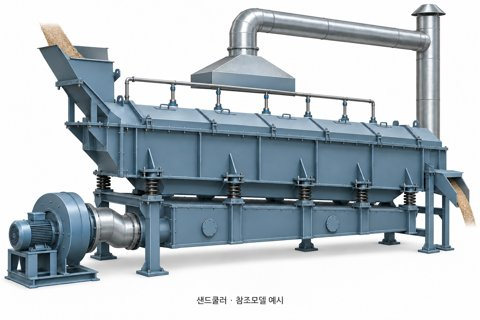

# 샌드쿨러

[전체 목록](../../../README.md) · 장비군: **주조·주물사 처리 설비** · [이 장비 문의하기](https://github.com/gb011-hub/aas-archive/issues/new?template=equipment-question.yml&title=%5B%EB%AC%B8%EC%9D%98%5D+%EC%83%8C%EB%93%9C%EC%BF%A8%EB%9F%AC&equipment=%EC%83%8C%EB%93%9C%EC%BF%A8%EB%9F%AC)

> 자동 생성 페이지입니다. 이 폴더에 파일을 올리면 내용이 갱신됩니다.

필수 산출물 1/3 · 개발계획서 없음 · 가이던스 없음 · AASX 있음

> [!WARNING]
> **확인 필요**
>
> - AASX 파일 이름 규칙 위반: `SandCooler_AAS_v0.0.1.aasx` (예: `AirDryer_v0.0.1.aasx`)

## 산출물

| 구분 | 파일 | 크기 | 보기 |
|---|---|---|---|
| 개발계획서 | 아직 없음 | | |
| 가이던스 | 아직 없음 | | |
| AASX | [SandCooler_AAS_v0.0.1.aasx](AASX/SandCooler_AAS_v0.0.1.aasx) | 8.6 MB | [열람 페이지](gen/SandCooler_AAS_v0.0.1.md) |

## AAS 구성 — `SandCoolerAAS`

`SandCooler_AAS_v0.0.1.aasx` 에서 읽은 서브모델 7개 · **[요소 전체 보기](gen/SandCooler_AAS_v0.0.1.md)**:

| # | 서브모델 idShort |
|:-:|---|
| 1 | Nameplate |
| 2 | HandoverDocumentation |
| 3 | TechnicalData |
| 4 | OperationalData |
| 5 | TimeSeries |
| 6 | ProcessParameters |
| 7 | PredictiveMaintenance |

변경 기록 (최근 5건)

| 날짜 | 변경 | 파일 |
|---|---|---|
| 2026-11-04 | 삭제 | 샌드쿨러_가이던스(자리표시).docx |
| 2026-11-04 | 삭제 | 샌드쿨러_개발계획서(자리표시).docx |
| 2026-11-03 | 추가 | SandCooler_AAS_v0.0.1.aasx |
| 2026-11-03 | 추가 | 샌드쿨러_가이던스(자리표시).docx |
| 2026-11-03 | 추가 | 샌드쿨러_개발계획서(자리표시).docx |

