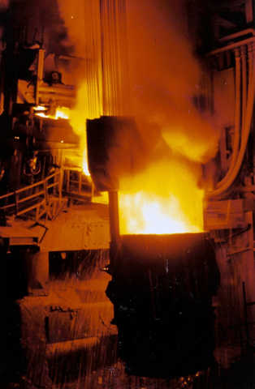

# 🧩 Melting_Furnace_v0.0.1.aasx

[← 장비 페이지](../README.md) · [⤓ AASX 다운로드](../AASX/Melting_Furnace_v0.0.1.aasx) · 2.7 MB

> 🤖 AASX 파일을 열어 자동으로 만든 열람 페이지입니다. 직접 고치지 말고 AASX를 다시 올리세요.

| 항목 | 내용 |
|---|---|
| AAS idShort | `MeltingFurnaceAAS` |
| AAS id | https://www.smart-factory.kr/ids/aas/MeltingFurnaceAAS/1/0 |
| 자산 종류 (assetKind) | Type |
| globalAssetId | https://www.smart-factory.kr/ids/asset/MeltingFurnace/1/0 |
| 서브모델 | 7개 |
| 전체 요소 | 325개 |

## 서브모델 한눈에 보기

| # | 서브모델 | 요소 수 | semanticId |
|:-:|---|--:|---|
| 1 | [Nameplate](#sm-1) | 28 | https://admin-shell.io/idta/nameplate/3/0/Nameplate |
| 2 | [HandoverDocumentation](#sm-2) | 27 | 0173-1#01-AHF578#003 |
| 3 | [TechnicalData](#sm-3) | 93 | 0173-1#01-AHX837#002 |
| 4 | [OperationalData](#sm-4) | 80 | https://www.smart-factory.kr/ids/sm/MeltingFurnaceAAS/OperationalData/1/0 |
| 5 | [TimeSeries](#sm-5) | 34 | https://admin-shell.io/idta/TimeSeries/1/1 |
| 6 | [ProcessParameters](#sm-6) | 32 | https://admin-shell-io/idta/SubmodelTemplate/ProcessParameters/1/0 |
| 7 | [PredictiveMaintenance](#sm-7) | 31 | https://admin-shell.io/idta/SubmodelTemplate/PredictiveMaintenance/1/0 |

## 서브모델 상세

각 서브모델 이름을 누르면 펼쳐집니다. **굵은 글씨**는 하위 요소가 있는 묶음입니다.

<b>1. Nameplate</b> — 요소 28개

> 자산 식별, 명판 조회, 인증 추적 및 제품별 AAS 인스턴스 생성의 기준정보로 활용한다. URIOfTheProduct, SerialNumber, ProductArticleNumberOfManufacturer 및 OrderCodeOfManufacturer를 MES·ERP·설비관리시스템의 자산 식별정보와 연계하여 동일 장비를 일관되게 조회한다. ManufacturerProductDesignation, ManufacturerProductFamily, ManufacturerProductType, YearOfConstruction 및 D…

semanticId: `https://admin-shell.io/idta/nameplate/3/0/Nameplate`

| idShort | 종류 | 값 | semanticId |
|---|---|---|---|
| URIOfTheProduct | 속성 | https://www.smart-factory.kr/ids/asset/MeltingFurnace/1/0 | 0112/2///61987#ABN590#002 |
| **AddressInformation** | 묶음&nbsp;(4) |  | https://admin-shell.io/zvei/nameplate/1/0/ContactInformations/Address… |
| &nbsp;&nbsp;&nbsp;└ Street | 다국어&nbsp;속성 | 예시로 1 | 0173-1#02-AAO128#002 |
| &nbsp;&nbsp;&nbsp;└ Zipcode | 다국어&nbsp;속성 | 00000 | 0173-1#02-AAO129#002 |
| &nbsp;&nbsp;&nbsp;└ CityTown | 다국어&nbsp;속성 | 예시시 | 0173-1#02-AAO132#002 |
| &nbsp;&nbsp;&nbsp;└ NationalCode | 다국어&nbsp;속성 | KR | 0173-1#02-AAO134#002 |
| ManufacturerName | 다국어&nbsp;속성 | ExampleCompany | 0112/2///61987#ABA565#009 |
| ManufacturerProductDesignation | 다국어&nbsp;속성 | 가상 코어리스 유도식 배치 용해로 | 0112/2///61987#ABA567#009 |
| ManufacturerProductRoot | 다국어&nbsp;속성 | 금속 습식 가공 기계 | 0112/2///61360_7#AAS011#001 |
| ManufacturerProductFamily | 다국어&nbsp;속성 | 코어리스 유도식 배치 용해 설비 | 0112/2///61987#ABP464#002 |
| ManufacturerProductType | 속성 | MF-3000 | 0112/2///61987#ABA300#008 |
| OrderCodeOfManufacturer | 속성 | MF-3000-ORD | 0112/2///61987#ABA950#008 |
| ProductArticleNumberOfManufacturer | 속성 | MF-3000-ART | 0112/2///61987#ABA581#007 |
| SerialNumber | 속성 | MF-SN-2026-0001 | 0112/2///61987#ABA951#009 |
| YearOfConstruction | 속성 | 2026 | 0112/2///61987#ABP000#002 |
| DateOfManufacture | 속성 | 2026-01-15 | 0112/2///61987#ABB757#007 |
| HardwareVersion | 속성 | 1.0.0 | 0112/2///61987#ABA926#008 |
| FirmwareVersion | 속성 | 1.0.0 | 0112/2///61987#ABA302#006 |
| SoftwareVersion | 속성 | 1.0.0 | 0112/2///61987#ABA601#008 |
| CountryOfOrigin | 속성 | KR | 0112/2///61987#ABP462#001 |
| UniqueFacilityIdentifier | 속성 | EXAMPLE-FACILITY-001 | https://admin-shell.io/idta/nameplate/3/0/UniqueFacilityIdentifier |
| **Markings** | 목록&nbsp;(1) |  | 0112/2///61360_7#AAS006#001 |
| &nbsp;&nbsp;&nbsp;└ **** | 묶음&nbsp;(5) |  | 0112/2///61360_7#AAS009#001 |
| &nbsp;&nbsp;&nbsp;&nbsp;&nbsp;&nbsp;└ MarkingName | 속성 | CE | 0112/2///61987#ABA231#009 |
| &nbsp;&nbsp;&nbsp;&nbsp;&nbsp;&nbsp;└ DesignationOfCertificateOrApproval | 속성 | EXAMPLE-CE-2026-001 | 0112/2///61987#ABH783#003 |
| &nbsp;&nbsp;&nbsp;&nbsp;&nbsp;&nbsp;└ IssueDate | 속성 | 2026-01-15 | 0112/2///61987#ABO097#001 |
| &nbsp;&nbsp;&nbsp;&nbsp;&nbsp;&nbsp;└ ExpiryDate | 속성 | 2031-01-14 | 0112/2///61987#ABH830#002 |
| &nbsp;&nbsp;&nbsp;&nbsp;&nbsp;&nbsp;└ MarkingFile | 파일 | /aasx/files/Marking_Reference_Notice.txt | 0112/2///61987#ABO100#002 |

<b>2. HandoverDocumentation</b> — 요소 27개

> 현장 운전·점검 시 최신 매뉴얼과 인증문서를 즉시 조회하고 문서 버전·상태를 추적한다. 용해로의 설치·시운전·운전·점검·정비 과정에서 필요한 매뉴얼과 기술문서를 장비 자산에 연결하여 현장 작업자가 최신 문서를 즉시 조회하도록 한다. 문서의 제목, 분류, 버전, 작성일, 상태 및 언어 정보를 이용하여 동일 문서의 개정 이력을 관리하고 폐기되거나 이전 버전인 문서의 오사용을 방지한다. 설치도면, 전기회로도, 냉각수 배관도, 내화물 축조자료 및 제조사 매뉴얼을 설비 인수인계 자료로 활용하여 장비 설치 상태와 설계 요구사항을 확인한다. …

semanticId: `0173-1#01-AHF578#003`

| idShort | 종류 | 값 | semanticId |
|---|---|---|---|
| **Documents** | 목록&nbsp;(1) |  | 0173-1#02-ABI500#003 |
| &nbsp;&nbsp;&nbsp;└ **** | 묶음&nbsp;(3) |  | 0173-1#02-ABI500#003/0173-1#01-AHF579#003 |
| &nbsp;&nbsp;&nbsp;&nbsp;&nbsp;&nbsp;└ **DocumentIds** | 목록&nbsp;(1) |  | 0173-1#02-ABI501#003 |
| &nbsp;&nbsp;&nbsp;&nbsp;&nbsp;&nbsp;&nbsp;&nbsp;&nbsp;└ **** | 묶음&nbsp;(3) |  | 0173-1#02-ABI501#003/0173-1#01-AHF580#003 |
| &nbsp;&nbsp;&nbsp;&nbsp;&nbsp;&nbsp;&nbsp;&nbsp;&nbsp;&nbsp;&nbsp;&nbsp;└ DocumentDomainId | 속성 | smart-factory.kr | 0173-1#02-ABH994#003 |
| &nbsp;&nbsp;&nbsp;&nbsp;&nbsp;&nbsp;&nbsp;&nbsp;&nbsp;&nbsp;&nbsp;&nbsp;└ DocumentIdentifier | 속성 | BLM-3000-OM-REF-001 | 0173-1#02-AAO099#004 |
| &nbsp;&nbsp;&nbsp;&nbsp;&nbsp;&nbsp;&nbsp;&nbsp;&nbsp;&nbsp;&nbsp;&nbsp;└ DocumentIsPrimary | 속성 | true | 0173-1#02-ABH995#003 |
| &nbsp;&nbsp;&nbsp;&nbsp;&nbsp;&nbsp;└ **DocumentClassifications** | 목록&nbsp;(1) |  | 0173-1#02-ABI502#003 |
| &nbsp;&nbsp;&nbsp;&nbsp;&nbsp;&nbsp;&nbsp;&nbsp;&nbsp;└ **** | 묶음&nbsp;(3) |  | 0173-1#02-ABI502#003/0173-1#01-AHF581#003 |
| &nbsp;&nbsp;&nbsp;&nbsp;&nbsp;&nbsp;&nbsp;&nbsp;&nbsp;&nbsp;&nbsp;&nbsp;└ ClassId | 속성 | 02-04 | 0173-1#02-ABH996#003 |
| &nbsp;&nbsp;&nbsp;&nbsp;&nbsp;&nbsp;&nbsp;&nbsp;&nbsp;&nbsp;&nbsp;&nbsp;└ ClassName | 다국어&nbsp;속성 | 운전 | 0173-1#02-ABJ219#002 |
| &nbsp;&nbsp;&nbsp;&nbsp;&nbsp;&nbsp;&nbsp;&nbsp;&nbsp;&nbsp;&nbsp;&nbsp;└ ClassificationSystem | 속성 | VDI 2770 Blatt 1:2020 | 0173-1#02-ABH997#003 |
| &nbsp;&nbsp;&nbsp;&nbsp;&nbsp;&nbsp;└ **DocumentVersions** | 목록&nbsp;(1) |  | 0173-1#02-ABI503#003 |
| &nbsp;&nbsp;&nbsp;&nbsp;&nbsp;&nbsp;&nbsp;&nbsp;&nbsp;└ **** | 묶음&nbsp;(10) |  | 0173-1#02-ABI503#003/0173-1#01-AHF582#003 |
| &nbsp;&nbsp;&nbsp;&nbsp;&nbsp;&nbsp;&nbsp;&nbsp;&nbsp;&nbsp;&nbsp;&nbsp;└ **Language** | 목록&nbsp;(2) |  | 0173-1#02-AAN468#008 |
| &nbsp;&nbsp;&nbsp;&nbsp;&nbsp;&nbsp;&nbsp;&nbsp;&nbsp;&nbsp;&nbsp;&nbsp;&nbsp;&nbsp;&nbsp;└  | 속성 | ko | 0173-1#02-AAN468#008 |
| &nbsp;&nbsp;&nbsp;&nbsp;&nbsp;&nbsp;&nbsp;&nbsp;&nbsp;&nbsp;&nbsp;&nbsp;&nbsp;&nbsp;&nbsp;└  | 속성 | en | 0173-1#02-AAN468#008 |
| &nbsp;&nbsp;&nbsp;&nbsp;&nbsp;&nbsp;&nbsp;&nbsp;&nbsp;&nbsp;&nbsp;&nbsp;└ Version | 속성 | 1.0 | 0173-1#02-AAP003#005 |
| &nbsp;&nbsp;&nbsp;&nbsp;&nbsp;&nbsp;&nbsp;&nbsp;&nbsp;&nbsp;&nbsp;&nbsp;└ Title | 다국어&nbsp;속성 | 용해로 운전 매뉴얼 - AAS 참조모델 예시 | 0173-1#02-ABG940#003 |
| &nbsp;&nbsp;&nbsp;&nbsp;&nbsp;&nbsp;&nbsp;&nbsp;&nbsp;&nbsp;&nbsp;&nbsp;└ Description | 다국어&nbsp;속성 | IDTA 02004 Handover Documentation의 기준 배포본 2.0.1와 DigitalFile 연결을 보여주는 용해로 참조모델용… | 0173-1#02-AAN466#004 |
| &nbsp;&nbsp;&nbsp;&nbsp;&nbsp;&nbsp;&nbsp;&nbsp;&nbsp;&nbsp;&nbsp;&nbsp;└ KeyWords | 다국어&nbsp;속성 | 용해로, 운전, 안전, 유지보수, 참조모델 | 0173-1#02-ABH999#003 |
| &nbsp;&nbsp;&nbsp;&nbsp;&nbsp;&nbsp;&nbsp;&nbsp;&nbsp;&nbsp;&nbsp;&nbsp;└ StatusSetDate | 속성 | 2026-07-30 | 0173-1#02-ABI000#003 |
| &nbsp;&nbsp;&nbsp;&nbsp;&nbsp;&nbsp;&nbsp;&nbsp;&nbsp;&nbsp;&nbsp;&nbsp;└ StatusValue | 속성 | Released | 0173-1#02-ABI001#003 |
| &nbsp;&nbsp;&nbsp;&nbsp;&nbsp;&nbsp;&nbsp;&nbsp;&nbsp;&nbsp;&nbsp;&nbsp;└ OrganizationShortName | 속성 | AASReferenceModel | https://api.eclass-cdp.com/0173-1-02-ABI002-003 |
| &nbsp;&nbsp;&nbsp;&nbsp;&nbsp;&nbsp;&nbsp;&nbsp;&nbsp;&nbsp;&nbsp;&nbsp;└ OrganizationOfficialName | 속성 | Smart Factory AAS Reference Model | 0173-1#02-ABI004#003 |
| &nbsp;&nbsp;&nbsp;&nbsp;&nbsp;&nbsp;&nbsp;&nbsp;&nbsp;&nbsp;&nbsp;&nbsp;└ **DigitalFiles** | 목록&nbsp;(1) |  | 0173-1#02-ABK126#002 |
| &nbsp;&nbsp;&nbsp;&nbsp;&nbsp;&nbsp;&nbsp;&nbsp;&nbsp;&nbsp;&nbsp;&nbsp;&nbsp;&nbsp;&nbsp;└  | 파일 | /aasx/files/Melting_Furnace_Reference_Manual.pdf | 0173-1#02-ABK126#002 |

<b>3. TechnicalData</b> — 요소 93개

> 설비 선정, 전원·냉각수·집진 설계, 대체장비 비교 및 디지털 트윈 기초사양으로 활용한다. 용해용량, 정격전력, 운전주파수, 전압, 노체 치수 및 경동사양을 설비 선정과 생산능력 검토의 기준정보로 활용한다. 용해 대상 재질, 최대 장입량, 목표 용탕량 및 예상 용해시간을 생산계획과 연계하여 Heat별 작업계획과 장입계획을 수립한다. 유도코일 구조, 냉각방식, 냉각회로 수, 통로 형상 및 설계유량을 냉각설비 용량 산정과 코일 교체·점검의 기준으로 사용한다. 냉각수 입구온도, 출구온도, 온도상승, 압력차, 유속 및 전기전도도 허용값을…

semanticId: `0173-1#01-AHX837#002`

| idShort | 종류 | 값 | semanticId |
|---|---|---|---|
| **GeneralInformation** | 묶음&nbsp;(5) |  | 0173-1#02-ABK161#002/0173-1#01-AHX838#002 |
| &nbsp;&nbsp;&nbsp;└ ManufacturerName | 속성 | ExampleCompany | 0173-1#02-AAO677#004 |
| &nbsp;&nbsp;&nbsp;└ ManufacturerProductDesignation | 다국어&nbsp;속성 | 가상 코어리스 유도식 배치 용해로 | 0173-1#02-AAW338#003 |
| &nbsp;&nbsp;&nbsp;└ ManufacturerArticleNumber | 속성 | MF-3000-ART | 0173-1#02-AAO676#005 |
| &nbsp;&nbsp;&nbsp;└ ManufacturerOrderCode | 속성 | MF-3000-ORD | 0173-1#02-AAO227#004 |
| &nbsp;&nbsp;&nbsp;└ **ProductImages** | 목록&nbsp;(1) |  | 0173-1#02-ABM220#001 |
| &nbsp;&nbsp;&nbsp;&nbsp;&nbsp;&nbsp;└ **** | 묶음&nbsp;(2) |  | 0173-1#02-ABM220#001/0173-1#01-AHY911#001 |
| &nbsp;&nbsp;&nbsp;&nbsp;&nbsp;&nbsp;&nbsp;&nbsp;&nbsp;└ ImageFile | 파일 | /aasx/files/Coreless_Induction_Melting_Furnace.png | 0173-1#02-ABK291#002 |
| &nbsp;&nbsp;&nbsp;&nbsp;&nbsp;&nbsp;&nbsp;&nbsp;&nbsp;└ ImageNote | 다국어&nbsp;속성 | 코어리스 유도식 배치 용해로의 대표 이미지 | 0173-1#02-ABL423#001 |
| **ProductClassifications** | 목록&nbsp;(1) |  | 0173-1#02-ABK162#002 |
| &nbsp;&nbsp;&nbsp;└ **** | 묶음&nbsp;(5) |  | 0173-1#02-ABK162#002/0173-1#01-AHX839#002 |
| &nbsp;&nbsp;&nbsp;&nbsp;&nbsp;&nbsp;└ ClassificationSystem | 속성 | ECLASS | 0173-1#02-ABL424#001 |
| &nbsp;&nbsp;&nbsp;&nbsp;&nbsp;&nbsp;└ ClassificationSystemVersion | 속성 | 16.0 | 0173-1#02-AAR710#003 |
| &nbsp;&nbsp;&nbsp;&nbsp;&nbsp;&nbsp;└ ProductClassId | 속성 | 0173-1#01-AKL339#010 | 0173-1#02-ABG776#003 |
| &nbsp;&nbsp;&nbsp;&nbsp;&nbsp;&nbsp;└ ProductClassCodedName | 속성 | 36-08-00-00 | 0173-1#02-ABK128#002 |
| &nbsp;&nbsp;&nbsp;&nbsp;&nbsp;&nbsp;└ ProductClassName | 다국어&nbsp;속성 | Industrial furnace, industrial heater | 0173-1#02-ABK273#002 |
| **TechnicalPropertyAreas** | 목록&nbsp;(5) |  | 0173-1#02-ABK163#002 |
| &nbsp;&nbsp;&nbsp;└ **** | 묶음&nbsp;(1) |  | 0173-1#02-ABL358#002/0173-1#01-AHX773#002 |
| &nbsp;&nbsp;&nbsp;&nbsp;&nbsp;&nbsp;└ **MeltingFurnaceCommonSystem** | 묶음&nbsp;(1) |  | https://www.smart-factory.kr/ids/cd/MeltingFurnaceCommonSystem/1/0 |
| &nbsp;&nbsp;&nbsp;&nbsp;&nbsp;&nbsp;&nbsp;&nbsp;&nbsp;└ **MeltingFurnaceCommonSpecifications** | 묶음&nbsp;(7) |  | https://www.smart-factory.kr/ids/cd/MeltingFurnaceCommonSpecification… |
| &nbsp;&nbsp;&nbsp;&nbsp;&nbsp;&nbsp;&nbsp;&nbsp;&nbsp;&nbsp;&nbsp;&nbsp;└ MeltingProcessType | 속성 | Coreless induction melting | https://www.smart-factory.kr/ids/cd/MeltingProcessType/1/0 |
| &nbsp;&nbsp;&nbsp;&nbsp;&nbsp;&nbsp;&nbsp;&nbsp;&nbsp;&nbsp;&nbsp;&nbsp;└ FurnaceType | 속성 | Coreless induction furnace | https://www.smart-factory.kr/ids/cd/FurnaceType/1/0 |
| &nbsp;&nbsp;&nbsp;&nbsp;&nbsp;&nbsp;&nbsp;&nbsp;&nbsp;&nbsp;&nbsp;&nbsp;└ OperationType | 속성 | Batch | https://www.smart-factory.kr/ids/cd/OperationType/1/0 |
| &nbsp;&nbsp;&nbsp;&nbsp;&nbsp;&nbsp;&nbsp;&nbsp;&nbsp;&nbsp;&nbsp;&nbsp;└ SystemConfiguration | 속성 | 수냉식 코일, 내화물 도가니, 유압 경동 및 집진후드 구성 | https://www.smart-factory.kr/ids/cd/SystemConfiguration/1/0 |
| &nbsp;&nbsp;&nbsp;&nbsp;&nbsp;&nbsp;&nbsp;&nbsp;&nbsp;&nbsp;&nbsp;&nbsp;└ InstallationType | 속성 | 바닥 설치형 경동 프레임 | https://www.smart-factory.kr/ids/cd/InstallationType/1/0 |
| &nbsp;&nbsp;&nbsp;&nbsp;&nbsp;&nbsp;&nbsp;&nbsp;&nbsp;&nbsp;&nbsp;&nbsp;└ NetWeight | 속성 | 38000 | 0173-1#02-AAS707#005 |
| &nbsp;&nbsp;&nbsp;&nbsp;&nbsp;&nbsp;&nbsp;&nbsp;&nbsp;&nbsp;&nbsp;&nbsp;└ ChargePreheatSupported | 속성 | true | https://www.smart-factory.kr/ids/cd/ChargePreheatSupported/1/0 |
| &nbsp;&nbsp;&nbsp;└ **** | 묶음&nbsp;(1) |  | 0173-1#02-ABL358#002/0173-1#01-AHX773#002 |
| &nbsp;&nbsp;&nbsp;&nbsp;&nbsp;&nbsp;└ **MeltingCapacityAndPowerSystem** | 묶음&nbsp;(1) |  | https://www.smart-factory.kr/ids/cd/MeltingCapacityAndPowerSystem/1/0 |
| &nbsp;&nbsp;&nbsp;&nbsp;&nbsp;&nbsp;&nbsp;&nbsp;&nbsp;└ **MeltingCapacityAndPowerSpecifications** | 묶음&nbsp;(7) |  | https://www.smart-factory.kr/ids/cd/MeltingCapacityAndPowerSpecificat… |
| &nbsp;&nbsp;&nbsp;&nbsp;&nbsp;&nbsp;&nbsp;&nbsp;&nbsp;&nbsp;&nbsp;&nbsp;└ MeltingCapacityPerHeat | 속성 | 6 | https://www.smart-factory.kr/ids/cd/MeltingCapacityPerHeat/1/0 |
| &nbsp;&nbsp;&nbsp;&nbsp;&nbsp;&nbsp;&nbsp;&nbsp;&nbsp;&nbsp;&nbsp;&nbsp;└ MeltingRate | 속성 | 9 | https://www.smart-factory.kr/ids/cd/MeltingRate/1/0 |
| &nbsp;&nbsp;&nbsp;&nbsp;&nbsp;&nbsp;&nbsp;&nbsp;&nbsp;&nbsp;&nbsp;&nbsp;└ RatedMeltingPower | 속성 | 3000 | https://www.smart-factory.kr/ids/cd/RatedMeltingPower/1/0 |
| &nbsp;&nbsp;&nbsp;&nbsp;&nbsp;&nbsp;&nbsp;&nbsp;&nbsp;&nbsp;&nbsp;&nbsp;└ OperatingFrequency | 속성 | 250 | https://www.smart-factory.kr/ids/cd/OperatingFrequency/1/0 |
| &nbsp;&nbsp;&nbsp;&nbsp;&nbsp;&nbsp;&nbsp;&nbsp;&nbsp;&nbsp;&nbsp;&nbsp;└ PowerConversionType | 속성 | IGBT medium-frequency converter | https://www.smart-factory.kr/ids/cd/PowerConversionType/1/0 |
| &nbsp;&nbsp;&nbsp;&nbsp;&nbsp;&nbsp;&nbsp;&nbsp;&nbsp;&nbsp;&nbsp;&nbsp;└ MeltTemperatureRange | 범위 | 1400 ~ 1550 | https://www.smart-factory.kr/ids/cd/MeltTemperatureRange/1/0 |
| &nbsp;&nbsp;&nbsp;&nbsp;&nbsp;&nbsp;&nbsp;&nbsp;&nbsp;&nbsp;&nbsp;&nbsp;└ MaxMeltTemperature | 속성 | 1600 | https://www.smart-factory.kr/ids/cd/MaxMeltTemperature/1/0 |
| &nbsp;&nbsp;&nbsp;└ **** | 묶음&nbsp;(1) |  | 0173-1#02-ABL358#002/0173-1#01-AHX773#002 |
| &nbsp;&nbsp;&nbsp;&nbsp;&nbsp;&nbsp;└ **FurnaceStructureAndDimensionSystem** | 묶음&nbsp;(1) |  | https://www.smart-factory.kr/ids/cd/FurnaceStructureAndDimensionSyste… |
| &nbsp;&nbsp;&nbsp;&nbsp;&nbsp;&nbsp;&nbsp;&nbsp;&nbsp;└ **FurnaceStructureAndDimensionSpecifications** | 묶음&nbsp;(13) |  | https://www.smart-factory.kr/ids/cd/FurnaceStructureAndDimensionSpeci… |
| &nbsp;&nbsp;&nbsp;&nbsp;&nbsp;&nbsp;&nbsp;&nbsp;&nbsp;&nbsp;&nbsp;&nbsp;└ CrucibleType | 속성 | Rammed refractory crucible | https://www.smart-factory.kr/ids/cd/CrucibleType/1/0 |
| &nbsp;&nbsp;&nbsp;&nbsp;&nbsp;&nbsp;&nbsp;&nbsp;&nbsp;&nbsp;&nbsp;&nbsp;└ CrucibleCapacity | 속성 | 6 | https://www.smart-factory.kr/ids/cd/CrucibleCapacity/1/0 |
| &nbsp;&nbsp;&nbsp;&nbsp;&nbsp;&nbsp;&nbsp;&nbsp;&nbsp;&nbsp;&nbsp;&nbsp;└ RefractoryLiningMaterial | 속성 | Silica-based SiO₂ ramming refractory | https://www.smart-factory.kr/ids/cd/RefractoryLiningMaterial/1/0 |
| &nbsp;&nbsp;&nbsp;&nbsp;&nbsp;&nbsp;&nbsp;&nbsp;&nbsp;&nbsp;&nbsp;&nbsp;└ LiningThicknessNominal | 속성 | 150 | https://www.smart-factory.kr/ids/cd/LiningThicknessNominal/1/0 |
| &nbsp;&nbsp;&nbsp;&nbsp;&nbsp;&nbsp;&nbsp;&nbsp;&nbsp;&nbsp;&nbsp;&nbsp;└ CoilMaterial | 속성 | Water-cooled copper tube coi | https://www.smart-factory.kr/ids/cd/CoilMaterial/1/0 |
| &nbsp;&nbsp;&nbsp;&nbsp;&nbsp;&nbsp;&nbsp;&nbsp;&nbsp;&nbsp;&nbsp;&nbsp;└ CoilTurns | 속성 | 12 | https://www.smart-factory.kr/ids/cd/CoilTurns/1/0 |
| &nbsp;&nbsp;&nbsp;&nbsp;&nbsp;&nbsp;&nbsp;&nbsp;&nbsp;&nbsp;&nbsp;&nbsp;└ TiltingMechanism | 속성 | Hydraulic cylinder tilting | https://www.smart-factory.kr/ids/cd/TiltingMechanism/1/0 |
| &nbsp;&nbsp;&nbsp;&nbsp;&nbsp;&nbsp;&nbsp;&nbsp;&nbsp;&nbsp;&nbsp;&nbsp;└ FurnaceInnerDiameter | 속성 | 900 | https://www.smart-factory.kr/ids/cd/FurnaceInnerDiameter/1/0 |
| &nbsp;&nbsp;&nbsp;&nbsp;&nbsp;&nbsp;&nbsp;&nbsp;&nbsp;&nbsp;&nbsp;&nbsp;└ DimensionsHeight | 속성 | 3200 | 0173-1#02-AAO034#007 |
| &nbsp;&nbsp;&nbsp;&nbsp;&nbsp;&nbsp;&nbsp;&nbsp;&nbsp;&nbsp;&nbsp;&nbsp;└ DimensionsWidth | 속성 | 2600 | 0173-1#02-AAO032#007 |
| &nbsp;&nbsp;&nbsp;&nbsp;&nbsp;&nbsp;&nbsp;&nbsp;&nbsp;&nbsp;&nbsp;&nbsp;└ DimensionsDepth | 속성 | 2400 | 0173-1#02-AAO035#008 |
| &nbsp;&nbsp;&nbsp;&nbsp;&nbsp;&nbsp;&nbsp;&nbsp;&nbsp;&nbsp;&nbsp;&nbsp;└ SoundPowerLevel | 속성 | 88 | 0173-1#02-AAZ122#004 |
| &nbsp;&nbsp;&nbsp;&nbsp;&nbsp;&nbsp;&nbsp;&nbsp;&nbsp;&nbsp;&nbsp;&nbsp;└ HydraulicUnitType | 속성 | Electro-hydraulic power pack | https://www.smart-factory.kr/ids/cd/HydraulicUnitType/1/0 |
| &nbsp;&nbsp;&nbsp;└ **** | 묶음&nbsp;(1) |  | 0173-1#02-ABL358#002/0173-1#01-AHX773#002 |
| &nbsp;&nbsp;&nbsp;&nbsp;&nbsp;&nbsp;└ **CoolingAndFumeExhaustSystem** | 묶음&nbsp;(1) |  | https://www.smart-factory.kr/ids/cd/CoolingAndFumeExhaustSystem/1/0 |
| &nbsp;&nbsp;&nbsp;&nbsp;&nbsp;&nbsp;&nbsp;&nbsp;&nbsp;└ **CoolingAndFumeExhaustSpecifications** | 묶음&nbsp;(22) |  | https://www.smart-factory.kr/ids/cd/CoolingAndFumeExhaustSpecificatio… |
| &nbsp;&nbsp;&nbsp;&nbsp;&nbsp;&nbsp;&nbsp;&nbsp;&nbsp;&nbsp;&nbsp;&nbsp;└ CoilCoolingMethod | 속성 | Closed-loop water cooling with plate heat exchanger | https://www.smart-factory.kr/ids/cd/CoilCoolingMethod/1/0 |
| &nbsp;&nbsp;&nbsp;&nbsp;&nbsp;&nbsp;&nbsp;&nbsp;&nbsp;&nbsp;&nbsp;&nbsp;└ CoolingWaterFlowRate | 속성 | 300 | https://www.smart-factory.kr/ids/cd/CoolingWaterFlowRate/1/0 |
| &nbsp;&nbsp;&nbsp;&nbsp;&nbsp;&nbsp;&nbsp;&nbsp;&nbsp;&nbsp;&nbsp;&nbsp;└ CoolingWaterInletTemperature | 속성 | 32 | https://www.smart-factory.kr/ids/cd/CoolingWaterInletTemperature/1/0 |
| &nbsp;&nbsp;&nbsp;&nbsp;&nbsp;&nbsp;&nbsp;&nbsp;&nbsp;&nbsp;&nbsp;&nbsp;└ CoolingWaterPressure | 속성 | 3.5 | https://www.smart-factory.kr/ids/cd/CoolingWaterPressure/1/0 |
| &nbsp;&nbsp;&nbsp;&nbsp;&nbsp;&nbsp;&nbsp;&nbsp;&nbsp;&nbsp;&nbsp;&nbsp;└ EmergencyCoolingSupported | 속성 | true | https://www.smart-factory.kr/ids/cd/EmergencyCoolingSupported/1/0 |
| &nbsp;&nbsp;&nbsp;&nbsp;&nbsp;&nbsp;&nbsp;&nbsp;&nbsp;&nbsp;&nbsp;&nbsp;└ FumeExtractionMethod | 속성 | Side-draft hood with baghouse | https://www.smart-factory.kr/ids/cd/FumeExtractionMethod/1/0 |
| &nbsp;&nbsp;&nbsp;&nbsp;&nbsp;&nbsp;&nbsp;&nbsp;&nbsp;&nbsp;&nbsp;&nbsp;└ FumeExtractionFlowRate | 속성 | 18000 | https://www.smart-factory.kr/ids/cd/FumeExtractionFlowRate/1/0 |
| &nbsp;&nbsp;&nbsp;&nbsp;&nbsp;&nbsp;&nbsp;&nbsp;&nbsp;&nbsp;&nbsp;&nbsp;└ DustCollectionConnectionSize | 속성 | 400 | https://www.smart-factory.kr/ids/cd/DustCollectionConnectionSize/1/0 |
| &nbsp;&nbsp;&nbsp;&nbsp;&nbsp;&nbsp;&nbsp;&nbsp;&nbsp;&nbsp;&nbsp;&nbsp;└ CoolingPassageShape | 속성 | Rectangular | https://www.smart-factory.kr/ids/cd/CoolingPassageShape/1/0 |
| &nbsp;&nbsp;&nbsp;&nbsp;&nbsp;&nbsp;&nbsp;&nbsp;&nbsp;&nbsp;&nbsp;&nbsp;└ CoolingPassageWidth | 속성 | 24 | https://www.smart-factory.kr/ids/cd/CoolingPassageWidth/1/0 |
| &nbsp;&nbsp;&nbsp;&nbsp;&nbsp;&nbsp;&nbsp;&nbsp;&nbsp;&nbsp;&nbsp;&nbsp;└ CoolingPassageHeight | 속성 | 18 | https://www.smart-factory.kr/ids/cd/CoolingPassageHeight/1/0 |
| &nbsp;&nbsp;&nbsp;&nbsp;&nbsp;&nbsp;&nbsp;&nbsp;&nbsp;&nbsp;&nbsp;&nbsp;└ CoolingPassageHydraulicDiameter | 속성 | 20.6 | https://www.smart-factory.kr/ids/cd/CoolingPassageHydraulicDiameter/1… |
| &nbsp;&nbsp;&nbsp;&nbsp;&nbsp;&nbsp;&nbsp;&nbsp;&nbsp;&nbsp;&nbsp;&nbsp;└ CoilCoolingCircuitCount | 속성 | 8 | https://www.smart-factory.kr/ids/cd/CoilCoolingCircuitCount/1/0 |
| &nbsp;&nbsp;&nbsp;&nbsp;&nbsp;&nbsp;&nbsp;&nbsp;&nbsp;&nbsp;&nbsp;&nbsp;└ CoolingWaterFlowRatePerCircuitDesign | 속성 | 37.5 | https://www.smart-factory.kr/ids/cd/CoolingWaterFlowRatePerCircuitDes… |
| &nbsp;&nbsp;&nbsp;&nbsp;&nbsp;&nbsp;&nbsp;&nbsp;&nbsp;&nbsp;&nbsp;&nbsp;└ CoolingWaterVelocityDesign | 속성 | 1.6 | https://www.smart-factory.kr/ids/cd/CoolingWaterVelocityDesign/1/0 |
| &nbsp;&nbsp;&nbsp;&nbsp;&nbsp;&nbsp;&nbsp;&nbsp;&nbsp;&nbsp;&nbsp;&nbsp;└ CoolingWaterDifferentialPressureDesign | 속성 | 1.2 | https://www.smart-factory.kr/ids/cd/CoolingWaterDifferentialPressureD… |
| &nbsp;&nbsp;&nbsp;&nbsp;&nbsp;&nbsp;&nbsp;&nbsp;&nbsp;&nbsp;&nbsp;&nbsp;└ CoolingWaterOutletTempMax | 속성 | 45 | https://www.smart-factory.kr/ids/cd/CoolingWaterOutletTempMax/1/0 |
| &nbsp;&nbsp;&nbsp;&nbsp;&nbsp;&nbsp;&nbsp;&nbsp;&nbsp;&nbsp;&nbsp;&nbsp;└ CoolingWaterTempRiseMax | 속성 | 10 | https://www.smart-factory.kr/ids/cd/CoolingWaterTempRiseMax/1/0 |
| &nbsp;&nbsp;&nbsp;&nbsp;&nbsp;&nbsp;&nbsp;&nbsp;&nbsp;&nbsp;&nbsp;&nbsp;└ CoolingWaterType | 속성 | Closed-loop softened water | https://www.smart-factory.kr/ids/cd/CoolingWaterType/1/0 |
| &nbsp;&nbsp;&nbsp;&nbsp;&nbsp;&nbsp;&nbsp;&nbsp;&nbsp;&nbsp;&nbsp;&nbsp;└ CoolingWaterConductivityMax | 속성 | 500 | https://www.smart-factory.kr/ids/cd/CoolingWaterConductivityMax/1/0 |
| &nbsp;&nbsp;&nbsp;&nbsp;&nbsp;&nbsp;&nbsp;&nbsp;&nbsp;&nbsp;&nbsp;&nbsp;└ CoolingWaterLowFlowTripSetpoint | 속성 | 240 | https://www.smart-factory.kr/ids/cd/CoolingWaterLowFlowTripSetpoint/1… |
| &nbsp;&nbsp;&nbsp;&nbsp;&nbsp;&nbsp;&nbsp;&nbsp;&nbsp;&nbsp;&nbsp;&nbsp;└ CoolingWaterHighOutletTempTripSetpoint | 속성 | 48 | https://www.smart-factory.kr/ids/cd/CoolingWaterHighOutletTempTripSet… |
| &nbsp;&nbsp;&nbsp;└ **** | 묶음&nbsp;(1) |  | 0173-1#02-ABL358#002/0173-1#01-AHX773#002 |
| &nbsp;&nbsp;&nbsp;&nbsp;&nbsp;&nbsp;└ **ElectricalAndSafetySystem** | 묶음&nbsp;(1) |  | https://www.smart-factory.kr/ids/cd/ElectricalAndSafetySystem/1/0 |
| &nbsp;&nbsp;&nbsp;&nbsp;&nbsp;&nbsp;&nbsp;&nbsp;&nbsp;└ **ElectricalAndSafetySpecifications** | 묶음&nbsp;(12) |  | https://www.smart-factory.kr/ids/cd/ElectricalAndSafetySpecifications… |
| &nbsp;&nbsp;&nbsp;&nbsp;&nbsp;&nbsp;&nbsp;&nbsp;&nbsp;&nbsp;&nbsp;&nbsp;└ RatedVoltage | 범위 | 380 ~ 690 | 0173-1#02-BAH005#008 |
| &nbsp;&nbsp;&nbsp;&nbsp;&nbsp;&nbsp;&nbsp;&nbsp;&nbsp;&nbsp;&nbsp;&nbsp;└ PowerSupplyPhase | 속성 | 3 | 0173-1#02-AAP621#003 |
| &nbsp;&nbsp;&nbsp;&nbsp;&nbsp;&nbsp;&nbsp;&nbsp;&nbsp;&nbsp;&nbsp;&nbsp;└ PowerSupplyFrequency | 속성 | 50 | 0173-1#02-BAA302#009 |
| &nbsp;&nbsp;&nbsp;&nbsp;&nbsp;&nbsp;&nbsp;&nbsp;&nbsp;&nbsp;&nbsp;&nbsp;└ RatedPower | 속성 | 3200000 | 0173-1#02-AAC970#010 |
| &nbsp;&nbsp;&nbsp;&nbsp;&nbsp;&nbsp;&nbsp;&nbsp;&nbsp;&nbsp;&nbsp;&nbsp;└ MaxRunningCurrent | 속성 | 3000 | 0173-1#02-AAW135#005 |
| &nbsp;&nbsp;&nbsp;&nbsp;&nbsp;&nbsp;&nbsp;&nbsp;&nbsp;&nbsp;&nbsp;&nbsp;└ LeakageBreakerCapacity | 속성 | 3200 | https://www.smart-factory.kr/ids/cd/LeakageBreakerCapacity/1/0 |
| &nbsp;&nbsp;&nbsp;&nbsp;&nbsp;&nbsp;&nbsp;&nbsp;&nbsp;&nbsp;&nbsp;&nbsp;└ EarthLeakageDetectionSupported | 속성 | true | https://www.smart-factory.kr/ids/cd/EarthLeakageDetectionSupported/1/0 |
| &nbsp;&nbsp;&nbsp;&nbsp;&nbsp;&nbsp;&nbsp;&nbsp;&nbsp;&nbsp;&nbsp;&nbsp;└ CoolingWaterFlowInterlockSupported | 속성 | true | https://www.smart-factory.kr/ids/cd/CoolingWaterFlowInterlockSupporte… |
| &nbsp;&nbsp;&nbsp;&nbsp;&nbsp;&nbsp;&nbsp;&nbsp;&nbsp;&nbsp;&nbsp;&nbsp;└ RunOutDetectionSupported | 속성 | true | https://www.smart-factory.kr/ids/cd/RunOutDetectionSupported/1/0 |
| &nbsp;&nbsp;&nbsp;&nbsp;&nbsp;&nbsp;&nbsp;&nbsp;&nbsp;&nbsp;&nbsp;&nbsp;└ TiltingInterlockSupported | 속성 | true | https://www.smart-factory.kr/ids/cd/TiltingInterlockSupported/1/0 |
| &nbsp;&nbsp;&nbsp;&nbsp;&nbsp;&nbsp;&nbsp;&nbsp;&nbsp;&nbsp;&nbsp;&nbsp;└ IPRating | 속성 | IP54 | 0173-1#02-BAG975#017 |
| &nbsp;&nbsp;&nbsp;&nbsp;&nbsp;&nbsp;&nbsp;&nbsp;&nbsp;&nbsp;&nbsp;&nbsp;└ GroundingRequired | 속성 | true | https://www.smart-factory.kr/ids/cd/GroundingRequired/1/0 |

<b>4. OperationalData</b> — 요소 80개

> Heat 진행, 용탕 품질, 에너지, 냉각·보호 및 운전허가 상태를 실시간 대시보드와 알람에 활용한다. 장비 운전상태, 운전모드, 용해단계, Heat 식별번호 및 누적 운전정보를 실시간 대시보드에 표시하여 현재 작업 진행상태를 파악한다. 용해전력, 용탕온도, 과열도, 용탕레벨, 장입량 및 용탕량을 감시하여 목표 작업조건과의 편차를 확인한다. 톤당 에너지 소비량, 용해 처리량, 온도 적합도 및 용손률을 이용하여 Heat별 생산성과 에너지 효율을 분석한다. 코일전류, 코일전압, 운전주파수, 역률 및 변환장치 운전상태를 감시하여 전원계…

semanticId: `https://www.smart-factory.kr/ids/sm/MeltingFurnaceAAS/OperationalData/1/0`

| idShort | 종류 | 값 | semanticId |
|---|---|---|---|
| **DeviceOperationSystem** | 묶음&nbsp;(1) |  | https://www.smart-factory.kr/ids/cd/DeviceOperationSystem/1/0 |
| &nbsp;&nbsp;&nbsp;└ **DeviceOperationMonitoring** | 묶음&nbsp;(10) |  | https://www.smart-factory.kr/ids/cd/DeviceOperationMonitoring/1/0 |
| &nbsp;&nbsp;&nbsp;&nbsp;&nbsp;&nbsp;└ DeviceRunState | 속성 | Running | https://www.smart-factory.kr/ids/cd/DeviceRunState/1/0 |
| &nbsp;&nbsp;&nbsp;&nbsp;&nbsp;&nbsp;└ OperationMode | 속성 | Batch melting | https://www.smart-factory.kr/ids/cd/OperationMode/1/0 |
| &nbsp;&nbsp;&nbsp;&nbsp;&nbsp;&nbsp;└ ActiveProcessId | 속성 | MF-P-001 | https://www.smart-factory.kr/ids/cd/ActiveProcessId/1/0 |
| &nbsp;&nbsp;&nbsp;&nbsp;&nbsp;&nbsp;└ MeltingPhase | 속성 | Melting | https://www.smart-factory.kr/ids/cd/MeltingPhase/1/0 |
| &nbsp;&nbsp;&nbsp;&nbsp;&nbsp;&nbsp;└ MeltingRunState | 속성 | Running | https://www.smart-factory.kr/ids/cd/MeltingRunState/1/0 |
| &nbsp;&nbsp;&nbsp;&nbsp;&nbsp;&nbsp;└ CurrentHeatId | 속성 | HEAT-2026-001 | https://www.smart-factory.kr/ids/cd/CurrentHeatId/1/0 |
| &nbsp;&nbsp;&nbsp;&nbsp;&nbsp;&nbsp;└ CumulativeHeatCount | 속성 | 9450 | https://www.smart-factory.kr/ids/cd/CumulativeHeatCount/1/0 |
| &nbsp;&nbsp;&nbsp;&nbsp;&nbsp;&nbsp;└ CumulativeMeltingHours | 속성 | 18600 | https://www.smart-factory.kr/ids/cd/CumulativeMeltingHours/1/0 |
| &nbsp;&nbsp;&nbsp;&nbsp;&nbsp;&nbsp;└ OperationStartTimestamp | 속성 | 2026-08-17T09:10:00+09:00 | https://www.smart-factory.kr/ids/cd/OperationStartTimestamp/1/0 |
| &nbsp;&nbsp;&nbsp;&nbsp;&nbsp;&nbsp;└ LastUpdateTimestamp | 속성 | 2026-08-17T10:25:30+09:00 | https://www.smart-factory.kr/ids/cd/LastUpdateTimestamp/1/0 |
| **MeltingProcessSystem** | 묶음&nbsp;(1) |  | https://www.smart-factory.kr/ids/cd/MeltingProcessSystem/1/0 |
| &nbsp;&nbsp;&nbsp;└ **MeltingProcessMonitoring** | 묶음&nbsp;(14) |  | https://www.smart-factory.kr/ids/cd/MeltingProcessMonitoring/1/0 |
| &nbsp;&nbsp;&nbsp;&nbsp;&nbsp;&nbsp;└ MeltPowerActual | 속성 | 2850 | https://www.smart-factory.kr/ids/cd/MeltPowerActual/1/0 |
| &nbsp;&nbsp;&nbsp;&nbsp;&nbsp;&nbsp;└ MeltTemperatureActual | 속성 | 1465 | https://www.smart-factory.kr/ids/cd/MeltTemperatureActual/1/0 |
| &nbsp;&nbsp;&nbsp;&nbsp;&nbsp;&nbsp;└ SuperheatActual | 속성 | 315 | https://www.smart-factory.kr/ids/cd/SuperheatActual/1/0 |
| &nbsp;&nbsp;&nbsp;&nbsp;&nbsp;&nbsp;└ MeltLevelActual | 속성 | 88 | https://www.smart-factory.kr/ids/cd/MeltLevelActual/1/0 |
| &nbsp;&nbsp;&nbsp;&nbsp;&nbsp;&nbsp;└ ChargedMassActual | 속성 | 6.0 | https://www.smart-factory.kr/ids/cd/ChargedMassActual/1/0 |
| &nbsp;&nbsp;&nbsp;&nbsp;&nbsp;&nbsp;└ MoltenMassActual | 속성 | 5.2 | https://www.smart-factory.kr/ids/cd/MoltenMassActual/1/0 |
| &nbsp;&nbsp;&nbsp;&nbsp;&nbsp;&nbsp;└ EnergyConsumptionPerTonActual | 속성 | 575 | https://www.smart-factory.kr/ids/cd/EnergyConsumptionPerTonActual/1/0 |
| &nbsp;&nbsp;&nbsp;&nbsp;&nbsp;&nbsp;└ MeltCompositionStatus | 속성 | Within spec | https://www.smart-factory.kr/ids/cd/MeltCompositionStatus/1/0 |
| &nbsp;&nbsp;&nbsp;&nbsp;&nbsp;&nbsp;└ MeltingThroughputRate | 속성 | 9 | https://www.smart-factory.kr/ids/cd/MeltingThroughputRate/1/0 |
| &nbsp;&nbsp;&nbsp;&nbsp;&nbsp;&nbsp;└ MeltTemperatureConformityIndex | 속성 | 0.97 | https://www.smart-factory.kr/ids/cd/MeltTemperatureConformityIndex/1/0 |
| &nbsp;&nbsp;&nbsp;&nbsp;&nbsp;&nbsp;└ MeltLossRate | 속성 | 13.333333 | https://www.smart-factory.kr/ids/cd/MeltLossRate/1/0 |
| &nbsp;&nbsp;&nbsp;&nbsp;&nbsp;&nbsp;└ CompleteMeltingStatus | 속성 | true | https://www.smart-factory.kr/ids/cd/CompleteMeltingStatus/1/0 |
| &nbsp;&nbsp;&nbsp;&nbsp;&nbsp;&nbsp;└ CompleteMeltingTimestamp | 속성 | 2026-08-18T10:45:00+09:00 | https://www.smart-factory.kr/ids/cd/CompleteMeltingTimestamp/1/0 |
| &nbsp;&nbsp;&nbsp;&nbsp;&nbsp;&nbsp;└ HeatingRateActual | 속성 | 18.5 | https://www.smart-factory.kr/ids/cd/HeatingRateActual/1/0 |
| **CoilAndPowerSystem** | 묶음&nbsp;(1) |  | https://www.smart-factory.kr/ids/cd/CoilAndPowerSystem/1/0 |
| &nbsp;&nbsp;&nbsp;└ **CoilAndPowerMonitoring** | 묶음&nbsp;(6) |  | https://www.smart-factory.kr/ids/cd/CoilAndPowerMonitoring/1/0 |
| &nbsp;&nbsp;&nbsp;&nbsp;&nbsp;&nbsp;└ CoilCurrentActual | 속성 | 2600 | https://www.smart-factory.kr/ids/cd/CoilCurrentActual/1/0 |
| &nbsp;&nbsp;&nbsp;&nbsp;&nbsp;&nbsp;└ OperatingFrequencyActual | 속성 | 248 | https://www.smart-factory.kr/ids/cd/OperatingFrequencyActual/1/0 |
| &nbsp;&nbsp;&nbsp;&nbsp;&nbsp;&nbsp;└ CoilVoltageActual | 속성 | 620 | https://www.smart-factory.kr/ids/cd/CoilVoltageActual/1/0 |
| &nbsp;&nbsp;&nbsp;&nbsp;&nbsp;&nbsp;└ PowerFactorActual | 속성 | 0.98 | https://www.smart-factory.kr/ids/cd/PowerFactorActual/1/0 |
| &nbsp;&nbsp;&nbsp;&nbsp;&nbsp;&nbsp;└ ConverterRunState | 속성 | Running | https://www.smart-factory.kr/ids/cd/ConverterRunState/1/0 |
| &nbsp;&nbsp;&nbsp;&nbsp;&nbsp;&nbsp;└ CoilResistanceActual | 속성 | 0.018 | https://www.smart-factory.kr/ids/cd/CoilResistanceActual/1/0 |
| **CoolingWaterAndProtectionSystem** | 묶음&nbsp;(1) |  | https://www.smart-factory.kr/ids/cd/CoolingWaterAndProtectionSystem/1… |
| &nbsp;&nbsp;&nbsp;└ **CoolingWaterAndProtectionMonitoring** | 묶음&nbsp;(14) |  | https://www.smart-factory.kr/ids/cd/CoolingWaterAndProtectionMonitori… |
| &nbsp;&nbsp;&nbsp;&nbsp;&nbsp;&nbsp;└ CoolingWaterFlowActual | 속성 | 291.8 | https://www.smart-factory.kr/ids/cd/CoolingWaterFlowActual/1/0 |
| &nbsp;&nbsp;&nbsp;&nbsp;&nbsp;&nbsp;└ CoolingWaterInletTempActual | 속성 | 29 | https://www.smart-factory.kr/ids/cd/CoolingWaterInletTempActual/1/0 |
| &nbsp;&nbsp;&nbsp;&nbsp;&nbsp;&nbsp;└ CoolingWaterOutletTempActual | 속성 | 35.6 | https://www.smart-factory.kr/ids/cd/CoolingWaterOutletTempActual/1/0 |
| &nbsp;&nbsp;&nbsp;&nbsp;&nbsp;&nbsp;└ EarthLeakageStatus | 속성 | Normal | https://www.smart-factory.kr/ids/cd/EarthLeakageStatus/1/0 |
| &nbsp;&nbsp;&nbsp;&nbsp;&nbsp;&nbsp;└ RunOutDetectionStatus | 속성 | Normal | https://www.smart-factory.kr/ids/cd/RunOutDetectionStatus/1/0 |
| &nbsp;&nbsp;&nbsp;&nbsp;&nbsp;&nbsp;└ OverTemperatureAlarmStatus | 속성 | Normal | https://www.smart-factory.kr/ids/cd/OverTemperatureAlarmStatus/1/0 |
| &nbsp;&nbsp;&nbsp;&nbsp;&nbsp;&nbsp;└ MeltingAlarmStatus | 속성 | None | https://www.smart-factory.kr/ids/cd/MeltingAlarmStatus/1/0 |
| &nbsp;&nbsp;&nbsp;&nbsp;&nbsp;&nbsp;└ CoolingWaterTempRiseActual | 속성 | 6.6 | https://www.smart-factory.kr/ids/cd/CoolingWaterTempRiseActual/1/0 |
| &nbsp;&nbsp;&nbsp;&nbsp;&nbsp;&nbsp;└ CoolingWaterInletPressureActual | 속성 | 3.6 | https://www.smart-factory.kr/ids/cd/CoolingWaterInletPressureActual/1… |
| &nbsp;&nbsp;&nbsp;&nbsp;&nbsp;&nbsp;└ CoolingWaterOutletPressureActual | 속성 | 2.3 | https://www.smart-factory.kr/ids/cd/CoolingWaterOutletPressureActual/… |
| &nbsp;&nbsp;&nbsp;&nbsp;&nbsp;&nbsp;└ CoolingWaterDifferentialPressureActual | 속성 | 1.3 | https://www.smart-factory.kr/ids/cd/CoolingWaterDifferentialPressureA… |
| &nbsp;&nbsp;&nbsp;&nbsp;&nbsp;&nbsp;└ CoolingWaterConductivityActual | 속성 | 186 | https://www.smart-factory.kr/ids/cd/CoolingWaterConductivityActual/1/0 |
| &nbsp;&nbsp;&nbsp;&nbsp;&nbsp;&nbsp;└ CoilCoolingStatus | 속성 | Normal | https://www.smart-factory.kr/ids/cd/CoilCoolingStatus/1/0 |
| &nbsp;&nbsp;&nbsp;&nbsp;&nbsp;&nbsp;└ EmergencyCoolingStatus | 속성 | Standby | https://www.smart-factory.kr/ids/cd/EmergencyCoolingStatus/1/0 |
| **ElectricalAndSafetyConditionSystem** | 묶음&nbsp;(1) |  | https://www.smart-factory.kr/ids/cd/ElectricalAndSafetyConditionSyste… |
| &nbsp;&nbsp;&nbsp;└ **ElectricalAndSafetyConditionMonitoring** | 묶음&nbsp;(7) |  | https://www.smart-factory.kr/ids/cd/ElectricalAndSafetyConditionMonit… |
| &nbsp;&nbsp;&nbsp;&nbsp;&nbsp;&nbsp;└ PowerConsumptionActual | 속성 | 2900 | https://www.smart-factory.kr/ids/cd/PowerConsumptionActual/1/0 |
| &nbsp;&nbsp;&nbsp;&nbsp;&nbsp;&nbsp;└ ElectricalSupplyStatus | 속성 | Normal | https://www.smart-factory.kr/ids/cd/ElectricalSupplyStatus/1/0 |
| &nbsp;&nbsp;&nbsp;&nbsp;&nbsp;&nbsp;└ EmergencyStopStatus | 속성 | Released | https://www.smart-factory.kr/ids/cd/EmergencyStopStatus/1/0 |
| &nbsp;&nbsp;&nbsp;&nbsp;&nbsp;&nbsp;└ TiltingInterlockStatus | 속성 | Locked | https://www.smart-factory.kr/ids/cd/TiltingInterlockStatus/1/0 |
| &nbsp;&nbsp;&nbsp;&nbsp;&nbsp;&nbsp;└ CoolingWaterFlowInterlockStatus | 속성 | Normal | https://www.smart-factory.kr/ids/cd/CoolingWaterFlowInterlockStatus/1… |
| &nbsp;&nbsp;&nbsp;&nbsp;&nbsp;&nbsp;└ SafetyCoverState | 속성 | Closed | https://www.smart-factory.kr/ids/cd/SafetyCoverState/1/0 |
| &nbsp;&nbsp;&nbsp;&nbsp;&nbsp;&nbsp;└ OperationPermittedState | 속성 | Permitted | https://www.smart-factory.kr/ids/cd/OperationPermittedState/1/0 |
| **FailureCauseChains** | 묶음&nbsp;(3) |  | https://www.smart-factory.kr/ids/cd/FailureCauseChains/1/0 |
| &nbsp;&nbsp;&nbsp;└ **CoolingCircuitDegradation** | 묶음&nbsp;(5) |  | https://www.smart-factory.kr/ids/cd/CoolingCircuitDegradation/1/0 |
| &nbsp;&nbsp;&nbsp;&nbsp;&nbsp;&nbsp;└ AffectedComponent | 다국어&nbsp;속성 | 유도코일 냉각회로 | https://www.smart-factory.kr/ids/cd/AffectedComponent/1/0 |
| &nbsp;&nbsp;&nbsp;&nbsp;&nbsp;&nbsp;└ FailureCause | 다국어&nbsp;속성 | 스케일 축적, 유로 막힘, 누수 또는 수질 저하 | https://www.smart-factory.kr/ids/cd/FailureCause/1/0 |
| &nbsp;&nbsp;&nbsp;&nbsp;&nbsp;&nbsp;└ ObservedData | 다국어&nbsp;속성 | CoolingWaterFlowActual, CoolingWaterInletTempActual, CoolingWaterOutletTempActu… | https://www.smart-factory.kr/ids/cd/ObservedData/1/0 |
| &nbsp;&nbsp;&nbsp;&nbsp;&nbsp;&nbsp;└ FunctionalDegradation | 다국어&nbsp;속성 | 냉각성능 저하와 코일 과열 위험 | https://www.smart-factory.kr/ids/cd/FunctionalDegradation/1/0 |
| &nbsp;&nbsp;&nbsp;&nbsp;&nbsp;&nbsp;└ QualityOrProcessImpact | 다국어&nbsp;속성 | 출력 제한, 용해 지연, Heat 조건 편차 또는 비상정지 | https://www.smart-factory.kr/ids/cd/QualityOrProcessImpact/1/0 |
| &nbsp;&nbsp;&nbsp;└ **PowerConversionDegradation** | 묶음&nbsp;(5) |  | https://www.smart-factory.kr/ids/cd/PowerConversionDegradation/1/0 |
| &nbsp;&nbsp;&nbsp;&nbsp;&nbsp;&nbsp;└ AffectedComponent | 다국어&nbsp;속성 | 전력변환장치·유도코일 회로 | https://www.smart-factory.kr/ids/cd/AffectedComponent/1/0 |
| &nbsp;&nbsp;&nbsp;&nbsp;&nbsp;&nbsp;└ FailureCause | 다국어&nbsp;속성 | 접속부 열화, 공진 불량, 코일 또는 커패시터 계통 성능 저하 | https://www.smart-factory.kr/ids/cd/FailureCause/1/0 |
| &nbsp;&nbsp;&nbsp;&nbsp;&nbsp;&nbsp;└ ObservedData | 다국어&nbsp;속성 | MeltPowerActual, CoilCurrentActual, CoilVoltageActual, CoilResistanceActual, Op… | https://www.smart-factory.kr/ids/cd/ObservedData/1/0 |
| &nbsp;&nbsp;&nbsp;&nbsp;&nbsp;&nbsp;└ FunctionalDegradation | 다국어&nbsp;속성 | 전력전달 효율 저하와 불안정한 유도가열 | https://www.smart-factory.kr/ids/cd/FunctionalDegradation/1/0 |
| &nbsp;&nbsp;&nbsp;&nbsp;&nbsp;&nbsp;└ QualityOrProcessImpact | 다국어&nbsp;속성 | 승온 지연, 에너지 원단위 증가 및 목표 출탕온도 미달 | https://www.smart-factory.kr/ids/cd/QualityOrProcessImpact/1/0 |
| &nbsp;&nbsp;&nbsp;└ **RefractoryLiningDegradation** | 묶음&nbsp;(5) |  | https://www.smart-factory.kr/ids/cd/RefractoryLiningDegradation/1/0 |
| &nbsp;&nbsp;&nbsp;&nbsp;&nbsp;&nbsp;└ AffectedComponent | 다국어&nbsp;속성 | 내화물 라이닝 | https://www.smart-factory.kr/ids/cd/AffectedComponent/1/0 |
| &nbsp;&nbsp;&nbsp;&nbsp;&nbsp;&nbsp;└ FailureCause | 다국어&nbsp;속성 | Heat 누적에 따른 침식, 국부 마모 또는 균열 | https://www.smart-factory.kr/ids/cd/FailureCause/1/0 |
| &nbsp;&nbsp;&nbsp;&nbsp;&nbsp;&nbsp;└ ObservedData | 다국어&nbsp;속성 | MeltTemperatureActual, SuperheatActual, CumulativeHeatCount, lining-thickness i… | https://www.smart-factory.kr/ids/cd/ObservedData/1/0 |
| &nbsp;&nbsp;&nbsp;&nbsp;&nbsp;&nbsp;└ FunctionalDegradation | 다국어&nbsp;속성 | 라이닝 잔존두께 감소와 용락 위험 증가 | https://www.smart-factory.kr/ids/cd/FunctionalDegradation/1/0 |
| &nbsp;&nbsp;&nbsp;&nbsp;&nbsp;&nbsp;└ QualityOrProcessImpact | 다국어&nbsp;속성 | 용탕 오염, 안전위험, 계획외 정지 또는 라이닝 교체 | https://www.smart-factory.kr/ids/cd/QualityOrProcessImpact/1/0 |

<b>5. TimeSeries</b> — 요소 34개

> 승온·용해 프로파일, 전력 원단위, 냉각수 변화와 이상 징후의 추세 분석에 활용한다. Heat별 용해전력, 용탕온도, 과열도, 용탕레벨, 코일전류, 전압, 주파수 및 역률을 시간순으로 저장하여 용해공정의 변화 추이를 분석한다. 냉각수 유량, 입·출구 온도, 온도상승, 입·출구 압력, 압력차 및 전기전도도를 함께 기록하여 냉각성능 저하와 이상 발생 시점을 추적한다. Record의 시간값을 기준으로 서로 다른 운전데이터를 동일 시점에 정렬하여 전력 변화, 온도 상승 및 냉각상태 사이의 상관관계를 분석한다. Heat 시작부터 출탕 완료…

semanticId: `https://admin-shell.io/idta/TimeSeries/1/1`

| idShort | 종류 | 값 | semanticId |
|---|---|---|---|
| **Metadata** | 묶음&nbsp;(3) |  | https://admin-shell.io/idta/TimeSeries/Metadata/1/1 |
| &nbsp;&nbsp;&nbsp;└ Name | 다국어&nbsp;속성 | Melting furnace operation time series | https://admin-shell.io/idta/TimeSeries/Metadata/Name/1/1 |
| &nbsp;&nbsp;&nbsp;└ Description | 다국어&nbsp;속성 | Time series of coreless induction melting furnace operation data | https://admin-shell.io/idta/TimeSeries/Metadata/Description/1/1 |
| &nbsp;&nbsp;&nbsp;└ **Record** | 묶음&nbsp;(18) |  | https://admin-shell.io/idta/TimeSeries/Record/1/1 |
| &nbsp;&nbsp;&nbsp;&nbsp;&nbsp;&nbsp;└ MeltPowerActual | 속성 | 2850 | https://www.smart-factory.kr/ids/cd/MeltPowerActual/1/0 |
| &nbsp;&nbsp;&nbsp;&nbsp;&nbsp;&nbsp;└ MeltTemperatureActual | 속성 | 1465 | https://www.smart-factory.kr/ids/cd/MeltTemperatureActual/1/0 |
| &nbsp;&nbsp;&nbsp;&nbsp;&nbsp;&nbsp;└ SuperheatActual | 속성 | 315 | https://www.smart-factory.kr/ids/cd/SuperheatActual/1/0 |
| &nbsp;&nbsp;&nbsp;&nbsp;&nbsp;&nbsp;└ MeltLevelActual | 속성 | 88 | https://www.smart-factory.kr/ids/cd/MeltLevelActual/1/0 |
| &nbsp;&nbsp;&nbsp;&nbsp;&nbsp;&nbsp;└ CoilCurrentActual | 속성 | 2600 | https://www.smart-factory.kr/ids/cd/CoilCurrentActual/1/0 |
| &nbsp;&nbsp;&nbsp;&nbsp;&nbsp;&nbsp;└ OperatingFrequencyActual | 속성 | 248 | https://www.smart-factory.kr/ids/cd/OperatingFrequencyActual/1/0 |
| &nbsp;&nbsp;&nbsp;&nbsp;&nbsp;&nbsp;└ CoilVoltageActual | 속성 | 620 | https://www.smart-factory.kr/ids/cd/CoilVoltageActual/1/0 |
| &nbsp;&nbsp;&nbsp;&nbsp;&nbsp;&nbsp;└ PowerFactorActual | 속성 | 0.98 | https://www.smart-factory.kr/ids/cd/PowerFactorActual/1/0 |
| &nbsp;&nbsp;&nbsp;&nbsp;&nbsp;&nbsp;└ CoolingWaterFlowActual | 속성 | 291.8 | https://www.smart-factory.kr/ids/cd/CoolingWaterFlowActual/1/0 |
| &nbsp;&nbsp;&nbsp;&nbsp;&nbsp;&nbsp;└ CoolingWaterInletTempActual | 속성 | 29 | https://www.smart-factory.kr/ids/cd/CoolingWaterInletTempActual/1/0 |
| &nbsp;&nbsp;&nbsp;&nbsp;&nbsp;&nbsp;└ CoolingWaterOutletTempActual | 속성 | 35.6 | https://www.smart-factory.kr/ids/cd/CoolingWaterOutletTempActual/1/0 |
| &nbsp;&nbsp;&nbsp;&nbsp;&nbsp;&nbsp;└ PowerConsumptionActual | 속성 | 2900 | https://www.smart-factory.kr/ids/cd/PowerConsumptionActual/1/0 |
| &nbsp;&nbsp;&nbsp;&nbsp;&nbsp;&nbsp;└ CoolingWaterTempRiseActual | 속성 | 6.6 | https://www.smart-factory.kr/ids/cd/CoolingWaterTempRiseActual/1/0 |
| &nbsp;&nbsp;&nbsp;&nbsp;&nbsp;&nbsp;└ CoolingWaterInletPressureActual | 속성 | 3.6 | https://www.smart-factory.kr/ids/cd/CoolingWaterInletPressureActual/1… |
| &nbsp;&nbsp;&nbsp;&nbsp;&nbsp;&nbsp;└ CoolingWaterOutletPressureActual | 속성 | 2.3 | https://www.smart-factory.kr/ids/cd/CoolingWaterOutletPressureActual/… |
| &nbsp;&nbsp;&nbsp;&nbsp;&nbsp;&nbsp;└ CoolingWaterDifferentialPressureActual | 속성 | 1.3 | https://www.smart-factory.kr/ids/cd/CoolingWaterDifferentialPressureA… |
| &nbsp;&nbsp;&nbsp;&nbsp;&nbsp;&nbsp;└ CoolingWaterConductivityActual | 속성 | 186 | https://www.smart-factory.kr/ids/cd/CoolingWaterConductivityActual/1/0 |
| &nbsp;&nbsp;&nbsp;&nbsp;&nbsp;&nbsp;└ Time | 속성 | 0 | https://admin-shell.io/idta/TimeSeries/RelativePointInTime/1/1 |
| **Segments** | 묶음&nbsp;(1) |  | https://admin-shell.io/idta/TimeSeries/Segments/1/1 |
| &nbsp;&nbsp;&nbsp;└ **ExternalSegment** | 묶음&nbsp;(10) |  | https://admin-shell.io/idta/TimeSeries/Segments/ExternalSegment/1/1 |
| &nbsp;&nbsp;&nbsp;&nbsp;&nbsp;&nbsp;└ Name | 다국어&nbsp;속성 | Melting furnace historian file data | https://admin-shell.io/idta/TimeSeries/Segment/Name/1/1 |
| &nbsp;&nbsp;&nbsp;&nbsp;&nbsp;&nbsp;└ Description | 다국어&nbsp;속성 | Melting furnace operation records for Heat HEAT-2026-001 | https://admin-shell.io/idta/TimeSeries/Segment/Description/1/1 |
| &nbsp;&nbsp;&nbsp;&nbsp;&nbsp;&nbsp;└ RecordCount | 속성 | 3600 | https://admin-shell.io/idta/TimeSeries/Segment/RecordCount/1/1 |
| &nbsp;&nbsp;&nbsp;&nbsp;&nbsp;&nbsp;└ StartTime | 속성 | 2026-08-17T09:10:00+09:00 | https://admin-shell.io/idta/TimeSeries/Segment/StartTime/1/1 |
| &nbsp;&nbsp;&nbsp;&nbsp;&nbsp;&nbsp;└ EndTime | 속성 | 2026-08-17T10:09:59+09:00 | https://admin-shell.io/idta/TimeSeries/Segment/EndTime/1/1 |
| &nbsp;&nbsp;&nbsp;&nbsp;&nbsp;&nbsp;└ Duration | 속성 | PT1H | https://admin-shell.io/idta/TimeSeries/Segment/Duration/1/1 |
| &nbsp;&nbsp;&nbsp;&nbsp;&nbsp;&nbsp;└ SamplingInterval | 속성 | 1 | https://admin-shell.io/idta/TimeSeries/Segment/SamplingInterval/1/1 |
| &nbsp;&nbsp;&nbsp;&nbsp;&nbsp;&nbsp;└ SamplingRate | 속성 | 1 | https://admin-shell.io/idta/TimeSeries/Segment/SamplingRate/1/1 |
| &nbsp;&nbsp;&nbsp;&nbsp;&nbsp;&nbsp;└ State | 속성 | completed | https://admin-shell.io/idta/TimeSeries/Segment/State/1/1 |
| &nbsp;&nbsp;&nbsp;&nbsp;&nbsp;&nbsp;└ LastUpdate | 속성 | 2026-08-17T10:10:05+09:00 | https://admin-shell.io/idta/TimeSeries/Segment/LastUpdate/1/1 |

<b>6. ProcessParameters</b> — 요소 32개

> 재질별 표준 레시피 배포, 자동 셋업, 작업지시 검증 및 투입자원 확인에 활용한다. 용해 대상 재질, 목표 용탕량, 목표온도, 목표 과열도 및 작업조건을 표준 공정 레시피로 관리한다. 작업 시작 전에 설정된 공정조건을 Technical Data의 장비 허용범위와 비교하여 용해로의 처리능력을 초과하는 입력을 방지한다. 재질과 제품별 표준 장입순서, 전력 운전조건 및 온도조건을 정의하여 작업자나 교대조에 따른 운전 편차를 줄인다. Heat 작업지시와 공정 파라미터를 연결하여 MES에서 전달된 생산계획이 해당 용해로의 운전조건으로 정확…

semanticId: `https://admin-shell-io/idta/SubmodelTemplate/ProcessParameters/1/0`

| idShort | 종류 | 값 | semanticId |
|---|---|---|---|
| **Processes** | 묶음&nbsp;(1) |  | https://admin-shell.io/idta/ProcessParameters/Processes/1/0 |
| &nbsp;&nbsp;&nbsp;└ **Process__00__** | 묶음&nbsp;(8) |  | https://admin-shell.io/idta/ProcessParameters/Process/1/0 |
| &nbsp;&nbsp;&nbsp;&nbsp;&nbsp;&nbsp;└ ProcessId | 속성 | MF-P-001 | https://admin-shell.io/idta/ProcessParameters/ProcessId/1/0 |
| &nbsp;&nbsp;&nbsp;&nbsp;&nbsp;&nbsp;└ ProcessName | 속성 | Batch induction melting | https://admin-shell.io/idta/ProcessParameters/ProcessName/1/0 |
| &nbsp;&nbsp;&nbsp;&nbsp;&nbsp;&nbsp;└ ProcessDescription | 다국어&nbsp;속성 | Coreless induction furnace batch melting process | https://admin-shell.io/idta/ProcessParameters/ProcessDescription/1/0 |
| &nbsp;&nbsp;&nbsp;&nbsp;&nbsp;&nbsp;└ PlannedProcessTime | 속성 | PT1H20M | https://admin-shell.io/idta/ProcessParameters/PlannedProcessTime/1/0 |
| &nbsp;&nbsp;&nbsp;&nbsp;&nbsp;&nbsp;└ **ProductParameters** | 묶음&nbsp;(2) |  | https://admin-shell.io/idta/ProcessParameters/ProductParameters/1/0 |
| &nbsp;&nbsp;&nbsp;&nbsp;&nbsp;&nbsp;&nbsp;&nbsp;&nbsp;└ TargetAlloyGrade | 속성 | EN-GJL-250 | https://www.smart-factory.kr/ids/cd/TargetAlloyGrade/1/0 |
| &nbsp;&nbsp;&nbsp;&nbsp;&nbsp;&nbsp;&nbsp;&nbsp;&nbsp;└ TargetTappingMass | 속성 | 5.8 | https://www.smart-factory.kr/ids/cd/TargetTappingMass/1/0 |
| &nbsp;&nbsp;&nbsp;&nbsp;&nbsp;&nbsp;└ **ProcessParameters** | 묶음&nbsp;(13) |  | https://admin-shell.io/idta/ProcessParameters/ProcessParameters/1/0 |
| &nbsp;&nbsp;&nbsp;&nbsp;&nbsp;&nbsp;&nbsp;&nbsp;&nbsp;└ OperationRecipeId | 속성 | RECIPE-MF-001 | https://www.smart-factory.kr/ids/cd/OperationRecipeId/1/0 |
| &nbsp;&nbsp;&nbsp;&nbsp;&nbsp;&nbsp;&nbsp;&nbsp;&nbsp;└ OperationMode | 속성 | Batch melting | https://www.smart-factory.kr/ids/cd/OperationMode/1/0 |
| &nbsp;&nbsp;&nbsp;&nbsp;&nbsp;&nbsp;&nbsp;&nbsp;&nbsp;└ MeltPowerSetpoint | 속성 | 3000 | https://www.smart-factory.kr/ids/cd/MeltPowerSetpoint/1/0 |
| &nbsp;&nbsp;&nbsp;&nbsp;&nbsp;&nbsp;&nbsp;&nbsp;&nbsp;└ OperatingFrequencySetpoint | 속성 | 250 | https://www.smart-factory.kr/ids/cd/OperatingFrequencySetpoint/1/0 |
| &nbsp;&nbsp;&nbsp;&nbsp;&nbsp;&nbsp;&nbsp;&nbsp;&nbsp;└ TargetMeltTemperatureSetpoint | 속성 | 1480 | https://www.smart-factory.kr/ids/cd/TargetMeltTemperatureSetpoint/1/0 |
| &nbsp;&nbsp;&nbsp;&nbsp;&nbsp;&nbsp;&nbsp;&nbsp;&nbsp;└ SuperheatSetpoint | 속성 | 330 | https://www.smart-factory.kr/ids/cd/SuperheatSetpoint/1/0 |
| &nbsp;&nbsp;&nbsp;&nbsp;&nbsp;&nbsp;&nbsp;&nbsp;&nbsp;└ TappingTemperatureSetpoint | 속성 | 1480 | https://www.smart-factory.kr/ids/cd/TappingTemperatureSetpoint/1/0 |
| &nbsp;&nbsp;&nbsp;&nbsp;&nbsp;&nbsp;&nbsp;&nbsp;&nbsp;└ HoldingTimeSetpoint | 속성 | PT20M | https://www.smart-factory.kr/ids/cd/HoldingTimeSetpoint/1/0 |
| &nbsp;&nbsp;&nbsp;&nbsp;&nbsp;&nbsp;&nbsp;&nbsp;&nbsp;└ OverTemperatureAlarmThreshold | 속성 | 1600 | https://www.smart-factory.kr/ids/cd/OverTemperatureAlarmThreshold/1/0 |
| &nbsp;&nbsp;&nbsp;&nbsp;&nbsp;&nbsp;&nbsp;&nbsp;&nbsp;└ MaterialMeltingPoint | 속성 | 1150 | https://www.smart-factory.kr/ids/cd/MaterialMeltingPoint/1/0 |
| &nbsp;&nbsp;&nbsp;&nbsp;&nbsp;&nbsp;&nbsp;&nbsp;&nbsp;└ HeatingRateSetpoint | 속성 | 20 | https://www.smart-factory.kr/ids/cd/HeatingRateSetpoint/1/0 |
| &nbsp;&nbsp;&nbsp;&nbsp;&nbsp;&nbsp;&nbsp;&nbsp;&nbsp;└ CompleteMeltingCriterion | 속성 | MeltTemperatureActual >= 1450 degC and no solid charge is observed | https://www.smart-factory.kr/ids/cd/CompleteMeltingCriterion/1/0 |
| &nbsp;&nbsp;&nbsp;&nbsp;&nbsp;&nbsp;&nbsp;&nbsp;&nbsp;└ StirringCondition | 속성 | Electromagnetic stirring at 60 percent rated power for PT5M | https://www.smart-factory.kr/ids/cd/StirringCondition/1/0 |
| &nbsp;&nbsp;&nbsp;&nbsp;&nbsp;&nbsp;└ **ResourceParameters** | 묶음&nbsp;(5) |  | https://admin-shell.io/idta/ProcessParameters/ResourceParameters/1/0 |
| &nbsp;&nbsp;&nbsp;&nbsp;&nbsp;&nbsp;&nbsp;&nbsp;&nbsp;└ RequiredMeltTemperatureSensor | 속성 | EXAMPLE-MeltTemperatureSensor-01 | https://www.smart-factory.kr/ids/cd/RequiredMeltTemperatureSensor/1/0 |
| &nbsp;&nbsp;&nbsp;&nbsp;&nbsp;&nbsp;&nbsp;&nbsp;&nbsp;└ RequiredPowerConverter | 속성 | MediumFrequencyConverter-01 | https://www.smart-factory.kr/ids/cd/RequiredPowerConverter/1/0 |
| &nbsp;&nbsp;&nbsp;&nbsp;&nbsp;&nbsp;&nbsp;&nbsp;&nbsp;└ RequiredTiltingUnit | 속성 | HydraulicTiltingUnit-01 | https://www.smart-factory.kr/ids/cd/RequiredTiltingUnit/1/0 |
| &nbsp;&nbsp;&nbsp;&nbsp;&nbsp;&nbsp;&nbsp;&nbsp;&nbsp;└ RequiredChargingSystem | 속성 | VibratoryChargingMachine-01 | https://www.smart-factory.kr/ids/cd/RequiredChargingSystem/1/0 |
| &nbsp;&nbsp;&nbsp;&nbsp;&nbsp;&nbsp;&nbsp;&nbsp;&nbsp;└ RequiredFumeExtractionUnit | 속성 | FurnaceFumeExtractionUnit-01 | https://www.smart-factory.kr/ids/cd/RequiredFumeExtractionUnit/1/0 |
| &nbsp;&nbsp;&nbsp;&nbsp;&nbsp;&nbsp;└ **ProcessBoM** | 묶음&nbsp;(2) |  | https://admin-shell.io/idta/ProcessParameters/ProcessBoM/1/0 |
| &nbsp;&nbsp;&nbsp;&nbsp;&nbsp;&nbsp;&nbsp;&nbsp;&nbsp;└ MetalChargeMaterial | 속성 | CHARGE-EN-GJL250-6000KG-V01 | https://www.smart-factory.kr/ids/cd/MetalChargeMaterial/1/0 |
| &nbsp;&nbsp;&nbsp;&nbsp;&nbsp;&nbsp;&nbsp;&nbsp;&nbsp;└ AlloyingAdditive | 속성 | FESI75-INOCULANT-V01 | https://www.smart-factory.kr/ids/cd/AlloyingAdditive/1/0 |

<b>7. PredictiveMaintenance</b> — 요소 31개

> 내화물 라이닝의 교체시점 계획, 용락 위험 예방 및 계획정비 의사결정에 활용한다. 코일, 전원변환장치, 냉각계통, 경동장치, 내화물 및 안전계통을 예지보전 대상 설비로 구분하여 상태를 관리한다. Operational Data와 Time Series Data의 전류, 전압, 전력, 온도, 유량, 압력차 및 전기전도도 데이터를 상태평가 입력값으로 활용한다. 냉각수 유량 감소, 온도상승 증가, 압력차 변화 및 전기전도도 상승 추세를 분석하여 코일 유로 막힘, 스케일 축적, 누수 또는 수질 저하 가능성을 조기에 탐지한다. 코일전류·전압·…

semanticId: `https://admin-shell.io/idta/SubmodelTemplate/PredictiveMaintenance/1/0`

| idShort | 종류 | 값 | semanticId |
|---|---|---|---|
| **RemainingUsefulLifePrediction** | 묶음&nbsp;(7) |  | https://admin-shell.io/idta/PredictiveMaintenance/RemainingUsefulLife… |
| &nbsp;&nbsp;&nbsp;└ **RemainingUsefulLifetime** | 엔티티&nbsp;(6) |  | https://admin-shell.io/idta/PredictiveMaintenance/RemainingUsefulLife… |
| &nbsp;&nbsp;&nbsp;&nbsp;&nbsp;&nbsp;└ IndicationType | 속성 | heat cycles | https://admin-shell.io/idta/PredictiveMaintenance/IndicationType/1/0 |
| &nbsp;&nbsp;&nbsp;&nbsp;&nbsp;&nbsp;└ DurationValue | 속성 | 100 | https://admin-shell.io/idta/PredictiveMaintenance/DurationValue/1/0 |
| &nbsp;&nbsp;&nbsp;&nbsp;&nbsp;&nbsp;└ EngineeringUnit | 속성 | cycle | https://admin-shell.io/idta/PredictiveMaintenance/EngineeringUnit/1/0 |
| &nbsp;&nbsp;&nbsp;&nbsp;&nbsp;&nbsp;└ StartValue | 속성 | 300 | https://admin-shell.io/idta/PredictiveMaintenance/StartValue/1/0 |
| &nbsp;&nbsp;&nbsp;&nbsp;&nbsp;&nbsp;└ StartDateTime | 속성 | 2026-08-17T10:00:00+09:00 | https://admin-shell.io/idta/PredictiveMaintenance/StartDateTime/1/0 |
| &nbsp;&nbsp;&nbsp;&nbsp;&nbsp;&nbsp;└ Description | 속성 | Illustrative remaining refractory lining life of 100 heat cycles from a lining … | https://admin-shell.io/idta/PredictiveMaintenance/Description/1/0 |
| &nbsp;&nbsp;&nbsp;└ RemainingUsfulLifeDateTime | 속성 | 2026-09-11T10:00:00+09:00 | https://admin-shell.io/idta/PredictiveMaintenance/RemainingUsfulLifeD… |
| &nbsp;&nbsp;&nbsp;└ ConfidenceInterval | 범위 | 80 ~ 120 | https://admin-shell.io/idta/PredictiveMaintenance/ConfidenceInterval/… |
| &nbsp;&nbsp;&nbsp;└ **ListRULBoundaryConditions** | 목록&nbsp;(1) |  | https://admin-shell.io/idta/PredictiveMaintenance/ListRULBoundaryCond… |
| &nbsp;&nbsp;&nbsp;&nbsp;&nbsp;&nbsp;└ **** | 묶음&nbsp;(9) |  | https://admin-shell.io/idta/PredictiveMaintenance/RULCondition/1/0 |
| &nbsp;&nbsp;&nbsp;&nbsp;&nbsp;&nbsp;&nbsp;&nbsp;&nbsp;└ ConditionName | 속성 | FurnaceLiningThicknessActual | https://admin-shell.io/idta/PredictiveMaintenance/ConditionName/1/0 |
| &nbsp;&nbsp;&nbsp;&nbsp;&nbsp;&nbsp;&nbsp;&nbsp;&nbsp;└ IsBoundaryConditionUsedInModel | 속성 | true | https://admin-shell.io/idta/PredictiveMaintenance/IsBoundaryCondition… |
| &nbsp;&nbsp;&nbsp;&nbsp;&nbsp;&nbsp;&nbsp;&nbsp;&nbsp;└ BoundaryValueRange | 속성 | 40 | https://admin-shell.io/idta/PredictiveMaintenance/BoundaryValueRange/… |
| &nbsp;&nbsp;&nbsp;&nbsp;&nbsp;&nbsp;&nbsp;&nbsp;&nbsp;└ BoundaryEngineeringUnit | 속성 | mm | https://admin-shell.io/idta/PredictiveMaintenance/BoundaryEngineering… |
| &nbsp;&nbsp;&nbsp;&nbsp;&nbsp;&nbsp;&nbsp;&nbsp;&nbsp;└ DriftInfoAIModel | 범위 |  | https://admin-shell.io/idta/PredictiveMaintenance/DriftInfoAIModel/1/0 |
| &nbsp;&nbsp;&nbsp;&nbsp;&nbsp;&nbsp;&nbsp;&nbsp;&nbsp;└ MeanValue | 속성 | 72.0 | https://admin-shell.io/idta/PredictiveMaintenance/MeanValue/1/0 |
| &nbsp;&nbsp;&nbsp;&nbsp;&nbsp;&nbsp;&nbsp;&nbsp;&nbsp;└ Standarddeviation | 속성 | 4.1 | https://admin-shell.io/idta/PredictiveMaintenance/Standarddeviation/1… |
| &nbsp;&nbsp;&nbsp;&nbsp;&nbsp;&nbsp;&nbsp;&nbsp;&nbsp;└ Skewness | 속성 | -0.30 | https://admin-shell.io/idta/PredictiveMaintenance/Skewness/1/0 |
| &nbsp;&nbsp;&nbsp;&nbsp;&nbsp;&nbsp;&nbsp;&nbsp;&nbsp;└ BoundaryDescription | 속성 | 설명용 내화물 라이닝 잔존두께 조건이다. 현장 적용 시 노벽의 고정 검측 위치별로 정지·냉각 상태에서 교정된 두께계로 측정하고 위치·방법·측정… | https://admin-shell.io/idta/PredictiveMaintenance/BoundaryDescription… |
| &nbsp;&nbsp;&nbsp;└ **PredictionModelInformation** | 묶음&nbsp;(2) |  | https://admin-shell.io/idta/PredictiveMaintenance/PredictionModelInfo… |
| &nbsp;&nbsp;&nbsp;&nbsp;&nbsp;&nbsp;└ ModelType | 속성 | ModelTypeHybrid | https://admin-shell.io/idta/PredictiveMaintenance/ModelType/1/0 |
| &nbsp;&nbsp;&nbsp;&nbsp;&nbsp;&nbsp;└ ModelDescription | 속성 | Illustrative hybrid model combining refractory wear rules with a statistical co… | https://admin-shell.io/idta/PredictiveMaintenance/ModelDescription/1/0 |
| &nbsp;&nbsp;&nbsp;└ **ListPreAlerts** | 목록&nbsp;(1) |  | https://admin-shell.io/idta/PredictiveMaintenance/ListPreAlerts/1/0 |
| &nbsp;&nbsp;&nbsp;&nbsp;&nbsp;&nbsp;└ **** | 묶음&nbsp;(2) |  | https://admin-shell.io/idta/PredictiveMaintenance/PreAlerts/1/0 |
| &nbsp;&nbsp;&nbsp;&nbsp;&nbsp;&nbsp;&nbsp;&nbsp;&nbsp;└ PreAlertMessage | 속성 | Pre-alert: refractory lining RUL is below 40 heats. Schedule a lining-thickness… | https://admin-shell.io/idta/PredictiveMaintenance/PreAlertMessage/1/0 |
| &nbsp;&nbsp;&nbsp;&nbsp;&nbsp;&nbsp;&nbsp;&nbsp;&nbsp;└ PreAlertValue | 속성 | 40 | https://admin-shell.io/idta/PredictiveMaintenance/PreAlertValue/1/0 |
| &nbsp;&nbsp;&nbsp;└ **AlertAfterExceedingRemainingUsableLife** | 묶음&nbsp;(2) |  | https://admin-shell.io/idta/PredictiveMaintenance/AlertAfterExceeding… |
| &nbsp;&nbsp;&nbsp;&nbsp;&nbsp;&nbsp;└ AlertMessage | 속성 | Alert: refractory lining has reached its predicted end of useful life. Stop mel… | https://admin-shell.io/idta/PredictiveMaintenance/AlertMessage/1/0 |
| &nbsp;&nbsp;&nbsp;&nbsp;&nbsp;&nbsp;└ MaintenanceRequired | 속성 | false | https://admin-shell.io/idta/PredictiveMaintenance/MaintenanceRequired… |

