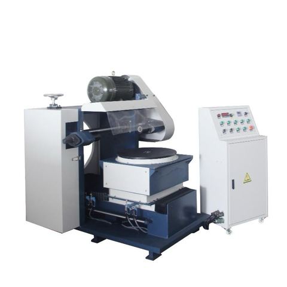

# 자동경면사상가공기

[전체 목록](../../../README.md) · 장비군: **표면가공·처리 설비**

> 자동 생성 페이지입니다. 이 폴더에 파일을 올리면 내용이 갱신됩니다.

필수 산출물 3/3 · 개발계획서 있음 · 가이던스 있음 · AASX 있음

## 산출물

| 구분 | 파일 | 크기 | 보기 |
|---|---|---|---|
| 개발계획서 | [참조모델_개발계획서_자동경면사상가공기.docx](%EA%B0%9C%EB%B0%9C%EA%B3%84%ED%9A%8D%EC%84%9C/%EC%B0%B8%EC%A1%B0%EB%AA%A8%EB%8D%B8_%EA%B0%9C%EB%B0%9C%EA%B3%84%ED%9A%8D%EC%84%9C_%EC%9E%90%EB%8F%99%EA%B2%BD%EB%A9%B4%EC%82%AC%EC%83%81%EA%B0%80%EA%B3%B5%EA%B8%B0.docx) | 793 KB | [보기](%EA%B0%9C%EB%B0%9C%EA%B3%84%ED%9A%8D%EC%84%9C/%EC%B0%B8%EC%A1%B0%EB%AA%A8%EB%8D%B8_%EA%B0%9C%EB%B0%9C%EA%B3%84%ED%9A%8D%EC%84%9C_%EC%9E%90%EB%8F%99%EA%B2%BD%EB%A9%B4%EC%82%AC%EC%83%81%EA%B0%80%EA%B3%B5%EA%B8%B0.pdf) |
| 가이던스 | [AAS_활용_가이던스_자동경면사상가공기.pdf](%EA%B0%80%EC%9D%B4%EB%8D%98%EC%8A%A4/AAS_%ED%99%9C%EC%9A%A9_%EA%B0%80%EC%9D%B4%EB%8D%98%EC%8A%A4_%EC%9E%90%EB%8F%99%EA%B2%BD%EB%A9%B4%EC%82%AC%EC%83%81%EA%B0%80%EA%B3%B5%EA%B8%B0.pdf) | 12.1 MB | [보기](%EA%B0%80%EC%9D%B4%EB%8D%98%EC%8A%A4/AAS_%ED%99%9C%EC%9A%A9_%EA%B0%80%EC%9D%B4%EB%8D%98%EC%8A%A4_%EC%9E%90%EB%8F%99%EA%B2%BD%EB%A9%B4%EC%82%AC%EC%83%81%EA%B0%80%EA%B3%B5%EA%B8%B0.pdf) |
| AASX | [MirrorFinishingMachine_v0.0.1.aasx](AASX/MirrorFinishingMachine_v0.0.1.aasx) | 35.7 MB | [열람 페이지](gen/MirrorFinishingMachine_v0.0.1.md) |
| 참고자료 | [참고링크.md](%EC%B0%B8%EA%B3%A0%EC%9E%90%EB%A3%8C/%EC%B0%B8%EA%B3%A0%EB%A7%81%ED%81%AC.md) | 3 KB | [보기](%EC%B0%B8%EA%B3%A0%EC%9E%90%EB%A3%8C/%EC%B0%B8%EA%B3%A0%EB%A7%81%ED%81%AC.md) |

## AAS 구성 — `MirrorFinishingMachineAAS`

`MirrorFinishingMachine_v0.0.1.aasx` 에서 읽은 서브모델 7개 · **[요소 전체 보기](gen/MirrorFinishingMachine_v0.0.1.md)**:

| # | 서브모델 idShort |
|:-:|---|
| 1 | DigitalNameplate |
| 2 | HandoverDocumentation |
| 3 | TechnicalData |
| 4 | OperationalData |
| 5 | TimeSeries |
| 6 | ProcessParameters |
| 7 | PredictiveMaintenance |

변경 기록 (최근 7건)

| 날짜 | 변경 | 파일 |
|---|---|---|
| 2026-11-04 | 추가 | 참조모델_개발계획서_자동경면사상가공기.docx |
| 2026-11-04 | 이름 변경 | 자동경면사상가공기_가이던스.pdf → AAS_활용_가이던스_자동경면사상가공기.pdf |
| 2026-11-04 | 삭제 | 자동경면사상가공기_개발계획서(자리표시).docx |
| 2026-11-03 | 추가 | MirrorFinishingMachine_v0.0.1.aasx |
| 2026-11-03 | 추가 | 자동경면사상가공기_가이던스.pdf |
| 2026-11-03 | 추가 | 자동경면사상가공기_개발계획서(자리표시).docx |
| 2026-11-03 | 추가 | 참고링크.md |

