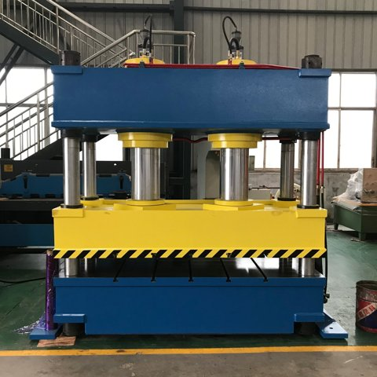

# 압력기

[← 전체 목록](../../../README.md) · 장비군: **프레스·압입 설비**

> 🤖 자동 생성 페이지입니다. 이 폴더에 파일을 올리면 내용이 갱신됩니다.

필수 산출물 1/3 · 개발계획서 없음 · 가이던스 없음 · AASX 있음

## 산출물

| 구분 | 파일 | 크기 | 바로 보기 |
|---|---|---|---|
| 📄 개발계획서 | _아직 없음_ | | |
| 📘 가이던스 | _아직 없음_ | | |
| 🧩 AASX | [HydraulicFormingPress_v0.0.3_261013.aasx](AASX/HydraulicFormingPress_v0.0.3_261013.aasx) | 13.1 MB | [👁 열람 페이지](gen/HydraulicFormingPress_v0.0.3_261013.md) |
| 🔗 참고자료 | [참고링크.md](%EC%B0%B8%EA%B3%A0%EC%9E%90%EB%A3%8C/%EC%B0%B8%EA%B3%A0%EB%A7%81%ED%81%AC.md) | 6 KB | [👁 바로 보기](%EC%B0%B8%EA%B3%A0%EC%9E%90%EB%A3%8C/%EC%B0%B8%EA%B3%A0%EB%A7%81%ED%81%AC.md) |

## AAS 구성 — `HydraulicFormingPress`

`HydraulicFormingPress_v0.0.3_261013.aasx` 에서 읽은 서브모델 6개 · **[👁 요소 전체 펼쳐 보기](gen/HydraulicFormingPress_v0.0.3_261013.md)**:

| # | 서브모델 idShort |
|:-:|---|
| 1 | Nameplate |
| 2 | HandoverDocumentation |
| 3 | TechnicalData |
| 4 | OperationalData |
| 5 | TimeSeries |
| 6 | ProcessParameters |
