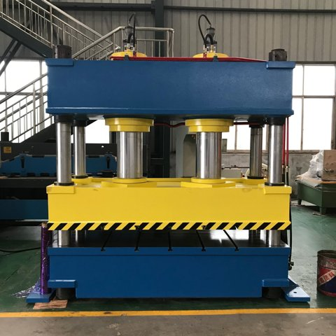

# HydraulicFormingPress_v0.0.3_261013.aasx

[장비 페이지](../README.md) · [AASX 다운로드](../AASX/HydraulicFormingPress_v0.0.3_261013.aasx) · 13.1 MB

> AASX 파일을 열어 자동으로 만든 열람 페이지입니다. 직접 고치지 말고 AASX를 다시 올리세요.

| 항목 | 내용 |
|---|---|
| AAS idShort | `HydraulicFormingPress` |
| AAS id | https://www.smart-factory.kr/ids/aas/HydraulicFormingPress/1/0 |
| 자산 종류 (assetKind) | Type |
| globalAssetId | https://www.smart-factory.kr/ids/asset/HydraulicFormingPress/PR2000H/1/0 |
| 설명 | 냉간 금속 판재 성형용 4주식 유압 프레스의 Type1 참조모델입니다. ExampleCompany·PR-2000H와 장비·운전·레시피 값은 비식별 합성 예시입니다. 공개 제조사 문서와 실린더·램 사진은 참고 자료이며 장비 채택 사양의 근거가 아닙니다. 썸네일은 4주식·주 가압 실린더 2개 장비 전경의 실사진이며 구성 참고용임. 출처: https://chi… |
| 서브모델 | 6개 |
| 전체 요소 | 1,600개 |

## 서브모델 한눈에 보기

| # | 서브모델 | 요소 수 | semanticId |
|:-:|---|--:|---|
| 1 | [Nameplate](#sm-1) | 21 | https://admin-shell.io/idta/nameplate/3/0/Nameplate |
| 2 | [HandoverDocumentation](#sm-2) | 25 | 0173-1#01-AHF578#003 |
| 3 | [TechnicalData](#sm-3) | 63 | 0173-1#01-AHX837#002 |
| 4 | [OperationalData](#sm-4) | 34 | https://www.smart-factory.kr/ids/sm/HydraulicFormingPress/OperationalData/1/0 |
| 5 | [TimeSeries](#sm-5) | 1,431 | https://admin-shell.io/idta/TimeSeries/1/1 |
| 6 | [ProcessParameters](#sm-6) | 26 | https://admin-shell-io/idta/SubmodelTemplate/ProcessParameters/1/0 |

## 서브모델 상세

각 서브모델 이름을 누르면 펼쳐집니다. **굵은 글씨**는 하위 요소가 있는 묶음입니다.

<b>1. Nameplate</b> — 요소 21개

> 4주식 유압 성형 프레스의 식별 정보이며 제품·주소 값은 비식별 합성 예시입니다.

semanticId: `https://admin-shell.io/idta/nameplate/3/0/Nameplate`

| idShort | 종류 | 값 | semanticId |
|---|---|---|---|
| URIOfTheProduct | 속성 | https://www.smart-factory.kr/ids/asset/HydraulicFormingPress/PR2000H/1/0 | 0112/2///61987#ABN590#002 |
| ManufacturerName | 다국어&nbsp;속성 | ExampleCompany | 0112/2///61987#ABA565#009 |
| ManufacturerProductDesignation | 다국어&nbsp;속성 | ExampleCompany Hydraulic Forming Press | 0112/2///61987#ABA567#009 |
| **AddressInformation** | 묶음&nbsp;(4) |  | https://admin-shell.io/zvei/nameplate/1/0/ContactInformations/Address… |
| &nbsp;&nbsp;&nbsp;└ Street | 다국어&nbsp;속성 | 1 Example-ro | 0173-1#02-AAO128#002 |
| &nbsp;&nbsp;&nbsp;└ Zipcode | 다국어&nbsp;속성 | 12345 | 0173-1#02-AAO129#002 |
| &nbsp;&nbsp;&nbsp;└ CityTown | 다국어&nbsp;속성 | ExampleCity | 0173-1#02-AAO132#002 |
| &nbsp;&nbsp;&nbsp;└ NationalCode | 다국어&nbsp;속성 | KR | 0173-1#02-AAO134#002 |
| ManufacturerProductRoot | 다국어&nbsp;속성 | Hydraulic press | 0112/2///61360_7#AAS011#001 |
| ManufacturerProductFamily | 다국어&nbsp;속성 | Hydraulic forming press | 0112/2///61987#ABP464#002 |
| ManufacturerProductType | 속성 | PR-2000H | 0112/2///61987#ABA300#008 |
| OrderCodeOfManufacturer | 속성 | PR-2000H-ORD | 0112/2///61987#ABA950#008 |
| ProductArticleNumberOfManufacturer | 속성 | PR-2000H-ART | 0112/2///61987#ABA581#007 |
| SerialNumber | 속성 | SYN-PR2000H-0001 | 0112/2///61987#ABA951#009 |
| YearOfConstruction | 속성 | 2026 | 0112/2///61987#ABP000#002 |
| DateOfManufacture | 속성 | 2026-06-01 | 0112/2///61987#ABB757#007 |
| HardwareVersion | 속성 | 1.0.0 | 0112/2///61987#ABA926#008 |
| FirmwareVersion | 속성 | 1.0.0 | 0112/2///61987#ABA302#006 |
| SoftwareVersion | 속성 | 1.0.0 | 0112/2///61987#ABA601#008 |
| CountryOfOrigin | 속성 | KR | 0112/2///61987#ABP462#001 |
| UniqueFacilityIdentifier | 속성 | SYN-FACILITY-001 | https://admin-shell.io/idta/nameplate/3/0/UniqueFacilityIdentifier |

<b>2. HandoverDocumentation</b> — 요소 25개

> 공개 제조사 카탈로그를 참고 문서로 연결하며, 장비 운전매뉴얼 또는 PDF/A 적합성이 확인된 인수문서와 구분합니다.

semanticId: `0173-1#01-AHF578#003`

| idShort | 종류 | 값 | semanticId |
|---|---|---|---|
| **Documents** | 목록&nbsp;(1) |  | 0173-1#02-ABI500#003 |
| &nbsp;&nbsp;&nbsp;└ **** | 묶음&nbsp;(3) |  | 0173-1#02-ABI500#003/0173-1#01-AHF579#003 |
| &nbsp;&nbsp;&nbsp;&nbsp;&nbsp;&nbsp;└ **DocumentIds** | 목록&nbsp;(1) |  | 0173-1#02-ABI501#003 |
| &nbsp;&nbsp;&nbsp;&nbsp;&nbsp;&nbsp;&nbsp;&nbsp;&nbsp;└ **** | 묶음&nbsp;(3) |  | 0173-1#02-ABI501#003/0173-1#01-AHF580#003 |
| &nbsp;&nbsp;&nbsp;&nbsp;&nbsp;&nbsp;&nbsp;&nbsp;&nbsp;&nbsp;&nbsp;&nbsp;└ DocumentDomainId | 속성 | multipress.com | 0173-1#02-ABH994#003 |
| &nbsp;&nbsp;&nbsp;&nbsp;&nbsp;&nbsp;&nbsp;&nbsp;&nbsp;&nbsp;&nbsp;&nbsp;└ DocumentIdentifier | 속성 | 11-002-V0320-MP-4-Post-Presses-Single.pdf | 0173-1#02-AAO099#004 |
| &nbsp;&nbsp;&nbsp;&nbsp;&nbsp;&nbsp;&nbsp;&nbsp;&nbsp;&nbsp;&nbsp;&nbsp;└ DocumentIsPrimary | 속성 | true | 0173-1#02-ABH995#003 |
| &nbsp;&nbsp;&nbsp;&nbsp;&nbsp;&nbsp;└ **DocumentClassifications** | 목록&nbsp;(1) |  | 0173-1#02-ABI502#003 |
| &nbsp;&nbsp;&nbsp;&nbsp;&nbsp;&nbsp;&nbsp;&nbsp;&nbsp;└ **** | 묶음&nbsp;(3) |  | 0173-1#02-ABI502#003/0173-1#01-AHF581#003 |
| &nbsp;&nbsp;&nbsp;&nbsp;&nbsp;&nbsp;&nbsp;&nbsp;&nbsp;&nbsp;&nbsp;&nbsp;└ ClassId | 속성 | 02-01 | 0173-1#02-ABH996#003 |
| &nbsp;&nbsp;&nbsp;&nbsp;&nbsp;&nbsp;&nbsp;&nbsp;&nbsp;&nbsp;&nbsp;&nbsp;└ ClassName | 다국어&nbsp;속성 | Technical specification | 0173-1#02-ABJ219#002 |
| &nbsp;&nbsp;&nbsp;&nbsp;&nbsp;&nbsp;&nbsp;&nbsp;&nbsp;&nbsp;&nbsp;&nbsp;└ ClassificationSystem | 속성 | VDI 2770 Blatt 1:2020 | 0173-1#02-ABH997#003 |
| &nbsp;&nbsp;&nbsp;&nbsp;&nbsp;&nbsp;└ **DocumentVersions** | 목록&nbsp;(1) |  | 0173-1#02-ABI503#003 |
| &nbsp;&nbsp;&nbsp;&nbsp;&nbsp;&nbsp;&nbsp;&nbsp;&nbsp;└ **** | 묶음&nbsp;(9) |  | 0173-1#02-ABI503#003/0173-1#01-AHF582#003 |
| &nbsp;&nbsp;&nbsp;&nbsp;&nbsp;&nbsp;&nbsp;&nbsp;&nbsp;&nbsp;&nbsp;&nbsp;└ **Language** | 목록&nbsp;(1) |  | 0173-1#02-AAN468#008 |
| &nbsp;&nbsp;&nbsp;&nbsp;&nbsp;&nbsp;&nbsp;&nbsp;&nbsp;&nbsp;&nbsp;&nbsp;&nbsp;&nbsp;&nbsp;└  | 속성 | en | 0173-1#02-AAN468#008 |
| &nbsp;&nbsp;&nbsp;&nbsp;&nbsp;&nbsp;&nbsp;&nbsp;&nbsp;&nbsp;&nbsp;&nbsp;└ Version | 속성 | sha256-ac3439e1ac12 | 0173-1#02-AAP003#005 |
| &nbsp;&nbsp;&nbsp;&nbsp;&nbsp;&nbsp;&nbsp;&nbsp;&nbsp;&nbsp;&nbsp;&nbsp;└ Title | 다국어&nbsp;속성 | 4-Post Presses | 0173-1#02-ABG940#003 |
| &nbsp;&nbsp;&nbsp;&nbsp;&nbsp;&nbsp;&nbsp;&nbsp;&nbsp;&nbsp;&nbsp;&nbsp;└ Description | 다국어&nbsp;속성 | Public MULTIPRESS four-post press catalog retained as reference material. It is… | 0173-1#02-AAN466#004 |
| &nbsp;&nbsp;&nbsp;&nbsp;&nbsp;&nbsp;&nbsp;&nbsp;&nbsp;&nbsp;&nbsp;&nbsp;└ StatusSetDate | 속성 | 2026-10-13 | 0173-1#02-ABI000#003 |
| &nbsp;&nbsp;&nbsp;&nbsp;&nbsp;&nbsp;&nbsp;&nbsp;&nbsp;&nbsp;&nbsp;&nbsp;└ StatusValue | 속성 | InReview | 0173-1#02-ABI001#003 |
| &nbsp;&nbsp;&nbsp;&nbsp;&nbsp;&nbsp;&nbsp;&nbsp;&nbsp;&nbsp;&nbsp;&nbsp;└ OrganizationShortName | 속성 | MULTIPRESS | https://api.eclass-cdp.com/0173-1-02-ABI002-003 |
| &nbsp;&nbsp;&nbsp;&nbsp;&nbsp;&nbsp;&nbsp;&nbsp;&nbsp;&nbsp;&nbsp;&nbsp;└ OrganizationOfficialName | 속성 | MULTIPRESS Inc. | 0173-1#02-ABI004#003 |
| &nbsp;&nbsp;&nbsp;&nbsp;&nbsp;&nbsp;&nbsp;&nbsp;&nbsp;&nbsp;&nbsp;&nbsp;└ **DigitalFiles** | 목록&nbsp;(1) |  | 0173-1#02-ABK126#002 |
| &nbsp;&nbsp;&nbsp;&nbsp;&nbsp;&nbsp;&nbsp;&nbsp;&nbsp;&nbsp;&nbsp;&nbsp;&nbsp;&nbsp;&nbsp;└  | 파일 | /aasx/files/documents/Multipress_4Post.pdf | 0173-1#02-ABK126#002 |

<b>3. TechnicalData</b> — 요소 63개

> 4주식 유압 성형 프레스의 설계·정격 사양입니다. PR-2000H 수치는 합성 예시이며 참고 사진의 사양을 채택한 것으로 해석하지 않습니다.

semanticId: `0173-1#01-AHX837#002`

| idShort | 종류 | 값 | semanticId |
|---|---|---|---|
| **GeneralInformation** | 묶음&nbsp;(5) |  | 0173-1#02-ABK161#002/0173-1#01-AHX838#002 |
| &nbsp;&nbsp;&nbsp;└ ManufacturerName | 속성 | ExampleCompany | 0173-1#02-AAO677#004 |
| &nbsp;&nbsp;&nbsp;└ ManufacturerProductDesignation | 다국어&nbsp;속성 | ExampleCompany Hydraulic Forming Press | 0173-1#02-AAW338#003 |
| &nbsp;&nbsp;&nbsp;└ ManufacturerArticleNumber | 속성 | PR-2000H-ART | 0173-1#02-AAO676#005 |
| &nbsp;&nbsp;&nbsp;└ ManufacturerOrderCode | 속성 | PR-2000H-ORD | 0173-1#02-AAO227#004 |
| &nbsp;&nbsp;&nbsp;└ **ProductImages** | 목록&nbsp;(1) |  | 0173-1#02-ABM220#001 |
| &nbsp;&nbsp;&nbsp;&nbsp;&nbsp;&nbsp;└ **** | 묶음&nbsp;(2) |  | 0173-1#02-ABM220#001/0173-1#01-AHY911#001 |
| &nbsp;&nbsp;&nbsp;&nbsp;&nbsp;&nbsp;&nbsp;&nbsp;&nbsp;└ ImageFile | 파일 | /aasx/files/images/figure4_actual.png | 0173-1#02-ABK291#002 |
| &nbsp;&nbsp;&nbsp;&nbsp;&nbsp;&nbsp;&nbsp;&nbsp;&nbsp;└ ImageNote | 다국어&nbsp;속성 | Hydraulic press cylinder and ram reference photo | 0173-1#02-ABL423#001 |
| **ProductClassifications** | 목록&nbsp;(1) |  | 0173-1#02-ABK162#002 |
| &nbsp;&nbsp;&nbsp;└ **** | 묶음&nbsp;(5) |  | 0173-1#02-ABK162#002/0173-1#01-AHX839#002 |
| &nbsp;&nbsp;&nbsp;&nbsp;&nbsp;&nbsp;└ ClassificationSystem | 속성 | ECLASS | 0173-1#02-ABL424#001 |
| &nbsp;&nbsp;&nbsp;&nbsp;&nbsp;&nbsp;└ ClassificationSystemVersion | 속성 | ECLASS 16.0 | 0173-1#02-AAR710#003 |
| &nbsp;&nbsp;&nbsp;&nbsp;&nbsp;&nbsp;└ ProductClassId | 속성 | 0173-1#01-AKK097#020 | 0173-1#02-ABG776#003 |
| &nbsp;&nbsp;&nbsp;&nbsp;&nbsp;&nbsp;└ ProductClassCodedName | 속성 | 36630608 | 0173-1#02-ABK128#002 |
| &nbsp;&nbsp;&nbsp;&nbsp;&nbsp;&nbsp;└ ProductClassName | 다국어&nbsp;속성 | Hydraulic column press (machine tool) | 0173-1#02-ABK273#002 |
| **TechnicalPropertyAreas** | 목록&nbsp;(1) |  | 0173-1#02-ABK163#002 |
| &nbsp;&nbsp;&nbsp;└ **** | 묶음&nbsp;(6) |  | 0173-1#02-ABL358#002/0173-1#01-AHX773#002 |
| &nbsp;&nbsp;&nbsp;&nbsp;&nbsp;&nbsp;└ **HydraulicPressCommonSpecifications** | 묶음&nbsp;(2) |  | https://www.smart-factory.kr/ids/cd/HydraulicPressCommonSpecification… |
| &nbsp;&nbsp;&nbsp;&nbsp;&nbsp;&nbsp;&nbsp;&nbsp;&nbsp;└ **PressTypeAndApplication** | 묶음&nbsp;(2) |  | https://www.smart-factory.kr/ids/cd/PressTypeAndApplication/1/0 |
| &nbsp;&nbsp;&nbsp;&nbsp;&nbsp;&nbsp;&nbsp;&nbsp;&nbsp;&nbsp;&nbsp;&nbsp;└ PressType | 다국어&nbsp;속성 | Four-column hydraulic press | https://www.smart-factory.kr/ids/cd/PressType/1/0 |
| &nbsp;&nbsp;&nbsp;&nbsp;&nbsp;&nbsp;&nbsp;&nbsp;&nbsp;&nbsp;&nbsp;&nbsp;└ PressApplicationField | 속성 | Cold forming of metal sheet blanks | https://www.smart-factory.kr/ids/cd/PressApplicationField/1/0 |
| &nbsp;&nbsp;&nbsp;&nbsp;&nbsp;&nbsp;&nbsp;&nbsp;&nbsp;└ **FrameAndActuators** | 묶음&nbsp;(2) |  | https://www.smart-factory.kr/ids/cd/FrameAndActuators/1/0 |
| &nbsp;&nbsp;&nbsp;&nbsp;&nbsp;&nbsp;&nbsp;&nbsp;&nbsp;&nbsp;&nbsp;&nbsp;└ NumberOfCylinders | 속성 | 2 | 0173-1#02-AAP412#003 |
| &nbsp;&nbsp;&nbsp;&nbsp;&nbsp;&nbsp;&nbsp;&nbsp;&nbsp;&nbsp;&nbsp;&nbsp;└ FrameStructureType | 속성 | Steel four-column frame | https://www.smart-factory.kr/ids/cd/FrameStructureType/1/0 |
| &nbsp;&nbsp;&nbsp;&nbsp;&nbsp;&nbsp;└ **FormingForceAndStrokeSpecifications** | 묶음&nbsp;(2) |  | https://www.smart-factory.kr/ids/cd/FormingForceAndStrokeSpecificatio… |
| &nbsp;&nbsp;&nbsp;&nbsp;&nbsp;&nbsp;&nbsp;&nbsp;&nbsp;└ **ForceRatings** | 묶음&nbsp;(2) |  | https://www.smart-factory.kr/ids/cd/ForceRatings/1/0 |
| &nbsp;&nbsp;&nbsp;&nbsp;&nbsp;&nbsp;&nbsp;&nbsp;&nbsp;&nbsp;&nbsp;&nbsp;└ RatedFormingForce | 속성 | 2000 | https://www.smart-factory.kr/ids/cd/RatedFormingForce/1/0 |
| &nbsp;&nbsp;&nbsp;&nbsp;&nbsp;&nbsp;&nbsp;&nbsp;&nbsp;&nbsp;&nbsp;&nbsp;└ MaxRamForce | 속성 | 19613.3 | https://www.smart-factory.kr/ids/cd/MaxRamForce/1/0 |
| &nbsp;&nbsp;&nbsp;&nbsp;&nbsp;&nbsp;&nbsp;&nbsp;&nbsp;└ **StrokeAndMotion** | 묶음&nbsp;(3) |  | https://www.smart-factory.kr/ids/cd/StrokeAndMotion/1/0 |
| &nbsp;&nbsp;&nbsp;&nbsp;&nbsp;&nbsp;&nbsp;&nbsp;&nbsp;&nbsp;&nbsp;&nbsp;└ MaxRamStroke | 속성 | 1200 | 0173-1#02-BAA627#010 |
| &nbsp;&nbsp;&nbsp;&nbsp;&nbsp;&nbsp;&nbsp;&nbsp;&nbsp;&nbsp;&nbsp;&nbsp;└ RamSpeedRange | 범위 | 0 ~ 3.8 | https://www.smart-factory.kr/ids/cd/RamSpeedRange/1/0 |
| &nbsp;&nbsp;&nbsp;&nbsp;&nbsp;&nbsp;&nbsp;&nbsp;&nbsp;&nbsp;&nbsp;&nbsp;└ DaylightOpening | 속성 | 1500 | https://www.smart-factory.kr/ids/cd/DaylightOpening/1/0 |
| &nbsp;&nbsp;&nbsp;&nbsp;&nbsp;&nbsp;└ **HydraulicSystemSpecifications** | 묶음&nbsp;(2) |  | https://www.smart-factory.kr/ids/cd/HydraulicSystemSpecifications/1/0 |
| &nbsp;&nbsp;&nbsp;&nbsp;&nbsp;&nbsp;&nbsp;&nbsp;&nbsp;└ **PressureAndFlow** | 묶음&nbsp;(3) |  | https://www.smart-factory.kr/ids/cd/PressureAndFlow/1/0 |
| &nbsp;&nbsp;&nbsp;&nbsp;&nbsp;&nbsp;&nbsp;&nbsp;&nbsp;&nbsp;&nbsp;&nbsp;└ SystemPressureRange | 범위 | 0 ~ 31.5 | https://www.smart-factory.kr/ids/cd/SystemPressureRange/1/0 |
| &nbsp;&nbsp;&nbsp;&nbsp;&nbsp;&nbsp;&nbsp;&nbsp;&nbsp;&nbsp;&nbsp;&nbsp;└ RatedSystemPressure | 속성 | 25 | https://www.smart-factory.kr/ids/cd/RatedSystemPressure/1/0 |
| &nbsp;&nbsp;&nbsp;&nbsp;&nbsp;&nbsp;&nbsp;&nbsp;&nbsp;&nbsp;&nbsp;&nbsp;└ PumpFlowRate | 속성 | 180 | 0173-1#02-ABC593#004 |
| &nbsp;&nbsp;&nbsp;&nbsp;&nbsp;&nbsp;&nbsp;&nbsp;&nbsp;└ **OilStorageAndSpecification** | 묶음&nbsp;(2) |  | https://www.smart-factory.kr/ids/cd/OilStorageAndSpecification/1/0 |
| &nbsp;&nbsp;&nbsp;&nbsp;&nbsp;&nbsp;&nbsp;&nbsp;&nbsp;&nbsp;&nbsp;&nbsp;└ HydraulicOilTankCapacity | 속성 | 1200 | https://www.smart-factory.kr/ids/cd/HydraulicOilTankCapacity/1/0 |
| &nbsp;&nbsp;&nbsp;&nbsp;&nbsp;&nbsp;&nbsp;&nbsp;&nbsp;&nbsp;&nbsp;&nbsp;└ HydraulicOilType | 속성 | ISO VG46 anti-wear hydraulic oil | https://www.smart-factory.kr/ids/cd/HydraulicOilType/1/0 |
| &nbsp;&nbsp;&nbsp;&nbsp;&nbsp;&nbsp;└ **DieAndBolsterSpecifications** | 묶음&nbsp;(2) |  | https://www.smart-factory.kr/ids/cd/DieAndBolsterSpecifications/1/0 |
| &nbsp;&nbsp;&nbsp;&nbsp;&nbsp;&nbsp;&nbsp;&nbsp;&nbsp;└ **DieInstallation** | 묶음&nbsp;(3) |  | https://www.smart-factory.kr/ids/cd/DieInstallation/1/0 |
| &nbsp;&nbsp;&nbsp;&nbsp;&nbsp;&nbsp;&nbsp;&nbsp;&nbsp;&nbsp;&nbsp;&nbsp;└ BolsterPlateSize | 속성 | 2000 x 1500 | https://www.smart-factory.kr/ids/cd/BolsterPlateSize/1/0 |
| &nbsp;&nbsp;&nbsp;&nbsp;&nbsp;&nbsp;&nbsp;&nbsp;&nbsp;&nbsp;&nbsp;&nbsp;└ MaxDieWeight | 속성 | 8000 | https://www.smart-factory.kr/ids/cd/MaxDieWeight/1/0 |
| &nbsp;&nbsp;&nbsp;&nbsp;&nbsp;&nbsp;&nbsp;&nbsp;&nbsp;&nbsp;&nbsp;&nbsp;└ DieClampingMethod | 속성 | Hydraulic die clamp | https://www.smart-factory.kr/ids/cd/DieClampingMethod/1/0 |
| &nbsp;&nbsp;&nbsp;&nbsp;&nbsp;&nbsp;&nbsp;&nbsp;&nbsp;└ **PartEjection** | 묶음&nbsp;(1) |  | https://www.smart-factory.kr/ids/cd/PartEjection/1/0 |
| &nbsp;&nbsp;&nbsp;&nbsp;&nbsp;&nbsp;&nbsp;&nbsp;&nbsp;&nbsp;&nbsp;&nbsp;└ EjectorForce | 속성 | 400 | https://www.smart-factory.kr/ids/cd/EjectorForce/1/0 |
| &nbsp;&nbsp;&nbsp;&nbsp;&nbsp;&nbsp;└ **StructureAndDimensionSpecifications** | 묶음&nbsp;(2) |  | https://www.smart-factory.kr/ids/cd/StructureAndDimensionSpecificatio… |
| &nbsp;&nbsp;&nbsp;&nbsp;&nbsp;&nbsp;&nbsp;&nbsp;&nbsp;└ **OverallDimensions** | 묶음&nbsp;(3) |  | https://www.smart-factory.kr/ids/cd/OverallDimensions/1/0 |
| &nbsp;&nbsp;&nbsp;&nbsp;&nbsp;&nbsp;&nbsp;&nbsp;&nbsp;&nbsp;&nbsp;&nbsp;└ Length | 속성 | 3500 | 0173-1#02-BAB146#011 |
| &nbsp;&nbsp;&nbsp;&nbsp;&nbsp;&nbsp;&nbsp;&nbsp;&nbsp;&nbsp;&nbsp;&nbsp;└ Width | 속성 | 3000 | 0173-1#02-BAA705#009 |
| &nbsp;&nbsp;&nbsp;&nbsp;&nbsp;&nbsp;&nbsp;&nbsp;&nbsp;&nbsp;&nbsp;&nbsp;└ Height | 속성 | 7000 | 0173-1#02-BAB707#009 |
| &nbsp;&nbsp;&nbsp;&nbsp;&nbsp;&nbsp;&nbsp;&nbsp;&nbsp;└ **WeightRatings** | 묶음&nbsp;(1) |  | https://www.smart-factory.kr/ids/cd/WeightRatings/1/0 |
| &nbsp;&nbsp;&nbsp;&nbsp;&nbsp;&nbsp;&nbsp;&nbsp;&nbsp;&nbsp;&nbsp;&nbsp;└ MachineWeight | 속성 | 65000 | 0173-1#02-AAH829#006 |
| &nbsp;&nbsp;&nbsp;&nbsp;&nbsp;&nbsp;└ **ElectricalAndSafetySpecifications** | 묶음&nbsp;(2) |  | https://www.smart-factory.kr/ids/cd/ElectricalAndSafetySpecifications… |
| &nbsp;&nbsp;&nbsp;&nbsp;&nbsp;&nbsp;&nbsp;&nbsp;&nbsp;└ **PowerSupply** | 묶음&nbsp;(2) |  | https://www.smart-factory.kr/ids/cd/PowerSupply/1/0 |
| &nbsp;&nbsp;&nbsp;&nbsp;&nbsp;&nbsp;&nbsp;&nbsp;&nbsp;&nbsp;&nbsp;&nbsp;└ RatedVoltage | 범위 | 380 ~ 415 | https://www.smart-factory.kr/ids/cd/RatedVoltage/1/0 |
| &nbsp;&nbsp;&nbsp;&nbsp;&nbsp;&nbsp;&nbsp;&nbsp;&nbsp;&nbsp;&nbsp;&nbsp;└ MainMotorPower | 속성 | 75 | 0173-1#02-AAG926#005 |
| &nbsp;&nbsp;&nbsp;&nbsp;&nbsp;&nbsp;&nbsp;&nbsp;&nbsp;└ **ProtectionAndSafety** | 묶음&nbsp;(3) |  | https://www.smart-factory.kr/ids/cd/ProtectionAndSafety/1/0 |
| &nbsp;&nbsp;&nbsp;&nbsp;&nbsp;&nbsp;&nbsp;&nbsp;&nbsp;&nbsp;&nbsp;&nbsp;└ IPRating | 속성 | IP54 | 0173-1#02-BAG975#017 |
| &nbsp;&nbsp;&nbsp;&nbsp;&nbsp;&nbsp;&nbsp;&nbsp;&nbsp;&nbsp;&nbsp;&nbsp;└ SafetyLightCurtainType | 속성 | Type 4 | https://www.smart-factory.kr/ids/cd/SafetyLightCurtainType/1/0 |
| &nbsp;&nbsp;&nbsp;&nbsp;&nbsp;&nbsp;&nbsp;&nbsp;&nbsp;&nbsp;&nbsp;&nbsp;└ EmergencyStopCategory | 속성 | 0 | 0173-1#02-AAC131#010 |

<b>4. OperationalData</b> — 요소 34개

> 2026-06-22T08:15:30Z의 합성 운전 스냅샷으로 성형력·램 운동·유압·생산·장비 상태를 표현합니다.

semanticId: `https://www.smart-factory.kr/ids/sm/HydraulicFormingPress/OperationalData/1/0`

| idShort | 종류 | 값 | semanticId |
|---|---|---|---|
| **FormingOperation** | 묶음&nbsp;(2) |  | https://www.smart-factory.kr/ids/cd/FormingOperation/1/0 |
| &nbsp;&nbsp;&nbsp;└ **ForceMeasurements** | 묶음&nbsp;(4) |  | https://www.smart-factory.kr/ids/cd/ForceMeasurements/1/0 |
| &nbsp;&nbsp;&nbsp;&nbsp;&nbsp;&nbsp;└ PressCurrentFormingForce | 속성 | 1860 | https://www.smart-factory.kr/ids/cd/PressCurrentFormingForce/1/0 |
| &nbsp;&nbsp;&nbsp;&nbsp;&nbsp;&nbsp;└ PressPeakForceThisCycle | 속성 | 1925 | https://www.smart-factory.kr/ids/cd/PressPeakForceThisCycle/1/0 |
| &nbsp;&nbsp;&nbsp;&nbsp;&nbsp;&nbsp;└ PressForceDeviation | 속성 | -2.11 | https://www.smart-factory.kr/ids/cd/PressForceDeviation/1/0 |
| &nbsp;&nbsp;&nbsp;&nbsp;&nbsp;&nbsp;└ PressTonnageStatus | 속성 | Normal | https://www.smart-factory.kr/ids/cd/PressTonnageStatus/1/0 |
| &nbsp;&nbsp;&nbsp;└ **PositionAndMotion** | 묶음&nbsp;(4) |  | https://www.smart-factory.kr/ids/cd/PositionAndMotion/1/0 |
| &nbsp;&nbsp;&nbsp;&nbsp;&nbsp;&nbsp;└ PressCurrentRamPosition | 속성 | 650.3 | https://www.smart-factory.kr/ids/cd/PressCurrentRamPosition/1/0 |
| &nbsp;&nbsp;&nbsp;&nbsp;&nbsp;&nbsp;└ PressBottomDeadCenterPosition | 속성 | 650.3 | https://www.smart-factory.kr/ids/cd/PressBottomDeadCenterPosition/1/0 |
| &nbsp;&nbsp;&nbsp;&nbsp;&nbsp;&nbsp;└ PressCurrentRamSpeed | 속성 | 0 | https://www.smart-factory.kr/ids/cd/PressCurrentRamSpeed/1/0 |
| &nbsp;&nbsp;&nbsp;&nbsp;&nbsp;&nbsp;└ PressRamPositionDeviation | 속성 | 0.3 | https://www.smart-factory.kr/ids/cd/PressRamPositionDeviation/1/0 |
| **HydraulicOperation** | 묶음&nbsp;(2) |  | https://www.smart-factory.kr/ids/cd/HydraulicOperation/1/0 |
| &nbsp;&nbsp;&nbsp;└ **PressureAndOilCondition** | 묶음&nbsp;(3) |  | https://www.smart-factory.kr/ids/cd/PressureAndOilCondition/1/0 |
| &nbsp;&nbsp;&nbsp;&nbsp;&nbsp;&nbsp;└ PressCurrentSystemPressure | 속성 | 24.1 | https://www.smart-factory.kr/ids/cd/PressCurrentSystemPressure/1/0 |
| &nbsp;&nbsp;&nbsp;&nbsp;&nbsp;&nbsp;└ PressHydraulicOilTemperature | 속성 | 48 | https://www.smart-factory.kr/ids/cd/PressHydraulicOilTemperature/1/0 |
| &nbsp;&nbsp;&nbsp;&nbsp;&nbsp;&nbsp;└ PressOilLevelStatus | 속성 | Normal | https://www.smart-factory.kr/ids/cd/PressOilLevelStatus/1/0 |
| &nbsp;&nbsp;&nbsp;└ **PumpCondition** | 묶음&nbsp;(1) |  | https://www.smart-factory.kr/ids/cd/PumpCondition/1/0 |
| &nbsp;&nbsp;&nbsp;&nbsp;&nbsp;&nbsp;└ PressPumpVibrationLevel | 속성 | 2.8 | https://www.smart-factory.kr/ids/cd/PressPumpVibrationLevel/1/0 |
| **ProductionOperation** | 묶음&nbsp;(3) |  | https://www.smart-factory.kr/ids/cd/ProductionOperation/1/0 |
| &nbsp;&nbsp;&nbsp;└ **CycleStatistics** | 묶음&nbsp;(2) |  | https://www.smart-factory.kr/ids/cd/CycleStatistics/1/0 |
| &nbsp;&nbsp;&nbsp;&nbsp;&nbsp;&nbsp;└ PressCurrentCycleTime | 속성 | 480 | 0173-1#02-AAF891#006 |
| &nbsp;&nbsp;&nbsp;&nbsp;&nbsp;&nbsp;└ PressStrokeCountAccumulated | 속성 | 1245870 | https://www.smart-factory.kr/ids/cd/PressStrokeCountAccumulated/1/0 |
| &nbsp;&nbsp;&nbsp;└ **PerformanceIndicators** | 묶음&nbsp;(1) |  | https://www.smart-factory.kr/ids/cd/PerformanceIndicators/1/0 |
| &nbsp;&nbsp;&nbsp;&nbsp;&nbsp;&nbsp;└ PressCurrentOEE | 속성 | 82.4 | https://www.smart-factory.kr/ids/cd/PressCurrentOEE/1/0 |
| &nbsp;&nbsp;&nbsp;└ **OperatingCondition** | 묶음&nbsp;(1) |  | https://www.smart-factory.kr/ids/cd/OperatingCondition/1/0 |
| &nbsp;&nbsp;&nbsp;&nbsp;&nbsp;&nbsp;└ PressOperatingMode | 속성 | Auto | https://www.smart-factory.kr/ids/cd/PressOperatingMode/1/0 |
| **EquipmentCondition** | 묶음&nbsp;(3) |  | https://www.smart-factory.kr/ids/cd/EquipmentCondition/1/0 |
| &nbsp;&nbsp;&nbsp;└ **RunAndAlarmState** | 묶음&nbsp;(2) |  | https://www.smart-factory.kr/ids/cd/RunAndAlarmState/1/0 |
| &nbsp;&nbsp;&nbsp;&nbsp;&nbsp;&nbsp;└ PressDeviceRunState | 속성 | Running | https://www.smart-factory.kr/ids/cd/PressDeviceRunState/1/0 |
| &nbsp;&nbsp;&nbsp;&nbsp;&nbsp;&nbsp;└ PressAlarmCode | 속성 | A0000 | https://www.smart-factory.kr/ids/cd/PressAlarmCode/1/0 |
| &nbsp;&nbsp;&nbsp;└ **GuardCondition** | 묶음&nbsp;(1) |  | https://www.smart-factory.kr/ids/cd/GuardCondition/1/0 |
| &nbsp;&nbsp;&nbsp;&nbsp;&nbsp;&nbsp;└ PressSafetyDoorStatus | 속성 | Closed | https://www.smart-factory.kr/ids/cd/PressSafetyDoorStatus/1/0 |
| &nbsp;&nbsp;&nbsp;└ **MaintenanceHistory** | 묶음&nbsp;(1) |  | https://www.smart-factory.kr/ids/cd/MaintenanceHistory/1/0 |
| &nbsp;&nbsp;&nbsp;&nbsp;&nbsp;&nbsp;└ PressLastMaintenanceDate | 속성 | 2026-05-20 | https://www.smart-factory.kr/ids/cd/PressLastMaintenanceDate/1/0 |

<b>5. TimeSeries</b> — 요소 1,431개

> 22개 필드의 공통 레코드 구조, 외부 1일 CSV와 내부 1초 간격 60개 레코드를 사용합니다. CSV는 기록 구조의 합성 예시이며 유압 연성 해석의 검증 자료가 아닙니다.

semanticId: `https://admin-shell.io/idta/TimeSeries/1/1`

| idShort | 종류 | 값 | semanticId |
|---|---|---|---|
| **Metadata** | 묶음&nbsp;(3) |  | https://admin-shell.io/idta/TimeSeries/Metadata/1/1 |
| &nbsp;&nbsp;&nbsp;└ Name | 다국어&nbsp;속성 | Hydraulic forming press operation time series | https://admin-shell.io/idta/TimeSeries/Metadata/Name/1/1 |
| &nbsp;&nbsp;&nbsp;└ Description | 다국어&nbsp;속성 | Time series data for hydraulic forming press operation values | https://admin-shell.io/idta/TimeSeries/Metadata/Description/1/1 |
| &nbsp;&nbsp;&nbsp;└ **Record** | 묶음&nbsp;(22) |  | https://admin-shell.io/idta/TimeSeries/Record/1/1 |
| &nbsp;&nbsp;&nbsp;&nbsp;&nbsp;&nbsp;└ Time | 속성 | 2026-06-22T08:15:30Z | https://admin-shell.io/idta/TimeSeries/UtcTime/1/1 |
| &nbsp;&nbsp;&nbsp;&nbsp;&nbsp;&nbsp;└ PressDeviceRunState | 속성 | Running | https://www.smart-factory.kr/ids/cd/PressDeviceRunState/1/0 |
| &nbsp;&nbsp;&nbsp;&nbsp;&nbsp;&nbsp;└ PressOperatingMode | 속성 | Auto | https://www.smart-factory.kr/ids/cd/PressOperatingMode/1/0 |
| &nbsp;&nbsp;&nbsp;&nbsp;&nbsp;&nbsp;└ PressCurrentCycleTime | 속성 | 480 | 0173-1#02-AAF891#006 |
| &nbsp;&nbsp;&nbsp;&nbsp;&nbsp;&nbsp;└ PressCurrentFormingForce | 속성 | 1860 | https://www.smart-factory.kr/ids/cd/PressCurrentFormingForce/1/0 |
| &nbsp;&nbsp;&nbsp;&nbsp;&nbsp;&nbsp;└ PressPeakForceThisCycle | 속성 | 1925 | https://www.smart-factory.kr/ids/cd/PressPeakForceThisCycle/1/0 |
| &nbsp;&nbsp;&nbsp;&nbsp;&nbsp;&nbsp;└ PressCurrentRamPosition | 속성 | 650.3 | https://www.smart-factory.kr/ids/cd/PressCurrentRamPosition/1/0 |
| &nbsp;&nbsp;&nbsp;&nbsp;&nbsp;&nbsp;└ PressBottomDeadCenterPosition | 속성 | 650.3 | https://www.smart-factory.kr/ids/cd/PressBottomDeadCenterPosition/1/0 |
| &nbsp;&nbsp;&nbsp;&nbsp;&nbsp;&nbsp;└ PressCurrentRamSpeed | 속성 | 0 | https://www.smart-factory.kr/ids/cd/PressCurrentRamSpeed/1/0 |
| &nbsp;&nbsp;&nbsp;&nbsp;&nbsp;&nbsp;└ PressRamPositionDeviation | 속성 | 0.3 | https://www.smart-factory.kr/ids/cd/PressRamPositionDeviation/1/0 |
| &nbsp;&nbsp;&nbsp;&nbsp;&nbsp;&nbsp;└ PressCurrentSystemPressure | 속성 | 24.1 | https://www.smart-factory.kr/ids/cd/PressCurrentSystemPressure/1/0 |
| &nbsp;&nbsp;&nbsp;&nbsp;&nbsp;&nbsp;└ PressHydraulicOilTemperature | 속성 | 48 | https://www.smart-factory.kr/ids/cd/PressHydraulicOilTemperature/1/0 |
| &nbsp;&nbsp;&nbsp;&nbsp;&nbsp;&nbsp;└ PressPumpVibrationLevel | 속성 | 2.8 | https://www.smart-factory.kr/ids/cd/PressPumpVibrationLevel/1/0 |
| &nbsp;&nbsp;&nbsp;&nbsp;&nbsp;&nbsp;└ PressForceDeviation | 속성 | -2.11 | https://www.smart-factory.kr/ids/cd/PressForceDeviation/1/0 |
| &nbsp;&nbsp;&nbsp;&nbsp;&nbsp;&nbsp;└ PressStrokeCountAccumulated | 속성 | 1245870 | https://www.smart-factory.kr/ids/cd/PressStrokeCountAccumulated/1/0 |
| &nbsp;&nbsp;&nbsp;&nbsp;&nbsp;&nbsp;└ PressCurrentOEE | 속성 | 82.4 | https://www.smart-factory.kr/ids/cd/PressCurrentOEE/1/0 |
| &nbsp;&nbsp;&nbsp;&nbsp;&nbsp;&nbsp;└ PressTonnageStatus | 속성 | Normal | https://www.smart-factory.kr/ids/cd/PressTonnageStatus/1/0 |
| &nbsp;&nbsp;&nbsp;&nbsp;&nbsp;&nbsp;└ PressOilLevelStatus | 속성 | Normal | https://www.smart-factory.kr/ids/cd/PressOilLevelStatus/1/0 |
| &nbsp;&nbsp;&nbsp;&nbsp;&nbsp;&nbsp;└ PressSafetyDoorStatus | 속성 | Closed | https://www.smart-factory.kr/ids/cd/PressSafetyDoorStatus/1/0 |
| &nbsp;&nbsp;&nbsp;&nbsp;&nbsp;&nbsp;└ PressAlarmCode | 속성 | A0000 | https://www.smart-factory.kr/ids/cd/PressAlarmCode/1/0 |
| &nbsp;&nbsp;&nbsp;&nbsp;&nbsp;&nbsp;└ PressDeviceRunStateDuration | 속성 | PT4H | https://www.smart-factory.kr/ids/cd/PressDeviceRunStateDuration/1/0 |
| &nbsp;&nbsp;&nbsp;&nbsp;&nbsp;&nbsp;└ PressLastMaintenanceDate | 속성 | 2026-05-20 | https://www.smart-factory.kr/ids/cd/PressLastMaintenanceDate/1/0 |
| **Segments** | 묶음&nbsp;(2) |  | https://admin-shell.io/idta/TimeSeries/Segments/1/1 |
| &nbsp;&nbsp;&nbsp;└ **ExternalSegment** | 묶음&nbsp;(11) |  | https://admin-shell.io/idta/TimeSeries/Segments/ExternalSegment/1/1 |
| &nbsp;&nbsp;&nbsp;&nbsp;&nbsp;&nbsp;└ Name | 다국어&nbsp;속성 | Hydraulic press historian file data | https://admin-shell.io/idta/TimeSeries/Segment/Name/1/1 |
| &nbsp;&nbsp;&nbsp;&nbsp;&nbsp;&nbsp;└ Description | 다국어&nbsp;속성 | Hydraulic forming press time series data stored in external CSV file | https://admin-shell.io/idta/TimeSeries/Segment/Description/1/1 |
| &nbsp;&nbsp;&nbsp;&nbsp;&nbsp;&nbsp;└ RecordCount | 속성 | 86400 | https://admin-shell.io/idta/TimeSeries/Segment/RecordCount/1/1 |
| &nbsp;&nbsp;&nbsp;&nbsp;&nbsp;&nbsp;└ StartTime | 속성 | 2026-06-22T00:00:00Z | https://admin-shell.io/idta/TimeSeries/Segment/StartTime/1/1 |
| &nbsp;&nbsp;&nbsp;&nbsp;&nbsp;&nbsp;└ EndTime | 속성 | 2026-06-22T23:59:59Z | https://admin-shell.io/idta/TimeSeries/Segment/EndTime/1/1 |
| &nbsp;&nbsp;&nbsp;&nbsp;&nbsp;&nbsp;└ Duration | 속성 | PT24H | https://admin-shell.io/idta/TimeSeries/Segment/Duration/1/1 |
| &nbsp;&nbsp;&nbsp;&nbsp;&nbsp;&nbsp;└ SamplingInterval | 속성 | 1 | https://admin-shell.io/idta/TimeSeries/Segment/SamplingInterval/1/1 |
| &nbsp;&nbsp;&nbsp;&nbsp;&nbsp;&nbsp;└ SamplingRate | 속성 | 1 | https://admin-shell.io/idta/TimeSeries/Segment/SamplingRate/1/1 |
| &nbsp;&nbsp;&nbsp;&nbsp;&nbsp;&nbsp;└ State | 속성 | completed | https://admin-shell.io/idta/TimeSeries/Segment/State/1/1 |
| &nbsp;&nbsp;&nbsp;&nbsp;&nbsp;&nbsp;└ LastUpdate | 속성 | 2026-06-23T00:00:05Z | https://admin-shell.io/idta/TimeSeries/Segment/LastUpdate/1/1 |
| &nbsp;&nbsp;&nbsp;&nbsp;&nbsp;&nbsp;└ File | 파일 | /aasx/files/timeseries/PR_TS_20260622.csv | https://admin-shell.io/idta/TimeSeries/File/1/1 |
| &nbsp;&nbsp;&nbsp;└ **InternalSegment** | 묶음&nbsp;(11) |  | https://admin-shell.io/idta/TimeSeries/Segments/InternalSegment/1/1 |
| &nbsp;&nbsp;&nbsp;&nbsp;&nbsp;&nbsp;└ Name | 다국어&nbsp;속성 | Recent hydraulic press operation data | https://admin-shell.io/idta/TimeSeries/Segment/Name/1/1 |
| &nbsp;&nbsp;&nbsp;&nbsp;&nbsp;&nbsp;└ Description | 다국어&nbsp;속성 | Recent hydraulic forming press operation records stored directly in AAS | https://admin-shell.io/idta/TimeSeries/Segment/Description/1/1 |
| &nbsp;&nbsp;&nbsp;&nbsp;&nbsp;&nbsp;└ RecordCount | 속성 | 60 | https://admin-shell.io/idta/TimeSeries/Segment/RecordCount/1/1 |
| &nbsp;&nbsp;&nbsp;&nbsp;&nbsp;&nbsp;└ StartTime | 속성 | 2026-06-22T08:15:00Z | https://admin-shell.io/idta/TimeSeries/Segment/StartTime/1/1 |
| &nbsp;&nbsp;&nbsp;&nbsp;&nbsp;&nbsp;└ EndTime | 속성 | 2026-06-22T08:15:59Z | https://admin-shell.io/idta/TimeSeries/Segment/EndTime/1/1 |
| &nbsp;&nbsp;&nbsp;&nbsp;&nbsp;&nbsp;└ Duration | 속성 | PT1M | https://admin-shell.io/idta/TimeSeries/Segment/Duration/1/1 |
| &nbsp;&nbsp;&nbsp;&nbsp;&nbsp;&nbsp;└ SamplingInterval | 속성 | 1 | https://admin-shell.io/idta/TimeSeries/Segment/SamplingInterval/1/1 |
| &nbsp;&nbsp;&nbsp;&nbsp;&nbsp;&nbsp;└ SamplingRate | 속성 | 1 | https://admin-shell.io/idta/TimeSeries/Segment/SamplingRate/1/1 |
| &nbsp;&nbsp;&nbsp;&nbsp;&nbsp;&nbsp;└ State | 속성 | completed | https://admin-shell.io/idta/TimeSeries/Segment/State/1/1 |
| &nbsp;&nbsp;&nbsp;&nbsp;&nbsp;&nbsp;└ LastUpdate | 속성 | 2026-06-22T08:16:00Z | https://admin-shell.io/idta/TimeSeries/Segment/LastUpdate/1/1 |
| &nbsp;&nbsp;&nbsp;&nbsp;&nbsp;&nbsp;└ **Records** | 묶음&nbsp;(60) |  | https://admin-shell.io/idta/TimeSeries/Records/1/1 |
| &nbsp;&nbsp;&nbsp;&nbsp;&nbsp;&nbsp;&nbsp;&nbsp;&nbsp;└ **Record00** | 묶음&nbsp;(22) |  | https://admin-shell.io/idta/TimeSeries/Record/1/1 |
| &nbsp;&nbsp;&nbsp;&nbsp;&nbsp;&nbsp;&nbsp;&nbsp;&nbsp;&nbsp;&nbsp;&nbsp;└ Time | 속성 | 2026-06-22T08:15:00Z | https://admin-shell.io/idta/TimeSeries/UtcTime/1/1 |
| &nbsp;&nbsp;&nbsp;&nbsp;&nbsp;&nbsp;&nbsp;&nbsp;&nbsp;&nbsp;&nbsp;&nbsp;└ PressDeviceRunState | 속성 | Running | https://www.smart-factory.kr/ids/cd/PressDeviceRunState/1/0 |
| &nbsp;&nbsp;&nbsp;&nbsp;&nbsp;&nbsp;&nbsp;&nbsp;&nbsp;&nbsp;&nbsp;&nbsp;└ PressOperatingMode | 속성 | Auto | https://www.smart-factory.kr/ids/cd/PressOperatingMode/1/0 |
| &nbsp;&nbsp;&nbsp;&nbsp;&nbsp;&nbsp;&nbsp;&nbsp;&nbsp;&nbsp;&nbsp;&nbsp;└ PressCurrentCycleTime | 속성 | 480 | 0173-1#02-AAF891#006 |
| &nbsp;&nbsp;&nbsp;&nbsp;&nbsp;&nbsp;&nbsp;&nbsp;&nbsp;&nbsp;&nbsp;&nbsp;└ PressCurrentFormingForce | 속성 | 0.0 | https://www.smart-factory.kr/ids/cd/PressCurrentFormingForce/1/0 |
| &nbsp;&nbsp;&nbsp;&nbsp;&nbsp;&nbsp;&nbsp;&nbsp;&nbsp;&nbsp;&nbsp;&nbsp;└ PressPeakForceThisCycle | 속성 | 0.0 | https://www.smart-factory.kr/ids/cd/PressPeakForceThisCycle/1/0 |
| &nbsp;&nbsp;&nbsp;&nbsp;&nbsp;&nbsp;&nbsp;&nbsp;&nbsp;&nbsp;&nbsp;&nbsp;└ PressCurrentRamPosition | 속성 | 585.2 | https://www.smart-factory.kr/ids/cd/PressCurrentRamPosition/1/0 |
| &nbsp;&nbsp;&nbsp;&nbsp;&nbsp;&nbsp;&nbsp;&nbsp;&nbsp;&nbsp;&nbsp;&nbsp;└ PressBottomDeadCenterPosition | 속성 | 650.3 | https://www.smart-factory.kr/ids/cd/PressBottomDeadCenterPosition/1/0 |
| &nbsp;&nbsp;&nbsp;&nbsp;&nbsp;&nbsp;&nbsp;&nbsp;&nbsp;&nbsp;&nbsp;&nbsp;└ PressCurrentRamSpeed | 속성 | 3.8 | https://www.smart-factory.kr/ids/cd/PressCurrentRamSpeed/1/0 |
| &nbsp;&nbsp;&nbsp;&nbsp;&nbsp;&nbsp;&nbsp;&nbsp;&nbsp;&nbsp;&nbsp;&nbsp;└ PressRamPositionDeviation | 속성 | 0.3 | https://www.smart-factory.kr/ids/cd/PressRamPositionDeviation/1/0 |
| &nbsp;&nbsp;&nbsp;&nbsp;&nbsp;&nbsp;&nbsp;&nbsp;&nbsp;&nbsp;&nbsp;&nbsp;└ PressCurrentSystemPressure | 속성 | 0.5 | https://www.smart-factory.kr/ids/cd/PressCurrentSystemPressure/1/0 |
| &nbsp;&nbsp;&nbsp;&nbsp;&nbsp;&nbsp;&nbsp;&nbsp;&nbsp;&nbsp;&nbsp;&nbsp;└ PressHydraulicOilTemperature | 속성 | 48 | https://www.smart-factory.kr/ids/cd/PressHydraulicOilTemperature/1/0 |
| &nbsp;&nbsp;&nbsp;&nbsp;&nbsp;&nbsp;&nbsp;&nbsp;&nbsp;&nbsp;&nbsp;&nbsp;└ PressPumpVibrationLevel | 속성 | 2.8 | https://www.smart-factory.kr/ids/cd/PressPumpVibrationLevel/1/0 |
| &nbsp;&nbsp;&nbsp;&nbsp;&nbsp;&nbsp;&nbsp;&nbsp;&nbsp;&nbsp;&nbsp;&nbsp;└ PressForceDeviation | 속성 | -100.00 | https://www.smart-factory.kr/ids/cd/PressForceDeviation/1/0 |
| &nbsp;&nbsp;&nbsp;&nbsp;&nbsp;&nbsp;&nbsp;&nbsp;&nbsp;&nbsp;&nbsp;&nbsp;└ PressStrokeCountAccumulated | 속성 | 1245869 | https://www.smart-factory.kr/ids/cd/PressStrokeCountAccumulated/1/0 |
| &nbsp;&nbsp;&nbsp;&nbsp;&nbsp;&nbsp;&nbsp;&nbsp;&nbsp;&nbsp;&nbsp;&nbsp;└ PressCurrentOEE | 속성 | 82.4 | https://www.smart-factory.kr/ids/cd/PressCurrentOEE/1/0 |
| &nbsp;&nbsp;&nbsp;&nbsp;&nbsp;&nbsp;&nbsp;&nbsp;&nbsp;&nbsp;&nbsp;&nbsp;└ PressTonnageStatus | 속성 | Normal | https://www.smart-factory.kr/ids/cd/PressTonnageStatus/1/0 |
| &nbsp;&nbsp;&nbsp;&nbsp;&nbsp;&nbsp;&nbsp;&nbsp;&nbsp;&nbsp;&nbsp;&nbsp;└ PressOilLevelStatus | 속성 | Normal | https://www.smart-factory.kr/ids/cd/PressOilLevelStatus/1/0 |
| &nbsp;&nbsp;&nbsp;&nbsp;&nbsp;&nbsp;&nbsp;&nbsp;&nbsp;&nbsp;&nbsp;&nbsp;└ PressSafetyDoorStatus | 속성 | Closed | https://www.smart-factory.kr/ids/cd/PressSafetyDoorStatus/1/0 |
| &nbsp;&nbsp;&nbsp;&nbsp;&nbsp;&nbsp;&nbsp;&nbsp;&nbsp;&nbsp;&nbsp;&nbsp;└ PressAlarmCode | 속성 | A0000 | https://www.smart-factory.kr/ids/cd/PressAlarmCode/1/0 |
| &nbsp;&nbsp;&nbsp;&nbsp;&nbsp;&nbsp;&nbsp;&nbsp;&nbsp;&nbsp;&nbsp;&nbsp;└ PressDeviceRunStateDuration | 속성 | PT14370S | https://www.smart-factory.kr/ids/cd/PressDeviceRunStateDuration/1/0 |
| &nbsp;&nbsp;&nbsp;&nbsp;&nbsp;&nbsp;&nbsp;&nbsp;&nbsp;&nbsp;&nbsp;&nbsp;└ PressLastMaintenanceDate | 속성 | 2026-05-20 | https://www.smart-factory.kr/ids/cd/PressLastMaintenanceDate/1/0 |
| &nbsp;&nbsp;&nbsp;&nbsp;&nbsp;&nbsp;&nbsp;&nbsp;&nbsp;└ **Record01** | 묶음&nbsp;(22) |  | https://admin-shell.io/idta/TimeSeries/Record/1/1 |
| &nbsp;&nbsp;&nbsp;&nbsp;&nbsp;&nbsp;&nbsp;&nbsp;&nbsp;&nbsp;&nbsp;&nbsp;└ Time | 속성 | 2026-06-22T08:15:01Z | https://admin-shell.io/idta/TimeSeries/UtcTime/1/1 |
| &nbsp;&nbsp;&nbsp;&nbsp;&nbsp;&nbsp;&nbsp;&nbsp;&nbsp;&nbsp;&nbsp;&nbsp;└ PressDeviceRunState | 속성 | Running | https://www.smart-factory.kr/ids/cd/PressDeviceRunState/1/0 |
| &nbsp;&nbsp;&nbsp;&nbsp;&nbsp;&nbsp;&nbsp;&nbsp;&nbsp;&nbsp;&nbsp;&nbsp;└ PressOperatingMode | 속성 | Auto | https://www.smart-factory.kr/ids/cd/PressOperatingMode/1/0 |
| &nbsp;&nbsp;&nbsp;&nbsp;&nbsp;&nbsp;&nbsp;&nbsp;&nbsp;&nbsp;&nbsp;&nbsp;└ PressCurrentCycleTime | 속성 | 480 | 0173-1#02-AAF891#006 |
| &nbsp;&nbsp;&nbsp;&nbsp;&nbsp;&nbsp;&nbsp;&nbsp;&nbsp;&nbsp;&nbsp;&nbsp;└ PressCurrentFormingForce | 속성 | 0.0 | https://www.smart-factory.kr/ids/cd/PressCurrentFormingForce/1/0 |
| &nbsp;&nbsp;&nbsp;&nbsp;&nbsp;&nbsp;&nbsp;&nbsp;&nbsp;&nbsp;&nbsp;&nbsp;└ PressPeakForceThisCycle | 속성 | 0.0 | https://www.smart-factory.kr/ids/cd/PressPeakForceThisCycle/1/0 |
| &nbsp;&nbsp;&nbsp;&nbsp;&nbsp;&nbsp;&nbsp;&nbsp;&nbsp;&nbsp;&nbsp;&nbsp;└ PressCurrentRamPosition | 속성 | 589.0 | https://www.smart-factory.kr/ids/cd/PressCurrentRamPosition/1/0 |
| &nbsp;&nbsp;&nbsp;&nbsp;&nbsp;&nbsp;&nbsp;&nbsp;&nbsp;&nbsp;&nbsp;&nbsp;└ PressBottomDeadCenterPosition | 속성 | 650.3 | https://www.smart-factory.kr/ids/cd/PressBottomDeadCenterPosition/1/0 |
| &nbsp;&nbsp;&nbsp;&nbsp;&nbsp;&nbsp;&nbsp;&nbsp;&nbsp;&nbsp;&nbsp;&nbsp;└ PressCurrentRamSpeed | 속성 | 3.8 | https://www.smart-factory.kr/ids/cd/PressCurrentRamSpeed/1/0 |
| &nbsp;&nbsp;&nbsp;&nbsp;&nbsp;&nbsp;&nbsp;&nbsp;&nbsp;&nbsp;&nbsp;&nbsp;└ PressRamPositionDeviation | 속성 | 0.3 | https://www.smart-factory.kr/ids/cd/PressRamPositionDeviation/1/0 |
| &nbsp;&nbsp;&nbsp;&nbsp;&nbsp;&nbsp;&nbsp;&nbsp;&nbsp;&nbsp;&nbsp;&nbsp;└ PressCurrentSystemPressure | 속성 | 0.5 | https://www.smart-factory.kr/ids/cd/PressCurrentSystemPressure/1/0 |
| &nbsp;&nbsp;&nbsp;&nbsp;&nbsp;&nbsp;&nbsp;&nbsp;&nbsp;&nbsp;&nbsp;&nbsp;└ PressHydraulicOilTemperature | 속성 | 48 | https://www.smart-factory.kr/ids/cd/PressHydraulicOilTemperature/1/0 |
| &nbsp;&nbsp;&nbsp;&nbsp;&nbsp;&nbsp;&nbsp;&nbsp;&nbsp;&nbsp;&nbsp;&nbsp;└ PressPumpVibrationLevel | 속성 | 2.8 | https://www.smart-factory.kr/ids/cd/PressPumpVibrationLevel/1/0 |
| &nbsp;&nbsp;&nbsp;&nbsp;&nbsp;&nbsp;&nbsp;&nbsp;&nbsp;&nbsp;&nbsp;&nbsp;└ PressForceDeviation | 속성 | -100.00 | https://www.smart-factory.kr/ids/cd/PressForceDeviation/1/0 |
| &nbsp;&nbsp;&nbsp;&nbsp;&nbsp;&nbsp;&nbsp;&nbsp;&nbsp;&nbsp;&nbsp;&nbsp;└ PressStrokeCountAccumulated | 속성 | 1245869 | https://www.smart-factory.kr/ids/cd/PressStrokeCountAccumulated/1/0 |
| &nbsp;&nbsp;&nbsp;&nbsp;&nbsp;&nbsp;&nbsp;&nbsp;&nbsp;&nbsp;&nbsp;&nbsp;└ PressCurrentOEE | 속성 | 82.4 | https://www.smart-factory.kr/ids/cd/PressCurrentOEE/1/0 |
| &nbsp;&nbsp;&nbsp;&nbsp;&nbsp;&nbsp;&nbsp;&nbsp;&nbsp;&nbsp;&nbsp;&nbsp;└ PressTonnageStatus | 속성 | Normal | https://www.smart-factory.kr/ids/cd/PressTonnageStatus/1/0 |
| &nbsp;&nbsp;&nbsp;&nbsp;&nbsp;&nbsp;&nbsp;&nbsp;&nbsp;&nbsp;&nbsp;&nbsp;└ PressOilLevelStatus | 속성 | Normal | https://www.smart-factory.kr/ids/cd/PressOilLevelStatus/1/0 |
| &nbsp;&nbsp;&nbsp;&nbsp;&nbsp;&nbsp;&nbsp;&nbsp;&nbsp;&nbsp;&nbsp;&nbsp;└ PressSafetyDoorStatus | 속성 | Closed | https://www.smart-factory.kr/ids/cd/PressSafetyDoorStatus/1/0 |
| &nbsp;&nbsp;&nbsp;&nbsp;&nbsp;&nbsp;&nbsp;&nbsp;&nbsp;&nbsp;&nbsp;&nbsp;└ PressAlarmCode | 속성 | A0000 | https://www.smart-factory.kr/ids/cd/PressAlarmCode/1/0 |
| &nbsp;&nbsp;&nbsp;&nbsp;&nbsp;&nbsp;&nbsp;&nbsp;&nbsp;&nbsp;&nbsp;&nbsp;└ PressDeviceRunStateDuration | 속성 | PT14371S | https://www.smart-factory.kr/ids/cd/PressDeviceRunStateDuration/1/0 |
| &nbsp;&nbsp;&nbsp;&nbsp;&nbsp;&nbsp;&nbsp;&nbsp;&nbsp;&nbsp;&nbsp;&nbsp;└ PressLastMaintenanceDate | 속성 | 2026-05-20 | https://www.smart-factory.kr/ids/cd/PressLastMaintenanceDate/1/0 |
| &nbsp;&nbsp;&nbsp;&nbsp;&nbsp;&nbsp;&nbsp;&nbsp;&nbsp;└ **Record02** | 묶음&nbsp;(22) |  | https://admin-shell.io/idta/TimeSeries/Record/1/1 |
| &nbsp;&nbsp;&nbsp;&nbsp;&nbsp;&nbsp;&nbsp;&nbsp;&nbsp;&nbsp;&nbsp;&nbsp;└ Time | 속성 | 2026-06-22T08:15:02Z | https://admin-shell.io/idta/TimeSeries/UtcTime/1/1 |
| &nbsp;&nbsp;&nbsp;&nbsp;&nbsp;&nbsp;&nbsp;&nbsp;&nbsp;&nbsp;&nbsp;&nbsp;└ PressDeviceRunState | 속성 | Running | https://www.smart-factory.kr/ids/cd/PressDeviceRunState/1/0 |
| &nbsp;&nbsp;&nbsp;&nbsp;&nbsp;&nbsp;&nbsp;&nbsp;&nbsp;&nbsp;&nbsp;&nbsp;└ PressOperatingMode | 속성 | Auto | https://www.smart-factory.kr/ids/cd/PressOperatingMode/1/0 |
| &nbsp;&nbsp;&nbsp;&nbsp;&nbsp;&nbsp;&nbsp;&nbsp;&nbsp;&nbsp;&nbsp;&nbsp;└ PressCurrentCycleTime | 속성 | 480 | 0173-1#02-AAF891#006 |
| &nbsp;&nbsp;&nbsp;&nbsp;&nbsp;&nbsp;&nbsp;&nbsp;&nbsp;&nbsp;&nbsp;&nbsp;└ PressCurrentFormingForce | 속성 | 0.0 | https://www.smart-factory.kr/ids/cd/PressCurrentFormingForce/1/0 |
| &nbsp;&nbsp;&nbsp;&nbsp;&nbsp;&nbsp;&nbsp;&nbsp;&nbsp;&nbsp;&nbsp;&nbsp;└ PressPeakForceThisCycle | 속성 | 0.0 | https://www.smart-factory.kr/ids/cd/PressPeakForceThisCycle/1/0 |
| &nbsp;&nbsp;&nbsp;&nbsp;&nbsp;&nbsp;&nbsp;&nbsp;&nbsp;&nbsp;&nbsp;&nbsp;└ PressCurrentRamPosition | 속성 | 592.8 | https://www.smart-factory.kr/ids/cd/PressCurrentRamPosition/1/0 |
| &nbsp;&nbsp;&nbsp;&nbsp;&nbsp;&nbsp;&nbsp;&nbsp;&nbsp;&nbsp;&nbsp;&nbsp;└ PressBottomDeadCenterPosition | 속성 | 650.3 | https://www.smart-factory.kr/ids/cd/PressBottomDeadCenterPosition/1/0 |
| &nbsp;&nbsp;&nbsp;&nbsp;&nbsp;&nbsp;&nbsp;&nbsp;&nbsp;&nbsp;&nbsp;&nbsp;└ PressCurrentRamSpeed | 속성 | 3.8 | https://www.smart-factory.kr/ids/cd/PressCurrentRamSpeed/1/0 |
| &nbsp;&nbsp;&nbsp;&nbsp;&nbsp;&nbsp;&nbsp;&nbsp;&nbsp;&nbsp;&nbsp;&nbsp;└ PressRamPositionDeviation | 속성 | 0.3 | https://www.smart-factory.kr/ids/cd/PressRamPositionDeviation/1/0 |
| &nbsp;&nbsp;&nbsp;&nbsp;&nbsp;&nbsp;&nbsp;&nbsp;&nbsp;&nbsp;&nbsp;&nbsp;└ PressCurrentSystemPressure | 속성 | 0.5 | https://www.smart-factory.kr/ids/cd/PressCurrentSystemPressure/1/0 |
| &nbsp;&nbsp;&nbsp;&nbsp;&nbsp;&nbsp;&nbsp;&nbsp;&nbsp;&nbsp;&nbsp;&nbsp;└ PressHydraulicOilTemperature | 속성 | 48 | https://www.smart-factory.kr/ids/cd/PressHydraulicOilTemperature/1/0 |
| &nbsp;&nbsp;&nbsp;&nbsp;&nbsp;&nbsp;&nbsp;&nbsp;&nbsp;&nbsp;&nbsp;&nbsp;└ PressPumpVibrationLevel | 속성 | 2.8 | https://www.smart-factory.kr/ids/cd/PressPumpVibrationLevel/1/0 |
| &nbsp;&nbsp;&nbsp;&nbsp;&nbsp;&nbsp;&nbsp;&nbsp;&nbsp;&nbsp;&nbsp;&nbsp;└ PressForceDeviation | 속성 | -100.00 | https://www.smart-factory.kr/ids/cd/PressForceDeviation/1/0 |
| &nbsp;&nbsp;&nbsp;&nbsp;&nbsp;&nbsp;&nbsp;&nbsp;&nbsp;&nbsp;&nbsp;&nbsp;└ PressStrokeCountAccumulated | 속성 | 1245869 | https://www.smart-factory.kr/ids/cd/PressStrokeCountAccumulated/1/0 |
| &nbsp;&nbsp;&nbsp;&nbsp;&nbsp;&nbsp;&nbsp;&nbsp;&nbsp;&nbsp;&nbsp;&nbsp;└ PressCurrentOEE | 속성 | 82.4 | https://www.smart-factory.kr/ids/cd/PressCurrentOEE/1/0 |
| &nbsp;&nbsp;&nbsp;&nbsp;&nbsp;&nbsp;&nbsp;&nbsp;&nbsp;&nbsp;&nbsp;&nbsp;└ PressTonnageStatus | 속성 | Normal | https://www.smart-factory.kr/ids/cd/PressTonnageStatus/1/0 |
| &nbsp;&nbsp;&nbsp;&nbsp;&nbsp;&nbsp;&nbsp;&nbsp;&nbsp;&nbsp;&nbsp;&nbsp;└ PressOilLevelStatus | 속성 | Normal | https://www.smart-factory.kr/ids/cd/PressOilLevelStatus/1/0 |
| &nbsp;&nbsp;&nbsp;&nbsp;&nbsp;&nbsp;&nbsp;&nbsp;&nbsp;&nbsp;&nbsp;&nbsp;└ PressSafetyDoorStatus | 속성 | Closed | https://www.smart-factory.kr/ids/cd/PressSafetyDoorStatus/1/0 |
| &nbsp;&nbsp;&nbsp;&nbsp;&nbsp;&nbsp;&nbsp;&nbsp;&nbsp;&nbsp;&nbsp;&nbsp;└ PressAlarmCode | 속성 | A0000 | https://www.smart-factory.kr/ids/cd/PressAlarmCode/1/0 |
| &nbsp;&nbsp;&nbsp;&nbsp;&nbsp;&nbsp;&nbsp;&nbsp;&nbsp;&nbsp;&nbsp;&nbsp;└ PressDeviceRunStateDuration | 속성 | PT14372S | https://www.smart-factory.kr/ids/cd/PressDeviceRunStateDuration/1/0 |
| &nbsp;&nbsp;&nbsp;&nbsp;&nbsp;&nbsp;&nbsp;&nbsp;&nbsp;&nbsp;&nbsp;&nbsp;└ PressLastMaintenanceDate | 속성 | 2026-05-20 | https://www.smart-factory.kr/ids/cd/PressLastMaintenanceDate/1/0 |
| &nbsp;&nbsp;&nbsp;&nbsp;&nbsp;&nbsp;&nbsp;&nbsp;&nbsp;└ **Record03** | 묶음&nbsp;(22) |  | https://admin-shell.io/idta/TimeSeries/Record/1/1 |
| &nbsp;&nbsp;&nbsp;&nbsp;&nbsp;&nbsp;&nbsp;&nbsp;&nbsp;&nbsp;&nbsp;&nbsp;└ Time | 속성 | 2026-06-22T08:15:03Z | https://admin-shell.io/idta/TimeSeries/UtcTime/1/1 |
| &nbsp;&nbsp;&nbsp;&nbsp;&nbsp;&nbsp;&nbsp;&nbsp;&nbsp;&nbsp;&nbsp;&nbsp;└ PressDeviceRunState | 속성 | Running | https://www.smart-factory.kr/ids/cd/PressDeviceRunState/1/0 |
| &nbsp;&nbsp;&nbsp;&nbsp;&nbsp;&nbsp;&nbsp;&nbsp;&nbsp;&nbsp;&nbsp;&nbsp;└ PressOperatingMode | 속성 | Auto | https://www.smart-factory.kr/ids/cd/PressOperatingMode/1/0 |
| &nbsp;&nbsp;&nbsp;&nbsp;&nbsp;&nbsp;&nbsp;&nbsp;&nbsp;&nbsp;&nbsp;&nbsp;└ PressCurrentCycleTime | 속성 | 480 | 0173-1#02-AAF891#006 |
| &nbsp;&nbsp;&nbsp;&nbsp;&nbsp;&nbsp;&nbsp;&nbsp;&nbsp;&nbsp;&nbsp;&nbsp;└ PressCurrentFormingForce | 속성 | 0.0 | https://www.smart-factory.kr/ids/cd/PressCurrentFormingForce/1/0 |
| &nbsp;&nbsp;&nbsp;&nbsp;&nbsp;&nbsp;&nbsp;&nbsp;&nbsp;&nbsp;&nbsp;&nbsp;└ PressPeakForceThisCycle | 속성 | 0.0 | https://www.smart-factory.kr/ids/cd/PressPeakForceThisCycle/1/0 |
| &nbsp;&nbsp;&nbsp;&nbsp;&nbsp;&nbsp;&nbsp;&nbsp;&nbsp;&nbsp;&nbsp;&nbsp;└ PressCurrentRamPosition | 속성 | 596.6 | https://www.smart-factory.kr/ids/cd/PressCurrentRamPosition/1/0 |
| &nbsp;&nbsp;&nbsp;&nbsp;&nbsp;&nbsp;&nbsp;&nbsp;&nbsp;&nbsp;&nbsp;&nbsp;└ PressBottomDeadCenterPosition | 속성 | 650.3 | https://www.smart-factory.kr/ids/cd/PressBottomDeadCenterPosition/1/0 |
| &nbsp;&nbsp;&nbsp;&nbsp;&nbsp;&nbsp;&nbsp;&nbsp;&nbsp;&nbsp;&nbsp;&nbsp;└ PressCurrentRamSpeed | 속성 | 3.8 | https://www.smart-factory.kr/ids/cd/PressCurrentRamSpeed/1/0 |
| &nbsp;&nbsp;&nbsp;&nbsp;&nbsp;&nbsp;&nbsp;&nbsp;&nbsp;&nbsp;&nbsp;&nbsp;└ PressRamPositionDeviation | 속성 | 0.3 | https://www.smart-factory.kr/ids/cd/PressRamPositionDeviation/1/0 |
| &nbsp;&nbsp;&nbsp;&nbsp;&nbsp;&nbsp;&nbsp;&nbsp;&nbsp;&nbsp;&nbsp;&nbsp;└ PressCurrentSystemPressure | 속성 | 0.5 | https://www.smart-factory.kr/ids/cd/PressCurrentSystemPressure/1/0 |
| &nbsp;&nbsp;&nbsp;&nbsp;&nbsp;&nbsp;&nbsp;&nbsp;&nbsp;&nbsp;&nbsp;&nbsp;└ PressHydraulicOilTemperature | 속성 | 48 | https://www.smart-factory.kr/ids/cd/PressHydraulicOilTemperature/1/0 |
| &nbsp;&nbsp;&nbsp;&nbsp;&nbsp;&nbsp;&nbsp;&nbsp;&nbsp;&nbsp;&nbsp;&nbsp;└ PressPumpVibrationLevel | 속성 | 2.8 | https://www.smart-factory.kr/ids/cd/PressPumpVibrationLevel/1/0 |
| &nbsp;&nbsp;&nbsp;&nbsp;&nbsp;&nbsp;&nbsp;&nbsp;&nbsp;&nbsp;&nbsp;&nbsp;└ PressForceDeviation | 속성 | -100.00 | https://www.smart-factory.kr/ids/cd/PressForceDeviation/1/0 |
| &nbsp;&nbsp;&nbsp;&nbsp;&nbsp;&nbsp;&nbsp;&nbsp;&nbsp;&nbsp;&nbsp;&nbsp;└ PressStrokeCountAccumulated | 속성 | 1245869 | https://www.smart-factory.kr/ids/cd/PressStrokeCountAccumulated/1/0 |
| &nbsp;&nbsp;&nbsp;&nbsp;&nbsp;&nbsp;&nbsp;&nbsp;&nbsp;&nbsp;&nbsp;&nbsp;└ PressCurrentOEE | 속성 | 82.4 | https://www.smart-factory.kr/ids/cd/PressCurrentOEE/1/0 |
| &nbsp;&nbsp;&nbsp;&nbsp;&nbsp;&nbsp;&nbsp;&nbsp;&nbsp;&nbsp;&nbsp;&nbsp;└ PressTonnageStatus | 속성 | Normal | https://www.smart-factory.kr/ids/cd/PressTonnageStatus/1/0 |
| &nbsp;&nbsp;&nbsp;&nbsp;&nbsp;&nbsp;&nbsp;&nbsp;&nbsp;&nbsp;&nbsp;&nbsp;└ PressOilLevelStatus | 속성 | Normal | https://www.smart-factory.kr/ids/cd/PressOilLevelStatus/1/0 |
| &nbsp;&nbsp;&nbsp;&nbsp;&nbsp;&nbsp;&nbsp;&nbsp;&nbsp;&nbsp;&nbsp;&nbsp;└ PressSafetyDoorStatus | 속성 | Closed | https://www.smart-factory.kr/ids/cd/PressSafetyDoorStatus/1/0 |
| &nbsp;&nbsp;&nbsp;&nbsp;&nbsp;&nbsp;&nbsp;&nbsp;&nbsp;&nbsp;&nbsp;&nbsp;└ PressAlarmCode | 속성 | A0000 | https://www.smart-factory.kr/ids/cd/PressAlarmCode/1/0 |
| &nbsp;&nbsp;&nbsp;&nbsp;&nbsp;&nbsp;&nbsp;&nbsp;&nbsp;&nbsp;&nbsp;&nbsp;└ PressDeviceRunStateDuration | 속성 | PT14373S | https://www.smart-factory.kr/ids/cd/PressDeviceRunStateDuration/1/0 |
| &nbsp;&nbsp;&nbsp;&nbsp;&nbsp;&nbsp;&nbsp;&nbsp;&nbsp;&nbsp;&nbsp;&nbsp;└ PressLastMaintenanceDate | 속성 | 2026-05-20 | https://www.smart-factory.kr/ids/cd/PressLastMaintenanceDate/1/0 |
| &nbsp;&nbsp;&nbsp;&nbsp;&nbsp;&nbsp;&nbsp;&nbsp;&nbsp;└ **Record04** | 묶음&nbsp;(22) |  | https://admin-shell.io/idta/TimeSeries/Record/1/1 |
| &nbsp;&nbsp;&nbsp;&nbsp;&nbsp;&nbsp;&nbsp;&nbsp;&nbsp;&nbsp;&nbsp;&nbsp;└ Time | 속성 | 2026-06-22T08:15:04Z | https://admin-shell.io/idta/TimeSeries/UtcTime/1/1 |
| &nbsp;&nbsp;&nbsp;&nbsp;&nbsp;&nbsp;&nbsp;&nbsp;&nbsp;&nbsp;&nbsp;&nbsp;└ PressDeviceRunState | 속성 | Running | https://www.smart-factory.kr/ids/cd/PressDeviceRunState/1/0 |
| &nbsp;&nbsp;&nbsp;&nbsp;&nbsp;&nbsp;&nbsp;&nbsp;&nbsp;&nbsp;&nbsp;&nbsp;└ PressOperatingMode | 속성 | Auto | https://www.smart-factory.kr/ids/cd/PressOperatingMode/1/0 |
| &nbsp;&nbsp;&nbsp;&nbsp;&nbsp;&nbsp;&nbsp;&nbsp;&nbsp;&nbsp;&nbsp;&nbsp;└ PressCurrentCycleTime | 속성 | 480 | 0173-1#02-AAF891#006 |
| &nbsp;&nbsp;&nbsp;&nbsp;&nbsp;&nbsp;&nbsp;&nbsp;&nbsp;&nbsp;&nbsp;&nbsp;└ PressCurrentFormingForce | 속성 | 0.0 | https://www.smart-factory.kr/ids/cd/PressCurrentFormingForce/1/0 |
| &nbsp;&nbsp;&nbsp;&nbsp;&nbsp;&nbsp;&nbsp;&nbsp;&nbsp;&nbsp;&nbsp;&nbsp;└ PressPeakForceThisCycle | 속성 | 0.0 | https://www.smart-factory.kr/ids/cd/PressPeakForceThisCycle/1/0 |
| &nbsp;&nbsp;&nbsp;&nbsp;&nbsp;&nbsp;&nbsp;&nbsp;&nbsp;&nbsp;&nbsp;&nbsp;└ PressCurrentRamPosition | 속성 | 600.3 | https://www.smart-factory.kr/ids/cd/PressCurrentRamPosition/1/0 |
| &nbsp;&nbsp;&nbsp;&nbsp;&nbsp;&nbsp;&nbsp;&nbsp;&nbsp;&nbsp;&nbsp;&nbsp;└ PressBottomDeadCenterPosition | 속성 | 650.3 | https://www.smart-factory.kr/ids/cd/PressBottomDeadCenterPosition/1/0 |
| &nbsp;&nbsp;&nbsp;&nbsp;&nbsp;&nbsp;&nbsp;&nbsp;&nbsp;&nbsp;&nbsp;&nbsp;└ PressCurrentRamSpeed | 속성 | 2.0 | https://www.smart-factory.kr/ids/cd/PressCurrentRamSpeed/1/0 |
| &nbsp;&nbsp;&nbsp;&nbsp;&nbsp;&nbsp;&nbsp;&nbsp;&nbsp;&nbsp;&nbsp;&nbsp;└ PressRamPositionDeviation | 속성 | 0.3 | https://www.smart-factory.kr/ids/cd/PressRamPositionDeviation/1/0 |
| &nbsp;&nbsp;&nbsp;&nbsp;&nbsp;&nbsp;&nbsp;&nbsp;&nbsp;&nbsp;&nbsp;&nbsp;└ PressCurrentSystemPressure | 속성 | 25 | https://www.smart-factory.kr/ids/cd/PressCurrentSystemPressure/1/0 |
| &nbsp;&nbsp;&nbsp;&nbsp;&nbsp;&nbsp;&nbsp;&nbsp;&nbsp;&nbsp;&nbsp;&nbsp;└ PressHydraulicOilTemperature | 속성 | 48 | https://www.smart-factory.kr/ids/cd/PressHydraulicOilTemperature/1/0 |
| &nbsp;&nbsp;&nbsp;&nbsp;&nbsp;&nbsp;&nbsp;&nbsp;&nbsp;&nbsp;&nbsp;&nbsp;└ PressPumpVibrationLevel | 속성 | 2.8 | https://www.smart-factory.kr/ids/cd/PressPumpVibrationLevel/1/0 |
| &nbsp;&nbsp;&nbsp;&nbsp;&nbsp;&nbsp;&nbsp;&nbsp;&nbsp;&nbsp;&nbsp;&nbsp;└ PressForceDeviation | 속성 | -100.00 | https://www.smart-factory.kr/ids/cd/PressForceDeviation/1/0 |
| &nbsp;&nbsp;&nbsp;&nbsp;&nbsp;&nbsp;&nbsp;&nbsp;&nbsp;&nbsp;&nbsp;&nbsp;└ PressStrokeCountAccumulated | 속성 | 1245869 | https://www.smart-factory.kr/ids/cd/PressStrokeCountAccumulated/1/0 |
| &nbsp;&nbsp;&nbsp;&nbsp;&nbsp;&nbsp;&nbsp;&nbsp;&nbsp;&nbsp;&nbsp;&nbsp;└ PressCurrentOEE | 속성 | 82.4 | https://www.smart-factory.kr/ids/cd/PressCurrentOEE/1/0 |
| &nbsp;&nbsp;&nbsp;&nbsp;&nbsp;&nbsp;&nbsp;&nbsp;&nbsp;&nbsp;&nbsp;&nbsp;└ PressTonnageStatus | 속성 | Normal | https://www.smart-factory.kr/ids/cd/PressTonnageStatus/1/0 |
| &nbsp;&nbsp;&nbsp;&nbsp;&nbsp;&nbsp;&nbsp;&nbsp;&nbsp;&nbsp;&nbsp;&nbsp;└ PressOilLevelStatus | 속성 | Normal | https://www.smart-factory.kr/ids/cd/PressOilLevelStatus/1/0 |
| &nbsp;&nbsp;&nbsp;&nbsp;&nbsp;&nbsp;&nbsp;&nbsp;&nbsp;&nbsp;&nbsp;&nbsp;└ PressSafetyDoorStatus | 속성 | Closed | https://www.smart-factory.kr/ids/cd/PressSafetyDoorStatus/1/0 |
| &nbsp;&nbsp;&nbsp;&nbsp;&nbsp;&nbsp;&nbsp;&nbsp;&nbsp;&nbsp;&nbsp;&nbsp;└ PressAlarmCode | 속성 | A0000 | https://www.smart-factory.kr/ids/cd/PressAlarmCode/1/0 |
| &nbsp;&nbsp;&nbsp;&nbsp;&nbsp;&nbsp;&nbsp;&nbsp;&nbsp;&nbsp;&nbsp;&nbsp;└ PressDeviceRunStateDuration | 속성 | PT14374S | https://www.smart-factory.kr/ids/cd/PressDeviceRunStateDuration/1/0 |
| &nbsp;&nbsp;&nbsp;&nbsp;&nbsp;&nbsp;&nbsp;&nbsp;&nbsp;&nbsp;&nbsp;&nbsp;└ PressLastMaintenanceDate | 속성 | 2026-05-20 | https://www.smart-factory.kr/ids/cd/PressLastMaintenanceDate/1/0 |
| &nbsp;&nbsp;&nbsp;&nbsp;&nbsp;&nbsp;&nbsp;&nbsp;&nbsp;└ **Record05** | 묶음&nbsp;(22) |  | https://admin-shell.io/idta/TimeSeries/Record/1/1 |
| &nbsp;&nbsp;&nbsp;&nbsp;&nbsp;&nbsp;&nbsp;&nbsp;&nbsp;&nbsp;&nbsp;&nbsp;└ Time | 속성 | 2026-06-22T08:15:05Z | https://admin-shell.io/idta/TimeSeries/UtcTime/1/1 |
| &nbsp;&nbsp;&nbsp;&nbsp;&nbsp;&nbsp;&nbsp;&nbsp;&nbsp;&nbsp;&nbsp;&nbsp;└ PressDeviceRunState | 속성 | Running | https://www.smart-factory.kr/ids/cd/PressDeviceRunState/1/0 |
| &nbsp;&nbsp;&nbsp;&nbsp;&nbsp;&nbsp;&nbsp;&nbsp;&nbsp;&nbsp;&nbsp;&nbsp;└ PressOperatingMode | 속성 | Auto | https://www.smart-factory.kr/ids/cd/PressOperatingMode/1/0 |
| &nbsp;&nbsp;&nbsp;&nbsp;&nbsp;&nbsp;&nbsp;&nbsp;&nbsp;&nbsp;&nbsp;&nbsp;└ PressCurrentCycleTime | 속성 | 480 | 0173-1#02-AAF891#006 |
| &nbsp;&nbsp;&nbsp;&nbsp;&nbsp;&nbsp;&nbsp;&nbsp;&nbsp;&nbsp;&nbsp;&nbsp;└ PressCurrentFormingForce | 속성 | 76.0 | https://www.smart-factory.kr/ids/cd/PressCurrentFormingForce/1/0 |
| &nbsp;&nbsp;&nbsp;&nbsp;&nbsp;&nbsp;&nbsp;&nbsp;&nbsp;&nbsp;&nbsp;&nbsp;└ PressPeakForceThisCycle | 속성 | 76.0 | https://www.smart-factory.kr/ids/cd/PressPeakForceThisCycle/1/0 |
| &nbsp;&nbsp;&nbsp;&nbsp;&nbsp;&nbsp;&nbsp;&nbsp;&nbsp;&nbsp;&nbsp;&nbsp;└ PressCurrentRamPosition | 속성 | 602.3 | https://www.smart-factory.kr/ids/cd/PressCurrentRamPosition/1/0 |
| &nbsp;&nbsp;&nbsp;&nbsp;&nbsp;&nbsp;&nbsp;&nbsp;&nbsp;&nbsp;&nbsp;&nbsp;└ PressBottomDeadCenterPosition | 속성 | 650.3 | https://www.smart-factory.kr/ids/cd/PressBottomDeadCenterPosition/1/0 |
| &nbsp;&nbsp;&nbsp;&nbsp;&nbsp;&nbsp;&nbsp;&nbsp;&nbsp;&nbsp;&nbsp;&nbsp;└ PressCurrentRamSpeed | 속성 | 2.0 | https://www.smart-factory.kr/ids/cd/PressCurrentRamSpeed/1/0 |
| &nbsp;&nbsp;&nbsp;&nbsp;&nbsp;&nbsp;&nbsp;&nbsp;&nbsp;&nbsp;&nbsp;&nbsp;└ PressRamPositionDeviation | 속성 | 0.3 | https://www.smart-factory.kr/ids/cd/PressRamPositionDeviation/1/0 |
| &nbsp;&nbsp;&nbsp;&nbsp;&nbsp;&nbsp;&nbsp;&nbsp;&nbsp;&nbsp;&nbsp;&nbsp;└ PressCurrentSystemPressure | 속성 | 25 | https://www.smart-factory.kr/ids/cd/PressCurrentSystemPressure/1/0 |
| &nbsp;&nbsp;&nbsp;&nbsp;&nbsp;&nbsp;&nbsp;&nbsp;&nbsp;&nbsp;&nbsp;&nbsp;└ PressHydraulicOilTemperature | 속성 | 48 | https://www.smart-factory.kr/ids/cd/PressHydraulicOilTemperature/1/0 |
| &nbsp;&nbsp;&nbsp;&nbsp;&nbsp;&nbsp;&nbsp;&nbsp;&nbsp;&nbsp;&nbsp;&nbsp;└ PressPumpVibrationLevel | 속성 | 2.8 | https://www.smart-factory.kr/ids/cd/PressPumpVibrationLevel/1/0 |
| &nbsp;&nbsp;&nbsp;&nbsp;&nbsp;&nbsp;&nbsp;&nbsp;&nbsp;&nbsp;&nbsp;&nbsp;└ PressForceDeviation | 속성 | -96.00 | https://www.smart-factory.kr/ids/cd/PressForceDeviation/1/0 |
| &nbsp;&nbsp;&nbsp;&nbsp;&nbsp;&nbsp;&nbsp;&nbsp;&nbsp;&nbsp;&nbsp;&nbsp;└ PressStrokeCountAccumulated | 속성 | 1245869 | https://www.smart-factory.kr/ids/cd/PressStrokeCountAccumulated/1/0 |
| &nbsp;&nbsp;&nbsp;&nbsp;&nbsp;&nbsp;&nbsp;&nbsp;&nbsp;&nbsp;&nbsp;&nbsp;└ PressCurrentOEE | 속성 | 82.4 | https://www.smart-factory.kr/ids/cd/PressCurrentOEE/1/0 |
| &nbsp;&nbsp;&nbsp;&nbsp;&nbsp;&nbsp;&nbsp;&nbsp;&nbsp;&nbsp;&nbsp;&nbsp;└ PressTonnageStatus | 속성 | Normal | https://www.smart-factory.kr/ids/cd/PressTonnageStatus/1/0 |
| &nbsp;&nbsp;&nbsp;&nbsp;&nbsp;&nbsp;&nbsp;&nbsp;&nbsp;&nbsp;&nbsp;&nbsp;└ PressOilLevelStatus | 속성 | Normal | https://www.smart-factory.kr/ids/cd/PressOilLevelStatus/1/0 |
| &nbsp;&nbsp;&nbsp;&nbsp;&nbsp;&nbsp;&nbsp;&nbsp;&nbsp;&nbsp;&nbsp;&nbsp;└ PressSafetyDoorStatus | 속성 | Closed | https://www.smart-factory.kr/ids/cd/PressSafetyDoorStatus/1/0 |
| &nbsp;&nbsp;&nbsp;&nbsp;&nbsp;&nbsp;&nbsp;&nbsp;&nbsp;&nbsp;&nbsp;&nbsp;└ PressAlarmCode | 속성 | A0000 | https://www.smart-factory.kr/ids/cd/PressAlarmCode/1/0 |
| &nbsp;&nbsp;&nbsp;&nbsp;&nbsp;&nbsp;&nbsp;&nbsp;&nbsp;&nbsp;&nbsp;&nbsp;└ PressDeviceRunStateDuration | 속성 | PT14375S | https://www.smart-factory.kr/ids/cd/PressDeviceRunStateDuration/1/0 |
| &nbsp;&nbsp;&nbsp;&nbsp;&nbsp;&nbsp;&nbsp;&nbsp;&nbsp;&nbsp;&nbsp;&nbsp;└ PressLastMaintenanceDate | 속성 | 2026-05-20 | https://www.smart-factory.kr/ids/cd/PressLastMaintenanceDate/1/0 |
| &nbsp;&nbsp;&nbsp;&nbsp;&nbsp;&nbsp;&nbsp;&nbsp;&nbsp;└ **Record06** | 묶음&nbsp;(22) |  | https://admin-shell.io/idta/TimeSeries/Record/1/1 |
| &nbsp;&nbsp;&nbsp;&nbsp;&nbsp;&nbsp;&nbsp;&nbsp;&nbsp;&nbsp;&nbsp;&nbsp;└ Time | 속성 | 2026-06-22T08:15:06Z | https://admin-shell.io/idta/TimeSeries/UtcTime/1/1 |
| &nbsp;&nbsp;&nbsp;&nbsp;&nbsp;&nbsp;&nbsp;&nbsp;&nbsp;&nbsp;&nbsp;&nbsp;└ PressDeviceRunState | 속성 | Running | https://www.smart-factory.kr/ids/cd/PressDeviceRunState/1/0 |
| &nbsp;&nbsp;&nbsp;&nbsp;&nbsp;&nbsp;&nbsp;&nbsp;&nbsp;&nbsp;&nbsp;&nbsp;└ PressOperatingMode | 속성 | Auto | https://www.smart-factory.kr/ids/cd/PressOperatingMode/1/0 |
| &nbsp;&nbsp;&nbsp;&nbsp;&nbsp;&nbsp;&nbsp;&nbsp;&nbsp;&nbsp;&nbsp;&nbsp;└ PressCurrentCycleTime | 속성 | 480 | 0173-1#02-AAF891#006 |
| &nbsp;&nbsp;&nbsp;&nbsp;&nbsp;&nbsp;&nbsp;&nbsp;&nbsp;&nbsp;&nbsp;&nbsp;└ PressCurrentFormingForce | 속성 | 152.0 | https://www.smart-factory.kr/ids/cd/PressCurrentFormingForce/1/0 |
| &nbsp;&nbsp;&nbsp;&nbsp;&nbsp;&nbsp;&nbsp;&nbsp;&nbsp;&nbsp;&nbsp;&nbsp;└ PressPeakForceThisCycle | 속성 | 152.0 | https://www.smart-factory.kr/ids/cd/PressPeakForceThisCycle/1/0 |
| &nbsp;&nbsp;&nbsp;&nbsp;&nbsp;&nbsp;&nbsp;&nbsp;&nbsp;&nbsp;&nbsp;&nbsp;└ PressCurrentRamPosition | 속성 | 604.3 | https://www.smart-factory.kr/ids/cd/PressCurrentRamPosition/1/0 |
| &nbsp;&nbsp;&nbsp;&nbsp;&nbsp;&nbsp;&nbsp;&nbsp;&nbsp;&nbsp;&nbsp;&nbsp;└ PressBottomDeadCenterPosition | 속성 | 650.3 | https://www.smart-factory.kr/ids/cd/PressBottomDeadCenterPosition/1/0 |
| &nbsp;&nbsp;&nbsp;&nbsp;&nbsp;&nbsp;&nbsp;&nbsp;&nbsp;&nbsp;&nbsp;&nbsp;└ PressCurrentRamSpeed | 속성 | 2.0 | https://www.smart-factory.kr/ids/cd/PressCurrentRamSpeed/1/0 |
| &nbsp;&nbsp;&nbsp;&nbsp;&nbsp;&nbsp;&nbsp;&nbsp;&nbsp;&nbsp;&nbsp;&nbsp;└ PressRamPositionDeviation | 속성 | 0.3 | https://www.smart-factory.kr/ids/cd/PressRamPositionDeviation/1/0 |
| &nbsp;&nbsp;&nbsp;&nbsp;&nbsp;&nbsp;&nbsp;&nbsp;&nbsp;&nbsp;&nbsp;&nbsp;└ PressCurrentSystemPressure | 속성 | 25 | https://www.smart-factory.kr/ids/cd/PressCurrentSystemPressure/1/0 |
| &nbsp;&nbsp;&nbsp;&nbsp;&nbsp;&nbsp;&nbsp;&nbsp;&nbsp;&nbsp;&nbsp;&nbsp;└ PressHydraulicOilTemperature | 속성 | 48 | https://www.smart-factory.kr/ids/cd/PressHydraulicOilTemperature/1/0 |
| &nbsp;&nbsp;&nbsp;&nbsp;&nbsp;&nbsp;&nbsp;&nbsp;&nbsp;&nbsp;&nbsp;&nbsp;└ PressPumpVibrationLevel | 속성 | 2.8 | https://www.smart-factory.kr/ids/cd/PressPumpVibrationLevel/1/0 |
| &nbsp;&nbsp;&nbsp;&nbsp;&nbsp;&nbsp;&nbsp;&nbsp;&nbsp;&nbsp;&nbsp;&nbsp;└ PressForceDeviation | 속성 | -92.00 | https://www.smart-factory.kr/ids/cd/PressForceDeviation/1/0 |
| &nbsp;&nbsp;&nbsp;&nbsp;&nbsp;&nbsp;&nbsp;&nbsp;&nbsp;&nbsp;&nbsp;&nbsp;└ PressStrokeCountAccumulated | 속성 | 1245869 | https://www.smart-factory.kr/ids/cd/PressStrokeCountAccumulated/1/0 |
| &nbsp;&nbsp;&nbsp;&nbsp;&nbsp;&nbsp;&nbsp;&nbsp;&nbsp;&nbsp;&nbsp;&nbsp;└ PressCurrentOEE | 속성 | 82.4 | https://www.smart-factory.kr/ids/cd/PressCurrentOEE/1/0 |
| &nbsp;&nbsp;&nbsp;&nbsp;&nbsp;&nbsp;&nbsp;&nbsp;&nbsp;&nbsp;&nbsp;&nbsp;└ PressTonnageStatus | 속성 | Normal | https://www.smart-factory.kr/ids/cd/PressTonnageStatus/1/0 |
| &nbsp;&nbsp;&nbsp;&nbsp;&nbsp;&nbsp;&nbsp;&nbsp;&nbsp;&nbsp;&nbsp;&nbsp;└ PressOilLevelStatus | 속성 | Normal | https://www.smart-factory.kr/ids/cd/PressOilLevelStatus/1/0 |
| &nbsp;&nbsp;&nbsp;&nbsp;&nbsp;&nbsp;&nbsp;&nbsp;&nbsp;&nbsp;&nbsp;&nbsp;└ PressSafetyDoorStatus | 속성 | Closed | https://www.smart-factory.kr/ids/cd/PressSafetyDoorStatus/1/0 |
| &nbsp;&nbsp;&nbsp;&nbsp;&nbsp;&nbsp;&nbsp;&nbsp;&nbsp;&nbsp;&nbsp;&nbsp;└ PressAlarmCode | 속성 | A0000 | https://www.smart-factory.kr/ids/cd/PressAlarmCode/1/0 |
| &nbsp;&nbsp;&nbsp;&nbsp;&nbsp;&nbsp;&nbsp;&nbsp;&nbsp;&nbsp;&nbsp;&nbsp;└ PressDeviceRunStateDuration | 속성 | PT14376S | https://www.smart-factory.kr/ids/cd/PressDeviceRunStateDuration/1/0 |
| &nbsp;&nbsp;&nbsp;&nbsp;&nbsp;&nbsp;&nbsp;&nbsp;&nbsp;&nbsp;&nbsp;&nbsp;└ PressLastMaintenanceDate | 속성 | 2026-05-20 | https://www.smart-factory.kr/ids/cd/PressLastMaintenanceDate/1/0 |
| &nbsp;&nbsp;&nbsp;&nbsp;&nbsp;&nbsp;&nbsp;&nbsp;&nbsp;└ **Record07** | 묶음&nbsp;(22) |  | https://admin-shell.io/idta/TimeSeries/Record/1/1 |
| &nbsp;&nbsp;&nbsp;&nbsp;&nbsp;&nbsp;&nbsp;&nbsp;&nbsp;&nbsp;&nbsp;&nbsp;└ Time | 속성 | 2026-06-22T08:15:07Z | https://admin-shell.io/idta/TimeSeries/UtcTime/1/1 |
| &nbsp;&nbsp;&nbsp;&nbsp;&nbsp;&nbsp;&nbsp;&nbsp;&nbsp;&nbsp;&nbsp;&nbsp;└ PressDeviceRunState | 속성 | Running | https://www.smart-factory.kr/ids/cd/PressDeviceRunState/1/0 |
| &nbsp;&nbsp;&nbsp;&nbsp;&nbsp;&nbsp;&nbsp;&nbsp;&nbsp;&nbsp;&nbsp;&nbsp;└ PressOperatingMode | 속성 | Auto | https://www.smart-factory.kr/ids/cd/PressOperatingMode/1/0 |
| &nbsp;&nbsp;&nbsp;&nbsp;&nbsp;&nbsp;&nbsp;&nbsp;&nbsp;&nbsp;&nbsp;&nbsp;└ PressCurrentCycleTime | 속성 | 480 | 0173-1#02-AAF891#006 |
| &nbsp;&nbsp;&nbsp;&nbsp;&nbsp;&nbsp;&nbsp;&nbsp;&nbsp;&nbsp;&nbsp;&nbsp;└ PressCurrentFormingForce | 속성 | 228.0 | https://www.smart-factory.kr/ids/cd/PressCurrentFormingForce/1/0 |
| &nbsp;&nbsp;&nbsp;&nbsp;&nbsp;&nbsp;&nbsp;&nbsp;&nbsp;&nbsp;&nbsp;&nbsp;└ PressPeakForceThisCycle | 속성 | 228.0 | https://www.smart-factory.kr/ids/cd/PressPeakForceThisCycle/1/0 |
| &nbsp;&nbsp;&nbsp;&nbsp;&nbsp;&nbsp;&nbsp;&nbsp;&nbsp;&nbsp;&nbsp;&nbsp;└ PressCurrentRamPosition | 속성 | 606.3 | https://www.smart-factory.kr/ids/cd/PressCurrentRamPosition/1/0 |
| &nbsp;&nbsp;&nbsp;&nbsp;&nbsp;&nbsp;&nbsp;&nbsp;&nbsp;&nbsp;&nbsp;&nbsp;└ PressBottomDeadCenterPosition | 속성 | 650.3 | https://www.smart-factory.kr/ids/cd/PressBottomDeadCenterPosition/1/0 |
| &nbsp;&nbsp;&nbsp;&nbsp;&nbsp;&nbsp;&nbsp;&nbsp;&nbsp;&nbsp;&nbsp;&nbsp;└ PressCurrentRamSpeed | 속성 | 2.0 | https://www.smart-factory.kr/ids/cd/PressCurrentRamSpeed/1/0 |
| &nbsp;&nbsp;&nbsp;&nbsp;&nbsp;&nbsp;&nbsp;&nbsp;&nbsp;&nbsp;&nbsp;&nbsp;└ PressRamPositionDeviation | 속성 | 0.3 | https://www.smart-factory.kr/ids/cd/PressRamPositionDeviation/1/0 |
| &nbsp;&nbsp;&nbsp;&nbsp;&nbsp;&nbsp;&nbsp;&nbsp;&nbsp;&nbsp;&nbsp;&nbsp;└ PressCurrentSystemPressure | 속성 | 25 | https://www.smart-factory.kr/ids/cd/PressCurrentSystemPressure/1/0 |
| &nbsp;&nbsp;&nbsp;&nbsp;&nbsp;&nbsp;&nbsp;&nbsp;&nbsp;&nbsp;&nbsp;&nbsp;└ PressHydraulicOilTemperature | 속성 | 48 | https://www.smart-factory.kr/ids/cd/PressHydraulicOilTemperature/1/0 |
| &nbsp;&nbsp;&nbsp;&nbsp;&nbsp;&nbsp;&nbsp;&nbsp;&nbsp;&nbsp;&nbsp;&nbsp;└ PressPumpVibrationLevel | 속성 | 2.8 | https://www.smart-factory.kr/ids/cd/PressPumpVibrationLevel/1/0 |
| &nbsp;&nbsp;&nbsp;&nbsp;&nbsp;&nbsp;&nbsp;&nbsp;&nbsp;&nbsp;&nbsp;&nbsp;└ PressForceDeviation | 속성 | -88.00 | https://www.smart-factory.kr/ids/cd/PressForceDeviation/1/0 |
| &nbsp;&nbsp;&nbsp;&nbsp;&nbsp;&nbsp;&nbsp;&nbsp;&nbsp;&nbsp;&nbsp;&nbsp;└ PressStrokeCountAccumulated | 속성 | 1245869 | https://www.smart-factory.kr/ids/cd/PressStrokeCountAccumulated/1/0 |
| &nbsp;&nbsp;&nbsp;&nbsp;&nbsp;&nbsp;&nbsp;&nbsp;&nbsp;&nbsp;&nbsp;&nbsp;└ PressCurrentOEE | 속성 | 82.4 | https://www.smart-factory.kr/ids/cd/PressCurrentOEE/1/0 |
| &nbsp;&nbsp;&nbsp;&nbsp;&nbsp;&nbsp;&nbsp;&nbsp;&nbsp;&nbsp;&nbsp;&nbsp;└ PressTonnageStatus | 속성 | Normal | https://www.smart-factory.kr/ids/cd/PressTonnageStatus/1/0 |
| &nbsp;&nbsp;&nbsp;&nbsp;&nbsp;&nbsp;&nbsp;&nbsp;&nbsp;&nbsp;&nbsp;&nbsp;└ PressOilLevelStatus | 속성 | Normal | https://www.smart-factory.kr/ids/cd/PressOilLevelStatus/1/0 |
| &nbsp;&nbsp;&nbsp;&nbsp;&nbsp;&nbsp;&nbsp;&nbsp;&nbsp;&nbsp;&nbsp;&nbsp;└ PressSafetyDoorStatus | 속성 | Closed | https://www.smart-factory.kr/ids/cd/PressSafetyDoorStatus/1/0 |
| &nbsp;&nbsp;&nbsp;&nbsp;&nbsp;&nbsp;&nbsp;&nbsp;&nbsp;&nbsp;&nbsp;&nbsp;└ PressAlarmCode | 속성 | A0000 | https://www.smart-factory.kr/ids/cd/PressAlarmCode/1/0 |
| &nbsp;&nbsp;&nbsp;&nbsp;&nbsp;&nbsp;&nbsp;&nbsp;&nbsp;&nbsp;&nbsp;&nbsp;└ PressDeviceRunStateDuration | 속성 | PT14377S | https://www.smart-factory.kr/ids/cd/PressDeviceRunStateDuration/1/0 |
| &nbsp;&nbsp;&nbsp;&nbsp;&nbsp;&nbsp;&nbsp;&nbsp;&nbsp;&nbsp;&nbsp;&nbsp;└ PressLastMaintenanceDate | 속성 | 2026-05-20 | https://www.smart-factory.kr/ids/cd/PressLastMaintenanceDate/1/0 |
| &nbsp;&nbsp;&nbsp;&nbsp;&nbsp;&nbsp;&nbsp;&nbsp;&nbsp;└ **Record08** | 묶음&nbsp;(22) |  | https://admin-shell.io/idta/TimeSeries/Record/1/1 |
| &nbsp;&nbsp;&nbsp;&nbsp;&nbsp;&nbsp;&nbsp;&nbsp;&nbsp;&nbsp;&nbsp;&nbsp;└ Time | 속성 | 2026-06-22T08:15:08Z | https://admin-shell.io/idta/TimeSeries/UtcTime/1/1 |
| &nbsp;&nbsp;&nbsp;&nbsp;&nbsp;&nbsp;&nbsp;&nbsp;&nbsp;&nbsp;&nbsp;&nbsp;└ PressDeviceRunState | 속성 | Running | https://www.smart-factory.kr/ids/cd/PressDeviceRunState/1/0 |
| &nbsp;&nbsp;&nbsp;&nbsp;&nbsp;&nbsp;&nbsp;&nbsp;&nbsp;&nbsp;&nbsp;&nbsp;└ PressOperatingMode | 속성 | Auto | https://www.smart-factory.kr/ids/cd/PressOperatingMode/1/0 |
| &nbsp;&nbsp;&nbsp;&nbsp;&nbsp;&nbsp;&nbsp;&nbsp;&nbsp;&nbsp;&nbsp;&nbsp;└ PressCurrentCycleTime | 속성 | 480 | 0173-1#02-AAF891#006 |
| &nbsp;&nbsp;&nbsp;&nbsp;&nbsp;&nbsp;&nbsp;&nbsp;&nbsp;&nbsp;&nbsp;&nbsp;└ PressCurrentFormingForce | 속성 | 304.0 | https://www.smart-factory.kr/ids/cd/PressCurrentFormingForce/1/0 |
| &nbsp;&nbsp;&nbsp;&nbsp;&nbsp;&nbsp;&nbsp;&nbsp;&nbsp;&nbsp;&nbsp;&nbsp;└ PressPeakForceThisCycle | 속성 | 304.0 | https://www.smart-factory.kr/ids/cd/PressPeakForceThisCycle/1/0 |
| &nbsp;&nbsp;&nbsp;&nbsp;&nbsp;&nbsp;&nbsp;&nbsp;&nbsp;&nbsp;&nbsp;&nbsp;└ PressCurrentRamPosition | 속성 | 608.3 | https://www.smart-factory.kr/ids/cd/PressCurrentRamPosition/1/0 |
| &nbsp;&nbsp;&nbsp;&nbsp;&nbsp;&nbsp;&nbsp;&nbsp;&nbsp;&nbsp;&nbsp;&nbsp;└ PressBottomDeadCenterPosition | 속성 | 650.3 | https://www.smart-factory.kr/ids/cd/PressBottomDeadCenterPosition/1/0 |
| &nbsp;&nbsp;&nbsp;&nbsp;&nbsp;&nbsp;&nbsp;&nbsp;&nbsp;&nbsp;&nbsp;&nbsp;└ PressCurrentRamSpeed | 속성 | 2.0 | https://www.smart-factory.kr/ids/cd/PressCurrentRamSpeed/1/0 |
| &nbsp;&nbsp;&nbsp;&nbsp;&nbsp;&nbsp;&nbsp;&nbsp;&nbsp;&nbsp;&nbsp;&nbsp;└ PressRamPositionDeviation | 속성 | 0.3 | https://www.smart-factory.kr/ids/cd/PressRamPositionDeviation/1/0 |
| &nbsp;&nbsp;&nbsp;&nbsp;&nbsp;&nbsp;&nbsp;&nbsp;&nbsp;&nbsp;&nbsp;&nbsp;└ PressCurrentSystemPressure | 속성 | 25 | https://www.smart-factory.kr/ids/cd/PressCurrentSystemPressure/1/0 |
| &nbsp;&nbsp;&nbsp;&nbsp;&nbsp;&nbsp;&nbsp;&nbsp;&nbsp;&nbsp;&nbsp;&nbsp;└ PressHydraulicOilTemperature | 속성 | 48 | https://www.smart-factory.kr/ids/cd/PressHydraulicOilTemperature/1/0 |
| &nbsp;&nbsp;&nbsp;&nbsp;&nbsp;&nbsp;&nbsp;&nbsp;&nbsp;&nbsp;&nbsp;&nbsp;└ PressPumpVibrationLevel | 속성 | 2.8 | https://www.smart-factory.kr/ids/cd/PressPumpVibrationLevel/1/0 |
| &nbsp;&nbsp;&nbsp;&nbsp;&nbsp;&nbsp;&nbsp;&nbsp;&nbsp;&nbsp;&nbsp;&nbsp;└ PressForceDeviation | 속성 | -84.00 | https://www.smart-factory.kr/ids/cd/PressForceDeviation/1/0 |
| &nbsp;&nbsp;&nbsp;&nbsp;&nbsp;&nbsp;&nbsp;&nbsp;&nbsp;&nbsp;&nbsp;&nbsp;└ PressStrokeCountAccumulated | 속성 | 1245869 | https://www.smart-factory.kr/ids/cd/PressStrokeCountAccumulated/1/0 |
| &nbsp;&nbsp;&nbsp;&nbsp;&nbsp;&nbsp;&nbsp;&nbsp;&nbsp;&nbsp;&nbsp;&nbsp;└ PressCurrentOEE | 속성 | 82.4 | https://www.smart-factory.kr/ids/cd/PressCurrentOEE/1/0 |
| &nbsp;&nbsp;&nbsp;&nbsp;&nbsp;&nbsp;&nbsp;&nbsp;&nbsp;&nbsp;&nbsp;&nbsp;└ PressTonnageStatus | 속성 | Normal | https://www.smart-factory.kr/ids/cd/PressTonnageStatus/1/0 |
| &nbsp;&nbsp;&nbsp;&nbsp;&nbsp;&nbsp;&nbsp;&nbsp;&nbsp;&nbsp;&nbsp;&nbsp;└ PressOilLevelStatus | 속성 | Normal | https://www.smart-factory.kr/ids/cd/PressOilLevelStatus/1/0 |
| &nbsp;&nbsp;&nbsp;&nbsp;&nbsp;&nbsp;&nbsp;&nbsp;&nbsp;&nbsp;&nbsp;&nbsp;└ PressSafetyDoorStatus | 속성 | Closed | https://www.smart-factory.kr/ids/cd/PressSafetyDoorStatus/1/0 |
| &nbsp;&nbsp;&nbsp;&nbsp;&nbsp;&nbsp;&nbsp;&nbsp;&nbsp;&nbsp;&nbsp;&nbsp;└ PressAlarmCode | 속성 | A0000 | https://www.smart-factory.kr/ids/cd/PressAlarmCode/1/0 |
| &nbsp;&nbsp;&nbsp;&nbsp;&nbsp;&nbsp;&nbsp;&nbsp;&nbsp;&nbsp;&nbsp;&nbsp;└ PressDeviceRunStateDuration | 속성 | PT14378S | https://www.smart-factory.kr/ids/cd/PressDeviceRunStateDuration/1/0 |
| &nbsp;&nbsp;&nbsp;&nbsp;&nbsp;&nbsp;&nbsp;&nbsp;&nbsp;&nbsp;&nbsp;&nbsp;└ PressLastMaintenanceDate | 속성 | 2026-05-20 | https://www.smart-factory.kr/ids/cd/PressLastMaintenanceDate/1/0 |
| &nbsp;&nbsp;&nbsp;&nbsp;&nbsp;&nbsp;&nbsp;&nbsp;&nbsp;└ **Record09** | 묶음&nbsp;(22) |  | https://admin-shell.io/idta/TimeSeries/Record/1/1 |
| &nbsp;&nbsp;&nbsp;&nbsp;&nbsp;&nbsp;&nbsp;&nbsp;&nbsp;&nbsp;&nbsp;&nbsp;└ Time | 속성 | 2026-06-22T08:15:09Z | https://admin-shell.io/idta/TimeSeries/UtcTime/1/1 |
| &nbsp;&nbsp;&nbsp;&nbsp;&nbsp;&nbsp;&nbsp;&nbsp;&nbsp;&nbsp;&nbsp;&nbsp;└ PressDeviceRunState | 속성 | Running | https://www.smart-factory.kr/ids/cd/PressDeviceRunState/1/0 |
| &nbsp;&nbsp;&nbsp;&nbsp;&nbsp;&nbsp;&nbsp;&nbsp;&nbsp;&nbsp;&nbsp;&nbsp;└ PressOperatingMode | 속성 | Auto | https://www.smart-factory.kr/ids/cd/PressOperatingMode/1/0 |
| &nbsp;&nbsp;&nbsp;&nbsp;&nbsp;&nbsp;&nbsp;&nbsp;&nbsp;&nbsp;&nbsp;&nbsp;└ PressCurrentCycleTime | 속성 | 480 | 0173-1#02-AAF891#006 |
| &nbsp;&nbsp;&nbsp;&nbsp;&nbsp;&nbsp;&nbsp;&nbsp;&nbsp;&nbsp;&nbsp;&nbsp;└ PressCurrentFormingForce | 속성 | 380.0 | https://www.smart-factory.kr/ids/cd/PressCurrentFormingForce/1/0 |
| &nbsp;&nbsp;&nbsp;&nbsp;&nbsp;&nbsp;&nbsp;&nbsp;&nbsp;&nbsp;&nbsp;&nbsp;└ PressPeakForceThisCycle | 속성 | 380.0 | https://www.smart-factory.kr/ids/cd/PressPeakForceThisCycle/1/0 |
| &nbsp;&nbsp;&nbsp;&nbsp;&nbsp;&nbsp;&nbsp;&nbsp;&nbsp;&nbsp;&nbsp;&nbsp;└ PressCurrentRamPosition | 속성 | 610.3 | https://www.smart-factory.kr/ids/cd/PressCurrentRamPosition/1/0 |
| &nbsp;&nbsp;&nbsp;&nbsp;&nbsp;&nbsp;&nbsp;&nbsp;&nbsp;&nbsp;&nbsp;&nbsp;└ PressBottomDeadCenterPosition | 속성 | 650.3 | https://www.smart-factory.kr/ids/cd/PressBottomDeadCenterPosition/1/0 |
| &nbsp;&nbsp;&nbsp;&nbsp;&nbsp;&nbsp;&nbsp;&nbsp;&nbsp;&nbsp;&nbsp;&nbsp;└ PressCurrentRamSpeed | 속성 | 2.0 | https://www.smart-factory.kr/ids/cd/PressCurrentRamSpeed/1/0 |
| &nbsp;&nbsp;&nbsp;&nbsp;&nbsp;&nbsp;&nbsp;&nbsp;&nbsp;&nbsp;&nbsp;&nbsp;└ PressRamPositionDeviation | 속성 | 0.3 | https://www.smart-factory.kr/ids/cd/PressRamPositionDeviation/1/0 |
| &nbsp;&nbsp;&nbsp;&nbsp;&nbsp;&nbsp;&nbsp;&nbsp;&nbsp;&nbsp;&nbsp;&nbsp;└ PressCurrentSystemPressure | 속성 | 25 | https://www.smart-factory.kr/ids/cd/PressCurrentSystemPressure/1/0 |
| &nbsp;&nbsp;&nbsp;&nbsp;&nbsp;&nbsp;&nbsp;&nbsp;&nbsp;&nbsp;&nbsp;&nbsp;└ PressHydraulicOilTemperature | 속성 | 48 | https://www.smart-factory.kr/ids/cd/PressHydraulicOilTemperature/1/0 |
| &nbsp;&nbsp;&nbsp;&nbsp;&nbsp;&nbsp;&nbsp;&nbsp;&nbsp;&nbsp;&nbsp;&nbsp;└ PressPumpVibrationLevel | 속성 | 2.8 | https://www.smart-factory.kr/ids/cd/PressPumpVibrationLevel/1/0 |
| &nbsp;&nbsp;&nbsp;&nbsp;&nbsp;&nbsp;&nbsp;&nbsp;&nbsp;&nbsp;&nbsp;&nbsp;└ PressForceDeviation | 속성 | -80.00 | https://www.smart-factory.kr/ids/cd/PressForceDeviation/1/0 |
| &nbsp;&nbsp;&nbsp;&nbsp;&nbsp;&nbsp;&nbsp;&nbsp;&nbsp;&nbsp;&nbsp;&nbsp;└ PressStrokeCountAccumulated | 속성 | 1245869 | https://www.smart-factory.kr/ids/cd/PressStrokeCountAccumulated/1/0 |
| &nbsp;&nbsp;&nbsp;&nbsp;&nbsp;&nbsp;&nbsp;&nbsp;&nbsp;&nbsp;&nbsp;&nbsp;└ PressCurrentOEE | 속성 | 82.4 | https://www.smart-factory.kr/ids/cd/PressCurrentOEE/1/0 |
| &nbsp;&nbsp;&nbsp;&nbsp;&nbsp;&nbsp;&nbsp;&nbsp;&nbsp;&nbsp;&nbsp;&nbsp;└ PressTonnageStatus | 속성 | Normal | https://www.smart-factory.kr/ids/cd/PressTonnageStatus/1/0 |
| &nbsp;&nbsp;&nbsp;&nbsp;&nbsp;&nbsp;&nbsp;&nbsp;&nbsp;&nbsp;&nbsp;&nbsp;└ PressOilLevelStatus | 속성 | Normal | https://www.smart-factory.kr/ids/cd/PressOilLevelStatus/1/0 |
| &nbsp;&nbsp;&nbsp;&nbsp;&nbsp;&nbsp;&nbsp;&nbsp;&nbsp;&nbsp;&nbsp;&nbsp;└ PressSafetyDoorStatus | 속성 | Closed | https://www.smart-factory.kr/ids/cd/PressSafetyDoorStatus/1/0 |
| &nbsp;&nbsp;&nbsp;&nbsp;&nbsp;&nbsp;&nbsp;&nbsp;&nbsp;&nbsp;&nbsp;&nbsp;└ PressAlarmCode | 속성 | A0000 | https://www.smart-factory.kr/ids/cd/PressAlarmCode/1/0 |
| &nbsp;&nbsp;&nbsp;&nbsp;&nbsp;&nbsp;&nbsp;&nbsp;&nbsp;&nbsp;&nbsp;&nbsp;└ PressDeviceRunStateDuration | 속성 | PT14379S | https://www.smart-factory.kr/ids/cd/PressDeviceRunStateDuration/1/0 |
| &nbsp;&nbsp;&nbsp;&nbsp;&nbsp;&nbsp;&nbsp;&nbsp;&nbsp;&nbsp;&nbsp;&nbsp;└ PressLastMaintenanceDate | 속성 | 2026-05-20 | https://www.smart-factory.kr/ids/cd/PressLastMaintenanceDate/1/0 |
| &nbsp;&nbsp;&nbsp;&nbsp;&nbsp;&nbsp;&nbsp;&nbsp;&nbsp;└ **Record10** | 묶음&nbsp;(22) |  | https://admin-shell.io/idta/TimeSeries/Record/1/1 |
| &nbsp;&nbsp;&nbsp;&nbsp;&nbsp;&nbsp;&nbsp;&nbsp;&nbsp;&nbsp;&nbsp;&nbsp;└ Time | 속성 | 2026-06-22T08:15:10Z | https://admin-shell.io/idta/TimeSeries/UtcTime/1/1 |
| &nbsp;&nbsp;&nbsp;&nbsp;&nbsp;&nbsp;&nbsp;&nbsp;&nbsp;&nbsp;&nbsp;&nbsp;└ PressDeviceRunState | 속성 | Running | https://www.smart-factory.kr/ids/cd/PressDeviceRunState/1/0 |
| &nbsp;&nbsp;&nbsp;&nbsp;&nbsp;&nbsp;&nbsp;&nbsp;&nbsp;&nbsp;&nbsp;&nbsp;└ PressOperatingMode | 속성 | Auto | https://www.smart-factory.kr/ids/cd/PressOperatingMode/1/0 |
| &nbsp;&nbsp;&nbsp;&nbsp;&nbsp;&nbsp;&nbsp;&nbsp;&nbsp;&nbsp;&nbsp;&nbsp;└ PressCurrentCycleTime | 속성 | 480 | 0173-1#02-AAF891#006 |
| &nbsp;&nbsp;&nbsp;&nbsp;&nbsp;&nbsp;&nbsp;&nbsp;&nbsp;&nbsp;&nbsp;&nbsp;└ PressCurrentFormingForce | 속성 | 456.0 | https://www.smart-factory.kr/ids/cd/PressCurrentFormingForce/1/0 |
| &nbsp;&nbsp;&nbsp;&nbsp;&nbsp;&nbsp;&nbsp;&nbsp;&nbsp;&nbsp;&nbsp;&nbsp;└ PressPeakForceThisCycle | 속성 | 456.0 | https://www.smart-factory.kr/ids/cd/PressPeakForceThisCycle/1/0 |
| &nbsp;&nbsp;&nbsp;&nbsp;&nbsp;&nbsp;&nbsp;&nbsp;&nbsp;&nbsp;&nbsp;&nbsp;└ PressCurrentRamPosition | 속성 | 612.3 | https://www.smart-factory.kr/ids/cd/PressCurrentRamPosition/1/0 |
| &nbsp;&nbsp;&nbsp;&nbsp;&nbsp;&nbsp;&nbsp;&nbsp;&nbsp;&nbsp;&nbsp;&nbsp;└ PressBottomDeadCenterPosition | 속성 | 650.3 | https://www.smart-factory.kr/ids/cd/PressBottomDeadCenterPosition/1/0 |
| &nbsp;&nbsp;&nbsp;&nbsp;&nbsp;&nbsp;&nbsp;&nbsp;&nbsp;&nbsp;&nbsp;&nbsp;└ PressCurrentRamSpeed | 속성 | 2.0 | https://www.smart-factory.kr/ids/cd/PressCurrentRamSpeed/1/0 |
| &nbsp;&nbsp;&nbsp;&nbsp;&nbsp;&nbsp;&nbsp;&nbsp;&nbsp;&nbsp;&nbsp;&nbsp;└ PressRamPositionDeviation | 속성 | 0.3 | https://www.smart-factory.kr/ids/cd/PressRamPositionDeviation/1/0 |
| &nbsp;&nbsp;&nbsp;&nbsp;&nbsp;&nbsp;&nbsp;&nbsp;&nbsp;&nbsp;&nbsp;&nbsp;└ PressCurrentSystemPressure | 속성 | 25 | https://www.smart-factory.kr/ids/cd/PressCurrentSystemPressure/1/0 |
| &nbsp;&nbsp;&nbsp;&nbsp;&nbsp;&nbsp;&nbsp;&nbsp;&nbsp;&nbsp;&nbsp;&nbsp;└ PressHydraulicOilTemperature | 속성 | 48 | https://www.smart-factory.kr/ids/cd/PressHydraulicOilTemperature/1/0 |
| &nbsp;&nbsp;&nbsp;&nbsp;&nbsp;&nbsp;&nbsp;&nbsp;&nbsp;&nbsp;&nbsp;&nbsp;└ PressPumpVibrationLevel | 속성 | 2.8 | https://www.smart-factory.kr/ids/cd/PressPumpVibrationLevel/1/0 |
| &nbsp;&nbsp;&nbsp;&nbsp;&nbsp;&nbsp;&nbsp;&nbsp;&nbsp;&nbsp;&nbsp;&nbsp;└ PressForceDeviation | 속성 | -76.00 | https://www.smart-factory.kr/ids/cd/PressForceDeviation/1/0 |
| &nbsp;&nbsp;&nbsp;&nbsp;&nbsp;&nbsp;&nbsp;&nbsp;&nbsp;&nbsp;&nbsp;&nbsp;└ PressStrokeCountAccumulated | 속성 | 1245869 | https://www.smart-factory.kr/ids/cd/PressStrokeCountAccumulated/1/0 |
| &nbsp;&nbsp;&nbsp;&nbsp;&nbsp;&nbsp;&nbsp;&nbsp;&nbsp;&nbsp;&nbsp;&nbsp;└ PressCurrentOEE | 속성 | 82.4 | https://www.smart-factory.kr/ids/cd/PressCurrentOEE/1/0 |
| &nbsp;&nbsp;&nbsp;&nbsp;&nbsp;&nbsp;&nbsp;&nbsp;&nbsp;&nbsp;&nbsp;&nbsp;└ PressTonnageStatus | 속성 | Normal | https://www.smart-factory.kr/ids/cd/PressTonnageStatus/1/0 |
| &nbsp;&nbsp;&nbsp;&nbsp;&nbsp;&nbsp;&nbsp;&nbsp;&nbsp;&nbsp;&nbsp;&nbsp;└ PressOilLevelStatus | 속성 | Normal | https://www.smart-factory.kr/ids/cd/PressOilLevelStatus/1/0 |
| &nbsp;&nbsp;&nbsp;&nbsp;&nbsp;&nbsp;&nbsp;&nbsp;&nbsp;&nbsp;&nbsp;&nbsp;└ PressSafetyDoorStatus | 속성 | Closed | https://www.smart-factory.kr/ids/cd/PressSafetyDoorStatus/1/0 |
| &nbsp;&nbsp;&nbsp;&nbsp;&nbsp;&nbsp;&nbsp;&nbsp;&nbsp;&nbsp;&nbsp;&nbsp;└ PressAlarmCode | 속성 | A0000 | https://www.smart-factory.kr/ids/cd/PressAlarmCode/1/0 |
| &nbsp;&nbsp;&nbsp;&nbsp;&nbsp;&nbsp;&nbsp;&nbsp;&nbsp;&nbsp;&nbsp;&nbsp;└ PressDeviceRunStateDuration | 속성 | PT14380S | https://www.smart-factory.kr/ids/cd/PressDeviceRunStateDuration/1/0 |
| &nbsp;&nbsp;&nbsp;&nbsp;&nbsp;&nbsp;&nbsp;&nbsp;&nbsp;&nbsp;&nbsp;&nbsp;└ PressLastMaintenanceDate | 속성 | 2026-05-20 | https://www.smart-factory.kr/ids/cd/PressLastMaintenanceDate/1/0 |
| &nbsp;&nbsp;&nbsp;&nbsp;&nbsp;&nbsp;&nbsp;&nbsp;&nbsp;└ **Record11** | 묶음&nbsp;(22) |  | https://admin-shell.io/idta/TimeSeries/Record/1/1 |
| &nbsp;&nbsp;&nbsp;&nbsp;&nbsp;&nbsp;&nbsp;&nbsp;&nbsp;&nbsp;&nbsp;&nbsp;└ Time | 속성 | 2026-06-22T08:15:11Z | https://admin-shell.io/idta/TimeSeries/UtcTime/1/1 |
| &nbsp;&nbsp;&nbsp;&nbsp;&nbsp;&nbsp;&nbsp;&nbsp;&nbsp;&nbsp;&nbsp;&nbsp;└ PressDeviceRunState | 속성 | Running | https://www.smart-factory.kr/ids/cd/PressDeviceRunState/1/0 |
| &nbsp;&nbsp;&nbsp;&nbsp;&nbsp;&nbsp;&nbsp;&nbsp;&nbsp;&nbsp;&nbsp;&nbsp;└ PressOperatingMode | 속성 | Auto | https://www.smart-factory.kr/ids/cd/PressOperatingMode/1/0 |
| &nbsp;&nbsp;&nbsp;&nbsp;&nbsp;&nbsp;&nbsp;&nbsp;&nbsp;&nbsp;&nbsp;&nbsp;└ PressCurrentCycleTime | 속성 | 480 | 0173-1#02-AAF891#006 |
| &nbsp;&nbsp;&nbsp;&nbsp;&nbsp;&nbsp;&nbsp;&nbsp;&nbsp;&nbsp;&nbsp;&nbsp;└ PressCurrentFormingForce | 속성 | 532.0 | https://www.smart-factory.kr/ids/cd/PressCurrentFormingForce/1/0 |
| &nbsp;&nbsp;&nbsp;&nbsp;&nbsp;&nbsp;&nbsp;&nbsp;&nbsp;&nbsp;&nbsp;&nbsp;└ PressPeakForceThisCycle | 속성 | 532.0 | https://www.smart-factory.kr/ids/cd/PressPeakForceThisCycle/1/0 |
| &nbsp;&nbsp;&nbsp;&nbsp;&nbsp;&nbsp;&nbsp;&nbsp;&nbsp;&nbsp;&nbsp;&nbsp;└ PressCurrentRamPosition | 속성 | 614.3 | https://www.smart-factory.kr/ids/cd/PressCurrentRamPosition/1/0 |
| &nbsp;&nbsp;&nbsp;&nbsp;&nbsp;&nbsp;&nbsp;&nbsp;&nbsp;&nbsp;&nbsp;&nbsp;└ PressBottomDeadCenterPosition | 속성 | 650.3 | https://www.smart-factory.kr/ids/cd/PressBottomDeadCenterPosition/1/0 |
| &nbsp;&nbsp;&nbsp;&nbsp;&nbsp;&nbsp;&nbsp;&nbsp;&nbsp;&nbsp;&nbsp;&nbsp;└ PressCurrentRamSpeed | 속성 | 2.0 | https://www.smart-factory.kr/ids/cd/PressCurrentRamSpeed/1/0 |
| &nbsp;&nbsp;&nbsp;&nbsp;&nbsp;&nbsp;&nbsp;&nbsp;&nbsp;&nbsp;&nbsp;&nbsp;└ PressRamPositionDeviation | 속성 | 0.3 | https://www.smart-factory.kr/ids/cd/PressRamPositionDeviation/1/0 |
| &nbsp;&nbsp;&nbsp;&nbsp;&nbsp;&nbsp;&nbsp;&nbsp;&nbsp;&nbsp;&nbsp;&nbsp;└ PressCurrentSystemPressure | 속성 | 25 | https://www.smart-factory.kr/ids/cd/PressCurrentSystemPressure/1/0 |
| &nbsp;&nbsp;&nbsp;&nbsp;&nbsp;&nbsp;&nbsp;&nbsp;&nbsp;&nbsp;&nbsp;&nbsp;└ PressHydraulicOilTemperature | 속성 | 48 | https://www.smart-factory.kr/ids/cd/PressHydraulicOilTemperature/1/0 |
| &nbsp;&nbsp;&nbsp;&nbsp;&nbsp;&nbsp;&nbsp;&nbsp;&nbsp;&nbsp;&nbsp;&nbsp;└ PressPumpVibrationLevel | 속성 | 2.8 | https://www.smart-factory.kr/ids/cd/PressPumpVibrationLevel/1/0 |
| &nbsp;&nbsp;&nbsp;&nbsp;&nbsp;&nbsp;&nbsp;&nbsp;&nbsp;&nbsp;&nbsp;&nbsp;└ PressForceDeviation | 속성 | -72.00 | https://www.smart-factory.kr/ids/cd/PressForceDeviation/1/0 |
| &nbsp;&nbsp;&nbsp;&nbsp;&nbsp;&nbsp;&nbsp;&nbsp;&nbsp;&nbsp;&nbsp;&nbsp;└ PressStrokeCountAccumulated | 속성 | 1245869 | https://www.smart-factory.kr/ids/cd/PressStrokeCountAccumulated/1/0 |
| &nbsp;&nbsp;&nbsp;&nbsp;&nbsp;&nbsp;&nbsp;&nbsp;&nbsp;&nbsp;&nbsp;&nbsp;└ PressCurrentOEE | 속성 | 82.4 | https://www.smart-factory.kr/ids/cd/PressCurrentOEE/1/0 |
| &nbsp;&nbsp;&nbsp;&nbsp;&nbsp;&nbsp;&nbsp;&nbsp;&nbsp;&nbsp;&nbsp;&nbsp;└ PressTonnageStatus | 속성 | Normal | https://www.smart-factory.kr/ids/cd/PressTonnageStatus/1/0 |
| &nbsp;&nbsp;&nbsp;&nbsp;&nbsp;&nbsp;&nbsp;&nbsp;&nbsp;&nbsp;&nbsp;&nbsp;└ PressOilLevelStatus | 속성 | Normal | https://www.smart-factory.kr/ids/cd/PressOilLevelStatus/1/0 |
| &nbsp;&nbsp;&nbsp;&nbsp;&nbsp;&nbsp;&nbsp;&nbsp;&nbsp;&nbsp;&nbsp;&nbsp;└ PressSafetyDoorStatus | 속성 | Closed | https://www.smart-factory.kr/ids/cd/PressSafetyDoorStatus/1/0 |
| &nbsp;&nbsp;&nbsp;&nbsp;&nbsp;&nbsp;&nbsp;&nbsp;&nbsp;&nbsp;&nbsp;&nbsp;└ PressAlarmCode | 속성 | A0000 | https://www.smart-factory.kr/ids/cd/PressAlarmCode/1/0 |
| &nbsp;&nbsp;&nbsp;&nbsp;&nbsp;&nbsp;&nbsp;&nbsp;&nbsp;&nbsp;&nbsp;&nbsp;└ PressDeviceRunStateDuration | 속성 | PT14381S | https://www.smart-factory.kr/ids/cd/PressDeviceRunStateDuration/1/0 |
| &nbsp;&nbsp;&nbsp;&nbsp;&nbsp;&nbsp;&nbsp;&nbsp;&nbsp;&nbsp;&nbsp;&nbsp;└ PressLastMaintenanceDate | 속성 | 2026-05-20 | https://www.smart-factory.kr/ids/cd/PressLastMaintenanceDate/1/0 |
| &nbsp;&nbsp;&nbsp;&nbsp;&nbsp;&nbsp;&nbsp;&nbsp;&nbsp;└ **Record12** | 묶음&nbsp;(22) |  | https://admin-shell.io/idta/TimeSeries/Record/1/1 |
| &nbsp;&nbsp;&nbsp;&nbsp;&nbsp;&nbsp;&nbsp;&nbsp;&nbsp;&nbsp;&nbsp;&nbsp;└ Time | 속성 | 2026-06-22T08:15:12Z | https://admin-shell.io/idta/TimeSeries/UtcTime/1/1 |
| &nbsp;&nbsp;&nbsp;&nbsp;&nbsp;&nbsp;&nbsp;&nbsp;&nbsp;&nbsp;&nbsp;&nbsp;└ PressDeviceRunState | 속성 | Running | https://www.smart-factory.kr/ids/cd/PressDeviceRunState/1/0 |
| &nbsp;&nbsp;&nbsp;&nbsp;&nbsp;&nbsp;&nbsp;&nbsp;&nbsp;&nbsp;&nbsp;&nbsp;└ PressOperatingMode | 속성 | Auto | https://www.smart-factory.kr/ids/cd/PressOperatingMode/1/0 |
| &nbsp;&nbsp;&nbsp;&nbsp;&nbsp;&nbsp;&nbsp;&nbsp;&nbsp;&nbsp;&nbsp;&nbsp;└ PressCurrentCycleTime | 속성 | 480 | 0173-1#02-AAF891#006 |
| &nbsp;&nbsp;&nbsp;&nbsp;&nbsp;&nbsp;&nbsp;&nbsp;&nbsp;&nbsp;&nbsp;&nbsp;└ PressCurrentFormingForce | 속성 | 608.0 | https://www.smart-factory.kr/ids/cd/PressCurrentFormingForce/1/0 |
| &nbsp;&nbsp;&nbsp;&nbsp;&nbsp;&nbsp;&nbsp;&nbsp;&nbsp;&nbsp;&nbsp;&nbsp;└ PressPeakForceThisCycle | 속성 | 608.0 | https://www.smart-factory.kr/ids/cd/PressPeakForceThisCycle/1/0 |
| &nbsp;&nbsp;&nbsp;&nbsp;&nbsp;&nbsp;&nbsp;&nbsp;&nbsp;&nbsp;&nbsp;&nbsp;└ PressCurrentRamPosition | 속성 | 616.3 | https://www.smart-factory.kr/ids/cd/PressCurrentRamPosition/1/0 |
| &nbsp;&nbsp;&nbsp;&nbsp;&nbsp;&nbsp;&nbsp;&nbsp;&nbsp;&nbsp;&nbsp;&nbsp;└ PressBottomDeadCenterPosition | 속성 | 650.3 | https://www.smart-factory.kr/ids/cd/PressBottomDeadCenterPosition/1/0 |
| &nbsp;&nbsp;&nbsp;&nbsp;&nbsp;&nbsp;&nbsp;&nbsp;&nbsp;&nbsp;&nbsp;&nbsp;└ PressCurrentRamSpeed | 속성 | 2.0 | https://www.smart-factory.kr/ids/cd/PressCurrentRamSpeed/1/0 |
| &nbsp;&nbsp;&nbsp;&nbsp;&nbsp;&nbsp;&nbsp;&nbsp;&nbsp;&nbsp;&nbsp;&nbsp;└ PressRamPositionDeviation | 속성 | 0.3 | https://www.smart-factory.kr/ids/cd/PressRamPositionDeviation/1/0 |
| &nbsp;&nbsp;&nbsp;&nbsp;&nbsp;&nbsp;&nbsp;&nbsp;&nbsp;&nbsp;&nbsp;&nbsp;└ PressCurrentSystemPressure | 속성 | 25 | https://www.smart-factory.kr/ids/cd/PressCurrentSystemPressure/1/0 |
| &nbsp;&nbsp;&nbsp;&nbsp;&nbsp;&nbsp;&nbsp;&nbsp;&nbsp;&nbsp;&nbsp;&nbsp;└ PressHydraulicOilTemperature | 속성 | 48 | https://www.smart-factory.kr/ids/cd/PressHydraulicOilTemperature/1/0 |
| &nbsp;&nbsp;&nbsp;&nbsp;&nbsp;&nbsp;&nbsp;&nbsp;&nbsp;&nbsp;&nbsp;&nbsp;└ PressPumpVibrationLevel | 속성 | 2.8 | https://www.smart-factory.kr/ids/cd/PressPumpVibrationLevel/1/0 |
| &nbsp;&nbsp;&nbsp;&nbsp;&nbsp;&nbsp;&nbsp;&nbsp;&nbsp;&nbsp;&nbsp;&nbsp;└ PressForceDeviation | 속성 | -68.00 | https://www.smart-factory.kr/ids/cd/PressForceDeviation/1/0 |
| &nbsp;&nbsp;&nbsp;&nbsp;&nbsp;&nbsp;&nbsp;&nbsp;&nbsp;&nbsp;&nbsp;&nbsp;└ PressStrokeCountAccumulated | 속성 | 1245869 | https://www.smart-factory.kr/ids/cd/PressStrokeCountAccumulated/1/0 |
| &nbsp;&nbsp;&nbsp;&nbsp;&nbsp;&nbsp;&nbsp;&nbsp;&nbsp;&nbsp;&nbsp;&nbsp;└ PressCurrentOEE | 속성 | 82.4 | https://www.smart-factory.kr/ids/cd/PressCurrentOEE/1/0 |
| &nbsp;&nbsp;&nbsp;&nbsp;&nbsp;&nbsp;&nbsp;&nbsp;&nbsp;&nbsp;&nbsp;&nbsp;└ PressTonnageStatus | 속성 | Normal | https://www.smart-factory.kr/ids/cd/PressTonnageStatus/1/0 |
| &nbsp;&nbsp;&nbsp;&nbsp;&nbsp;&nbsp;&nbsp;&nbsp;&nbsp;&nbsp;&nbsp;&nbsp;└ PressOilLevelStatus | 속성 | Normal | https://www.smart-factory.kr/ids/cd/PressOilLevelStatus/1/0 |
| &nbsp;&nbsp;&nbsp;&nbsp;&nbsp;&nbsp;&nbsp;&nbsp;&nbsp;&nbsp;&nbsp;&nbsp;└ PressSafetyDoorStatus | 속성 | Closed | https://www.smart-factory.kr/ids/cd/PressSafetyDoorStatus/1/0 |
| &nbsp;&nbsp;&nbsp;&nbsp;&nbsp;&nbsp;&nbsp;&nbsp;&nbsp;&nbsp;&nbsp;&nbsp;└ PressAlarmCode | 속성 | A0000 | https://www.smart-factory.kr/ids/cd/PressAlarmCode/1/0 |
| &nbsp;&nbsp;&nbsp;&nbsp;&nbsp;&nbsp;&nbsp;&nbsp;&nbsp;&nbsp;&nbsp;&nbsp;└ PressDeviceRunStateDuration | 속성 | PT14382S | https://www.smart-factory.kr/ids/cd/PressDeviceRunStateDuration/1/0 |
| &nbsp;&nbsp;&nbsp;&nbsp;&nbsp;&nbsp;&nbsp;&nbsp;&nbsp;&nbsp;&nbsp;&nbsp;└ PressLastMaintenanceDate | 속성 | 2026-05-20 | https://www.smart-factory.kr/ids/cd/PressLastMaintenanceDate/1/0 |
| &nbsp;&nbsp;&nbsp;&nbsp;&nbsp;&nbsp;&nbsp;&nbsp;&nbsp;└ **Record13** | 묶음&nbsp;(22) |  | https://admin-shell.io/idta/TimeSeries/Record/1/1 |
| &nbsp;&nbsp;&nbsp;&nbsp;&nbsp;&nbsp;&nbsp;&nbsp;&nbsp;&nbsp;&nbsp;&nbsp;└ Time | 속성 | 2026-06-22T08:15:13Z | https://admin-shell.io/idta/TimeSeries/UtcTime/1/1 |
| &nbsp;&nbsp;&nbsp;&nbsp;&nbsp;&nbsp;&nbsp;&nbsp;&nbsp;&nbsp;&nbsp;&nbsp;└ PressDeviceRunState | 속성 | Running | https://www.smart-factory.kr/ids/cd/PressDeviceRunState/1/0 |
| &nbsp;&nbsp;&nbsp;&nbsp;&nbsp;&nbsp;&nbsp;&nbsp;&nbsp;&nbsp;&nbsp;&nbsp;└ PressOperatingMode | 속성 | Auto | https://www.smart-factory.kr/ids/cd/PressOperatingMode/1/0 |
| &nbsp;&nbsp;&nbsp;&nbsp;&nbsp;&nbsp;&nbsp;&nbsp;&nbsp;&nbsp;&nbsp;&nbsp;└ PressCurrentCycleTime | 속성 | 480 | 0173-1#02-AAF891#006 |
| &nbsp;&nbsp;&nbsp;&nbsp;&nbsp;&nbsp;&nbsp;&nbsp;&nbsp;&nbsp;&nbsp;&nbsp;└ PressCurrentFormingForce | 속성 | 684.0 | https://www.smart-factory.kr/ids/cd/PressCurrentFormingForce/1/0 |
| &nbsp;&nbsp;&nbsp;&nbsp;&nbsp;&nbsp;&nbsp;&nbsp;&nbsp;&nbsp;&nbsp;&nbsp;└ PressPeakForceThisCycle | 속성 | 684.0 | https://www.smart-factory.kr/ids/cd/PressPeakForceThisCycle/1/0 |
| &nbsp;&nbsp;&nbsp;&nbsp;&nbsp;&nbsp;&nbsp;&nbsp;&nbsp;&nbsp;&nbsp;&nbsp;└ PressCurrentRamPosition | 속성 | 618.3 | https://www.smart-factory.kr/ids/cd/PressCurrentRamPosition/1/0 |
| &nbsp;&nbsp;&nbsp;&nbsp;&nbsp;&nbsp;&nbsp;&nbsp;&nbsp;&nbsp;&nbsp;&nbsp;└ PressBottomDeadCenterPosition | 속성 | 650.3 | https://www.smart-factory.kr/ids/cd/PressBottomDeadCenterPosition/1/0 |
| &nbsp;&nbsp;&nbsp;&nbsp;&nbsp;&nbsp;&nbsp;&nbsp;&nbsp;&nbsp;&nbsp;&nbsp;└ PressCurrentRamSpeed | 속성 | 2.0 | https://www.smart-factory.kr/ids/cd/PressCurrentRamSpeed/1/0 |
| &nbsp;&nbsp;&nbsp;&nbsp;&nbsp;&nbsp;&nbsp;&nbsp;&nbsp;&nbsp;&nbsp;&nbsp;└ PressRamPositionDeviation | 속성 | 0.3 | https://www.smart-factory.kr/ids/cd/PressRamPositionDeviation/1/0 |
| &nbsp;&nbsp;&nbsp;&nbsp;&nbsp;&nbsp;&nbsp;&nbsp;&nbsp;&nbsp;&nbsp;&nbsp;└ PressCurrentSystemPressure | 속성 | 25 | https://www.smart-factory.kr/ids/cd/PressCurrentSystemPressure/1/0 |
| &nbsp;&nbsp;&nbsp;&nbsp;&nbsp;&nbsp;&nbsp;&nbsp;&nbsp;&nbsp;&nbsp;&nbsp;└ PressHydraulicOilTemperature | 속성 | 48 | https://www.smart-factory.kr/ids/cd/PressHydraulicOilTemperature/1/0 |
| &nbsp;&nbsp;&nbsp;&nbsp;&nbsp;&nbsp;&nbsp;&nbsp;&nbsp;&nbsp;&nbsp;&nbsp;└ PressPumpVibrationLevel | 속성 | 2.8 | https://www.smart-factory.kr/ids/cd/PressPumpVibrationLevel/1/0 |
| &nbsp;&nbsp;&nbsp;&nbsp;&nbsp;&nbsp;&nbsp;&nbsp;&nbsp;&nbsp;&nbsp;&nbsp;└ PressForceDeviation | 속성 | -64.00 | https://www.smart-factory.kr/ids/cd/PressForceDeviation/1/0 |
| &nbsp;&nbsp;&nbsp;&nbsp;&nbsp;&nbsp;&nbsp;&nbsp;&nbsp;&nbsp;&nbsp;&nbsp;└ PressStrokeCountAccumulated | 속성 | 1245869 | https://www.smart-factory.kr/ids/cd/PressStrokeCountAccumulated/1/0 |
| &nbsp;&nbsp;&nbsp;&nbsp;&nbsp;&nbsp;&nbsp;&nbsp;&nbsp;&nbsp;&nbsp;&nbsp;└ PressCurrentOEE | 속성 | 82.4 | https://www.smart-factory.kr/ids/cd/PressCurrentOEE/1/0 |
| &nbsp;&nbsp;&nbsp;&nbsp;&nbsp;&nbsp;&nbsp;&nbsp;&nbsp;&nbsp;&nbsp;&nbsp;└ PressTonnageStatus | 속성 | Normal | https://www.smart-factory.kr/ids/cd/PressTonnageStatus/1/0 |
| &nbsp;&nbsp;&nbsp;&nbsp;&nbsp;&nbsp;&nbsp;&nbsp;&nbsp;&nbsp;&nbsp;&nbsp;└ PressOilLevelStatus | 속성 | Normal | https://www.smart-factory.kr/ids/cd/PressOilLevelStatus/1/0 |
| &nbsp;&nbsp;&nbsp;&nbsp;&nbsp;&nbsp;&nbsp;&nbsp;&nbsp;&nbsp;&nbsp;&nbsp;└ PressSafetyDoorStatus | 속성 | Closed | https://www.smart-factory.kr/ids/cd/PressSafetyDoorStatus/1/0 |
| &nbsp;&nbsp;&nbsp;&nbsp;&nbsp;&nbsp;&nbsp;&nbsp;&nbsp;&nbsp;&nbsp;&nbsp;└ PressAlarmCode | 속성 | A0000 | https://www.smart-factory.kr/ids/cd/PressAlarmCode/1/0 |
| &nbsp;&nbsp;&nbsp;&nbsp;&nbsp;&nbsp;&nbsp;&nbsp;&nbsp;&nbsp;&nbsp;&nbsp;└ PressDeviceRunStateDuration | 속성 | PT14383S | https://www.smart-factory.kr/ids/cd/PressDeviceRunStateDuration/1/0 |
| &nbsp;&nbsp;&nbsp;&nbsp;&nbsp;&nbsp;&nbsp;&nbsp;&nbsp;&nbsp;&nbsp;&nbsp;└ PressLastMaintenanceDate | 속성 | 2026-05-20 | https://www.smart-factory.kr/ids/cd/PressLastMaintenanceDate/1/0 |
| &nbsp;&nbsp;&nbsp;&nbsp;&nbsp;&nbsp;&nbsp;&nbsp;&nbsp;└ **Record14** | 묶음&nbsp;(22) |  | https://admin-shell.io/idta/TimeSeries/Record/1/1 |
| &nbsp;&nbsp;&nbsp;&nbsp;&nbsp;&nbsp;&nbsp;&nbsp;&nbsp;&nbsp;&nbsp;&nbsp;└ Time | 속성 | 2026-06-22T08:15:14Z | https://admin-shell.io/idta/TimeSeries/UtcTime/1/1 |
| &nbsp;&nbsp;&nbsp;&nbsp;&nbsp;&nbsp;&nbsp;&nbsp;&nbsp;&nbsp;&nbsp;&nbsp;└ PressDeviceRunState | 속성 | Running | https://www.smart-factory.kr/ids/cd/PressDeviceRunState/1/0 |
| &nbsp;&nbsp;&nbsp;&nbsp;&nbsp;&nbsp;&nbsp;&nbsp;&nbsp;&nbsp;&nbsp;&nbsp;└ PressOperatingMode | 속성 | Auto | https://www.smart-factory.kr/ids/cd/PressOperatingMode/1/0 |
| &nbsp;&nbsp;&nbsp;&nbsp;&nbsp;&nbsp;&nbsp;&nbsp;&nbsp;&nbsp;&nbsp;&nbsp;└ PressCurrentCycleTime | 속성 | 480 | 0173-1#02-AAF891#006 |
| &nbsp;&nbsp;&nbsp;&nbsp;&nbsp;&nbsp;&nbsp;&nbsp;&nbsp;&nbsp;&nbsp;&nbsp;└ PressCurrentFormingForce | 속성 | 760.0 | https://www.smart-factory.kr/ids/cd/PressCurrentFormingForce/1/0 |
| &nbsp;&nbsp;&nbsp;&nbsp;&nbsp;&nbsp;&nbsp;&nbsp;&nbsp;&nbsp;&nbsp;&nbsp;└ PressPeakForceThisCycle | 속성 | 760.0 | https://www.smart-factory.kr/ids/cd/PressPeakForceThisCycle/1/0 |
| &nbsp;&nbsp;&nbsp;&nbsp;&nbsp;&nbsp;&nbsp;&nbsp;&nbsp;&nbsp;&nbsp;&nbsp;└ PressCurrentRamPosition | 속성 | 620.3 | https://www.smart-factory.kr/ids/cd/PressCurrentRamPosition/1/0 |
| &nbsp;&nbsp;&nbsp;&nbsp;&nbsp;&nbsp;&nbsp;&nbsp;&nbsp;&nbsp;&nbsp;&nbsp;└ PressBottomDeadCenterPosition | 속성 | 650.3 | https://www.smart-factory.kr/ids/cd/PressBottomDeadCenterPosition/1/0 |
| &nbsp;&nbsp;&nbsp;&nbsp;&nbsp;&nbsp;&nbsp;&nbsp;&nbsp;&nbsp;&nbsp;&nbsp;└ PressCurrentRamSpeed | 속성 | 2.0 | https://www.smart-factory.kr/ids/cd/PressCurrentRamSpeed/1/0 |
| &nbsp;&nbsp;&nbsp;&nbsp;&nbsp;&nbsp;&nbsp;&nbsp;&nbsp;&nbsp;&nbsp;&nbsp;└ PressRamPositionDeviation | 속성 | 0.3 | https://www.smart-factory.kr/ids/cd/PressRamPositionDeviation/1/0 |
| &nbsp;&nbsp;&nbsp;&nbsp;&nbsp;&nbsp;&nbsp;&nbsp;&nbsp;&nbsp;&nbsp;&nbsp;└ PressCurrentSystemPressure | 속성 | 25 | https://www.smart-factory.kr/ids/cd/PressCurrentSystemPressure/1/0 |
| &nbsp;&nbsp;&nbsp;&nbsp;&nbsp;&nbsp;&nbsp;&nbsp;&nbsp;&nbsp;&nbsp;&nbsp;└ PressHydraulicOilTemperature | 속성 | 48 | https://www.smart-factory.kr/ids/cd/PressHydraulicOilTemperature/1/0 |
| &nbsp;&nbsp;&nbsp;&nbsp;&nbsp;&nbsp;&nbsp;&nbsp;&nbsp;&nbsp;&nbsp;&nbsp;└ PressPumpVibrationLevel | 속성 | 2.8 | https://www.smart-factory.kr/ids/cd/PressPumpVibrationLevel/1/0 |
| &nbsp;&nbsp;&nbsp;&nbsp;&nbsp;&nbsp;&nbsp;&nbsp;&nbsp;&nbsp;&nbsp;&nbsp;└ PressForceDeviation | 속성 | -60.00 | https://www.smart-factory.kr/ids/cd/PressForceDeviation/1/0 |
| &nbsp;&nbsp;&nbsp;&nbsp;&nbsp;&nbsp;&nbsp;&nbsp;&nbsp;&nbsp;&nbsp;&nbsp;└ PressStrokeCountAccumulated | 속성 | 1245869 | https://www.smart-factory.kr/ids/cd/PressStrokeCountAccumulated/1/0 |
| &nbsp;&nbsp;&nbsp;&nbsp;&nbsp;&nbsp;&nbsp;&nbsp;&nbsp;&nbsp;&nbsp;&nbsp;└ PressCurrentOEE | 속성 | 82.4 | https://www.smart-factory.kr/ids/cd/PressCurrentOEE/1/0 |
| &nbsp;&nbsp;&nbsp;&nbsp;&nbsp;&nbsp;&nbsp;&nbsp;&nbsp;&nbsp;&nbsp;&nbsp;└ PressTonnageStatus | 속성 | Normal | https://www.smart-factory.kr/ids/cd/PressTonnageStatus/1/0 |
| &nbsp;&nbsp;&nbsp;&nbsp;&nbsp;&nbsp;&nbsp;&nbsp;&nbsp;&nbsp;&nbsp;&nbsp;└ PressOilLevelStatus | 속성 | Normal | https://www.smart-factory.kr/ids/cd/PressOilLevelStatus/1/0 |
| &nbsp;&nbsp;&nbsp;&nbsp;&nbsp;&nbsp;&nbsp;&nbsp;&nbsp;&nbsp;&nbsp;&nbsp;└ PressSafetyDoorStatus | 속성 | Closed | https://www.smart-factory.kr/ids/cd/PressSafetyDoorStatus/1/0 |
| &nbsp;&nbsp;&nbsp;&nbsp;&nbsp;&nbsp;&nbsp;&nbsp;&nbsp;&nbsp;&nbsp;&nbsp;└ PressAlarmCode | 속성 | A0000 | https://www.smart-factory.kr/ids/cd/PressAlarmCode/1/0 |
| &nbsp;&nbsp;&nbsp;&nbsp;&nbsp;&nbsp;&nbsp;&nbsp;&nbsp;&nbsp;&nbsp;&nbsp;└ PressDeviceRunStateDuration | 속성 | PT14384S | https://www.smart-factory.kr/ids/cd/PressDeviceRunStateDuration/1/0 |
| &nbsp;&nbsp;&nbsp;&nbsp;&nbsp;&nbsp;&nbsp;&nbsp;&nbsp;&nbsp;&nbsp;&nbsp;└ PressLastMaintenanceDate | 속성 | 2026-05-20 | https://www.smart-factory.kr/ids/cd/PressLastMaintenanceDate/1/0 |
| &nbsp;&nbsp;&nbsp;&nbsp;&nbsp;&nbsp;&nbsp;&nbsp;&nbsp;└ **Record15** | 묶음&nbsp;(22) |  | https://admin-shell.io/idta/TimeSeries/Record/1/1 |
| &nbsp;&nbsp;&nbsp;&nbsp;&nbsp;&nbsp;&nbsp;&nbsp;&nbsp;&nbsp;&nbsp;&nbsp;└ Time | 속성 | 2026-06-22T08:15:15Z | https://admin-shell.io/idta/TimeSeries/UtcTime/1/1 |
| &nbsp;&nbsp;&nbsp;&nbsp;&nbsp;&nbsp;&nbsp;&nbsp;&nbsp;&nbsp;&nbsp;&nbsp;└ PressDeviceRunState | 속성 | Running | https://www.smart-factory.kr/ids/cd/PressDeviceRunState/1/0 |
| &nbsp;&nbsp;&nbsp;&nbsp;&nbsp;&nbsp;&nbsp;&nbsp;&nbsp;&nbsp;&nbsp;&nbsp;└ PressOperatingMode | 속성 | Auto | https://www.smart-factory.kr/ids/cd/PressOperatingMode/1/0 |
| &nbsp;&nbsp;&nbsp;&nbsp;&nbsp;&nbsp;&nbsp;&nbsp;&nbsp;&nbsp;&nbsp;&nbsp;└ PressCurrentCycleTime | 속성 | 480 | 0173-1#02-AAF891#006 |
| &nbsp;&nbsp;&nbsp;&nbsp;&nbsp;&nbsp;&nbsp;&nbsp;&nbsp;&nbsp;&nbsp;&nbsp;└ PressCurrentFormingForce | 속성 | 836.0 | https://www.smart-factory.kr/ids/cd/PressCurrentFormingForce/1/0 |
| &nbsp;&nbsp;&nbsp;&nbsp;&nbsp;&nbsp;&nbsp;&nbsp;&nbsp;&nbsp;&nbsp;&nbsp;└ PressPeakForceThisCycle | 속성 | 836.0 | https://www.smart-factory.kr/ids/cd/PressPeakForceThisCycle/1/0 |
| &nbsp;&nbsp;&nbsp;&nbsp;&nbsp;&nbsp;&nbsp;&nbsp;&nbsp;&nbsp;&nbsp;&nbsp;└ PressCurrentRamPosition | 속성 | 622.3 | https://www.smart-factory.kr/ids/cd/PressCurrentRamPosition/1/0 |
| &nbsp;&nbsp;&nbsp;&nbsp;&nbsp;&nbsp;&nbsp;&nbsp;&nbsp;&nbsp;&nbsp;&nbsp;└ PressBottomDeadCenterPosition | 속성 | 650.3 | https://www.smart-factory.kr/ids/cd/PressBottomDeadCenterPosition/1/0 |
| &nbsp;&nbsp;&nbsp;&nbsp;&nbsp;&nbsp;&nbsp;&nbsp;&nbsp;&nbsp;&nbsp;&nbsp;└ PressCurrentRamSpeed | 속성 | 2.0 | https://www.smart-factory.kr/ids/cd/PressCurrentRamSpeed/1/0 |
| &nbsp;&nbsp;&nbsp;&nbsp;&nbsp;&nbsp;&nbsp;&nbsp;&nbsp;&nbsp;&nbsp;&nbsp;└ PressRamPositionDeviation | 속성 | 0.3 | https://www.smart-factory.kr/ids/cd/PressRamPositionDeviation/1/0 |
| &nbsp;&nbsp;&nbsp;&nbsp;&nbsp;&nbsp;&nbsp;&nbsp;&nbsp;&nbsp;&nbsp;&nbsp;└ PressCurrentSystemPressure | 속성 | 25 | https://www.smart-factory.kr/ids/cd/PressCurrentSystemPressure/1/0 |
| &nbsp;&nbsp;&nbsp;&nbsp;&nbsp;&nbsp;&nbsp;&nbsp;&nbsp;&nbsp;&nbsp;&nbsp;└ PressHydraulicOilTemperature | 속성 | 48 | https://www.smart-factory.kr/ids/cd/PressHydraulicOilTemperature/1/0 |
| &nbsp;&nbsp;&nbsp;&nbsp;&nbsp;&nbsp;&nbsp;&nbsp;&nbsp;&nbsp;&nbsp;&nbsp;└ PressPumpVibrationLevel | 속성 | 2.8 | https://www.smart-factory.kr/ids/cd/PressPumpVibrationLevel/1/0 |
| &nbsp;&nbsp;&nbsp;&nbsp;&nbsp;&nbsp;&nbsp;&nbsp;&nbsp;&nbsp;&nbsp;&nbsp;└ PressForceDeviation | 속성 | -56.00 | https://www.smart-factory.kr/ids/cd/PressForceDeviation/1/0 |
| &nbsp;&nbsp;&nbsp;&nbsp;&nbsp;&nbsp;&nbsp;&nbsp;&nbsp;&nbsp;&nbsp;&nbsp;└ PressStrokeCountAccumulated | 속성 | 1245869 | https://www.smart-factory.kr/ids/cd/PressStrokeCountAccumulated/1/0 |
| &nbsp;&nbsp;&nbsp;&nbsp;&nbsp;&nbsp;&nbsp;&nbsp;&nbsp;&nbsp;&nbsp;&nbsp;└ PressCurrentOEE | 속성 | 82.4 | https://www.smart-factory.kr/ids/cd/PressCurrentOEE/1/0 |
| &nbsp;&nbsp;&nbsp;&nbsp;&nbsp;&nbsp;&nbsp;&nbsp;&nbsp;&nbsp;&nbsp;&nbsp;└ PressTonnageStatus | 속성 | Normal | https://www.smart-factory.kr/ids/cd/PressTonnageStatus/1/0 |
| &nbsp;&nbsp;&nbsp;&nbsp;&nbsp;&nbsp;&nbsp;&nbsp;&nbsp;&nbsp;&nbsp;&nbsp;└ PressOilLevelStatus | 속성 | Normal | https://www.smart-factory.kr/ids/cd/PressOilLevelStatus/1/0 |
| &nbsp;&nbsp;&nbsp;&nbsp;&nbsp;&nbsp;&nbsp;&nbsp;&nbsp;&nbsp;&nbsp;&nbsp;└ PressSafetyDoorStatus | 속성 | Closed | https://www.smart-factory.kr/ids/cd/PressSafetyDoorStatus/1/0 |
| &nbsp;&nbsp;&nbsp;&nbsp;&nbsp;&nbsp;&nbsp;&nbsp;&nbsp;&nbsp;&nbsp;&nbsp;└ PressAlarmCode | 속성 | A0000 | https://www.smart-factory.kr/ids/cd/PressAlarmCode/1/0 |
| &nbsp;&nbsp;&nbsp;&nbsp;&nbsp;&nbsp;&nbsp;&nbsp;&nbsp;&nbsp;&nbsp;&nbsp;└ PressDeviceRunStateDuration | 속성 | PT14385S | https://www.smart-factory.kr/ids/cd/PressDeviceRunStateDuration/1/0 |
| &nbsp;&nbsp;&nbsp;&nbsp;&nbsp;&nbsp;&nbsp;&nbsp;&nbsp;&nbsp;&nbsp;&nbsp;└ PressLastMaintenanceDate | 속성 | 2026-05-20 | https://www.smart-factory.kr/ids/cd/PressLastMaintenanceDate/1/0 |
| &nbsp;&nbsp;&nbsp;&nbsp;&nbsp;&nbsp;&nbsp;&nbsp;&nbsp;└ **Record16** | 묶음&nbsp;(22) |  | https://admin-shell.io/idta/TimeSeries/Record/1/1 |
| &nbsp;&nbsp;&nbsp;&nbsp;&nbsp;&nbsp;&nbsp;&nbsp;&nbsp;&nbsp;&nbsp;&nbsp;└ Time | 속성 | 2026-06-22T08:15:16Z | https://admin-shell.io/idta/TimeSeries/UtcTime/1/1 |
| &nbsp;&nbsp;&nbsp;&nbsp;&nbsp;&nbsp;&nbsp;&nbsp;&nbsp;&nbsp;&nbsp;&nbsp;└ PressDeviceRunState | 속성 | Running | https://www.smart-factory.kr/ids/cd/PressDeviceRunState/1/0 |
| &nbsp;&nbsp;&nbsp;&nbsp;&nbsp;&nbsp;&nbsp;&nbsp;&nbsp;&nbsp;&nbsp;&nbsp;└ PressOperatingMode | 속성 | Auto | https://www.smart-factory.kr/ids/cd/PressOperatingMode/1/0 |
| &nbsp;&nbsp;&nbsp;&nbsp;&nbsp;&nbsp;&nbsp;&nbsp;&nbsp;&nbsp;&nbsp;&nbsp;└ PressCurrentCycleTime | 속성 | 480 | 0173-1#02-AAF891#006 |
| &nbsp;&nbsp;&nbsp;&nbsp;&nbsp;&nbsp;&nbsp;&nbsp;&nbsp;&nbsp;&nbsp;&nbsp;└ PressCurrentFormingForce | 속성 | 912.0 | https://www.smart-factory.kr/ids/cd/PressCurrentFormingForce/1/0 |
| &nbsp;&nbsp;&nbsp;&nbsp;&nbsp;&nbsp;&nbsp;&nbsp;&nbsp;&nbsp;&nbsp;&nbsp;└ PressPeakForceThisCycle | 속성 | 912.0 | https://www.smart-factory.kr/ids/cd/PressPeakForceThisCycle/1/0 |
| &nbsp;&nbsp;&nbsp;&nbsp;&nbsp;&nbsp;&nbsp;&nbsp;&nbsp;&nbsp;&nbsp;&nbsp;└ PressCurrentRamPosition | 속성 | 624.3 | https://www.smart-factory.kr/ids/cd/PressCurrentRamPosition/1/0 |
| &nbsp;&nbsp;&nbsp;&nbsp;&nbsp;&nbsp;&nbsp;&nbsp;&nbsp;&nbsp;&nbsp;&nbsp;└ PressBottomDeadCenterPosition | 속성 | 650.3 | https://www.smart-factory.kr/ids/cd/PressBottomDeadCenterPosition/1/0 |
| &nbsp;&nbsp;&nbsp;&nbsp;&nbsp;&nbsp;&nbsp;&nbsp;&nbsp;&nbsp;&nbsp;&nbsp;└ PressCurrentRamSpeed | 속성 | 2.0 | https://www.smart-factory.kr/ids/cd/PressCurrentRamSpeed/1/0 |
| &nbsp;&nbsp;&nbsp;&nbsp;&nbsp;&nbsp;&nbsp;&nbsp;&nbsp;&nbsp;&nbsp;&nbsp;└ PressRamPositionDeviation | 속성 | 0.3 | https://www.smart-factory.kr/ids/cd/PressRamPositionDeviation/1/0 |
| &nbsp;&nbsp;&nbsp;&nbsp;&nbsp;&nbsp;&nbsp;&nbsp;&nbsp;&nbsp;&nbsp;&nbsp;└ PressCurrentSystemPressure | 속성 | 25 | https://www.smart-factory.kr/ids/cd/PressCurrentSystemPressure/1/0 |
| &nbsp;&nbsp;&nbsp;&nbsp;&nbsp;&nbsp;&nbsp;&nbsp;&nbsp;&nbsp;&nbsp;&nbsp;└ PressHydraulicOilTemperature | 속성 | 48 | https://www.smart-factory.kr/ids/cd/PressHydraulicOilTemperature/1/0 |
| &nbsp;&nbsp;&nbsp;&nbsp;&nbsp;&nbsp;&nbsp;&nbsp;&nbsp;&nbsp;&nbsp;&nbsp;└ PressPumpVibrationLevel | 속성 | 2.8 | https://www.smart-factory.kr/ids/cd/PressPumpVibrationLevel/1/0 |
| &nbsp;&nbsp;&nbsp;&nbsp;&nbsp;&nbsp;&nbsp;&nbsp;&nbsp;&nbsp;&nbsp;&nbsp;└ PressForceDeviation | 속성 | -52.00 | https://www.smart-factory.kr/ids/cd/PressForceDeviation/1/0 |
| &nbsp;&nbsp;&nbsp;&nbsp;&nbsp;&nbsp;&nbsp;&nbsp;&nbsp;&nbsp;&nbsp;&nbsp;└ PressStrokeCountAccumulated | 속성 | 1245869 | https://www.smart-factory.kr/ids/cd/PressStrokeCountAccumulated/1/0 |
| &nbsp;&nbsp;&nbsp;&nbsp;&nbsp;&nbsp;&nbsp;&nbsp;&nbsp;&nbsp;&nbsp;&nbsp;└ PressCurrentOEE | 속성 | 82.4 | https://www.smart-factory.kr/ids/cd/PressCurrentOEE/1/0 |
| &nbsp;&nbsp;&nbsp;&nbsp;&nbsp;&nbsp;&nbsp;&nbsp;&nbsp;&nbsp;&nbsp;&nbsp;└ PressTonnageStatus | 속성 | Normal | https://www.smart-factory.kr/ids/cd/PressTonnageStatus/1/0 |
| &nbsp;&nbsp;&nbsp;&nbsp;&nbsp;&nbsp;&nbsp;&nbsp;&nbsp;&nbsp;&nbsp;&nbsp;└ PressOilLevelStatus | 속성 | Normal | https://www.smart-factory.kr/ids/cd/PressOilLevelStatus/1/0 |
| &nbsp;&nbsp;&nbsp;&nbsp;&nbsp;&nbsp;&nbsp;&nbsp;&nbsp;&nbsp;&nbsp;&nbsp;└ PressSafetyDoorStatus | 속성 | Closed | https://www.smart-factory.kr/ids/cd/PressSafetyDoorStatus/1/0 |
| &nbsp;&nbsp;&nbsp;&nbsp;&nbsp;&nbsp;&nbsp;&nbsp;&nbsp;&nbsp;&nbsp;&nbsp;└ PressAlarmCode | 속성 | A0000 | https://www.smart-factory.kr/ids/cd/PressAlarmCode/1/0 |
| &nbsp;&nbsp;&nbsp;&nbsp;&nbsp;&nbsp;&nbsp;&nbsp;&nbsp;&nbsp;&nbsp;&nbsp;└ PressDeviceRunStateDuration | 속성 | PT14386S | https://www.smart-factory.kr/ids/cd/PressDeviceRunStateDuration/1/0 |
| &nbsp;&nbsp;&nbsp;&nbsp;&nbsp;&nbsp;&nbsp;&nbsp;&nbsp;&nbsp;&nbsp;&nbsp;└ PressLastMaintenanceDate | 속성 | 2026-05-20 | https://www.smart-factory.kr/ids/cd/PressLastMaintenanceDate/1/0 |
| &nbsp;&nbsp;&nbsp;&nbsp;&nbsp;&nbsp;&nbsp;&nbsp;&nbsp;└ **Record17** | 묶음&nbsp;(22) |  | https://admin-shell.io/idta/TimeSeries/Record/1/1 |
| &nbsp;&nbsp;&nbsp;&nbsp;&nbsp;&nbsp;&nbsp;&nbsp;&nbsp;&nbsp;&nbsp;&nbsp;└ Time | 속성 | 2026-06-22T08:15:17Z | https://admin-shell.io/idta/TimeSeries/UtcTime/1/1 |
| &nbsp;&nbsp;&nbsp;&nbsp;&nbsp;&nbsp;&nbsp;&nbsp;&nbsp;&nbsp;&nbsp;&nbsp;└ PressDeviceRunState | 속성 | Running | https://www.smart-factory.kr/ids/cd/PressDeviceRunState/1/0 |
| &nbsp;&nbsp;&nbsp;&nbsp;&nbsp;&nbsp;&nbsp;&nbsp;&nbsp;&nbsp;&nbsp;&nbsp;└ PressOperatingMode | 속성 | Auto | https://www.smart-factory.kr/ids/cd/PressOperatingMode/1/0 |
| &nbsp;&nbsp;&nbsp;&nbsp;&nbsp;&nbsp;&nbsp;&nbsp;&nbsp;&nbsp;&nbsp;&nbsp;└ PressCurrentCycleTime | 속성 | 480 | 0173-1#02-AAF891#006 |
| &nbsp;&nbsp;&nbsp;&nbsp;&nbsp;&nbsp;&nbsp;&nbsp;&nbsp;&nbsp;&nbsp;&nbsp;└ PressCurrentFormingForce | 속성 | 988.0 | https://www.smart-factory.kr/ids/cd/PressCurrentFormingForce/1/0 |
| &nbsp;&nbsp;&nbsp;&nbsp;&nbsp;&nbsp;&nbsp;&nbsp;&nbsp;&nbsp;&nbsp;&nbsp;└ PressPeakForceThisCycle | 속성 | 988.0 | https://www.smart-factory.kr/ids/cd/PressPeakForceThisCycle/1/0 |
| &nbsp;&nbsp;&nbsp;&nbsp;&nbsp;&nbsp;&nbsp;&nbsp;&nbsp;&nbsp;&nbsp;&nbsp;└ PressCurrentRamPosition | 속성 | 626.3 | https://www.smart-factory.kr/ids/cd/PressCurrentRamPosition/1/0 |
| &nbsp;&nbsp;&nbsp;&nbsp;&nbsp;&nbsp;&nbsp;&nbsp;&nbsp;&nbsp;&nbsp;&nbsp;└ PressBottomDeadCenterPosition | 속성 | 650.3 | https://www.smart-factory.kr/ids/cd/PressBottomDeadCenterPosition/1/0 |
| &nbsp;&nbsp;&nbsp;&nbsp;&nbsp;&nbsp;&nbsp;&nbsp;&nbsp;&nbsp;&nbsp;&nbsp;└ PressCurrentRamSpeed | 속성 | 2.0 | https://www.smart-factory.kr/ids/cd/PressCurrentRamSpeed/1/0 |
| &nbsp;&nbsp;&nbsp;&nbsp;&nbsp;&nbsp;&nbsp;&nbsp;&nbsp;&nbsp;&nbsp;&nbsp;└ PressRamPositionDeviation | 속성 | 0.3 | https://www.smart-factory.kr/ids/cd/PressRamPositionDeviation/1/0 |
| &nbsp;&nbsp;&nbsp;&nbsp;&nbsp;&nbsp;&nbsp;&nbsp;&nbsp;&nbsp;&nbsp;&nbsp;└ PressCurrentSystemPressure | 속성 | 25 | https://www.smart-factory.kr/ids/cd/PressCurrentSystemPressure/1/0 |
| &nbsp;&nbsp;&nbsp;&nbsp;&nbsp;&nbsp;&nbsp;&nbsp;&nbsp;&nbsp;&nbsp;&nbsp;└ PressHydraulicOilTemperature | 속성 | 48 | https://www.smart-factory.kr/ids/cd/PressHydraulicOilTemperature/1/0 |
| &nbsp;&nbsp;&nbsp;&nbsp;&nbsp;&nbsp;&nbsp;&nbsp;&nbsp;&nbsp;&nbsp;&nbsp;└ PressPumpVibrationLevel | 속성 | 2.8 | https://www.smart-factory.kr/ids/cd/PressPumpVibrationLevel/1/0 |
| &nbsp;&nbsp;&nbsp;&nbsp;&nbsp;&nbsp;&nbsp;&nbsp;&nbsp;&nbsp;&nbsp;&nbsp;└ PressForceDeviation | 속성 | -48.00 | https://www.smart-factory.kr/ids/cd/PressForceDeviation/1/0 |
| &nbsp;&nbsp;&nbsp;&nbsp;&nbsp;&nbsp;&nbsp;&nbsp;&nbsp;&nbsp;&nbsp;&nbsp;└ PressStrokeCountAccumulated | 속성 | 1245869 | https://www.smart-factory.kr/ids/cd/PressStrokeCountAccumulated/1/0 |
| &nbsp;&nbsp;&nbsp;&nbsp;&nbsp;&nbsp;&nbsp;&nbsp;&nbsp;&nbsp;&nbsp;&nbsp;└ PressCurrentOEE | 속성 | 82.4 | https://www.smart-factory.kr/ids/cd/PressCurrentOEE/1/0 |
| &nbsp;&nbsp;&nbsp;&nbsp;&nbsp;&nbsp;&nbsp;&nbsp;&nbsp;&nbsp;&nbsp;&nbsp;└ PressTonnageStatus | 속성 | Normal | https://www.smart-factory.kr/ids/cd/PressTonnageStatus/1/0 |
| &nbsp;&nbsp;&nbsp;&nbsp;&nbsp;&nbsp;&nbsp;&nbsp;&nbsp;&nbsp;&nbsp;&nbsp;└ PressOilLevelStatus | 속성 | Normal | https://www.smart-factory.kr/ids/cd/PressOilLevelStatus/1/0 |
| &nbsp;&nbsp;&nbsp;&nbsp;&nbsp;&nbsp;&nbsp;&nbsp;&nbsp;&nbsp;&nbsp;&nbsp;└ PressSafetyDoorStatus | 속성 | Closed | https://www.smart-factory.kr/ids/cd/PressSafetyDoorStatus/1/0 |
| &nbsp;&nbsp;&nbsp;&nbsp;&nbsp;&nbsp;&nbsp;&nbsp;&nbsp;&nbsp;&nbsp;&nbsp;└ PressAlarmCode | 속성 | A0000 | https://www.smart-factory.kr/ids/cd/PressAlarmCode/1/0 |
| &nbsp;&nbsp;&nbsp;&nbsp;&nbsp;&nbsp;&nbsp;&nbsp;&nbsp;&nbsp;&nbsp;&nbsp;└ PressDeviceRunStateDuration | 속성 | PT14387S | https://www.smart-factory.kr/ids/cd/PressDeviceRunStateDuration/1/0 |
| &nbsp;&nbsp;&nbsp;&nbsp;&nbsp;&nbsp;&nbsp;&nbsp;&nbsp;&nbsp;&nbsp;&nbsp;└ PressLastMaintenanceDate | 속성 | 2026-05-20 | https://www.smart-factory.kr/ids/cd/PressLastMaintenanceDate/1/0 |
| &nbsp;&nbsp;&nbsp;&nbsp;&nbsp;&nbsp;&nbsp;&nbsp;&nbsp;└ **Record18** | 묶음&nbsp;(22) |  | https://admin-shell.io/idta/TimeSeries/Record/1/1 |
| &nbsp;&nbsp;&nbsp;&nbsp;&nbsp;&nbsp;&nbsp;&nbsp;&nbsp;&nbsp;&nbsp;&nbsp;└ Time | 속성 | 2026-06-22T08:15:18Z | https://admin-shell.io/idta/TimeSeries/UtcTime/1/1 |
| &nbsp;&nbsp;&nbsp;&nbsp;&nbsp;&nbsp;&nbsp;&nbsp;&nbsp;&nbsp;&nbsp;&nbsp;└ PressDeviceRunState | 속성 | Running | https://www.smart-factory.kr/ids/cd/PressDeviceRunState/1/0 |
| &nbsp;&nbsp;&nbsp;&nbsp;&nbsp;&nbsp;&nbsp;&nbsp;&nbsp;&nbsp;&nbsp;&nbsp;└ PressOperatingMode | 속성 | Auto | https://www.smart-factory.kr/ids/cd/PressOperatingMode/1/0 |
| &nbsp;&nbsp;&nbsp;&nbsp;&nbsp;&nbsp;&nbsp;&nbsp;&nbsp;&nbsp;&nbsp;&nbsp;└ PressCurrentCycleTime | 속성 | 480 | 0173-1#02-AAF891#006 |
| &nbsp;&nbsp;&nbsp;&nbsp;&nbsp;&nbsp;&nbsp;&nbsp;&nbsp;&nbsp;&nbsp;&nbsp;└ PressCurrentFormingForce | 속성 | 1064.0 | https://www.smart-factory.kr/ids/cd/PressCurrentFormingForce/1/0 |
| &nbsp;&nbsp;&nbsp;&nbsp;&nbsp;&nbsp;&nbsp;&nbsp;&nbsp;&nbsp;&nbsp;&nbsp;└ PressPeakForceThisCycle | 속성 | 1064.0 | https://www.smart-factory.kr/ids/cd/PressPeakForceThisCycle/1/0 |
| &nbsp;&nbsp;&nbsp;&nbsp;&nbsp;&nbsp;&nbsp;&nbsp;&nbsp;&nbsp;&nbsp;&nbsp;└ PressCurrentRamPosition | 속성 | 628.3 | https://www.smart-factory.kr/ids/cd/PressCurrentRamPosition/1/0 |
| &nbsp;&nbsp;&nbsp;&nbsp;&nbsp;&nbsp;&nbsp;&nbsp;&nbsp;&nbsp;&nbsp;&nbsp;└ PressBottomDeadCenterPosition | 속성 | 650.3 | https://www.smart-factory.kr/ids/cd/PressBottomDeadCenterPosition/1/0 |
| &nbsp;&nbsp;&nbsp;&nbsp;&nbsp;&nbsp;&nbsp;&nbsp;&nbsp;&nbsp;&nbsp;&nbsp;└ PressCurrentRamSpeed | 속성 | 2.0 | https://www.smart-factory.kr/ids/cd/PressCurrentRamSpeed/1/0 |
| &nbsp;&nbsp;&nbsp;&nbsp;&nbsp;&nbsp;&nbsp;&nbsp;&nbsp;&nbsp;&nbsp;&nbsp;└ PressRamPositionDeviation | 속성 | 0.3 | https://www.smart-factory.kr/ids/cd/PressRamPositionDeviation/1/0 |
| &nbsp;&nbsp;&nbsp;&nbsp;&nbsp;&nbsp;&nbsp;&nbsp;&nbsp;&nbsp;&nbsp;&nbsp;└ PressCurrentSystemPressure | 속성 | 25 | https://www.smart-factory.kr/ids/cd/PressCurrentSystemPressure/1/0 |
| &nbsp;&nbsp;&nbsp;&nbsp;&nbsp;&nbsp;&nbsp;&nbsp;&nbsp;&nbsp;&nbsp;&nbsp;└ PressHydraulicOilTemperature | 속성 | 48 | https://www.smart-factory.kr/ids/cd/PressHydraulicOilTemperature/1/0 |
| &nbsp;&nbsp;&nbsp;&nbsp;&nbsp;&nbsp;&nbsp;&nbsp;&nbsp;&nbsp;&nbsp;&nbsp;└ PressPumpVibrationLevel | 속성 | 2.8 | https://www.smart-factory.kr/ids/cd/PressPumpVibrationLevel/1/0 |
| &nbsp;&nbsp;&nbsp;&nbsp;&nbsp;&nbsp;&nbsp;&nbsp;&nbsp;&nbsp;&nbsp;&nbsp;└ PressForceDeviation | 속성 | -44.00 | https://www.smart-factory.kr/ids/cd/PressForceDeviation/1/0 |
| &nbsp;&nbsp;&nbsp;&nbsp;&nbsp;&nbsp;&nbsp;&nbsp;&nbsp;&nbsp;&nbsp;&nbsp;└ PressStrokeCountAccumulated | 속성 | 1245869 | https://www.smart-factory.kr/ids/cd/PressStrokeCountAccumulated/1/0 |
| &nbsp;&nbsp;&nbsp;&nbsp;&nbsp;&nbsp;&nbsp;&nbsp;&nbsp;&nbsp;&nbsp;&nbsp;└ PressCurrentOEE | 속성 | 82.4 | https://www.smart-factory.kr/ids/cd/PressCurrentOEE/1/0 |
| &nbsp;&nbsp;&nbsp;&nbsp;&nbsp;&nbsp;&nbsp;&nbsp;&nbsp;&nbsp;&nbsp;&nbsp;└ PressTonnageStatus | 속성 | Normal | https://www.smart-factory.kr/ids/cd/PressTonnageStatus/1/0 |
| &nbsp;&nbsp;&nbsp;&nbsp;&nbsp;&nbsp;&nbsp;&nbsp;&nbsp;&nbsp;&nbsp;&nbsp;└ PressOilLevelStatus | 속성 | Normal | https://www.smart-factory.kr/ids/cd/PressOilLevelStatus/1/0 |
| &nbsp;&nbsp;&nbsp;&nbsp;&nbsp;&nbsp;&nbsp;&nbsp;&nbsp;&nbsp;&nbsp;&nbsp;└ PressSafetyDoorStatus | 속성 | Closed | https://www.smart-factory.kr/ids/cd/PressSafetyDoorStatus/1/0 |
| &nbsp;&nbsp;&nbsp;&nbsp;&nbsp;&nbsp;&nbsp;&nbsp;&nbsp;&nbsp;&nbsp;&nbsp;└ PressAlarmCode | 속성 | A0000 | https://www.smart-factory.kr/ids/cd/PressAlarmCode/1/0 |
| &nbsp;&nbsp;&nbsp;&nbsp;&nbsp;&nbsp;&nbsp;&nbsp;&nbsp;&nbsp;&nbsp;&nbsp;└ PressDeviceRunStateDuration | 속성 | PT14388S | https://www.smart-factory.kr/ids/cd/PressDeviceRunStateDuration/1/0 |
| &nbsp;&nbsp;&nbsp;&nbsp;&nbsp;&nbsp;&nbsp;&nbsp;&nbsp;&nbsp;&nbsp;&nbsp;└ PressLastMaintenanceDate | 속성 | 2026-05-20 | https://www.smart-factory.kr/ids/cd/PressLastMaintenanceDate/1/0 |
| &nbsp;&nbsp;&nbsp;&nbsp;&nbsp;&nbsp;&nbsp;&nbsp;&nbsp;└ **Record19** | 묶음&nbsp;(22) |  | https://admin-shell.io/idta/TimeSeries/Record/1/1 |
| &nbsp;&nbsp;&nbsp;&nbsp;&nbsp;&nbsp;&nbsp;&nbsp;&nbsp;&nbsp;&nbsp;&nbsp;└ Time | 속성 | 2026-06-22T08:15:19Z | https://admin-shell.io/idta/TimeSeries/UtcTime/1/1 |
| &nbsp;&nbsp;&nbsp;&nbsp;&nbsp;&nbsp;&nbsp;&nbsp;&nbsp;&nbsp;&nbsp;&nbsp;└ PressDeviceRunState | 속성 | Running | https://www.smart-factory.kr/ids/cd/PressDeviceRunState/1/0 |
| &nbsp;&nbsp;&nbsp;&nbsp;&nbsp;&nbsp;&nbsp;&nbsp;&nbsp;&nbsp;&nbsp;&nbsp;└ PressOperatingMode | 속성 | Auto | https://www.smart-factory.kr/ids/cd/PressOperatingMode/1/0 |
| &nbsp;&nbsp;&nbsp;&nbsp;&nbsp;&nbsp;&nbsp;&nbsp;&nbsp;&nbsp;&nbsp;&nbsp;└ PressCurrentCycleTime | 속성 | 480 | 0173-1#02-AAF891#006 |
| &nbsp;&nbsp;&nbsp;&nbsp;&nbsp;&nbsp;&nbsp;&nbsp;&nbsp;&nbsp;&nbsp;&nbsp;└ PressCurrentFormingForce | 속성 | 1140.0 | https://www.smart-factory.kr/ids/cd/PressCurrentFormingForce/1/0 |
| &nbsp;&nbsp;&nbsp;&nbsp;&nbsp;&nbsp;&nbsp;&nbsp;&nbsp;&nbsp;&nbsp;&nbsp;└ PressPeakForceThisCycle | 속성 | 1140.0 | https://www.smart-factory.kr/ids/cd/PressPeakForceThisCycle/1/0 |
| &nbsp;&nbsp;&nbsp;&nbsp;&nbsp;&nbsp;&nbsp;&nbsp;&nbsp;&nbsp;&nbsp;&nbsp;└ PressCurrentRamPosition | 속성 | 630.3 | https://www.smart-factory.kr/ids/cd/PressCurrentRamPosition/1/0 |
| &nbsp;&nbsp;&nbsp;&nbsp;&nbsp;&nbsp;&nbsp;&nbsp;&nbsp;&nbsp;&nbsp;&nbsp;└ PressBottomDeadCenterPosition | 속성 | 650.3 | https://www.smart-factory.kr/ids/cd/PressBottomDeadCenterPosition/1/0 |
| &nbsp;&nbsp;&nbsp;&nbsp;&nbsp;&nbsp;&nbsp;&nbsp;&nbsp;&nbsp;&nbsp;&nbsp;└ PressCurrentRamSpeed | 속성 | 2.0 | https://www.smart-factory.kr/ids/cd/PressCurrentRamSpeed/1/0 |
| &nbsp;&nbsp;&nbsp;&nbsp;&nbsp;&nbsp;&nbsp;&nbsp;&nbsp;&nbsp;&nbsp;&nbsp;└ PressRamPositionDeviation | 속성 | 0.3 | https://www.smart-factory.kr/ids/cd/PressRamPositionDeviation/1/0 |
| &nbsp;&nbsp;&nbsp;&nbsp;&nbsp;&nbsp;&nbsp;&nbsp;&nbsp;&nbsp;&nbsp;&nbsp;└ PressCurrentSystemPressure | 속성 | 25 | https://www.smart-factory.kr/ids/cd/PressCurrentSystemPressure/1/0 |
| &nbsp;&nbsp;&nbsp;&nbsp;&nbsp;&nbsp;&nbsp;&nbsp;&nbsp;&nbsp;&nbsp;&nbsp;└ PressHydraulicOilTemperature | 속성 | 48 | https://www.smart-factory.kr/ids/cd/PressHydraulicOilTemperature/1/0 |
| &nbsp;&nbsp;&nbsp;&nbsp;&nbsp;&nbsp;&nbsp;&nbsp;&nbsp;&nbsp;&nbsp;&nbsp;└ PressPumpVibrationLevel | 속성 | 2.8 | https://www.smart-factory.kr/ids/cd/PressPumpVibrationLevel/1/0 |
| &nbsp;&nbsp;&nbsp;&nbsp;&nbsp;&nbsp;&nbsp;&nbsp;&nbsp;&nbsp;&nbsp;&nbsp;└ PressForceDeviation | 속성 | -40.00 | https://www.smart-factory.kr/ids/cd/PressForceDeviation/1/0 |
| &nbsp;&nbsp;&nbsp;&nbsp;&nbsp;&nbsp;&nbsp;&nbsp;&nbsp;&nbsp;&nbsp;&nbsp;└ PressStrokeCountAccumulated | 속성 | 1245869 | https://www.smart-factory.kr/ids/cd/PressStrokeCountAccumulated/1/0 |
| &nbsp;&nbsp;&nbsp;&nbsp;&nbsp;&nbsp;&nbsp;&nbsp;&nbsp;&nbsp;&nbsp;&nbsp;└ PressCurrentOEE | 속성 | 82.4 | https://www.smart-factory.kr/ids/cd/PressCurrentOEE/1/0 |
| &nbsp;&nbsp;&nbsp;&nbsp;&nbsp;&nbsp;&nbsp;&nbsp;&nbsp;&nbsp;&nbsp;&nbsp;└ PressTonnageStatus | 속성 | Normal | https://www.smart-factory.kr/ids/cd/PressTonnageStatus/1/0 |
| &nbsp;&nbsp;&nbsp;&nbsp;&nbsp;&nbsp;&nbsp;&nbsp;&nbsp;&nbsp;&nbsp;&nbsp;└ PressOilLevelStatus | 속성 | Normal | https://www.smart-factory.kr/ids/cd/PressOilLevelStatus/1/0 |
| &nbsp;&nbsp;&nbsp;&nbsp;&nbsp;&nbsp;&nbsp;&nbsp;&nbsp;&nbsp;&nbsp;&nbsp;└ PressSafetyDoorStatus | 속성 | Closed | https://www.smart-factory.kr/ids/cd/PressSafetyDoorStatus/1/0 |
| &nbsp;&nbsp;&nbsp;&nbsp;&nbsp;&nbsp;&nbsp;&nbsp;&nbsp;&nbsp;&nbsp;&nbsp;└ PressAlarmCode | 속성 | A0000 | https://www.smart-factory.kr/ids/cd/PressAlarmCode/1/0 |
| &nbsp;&nbsp;&nbsp;&nbsp;&nbsp;&nbsp;&nbsp;&nbsp;&nbsp;&nbsp;&nbsp;&nbsp;└ PressDeviceRunStateDuration | 속성 | PT14389S | https://www.smart-factory.kr/ids/cd/PressDeviceRunStateDuration/1/0 |
| &nbsp;&nbsp;&nbsp;&nbsp;&nbsp;&nbsp;&nbsp;&nbsp;&nbsp;&nbsp;&nbsp;&nbsp;└ PressLastMaintenanceDate | 속성 | 2026-05-20 | https://www.smart-factory.kr/ids/cd/PressLastMaintenanceDate/1/0 |
| &nbsp;&nbsp;&nbsp;&nbsp;&nbsp;&nbsp;&nbsp;&nbsp;&nbsp;└ **Record20** | 묶음&nbsp;(22) |  | https://admin-shell.io/idta/TimeSeries/Record/1/1 |
| &nbsp;&nbsp;&nbsp;&nbsp;&nbsp;&nbsp;&nbsp;&nbsp;&nbsp;&nbsp;&nbsp;&nbsp;└ Time | 속성 | 2026-06-22T08:15:20Z | https://admin-shell.io/idta/TimeSeries/UtcTime/1/1 |
| &nbsp;&nbsp;&nbsp;&nbsp;&nbsp;&nbsp;&nbsp;&nbsp;&nbsp;&nbsp;&nbsp;&nbsp;└ PressDeviceRunState | 속성 | Running | https://www.smart-factory.kr/ids/cd/PressDeviceRunState/1/0 |
| &nbsp;&nbsp;&nbsp;&nbsp;&nbsp;&nbsp;&nbsp;&nbsp;&nbsp;&nbsp;&nbsp;&nbsp;└ PressOperatingMode | 속성 | Auto | https://www.smart-factory.kr/ids/cd/PressOperatingMode/1/0 |
| &nbsp;&nbsp;&nbsp;&nbsp;&nbsp;&nbsp;&nbsp;&nbsp;&nbsp;&nbsp;&nbsp;&nbsp;└ PressCurrentCycleTime | 속성 | 480 | 0173-1#02-AAF891#006 |
| &nbsp;&nbsp;&nbsp;&nbsp;&nbsp;&nbsp;&nbsp;&nbsp;&nbsp;&nbsp;&nbsp;&nbsp;└ PressCurrentFormingForce | 속성 | 1216.0 | https://www.smart-factory.kr/ids/cd/PressCurrentFormingForce/1/0 |
| &nbsp;&nbsp;&nbsp;&nbsp;&nbsp;&nbsp;&nbsp;&nbsp;&nbsp;&nbsp;&nbsp;&nbsp;└ PressPeakForceThisCycle | 속성 | 1216.0 | https://www.smart-factory.kr/ids/cd/PressPeakForceThisCycle/1/0 |
| &nbsp;&nbsp;&nbsp;&nbsp;&nbsp;&nbsp;&nbsp;&nbsp;&nbsp;&nbsp;&nbsp;&nbsp;└ PressCurrentRamPosition | 속성 | 632.3 | https://www.smart-factory.kr/ids/cd/PressCurrentRamPosition/1/0 |
| &nbsp;&nbsp;&nbsp;&nbsp;&nbsp;&nbsp;&nbsp;&nbsp;&nbsp;&nbsp;&nbsp;&nbsp;└ PressBottomDeadCenterPosition | 속성 | 650.3 | https://www.smart-factory.kr/ids/cd/PressBottomDeadCenterPosition/1/0 |
| &nbsp;&nbsp;&nbsp;&nbsp;&nbsp;&nbsp;&nbsp;&nbsp;&nbsp;&nbsp;&nbsp;&nbsp;└ PressCurrentRamSpeed | 속성 | 2.0 | https://www.smart-factory.kr/ids/cd/PressCurrentRamSpeed/1/0 |
| &nbsp;&nbsp;&nbsp;&nbsp;&nbsp;&nbsp;&nbsp;&nbsp;&nbsp;&nbsp;&nbsp;&nbsp;└ PressRamPositionDeviation | 속성 | 0.3 | https://www.smart-factory.kr/ids/cd/PressRamPositionDeviation/1/0 |
| &nbsp;&nbsp;&nbsp;&nbsp;&nbsp;&nbsp;&nbsp;&nbsp;&nbsp;&nbsp;&nbsp;&nbsp;└ PressCurrentSystemPressure | 속성 | 25 | https://www.smart-factory.kr/ids/cd/PressCurrentSystemPressure/1/0 |
| &nbsp;&nbsp;&nbsp;&nbsp;&nbsp;&nbsp;&nbsp;&nbsp;&nbsp;&nbsp;&nbsp;&nbsp;└ PressHydraulicOilTemperature | 속성 | 48 | https://www.smart-factory.kr/ids/cd/PressHydraulicOilTemperature/1/0 |
| &nbsp;&nbsp;&nbsp;&nbsp;&nbsp;&nbsp;&nbsp;&nbsp;&nbsp;&nbsp;&nbsp;&nbsp;└ PressPumpVibrationLevel | 속성 | 2.8 | https://www.smart-factory.kr/ids/cd/PressPumpVibrationLevel/1/0 |
| &nbsp;&nbsp;&nbsp;&nbsp;&nbsp;&nbsp;&nbsp;&nbsp;&nbsp;&nbsp;&nbsp;&nbsp;└ PressForceDeviation | 속성 | -36.00 | https://www.smart-factory.kr/ids/cd/PressForceDeviation/1/0 |
| &nbsp;&nbsp;&nbsp;&nbsp;&nbsp;&nbsp;&nbsp;&nbsp;&nbsp;&nbsp;&nbsp;&nbsp;└ PressStrokeCountAccumulated | 속성 | 1245869 | https://www.smart-factory.kr/ids/cd/PressStrokeCountAccumulated/1/0 |
| &nbsp;&nbsp;&nbsp;&nbsp;&nbsp;&nbsp;&nbsp;&nbsp;&nbsp;&nbsp;&nbsp;&nbsp;└ PressCurrentOEE | 속성 | 82.4 | https://www.smart-factory.kr/ids/cd/PressCurrentOEE/1/0 |
| &nbsp;&nbsp;&nbsp;&nbsp;&nbsp;&nbsp;&nbsp;&nbsp;&nbsp;&nbsp;&nbsp;&nbsp;└ PressTonnageStatus | 속성 | Normal | https://www.smart-factory.kr/ids/cd/PressTonnageStatus/1/0 |
| &nbsp;&nbsp;&nbsp;&nbsp;&nbsp;&nbsp;&nbsp;&nbsp;&nbsp;&nbsp;&nbsp;&nbsp;└ PressOilLevelStatus | 속성 | Normal | https://www.smart-factory.kr/ids/cd/PressOilLevelStatus/1/0 |
| &nbsp;&nbsp;&nbsp;&nbsp;&nbsp;&nbsp;&nbsp;&nbsp;&nbsp;&nbsp;&nbsp;&nbsp;└ PressSafetyDoorStatus | 속성 | Closed | https://www.smart-factory.kr/ids/cd/PressSafetyDoorStatus/1/0 |
| &nbsp;&nbsp;&nbsp;&nbsp;&nbsp;&nbsp;&nbsp;&nbsp;&nbsp;&nbsp;&nbsp;&nbsp;└ PressAlarmCode | 속성 | A0000 | https://www.smart-factory.kr/ids/cd/PressAlarmCode/1/0 |
| &nbsp;&nbsp;&nbsp;&nbsp;&nbsp;&nbsp;&nbsp;&nbsp;&nbsp;&nbsp;&nbsp;&nbsp;└ PressDeviceRunStateDuration | 속성 | PT14390S | https://www.smart-factory.kr/ids/cd/PressDeviceRunStateDuration/1/0 |
| &nbsp;&nbsp;&nbsp;&nbsp;&nbsp;&nbsp;&nbsp;&nbsp;&nbsp;&nbsp;&nbsp;&nbsp;└ PressLastMaintenanceDate | 속성 | 2026-05-20 | https://www.smart-factory.kr/ids/cd/PressLastMaintenanceDate/1/0 |
| &nbsp;&nbsp;&nbsp;&nbsp;&nbsp;&nbsp;&nbsp;&nbsp;&nbsp;└ **Record21** | 묶음&nbsp;(22) |  | https://admin-shell.io/idta/TimeSeries/Record/1/1 |
| &nbsp;&nbsp;&nbsp;&nbsp;&nbsp;&nbsp;&nbsp;&nbsp;&nbsp;&nbsp;&nbsp;&nbsp;└ Time | 속성 | 2026-06-22T08:15:21Z | https://admin-shell.io/idta/TimeSeries/UtcTime/1/1 |
| &nbsp;&nbsp;&nbsp;&nbsp;&nbsp;&nbsp;&nbsp;&nbsp;&nbsp;&nbsp;&nbsp;&nbsp;└ PressDeviceRunState | 속성 | Running | https://www.smart-factory.kr/ids/cd/PressDeviceRunState/1/0 |
| &nbsp;&nbsp;&nbsp;&nbsp;&nbsp;&nbsp;&nbsp;&nbsp;&nbsp;&nbsp;&nbsp;&nbsp;└ PressOperatingMode | 속성 | Auto | https://www.smart-factory.kr/ids/cd/PressOperatingMode/1/0 |
| &nbsp;&nbsp;&nbsp;&nbsp;&nbsp;&nbsp;&nbsp;&nbsp;&nbsp;&nbsp;&nbsp;&nbsp;└ PressCurrentCycleTime | 속성 | 480 | 0173-1#02-AAF891#006 |
| &nbsp;&nbsp;&nbsp;&nbsp;&nbsp;&nbsp;&nbsp;&nbsp;&nbsp;&nbsp;&nbsp;&nbsp;└ PressCurrentFormingForce | 속성 | 1292.0 | https://www.smart-factory.kr/ids/cd/PressCurrentFormingForce/1/0 |
| &nbsp;&nbsp;&nbsp;&nbsp;&nbsp;&nbsp;&nbsp;&nbsp;&nbsp;&nbsp;&nbsp;&nbsp;└ PressPeakForceThisCycle | 속성 | 1292.0 | https://www.smart-factory.kr/ids/cd/PressPeakForceThisCycle/1/0 |
| &nbsp;&nbsp;&nbsp;&nbsp;&nbsp;&nbsp;&nbsp;&nbsp;&nbsp;&nbsp;&nbsp;&nbsp;└ PressCurrentRamPosition | 속성 | 634.3 | https://www.smart-factory.kr/ids/cd/PressCurrentRamPosition/1/0 |
| &nbsp;&nbsp;&nbsp;&nbsp;&nbsp;&nbsp;&nbsp;&nbsp;&nbsp;&nbsp;&nbsp;&nbsp;└ PressBottomDeadCenterPosition | 속성 | 650.3 | https://www.smart-factory.kr/ids/cd/PressBottomDeadCenterPosition/1/0 |
| &nbsp;&nbsp;&nbsp;&nbsp;&nbsp;&nbsp;&nbsp;&nbsp;&nbsp;&nbsp;&nbsp;&nbsp;└ PressCurrentRamSpeed | 속성 | 2.0 | https://www.smart-factory.kr/ids/cd/PressCurrentRamSpeed/1/0 |
| &nbsp;&nbsp;&nbsp;&nbsp;&nbsp;&nbsp;&nbsp;&nbsp;&nbsp;&nbsp;&nbsp;&nbsp;└ PressRamPositionDeviation | 속성 | 0.3 | https://www.smart-factory.kr/ids/cd/PressRamPositionDeviation/1/0 |
| &nbsp;&nbsp;&nbsp;&nbsp;&nbsp;&nbsp;&nbsp;&nbsp;&nbsp;&nbsp;&nbsp;&nbsp;└ PressCurrentSystemPressure | 속성 | 25 | https://www.smart-factory.kr/ids/cd/PressCurrentSystemPressure/1/0 |
| &nbsp;&nbsp;&nbsp;&nbsp;&nbsp;&nbsp;&nbsp;&nbsp;&nbsp;&nbsp;&nbsp;&nbsp;└ PressHydraulicOilTemperature | 속성 | 48 | https://www.smart-factory.kr/ids/cd/PressHydraulicOilTemperature/1/0 |
| &nbsp;&nbsp;&nbsp;&nbsp;&nbsp;&nbsp;&nbsp;&nbsp;&nbsp;&nbsp;&nbsp;&nbsp;└ PressPumpVibrationLevel | 속성 | 2.8 | https://www.smart-factory.kr/ids/cd/PressPumpVibrationLevel/1/0 |
| &nbsp;&nbsp;&nbsp;&nbsp;&nbsp;&nbsp;&nbsp;&nbsp;&nbsp;&nbsp;&nbsp;&nbsp;└ PressForceDeviation | 속성 | -32.00 | https://www.smart-factory.kr/ids/cd/PressForceDeviation/1/0 |
| &nbsp;&nbsp;&nbsp;&nbsp;&nbsp;&nbsp;&nbsp;&nbsp;&nbsp;&nbsp;&nbsp;&nbsp;└ PressStrokeCountAccumulated | 속성 | 1245869 | https://www.smart-factory.kr/ids/cd/PressStrokeCountAccumulated/1/0 |
| &nbsp;&nbsp;&nbsp;&nbsp;&nbsp;&nbsp;&nbsp;&nbsp;&nbsp;&nbsp;&nbsp;&nbsp;└ PressCurrentOEE | 속성 | 82.4 | https://www.smart-factory.kr/ids/cd/PressCurrentOEE/1/0 |
| &nbsp;&nbsp;&nbsp;&nbsp;&nbsp;&nbsp;&nbsp;&nbsp;&nbsp;&nbsp;&nbsp;&nbsp;└ PressTonnageStatus | 속성 | Normal | https://www.smart-factory.kr/ids/cd/PressTonnageStatus/1/0 |
| &nbsp;&nbsp;&nbsp;&nbsp;&nbsp;&nbsp;&nbsp;&nbsp;&nbsp;&nbsp;&nbsp;&nbsp;└ PressOilLevelStatus | 속성 | Normal | https://www.smart-factory.kr/ids/cd/PressOilLevelStatus/1/0 |
| &nbsp;&nbsp;&nbsp;&nbsp;&nbsp;&nbsp;&nbsp;&nbsp;&nbsp;&nbsp;&nbsp;&nbsp;└ PressSafetyDoorStatus | 속성 | Closed | https://www.smart-factory.kr/ids/cd/PressSafetyDoorStatus/1/0 |
| &nbsp;&nbsp;&nbsp;&nbsp;&nbsp;&nbsp;&nbsp;&nbsp;&nbsp;&nbsp;&nbsp;&nbsp;└ PressAlarmCode | 속성 | A0000 | https://www.smart-factory.kr/ids/cd/PressAlarmCode/1/0 |
| &nbsp;&nbsp;&nbsp;&nbsp;&nbsp;&nbsp;&nbsp;&nbsp;&nbsp;&nbsp;&nbsp;&nbsp;└ PressDeviceRunStateDuration | 속성 | PT14391S | https://www.smart-factory.kr/ids/cd/PressDeviceRunStateDuration/1/0 |
| &nbsp;&nbsp;&nbsp;&nbsp;&nbsp;&nbsp;&nbsp;&nbsp;&nbsp;&nbsp;&nbsp;&nbsp;└ PressLastMaintenanceDate | 속성 | 2026-05-20 | https://www.smart-factory.kr/ids/cd/PressLastMaintenanceDate/1/0 |
| &nbsp;&nbsp;&nbsp;&nbsp;&nbsp;&nbsp;&nbsp;&nbsp;&nbsp;└ **Record22** | 묶음&nbsp;(22) |  | https://admin-shell.io/idta/TimeSeries/Record/1/1 |
| &nbsp;&nbsp;&nbsp;&nbsp;&nbsp;&nbsp;&nbsp;&nbsp;&nbsp;&nbsp;&nbsp;&nbsp;└ Time | 속성 | 2026-06-22T08:15:22Z | https://admin-shell.io/idta/TimeSeries/UtcTime/1/1 |
| &nbsp;&nbsp;&nbsp;&nbsp;&nbsp;&nbsp;&nbsp;&nbsp;&nbsp;&nbsp;&nbsp;&nbsp;└ PressDeviceRunState | 속성 | Running | https://www.smart-factory.kr/ids/cd/PressDeviceRunState/1/0 |
| &nbsp;&nbsp;&nbsp;&nbsp;&nbsp;&nbsp;&nbsp;&nbsp;&nbsp;&nbsp;&nbsp;&nbsp;└ PressOperatingMode | 속성 | Auto | https://www.smart-factory.kr/ids/cd/PressOperatingMode/1/0 |
| &nbsp;&nbsp;&nbsp;&nbsp;&nbsp;&nbsp;&nbsp;&nbsp;&nbsp;&nbsp;&nbsp;&nbsp;└ PressCurrentCycleTime | 속성 | 480 | 0173-1#02-AAF891#006 |
| &nbsp;&nbsp;&nbsp;&nbsp;&nbsp;&nbsp;&nbsp;&nbsp;&nbsp;&nbsp;&nbsp;&nbsp;└ PressCurrentFormingForce | 속성 | 1368.0 | https://www.smart-factory.kr/ids/cd/PressCurrentFormingForce/1/0 |
| &nbsp;&nbsp;&nbsp;&nbsp;&nbsp;&nbsp;&nbsp;&nbsp;&nbsp;&nbsp;&nbsp;&nbsp;└ PressPeakForceThisCycle | 속성 | 1368.0 | https://www.smart-factory.kr/ids/cd/PressPeakForceThisCycle/1/0 |
| &nbsp;&nbsp;&nbsp;&nbsp;&nbsp;&nbsp;&nbsp;&nbsp;&nbsp;&nbsp;&nbsp;&nbsp;└ PressCurrentRamPosition | 속성 | 636.3 | https://www.smart-factory.kr/ids/cd/PressCurrentRamPosition/1/0 |
| &nbsp;&nbsp;&nbsp;&nbsp;&nbsp;&nbsp;&nbsp;&nbsp;&nbsp;&nbsp;&nbsp;&nbsp;└ PressBottomDeadCenterPosition | 속성 | 650.3 | https://www.smart-factory.kr/ids/cd/PressBottomDeadCenterPosition/1/0 |
| &nbsp;&nbsp;&nbsp;&nbsp;&nbsp;&nbsp;&nbsp;&nbsp;&nbsp;&nbsp;&nbsp;&nbsp;└ PressCurrentRamSpeed | 속성 | 2.0 | https://www.smart-factory.kr/ids/cd/PressCurrentRamSpeed/1/0 |
| &nbsp;&nbsp;&nbsp;&nbsp;&nbsp;&nbsp;&nbsp;&nbsp;&nbsp;&nbsp;&nbsp;&nbsp;└ PressRamPositionDeviation | 속성 | 0.3 | https://www.smart-factory.kr/ids/cd/PressRamPositionDeviation/1/0 |
| &nbsp;&nbsp;&nbsp;&nbsp;&nbsp;&nbsp;&nbsp;&nbsp;&nbsp;&nbsp;&nbsp;&nbsp;└ PressCurrentSystemPressure | 속성 | 25 | https://www.smart-factory.kr/ids/cd/PressCurrentSystemPressure/1/0 |
| &nbsp;&nbsp;&nbsp;&nbsp;&nbsp;&nbsp;&nbsp;&nbsp;&nbsp;&nbsp;&nbsp;&nbsp;└ PressHydraulicOilTemperature | 속성 | 48 | https://www.smart-factory.kr/ids/cd/PressHydraulicOilTemperature/1/0 |
| &nbsp;&nbsp;&nbsp;&nbsp;&nbsp;&nbsp;&nbsp;&nbsp;&nbsp;&nbsp;&nbsp;&nbsp;└ PressPumpVibrationLevel | 속성 | 2.8 | https://www.smart-factory.kr/ids/cd/PressPumpVibrationLevel/1/0 |
| &nbsp;&nbsp;&nbsp;&nbsp;&nbsp;&nbsp;&nbsp;&nbsp;&nbsp;&nbsp;&nbsp;&nbsp;└ PressForceDeviation | 속성 | -28.00 | https://www.smart-factory.kr/ids/cd/PressForceDeviation/1/0 |
| &nbsp;&nbsp;&nbsp;&nbsp;&nbsp;&nbsp;&nbsp;&nbsp;&nbsp;&nbsp;&nbsp;&nbsp;└ PressStrokeCountAccumulated | 속성 | 1245869 | https://www.smart-factory.kr/ids/cd/PressStrokeCountAccumulated/1/0 |
| &nbsp;&nbsp;&nbsp;&nbsp;&nbsp;&nbsp;&nbsp;&nbsp;&nbsp;&nbsp;&nbsp;&nbsp;└ PressCurrentOEE | 속성 | 82.4 | https://www.smart-factory.kr/ids/cd/PressCurrentOEE/1/0 |
| &nbsp;&nbsp;&nbsp;&nbsp;&nbsp;&nbsp;&nbsp;&nbsp;&nbsp;&nbsp;&nbsp;&nbsp;└ PressTonnageStatus | 속성 | Normal | https://www.smart-factory.kr/ids/cd/PressTonnageStatus/1/0 |
| &nbsp;&nbsp;&nbsp;&nbsp;&nbsp;&nbsp;&nbsp;&nbsp;&nbsp;&nbsp;&nbsp;&nbsp;└ PressOilLevelStatus | 속성 | Normal | https://www.smart-factory.kr/ids/cd/PressOilLevelStatus/1/0 |
| &nbsp;&nbsp;&nbsp;&nbsp;&nbsp;&nbsp;&nbsp;&nbsp;&nbsp;&nbsp;&nbsp;&nbsp;└ PressSafetyDoorStatus | 속성 | Closed | https://www.smart-factory.kr/ids/cd/PressSafetyDoorStatus/1/0 |
| &nbsp;&nbsp;&nbsp;&nbsp;&nbsp;&nbsp;&nbsp;&nbsp;&nbsp;&nbsp;&nbsp;&nbsp;└ PressAlarmCode | 속성 | A0000 | https://www.smart-factory.kr/ids/cd/PressAlarmCode/1/0 |
| &nbsp;&nbsp;&nbsp;&nbsp;&nbsp;&nbsp;&nbsp;&nbsp;&nbsp;&nbsp;&nbsp;&nbsp;└ PressDeviceRunStateDuration | 속성 | PT14392S | https://www.smart-factory.kr/ids/cd/PressDeviceRunStateDuration/1/0 |
| &nbsp;&nbsp;&nbsp;&nbsp;&nbsp;&nbsp;&nbsp;&nbsp;&nbsp;&nbsp;&nbsp;&nbsp;└ PressLastMaintenanceDate | 속성 | 2026-05-20 | https://www.smart-factory.kr/ids/cd/PressLastMaintenanceDate/1/0 |
| &nbsp;&nbsp;&nbsp;&nbsp;&nbsp;&nbsp;&nbsp;&nbsp;&nbsp;└ **Record23** | 묶음&nbsp;(22) |  | https://admin-shell.io/idta/TimeSeries/Record/1/1 |
| &nbsp;&nbsp;&nbsp;&nbsp;&nbsp;&nbsp;&nbsp;&nbsp;&nbsp;&nbsp;&nbsp;&nbsp;└ Time | 속성 | 2026-06-22T08:15:23Z | https://admin-shell.io/idta/TimeSeries/UtcTime/1/1 |
| &nbsp;&nbsp;&nbsp;&nbsp;&nbsp;&nbsp;&nbsp;&nbsp;&nbsp;&nbsp;&nbsp;&nbsp;└ PressDeviceRunState | 속성 | Running | https://www.smart-factory.kr/ids/cd/PressDeviceRunState/1/0 |
| &nbsp;&nbsp;&nbsp;&nbsp;&nbsp;&nbsp;&nbsp;&nbsp;&nbsp;&nbsp;&nbsp;&nbsp;└ PressOperatingMode | 속성 | Auto | https://www.smart-factory.kr/ids/cd/PressOperatingMode/1/0 |
| &nbsp;&nbsp;&nbsp;&nbsp;&nbsp;&nbsp;&nbsp;&nbsp;&nbsp;&nbsp;&nbsp;&nbsp;└ PressCurrentCycleTime | 속성 | 480 | 0173-1#02-AAF891#006 |
| &nbsp;&nbsp;&nbsp;&nbsp;&nbsp;&nbsp;&nbsp;&nbsp;&nbsp;&nbsp;&nbsp;&nbsp;└ PressCurrentFormingForce | 속성 | 1444.0 | https://www.smart-factory.kr/ids/cd/PressCurrentFormingForce/1/0 |
| &nbsp;&nbsp;&nbsp;&nbsp;&nbsp;&nbsp;&nbsp;&nbsp;&nbsp;&nbsp;&nbsp;&nbsp;└ PressPeakForceThisCycle | 속성 | 1444.0 | https://www.smart-factory.kr/ids/cd/PressPeakForceThisCycle/1/0 |
| &nbsp;&nbsp;&nbsp;&nbsp;&nbsp;&nbsp;&nbsp;&nbsp;&nbsp;&nbsp;&nbsp;&nbsp;└ PressCurrentRamPosition | 속성 | 638.3 | https://www.smart-factory.kr/ids/cd/PressCurrentRamPosition/1/0 |
| &nbsp;&nbsp;&nbsp;&nbsp;&nbsp;&nbsp;&nbsp;&nbsp;&nbsp;&nbsp;&nbsp;&nbsp;└ PressBottomDeadCenterPosition | 속성 | 650.3 | https://www.smart-factory.kr/ids/cd/PressBottomDeadCenterPosition/1/0 |
| &nbsp;&nbsp;&nbsp;&nbsp;&nbsp;&nbsp;&nbsp;&nbsp;&nbsp;&nbsp;&nbsp;&nbsp;└ PressCurrentRamSpeed | 속성 | 2.0 | https://www.smart-factory.kr/ids/cd/PressCurrentRamSpeed/1/0 |
| &nbsp;&nbsp;&nbsp;&nbsp;&nbsp;&nbsp;&nbsp;&nbsp;&nbsp;&nbsp;&nbsp;&nbsp;└ PressRamPositionDeviation | 속성 | 0.3 | https://www.smart-factory.kr/ids/cd/PressRamPositionDeviation/1/0 |
| &nbsp;&nbsp;&nbsp;&nbsp;&nbsp;&nbsp;&nbsp;&nbsp;&nbsp;&nbsp;&nbsp;&nbsp;└ PressCurrentSystemPressure | 속성 | 25 | https://www.smart-factory.kr/ids/cd/PressCurrentSystemPressure/1/0 |
| &nbsp;&nbsp;&nbsp;&nbsp;&nbsp;&nbsp;&nbsp;&nbsp;&nbsp;&nbsp;&nbsp;&nbsp;└ PressHydraulicOilTemperature | 속성 | 48 | https://www.smart-factory.kr/ids/cd/PressHydraulicOilTemperature/1/0 |
| &nbsp;&nbsp;&nbsp;&nbsp;&nbsp;&nbsp;&nbsp;&nbsp;&nbsp;&nbsp;&nbsp;&nbsp;└ PressPumpVibrationLevel | 속성 | 2.8 | https://www.smart-factory.kr/ids/cd/PressPumpVibrationLevel/1/0 |
| &nbsp;&nbsp;&nbsp;&nbsp;&nbsp;&nbsp;&nbsp;&nbsp;&nbsp;&nbsp;&nbsp;&nbsp;└ PressForceDeviation | 속성 | -24.00 | https://www.smart-factory.kr/ids/cd/PressForceDeviation/1/0 |
| &nbsp;&nbsp;&nbsp;&nbsp;&nbsp;&nbsp;&nbsp;&nbsp;&nbsp;&nbsp;&nbsp;&nbsp;└ PressStrokeCountAccumulated | 속성 | 1245869 | https://www.smart-factory.kr/ids/cd/PressStrokeCountAccumulated/1/0 |
| &nbsp;&nbsp;&nbsp;&nbsp;&nbsp;&nbsp;&nbsp;&nbsp;&nbsp;&nbsp;&nbsp;&nbsp;└ PressCurrentOEE | 속성 | 82.4 | https://www.smart-factory.kr/ids/cd/PressCurrentOEE/1/0 |
| &nbsp;&nbsp;&nbsp;&nbsp;&nbsp;&nbsp;&nbsp;&nbsp;&nbsp;&nbsp;&nbsp;&nbsp;└ PressTonnageStatus | 속성 | Normal | https://www.smart-factory.kr/ids/cd/PressTonnageStatus/1/0 |
| &nbsp;&nbsp;&nbsp;&nbsp;&nbsp;&nbsp;&nbsp;&nbsp;&nbsp;&nbsp;&nbsp;&nbsp;└ PressOilLevelStatus | 속성 | Normal | https://www.smart-factory.kr/ids/cd/PressOilLevelStatus/1/0 |
| &nbsp;&nbsp;&nbsp;&nbsp;&nbsp;&nbsp;&nbsp;&nbsp;&nbsp;&nbsp;&nbsp;&nbsp;└ PressSafetyDoorStatus | 속성 | Closed | https://www.smart-factory.kr/ids/cd/PressSafetyDoorStatus/1/0 |
| &nbsp;&nbsp;&nbsp;&nbsp;&nbsp;&nbsp;&nbsp;&nbsp;&nbsp;&nbsp;&nbsp;&nbsp;└ PressAlarmCode | 속성 | A0000 | https://www.smart-factory.kr/ids/cd/PressAlarmCode/1/0 |
| &nbsp;&nbsp;&nbsp;&nbsp;&nbsp;&nbsp;&nbsp;&nbsp;&nbsp;&nbsp;&nbsp;&nbsp;└ PressDeviceRunStateDuration | 속성 | PT14393S | https://www.smart-factory.kr/ids/cd/PressDeviceRunStateDuration/1/0 |
| &nbsp;&nbsp;&nbsp;&nbsp;&nbsp;&nbsp;&nbsp;&nbsp;&nbsp;&nbsp;&nbsp;&nbsp;└ PressLastMaintenanceDate | 속성 | 2026-05-20 | https://www.smart-factory.kr/ids/cd/PressLastMaintenanceDate/1/0 |
| &nbsp;&nbsp;&nbsp;&nbsp;&nbsp;&nbsp;&nbsp;&nbsp;&nbsp;└ **Record24** | 묶음&nbsp;(22) |  | https://admin-shell.io/idta/TimeSeries/Record/1/1 |
| &nbsp;&nbsp;&nbsp;&nbsp;&nbsp;&nbsp;&nbsp;&nbsp;&nbsp;&nbsp;&nbsp;&nbsp;└ Time | 속성 | 2026-06-22T08:15:24Z | https://admin-shell.io/idta/TimeSeries/UtcTime/1/1 |
| &nbsp;&nbsp;&nbsp;&nbsp;&nbsp;&nbsp;&nbsp;&nbsp;&nbsp;&nbsp;&nbsp;&nbsp;└ PressDeviceRunState | 속성 | Running | https://www.smart-factory.kr/ids/cd/PressDeviceRunState/1/0 |
| &nbsp;&nbsp;&nbsp;&nbsp;&nbsp;&nbsp;&nbsp;&nbsp;&nbsp;&nbsp;&nbsp;&nbsp;└ PressOperatingMode | 속성 | Auto | https://www.smart-factory.kr/ids/cd/PressOperatingMode/1/0 |
| &nbsp;&nbsp;&nbsp;&nbsp;&nbsp;&nbsp;&nbsp;&nbsp;&nbsp;&nbsp;&nbsp;&nbsp;└ PressCurrentCycleTime | 속성 | 480 | 0173-1#02-AAF891#006 |
| &nbsp;&nbsp;&nbsp;&nbsp;&nbsp;&nbsp;&nbsp;&nbsp;&nbsp;&nbsp;&nbsp;&nbsp;└ PressCurrentFormingForce | 속성 | 1520.0 | https://www.smart-factory.kr/ids/cd/PressCurrentFormingForce/1/0 |
| &nbsp;&nbsp;&nbsp;&nbsp;&nbsp;&nbsp;&nbsp;&nbsp;&nbsp;&nbsp;&nbsp;&nbsp;└ PressPeakForceThisCycle | 속성 | 1520.0 | https://www.smart-factory.kr/ids/cd/PressPeakForceThisCycle/1/0 |
| &nbsp;&nbsp;&nbsp;&nbsp;&nbsp;&nbsp;&nbsp;&nbsp;&nbsp;&nbsp;&nbsp;&nbsp;└ PressCurrentRamPosition | 속성 | 640.3 | https://www.smart-factory.kr/ids/cd/PressCurrentRamPosition/1/0 |
| &nbsp;&nbsp;&nbsp;&nbsp;&nbsp;&nbsp;&nbsp;&nbsp;&nbsp;&nbsp;&nbsp;&nbsp;└ PressBottomDeadCenterPosition | 속성 | 650.3 | https://www.smart-factory.kr/ids/cd/PressBottomDeadCenterPosition/1/0 |
| &nbsp;&nbsp;&nbsp;&nbsp;&nbsp;&nbsp;&nbsp;&nbsp;&nbsp;&nbsp;&nbsp;&nbsp;└ PressCurrentRamSpeed | 속성 | 2.0 | https://www.smart-factory.kr/ids/cd/PressCurrentRamSpeed/1/0 |
| &nbsp;&nbsp;&nbsp;&nbsp;&nbsp;&nbsp;&nbsp;&nbsp;&nbsp;&nbsp;&nbsp;&nbsp;└ PressRamPositionDeviation | 속성 | 0.3 | https://www.smart-factory.kr/ids/cd/PressRamPositionDeviation/1/0 |
| &nbsp;&nbsp;&nbsp;&nbsp;&nbsp;&nbsp;&nbsp;&nbsp;&nbsp;&nbsp;&nbsp;&nbsp;└ PressCurrentSystemPressure | 속성 | 25 | https://www.smart-factory.kr/ids/cd/PressCurrentSystemPressure/1/0 |
| &nbsp;&nbsp;&nbsp;&nbsp;&nbsp;&nbsp;&nbsp;&nbsp;&nbsp;&nbsp;&nbsp;&nbsp;└ PressHydraulicOilTemperature | 속성 | 48 | https://www.smart-factory.kr/ids/cd/PressHydraulicOilTemperature/1/0 |
| &nbsp;&nbsp;&nbsp;&nbsp;&nbsp;&nbsp;&nbsp;&nbsp;&nbsp;&nbsp;&nbsp;&nbsp;└ PressPumpVibrationLevel | 속성 | 2.8 | https://www.smart-factory.kr/ids/cd/PressPumpVibrationLevel/1/0 |
| &nbsp;&nbsp;&nbsp;&nbsp;&nbsp;&nbsp;&nbsp;&nbsp;&nbsp;&nbsp;&nbsp;&nbsp;└ PressForceDeviation | 속성 | -20.00 | https://www.smart-factory.kr/ids/cd/PressForceDeviation/1/0 |
| &nbsp;&nbsp;&nbsp;&nbsp;&nbsp;&nbsp;&nbsp;&nbsp;&nbsp;&nbsp;&nbsp;&nbsp;└ PressStrokeCountAccumulated | 속성 | 1245869 | https://www.smart-factory.kr/ids/cd/PressStrokeCountAccumulated/1/0 |
| &nbsp;&nbsp;&nbsp;&nbsp;&nbsp;&nbsp;&nbsp;&nbsp;&nbsp;&nbsp;&nbsp;&nbsp;└ PressCurrentOEE | 속성 | 82.4 | https://www.smart-factory.kr/ids/cd/PressCurrentOEE/1/0 |
| &nbsp;&nbsp;&nbsp;&nbsp;&nbsp;&nbsp;&nbsp;&nbsp;&nbsp;&nbsp;&nbsp;&nbsp;└ PressTonnageStatus | 속성 | Normal | https://www.smart-factory.kr/ids/cd/PressTonnageStatus/1/0 |
| &nbsp;&nbsp;&nbsp;&nbsp;&nbsp;&nbsp;&nbsp;&nbsp;&nbsp;&nbsp;&nbsp;&nbsp;└ PressOilLevelStatus | 속성 | Normal | https://www.smart-factory.kr/ids/cd/PressOilLevelStatus/1/0 |
| &nbsp;&nbsp;&nbsp;&nbsp;&nbsp;&nbsp;&nbsp;&nbsp;&nbsp;&nbsp;&nbsp;&nbsp;└ PressSafetyDoorStatus | 속성 | Closed | https://www.smart-factory.kr/ids/cd/PressSafetyDoorStatus/1/0 |
| &nbsp;&nbsp;&nbsp;&nbsp;&nbsp;&nbsp;&nbsp;&nbsp;&nbsp;&nbsp;&nbsp;&nbsp;└ PressAlarmCode | 속성 | A0000 | https://www.smart-factory.kr/ids/cd/PressAlarmCode/1/0 |
| &nbsp;&nbsp;&nbsp;&nbsp;&nbsp;&nbsp;&nbsp;&nbsp;&nbsp;&nbsp;&nbsp;&nbsp;└ PressDeviceRunStateDuration | 속성 | PT14394S | https://www.smart-factory.kr/ids/cd/PressDeviceRunStateDuration/1/0 |
| &nbsp;&nbsp;&nbsp;&nbsp;&nbsp;&nbsp;&nbsp;&nbsp;&nbsp;&nbsp;&nbsp;&nbsp;└ PressLastMaintenanceDate | 속성 | 2026-05-20 | https://www.smart-factory.kr/ids/cd/PressLastMaintenanceDate/1/0 |
| &nbsp;&nbsp;&nbsp;&nbsp;&nbsp;&nbsp;&nbsp;&nbsp;&nbsp;└ **Record25** | 묶음&nbsp;(22) |  | https://admin-shell.io/idta/TimeSeries/Record/1/1 |
| &nbsp;&nbsp;&nbsp;&nbsp;&nbsp;&nbsp;&nbsp;&nbsp;&nbsp;&nbsp;&nbsp;&nbsp;└ Time | 속성 | 2026-06-22T08:15:25Z | https://admin-shell.io/idta/TimeSeries/UtcTime/1/1 |
| &nbsp;&nbsp;&nbsp;&nbsp;&nbsp;&nbsp;&nbsp;&nbsp;&nbsp;&nbsp;&nbsp;&nbsp;└ PressDeviceRunState | 속성 | Running | https://www.smart-factory.kr/ids/cd/PressDeviceRunState/1/0 |
| &nbsp;&nbsp;&nbsp;&nbsp;&nbsp;&nbsp;&nbsp;&nbsp;&nbsp;&nbsp;&nbsp;&nbsp;└ PressOperatingMode | 속성 | Auto | https://www.smart-factory.kr/ids/cd/PressOperatingMode/1/0 |
| &nbsp;&nbsp;&nbsp;&nbsp;&nbsp;&nbsp;&nbsp;&nbsp;&nbsp;&nbsp;&nbsp;&nbsp;└ PressCurrentCycleTime | 속성 | 480 | 0173-1#02-AAF891#006 |
| &nbsp;&nbsp;&nbsp;&nbsp;&nbsp;&nbsp;&nbsp;&nbsp;&nbsp;&nbsp;&nbsp;&nbsp;└ PressCurrentFormingForce | 속성 | 1596.0 | https://www.smart-factory.kr/ids/cd/PressCurrentFormingForce/1/0 |
| &nbsp;&nbsp;&nbsp;&nbsp;&nbsp;&nbsp;&nbsp;&nbsp;&nbsp;&nbsp;&nbsp;&nbsp;└ PressPeakForceThisCycle | 속성 | 1596.0 | https://www.smart-factory.kr/ids/cd/PressPeakForceThisCycle/1/0 |
| &nbsp;&nbsp;&nbsp;&nbsp;&nbsp;&nbsp;&nbsp;&nbsp;&nbsp;&nbsp;&nbsp;&nbsp;└ PressCurrentRamPosition | 속성 | 642.3 | https://www.smart-factory.kr/ids/cd/PressCurrentRamPosition/1/0 |
| &nbsp;&nbsp;&nbsp;&nbsp;&nbsp;&nbsp;&nbsp;&nbsp;&nbsp;&nbsp;&nbsp;&nbsp;└ PressBottomDeadCenterPosition | 속성 | 650.3 | https://www.smart-factory.kr/ids/cd/PressBottomDeadCenterPosition/1/0 |
| &nbsp;&nbsp;&nbsp;&nbsp;&nbsp;&nbsp;&nbsp;&nbsp;&nbsp;&nbsp;&nbsp;&nbsp;└ PressCurrentRamSpeed | 속성 | 2.0 | https://www.smart-factory.kr/ids/cd/PressCurrentRamSpeed/1/0 |
| &nbsp;&nbsp;&nbsp;&nbsp;&nbsp;&nbsp;&nbsp;&nbsp;&nbsp;&nbsp;&nbsp;&nbsp;└ PressRamPositionDeviation | 속성 | 0.3 | https://www.smart-factory.kr/ids/cd/PressRamPositionDeviation/1/0 |
| &nbsp;&nbsp;&nbsp;&nbsp;&nbsp;&nbsp;&nbsp;&nbsp;&nbsp;&nbsp;&nbsp;&nbsp;└ PressCurrentSystemPressure | 속성 | 25 | https://www.smart-factory.kr/ids/cd/PressCurrentSystemPressure/1/0 |
| &nbsp;&nbsp;&nbsp;&nbsp;&nbsp;&nbsp;&nbsp;&nbsp;&nbsp;&nbsp;&nbsp;&nbsp;└ PressHydraulicOilTemperature | 속성 | 48 | https://www.smart-factory.kr/ids/cd/PressHydraulicOilTemperature/1/0 |
| &nbsp;&nbsp;&nbsp;&nbsp;&nbsp;&nbsp;&nbsp;&nbsp;&nbsp;&nbsp;&nbsp;&nbsp;└ PressPumpVibrationLevel | 속성 | 2.8 | https://www.smart-factory.kr/ids/cd/PressPumpVibrationLevel/1/0 |
| &nbsp;&nbsp;&nbsp;&nbsp;&nbsp;&nbsp;&nbsp;&nbsp;&nbsp;&nbsp;&nbsp;&nbsp;└ PressForceDeviation | 속성 | -16.00 | https://www.smart-factory.kr/ids/cd/PressForceDeviation/1/0 |
| &nbsp;&nbsp;&nbsp;&nbsp;&nbsp;&nbsp;&nbsp;&nbsp;&nbsp;&nbsp;&nbsp;&nbsp;└ PressStrokeCountAccumulated | 속성 | 1245869 | https://www.smart-factory.kr/ids/cd/PressStrokeCountAccumulated/1/0 |
| &nbsp;&nbsp;&nbsp;&nbsp;&nbsp;&nbsp;&nbsp;&nbsp;&nbsp;&nbsp;&nbsp;&nbsp;└ PressCurrentOEE | 속성 | 82.4 | https://www.smart-factory.kr/ids/cd/PressCurrentOEE/1/0 |
| &nbsp;&nbsp;&nbsp;&nbsp;&nbsp;&nbsp;&nbsp;&nbsp;&nbsp;&nbsp;&nbsp;&nbsp;└ PressTonnageStatus | 속성 | Normal | https://www.smart-factory.kr/ids/cd/PressTonnageStatus/1/0 |
| &nbsp;&nbsp;&nbsp;&nbsp;&nbsp;&nbsp;&nbsp;&nbsp;&nbsp;&nbsp;&nbsp;&nbsp;└ PressOilLevelStatus | 속성 | Normal | https://www.smart-factory.kr/ids/cd/PressOilLevelStatus/1/0 |
| &nbsp;&nbsp;&nbsp;&nbsp;&nbsp;&nbsp;&nbsp;&nbsp;&nbsp;&nbsp;&nbsp;&nbsp;└ PressSafetyDoorStatus | 속성 | Closed | https://www.smart-factory.kr/ids/cd/PressSafetyDoorStatus/1/0 |
| &nbsp;&nbsp;&nbsp;&nbsp;&nbsp;&nbsp;&nbsp;&nbsp;&nbsp;&nbsp;&nbsp;&nbsp;└ PressAlarmCode | 속성 | A0000 | https://www.smart-factory.kr/ids/cd/PressAlarmCode/1/0 |
| &nbsp;&nbsp;&nbsp;&nbsp;&nbsp;&nbsp;&nbsp;&nbsp;&nbsp;&nbsp;&nbsp;&nbsp;└ PressDeviceRunStateDuration | 속성 | PT14395S | https://www.smart-factory.kr/ids/cd/PressDeviceRunStateDuration/1/0 |
| &nbsp;&nbsp;&nbsp;&nbsp;&nbsp;&nbsp;&nbsp;&nbsp;&nbsp;&nbsp;&nbsp;&nbsp;└ PressLastMaintenanceDate | 속성 | 2026-05-20 | https://www.smart-factory.kr/ids/cd/PressLastMaintenanceDate/1/0 |
| &nbsp;&nbsp;&nbsp;&nbsp;&nbsp;&nbsp;&nbsp;&nbsp;&nbsp;└ **Record26** | 묶음&nbsp;(22) |  | https://admin-shell.io/idta/TimeSeries/Record/1/1 |
| &nbsp;&nbsp;&nbsp;&nbsp;&nbsp;&nbsp;&nbsp;&nbsp;&nbsp;&nbsp;&nbsp;&nbsp;└ Time | 속성 | 2026-06-22T08:15:26Z | https://admin-shell.io/idta/TimeSeries/UtcTime/1/1 |
| &nbsp;&nbsp;&nbsp;&nbsp;&nbsp;&nbsp;&nbsp;&nbsp;&nbsp;&nbsp;&nbsp;&nbsp;└ PressDeviceRunState | 속성 | Running | https://www.smart-factory.kr/ids/cd/PressDeviceRunState/1/0 |
| &nbsp;&nbsp;&nbsp;&nbsp;&nbsp;&nbsp;&nbsp;&nbsp;&nbsp;&nbsp;&nbsp;&nbsp;└ PressOperatingMode | 속성 | Auto | https://www.smart-factory.kr/ids/cd/PressOperatingMode/1/0 |
| &nbsp;&nbsp;&nbsp;&nbsp;&nbsp;&nbsp;&nbsp;&nbsp;&nbsp;&nbsp;&nbsp;&nbsp;└ PressCurrentCycleTime | 속성 | 480 | 0173-1#02-AAF891#006 |
| &nbsp;&nbsp;&nbsp;&nbsp;&nbsp;&nbsp;&nbsp;&nbsp;&nbsp;&nbsp;&nbsp;&nbsp;└ PressCurrentFormingForce | 속성 | 1672.0 | https://www.smart-factory.kr/ids/cd/PressCurrentFormingForce/1/0 |
| &nbsp;&nbsp;&nbsp;&nbsp;&nbsp;&nbsp;&nbsp;&nbsp;&nbsp;&nbsp;&nbsp;&nbsp;└ PressPeakForceThisCycle | 속성 | 1672.0 | https://www.smart-factory.kr/ids/cd/PressPeakForceThisCycle/1/0 |
| &nbsp;&nbsp;&nbsp;&nbsp;&nbsp;&nbsp;&nbsp;&nbsp;&nbsp;&nbsp;&nbsp;&nbsp;└ PressCurrentRamPosition | 속성 | 644.3 | https://www.smart-factory.kr/ids/cd/PressCurrentRamPosition/1/0 |
| &nbsp;&nbsp;&nbsp;&nbsp;&nbsp;&nbsp;&nbsp;&nbsp;&nbsp;&nbsp;&nbsp;&nbsp;└ PressBottomDeadCenterPosition | 속성 | 650.3 | https://www.smart-factory.kr/ids/cd/PressBottomDeadCenterPosition/1/0 |
| &nbsp;&nbsp;&nbsp;&nbsp;&nbsp;&nbsp;&nbsp;&nbsp;&nbsp;&nbsp;&nbsp;&nbsp;└ PressCurrentRamSpeed | 속성 | 2.0 | https://www.smart-factory.kr/ids/cd/PressCurrentRamSpeed/1/0 |
| &nbsp;&nbsp;&nbsp;&nbsp;&nbsp;&nbsp;&nbsp;&nbsp;&nbsp;&nbsp;&nbsp;&nbsp;└ PressRamPositionDeviation | 속성 | 0.3 | https://www.smart-factory.kr/ids/cd/PressRamPositionDeviation/1/0 |
| &nbsp;&nbsp;&nbsp;&nbsp;&nbsp;&nbsp;&nbsp;&nbsp;&nbsp;&nbsp;&nbsp;&nbsp;└ PressCurrentSystemPressure | 속성 | 25 | https://www.smart-factory.kr/ids/cd/PressCurrentSystemPressure/1/0 |
| &nbsp;&nbsp;&nbsp;&nbsp;&nbsp;&nbsp;&nbsp;&nbsp;&nbsp;&nbsp;&nbsp;&nbsp;└ PressHydraulicOilTemperature | 속성 | 48 | https://www.smart-factory.kr/ids/cd/PressHydraulicOilTemperature/1/0 |
| &nbsp;&nbsp;&nbsp;&nbsp;&nbsp;&nbsp;&nbsp;&nbsp;&nbsp;&nbsp;&nbsp;&nbsp;└ PressPumpVibrationLevel | 속성 | 2.8 | https://www.smart-factory.kr/ids/cd/PressPumpVibrationLevel/1/0 |
| &nbsp;&nbsp;&nbsp;&nbsp;&nbsp;&nbsp;&nbsp;&nbsp;&nbsp;&nbsp;&nbsp;&nbsp;└ PressForceDeviation | 속성 | -12.00 | https://www.smart-factory.kr/ids/cd/PressForceDeviation/1/0 |
| &nbsp;&nbsp;&nbsp;&nbsp;&nbsp;&nbsp;&nbsp;&nbsp;&nbsp;&nbsp;&nbsp;&nbsp;└ PressStrokeCountAccumulated | 속성 | 1245869 | https://www.smart-factory.kr/ids/cd/PressStrokeCountAccumulated/1/0 |
| &nbsp;&nbsp;&nbsp;&nbsp;&nbsp;&nbsp;&nbsp;&nbsp;&nbsp;&nbsp;&nbsp;&nbsp;└ PressCurrentOEE | 속성 | 82.4 | https://www.smart-factory.kr/ids/cd/PressCurrentOEE/1/0 |
| &nbsp;&nbsp;&nbsp;&nbsp;&nbsp;&nbsp;&nbsp;&nbsp;&nbsp;&nbsp;&nbsp;&nbsp;└ PressTonnageStatus | 속성 | Normal | https://www.smart-factory.kr/ids/cd/PressTonnageStatus/1/0 |
| &nbsp;&nbsp;&nbsp;&nbsp;&nbsp;&nbsp;&nbsp;&nbsp;&nbsp;&nbsp;&nbsp;&nbsp;└ PressOilLevelStatus | 속성 | Normal | https://www.smart-factory.kr/ids/cd/PressOilLevelStatus/1/0 |
| &nbsp;&nbsp;&nbsp;&nbsp;&nbsp;&nbsp;&nbsp;&nbsp;&nbsp;&nbsp;&nbsp;&nbsp;└ PressSafetyDoorStatus | 속성 | Closed | https://www.smart-factory.kr/ids/cd/PressSafetyDoorStatus/1/0 |
| &nbsp;&nbsp;&nbsp;&nbsp;&nbsp;&nbsp;&nbsp;&nbsp;&nbsp;&nbsp;&nbsp;&nbsp;└ PressAlarmCode | 속성 | A0000 | https://www.smart-factory.kr/ids/cd/PressAlarmCode/1/0 |
| &nbsp;&nbsp;&nbsp;&nbsp;&nbsp;&nbsp;&nbsp;&nbsp;&nbsp;&nbsp;&nbsp;&nbsp;└ PressDeviceRunStateDuration | 속성 | PT14396S | https://www.smart-factory.kr/ids/cd/PressDeviceRunStateDuration/1/0 |
| &nbsp;&nbsp;&nbsp;&nbsp;&nbsp;&nbsp;&nbsp;&nbsp;&nbsp;&nbsp;&nbsp;&nbsp;└ PressLastMaintenanceDate | 속성 | 2026-05-20 | https://www.smart-factory.kr/ids/cd/PressLastMaintenanceDate/1/0 |
| &nbsp;&nbsp;&nbsp;&nbsp;&nbsp;&nbsp;&nbsp;&nbsp;&nbsp;└ **Record27** | 묶음&nbsp;(22) |  | https://admin-shell.io/idta/TimeSeries/Record/1/1 |
| &nbsp;&nbsp;&nbsp;&nbsp;&nbsp;&nbsp;&nbsp;&nbsp;&nbsp;&nbsp;&nbsp;&nbsp;└ Time | 속성 | 2026-06-22T08:15:27Z | https://admin-shell.io/idta/TimeSeries/UtcTime/1/1 |
| &nbsp;&nbsp;&nbsp;&nbsp;&nbsp;&nbsp;&nbsp;&nbsp;&nbsp;&nbsp;&nbsp;&nbsp;└ PressDeviceRunState | 속성 | Running | https://www.smart-factory.kr/ids/cd/PressDeviceRunState/1/0 |
| &nbsp;&nbsp;&nbsp;&nbsp;&nbsp;&nbsp;&nbsp;&nbsp;&nbsp;&nbsp;&nbsp;&nbsp;└ PressOperatingMode | 속성 | Auto | https://www.smart-factory.kr/ids/cd/PressOperatingMode/1/0 |
| &nbsp;&nbsp;&nbsp;&nbsp;&nbsp;&nbsp;&nbsp;&nbsp;&nbsp;&nbsp;&nbsp;&nbsp;└ PressCurrentCycleTime | 속성 | 480 | 0173-1#02-AAF891#006 |
| &nbsp;&nbsp;&nbsp;&nbsp;&nbsp;&nbsp;&nbsp;&nbsp;&nbsp;&nbsp;&nbsp;&nbsp;└ PressCurrentFormingForce | 속성 | 1748.0 | https://www.smart-factory.kr/ids/cd/PressCurrentFormingForce/1/0 |
| &nbsp;&nbsp;&nbsp;&nbsp;&nbsp;&nbsp;&nbsp;&nbsp;&nbsp;&nbsp;&nbsp;&nbsp;└ PressPeakForceThisCycle | 속성 | 1748.0 | https://www.smart-factory.kr/ids/cd/PressPeakForceThisCycle/1/0 |
| &nbsp;&nbsp;&nbsp;&nbsp;&nbsp;&nbsp;&nbsp;&nbsp;&nbsp;&nbsp;&nbsp;&nbsp;└ PressCurrentRamPosition | 속성 | 646.3 | https://www.smart-factory.kr/ids/cd/PressCurrentRamPosition/1/0 |
| &nbsp;&nbsp;&nbsp;&nbsp;&nbsp;&nbsp;&nbsp;&nbsp;&nbsp;&nbsp;&nbsp;&nbsp;└ PressBottomDeadCenterPosition | 속성 | 650.3 | https://www.smart-factory.kr/ids/cd/PressBottomDeadCenterPosition/1/0 |
| &nbsp;&nbsp;&nbsp;&nbsp;&nbsp;&nbsp;&nbsp;&nbsp;&nbsp;&nbsp;&nbsp;&nbsp;└ PressCurrentRamSpeed | 속성 | 2.0 | https://www.smart-factory.kr/ids/cd/PressCurrentRamSpeed/1/0 |
| &nbsp;&nbsp;&nbsp;&nbsp;&nbsp;&nbsp;&nbsp;&nbsp;&nbsp;&nbsp;&nbsp;&nbsp;└ PressRamPositionDeviation | 속성 | 0.3 | https://www.smart-factory.kr/ids/cd/PressRamPositionDeviation/1/0 |
| &nbsp;&nbsp;&nbsp;&nbsp;&nbsp;&nbsp;&nbsp;&nbsp;&nbsp;&nbsp;&nbsp;&nbsp;└ PressCurrentSystemPressure | 속성 | 25 | https://www.smart-factory.kr/ids/cd/PressCurrentSystemPressure/1/0 |
| &nbsp;&nbsp;&nbsp;&nbsp;&nbsp;&nbsp;&nbsp;&nbsp;&nbsp;&nbsp;&nbsp;&nbsp;└ PressHydraulicOilTemperature | 속성 | 48 | https://www.smart-factory.kr/ids/cd/PressHydraulicOilTemperature/1/0 |
| &nbsp;&nbsp;&nbsp;&nbsp;&nbsp;&nbsp;&nbsp;&nbsp;&nbsp;&nbsp;&nbsp;&nbsp;└ PressPumpVibrationLevel | 속성 | 2.8 | https://www.smart-factory.kr/ids/cd/PressPumpVibrationLevel/1/0 |
| &nbsp;&nbsp;&nbsp;&nbsp;&nbsp;&nbsp;&nbsp;&nbsp;&nbsp;&nbsp;&nbsp;&nbsp;└ PressForceDeviation | 속성 | -8.00 | https://www.smart-factory.kr/ids/cd/PressForceDeviation/1/0 |
| &nbsp;&nbsp;&nbsp;&nbsp;&nbsp;&nbsp;&nbsp;&nbsp;&nbsp;&nbsp;&nbsp;&nbsp;└ PressStrokeCountAccumulated | 속성 | 1245869 | https://www.smart-factory.kr/ids/cd/PressStrokeCountAccumulated/1/0 |
| &nbsp;&nbsp;&nbsp;&nbsp;&nbsp;&nbsp;&nbsp;&nbsp;&nbsp;&nbsp;&nbsp;&nbsp;└ PressCurrentOEE | 속성 | 82.4 | https://www.smart-factory.kr/ids/cd/PressCurrentOEE/1/0 |
| &nbsp;&nbsp;&nbsp;&nbsp;&nbsp;&nbsp;&nbsp;&nbsp;&nbsp;&nbsp;&nbsp;&nbsp;└ PressTonnageStatus | 속성 | Normal | https://www.smart-factory.kr/ids/cd/PressTonnageStatus/1/0 |
| &nbsp;&nbsp;&nbsp;&nbsp;&nbsp;&nbsp;&nbsp;&nbsp;&nbsp;&nbsp;&nbsp;&nbsp;└ PressOilLevelStatus | 속성 | Normal | https://www.smart-factory.kr/ids/cd/PressOilLevelStatus/1/0 |
| &nbsp;&nbsp;&nbsp;&nbsp;&nbsp;&nbsp;&nbsp;&nbsp;&nbsp;&nbsp;&nbsp;&nbsp;└ PressSafetyDoorStatus | 속성 | Closed | https://www.smart-factory.kr/ids/cd/PressSafetyDoorStatus/1/0 |
| &nbsp;&nbsp;&nbsp;&nbsp;&nbsp;&nbsp;&nbsp;&nbsp;&nbsp;&nbsp;&nbsp;&nbsp;└ PressAlarmCode | 속성 | A0000 | https://www.smart-factory.kr/ids/cd/PressAlarmCode/1/0 |
| &nbsp;&nbsp;&nbsp;&nbsp;&nbsp;&nbsp;&nbsp;&nbsp;&nbsp;&nbsp;&nbsp;&nbsp;└ PressDeviceRunStateDuration | 속성 | PT14397S | https://www.smart-factory.kr/ids/cd/PressDeviceRunStateDuration/1/0 |
| &nbsp;&nbsp;&nbsp;&nbsp;&nbsp;&nbsp;&nbsp;&nbsp;&nbsp;&nbsp;&nbsp;&nbsp;└ PressLastMaintenanceDate | 속성 | 2026-05-20 | https://www.smart-factory.kr/ids/cd/PressLastMaintenanceDate/1/0 |
| &nbsp;&nbsp;&nbsp;&nbsp;&nbsp;&nbsp;&nbsp;&nbsp;&nbsp;└ **Record28** | 묶음&nbsp;(22) |  | https://admin-shell.io/idta/TimeSeries/Record/1/1 |
| &nbsp;&nbsp;&nbsp;&nbsp;&nbsp;&nbsp;&nbsp;&nbsp;&nbsp;&nbsp;&nbsp;&nbsp;└ Time | 속성 | 2026-06-22T08:15:28Z | https://admin-shell.io/idta/TimeSeries/UtcTime/1/1 |
| &nbsp;&nbsp;&nbsp;&nbsp;&nbsp;&nbsp;&nbsp;&nbsp;&nbsp;&nbsp;&nbsp;&nbsp;└ PressDeviceRunState | 속성 | Running | https://www.smart-factory.kr/ids/cd/PressDeviceRunState/1/0 |
| &nbsp;&nbsp;&nbsp;&nbsp;&nbsp;&nbsp;&nbsp;&nbsp;&nbsp;&nbsp;&nbsp;&nbsp;└ PressOperatingMode | 속성 | Auto | https://www.smart-factory.kr/ids/cd/PressOperatingMode/1/0 |
| &nbsp;&nbsp;&nbsp;&nbsp;&nbsp;&nbsp;&nbsp;&nbsp;&nbsp;&nbsp;&nbsp;&nbsp;└ PressCurrentCycleTime | 속성 | 480 | 0173-1#02-AAF891#006 |
| &nbsp;&nbsp;&nbsp;&nbsp;&nbsp;&nbsp;&nbsp;&nbsp;&nbsp;&nbsp;&nbsp;&nbsp;└ PressCurrentFormingForce | 속성 | 1824.0 | https://www.smart-factory.kr/ids/cd/PressCurrentFormingForce/1/0 |
| &nbsp;&nbsp;&nbsp;&nbsp;&nbsp;&nbsp;&nbsp;&nbsp;&nbsp;&nbsp;&nbsp;&nbsp;└ PressPeakForceThisCycle | 속성 | 1824.0 | https://www.smart-factory.kr/ids/cd/PressPeakForceThisCycle/1/0 |
| &nbsp;&nbsp;&nbsp;&nbsp;&nbsp;&nbsp;&nbsp;&nbsp;&nbsp;&nbsp;&nbsp;&nbsp;└ PressCurrentRamPosition | 속성 | 648.3 | https://www.smart-factory.kr/ids/cd/PressCurrentRamPosition/1/0 |
| &nbsp;&nbsp;&nbsp;&nbsp;&nbsp;&nbsp;&nbsp;&nbsp;&nbsp;&nbsp;&nbsp;&nbsp;└ PressBottomDeadCenterPosition | 속성 | 650.3 | https://www.smart-factory.kr/ids/cd/PressBottomDeadCenterPosition/1/0 |
| &nbsp;&nbsp;&nbsp;&nbsp;&nbsp;&nbsp;&nbsp;&nbsp;&nbsp;&nbsp;&nbsp;&nbsp;└ PressCurrentRamSpeed | 속성 | 2.0 | https://www.smart-factory.kr/ids/cd/PressCurrentRamSpeed/1/0 |
| &nbsp;&nbsp;&nbsp;&nbsp;&nbsp;&nbsp;&nbsp;&nbsp;&nbsp;&nbsp;&nbsp;&nbsp;└ PressRamPositionDeviation | 속성 | 0.3 | https://www.smart-factory.kr/ids/cd/PressRamPositionDeviation/1/0 |
| &nbsp;&nbsp;&nbsp;&nbsp;&nbsp;&nbsp;&nbsp;&nbsp;&nbsp;&nbsp;&nbsp;&nbsp;└ PressCurrentSystemPressure | 속성 | 25 | https://www.smart-factory.kr/ids/cd/PressCurrentSystemPressure/1/0 |
| &nbsp;&nbsp;&nbsp;&nbsp;&nbsp;&nbsp;&nbsp;&nbsp;&nbsp;&nbsp;&nbsp;&nbsp;└ PressHydraulicOilTemperature | 속성 | 48 | https://www.smart-factory.kr/ids/cd/PressHydraulicOilTemperature/1/0 |
| &nbsp;&nbsp;&nbsp;&nbsp;&nbsp;&nbsp;&nbsp;&nbsp;&nbsp;&nbsp;&nbsp;&nbsp;└ PressPumpVibrationLevel | 속성 | 2.8 | https://www.smart-factory.kr/ids/cd/PressPumpVibrationLevel/1/0 |
| &nbsp;&nbsp;&nbsp;&nbsp;&nbsp;&nbsp;&nbsp;&nbsp;&nbsp;&nbsp;&nbsp;&nbsp;└ PressForceDeviation | 속성 | -4.00 | https://www.smart-factory.kr/ids/cd/PressForceDeviation/1/0 |
| &nbsp;&nbsp;&nbsp;&nbsp;&nbsp;&nbsp;&nbsp;&nbsp;&nbsp;&nbsp;&nbsp;&nbsp;└ PressStrokeCountAccumulated | 속성 | 1245869 | https://www.smart-factory.kr/ids/cd/PressStrokeCountAccumulated/1/0 |
| &nbsp;&nbsp;&nbsp;&nbsp;&nbsp;&nbsp;&nbsp;&nbsp;&nbsp;&nbsp;&nbsp;&nbsp;└ PressCurrentOEE | 속성 | 82.4 | https://www.smart-factory.kr/ids/cd/PressCurrentOEE/1/0 |
| &nbsp;&nbsp;&nbsp;&nbsp;&nbsp;&nbsp;&nbsp;&nbsp;&nbsp;&nbsp;&nbsp;&nbsp;└ PressTonnageStatus | 속성 | Normal | https://www.smart-factory.kr/ids/cd/PressTonnageStatus/1/0 |
| &nbsp;&nbsp;&nbsp;&nbsp;&nbsp;&nbsp;&nbsp;&nbsp;&nbsp;&nbsp;&nbsp;&nbsp;└ PressOilLevelStatus | 속성 | Normal | https://www.smart-factory.kr/ids/cd/PressOilLevelStatus/1/0 |
| &nbsp;&nbsp;&nbsp;&nbsp;&nbsp;&nbsp;&nbsp;&nbsp;&nbsp;&nbsp;&nbsp;&nbsp;└ PressSafetyDoorStatus | 속성 | Closed | https://www.smart-factory.kr/ids/cd/PressSafetyDoorStatus/1/0 |
| &nbsp;&nbsp;&nbsp;&nbsp;&nbsp;&nbsp;&nbsp;&nbsp;&nbsp;&nbsp;&nbsp;&nbsp;└ PressAlarmCode | 속성 | A0000 | https://www.smart-factory.kr/ids/cd/PressAlarmCode/1/0 |
| &nbsp;&nbsp;&nbsp;&nbsp;&nbsp;&nbsp;&nbsp;&nbsp;&nbsp;&nbsp;&nbsp;&nbsp;└ PressDeviceRunStateDuration | 속성 | PT14398S | https://www.smart-factory.kr/ids/cd/PressDeviceRunStateDuration/1/0 |
| &nbsp;&nbsp;&nbsp;&nbsp;&nbsp;&nbsp;&nbsp;&nbsp;&nbsp;&nbsp;&nbsp;&nbsp;└ PressLastMaintenanceDate | 속성 | 2026-05-20 | https://www.smart-factory.kr/ids/cd/PressLastMaintenanceDate/1/0 |
| &nbsp;&nbsp;&nbsp;&nbsp;&nbsp;&nbsp;&nbsp;&nbsp;&nbsp;└ **Record29** | 묶음&nbsp;(22) |  | https://admin-shell.io/idta/TimeSeries/Record/1/1 |
| &nbsp;&nbsp;&nbsp;&nbsp;&nbsp;&nbsp;&nbsp;&nbsp;&nbsp;&nbsp;&nbsp;&nbsp;└ Time | 속성 | 2026-06-22T08:15:29Z | https://admin-shell.io/idta/TimeSeries/UtcTime/1/1 |
| &nbsp;&nbsp;&nbsp;&nbsp;&nbsp;&nbsp;&nbsp;&nbsp;&nbsp;&nbsp;&nbsp;&nbsp;└ PressDeviceRunState | 속성 | Running | https://www.smart-factory.kr/ids/cd/PressDeviceRunState/1/0 |
| &nbsp;&nbsp;&nbsp;&nbsp;&nbsp;&nbsp;&nbsp;&nbsp;&nbsp;&nbsp;&nbsp;&nbsp;└ PressOperatingMode | 속성 | Auto | https://www.smart-factory.kr/ids/cd/PressOperatingMode/1/0 |
| &nbsp;&nbsp;&nbsp;&nbsp;&nbsp;&nbsp;&nbsp;&nbsp;&nbsp;&nbsp;&nbsp;&nbsp;└ PressCurrentCycleTime | 속성 | 480 | 0173-1#02-AAF891#006 |
| &nbsp;&nbsp;&nbsp;&nbsp;&nbsp;&nbsp;&nbsp;&nbsp;&nbsp;&nbsp;&nbsp;&nbsp;└ PressCurrentFormingForce | 속성 | 1860.0 | https://www.smart-factory.kr/ids/cd/PressCurrentFormingForce/1/0 |
| &nbsp;&nbsp;&nbsp;&nbsp;&nbsp;&nbsp;&nbsp;&nbsp;&nbsp;&nbsp;&nbsp;&nbsp;└ PressPeakForceThisCycle | 속성 | 1925 | https://www.smart-factory.kr/ids/cd/PressPeakForceThisCycle/1/0 |
| &nbsp;&nbsp;&nbsp;&nbsp;&nbsp;&nbsp;&nbsp;&nbsp;&nbsp;&nbsp;&nbsp;&nbsp;└ PressCurrentRamPosition | 속성 | 650.3 | https://www.smart-factory.kr/ids/cd/PressCurrentRamPosition/1/0 |
| &nbsp;&nbsp;&nbsp;&nbsp;&nbsp;&nbsp;&nbsp;&nbsp;&nbsp;&nbsp;&nbsp;&nbsp;└ PressBottomDeadCenterPosition | 속성 | 650.3 | https://www.smart-factory.kr/ids/cd/PressBottomDeadCenterPosition/1/0 |
| &nbsp;&nbsp;&nbsp;&nbsp;&nbsp;&nbsp;&nbsp;&nbsp;&nbsp;&nbsp;&nbsp;&nbsp;└ PressCurrentRamSpeed | 속성 | 0.0 | https://www.smart-factory.kr/ids/cd/PressCurrentRamSpeed/1/0 |
| &nbsp;&nbsp;&nbsp;&nbsp;&nbsp;&nbsp;&nbsp;&nbsp;&nbsp;&nbsp;&nbsp;&nbsp;└ PressRamPositionDeviation | 속성 | 0.3 | https://www.smart-factory.kr/ids/cd/PressRamPositionDeviation/1/0 |
| &nbsp;&nbsp;&nbsp;&nbsp;&nbsp;&nbsp;&nbsp;&nbsp;&nbsp;&nbsp;&nbsp;&nbsp;└ PressCurrentSystemPressure | 속성 | 24.1 | https://www.smart-factory.kr/ids/cd/PressCurrentSystemPressure/1/0 |
| &nbsp;&nbsp;&nbsp;&nbsp;&nbsp;&nbsp;&nbsp;&nbsp;&nbsp;&nbsp;&nbsp;&nbsp;└ PressHydraulicOilTemperature | 속성 | 48 | https://www.smart-factory.kr/ids/cd/PressHydraulicOilTemperature/1/0 |
| &nbsp;&nbsp;&nbsp;&nbsp;&nbsp;&nbsp;&nbsp;&nbsp;&nbsp;&nbsp;&nbsp;&nbsp;└ PressPumpVibrationLevel | 속성 | 2.8 | https://www.smart-factory.kr/ids/cd/PressPumpVibrationLevel/1/0 |
| &nbsp;&nbsp;&nbsp;&nbsp;&nbsp;&nbsp;&nbsp;&nbsp;&nbsp;&nbsp;&nbsp;&nbsp;└ PressForceDeviation | 속성 | -2.11 | https://www.smart-factory.kr/ids/cd/PressForceDeviation/1/0 |
| &nbsp;&nbsp;&nbsp;&nbsp;&nbsp;&nbsp;&nbsp;&nbsp;&nbsp;&nbsp;&nbsp;&nbsp;└ PressStrokeCountAccumulated | 속성 | 1245869 | https://www.smart-factory.kr/ids/cd/PressStrokeCountAccumulated/1/0 |
| &nbsp;&nbsp;&nbsp;&nbsp;&nbsp;&nbsp;&nbsp;&nbsp;&nbsp;&nbsp;&nbsp;&nbsp;└ PressCurrentOEE | 속성 | 82.4 | https://www.smart-factory.kr/ids/cd/PressCurrentOEE/1/0 |
| &nbsp;&nbsp;&nbsp;&nbsp;&nbsp;&nbsp;&nbsp;&nbsp;&nbsp;&nbsp;&nbsp;&nbsp;└ PressTonnageStatus | 속성 | Normal | https://www.smart-factory.kr/ids/cd/PressTonnageStatus/1/0 |
| &nbsp;&nbsp;&nbsp;&nbsp;&nbsp;&nbsp;&nbsp;&nbsp;&nbsp;&nbsp;&nbsp;&nbsp;└ PressOilLevelStatus | 속성 | Normal | https://www.smart-factory.kr/ids/cd/PressOilLevelStatus/1/0 |
| &nbsp;&nbsp;&nbsp;&nbsp;&nbsp;&nbsp;&nbsp;&nbsp;&nbsp;&nbsp;&nbsp;&nbsp;└ PressSafetyDoorStatus | 속성 | Closed | https://www.smart-factory.kr/ids/cd/PressSafetyDoorStatus/1/0 |
| &nbsp;&nbsp;&nbsp;&nbsp;&nbsp;&nbsp;&nbsp;&nbsp;&nbsp;&nbsp;&nbsp;&nbsp;└ PressAlarmCode | 속성 | A0000 | https://www.smart-factory.kr/ids/cd/PressAlarmCode/1/0 |
| &nbsp;&nbsp;&nbsp;&nbsp;&nbsp;&nbsp;&nbsp;&nbsp;&nbsp;&nbsp;&nbsp;&nbsp;└ PressDeviceRunStateDuration | 속성 | PT14399S | https://www.smart-factory.kr/ids/cd/PressDeviceRunStateDuration/1/0 |
| &nbsp;&nbsp;&nbsp;&nbsp;&nbsp;&nbsp;&nbsp;&nbsp;&nbsp;&nbsp;&nbsp;&nbsp;└ PressLastMaintenanceDate | 속성 | 2026-05-20 | https://www.smart-factory.kr/ids/cd/PressLastMaintenanceDate/1/0 |
| &nbsp;&nbsp;&nbsp;&nbsp;&nbsp;&nbsp;&nbsp;&nbsp;&nbsp;└ **Record30** | 묶음&nbsp;(22) |  | https://admin-shell.io/idta/TimeSeries/Record/1/1 |
| &nbsp;&nbsp;&nbsp;&nbsp;&nbsp;&nbsp;&nbsp;&nbsp;&nbsp;&nbsp;&nbsp;&nbsp;└ Time | 속성 | 2026-06-22T08:15:30Z | https://admin-shell.io/idta/TimeSeries/UtcTime/1/1 |
| &nbsp;&nbsp;&nbsp;&nbsp;&nbsp;&nbsp;&nbsp;&nbsp;&nbsp;&nbsp;&nbsp;&nbsp;└ PressDeviceRunState | 속성 | Running | https://www.smart-factory.kr/ids/cd/PressDeviceRunState/1/0 |
| &nbsp;&nbsp;&nbsp;&nbsp;&nbsp;&nbsp;&nbsp;&nbsp;&nbsp;&nbsp;&nbsp;&nbsp;└ PressOperatingMode | 속성 | Auto | https://www.smart-factory.kr/ids/cd/PressOperatingMode/1/0 |
| &nbsp;&nbsp;&nbsp;&nbsp;&nbsp;&nbsp;&nbsp;&nbsp;&nbsp;&nbsp;&nbsp;&nbsp;└ PressCurrentCycleTime | 속성 | 480 | 0173-1#02-AAF891#006 |
| &nbsp;&nbsp;&nbsp;&nbsp;&nbsp;&nbsp;&nbsp;&nbsp;&nbsp;&nbsp;&nbsp;&nbsp;└ PressCurrentFormingForce | 속성 | 1860 | https://www.smart-factory.kr/ids/cd/PressCurrentFormingForce/1/0 |
| &nbsp;&nbsp;&nbsp;&nbsp;&nbsp;&nbsp;&nbsp;&nbsp;&nbsp;&nbsp;&nbsp;&nbsp;└ PressPeakForceThisCycle | 속성 | 1925 | https://www.smart-factory.kr/ids/cd/PressPeakForceThisCycle/1/0 |
| &nbsp;&nbsp;&nbsp;&nbsp;&nbsp;&nbsp;&nbsp;&nbsp;&nbsp;&nbsp;&nbsp;&nbsp;└ PressCurrentRamPosition | 속성 | 650.3 | https://www.smart-factory.kr/ids/cd/PressCurrentRamPosition/1/0 |
| &nbsp;&nbsp;&nbsp;&nbsp;&nbsp;&nbsp;&nbsp;&nbsp;&nbsp;&nbsp;&nbsp;&nbsp;└ PressBottomDeadCenterPosition | 속성 | 650.3 | https://www.smart-factory.kr/ids/cd/PressBottomDeadCenterPosition/1/0 |
| &nbsp;&nbsp;&nbsp;&nbsp;&nbsp;&nbsp;&nbsp;&nbsp;&nbsp;&nbsp;&nbsp;&nbsp;└ PressCurrentRamSpeed | 속성 | 0 | https://www.smart-factory.kr/ids/cd/PressCurrentRamSpeed/1/0 |
| &nbsp;&nbsp;&nbsp;&nbsp;&nbsp;&nbsp;&nbsp;&nbsp;&nbsp;&nbsp;&nbsp;&nbsp;└ PressRamPositionDeviation | 속성 | 0.3 | https://www.smart-factory.kr/ids/cd/PressRamPositionDeviation/1/0 |
| &nbsp;&nbsp;&nbsp;&nbsp;&nbsp;&nbsp;&nbsp;&nbsp;&nbsp;&nbsp;&nbsp;&nbsp;└ PressCurrentSystemPressure | 속성 | 24.1 | https://www.smart-factory.kr/ids/cd/PressCurrentSystemPressure/1/0 |
| &nbsp;&nbsp;&nbsp;&nbsp;&nbsp;&nbsp;&nbsp;&nbsp;&nbsp;&nbsp;&nbsp;&nbsp;└ PressHydraulicOilTemperature | 속성 | 48 | https://www.smart-factory.kr/ids/cd/PressHydraulicOilTemperature/1/0 |
| &nbsp;&nbsp;&nbsp;&nbsp;&nbsp;&nbsp;&nbsp;&nbsp;&nbsp;&nbsp;&nbsp;&nbsp;└ PressPumpVibrationLevel | 속성 | 2.8 | https://www.smart-factory.kr/ids/cd/PressPumpVibrationLevel/1/0 |
| &nbsp;&nbsp;&nbsp;&nbsp;&nbsp;&nbsp;&nbsp;&nbsp;&nbsp;&nbsp;&nbsp;&nbsp;└ PressForceDeviation | 속성 | -2.11 | https://www.smart-factory.kr/ids/cd/PressForceDeviation/1/0 |
| &nbsp;&nbsp;&nbsp;&nbsp;&nbsp;&nbsp;&nbsp;&nbsp;&nbsp;&nbsp;&nbsp;&nbsp;└ PressStrokeCountAccumulated | 속성 | 1245870 | https://www.smart-factory.kr/ids/cd/PressStrokeCountAccumulated/1/0 |
| &nbsp;&nbsp;&nbsp;&nbsp;&nbsp;&nbsp;&nbsp;&nbsp;&nbsp;&nbsp;&nbsp;&nbsp;└ PressCurrentOEE | 속성 | 82.4 | https://www.smart-factory.kr/ids/cd/PressCurrentOEE/1/0 |
| &nbsp;&nbsp;&nbsp;&nbsp;&nbsp;&nbsp;&nbsp;&nbsp;&nbsp;&nbsp;&nbsp;&nbsp;└ PressTonnageStatus | 속성 | Normal | https://www.smart-factory.kr/ids/cd/PressTonnageStatus/1/0 |
| &nbsp;&nbsp;&nbsp;&nbsp;&nbsp;&nbsp;&nbsp;&nbsp;&nbsp;&nbsp;&nbsp;&nbsp;└ PressOilLevelStatus | 속성 | Normal | https://www.smart-factory.kr/ids/cd/PressOilLevelStatus/1/0 |
| &nbsp;&nbsp;&nbsp;&nbsp;&nbsp;&nbsp;&nbsp;&nbsp;&nbsp;&nbsp;&nbsp;&nbsp;└ PressSafetyDoorStatus | 속성 | Closed | https://www.smart-factory.kr/ids/cd/PressSafetyDoorStatus/1/0 |
| &nbsp;&nbsp;&nbsp;&nbsp;&nbsp;&nbsp;&nbsp;&nbsp;&nbsp;&nbsp;&nbsp;&nbsp;└ PressAlarmCode | 속성 | A0000 | https://www.smart-factory.kr/ids/cd/PressAlarmCode/1/0 |
| &nbsp;&nbsp;&nbsp;&nbsp;&nbsp;&nbsp;&nbsp;&nbsp;&nbsp;&nbsp;&nbsp;&nbsp;└ PressDeviceRunStateDuration | 속성 | PT4H | https://www.smart-factory.kr/ids/cd/PressDeviceRunStateDuration/1/0 |
| &nbsp;&nbsp;&nbsp;&nbsp;&nbsp;&nbsp;&nbsp;&nbsp;&nbsp;&nbsp;&nbsp;&nbsp;└ PressLastMaintenanceDate | 속성 | 2026-05-20 | https://www.smart-factory.kr/ids/cd/PressLastMaintenanceDate/1/0 |
| &nbsp;&nbsp;&nbsp;&nbsp;&nbsp;&nbsp;&nbsp;&nbsp;&nbsp;└ **Record31** | 묶음&nbsp;(22) |  | https://admin-shell.io/idta/TimeSeries/Record/1/1 |
| &nbsp;&nbsp;&nbsp;&nbsp;&nbsp;&nbsp;&nbsp;&nbsp;&nbsp;&nbsp;&nbsp;&nbsp;└ Time | 속성 | 2026-06-22T08:15:31Z | https://admin-shell.io/idta/TimeSeries/UtcTime/1/1 |
| &nbsp;&nbsp;&nbsp;&nbsp;&nbsp;&nbsp;&nbsp;&nbsp;&nbsp;&nbsp;&nbsp;&nbsp;└ PressDeviceRunState | 속성 | Running | https://www.smart-factory.kr/ids/cd/PressDeviceRunState/1/0 |
| &nbsp;&nbsp;&nbsp;&nbsp;&nbsp;&nbsp;&nbsp;&nbsp;&nbsp;&nbsp;&nbsp;&nbsp;└ PressOperatingMode | 속성 | Auto | https://www.smart-factory.kr/ids/cd/PressOperatingMode/1/0 |
| &nbsp;&nbsp;&nbsp;&nbsp;&nbsp;&nbsp;&nbsp;&nbsp;&nbsp;&nbsp;&nbsp;&nbsp;└ PressCurrentCycleTime | 속성 | 480 | 0173-1#02-AAF891#006 |
| &nbsp;&nbsp;&nbsp;&nbsp;&nbsp;&nbsp;&nbsp;&nbsp;&nbsp;&nbsp;&nbsp;&nbsp;└ PressCurrentFormingForce | 속성 | 0.0 | https://www.smart-factory.kr/ids/cd/PressCurrentFormingForce/1/0 |
| &nbsp;&nbsp;&nbsp;&nbsp;&nbsp;&nbsp;&nbsp;&nbsp;&nbsp;&nbsp;&nbsp;&nbsp;└ PressPeakForceThisCycle | 속성 | 1925 | https://www.smart-factory.kr/ids/cd/PressPeakForceThisCycle/1/0 |
| &nbsp;&nbsp;&nbsp;&nbsp;&nbsp;&nbsp;&nbsp;&nbsp;&nbsp;&nbsp;&nbsp;&nbsp;└ PressCurrentRamPosition | 속성 | 650.3 | https://www.smart-factory.kr/ids/cd/PressCurrentRamPosition/1/0 |
| &nbsp;&nbsp;&nbsp;&nbsp;&nbsp;&nbsp;&nbsp;&nbsp;&nbsp;&nbsp;&nbsp;&nbsp;└ PressBottomDeadCenterPosition | 속성 | 650.3 | https://www.smart-factory.kr/ids/cd/PressBottomDeadCenterPosition/1/0 |
| &nbsp;&nbsp;&nbsp;&nbsp;&nbsp;&nbsp;&nbsp;&nbsp;&nbsp;&nbsp;&nbsp;&nbsp;└ PressCurrentRamSpeed | 속성 | 3.8 | https://www.smart-factory.kr/ids/cd/PressCurrentRamSpeed/1/0 |
| &nbsp;&nbsp;&nbsp;&nbsp;&nbsp;&nbsp;&nbsp;&nbsp;&nbsp;&nbsp;&nbsp;&nbsp;└ PressRamPositionDeviation | 속성 | 0.3 | https://www.smart-factory.kr/ids/cd/PressRamPositionDeviation/1/0 |
| &nbsp;&nbsp;&nbsp;&nbsp;&nbsp;&nbsp;&nbsp;&nbsp;&nbsp;&nbsp;&nbsp;&nbsp;└ PressCurrentSystemPressure | 속성 | 0.5 | https://www.smart-factory.kr/ids/cd/PressCurrentSystemPressure/1/0 |
| &nbsp;&nbsp;&nbsp;&nbsp;&nbsp;&nbsp;&nbsp;&nbsp;&nbsp;&nbsp;&nbsp;&nbsp;└ PressHydraulicOilTemperature | 속성 | 48 | https://www.smart-factory.kr/ids/cd/PressHydraulicOilTemperature/1/0 |
| &nbsp;&nbsp;&nbsp;&nbsp;&nbsp;&nbsp;&nbsp;&nbsp;&nbsp;&nbsp;&nbsp;&nbsp;└ PressPumpVibrationLevel | 속성 | 2.8 | https://www.smart-factory.kr/ids/cd/PressPumpVibrationLevel/1/0 |
| &nbsp;&nbsp;&nbsp;&nbsp;&nbsp;&nbsp;&nbsp;&nbsp;&nbsp;&nbsp;&nbsp;&nbsp;└ PressForceDeviation | 속성 | -100.00 | https://www.smart-factory.kr/ids/cd/PressForceDeviation/1/0 |
| &nbsp;&nbsp;&nbsp;&nbsp;&nbsp;&nbsp;&nbsp;&nbsp;&nbsp;&nbsp;&nbsp;&nbsp;└ PressStrokeCountAccumulated | 속성 | 1245870 | https://www.smart-factory.kr/ids/cd/PressStrokeCountAccumulated/1/0 |
| &nbsp;&nbsp;&nbsp;&nbsp;&nbsp;&nbsp;&nbsp;&nbsp;&nbsp;&nbsp;&nbsp;&nbsp;└ PressCurrentOEE | 속성 | 82.4 | https://www.smart-factory.kr/ids/cd/PressCurrentOEE/1/0 |
| &nbsp;&nbsp;&nbsp;&nbsp;&nbsp;&nbsp;&nbsp;&nbsp;&nbsp;&nbsp;&nbsp;&nbsp;└ PressTonnageStatus | 속성 | Normal | https://www.smart-factory.kr/ids/cd/PressTonnageStatus/1/0 |
| &nbsp;&nbsp;&nbsp;&nbsp;&nbsp;&nbsp;&nbsp;&nbsp;&nbsp;&nbsp;&nbsp;&nbsp;└ PressOilLevelStatus | 속성 | Normal | https://www.smart-factory.kr/ids/cd/PressOilLevelStatus/1/0 |
| &nbsp;&nbsp;&nbsp;&nbsp;&nbsp;&nbsp;&nbsp;&nbsp;&nbsp;&nbsp;&nbsp;&nbsp;└ PressSafetyDoorStatus | 속성 | Closed | https://www.smart-factory.kr/ids/cd/PressSafetyDoorStatus/1/0 |
| &nbsp;&nbsp;&nbsp;&nbsp;&nbsp;&nbsp;&nbsp;&nbsp;&nbsp;&nbsp;&nbsp;&nbsp;└ PressAlarmCode | 속성 | A0000 | https://www.smart-factory.kr/ids/cd/PressAlarmCode/1/0 |
| &nbsp;&nbsp;&nbsp;&nbsp;&nbsp;&nbsp;&nbsp;&nbsp;&nbsp;&nbsp;&nbsp;&nbsp;└ PressDeviceRunStateDuration | 속성 | PT14401S | https://www.smart-factory.kr/ids/cd/PressDeviceRunStateDuration/1/0 |
| &nbsp;&nbsp;&nbsp;&nbsp;&nbsp;&nbsp;&nbsp;&nbsp;&nbsp;&nbsp;&nbsp;&nbsp;└ PressLastMaintenanceDate | 속성 | 2026-05-20 | https://www.smart-factory.kr/ids/cd/PressLastMaintenanceDate/1/0 |
| &nbsp;&nbsp;&nbsp;&nbsp;&nbsp;&nbsp;&nbsp;&nbsp;&nbsp;└ **Record32** | 묶음&nbsp;(22) |  | https://admin-shell.io/idta/TimeSeries/Record/1/1 |
| &nbsp;&nbsp;&nbsp;&nbsp;&nbsp;&nbsp;&nbsp;&nbsp;&nbsp;&nbsp;&nbsp;&nbsp;└ Time | 속성 | 2026-06-22T08:15:32Z | https://admin-shell.io/idta/TimeSeries/UtcTime/1/1 |
| &nbsp;&nbsp;&nbsp;&nbsp;&nbsp;&nbsp;&nbsp;&nbsp;&nbsp;&nbsp;&nbsp;&nbsp;└ PressDeviceRunState | 속성 | Running | https://www.smart-factory.kr/ids/cd/PressDeviceRunState/1/0 |
| &nbsp;&nbsp;&nbsp;&nbsp;&nbsp;&nbsp;&nbsp;&nbsp;&nbsp;&nbsp;&nbsp;&nbsp;└ PressOperatingMode | 속성 | Auto | https://www.smart-factory.kr/ids/cd/PressOperatingMode/1/0 |
| &nbsp;&nbsp;&nbsp;&nbsp;&nbsp;&nbsp;&nbsp;&nbsp;&nbsp;&nbsp;&nbsp;&nbsp;└ PressCurrentCycleTime | 속성 | 480 | 0173-1#02-AAF891#006 |
| &nbsp;&nbsp;&nbsp;&nbsp;&nbsp;&nbsp;&nbsp;&nbsp;&nbsp;&nbsp;&nbsp;&nbsp;└ PressCurrentFormingForce | 속성 | 0.0 | https://www.smart-factory.kr/ids/cd/PressCurrentFormingForce/1/0 |
| &nbsp;&nbsp;&nbsp;&nbsp;&nbsp;&nbsp;&nbsp;&nbsp;&nbsp;&nbsp;&nbsp;&nbsp;└ PressPeakForceThisCycle | 속성 | 1925 | https://www.smart-factory.kr/ids/cd/PressPeakForceThisCycle/1/0 |
| &nbsp;&nbsp;&nbsp;&nbsp;&nbsp;&nbsp;&nbsp;&nbsp;&nbsp;&nbsp;&nbsp;&nbsp;└ PressCurrentRamPosition | 속성 | 646.5 | https://www.smart-factory.kr/ids/cd/PressCurrentRamPosition/1/0 |
| &nbsp;&nbsp;&nbsp;&nbsp;&nbsp;&nbsp;&nbsp;&nbsp;&nbsp;&nbsp;&nbsp;&nbsp;└ PressBottomDeadCenterPosition | 속성 | 650.3 | https://www.smart-factory.kr/ids/cd/PressBottomDeadCenterPosition/1/0 |
| &nbsp;&nbsp;&nbsp;&nbsp;&nbsp;&nbsp;&nbsp;&nbsp;&nbsp;&nbsp;&nbsp;&nbsp;└ PressCurrentRamSpeed | 속성 | 3.8 | https://www.smart-factory.kr/ids/cd/PressCurrentRamSpeed/1/0 |
| &nbsp;&nbsp;&nbsp;&nbsp;&nbsp;&nbsp;&nbsp;&nbsp;&nbsp;&nbsp;&nbsp;&nbsp;└ PressRamPositionDeviation | 속성 | 0.3 | https://www.smart-factory.kr/ids/cd/PressRamPositionDeviation/1/0 |
| &nbsp;&nbsp;&nbsp;&nbsp;&nbsp;&nbsp;&nbsp;&nbsp;&nbsp;&nbsp;&nbsp;&nbsp;└ PressCurrentSystemPressure | 속성 | 0.5 | https://www.smart-factory.kr/ids/cd/PressCurrentSystemPressure/1/0 |
| &nbsp;&nbsp;&nbsp;&nbsp;&nbsp;&nbsp;&nbsp;&nbsp;&nbsp;&nbsp;&nbsp;&nbsp;└ PressHydraulicOilTemperature | 속성 | 48 | https://www.smart-factory.kr/ids/cd/PressHydraulicOilTemperature/1/0 |
| &nbsp;&nbsp;&nbsp;&nbsp;&nbsp;&nbsp;&nbsp;&nbsp;&nbsp;&nbsp;&nbsp;&nbsp;└ PressPumpVibrationLevel | 속성 | 2.8 | https://www.smart-factory.kr/ids/cd/PressPumpVibrationLevel/1/0 |
| &nbsp;&nbsp;&nbsp;&nbsp;&nbsp;&nbsp;&nbsp;&nbsp;&nbsp;&nbsp;&nbsp;&nbsp;└ PressForceDeviation | 속성 | -100.00 | https://www.smart-factory.kr/ids/cd/PressForceDeviation/1/0 |
| &nbsp;&nbsp;&nbsp;&nbsp;&nbsp;&nbsp;&nbsp;&nbsp;&nbsp;&nbsp;&nbsp;&nbsp;└ PressStrokeCountAccumulated | 속성 | 1245870 | https://www.smart-factory.kr/ids/cd/PressStrokeCountAccumulated/1/0 |
| &nbsp;&nbsp;&nbsp;&nbsp;&nbsp;&nbsp;&nbsp;&nbsp;&nbsp;&nbsp;&nbsp;&nbsp;└ PressCurrentOEE | 속성 | 82.4 | https://www.smart-factory.kr/ids/cd/PressCurrentOEE/1/0 |
| &nbsp;&nbsp;&nbsp;&nbsp;&nbsp;&nbsp;&nbsp;&nbsp;&nbsp;&nbsp;&nbsp;&nbsp;└ PressTonnageStatus | 속성 | Normal | https://www.smart-factory.kr/ids/cd/PressTonnageStatus/1/0 |
| &nbsp;&nbsp;&nbsp;&nbsp;&nbsp;&nbsp;&nbsp;&nbsp;&nbsp;&nbsp;&nbsp;&nbsp;└ PressOilLevelStatus | 속성 | Normal | https://www.smart-factory.kr/ids/cd/PressOilLevelStatus/1/0 |
| &nbsp;&nbsp;&nbsp;&nbsp;&nbsp;&nbsp;&nbsp;&nbsp;&nbsp;&nbsp;&nbsp;&nbsp;└ PressSafetyDoorStatus | 속성 | Closed | https://www.smart-factory.kr/ids/cd/PressSafetyDoorStatus/1/0 |
| &nbsp;&nbsp;&nbsp;&nbsp;&nbsp;&nbsp;&nbsp;&nbsp;&nbsp;&nbsp;&nbsp;&nbsp;└ PressAlarmCode | 속성 | A0000 | https://www.smart-factory.kr/ids/cd/PressAlarmCode/1/0 |
| &nbsp;&nbsp;&nbsp;&nbsp;&nbsp;&nbsp;&nbsp;&nbsp;&nbsp;&nbsp;&nbsp;&nbsp;└ PressDeviceRunStateDuration | 속성 | PT14402S | https://www.smart-factory.kr/ids/cd/PressDeviceRunStateDuration/1/0 |
| &nbsp;&nbsp;&nbsp;&nbsp;&nbsp;&nbsp;&nbsp;&nbsp;&nbsp;&nbsp;&nbsp;&nbsp;└ PressLastMaintenanceDate | 속성 | 2026-05-20 | https://www.smart-factory.kr/ids/cd/PressLastMaintenanceDate/1/0 |
| &nbsp;&nbsp;&nbsp;&nbsp;&nbsp;&nbsp;&nbsp;&nbsp;&nbsp;└ **Record33** | 묶음&nbsp;(22) |  | https://admin-shell.io/idta/TimeSeries/Record/1/1 |
| &nbsp;&nbsp;&nbsp;&nbsp;&nbsp;&nbsp;&nbsp;&nbsp;&nbsp;&nbsp;&nbsp;&nbsp;└ Time | 속성 | 2026-06-22T08:15:33Z | https://admin-shell.io/idta/TimeSeries/UtcTime/1/1 |
| &nbsp;&nbsp;&nbsp;&nbsp;&nbsp;&nbsp;&nbsp;&nbsp;&nbsp;&nbsp;&nbsp;&nbsp;└ PressDeviceRunState | 속성 | Running | https://www.smart-factory.kr/ids/cd/PressDeviceRunState/1/0 |
| &nbsp;&nbsp;&nbsp;&nbsp;&nbsp;&nbsp;&nbsp;&nbsp;&nbsp;&nbsp;&nbsp;&nbsp;└ PressOperatingMode | 속성 | Auto | https://www.smart-factory.kr/ids/cd/PressOperatingMode/1/0 |
| &nbsp;&nbsp;&nbsp;&nbsp;&nbsp;&nbsp;&nbsp;&nbsp;&nbsp;&nbsp;&nbsp;&nbsp;└ PressCurrentCycleTime | 속성 | 480 | 0173-1#02-AAF891#006 |
| &nbsp;&nbsp;&nbsp;&nbsp;&nbsp;&nbsp;&nbsp;&nbsp;&nbsp;&nbsp;&nbsp;&nbsp;└ PressCurrentFormingForce | 속성 | 0.0 | https://www.smart-factory.kr/ids/cd/PressCurrentFormingForce/1/0 |
| &nbsp;&nbsp;&nbsp;&nbsp;&nbsp;&nbsp;&nbsp;&nbsp;&nbsp;&nbsp;&nbsp;&nbsp;└ PressPeakForceThisCycle | 속성 | 1925 | https://www.smart-factory.kr/ids/cd/PressPeakForceThisCycle/1/0 |
| &nbsp;&nbsp;&nbsp;&nbsp;&nbsp;&nbsp;&nbsp;&nbsp;&nbsp;&nbsp;&nbsp;&nbsp;└ PressCurrentRamPosition | 속성 | 642.7 | https://www.smart-factory.kr/ids/cd/PressCurrentRamPosition/1/0 |
| &nbsp;&nbsp;&nbsp;&nbsp;&nbsp;&nbsp;&nbsp;&nbsp;&nbsp;&nbsp;&nbsp;&nbsp;└ PressBottomDeadCenterPosition | 속성 | 650.3 | https://www.smart-factory.kr/ids/cd/PressBottomDeadCenterPosition/1/0 |
| &nbsp;&nbsp;&nbsp;&nbsp;&nbsp;&nbsp;&nbsp;&nbsp;&nbsp;&nbsp;&nbsp;&nbsp;└ PressCurrentRamSpeed | 속성 | 3.8 | https://www.smart-factory.kr/ids/cd/PressCurrentRamSpeed/1/0 |
| &nbsp;&nbsp;&nbsp;&nbsp;&nbsp;&nbsp;&nbsp;&nbsp;&nbsp;&nbsp;&nbsp;&nbsp;└ PressRamPositionDeviation | 속성 | 0.3 | https://www.smart-factory.kr/ids/cd/PressRamPositionDeviation/1/0 |
| &nbsp;&nbsp;&nbsp;&nbsp;&nbsp;&nbsp;&nbsp;&nbsp;&nbsp;&nbsp;&nbsp;&nbsp;└ PressCurrentSystemPressure | 속성 | 0.5 | https://www.smart-factory.kr/ids/cd/PressCurrentSystemPressure/1/0 |
| &nbsp;&nbsp;&nbsp;&nbsp;&nbsp;&nbsp;&nbsp;&nbsp;&nbsp;&nbsp;&nbsp;&nbsp;└ PressHydraulicOilTemperature | 속성 | 48 | https://www.smart-factory.kr/ids/cd/PressHydraulicOilTemperature/1/0 |
| &nbsp;&nbsp;&nbsp;&nbsp;&nbsp;&nbsp;&nbsp;&nbsp;&nbsp;&nbsp;&nbsp;&nbsp;└ PressPumpVibrationLevel | 속성 | 2.8 | https://www.smart-factory.kr/ids/cd/PressPumpVibrationLevel/1/0 |
| &nbsp;&nbsp;&nbsp;&nbsp;&nbsp;&nbsp;&nbsp;&nbsp;&nbsp;&nbsp;&nbsp;&nbsp;└ PressForceDeviation | 속성 | -100.00 | https://www.smart-factory.kr/ids/cd/PressForceDeviation/1/0 |
| &nbsp;&nbsp;&nbsp;&nbsp;&nbsp;&nbsp;&nbsp;&nbsp;&nbsp;&nbsp;&nbsp;&nbsp;└ PressStrokeCountAccumulated | 속성 | 1245870 | https://www.smart-factory.kr/ids/cd/PressStrokeCountAccumulated/1/0 |
| &nbsp;&nbsp;&nbsp;&nbsp;&nbsp;&nbsp;&nbsp;&nbsp;&nbsp;&nbsp;&nbsp;&nbsp;└ PressCurrentOEE | 속성 | 82.4 | https://www.smart-factory.kr/ids/cd/PressCurrentOEE/1/0 |
| &nbsp;&nbsp;&nbsp;&nbsp;&nbsp;&nbsp;&nbsp;&nbsp;&nbsp;&nbsp;&nbsp;&nbsp;└ PressTonnageStatus | 속성 | Normal | https://www.smart-factory.kr/ids/cd/PressTonnageStatus/1/0 |
| &nbsp;&nbsp;&nbsp;&nbsp;&nbsp;&nbsp;&nbsp;&nbsp;&nbsp;&nbsp;&nbsp;&nbsp;└ PressOilLevelStatus | 속성 | Normal | https://www.smart-factory.kr/ids/cd/PressOilLevelStatus/1/0 |
| &nbsp;&nbsp;&nbsp;&nbsp;&nbsp;&nbsp;&nbsp;&nbsp;&nbsp;&nbsp;&nbsp;&nbsp;└ PressSafetyDoorStatus | 속성 | Closed | https://www.smart-factory.kr/ids/cd/PressSafetyDoorStatus/1/0 |
| &nbsp;&nbsp;&nbsp;&nbsp;&nbsp;&nbsp;&nbsp;&nbsp;&nbsp;&nbsp;&nbsp;&nbsp;└ PressAlarmCode | 속성 | A0000 | https://www.smart-factory.kr/ids/cd/PressAlarmCode/1/0 |
| &nbsp;&nbsp;&nbsp;&nbsp;&nbsp;&nbsp;&nbsp;&nbsp;&nbsp;&nbsp;&nbsp;&nbsp;└ PressDeviceRunStateDuration | 속성 | PT14403S | https://www.smart-factory.kr/ids/cd/PressDeviceRunStateDuration/1/0 |
| &nbsp;&nbsp;&nbsp;&nbsp;&nbsp;&nbsp;&nbsp;&nbsp;&nbsp;&nbsp;&nbsp;&nbsp;└ PressLastMaintenanceDate | 속성 | 2026-05-20 | https://www.smart-factory.kr/ids/cd/PressLastMaintenanceDate/1/0 |
| &nbsp;&nbsp;&nbsp;&nbsp;&nbsp;&nbsp;&nbsp;&nbsp;&nbsp;└ **Record34** | 묶음&nbsp;(22) |  | https://admin-shell.io/idta/TimeSeries/Record/1/1 |
| &nbsp;&nbsp;&nbsp;&nbsp;&nbsp;&nbsp;&nbsp;&nbsp;&nbsp;&nbsp;&nbsp;&nbsp;└ Time | 속성 | 2026-06-22T08:15:34Z | https://admin-shell.io/idta/TimeSeries/UtcTime/1/1 |
| &nbsp;&nbsp;&nbsp;&nbsp;&nbsp;&nbsp;&nbsp;&nbsp;&nbsp;&nbsp;&nbsp;&nbsp;└ PressDeviceRunState | 속성 | Running | https://www.smart-factory.kr/ids/cd/PressDeviceRunState/1/0 |
| &nbsp;&nbsp;&nbsp;&nbsp;&nbsp;&nbsp;&nbsp;&nbsp;&nbsp;&nbsp;&nbsp;&nbsp;└ PressOperatingMode | 속성 | Auto | https://www.smart-factory.kr/ids/cd/PressOperatingMode/1/0 |
| &nbsp;&nbsp;&nbsp;&nbsp;&nbsp;&nbsp;&nbsp;&nbsp;&nbsp;&nbsp;&nbsp;&nbsp;└ PressCurrentCycleTime | 속성 | 480 | 0173-1#02-AAF891#006 |
| &nbsp;&nbsp;&nbsp;&nbsp;&nbsp;&nbsp;&nbsp;&nbsp;&nbsp;&nbsp;&nbsp;&nbsp;└ PressCurrentFormingForce | 속성 | 0.0 | https://www.smart-factory.kr/ids/cd/PressCurrentFormingForce/1/0 |
| &nbsp;&nbsp;&nbsp;&nbsp;&nbsp;&nbsp;&nbsp;&nbsp;&nbsp;&nbsp;&nbsp;&nbsp;└ PressPeakForceThisCycle | 속성 | 1925 | https://www.smart-factory.kr/ids/cd/PressPeakForceThisCycle/1/0 |
| &nbsp;&nbsp;&nbsp;&nbsp;&nbsp;&nbsp;&nbsp;&nbsp;&nbsp;&nbsp;&nbsp;&nbsp;└ PressCurrentRamPosition | 속성 | 638.9 | https://www.smart-factory.kr/ids/cd/PressCurrentRamPosition/1/0 |
| &nbsp;&nbsp;&nbsp;&nbsp;&nbsp;&nbsp;&nbsp;&nbsp;&nbsp;&nbsp;&nbsp;&nbsp;└ PressBottomDeadCenterPosition | 속성 | 650.3 | https://www.smart-factory.kr/ids/cd/PressBottomDeadCenterPosition/1/0 |
| &nbsp;&nbsp;&nbsp;&nbsp;&nbsp;&nbsp;&nbsp;&nbsp;&nbsp;&nbsp;&nbsp;&nbsp;└ PressCurrentRamSpeed | 속성 | 3.8 | https://www.smart-factory.kr/ids/cd/PressCurrentRamSpeed/1/0 |
| &nbsp;&nbsp;&nbsp;&nbsp;&nbsp;&nbsp;&nbsp;&nbsp;&nbsp;&nbsp;&nbsp;&nbsp;└ PressRamPositionDeviation | 속성 | 0.3 | https://www.smart-factory.kr/ids/cd/PressRamPositionDeviation/1/0 |
| &nbsp;&nbsp;&nbsp;&nbsp;&nbsp;&nbsp;&nbsp;&nbsp;&nbsp;&nbsp;&nbsp;&nbsp;└ PressCurrentSystemPressure | 속성 | 0.5 | https://www.smart-factory.kr/ids/cd/PressCurrentSystemPressure/1/0 |
| &nbsp;&nbsp;&nbsp;&nbsp;&nbsp;&nbsp;&nbsp;&nbsp;&nbsp;&nbsp;&nbsp;&nbsp;└ PressHydraulicOilTemperature | 속성 | 48 | https://www.smart-factory.kr/ids/cd/PressHydraulicOilTemperature/1/0 |
| &nbsp;&nbsp;&nbsp;&nbsp;&nbsp;&nbsp;&nbsp;&nbsp;&nbsp;&nbsp;&nbsp;&nbsp;└ PressPumpVibrationLevel | 속성 | 2.8 | https://www.smart-factory.kr/ids/cd/PressPumpVibrationLevel/1/0 |
| &nbsp;&nbsp;&nbsp;&nbsp;&nbsp;&nbsp;&nbsp;&nbsp;&nbsp;&nbsp;&nbsp;&nbsp;└ PressForceDeviation | 속성 | -100.00 | https://www.smart-factory.kr/ids/cd/PressForceDeviation/1/0 |
| &nbsp;&nbsp;&nbsp;&nbsp;&nbsp;&nbsp;&nbsp;&nbsp;&nbsp;&nbsp;&nbsp;&nbsp;└ PressStrokeCountAccumulated | 속성 | 1245870 | https://www.smart-factory.kr/ids/cd/PressStrokeCountAccumulated/1/0 |
| &nbsp;&nbsp;&nbsp;&nbsp;&nbsp;&nbsp;&nbsp;&nbsp;&nbsp;&nbsp;&nbsp;&nbsp;└ PressCurrentOEE | 속성 | 82.4 | https://www.smart-factory.kr/ids/cd/PressCurrentOEE/1/0 |
| &nbsp;&nbsp;&nbsp;&nbsp;&nbsp;&nbsp;&nbsp;&nbsp;&nbsp;&nbsp;&nbsp;&nbsp;└ PressTonnageStatus | 속성 | Normal | https://www.smart-factory.kr/ids/cd/PressTonnageStatus/1/0 |
| &nbsp;&nbsp;&nbsp;&nbsp;&nbsp;&nbsp;&nbsp;&nbsp;&nbsp;&nbsp;&nbsp;&nbsp;└ PressOilLevelStatus | 속성 | Normal | https://www.smart-factory.kr/ids/cd/PressOilLevelStatus/1/0 |
| &nbsp;&nbsp;&nbsp;&nbsp;&nbsp;&nbsp;&nbsp;&nbsp;&nbsp;&nbsp;&nbsp;&nbsp;└ PressSafetyDoorStatus | 속성 | Closed | https://www.smart-factory.kr/ids/cd/PressSafetyDoorStatus/1/0 |
| &nbsp;&nbsp;&nbsp;&nbsp;&nbsp;&nbsp;&nbsp;&nbsp;&nbsp;&nbsp;&nbsp;&nbsp;└ PressAlarmCode | 속성 | A0000 | https://www.smart-factory.kr/ids/cd/PressAlarmCode/1/0 |
| &nbsp;&nbsp;&nbsp;&nbsp;&nbsp;&nbsp;&nbsp;&nbsp;&nbsp;&nbsp;&nbsp;&nbsp;└ PressDeviceRunStateDuration | 속성 | PT14404S | https://www.smart-factory.kr/ids/cd/PressDeviceRunStateDuration/1/0 |
| &nbsp;&nbsp;&nbsp;&nbsp;&nbsp;&nbsp;&nbsp;&nbsp;&nbsp;&nbsp;&nbsp;&nbsp;└ PressLastMaintenanceDate | 속성 | 2026-05-20 | https://www.smart-factory.kr/ids/cd/PressLastMaintenanceDate/1/0 |
| &nbsp;&nbsp;&nbsp;&nbsp;&nbsp;&nbsp;&nbsp;&nbsp;&nbsp;└ **Record35** | 묶음&nbsp;(22) |  | https://admin-shell.io/idta/TimeSeries/Record/1/1 |
| &nbsp;&nbsp;&nbsp;&nbsp;&nbsp;&nbsp;&nbsp;&nbsp;&nbsp;&nbsp;&nbsp;&nbsp;└ Time | 속성 | 2026-06-22T08:15:35Z | https://admin-shell.io/idta/TimeSeries/UtcTime/1/1 |
| &nbsp;&nbsp;&nbsp;&nbsp;&nbsp;&nbsp;&nbsp;&nbsp;&nbsp;&nbsp;&nbsp;&nbsp;└ PressDeviceRunState | 속성 | Running | https://www.smart-factory.kr/ids/cd/PressDeviceRunState/1/0 |
| &nbsp;&nbsp;&nbsp;&nbsp;&nbsp;&nbsp;&nbsp;&nbsp;&nbsp;&nbsp;&nbsp;&nbsp;└ PressOperatingMode | 속성 | Auto | https://www.smart-factory.kr/ids/cd/PressOperatingMode/1/0 |
| &nbsp;&nbsp;&nbsp;&nbsp;&nbsp;&nbsp;&nbsp;&nbsp;&nbsp;&nbsp;&nbsp;&nbsp;└ PressCurrentCycleTime | 속성 | 480 | 0173-1#02-AAF891#006 |
| &nbsp;&nbsp;&nbsp;&nbsp;&nbsp;&nbsp;&nbsp;&nbsp;&nbsp;&nbsp;&nbsp;&nbsp;└ PressCurrentFormingForce | 속성 | 0.0 | https://www.smart-factory.kr/ids/cd/PressCurrentFormingForce/1/0 |
| &nbsp;&nbsp;&nbsp;&nbsp;&nbsp;&nbsp;&nbsp;&nbsp;&nbsp;&nbsp;&nbsp;&nbsp;└ PressPeakForceThisCycle | 속성 | 1925 | https://www.smart-factory.kr/ids/cd/PressPeakForceThisCycle/1/0 |
| &nbsp;&nbsp;&nbsp;&nbsp;&nbsp;&nbsp;&nbsp;&nbsp;&nbsp;&nbsp;&nbsp;&nbsp;└ PressCurrentRamPosition | 속성 | 635.1 | https://www.smart-factory.kr/ids/cd/PressCurrentRamPosition/1/0 |
| &nbsp;&nbsp;&nbsp;&nbsp;&nbsp;&nbsp;&nbsp;&nbsp;&nbsp;&nbsp;&nbsp;&nbsp;└ PressBottomDeadCenterPosition | 속성 | 650.3 | https://www.smart-factory.kr/ids/cd/PressBottomDeadCenterPosition/1/0 |
| &nbsp;&nbsp;&nbsp;&nbsp;&nbsp;&nbsp;&nbsp;&nbsp;&nbsp;&nbsp;&nbsp;&nbsp;└ PressCurrentRamSpeed | 속성 | 3.8 | https://www.smart-factory.kr/ids/cd/PressCurrentRamSpeed/1/0 |
| &nbsp;&nbsp;&nbsp;&nbsp;&nbsp;&nbsp;&nbsp;&nbsp;&nbsp;&nbsp;&nbsp;&nbsp;└ PressRamPositionDeviation | 속성 | 0.3 | https://www.smart-factory.kr/ids/cd/PressRamPositionDeviation/1/0 |
| &nbsp;&nbsp;&nbsp;&nbsp;&nbsp;&nbsp;&nbsp;&nbsp;&nbsp;&nbsp;&nbsp;&nbsp;└ PressCurrentSystemPressure | 속성 | 0.5 | https://www.smart-factory.kr/ids/cd/PressCurrentSystemPressure/1/0 |
| &nbsp;&nbsp;&nbsp;&nbsp;&nbsp;&nbsp;&nbsp;&nbsp;&nbsp;&nbsp;&nbsp;&nbsp;└ PressHydraulicOilTemperature | 속성 | 48 | https://www.smart-factory.kr/ids/cd/PressHydraulicOilTemperature/1/0 |
| &nbsp;&nbsp;&nbsp;&nbsp;&nbsp;&nbsp;&nbsp;&nbsp;&nbsp;&nbsp;&nbsp;&nbsp;└ PressPumpVibrationLevel | 속성 | 2.8 | https://www.smart-factory.kr/ids/cd/PressPumpVibrationLevel/1/0 |
| &nbsp;&nbsp;&nbsp;&nbsp;&nbsp;&nbsp;&nbsp;&nbsp;&nbsp;&nbsp;&nbsp;&nbsp;└ PressForceDeviation | 속성 | -100.00 | https://www.smart-factory.kr/ids/cd/PressForceDeviation/1/0 |
| &nbsp;&nbsp;&nbsp;&nbsp;&nbsp;&nbsp;&nbsp;&nbsp;&nbsp;&nbsp;&nbsp;&nbsp;└ PressStrokeCountAccumulated | 속성 | 1245870 | https://www.smart-factory.kr/ids/cd/PressStrokeCountAccumulated/1/0 |
| &nbsp;&nbsp;&nbsp;&nbsp;&nbsp;&nbsp;&nbsp;&nbsp;&nbsp;&nbsp;&nbsp;&nbsp;└ PressCurrentOEE | 속성 | 82.4 | https://www.smart-factory.kr/ids/cd/PressCurrentOEE/1/0 |
| &nbsp;&nbsp;&nbsp;&nbsp;&nbsp;&nbsp;&nbsp;&nbsp;&nbsp;&nbsp;&nbsp;&nbsp;└ PressTonnageStatus | 속성 | Normal | https://www.smart-factory.kr/ids/cd/PressTonnageStatus/1/0 |
| &nbsp;&nbsp;&nbsp;&nbsp;&nbsp;&nbsp;&nbsp;&nbsp;&nbsp;&nbsp;&nbsp;&nbsp;└ PressOilLevelStatus | 속성 | Normal | https://www.smart-factory.kr/ids/cd/PressOilLevelStatus/1/0 |
| &nbsp;&nbsp;&nbsp;&nbsp;&nbsp;&nbsp;&nbsp;&nbsp;&nbsp;&nbsp;&nbsp;&nbsp;└ PressSafetyDoorStatus | 속성 | Closed | https://www.smart-factory.kr/ids/cd/PressSafetyDoorStatus/1/0 |
| &nbsp;&nbsp;&nbsp;&nbsp;&nbsp;&nbsp;&nbsp;&nbsp;&nbsp;&nbsp;&nbsp;&nbsp;└ PressAlarmCode | 속성 | A0000 | https://www.smart-factory.kr/ids/cd/PressAlarmCode/1/0 |
| &nbsp;&nbsp;&nbsp;&nbsp;&nbsp;&nbsp;&nbsp;&nbsp;&nbsp;&nbsp;&nbsp;&nbsp;└ PressDeviceRunStateDuration | 속성 | PT14405S | https://www.smart-factory.kr/ids/cd/PressDeviceRunStateDuration/1/0 |
| &nbsp;&nbsp;&nbsp;&nbsp;&nbsp;&nbsp;&nbsp;&nbsp;&nbsp;&nbsp;&nbsp;&nbsp;└ PressLastMaintenanceDate | 속성 | 2026-05-20 | https://www.smart-factory.kr/ids/cd/PressLastMaintenanceDate/1/0 |
| &nbsp;&nbsp;&nbsp;&nbsp;&nbsp;&nbsp;&nbsp;&nbsp;&nbsp;└ **Record36** | 묶음&nbsp;(22) |  | https://admin-shell.io/idta/TimeSeries/Record/1/1 |
| &nbsp;&nbsp;&nbsp;&nbsp;&nbsp;&nbsp;&nbsp;&nbsp;&nbsp;&nbsp;&nbsp;&nbsp;└ Time | 속성 | 2026-06-22T08:15:36Z | https://admin-shell.io/idta/TimeSeries/UtcTime/1/1 |
| &nbsp;&nbsp;&nbsp;&nbsp;&nbsp;&nbsp;&nbsp;&nbsp;&nbsp;&nbsp;&nbsp;&nbsp;└ PressDeviceRunState | 속성 | Running | https://www.smart-factory.kr/ids/cd/PressDeviceRunState/1/0 |
| &nbsp;&nbsp;&nbsp;&nbsp;&nbsp;&nbsp;&nbsp;&nbsp;&nbsp;&nbsp;&nbsp;&nbsp;└ PressOperatingMode | 속성 | Auto | https://www.smart-factory.kr/ids/cd/PressOperatingMode/1/0 |
| &nbsp;&nbsp;&nbsp;&nbsp;&nbsp;&nbsp;&nbsp;&nbsp;&nbsp;&nbsp;&nbsp;&nbsp;└ PressCurrentCycleTime | 속성 | 480 | 0173-1#02-AAF891#006 |
| &nbsp;&nbsp;&nbsp;&nbsp;&nbsp;&nbsp;&nbsp;&nbsp;&nbsp;&nbsp;&nbsp;&nbsp;└ PressCurrentFormingForce | 속성 | 0.0 | https://www.smart-factory.kr/ids/cd/PressCurrentFormingForce/1/0 |
| &nbsp;&nbsp;&nbsp;&nbsp;&nbsp;&nbsp;&nbsp;&nbsp;&nbsp;&nbsp;&nbsp;&nbsp;└ PressPeakForceThisCycle | 속성 | 1925 | https://www.smart-factory.kr/ids/cd/PressPeakForceThisCycle/1/0 |
| &nbsp;&nbsp;&nbsp;&nbsp;&nbsp;&nbsp;&nbsp;&nbsp;&nbsp;&nbsp;&nbsp;&nbsp;└ PressCurrentRamPosition | 속성 | 631.3 | https://www.smart-factory.kr/ids/cd/PressCurrentRamPosition/1/0 |
| &nbsp;&nbsp;&nbsp;&nbsp;&nbsp;&nbsp;&nbsp;&nbsp;&nbsp;&nbsp;&nbsp;&nbsp;└ PressBottomDeadCenterPosition | 속성 | 650.3 | https://www.smart-factory.kr/ids/cd/PressBottomDeadCenterPosition/1/0 |
| &nbsp;&nbsp;&nbsp;&nbsp;&nbsp;&nbsp;&nbsp;&nbsp;&nbsp;&nbsp;&nbsp;&nbsp;└ PressCurrentRamSpeed | 속성 | 3.8 | https://www.smart-factory.kr/ids/cd/PressCurrentRamSpeed/1/0 |
| &nbsp;&nbsp;&nbsp;&nbsp;&nbsp;&nbsp;&nbsp;&nbsp;&nbsp;&nbsp;&nbsp;&nbsp;└ PressRamPositionDeviation | 속성 | 0.3 | https://www.smart-factory.kr/ids/cd/PressRamPositionDeviation/1/0 |
| &nbsp;&nbsp;&nbsp;&nbsp;&nbsp;&nbsp;&nbsp;&nbsp;&nbsp;&nbsp;&nbsp;&nbsp;└ PressCurrentSystemPressure | 속성 | 0.5 | https://www.smart-factory.kr/ids/cd/PressCurrentSystemPressure/1/0 |
| &nbsp;&nbsp;&nbsp;&nbsp;&nbsp;&nbsp;&nbsp;&nbsp;&nbsp;&nbsp;&nbsp;&nbsp;└ PressHydraulicOilTemperature | 속성 | 48 | https://www.smart-factory.kr/ids/cd/PressHydraulicOilTemperature/1/0 |
| &nbsp;&nbsp;&nbsp;&nbsp;&nbsp;&nbsp;&nbsp;&nbsp;&nbsp;&nbsp;&nbsp;&nbsp;└ PressPumpVibrationLevel | 속성 | 2.8 | https://www.smart-factory.kr/ids/cd/PressPumpVibrationLevel/1/0 |
| &nbsp;&nbsp;&nbsp;&nbsp;&nbsp;&nbsp;&nbsp;&nbsp;&nbsp;&nbsp;&nbsp;&nbsp;└ PressForceDeviation | 속성 | -100.00 | https://www.smart-factory.kr/ids/cd/PressForceDeviation/1/0 |
| &nbsp;&nbsp;&nbsp;&nbsp;&nbsp;&nbsp;&nbsp;&nbsp;&nbsp;&nbsp;&nbsp;&nbsp;└ PressStrokeCountAccumulated | 속성 | 1245870 | https://www.smart-factory.kr/ids/cd/PressStrokeCountAccumulated/1/0 |
| &nbsp;&nbsp;&nbsp;&nbsp;&nbsp;&nbsp;&nbsp;&nbsp;&nbsp;&nbsp;&nbsp;&nbsp;└ PressCurrentOEE | 속성 | 82.4 | https://www.smart-factory.kr/ids/cd/PressCurrentOEE/1/0 |
| &nbsp;&nbsp;&nbsp;&nbsp;&nbsp;&nbsp;&nbsp;&nbsp;&nbsp;&nbsp;&nbsp;&nbsp;└ PressTonnageStatus | 속성 | Normal | https://www.smart-factory.kr/ids/cd/PressTonnageStatus/1/0 |
| &nbsp;&nbsp;&nbsp;&nbsp;&nbsp;&nbsp;&nbsp;&nbsp;&nbsp;&nbsp;&nbsp;&nbsp;└ PressOilLevelStatus | 속성 | Normal | https://www.smart-factory.kr/ids/cd/PressOilLevelStatus/1/0 |
| &nbsp;&nbsp;&nbsp;&nbsp;&nbsp;&nbsp;&nbsp;&nbsp;&nbsp;&nbsp;&nbsp;&nbsp;└ PressSafetyDoorStatus | 속성 | Closed | https://www.smart-factory.kr/ids/cd/PressSafetyDoorStatus/1/0 |
| &nbsp;&nbsp;&nbsp;&nbsp;&nbsp;&nbsp;&nbsp;&nbsp;&nbsp;&nbsp;&nbsp;&nbsp;└ PressAlarmCode | 속성 | A0000 | https://www.smart-factory.kr/ids/cd/PressAlarmCode/1/0 |
| &nbsp;&nbsp;&nbsp;&nbsp;&nbsp;&nbsp;&nbsp;&nbsp;&nbsp;&nbsp;&nbsp;&nbsp;└ PressDeviceRunStateDuration | 속성 | PT14406S | https://www.smart-factory.kr/ids/cd/PressDeviceRunStateDuration/1/0 |
| &nbsp;&nbsp;&nbsp;&nbsp;&nbsp;&nbsp;&nbsp;&nbsp;&nbsp;&nbsp;&nbsp;&nbsp;└ PressLastMaintenanceDate | 속성 | 2026-05-20 | https://www.smart-factory.kr/ids/cd/PressLastMaintenanceDate/1/0 |
| &nbsp;&nbsp;&nbsp;&nbsp;&nbsp;&nbsp;&nbsp;&nbsp;&nbsp;└ **Record37** | 묶음&nbsp;(22) |  | https://admin-shell.io/idta/TimeSeries/Record/1/1 |
| &nbsp;&nbsp;&nbsp;&nbsp;&nbsp;&nbsp;&nbsp;&nbsp;&nbsp;&nbsp;&nbsp;&nbsp;└ Time | 속성 | 2026-06-22T08:15:37Z | https://admin-shell.io/idta/TimeSeries/UtcTime/1/1 |
| &nbsp;&nbsp;&nbsp;&nbsp;&nbsp;&nbsp;&nbsp;&nbsp;&nbsp;&nbsp;&nbsp;&nbsp;└ PressDeviceRunState | 속성 | Running | https://www.smart-factory.kr/ids/cd/PressDeviceRunState/1/0 |
| &nbsp;&nbsp;&nbsp;&nbsp;&nbsp;&nbsp;&nbsp;&nbsp;&nbsp;&nbsp;&nbsp;&nbsp;└ PressOperatingMode | 속성 | Auto | https://www.smart-factory.kr/ids/cd/PressOperatingMode/1/0 |
| &nbsp;&nbsp;&nbsp;&nbsp;&nbsp;&nbsp;&nbsp;&nbsp;&nbsp;&nbsp;&nbsp;&nbsp;└ PressCurrentCycleTime | 속성 | 480 | 0173-1#02-AAF891#006 |
| &nbsp;&nbsp;&nbsp;&nbsp;&nbsp;&nbsp;&nbsp;&nbsp;&nbsp;&nbsp;&nbsp;&nbsp;└ PressCurrentFormingForce | 속성 | 0.0 | https://www.smart-factory.kr/ids/cd/PressCurrentFormingForce/1/0 |
| &nbsp;&nbsp;&nbsp;&nbsp;&nbsp;&nbsp;&nbsp;&nbsp;&nbsp;&nbsp;&nbsp;&nbsp;└ PressPeakForceThisCycle | 속성 | 1925 | https://www.smart-factory.kr/ids/cd/PressPeakForceThisCycle/1/0 |
| &nbsp;&nbsp;&nbsp;&nbsp;&nbsp;&nbsp;&nbsp;&nbsp;&nbsp;&nbsp;&nbsp;&nbsp;└ PressCurrentRamPosition | 속성 | 627.5 | https://www.smart-factory.kr/ids/cd/PressCurrentRamPosition/1/0 |
| &nbsp;&nbsp;&nbsp;&nbsp;&nbsp;&nbsp;&nbsp;&nbsp;&nbsp;&nbsp;&nbsp;&nbsp;└ PressBottomDeadCenterPosition | 속성 | 650.3 | https://www.smart-factory.kr/ids/cd/PressBottomDeadCenterPosition/1/0 |
| &nbsp;&nbsp;&nbsp;&nbsp;&nbsp;&nbsp;&nbsp;&nbsp;&nbsp;&nbsp;&nbsp;&nbsp;└ PressCurrentRamSpeed | 속성 | 3.8 | https://www.smart-factory.kr/ids/cd/PressCurrentRamSpeed/1/0 |
| &nbsp;&nbsp;&nbsp;&nbsp;&nbsp;&nbsp;&nbsp;&nbsp;&nbsp;&nbsp;&nbsp;&nbsp;└ PressRamPositionDeviation | 속성 | 0.3 | https://www.smart-factory.kr/ids/cd/PressRamPositionDeviation/1/0 |
| &nbsp;&nbsp;&nbsp;&nbsp;&nbsp;&nbsp;&nbsp;&nbsp;&nbsp;&nbsp;&nbsp;&nbsp;└ PressCurrentSystemPressure | 속성 | 0.5 | https://www.smart-factory.kr/ids/cd/PressCurrentSystemPressure/1/0 |
| &nbsp;&nbsp;&nbsp;&nbsp;&nbsp;&nbsp;&nbsp;&nbsp;&nbsp;&nbsp;&nbsp;&nbsp;└ PressHydraulicOilTemperature | 속성 | 48 | https://www.smart-factory.kr/ids/cd/PressHydraulicOilTemperature/1/0 |
| &nbsp;&nbsp;&nbsp;&nbsp;&nbsp;&nbsp;&nbsp;&nbsp;&nbsp;&nbsp;&nbsp;&nbsp;└ PressPumpVibrationLevel | 속성 | 2.8 | https://www.smart-factory.kr/ids/cd/PressPumpVibrationLevel/1/0 |
| &nbsp;&nbsp;&nbsp;&nbsp;&nbsp;&nbsp;&nbsp;&nbsp;&nbsp;&nbsp;&nbsp;&nbsp;└ PressForceDeviation | 속성 | -100.00 | https://www.smart-factory.kr/ids/cd/PressForceDeviation/1/0 |
| &nbsp;&nbsp;&nbsp;&nbsp;&nbsp;&nbsp;&nbsp;&nbsp;&nbsp;&nbsp;&nbsp;&nbsp;└ PressStrokeCountAccumulated | 속성 | 1245870 | https://www.smart-factory.kr/ids/cd/PressStrokeCountAccumulated/1/0 |
| &nbsp;&nbsp;&nbsp;&nbsp;&nbsp;&nbsp;&nbsp;&nbsp;&nbsp;&nbsp;&nbsp;&nbsp;└ PressCurrentOEE | 속성 | 82.4 | https://www.smart-factory.kr/ids/cd/PressCurrentOEE/1/0 |
| &nbsp;&nbsp;&nbsp;&nbsp;&nbsp;&nbsp;&nbsp;&nbsp;&nbsp;&nbsp;&nbsp;&nbsp;└ PressTonnageStatus | 속성 | Normal | https://www.smart-factory.kr/ids/cd/PressTonnageStatus/1/0 |
| &nbsp;&nbsp;&nbsp;&nbsp;&nbsp;&nbsp;&nbsp;&nbsp;&nbsp;&nbsp;&nbsp;&nbsp;└ PressOilLevelStatus | 속성 | Normal | https://www.smart-factory.kr/ids/cd/PressOilLevelStatus/1/0 |
| &nbsp;&nbsp;&nbsp;&nbsp;&nbsp;&nbsp;&nbsp;&nbsp;&nbsp;&nbsp;&nbsp;&nbsp;└ PressSafetyDoorStatus | 속성 | Closed | https://www.smart-factory.kr/ids/cd/PressSafetyDoorStatus/1/0 |
| &nbsp;&nbsp;&nbsp;&nbsp;&nbsp;&nbsp;&nbsp;&nbsp;&nbsp;&nbsp;&nbsp;&nbsp;└ PressAlarmCode | 속성 | A0000 | https://www.smart-factory.kr/ids/cd/PressAlarmCode/1/0 |
| &nbsp;&nbsp;&nbsp;&nbsp;&nbsp;&nbsp;&nbsp;&nbsp;&nbsp;&nbsp;&nbsp;&nbsp;└ PressDeviceRunStateDuration | 속성 | PT14407S | https://www.smart-factory.kr/ids/cd/PressDeviceRunStateDuration/1/0 |
| &nbsp;&nbsp;&nbsp;&nbsp;&nbsp;&nbsp;&nbsp;&nbsp;&nbsp;&nbsp;&nbsp;&nbsp;└ PressLastMaintenanceDate | 속성 | 2026-05-20 | https://www.smart-factory.kr/ids/cd/PressLastMaintenanceDate/1/0 |
| &nbsp;&nbsp;&nbsp;&nbsp;&nbsp;&nbsp;&nbsp;&nbsp;&nbsp;└ **Record38** | 묶음&nbsp;(22) |  | https://admin-shell.io/idta/TimeSeries/Record/1/1 |
| &nbsp;&nbsp;&nbsp;&nbsp;&nbsp;&nbsp;&nbsp;&nbsp;&nbsp;&nbsp;&nbsp;&nbsp;└ Time | 속성 | 2026-06-22T08:15:38Z | https://admin-shell.io/idta/TimeSeries/UtcTime/1/1 |
| &nbsp;&nbsp;&nbsp;&nbsp;&nbsp;&nbsp;&nbsp;&nbsp;&nbsp;&nbsp;&nbsp;&nbsp;└ PressDeviceRunState | 속성 | Running | https://www.smart-factory.kr/ids/cd/PressDeviceRunState/1/0 |
| &nbsp;&nbsp;&nbsp;&nbsp;&nbsp;&nbsp;&nbsp;&nbsp;&nbsp;&nbsp;&nbsp;&nbsp;└ PressOperatingMode | 속성 | Auto | https://www.smart-factory.kr/ids/cd/PressOperatingMode/1/0 |
| &nbsp;&nbsp;&nbsp;&nbsp;&nbsp;&nbsp;&nbsp;&nbsp;&nbsp;&nbsp;&nbsp;&nbsp;└ PressCurrentCycleTime | 속성 | 480 | 0173-1#02-AAF891#006 |
| &nbsp;&nbsp;&nbsp;&nbsp;&nbsp;&nbsp;&nbsp;&nbsp;&nbsp;&nbsp;&nbsp;&nbsp;└ PressCurrentFormingForce | 속성 | 0.0 | https://www.smart-factory.kr/ids/cd/PressCurrentFormingForce/1/0 |
| &nbsp;&nbsp;&nbsp;&nbsp;&nbsp;&nbsp;&nbsp;&nbsp;&nbsp;&nbsp;&nbsp;&nbsp;└ PressPeakForceThisCycle | 속성 | 1925 | https://www.smart-factory.kr/ids/cd/PressPeakForceThisCycle/1/0 |
| &nbsp;&nbsp;&nbsp;&nbsp;&nbsp;&nbsp;&nbsp;&nbsp;&nbsp;&nbsp;&nbsp;&nbsp;└ PressCurrentRamPosition | 속성 | 623.7 | https://www.smart-factory.kr/ids/cd/PressCurrentRamPosition/1/0 |
| &nbsp;&nbsp;&nbsp;&nbsp;&nbsp;&nbsp;&nbsp;&nbsp;&nbsp;&nbsp;&nbsp;&nbsp;└ PressBottomDeadCenterPosition | 속성 | 650.3 | https://www.smart-factory.kr/ids/cd/PressBottomDeadCenterPosition/1/0 |
| &nbsp;&nbsp;&nbsp;&nbsp;&nbsp;&nbsp;&nbsp;&nbsp;&nbsp;&nbsp;&nbsp;&nbsp;└ PressCurrentRamSpeed | 속성 | 3.8 | https://www.smart-factory.kr/ids/cd/PressCurrentRamSpeed/1/0 |
| &nbsp;&nbsp;&nbsp;&nbsp;&nbsp;&nbsp;&nbsp;&nbsp;&nbsp;&nbsp;&nbsp;&nbsp;└ PressRamPositionDeviation | 속성 | 0.3 | https://www.smart-factory.kr/ids/cd/PressRamPositionDeviation/1/0 |
| &nbsp;&nbsp;&nbsp;&nbsp;&nbsp;&nbsp;&nbsp;&nbsp;&nbsp;&nbsp;&nbsp;&nbsp;└ PressCurrentSystemPressure | 속성 | 0.5 | https://www.smart-factory.kr/ids/cd/PressCurrentSystemPressure/1/0 |
| &nbsp;&nbsp;&nbsp;&nbsp;&nbsp;&nbsp;&nbsp;&nbsp;&nbsp;&nbsp;&nbsp;&nbsp;└ PressHydraulicOilTemperature | 속성 | 48 | https://www.smart-factory.kr/ids/cd/PressHydraulicOilTemperature/1/0 |
| &nbsp;&nbsp;&nbsp;&nbsp;&nbsp;&nbsp;&nbsp;&nbsp;&nbsp;&nbsp;&nbsp;&nbsp;└ PressPumpVibrationLevel | 속성 | 2.8 | https://www.smart-factory.kr/ids/cd/PressPumpVibrationLevel/1/0 |
| &nbsp;&nbsp;&nbsp;&nbsp;&nbsp;&nbsp;&nbsp;&nbsp;&nbsp;&nbsp;&nbsp;&nbsp;└ PressForceDeviation | 속성 | -100.00 | https://www.smart-factory.kr/ids/cd/PressForceDeviation/1/0 |
| &nbsp;&nbsp;&nbsp;&nbsp;&nbsp;&nbsp;&nbsp;&nbsp;&nbsp;&nbsp;&nbsp;&nbsp;└ PressStrokeCountAccumulated | 속성 | 1245870 | https://www.smart-factory.kr/ids/cd/PressStrokeCountAccumulated/1/0 |
| &nbsp;&nbsp;&nbsp;&nbsp;&nbsp;&nbsp;&nbsp;&nbsp;&nbsp;&nbsp;&nbsp;&nbsp;└ PressCurrentOEE | 속성 | 82.4 | https://www.smart-factory.kr/ids/cd/PressCurrentOEE/1/0 |
| &nbsp;&nbsp;&nbsp;&nbsp;&nbsp;&nbsp;&nbsp;&nbsp;&nbsp;&nbsp;&nbsp;&nbsp;└ PressTonnageStatus | 속성 | Normal | https://www.smart-factory.kr/ids/cd/PressTonnageStatus/1/0 |
| &nbsp;&nbsp;&nbsp;&nbsp;&nbsp;&nbsp;&nbsp;&nbsp;&nbsp;&nbsp;&nbsp;&nbsp;└ PressOilLevelStatus | 속성 | Normal | https://www.smart-factory.kr/ids/cd/PressOilLevelStatus/1/0 |
| &nbsp;&nbsp;&nbsp;&nbsp;&nbsp;&nbsp;&nbsp;&nbsp;&nbsp;&nbsp;&nbsp;&nbsp;└ PressSafetyDoorStatus | 속성 | Closed | https://www.smart-factory.kr/ids/cd/PressSafetyDoorStatus/1/0 |
| &nbsp;&nbsp;&nbsp;&nbsp;&nbsp;&nbsp;&nbsp;&nbsp;&nbsp;&nbsp;&nbsp;&nbsp;└ PressAlarmCode | 속성 | A0000 | https://www.smart-factory.kr/ids/cd/PressAlarmCode/1/0 |
| &nbsp;&nbsp;&nbsp;&nbsp;&nbsp;&nbsp;&nbsp;&nbsp;&nbsp;&nbsp;&nbsp;&nbsp;└ PressDeviceRunStateDuration | 속성 | PT14408S | https://www.smart-factory.kr/ids/cd/PressDeviceRunStateDuration/1/0 |
| &nbsp;&nbsp;&nbsp;&nbsp;&nbsp;&nbsp;&nbsp;&nbsp;&nbsp;&nbsp;&nbsp;&nbsp;└ PressLastMaintenanceDate | 속성 | 2026-05-20 | https://www.smart-factory.kr/ids/cd/PressLastMaintenanceDate/1/0 |
| &nbsp;&nbsp;&nbsp;&nbsp;&nbsp;&nbsp;&nbsp;&nbsp;&nbsp;└ **Record39** | 묶음&nbsp;(22) |  | https://admin-shell.io/idta/TimeSeries/Record/1/1 |
| &nbsp;&nbsp;&nbsp;&nbsp;&nbsp;&nbsp;&nbsp;&nbsp;&nbsp;&nbsp;&nbsp;&nbsp;└ Time | 속성 | 2026-06-22T08:15:39Z | https://admin-shell.io/idta/TimeSeries/UtcTime/1/1 |
| &nbsp;&nbsp;&nbsp;&nbsp;&nbsp;&nbsp;&nbsp;&nbsp;&nbsp;&nbsp;&nbsp;&nbsp;└ PressDeviceRunState | 속성 | Running | https://www.smart-factory.kr/ids/cd/PressDeviceRunState/1/0 |
| &nbsp;&nbsp;&nbsp;&nbsp;&nbsp;&nbsp;&nbsp;&nbsp;&nbsp;&nbsp;&nbsp;&nbsp;└ PressOperatingMode | 속성 | Auto | https://www.smart-factory.kr/ids/cd/PressOperatingMode/1/0 |
| &nbsp;&nbsp;&nbsp;&nbsp;&nbsp;&nbsp;&nbsp;&nbsp;&nbsp;&nbsp;&nbsp;&nbsp;└ PressCurrentCycleTime | 속성 | 480 | 0173-1#02-AAF891#006 |
| &nbsp;&nbsp;&nbsp;&nbsp;&nbsp;&nbsp;&nbsp;&nbsp;&nbsp;&nbsp;&nbsp;&nbsp;└ PressCurrentFormingForce | 속성 | 0.0 | https://www.smart-factory.kr/ids/cd/PressCurrentFormingForce/1/0 |
| &nbsp;&nbsp;&nbsp;&nbsp;&nbsp;&nbsp;&nbsp;&nbsp;&nbsp;&nbsp;&nbsp;&nbsp;└ PressPeakForceThisCycle | 속성 | 1925 | https://www.smart-factory.kr/ids/cd/PressPeakForceThisCycle/1/0 |
| &nbsp;&nbsp;&nbsp;&nbsp;&nbsp;&nbsp;&nbsp;&nbsp;&nbsp;&nbsp;&nbsp;&nbsp;└ PressCurrentRamPosition | 속성 | 619.9 | https://www.smart-factory.kr/ids/cd/PressCurrentRamPosition/1/0 |
| &nbsp;&nbsp;&nbsp;&nbsp;&nbsp;&nbsp;&nbsp;&nbsp;&nbsp;&nbsp;&nbsp;&nbsp;└ PressBottomDeadCenterPosition | 속성 | 650.3 | https://www.smart-factory.kr/ids/cd/PressBottomDeadCenterPosition/1/0 |
| &nbsp;&nbsp;&nbsp;&nbsp;&nbsp;&nbsp;&nbsp;&nbsp;&nbsp;&nbsp;&nbsp;&nbsp;└ PressCurrentRamSpeed | 속성 | 3.8 | https://www.smart-factory.kr/ids/cd/PressCurrentRamSpeed/1/0 |
| &nbsp;&nbsp;&nbsp;&nbsp;&nbsp;&nbsp;&nbsp;&nbsp;&nbsp;&nbsp;&nbsp;&nbsp;└ PressRamPositionDeviation | 속성 | 0.3 | https://www.smart-factory.kr/ids/cd/PressRamPositionDeviation/1/0 |
| &nbsp;&nbsp;&nbsp;&nbsp;&nbsp;&nbsp;&nbsp;&nbsp;&nbsp;&nbsp;&nbsp;&nbsp;└ PressCurrentSystemPressure | 속성 | 0.5 | https://www.smart-factory.kr/ids/cd/PressCurrentSystemPressure/1/0 |
| &nbsp;&nbsp;&nbsp;&nbsp;&nbsp;&nbsp;&nbsp;&nbsp;&nbsp;&nbsp;&nbsp;&nbsp;└ PressHydraulicOilTemperature | 속성 | 48 | https://www.smart-factory.kr/ids/cd/PressHydraulicOilTemperature/1/0 |
| &nbsp;&nbsp;&nbsp;&nbsp;&nbsp;&nbsp;&nbsp;&nbsp;&nbsp;&nbsp;&nbsp;&nbsp;└ PressPumpVibrationLevel | 속성 | 2.8 | https://www.smart-factory.kr/ids/cd/PressPumpVibrationLevel/1/0 |
| &nbsp;&nbsp;&nbsp;&nbsp;&nbsp;&nbsp;&nbsp;&nbsp;&nbsp;&nbsp;&nbsp;&nbsp;└ PressForceDeviation | 속성 | -100.00 | https://www.smart-factory.kr/ids/cd/PressForceDeviation/1/0 |
| &nbsp;&nbsp;&nbsp;&nbsp;&nbsp;&nbsp;&nbsp;&nbsp;&nbsp;&nbsp;&nbsp;&nbsp;└ PressStrokeCountAccumulated | 속성 | 1245870 | https://www.smart-factory.kr/ids/cd/PressStrokeCountAccumulated/1/0 |
| &nbsp;&nbsp;&nbsp;&nbsp;&nbsp;&nbsp;&nbsp;&nbsp;&nbsp;&nbsp;&nbsp;&nbsp;└ PressCurrentOEE | 속성 | 82.4 | https://www.smart-factory.kr/ids/cd/PressCurrentOEE/1/0 |
| &nbsp;&nbsp;&nbsp;&nbsp;&nbsp;&nbsp;&nbsp;&nbsp;&nbsp;&nbsp;&nbsp;&nbsp;└ PressTonnageStatus | 속성 | Normal | https://www.smart-factory.kr/ids/cd/PressTonnageStatus/1/0 |
| &nbsp;&nbsp;&nbsp;&nbsp;&nbsp;&nbsp;&nbsp;&nbsp;&nbsp;&nbsp;&nbsp;&nbsp;└ PressOilLevelStatus | 속성 | Normal | https://www.smart-factory.kr/ids/cd/PressOilLevelStatus/1/0 |
| &nbsp;&nbsp;&nbsp;&nbsp;&nbsp;&nbsp;&nbsp;&nbsp;&nbsp;&nbsp;&nbsp;&nbsp;└ PressSafetyDoorStatus | 속성 | Closed | https://www.smart-factory.kr/ids/cd/PressSafetyDoorStatus/1/0 |
| &nbsp;&nbsp;&nbsp;&nbsp;&nbsp;&nbsp;&nbsp;&nbsp;&nbsp;&nbsp;&nbsp;&nbsp;└ PressAlarmCode | 속성 | A0000 | https://www.smart-factory.kr/ids/cd/PressAlarmCode/1/0 |
| &nbsp;&nbsp;&nbsp;&nbsp;&nbsp;&nbsp;&nbsp;&nbsp;&nbsp;&nbsp;&nbsp;&nbsp;└ PressDeviceRunStateDuration | 속성 | PT14409S | https://www.smart-factory.kr/ids/cd/PressDeviceRunStateDuration/1/0 |
| &nbsp;&nbsp;&nbsp;&nbsp;&nbsp;&nbsp;&nbsp;&nbsp;&nbsp;&nbsp;&nbsp;&nbsp;└ PressLastMaintenanceDate | 속성 | 2026-05-20 | https://www.smart-factory.kr/ids/cd/PressLastMaintenanceDate/1/0 |
| &nbsp;&nbsp;&nbsp;&nbsp;&nbsp;&nbsp;&nbsp;&nbsp;&nbsp;└ **Record40** | 묶음&nbsp;(22) |  | https://admin-shell.io/idta/TimeSeries/Record/1/1 |
| &nbsp;&nbsp;&nbsp;&nbsp;&nbsp;&nbsp;&nbsp;&nbsp;&nbsp;&nbsp;&nbsp;&nbsp;└ Time | 속성 | 2026-06-22T08:15:40Z | https://admin-shell.io/idta/TimeSeries/UtcTime/1/1 |
| &nbsp;&nbsp;&nbsp;&nbsp;&nbsp;&nbsp;&nbsp;&nbsp;&nbsp;&nbsp;&nbsp;&nbsp;└ PressDeviceRunState | 속성 | Running | https://www.smart-factory.kr/ids/cd/PressDeviceRunState/1/0 |
| &nbsp;&nbsp;&nbsp;&nbsp;&nbsp;&nbsp;&nbsp;&nbsp;&nbsp;&nbsp;&nbsp;&nbsp;└ PressOperatingMode | 속성 | Auto | https://www.smart-factory.kr/ids/cd/PressOperatingMode/1/0 |
| &nbsp;&nbsp;&nbsp;&nbsp;&nbsp;&nbsp;&nbsp;&nbsp;&nbsp;&nbsp;&nbsp;&nbsp;└ PressCurrentCycleTime | 속성 | 480 | 0173-1#02-AAF891#006 |
| &nbsp;&nbsp;&nbsp;&nbsp;&nbsp;&nbsp;&nbsp;&nbsp;&nbsp;&nbsp;&nbsp;&nbsp;└ PressCurrentFormingForce | 속성 | 0.0 | https://www.smart-factory.kr/ids/cd/PressCurrentFormingForce/1/0 |
| &nbsp;&nbsp;&nbsp;&nbsp;&nbsp;&nbsp;&nbsp;&nbsp;&nbsp;&nbsp;&nbsp;&nbsp;└ PressPeakForceThisCycle | 속성 | 1925 | https://www.smart-factory.kr/ids/cd/PressPeakForceThisCycle/1/0 |
| &nbsp;&nbsp;&nbsp;&nbsp;&nbsp;&nbsp;&nbsp;&nbsp;&nbsp;&nbsp;&nbsp;&nbsp;└ PressCurrentRamPosition | 속성 | 616.1 | https://www.smart-factory.kr/ids/cd/PressCurrentRamPosition/1/0 |
| &nbsp;&nbsp;&nbsp;&nbsp;&nbsp;&nbsp;&nbsp;&nbsp;&nbsp;&nbsp;&nbsp;&nbsp;└ PressBottomDeadCenterPosition | 속성 | 650.3 | https://www.smart-factory.kr/ids/cd/PressBottomDeadCenterPosition/1/0 |
| &nbsp;&nbsp;&nbsp;&nbsp;&nbsp;&nbsp;&nbsp;&nbsp;&nbsp;&nbsp;&nbsp;&nbsp;└ PressCurrentRamSpeed | 속성 | 3.8 | https://www.smart-factory.kr/ids/cd/PressCurrentRamSpeed/1/0 |
| &nbsp;&nbsp;&nbsp;&nbsp;&nbsp;&nbsp;&nbsp;&nbsp;&nbsp;&nbsp;&nbsp;&nbsp;└ PressRamPositionDeviation | 속성 | 0.3 | https://www.smart-factory.kr/ids/cd/PressRamPositionDeviation/1/0 |
| &nbsp;&nbsp;&nbsp;&nbsp;&nbsp;&nbsp;&nbsp;&nbsp;&nbsp;&nbsp;&nbsp;&nbsp;└ PressCurrentSystemPressure | 속성 | 0.5 | https://www.smart-factory.kr/ids/cd/PressCurrentSystemPressure/1/0 |
| &nbsp;&nbsp;&nbsp;&nbsp;&nbsp;&nbsp;&nbsp;&nbsp;&nbsp;&nbsp;&nbsp;&nbsp;└ PressHydraulicOilTemperature | 속성 | 48 | https://www.smart-factory.kr/ids/cd/PressHydraulicOilTemperature/1/0 |
| &nbsp;&nbsp;&nbsp;&nbsp;&nbsp;&nbsp;&nbsp;&nbsp;&nbsp;&nbsp;&nbsp;&nbsp;└ PressPumpVibrationLevel | 속성 | 2.8 | https://www.smart-factory.kr/ids/cd/PressPumpVibrationLevel/1/0 |
| &nbsp;&nbsp;&nbsp;&nbsp;&nbsp;&nbsp;&nbsp;&nbsp;&nbsp;&nbsp;&nbsp;&nbsp;└ PressForceDeviation | 속성 | -100.00 | https://www.smart-factory.kr/ids/cd/PressForceDeviation/1/0 |
| &nbsp;&nbsp;&nbsp;&nbsp;&nbsp;&nbsp;&nbsp;&nbsp;&nbsp;&nbsp;&nbsp;&nbsp;└ PressStrokeCountAccumulated | 속성 | 1245870 | https://www.smart-factory.kr/ids/cd/PressStrokeCountAccumulated/1/0 |
| &nbsp;&nbsp;&nbsp;&nbsp;&nbsp;&nbsp;&nbsp;&nbsp;&nbsp;&nbsp;&nbsp;&nbsp;└ PressCurrentOEE | 속성 | 82.4 | https://www.smart-factory.kr/ids/cd/PressCurrentOEE/1/0 |
| &nbsp;&nbsp;&nbsp;&nbsp;&nbsp;&nbsp;&nbsp;&nbsp;&nbsp;&nbsp;&nbsp;&nbsp;└ PressTonnageStatus | 속성 | Normal | https://www.smart-factory.kr/ids/cd/PressTonnageStatus/1/0 |
| &nbsp;&nbsp;&nbsp;&nbsp;&nbsp;&nbsp;&nbsp;&nbsp;&nbsp;&nbsp;&nbsp;&nbsp;└ PressOilLevelStatus | 속성 | Normal | https://www.smart-factory.kr/ids/cd/PressOilLevelStatus/1/0 |
| &nbsp;&nbsp;&nbsp;&nbsp;&nbsp;&nbsp;&nbsp;&nbsp;&nbsp;&nbsp;&nbsp;&nbsp;└ PressSafetyDoorStatus | 속성 | Closed | https://www.smart-factory.kr/ids/cd/PressSafetyDoorStatus/1/0 |
| &nbsp;&nbsp;&nbsp;&nbsp;&nbsp;&nbsp;&nbsp;&nbsp;&nbsp;&nbsp;&nbsp;&nbsp;└ PressAlarmCode | 속성 | A0000 | https://www.smart-factory.kr/ids/cd/PressAlarmCode/1/0 |
| &nbsp;&nbsp;&nbsp;&nbsp;&nbsp;&nbsp;&nbsp;&nbsp;&nbsp;&nbsp;&nbsp;&nbsp;└ PressDeviceRunStateDuration | 속성 | PT14410S | https://www.smart-factory.kr/ids/cd/PressDeviceRunStateDuration/1/0 |
| &nbsp;&nbsp;&nbsp;&nbsp;&nbsp;&nbsp;&nbsp;&nbsp;&nbsp;&nbsp;&nbsp;&nbsp;└ PressLastMaintenanceDate | 속성 | 2026-05-20 | https://www.smart-factory.kr/ids/cd/PressLastMaintenanceDate/1/0 |
| &nbsp;&nbsp;&nbsp;&nbsp;&nbsp;&nbsp;&nbsp;&nbsp;&nbsp;└ **Record41** | 묶음&nbsp;(22) |  | https://admin-shell.io/idta/TimeSeries/Record/1/1 |
| &nbsp;&nbsp;&nbsp;&nbsp;&nbsp;&nbsp;&nbsp;&nbsp;&nbsp;&nbsp;&nbsp;&nbsp;└ Time | 속성 | 2026-06-22T08:15:41Z | https://admin-shell.io/idta/TimeSeries/UtcTime/1/1 |
| &nbsp;&nbsp;&nbsp;&nbsp;&nbsp;&nbsp;&nbsp;&nbsp;&nbsp;&nbsp;&nbsp;&nbsp;└ PressDeviceRunState | 속성 | Running | https://www.smart-factory.kr/ids/cd/PressDeviceRunState/1/0 |
| &nbsp;&nbsp;&nbsp;&nbsp;&nbsp;&nbsp;&nbsp;&nbsp;&nbsp;&nbsp;&nbsp;&nbsp;└ PressOperatingMode | 속성 | Auto | https://www.smart-factory.kr/ids/cd/PressOperatingMode/1/0 |
| &nbsp;&nbsp;&nbsp;&nbsp;&nbsp;&nbsp;&nbsp;&nbsp;&nbsp;&nbsp;&nbsp;&nbsp;└ PressCurrentCycleTime | 속성 | 480 | 0173-1#02-AAF891#006 |
| &nbsp;&nbsp;&nbsp;&nbsp;&nbsp;&nbsp;&nbsp;&nbsp;&nbsp;&nbsp;&nbsp;&nbsp;└ PressCurrentFormingForce | 속성 | 0.0 | https://www.smart-factory.kr/ids/cd/PressCurrentFormingForce/1/0 |
| &nbsp;&nbsp;&nbsp;&nbsp;&nbsp;&nbsp;&nbsp;&nbsp;&nbsp;&nbsp;&nbsp;&nbsp;└ PressPeakForceThisCycle | 속성 | 1925 | https://www.smart-factory.kr/ids/cd/PressPeakForceThisCycle/1/0 |
| &nbsp;&nbsp;&nbsp;&nbsp;&nbsp;&nbsp;&nbsp;&nbsp;&nbsp;&nbsp;&nbsp;&nbsp;└ PressCurrentRamPosition | 속성 | 612.3 | https://www.smart-factory.kr/ids/cd/PressCurrentRamPosition/1/0 |
| &nbsp;&nbsp;&nbsp;&nbsp;&nbsp;&nbsp;&nbsp;&nbsp;&nbsp;&nbsp;&nbsp;&nbsp;└ PressBottomDeadCenterPosition | 속성 | 650.3 | https://www.smart-factory.kr/ids/cd/PressBottomDeadCenterPosition/1/0 |
| &nbsp;&nbsp;&nbsp;&nbsp;&nbsp;&nbsp;&nbsp;&nbsp;&nbsp;&nbsp;&nbsp;&nbsp;└ PressCurrentRamSpeed | 속성 | 3.8 | https://www.smart-factory.kr/ids/cd/PressCurrentRamSpeed/1/0 |
| &nbsp;&nbsp;&nbsp;&nbsp;&nbsp;&nbsp;&nbsp;&nbsp;&nbsp;&nbsp;&nbsp;&nbsp;└ PressRamPositionDeviation | 속성 | 0.3 | https://www.smart-factory.kr/ids/cd/PressRamPositionDeviation/1/0 |
| &nbsp;&nbsp;&nbsp;&nbsp;&nbsp;&nbsp;&nbsp;&nbsp;&nbsp;&nbsp;&nbsp;&nbsp;└ PressCurrentSystemPressure | 속성 | 0.5 | https://www.smart-factory.kr/ids/cd/PressCurrentSystemPressure/1/0 |
| &nbsp;&nbsp;&nbsp;&nbsp;&nbsp;&nbsp;&nbsp;&nbsp;&nbsp;&nbsp;&nbsp;&nbsp;└ PressHydraulicOilTemperature | 속성 | 48 | https://www.smart-factory.kr/ids/cd/PressHydraulicOilTemperature/1/0 |
| &nbsp;&nbsp;&nbsp;&nbsp;&nbsp;&nbsp;&nbsp;&nbsp;&nbsp;&nbsp;&nbsp;&nbsp;└ PressPumpVibrationLevel | 속성 | 2.8 | https://www.smart-factory.kr/ids/cd/PressPumpVibrationLevel/1/0 |
| &nbsp;&nbsp;&nbsp;&nbsp;&nbsp;&nbsp;&nbsp;&nbsp;&nbsp;&nbsp;&nbsp;&nbsp;└ PressForceDeviation | 속성 | -100.00 | https://www.smart-factory.kr/ids/cd/PressForceDeviation/1/0 |
| &nbsp;&nbsp;&nbsp;&nbsp;&nbsp;&nbsp;&nbsp;&nbsp;&nbsp;&nbsp;&nbsp;&nbsp;└ PressStrokeCountAccumulated | 속성 | 1245870 | https://www.smart-factory.kr/ids/cd/PressStrokeCountAccumulated/1/0 |
| &nbsp;&nbsp;&nbsp;&nbsp;&nbsp;&nbsp;&nbsp;&nbsp;&nbsp;&nbsp;&nbsp;&nbsp;└ PressCurrentOEE | 속성 | 82.4 | https://www.smart-factory.kr/ids/cd/PressCurrentOEE/1/0 |
| &nbsp;&nbsp;&nbsp;&nbsp;&nbsp;&nbsp;&nbsp;&nbsp;&nbsp;&nbsp;&nbsp;&nbsp;└ PressTonnageStatus | 속성 | Normal | https://www.smart-factory.kr/ids/cd/PressTonnageStatus/1/0 |
| &nbsp;&nbsp;&nbsp;&nbsp;&nbsp;&nbsp;&nbsp;&nbsp;&nbsp;&nbsp;&nbsp;&nbsp;└ PressOilLevelStatus | 속성 | Normal | https://www.smart-factory.kr/ids/cd/PressOilLevelStatus/1/0 |
| &nbsp;&nbsp;&nbsp;&nbsp;&nbsp;&nbsp;&nbsp;&nbsp;&nbsp;&nbsp;&nbsp;&nbsp;└ PressSafetyDoorStatus | 속성 | Closed | https://www.smart-factory.kr/ids/cd/PressSafetyDoorStatus/1/0 |
| &nbsp;&nbsp;&nbsp;&nbsp;&nbsp;&nbsp;&nbsp;&nbsp;&nbsp;&nbsp;&nbsp;&nbsp;└ PressAlarmCode | 속성 | A0000 | https://www.smart-factory.kr/ids/cd/PressAlarmCode/1/0 |
| &nbsp;&nbsp;&nbsp;&nbsp;&nbsp;&nbsp;&nbsp;&nbsp;&nbsp;&nbsp;&nbsp;&nbsp;└ PressDeviceRunStateDuration | 속성 | PT14411S | https://www.smart-factory.kr/ids/cd/PressDeviceRunStateDuration/1/0 |
| &nbsp;&nbsp;&nbsp;&nbsp;&nbsp;&nbsp;&nbsp;&nbsp;&nbsp;&nbsp;&nbsp;&nbsp;└ PressLastMaintenanceDate | 속성 | 2026-05-20 | https://www.smart-factory.kr/ids/cd/PressLastMaintenanceDate/1/0 |
| &nbsp;&nbsp;&nbsp;&nbsp;&nbsp;&nbsp;&nbsp;&nbsp;&nbsp;└ **Record42** | 묶음&nbsp;(22) |  | https://admin-shell.io/idta/TimeSeries/Record/1/1 |
| &nbsp;&nbsp;&nbsp;&nbsp;&nbsp;&nbsp;&nbsp;&nbsp;&nbsp;&nbsp;&nbsp;&nbsp;└ Time | 속성 | 2026-06-22T08:15:42Z | https://admin-shell.io/idta/TimeSeries/UtcTime/1/1 |
| &nbsp;&nbsp;&nbsp;&nbsp;&nbsp;&nbsp;&nbsp;&nbsp;&nbsp;&nbsp;&nbsp;&nbsp;└ PressDeviceRunState | 속성 | Running | https://www.smart-factory.kr/ids/cd/PressDeviceRunState/1/0 |
| &nbsp;&nbsp;&nbsp;&nbsp;&nbsp;&nbsp;&nbsp;&nbsp;&nbsp;&nbsp;&nbsp;&nbsp;└ PressOperatingMode | 속성 | Auto | https://www.smart-factory.kr/ids/cd/PressOperatingMode/1/0 |
| &nbsp;&nbsp;&nbsp;&nbsp;&nbsp;&nbsp;&nbsp;&nbsp;&nbsp;&nbsp;&nbsp;&nbsp;└ PressCurrentCycleTime | 속성 | 480 | 0173-1#02-AAF891#006 |
| &nbsp;&nbsp;&nbsp;&nbsp;&nbsp;&nbsp;&nbsp;&nbsp;&nbsp;&nbsp;&nbsp;&nbsp;└ PressCurrentFormingForce | 속성 | 0.0 | https://www.smart-factory.kr/ids/cd/PressCurrentFormingForce/1/0 |
| &nbsp;&nbsp;&nbsp;&nbsp;&nbsp;&nbsp;&nbsp;&nbsp;&nbsp;&nbsp;&nbsp;&nbsp;└ PressPeakForceThisCycle | 속성 | 1925 | https://www.smart-factory.kr/ids/cd/PressPeakForceThisCycle/1/0 |
| &nbsp;&nbsp;&nbsp;&nbsp;&nbsp;&nbsp;&nbsp;&nbsp;&nbsp;&nbsp;&nbsp;&nbsp;└ PressCurrentRamPosition | 속성 | 608.5 | https://www.smart-factory.kr/ids/cd/PressCurrentRamPosition/1/0 |
| &nbsp;&nbsp;&nbsp;&nbsp;&nbsp;&nbsp;&nbsp;&nbsp;&nbsp;&nbsp;&nbsp;&nbsp;└ PressBottomDeadCenterPosition | 속성 | 650.3 | https://www.smart-factory.kr/ids/cd/PressBottomDeadCenterPosition/1/0 |
| &nbsp;&nbsp;&nbsp;&nbsp;&nbsp;&nbsp;&nbsp;&nbsp;&nbsp;&nbsp;&nbsp;&nbsp;└ PressCurrentRamSpeed | 속성 | 3.8 | https://www.smart-factory.kr/ids/cd/PressCurrentRamSpeed/1/0 |
| &nbsp;&nbsp;&nbsp;&nbsp;&nbsp;&nbsp;&nbsp;&nbsp;&nbsp;&nbsp;&nbsp;&nbsp;└ PressRamPositionDeviation | 속성 | 0.3 | https://www.smart-factory.kr/ids/cd/PressRamPositionDeviation/1/0 |
| &nbsp;&nbsp;&nbsp;&nbsp;&nbsp;&nbsp;&nbsp;&nbsp;&nbsp;&nbsp;&nbsp;&nbsp;└ PressCurrentSystemPressure | 속성 | 0.5 | https://www.smart-factory.kr/ids/cd/PressCurrentSystemPressure/1/0 |
| &nbsp;&nbsp;&nbsp;&nbsp;&nbsp;&nbsp;&nbsp;&nbsp;&nbsp;&nbsp;&nbsp;&nbsp;└ PressHydraulicOilTemperature | 속성 | 48 | https://www.smart-factory.kr/ids/cd/PressHydraulicOilTemperature/1/0 |
| &nbsp;&nbsp;&nbsp;&nbsp;&nbsp;&nbsp;&nbsp;&nbsp;&nbsp;&nbsp;&nbsp;&nbsp;└ PressPumpVibrationLevel | 속성 | 2.8 | https://www.smart-factory.kr/ids/cd/PressPumpVibrationLevel/1/0 |
| &nbsp;&nbsp;&nbsp;&nbsp;&nbsp;&nbsp;&nbsp;&nbsp;&nbsp;&nbsp;&nbsp;&nbsp;└ PressForceDeviation | 속성 | -100.00 | https://www.smart-factory.kr/ids/cd/PressForceDeviation/1/0 |
| &nbsp;&nbsp;&nbsp;&nbsp;&nbsp;&nbsp;&nbsp;&nbsp;&nbsp;&nbsp;&nbsp;&nbsp;└ PressStrokeCountAccumulated | 속성 | 1245870 | https://www.smart-factory.kr/ids/cd/PressStrokeCountAccumulated/1/0 |
| &nbsp;&nbsp;&nbsp;&nbsp;&nbsp;&nbsp;&nbsp;&nbsp;&nbsp;&nbsp;&nbsp;&nbsp;└ PressCurrentOEE | 속성 | 82.4 | https://www.smart-factory.kr/ids/cd/PressCurrentOEE/1/0 |
| &nbsp;&nbsp;&nbsp;&nbsp;&nbsp;&nbsp;&nbsp;&nbsp;&nbsp;&nbsp;&nbsp;&nbsp;└ PressTonnageStatus | 속성 | Normal | https://www.smart-factory.kr/ids/cd/PressTonnageStatus/1/0 |
| &nbsp;&nbsp;&nbsp;&nbsp;&nbsp;&nbsp;&nbsp;&nbsp;&nbsp;&nbsp;&nbsp;&nbsp;└ PressOilLevelStatus | 속성 | Normal | https://www.smart-factory.kr/ids/cd/PressOilLevelStatus/1/0 |
| &nbsp;&nbsp;&nbsp;&nbsp;&nbsp;&nbsp;&nbsp;&nbsp;&nbsp;&nbsp;&nbsp;&nbsp;└ PressSafetyDoorStatus | 속성 | Closed | https://www.smart-factory.kr/ids/cd/PressSafetyDoorStatus/1/0 |
| &nbsp;&nbsp;&nbsp;&nbsp;&nbsp;&nbsp;&nbsp;&nbsp;&nbsp;&nbsp;&nbsp;&nbsp;└ PressAlarmCode | 속성 | A0000 | https://www.smart-factory.kr/ids/cd/PressAlarmCode/1/0 |
| &nbsp;&nbsp;&nbsp;&nbsp;&nbsp;&nbsp;&nbsp;&nbsp;&nbsp;&nbsp;&nbsp;&nbsp;└ PressDeviceRunStateDuration | 속성 | PT14412S | https://www.smart-factory.kr/ids/cd/PressDeviceRunStateDuration/1/0 |
| &nbsp;&nbsp;&nbsp;&nbsp;&nbsp;&nbsp;&nbsp;&nbsp;&nbsp;&nbsp;&nbsp;&nbsp;└ PressLastMaintenanceDate | 속성 | 2026-05-20 | https://www.smart-factory.kr/ids/cd/PressLastMaintenanceDate/1/0 |
| &nbsp;&nbsp;&nbsp;&nbsp;&nbsp;&nbsp;&nbsp;&nbsp;&nbsp;└ **Record43** | 묶음&nbsp;(22) |  | https://admin-shell.io/idta/TimeSeries/Record/1/1 |
| &nbsp;&nbsp;&nbsp;&nbsp;&nbsp;&nbsp;&nbsp;&nbsp;&nbsp;&nbsp;&nbsp;&nbsp;└ Time | 속성 | 2026-06-22T08:15:43Z | https://admin-shell.io/idta/TimeSeries/UtcTime/1/1 |
| &nbsp;&nbsp;&nbsp;&nbsp;&nbsp;&nbsp;&nbsp;&nbsp;&nbsp;&nbsp;&nbsp;&nbsp;└ PressDeviceRunState | 속성 | Running | https://www.smart-factory.kr/ids/cd/PressDeviceRunState/1/0 |
| &nbsp;&nbsp;&nbsp;&nbsp;&nbsp;&nbsp;&nbsp;&nbsp;&nbsp;&nbsp;&nbsp;&nbsp;└ PressOperatingMode | 속성 | Auto | https://www.smart-factory.kr/ids/cd/PressOperatingMode/1/0 |
| &nbsp;&nbsp;&nbsp;&nbsp;&nbsp;&nbsp;&nbsp;&nbsp;&nbsp;&nbsp;&nbsp;&nbsp;└ PressCurrentCycleTime | 속성 | 480 | 0173-1#02-AAF891#006 |
| &nbsp;&nbsp;&nbsp;&nbsp;&nbsp;&nbsp;&nbsp;&nbsp;&nbsp;&nbsp;&nbsp;&nbsp;└ PressCurrentFormingForce | 속성 | 0.0 | https://www.smart-factory.kr/ids/cd/PressCurrentFormingForce/1/0 |
| &nbsp;&nbsp;&nbsp;&nbsp;&nbsp;&nbsp;&nbsp;&nbsp;&nbsp;&nbsp;&nbsp;&nbsp;└ PressPeakForceThisCycle | 속성 | 1925 | https://www.smart-factory.kr/ids/cd/PressPeakForceThisCycle/1/0 |
| &nbsp;&nbsp;&nbsp;&nbsp;&nbsp;&nbsp;&nbsp;&nbsp;&nbsp;&nbsp;&nbsp;&nbsp;└ PressCurrentRamPosition | 속성 | 604.7 | https://www.smart-factory.kr/ids/cd/PressCurrentRamPosition/1/0 |
| &nbsp;&nbsp;&nbsp;&nbsp;&nbsp;&nbsp;&nbsp;&nbsp;&nbsp;&nbsp;&nbsp;&nbsp;└ PressBottomDeadCenterPosition | 속성 | 650.3 | https://www.smart-factory.kr/ids/cd/PressBottomDeadCenterPosition/1/0 |
| &nbsp;&nbsp;&nbsp;&nbsp;&nbsp;&nbsp;&nbsp;&nbsp;&nbsp;&nbsp;&nbsp;&nbsp;└ PressCurrentRamSpeed | 속성 | 3.8 | https://www.smart-factory.kr/ids/cd/PressCurrentRamSpeed/1/0 |
| &nbsp;&nbsp;&nbsp;&nbsp;&nbsp;&nbsp;&nbsp;&nbsp;&nbsp;&nbsp;&nbsp;&nbsp;└ PressRamPositionDeviation | 속성 | 0.3 | https://www.smart-factory.kr/ids/cd/PressRamPositionDeviation/1/0 |
| &nbsp;&nbsp;&nbsp;&nbsp;&nbsp;&nbsp;&nbsp;&nbsp;&nbsp;&nbsp;&nbsp;&nbsp;└ PressCurrentSystemPressure | 속성 | 0.5 | https://www.smart-factory.kr/ids/cd/PressCurrentSystemPressure/1/0 |
| &nbsp;&nbsp;&nbsp;&nbsp;&nbsp;&nbsp;&nbsp;&nbsp;&nbsp;&nbsp;&nbsp;&nbsp;└ PressHydraulicOilTemperature | 속성 | 48 | https://www.smart-factory.kr/ids/cd/PressHydraulicOilTemperature/1/0 |
| &nbsp;&nbsp;&nbsp;&nbsp;&nbsp;&nbsp;&nbsp;&nbsp;&nbsp;&nbsp;&nbsp;&nbsp;└ PressPumpVibrationLevel | 속성 | 2.8 | https://www.smart-factory.kr/ids/cd/PressPumpVibrationLevel/1/0 |
| &nbsp;&nbsp;&nbsp;&nbsp;&nbsp;&nbsp;&nbsp;&nbsp;&nbsp;&nbsp;&nbsp;&nbsp;└ PressForceDeviation | 속성 | -100.00 | https://www.smart-factory.kr/ids/cd/PressForceDeviation/1/0 |
| &nbsp;&nbsp;&nbsp;&nbsp;&nbsp;&nbsp;&nbsp;&nbsp;&nbsp;&nbsp;&nbsp;&nbsp;└ PressStrokeCountAccumulated | 속성 | 1245870 | https://www.smart-factory.kr/ids/cd/PressStrokeCountAccumulated/1/0 |
| &nbsp;&nbsp;&nbsp;&nbsp;&nbsp;&nbsp;&nbsp;&nbsp;&nbsp;&nbsp;&nbsp;&nbsp;└ PressCurrentOEE | 속성 | 82.4 | https://www.smart-factory.kr/ids/cd/PressCurrentOEE/1/0 |
| &nbsp;&nbsp;&nbsp;&nbsp;&nbsp;&nbsp;&nbsp;&nbsp;&nbsp;&nbsp;&nbsp;&nbsp;└ PressTonnageStatus | 속성 | Normal | https://www.smart-factory.kr/ids/cd/PressTonnageStatus/1/0 |
| &nbsp;&nbsp;&nbsp;&nbsp;&nbsp;&nbsp;&nbsp;&nbsp;&nbsp;&nbsp;&nbsp;&nbsp;└ PressOilLevelStatus | 속성 | Normal | https://www.smart-factory.kr/ids/cd/PressOilLevelStatus/1/0 |
| &nbsp;&nbsp;&nbsp;&nbsp;&nbsp;&nbsp;&nbsp;&nbsp;&nbsp;&nbsp;&nbsp;&nbsp;└ PressSafetyDoorStatus | 속성 | Closed | https://www.smart-factory.kr/ids/cd/PressSafetyDoorStatus/1/0 |
| &nbsp;&nbsp;&nbsp;&nbsp;&nbsp;&nbsp;&nbsp;&nbsp;&nbsp;&nbsp;&nbsp;&nbsp;└ PressAlarmCode | 속성 | A0000 | https://www.smart-factory.kr/ids/cd/PressAlarmCode/1/0 |
| &nbsp;&nbsp;&nbsp;&nbsp;&nbsp;&nbsp;&nbsp;&nbsp;&nbsp;&nbsp;&nbsp;&nbsp;└ PressDeviceRunStateDuration | 속성 | PT14413S | https://www.smart-factory.kr/ids/cd/PressDeviceRunStateDuration/1/0 |
| &nbsp;&nbsp;&nbsp;&nbsp;&nbsp;&nbsp;&nbsp;&nbsp;&nbsp;&nbsp;&nbsp;&nbsp;└ PressLastMaintenanceDate | 속성 | 2026-05-20 | https://www.smart-factory.kr/ids/cd/PressLastMaintenanceDate/1/0 |
| &nbsp;&nbsp;&nbsp;&nbsp;&nbsp;&nbsp;&nbsp;&nbsp;&nbsp;└ **Record44** | 묶음&nbsp;(22) |  | https://admin-shell.io/idta/TimeSeries/Record/1/1 |
| &nbsp;&nbsp;&nbsp;&nbsp;&nbsp;&nbsp;&nbsp;&nbsp;&nbsp;&nbsp;&nbsp;&nbsp;└ Time | 속성 | 2026-06-22T08:15:44Z | https://admin-shell.io/idta/TimeSeries/UtcTime/1/1 |
| &nbsp;&nbsp;&nbsp;&nbsp;&nbsp;&nbsp;&nbsp;&nbsp;&nbsp;&nbsp;&nbsp;&nbsp;└ PressDeviceRunState | 속성 | Running | https://www.smart-factory.kr/ids/cd/PressDeviceRunState/1/0 |
| &nbsp;&nbsp;&nbsp;&nbsp;&nbsp;&nbsp;&nbsp;&nbsp;&nbsp;&nbsp;&nbsp;&nbsp;└ PressOperatingMode | 속성 | Auto | https://www.smart-factory.kr/ids/cd/PressOperatingMode/1/0 |
| &nbsp;&nbsp;&nbsp;&nbsp;&nbsp;&nbsp;&nbsp;&nbsp;&nbsp;&nbsp;&nbsp;&nbsp;└ PressCurrentCycleTime | 속성 | 480 | 0173-1#02-AAF891#006 |
| &nbsp;&nbsp;&nbsp;&nbsp;&nbsp;&nbsp;&nbsp;&nbsp;&nbsp;&nbsp;&nbsp;&nbsp;└ PressCurrentFormingForce | 속성 | 0.0 | https://www.smart-factory.kr/ids/cd/PressCurrentFormingForce/1/0 |
| &nbsp;&nbsp;&nbsp;&nbsp;&nbsp;&nbsp;&nbsp;&nbsp;&nbsp;&nbsp;&nbsp;&nbsp;└ PressPeakForceThisCycle | 속성 | 1925 | https://www.smart-factory.kr/ids/cd/PressPeakForceThisCycle/1/0 |
| &nbsp;&nbsp;&nbsp;&nbsp;&nbsp;&nbsp;&nbsp;&nbsp;&nbsp;&nbsp;&nbsp;&nbsp;└ PressCurrentRamPosition | 속성 | 600.9 | https://www.smart-factory.kr/ids/cd/PressCurrentRamPosition/1/0 |
| &nbsp;&nbsp;&nbsp;&nbsp;&nbsp;&nbsp;&nbsp;&nbsp;&nbsp;&nbsp;&nbsp;&nbsp;└ PressBottomDeadCenterPosition | 속성 | 650.3 | https://www.smart-factory.kr/ids/cd/PressBottomDeadCenterPosition/1/0 |
| &nbsp;&nbsp;&nbsp;&nbsp;&nbsp;&nbsp;&nbsp;&nbsp;&nbsp;&nbsp;&nbsp;&nbsp;└ PressCurrentRamSpeed | 속성 | 3.8 | https://www.smart-factory.kr/ids/cd/PressCurrentRamSpeed/1/0 |
| &nbsp;&nbsp;&nbsp;&nbsp;&nbsp;&nbsp;&nbsp;&nbsp;&nbsp;&nbsp;&nbsp;&nbsp;└ PressRamPositionDeviation | 속성 | 0.3 | https://www.smart-factory.kr/ids/cd/PressRamPositionDeviation/1/0 |
| &nbsp;&nbsp;&nbsp;&nbsp;&nbsp;&nbsp;&nbsp;&nbsp;&nbsp;&nbsp;&nbsp;&nbsp;└ PressCurrentSystemPressure | 속성 | 0.5 | https://www.smart-factory.kr/ids/cd/PressCurrentSystemPressure/1/0 |
| &nbsp;&nbsp;&nbsp;&nbsp;&nbsp;&nbsp;&nbsp;&nbsp;&nbsp;&nbsp;&nbsp;&nbsp;└ PressHydraulicOilTemperature | 속성 | 48 | https://www.smart-factory.kr/ids/cd/PressHydraulicOilTemperature/1/0 |
| &nbsp;&nbsp;&nbsp;&nbsp;&nbsp;&nbsp;&nbsp;&nbsp;&nbsp;&nbsp;&nbsp;&nbsp;└ PressPumpVibrationLevel | 속성 | 2.8 | https://www.smart-factory.kr/ids/cd/PressPumpVibrationLevel/1/0 |
| &nbsp;&nbsp;&nbsp;&nbsp;&nbsp;&nbsp;&nbsp;&nbsp;&nbsp;&nbsp;&nbsp;&nbsp;└ PressForceDeviation | 속성 | -100.00 | https://www.smart-factory.kr/ids/cd/PressForceDeviation/1/0 |
| &nbsp;&nbsp;&nbsp;&nbsp;&nbsp;&nbsp;&nbsp;&nbsp;&nbsp;&nbsp;&nbsp;&nbsp;└ PressStrokeCountAccumulated | 속성 | 1245870 | https://www.smart-factory.kr/ids/cd/PressStrokeCountAccumulated/1/0 |
| &nbsp;&nbsp;&nbsp;&nbsp;&nbsp;&nbsp;&nbsp;&nbsp;&nbsp;&nbsp;&nbsp;&nbsp;└ PressCurrentOEE | 속성 | 82.4 | https://www.smart-factory.kr/ids/cd/PressCurrentOEE/1/0 |
| &nbsp;&nbsp;&nbsp;&nbsp;&nbsp;&nbsp;&nbsp;&nbsp;&nbsp;&nbsp;&nbsp;&nbsp;└ PressTonnageStatus | 속성 | Normal | https://www.smart-factory.kr/ids/cd/PressTonnageStatus/1/0 |
| &nbsp;&nbsp;&nbsp;&nbsp;&nbsp;&nbsp;&nbsp;&nbsp;&nbsp;&nbsp;&nbsp;&nbsp;└ PressOilLevelStatus | 속성 | Normal | https://www.smart-factory.kr/ids/cd/PressOilLevelStatus/1/0 |
| &nbsp;&nbsp;&nbsp;&nbsp;&nbsp;&nbsp;&nbsp;&nbsp;&nbsp;&nbsp;&nbsp;&nbsp;└ PressSafetyDoorStatus | 속성 | Closed | https://www.smart-factory.kr/ids/cd/PressSafetyDoorStatus/1/0 |
| &nbsp;&nbsp;&nbsp;&nbsp;&nbsp;&nbsp;&nbsp;&nbsp;&nbsp;&nbsp;&nbsp;&nbsp;└ PressAlarmCode | 속성 | A0000 | https://www.smart-factory.kr/ids/cd/PressAlarmCode/1/0 |
| &nbsp;&nbsp;&nbsp;&nbsp;&nbsp;&nbsp;&nbsp;&nbsp;&nbsp;&nbsp;&nbsp;&nbsp;└ PressDeviceRunStateDuration | 속성 | PT14414S | https://www.smart-factory.kr/ids/cd/PressDeviceRunStateDuration/1/0 |
| &nbsp;&nbsp;&nbsp;&nbsp;&nbsp;&nbsp;&nbsp;&nbsp;&nbsp;&nbsp;&nbsp;&nbsp;└ PressLastMaintenanceDate | 속성 | 2026-05-20 | https://www.smart-factory.kr/ids/cd/PressLastMaintenanceDate/1/0 |
| &nbsp;&nbsp;&nbsp;&nbsp;&nbsp;&nbsp;&nbsp;&nbsp;&nbsp;└ **Record45** | 묶음&nbsp;(22) |  | https://admin-shell.io/idta/TimeSeries/Record/1/1 |
| &nbsp;&nbsp;&nbsp;&nbsp;&nbsp;&nbsp;&nbsp;&nbsp;&nbsp;&nbsp;&nbsp;&nbsp;└ Time | 속성 | 2026-06-22T08:15:45Z | https://admin-shell.io/idta/TimeSeries/UtcTime/1/1 |
| &nbsp;&nbsp;&nbsp;&nbsp;&nbsp;&nbsp;&nbsp;&nbsp;&nbsp;&nbsp;&nbsp;&nbsp;└ PressDeviceRunState | 속성 | Running | https://www.smart-factory.kr/ids/cd/PressDeviceRunState/1/0 |
| &nbsp;&nbsp;&nbsp;&nbsp;&nbsp;&nbsp;&nbsp;&nbsp;&nbsp;&nbsp;&nbsp;&nbsp;└ PressOperatingMode | 속성 | Auto | https://www.smart-factory.kr/ids/cd/PressOperatingMode/1/0 |
| &nbsp;&nbsp;&nbsp;&nbsp;&nbsp;&nbsp;&nbsp;&nbsp;&nbsp;&nbsp;&nbsp;&nbsp;└ PressCurrentCycleTime | 속성 | 480 | 0173-1#02-AAF891#006 |
| &nbsp;&nbsp;&nbsp;&nbsp;&nbsp;&nbsp;&nbsp;&nbsp;&nbsp;&nbsp;&nbsp;&nbsp;└ PressCurrentFormingForce | 속성 | 0.0 | https://www.smart-factory.kr/ids/cd/PressCurrentFormingForce/1/0 |
| &nbsp;&nbsp;&nbsp;&nbsp;&nbsp;&nbsp;&nbsp;&nbsp;&nbsp;&nbsp;&nbsp;&nbsp;└ PressPeakForceThisCycle | 속성 | 1925 | https://www.smart-factory.kr/ids/cd/PressPeakForceThisCycle/1/0 |
| &nbsp;&nbsp;&nbsp;&nbsp;&nbsp;&nbsp;&nbsp;&nbsp;&nbsp;&nbsp;&nbsp;&nbsp;└ PressCurrentRamPosition | 속성 | 597.1 | https://www.smart-factory.kr/ids/cd/PressCurrentRamPosition/1/0 |
| &nbsp;&nbsp;&nbsp;&nbsp;&nbsp;&nbsp;&nbsp;&nbsp;&nbsp;&nbsp;&nbsp;&nbsp;└ PressBottomDeadCenterPosition | 속성 | 650.3 | https://www.smart-factory.kr/ids/cd/PressBottomDeadCenterPosition/1/0 |
| &nbsp;&nbsp;&nbsp;&nbsp;&nbsp;&nbsp;&nbsp;&nbsp;&nbsp;&nbsp;&nbsp;&nbsp;└ PressCurrentRamSpeed | 속성 | 3.8 | https://www.smart-factory.kr/ids/cd/PressCurrentRamSpeed/1/0 |
| &nbsp;&nbsp;&nbsp;&nbsp;&nbsp;&nbsp;&nbsp;&nbsp;&nbsp;&nbsp;&nbsp;&nbsp;└ PressRamPositionDeviation | 속성 | 0.3 | https://www.smart-factory.kr/ids/cd/PressRamPositionDeviation/1/0 |
| &nbsp;&nbsp;&nbsp;&nbsp;&nbsp;&nbsp;&nbsp;&nbsp;&nbsp;&nbsp;&nbsp;&nbsp;└ PressCurrentSystemPressure | 속성 | 0.5 | https://www.smart-factory.kr/ids/cd/PressCurrentSystemPressure/1/0 |
| &nbsp;&nbsp;&nbsp;&nbsp;&nbsp;&nbsp;&nbsp;&nbsp;&nbsp;&nbsp;&nbsp;&nbsp;└ PressHydraulicOilTemperature | 속성 | 48 | https://www.smart-factory.kr/ids/cd/PressHydraulicOilTemperature/1/0 |
| &nbsp;&nbsp;&nbsp;&nbsp;&nbsp;&nbsp;&nbsp;&nbsp;&nbsp;&nbsp;&nbsp;&nbsp;└ PressPumpVibrationLevel | 속성 | 2.8 | https://www.smart-factory.kr/ids/cd/PressPumpVibrationLevel/1/0 |
| &nbsp;&nbsp;&nbsp;&nbsp;&nbsp;&nbsp;&nbsp;&nbsp;&nbsp;&nbsp;&nbsp;&nbsp;└ PressForceDeviation | 속성 | -100.00 | https://www.smart-factory.kr/ids/cd/PressForceDeviation/1/0 |
| &nbsp;&nbsp;&nbsp;&nbsp;&nbsp;&nbsp;&nbsp;&nbsp;&nbsp;&nbsp;&nbsp;&nbsp;└ PressStrokeCountAccumulated | 속성 | 1245870 | https://www.smart-factory.kr/ids/cd/PressStrokeCountAccumulated/1/0 |
| &nbsp;&nbsp;&nbsp;&nbsp;&nbsp;&nbsp;&nbsp;&nbsp;&nbsp;&nbsp;&nbsp;&nbsp;└ PressCurrentOEE | 속성 | 82.4 | https://www.smart-factory.kr/ids/cd/PressCurrentOEE/1/0 |
| &nbsp;&nbsp;&nbsp;&nbsp;&nbsp;&nbsp;&nbsp;&nbsp;&nbsp;&nbsp;&nbsp;&nbsp;└ PressTonnageStatus | 속성 | Normal | https://www.smart-factory.kr/ids/cd/PressTonnageStatus/1/0 |
| &nbsp;&nbsp;&nbsp;&nbsp;&nbsp;&nbsp;&nbsp;&nbsp;&nbsp;&nbsp;&nbsp;&nbsp;└ PressOilLevelStatus | 속성 | Normal | https://www.smart-factory.kr/ids/cd/PressOilLevelStatus/1/0 |
| &nbsp;&nbsp;&nbsp;&nbsp;&nbsp;&nbsp;&nbsp;&nbsp;&nbsp;&nbsp;&nbsp;&nbsp;└ PressSafetyDoorStatus | 속성 | Closed | https://www.smart-factory.kr/ids/cd/PressSafetyDoorStatus/1/0 |
| &nbsp;&nbsp;&nbsp;&nbsp;&nbsp;&nbsp;&nbsp;&nbsp;&nbsp;&nbsp;&nbsp;&nbsp;└ PressAlarmCode | 속성 | A0000 | https://www.smart-factory.kr/ids/cd/PressAlarmCode/1/0 |
| &nbsp;&nbsp;&nbsp;&nbsp;&nbsp;&nbsp;&nbsp;&nbsp;&nbsp;&nbsp;&nbsp;&nbsp;└ PressDeviceRunStateDuration | 속성 | PT14415S | https://www.smart-factory.kr/ids/cd/PressDeviceRunStateDuration/1/0 |
| &nbsp;&nbsp;&nbsp;&nbsp;&nbsp;&nbsp;&nbsp;&nbsp;&nbsp;&nbsp;&nbsp;&nbsp;└ PressLastMaintenanceDate | 속성 | 2026-05-20 | https://www.smart-factory.kr/ids/cd/PressLastMaintenanceDate/1/0 |
| &nbsp;&nbsp;&nbsp;&nbsp;&nbsp;&nbsp;&nbsp;&nbsp;&nbsp;└ **Record46** | 묶음&nbsp;(22) |  | https://admin-shell.io/idta/TimeSeries/Record/1/1 |
| &nbsp;&nbsp;&nbsp;&nbsp;&nbsp;&nbsp;&nbsp;&nbsp;&nbsp;&nbsp;&nbsp;&nbsp;└ Time | 속성 | 2026-06-22T08:15:46Z | https://admin-shell.io/idta/TimeSeries/UtcTime/1/1 |
| &nbsp;&nbsp;&nbsp;&nbsp;&nbsp;&nbsp;&nbsp;&nbsp;&nbsp;&nbsp;&nbsp;&nbsp;└ PressDeviceRunState | 속성 | Running | https://www.smart-factory.kr/ids/cd/PressDeviceRunState/1/0 |
| &nbsp;&nbsp;&nbsp;&nbsp;&nbsp;&nbsp;&nbsp;&nbsp;&nbsp;&nbsp;&nbsp;&nbsp;└ PressOperatingMode | 속성 | Auto | https://www.smart-factory.kr/ids/cd/PressOperatingMode/1/0 |
| &nbsp;&nbsp;&nbsp;&nbsp;&nbsp;&nbsp;&nbsp;&nbsp;&nbsp;&nbsp;&nbsp;&nbsp;└ PressCurrentCycleTime | 속성 | 480 | 0173-1#02-AAF891#006 |
| &nbsp;&nbsp;&nbsp;&nbsp;&nbsp;&nbsp;&nbsp;&nbsp;&nbsp;&nbsp;&nbsp;&nbsp;└ PressCurrentFormingForce | 속성 | 0.0 | https://www.smart-factory.kr/ids/cd/PressCurrentFormingForce/1/0 |
| &nbsp;&nbsp;&nbsp;&nbsp;&nbsp;&nbsp;&nbsp;&nbsp;&nbsp;&nbsp;&nbsp;&nbsp;└ PressPeakForceThisCycle | 속성 | 1925 | https://www.smart-factory.kr/ids/cd/PressPeakForceThisCycle/1/0 |
| &nbsp;&nbsp;&nbsp;&nbsp;&nbsp;&nbsp;&nbsp;&nbsp;&nbsp;&nbsp;&nbsp;&nbsp;└ PressCurrentRamPosition | 속성 | 593.3 | https://www.smart-factory.kr/ids/cd/PressCurrentRamPosition/1/0 |
| &nbsp;&nbsp;&nbsp;&nbsp;&nbsp;&nbsp;&nbsp;&nbsp;&nbsp;&nbsp;&nbsp;&nbsp;└ PressBottomDeadCenterPosition | 속성 | 650.3 | https://www.smart-factory.kr/ids/cd/PressBottomDeadCenterPosition/1/0 |
| &nbsp;&nbsp;&nbsp;&nbsp;&nbsp;&nbsp;&nbsp;&nbsp;&nbsp;&nbsp;&nbsp;&nbsp;└ PressCurrentRamSpeed | 속성 | 3.8 | https://www.smart-factory.kr/ids/cd/PressCurrentRamSpeed/1/0 |
| &nbsp;&nbsp;&nbsp;&nbsp;&nbsp;&nbsp;&nbsp;&nbsp;&nbsp;&nbsp;&nbsp;&nbsp;└ PressRamPositionDeviation | 속성 | 0.3 | https://www.smart-factory.kr/ids/cd/PressRamPositionDeviation/1/0 |
| &nbsp;&nbsp;&nbsp;&nbsp;&nbsp;&nbsp;&nbsp;&nbsp;&nbsp;&nbsp;&nbsp;&nbsp;└ PressCurrentSystemPressure | 속성 | 0.5 | https://www.smart-factory.kr/ids/cd/PressCurrentSystemPressure/1/0 |
| &nbsp;&nbsp;&nbsp;&nbsp;&nbsp;&nbsp;&nbsp;&nbsp;&nbsp;&nbsp;&nbsp;&nbsp;└ PressHydraulicOilTemperature | 속성 | 48 | https://www.smart-factory.kr/ids/cd/PressHydraulicOilTemperature/1/0 |
| &nbsp;&nbsp;&nbsp;&nbsp;&nbsp;&nbsp;&nbsp;&nbsp;&nbsp;&nbsp;&nbsp;&nbsp;└ PressPumpVibrationLevel | 속성 | 2.8 | https://www.smart-factory.kr/ids/cd/PressPumpVibrationLevel/1/0 |
| &nbsp;&nbsp;&nbsp;&nbsp;&nbsp;&nbsp;&nbsp;&nbsp;&nbsp;&nbsp;&nbsp;&nbsp;└ PressForceDeviation | 속성 | -100.00 | https://www.smart-factory.kr/ids/cd/PressForceDeviation/1/0 |
| &nbsp;&nbsp;&nbsp;&nbsp;&nbsp;&nbsp;&nbsp;&nbsp;&nbsp;&nbsp;&nbsp;&nbsp;└ PressStrokeCountAccumulated | 속성 | 1245870 | https://www.smart-factory.kr/ids/cd/PressStrokeCountAccumulated/1/0 |
| &nbsp;&nbsp;&nbsp;&nbsp;&nbsp;&nbsp;&nbsp;&nbsp;&nbsp;&nbsp;&nbsp;&nbsp;└ PressCurrentOEE | 속성 | 82.4 | https://www.smart-factory.kr/ids/cd/PressCurrentOEE/1/0 |
| &nbsp;&nbsp;&nbsp;&nbsp;&nbsp;&nbsp;&nbsp;&nbsp;&nbsp;&nbsp;&nbsp;&nbsp;└ PressTonnageStatus | 속성 | Normal | https://www.smart-factory.kr/ids/cd/PressTonnageStatus/1/0 |
| &nbsp;&nbsp;&nbsp;&nbsp;&nbsp;&nbsp;&nbsp;&nbsp;&nbsp;&nbsp;&nbsp;&nbsp;└ PressOilLevelStatus | 속성 | Normal | https://www.smart-factory.kr/ids/cd/PressOilLevelStatus/1/0 |
| &nbsp;&nbsp;&nbsp;&nbsp;&nbsp;&nbsp;&nbsp;&nbsp;&nbsp;&nbsp;&nbsp;&nbsp;└ PressSafetyDoorStatus | 속성 | Closed | https://www.smart-factory.kr/ids/cd/PressSafetyDoorStatus/1/0 |
| &nbsp;&nbsp;&nbsp;&nbsp;&nbsp;&nbsp;&nbsp;&nbsp;&nbsp;&nbsp;&nbsp;&nbsp;└ PressAlarmCode | 속성 | A0000 | https://www.smart-factory.kr/ids/cd/PressAlarmCode/1/0 |
| &nbsp;&nbsp;&nbsp;&nbsp;&nbsp;&nbsp;&nbsp;&nbsp;&nbsp;&nbsp;&nbsp;&nbsp;└ PressDeviceRunStateDuration | 속성 | PT14416S | https://www.smart-factory.kr/ids/cd/PressDeviceRunStateDuration/1/0 |
| &nbsp;&nbsp;&nbsp;&nbsp;&nbsp;&nbsp;&nbsp;&nbsp;&nbsp;&nbsp;&nbsp;&nbsp;└ PressLastMaintenanceDate | 속성 | 2026-05-20 | https://www.smart-factory.kr/ids/cd/PressLastMaintenanceDate/1/0 |
| &nbsp;&nbsp;&nbsp;&nbsp;&nbsp;&nbsp;&nbsp;&nbsp;&nbsp;└ **Record47** | 묶음&nbsp;(22) |  | https://admin-shell.io/idta/TimeSeries/Record/1/1 |
| &nbsp;&nbsp;&nbsp;&nbsp;&nbsp;&nbsp;&nbsp;&nbsp;&nbsp;&nbsp;&nbsp;&nbsp;└ Time | 속성 | 2026-06-22T08:15:47Z | https://admin-shell.io/idta/TimeSeries/UtcTime/1/1 |
| &nbsp;&nbsp;&nbsp;&nbsp;&nbsp;&nbsp;&nbsp;&nbsp;&nbsp;&nbsp;&nbsp;&nbsp;└ PressDeviceRunState | 속성 | Running | https://www.smart-factory.kr/ids/cd/PressDeviceRunState/1/0 |
| &nbsp;&nbsp;&nbsp;&nbsp;&nbsp;&nbsp;&nbsp;&nbsp;&nbsp;&nbsp;&nbsp;&nbsp;└ PressOperatingMode | 속성 | Auto | https://www.smart-factory.kr/ids/cd/PressOperatingMode/1/0 |
| &nbsp;&nbsp;&nbsp;&nbsp;&nbsp;&nbsp;&nbsp;&nbsp;&nbsp;&nbsp;&nbsp;&nbsp;└ PressCurrentCycleTime | 속성 | 480 | 0173-1#02-AAF891#006 |
| &nbsp;&nbsp;&nbsp;&nbsp;&nbsp;&nbsp;&nbsp;&nbsp;&nbsp;&nbsp;&nbsp;&nbsp;└ PressCurrentFormingForce | 속성 | 0.0 | https://www.smart-factory.kr/ids/cd/PressCurrentFormingForce/1/0 |
| &nbsp;&nbsp;&nbsp;&nbsp;&nbsp;&nbsp;&nbsp;&nbsp;&nbsp;&nbsp;&nbsp;&nbsp;└ PressPeakForceThisCycle | 속성 | 1925 | https://www.smart-factory.kr/ids/cd/PressPeakForceThisCycle/1/0 |
| &nbsp;&nbsp;&nbsp;&nbsp;&nbsp;&nbsp;&nbsp;&nbsp;&nbsp;&nbsp;&nbsp;&nbsp;└ PressCurrentRamPosition | 속성 | 589.5 | https://www.smart-factory.kr/ids/cd/PressCurrentRamPosition/1/0 |
| &nbsp;&nbsp;&nbsp;&nbsp;&nbsp;&nbsp;&nbsp;&nbsp;&nbsp;&nbsp;&nbsp;&nbsp;└ PressBottomDeadCenterPosition | 속성 | 650.3 | https://www.smart-factory.kr/ids/cd/PressBottomDeadCenterPosition/1/0 |
| &nbsp;&nbsp;&nbsp;&nbsp;&nbsp;&nbsp;&nbsp;&nbsp;&nbsp;&nbsp;&nbsp;&nbsp;└ PressCurrentRamSpeed | 속성 | 3.8 | https://www.smart-factory.kr/ids/cd/PressCurrentRamSpeed/1/0 |
| &nbsp;&nbsp;&nbsp;&nbsp;&nbsp;&nbsp;&nbsp;&nbsp;&nbsp;&nbsp;&nbsp;&nbsp;└ PressRamPositionDeviation | 속성 | 0.3 | https://www.smart-factory.kr/ids/cd/PressRamPositionDeviation/1/0 |
| &nbsp;&nbsp;&nbsp;&nbsp;&nbsp;&nbsp;&nbsp;&nbsp;&nbsp;&nbsp;&nbsp;&nbsp;└ PressCurrentSystemPressure | 속성 | 0.5 | https://www.smart-factory.kr/ids/cd/PressCurrentSystemPressure/1/0 |
| &nbsp;&nbsp;&nbsp;&nbsp;&nbsp;&nbsp;&nbsp;&nbsp;&nbsp;&nbsp;&nbsp;&nbsp;└ PressHydraulicOilTemperature | 속성 | 48 | https://www.smart-factory.kr/ids/cd/PressHydraulicOilTemperature/1/0 |
| &nbsp;&nbsp;&nbsp;&nbsp;&nbsp;&nbsp;&nbsp;&nbsp;&nbsp;&nbsp;&nbsp;&nbsp;└ PressPumpVibrationLevel | 속성 | 2.8 | https://www.smart-factory.kr/ids/cd/PressPumpVibrationLevel/1/0 |
| &nbsp;&nbsp;&nbsp;&nbsp;&nbsp;&nbsp;&nbsp;&nbsp;&nbsp;&nbsp;&nbsp;&nbsp;└ PressForceDeviation | 속성 | -100.00 | https://www.smart-factory.kr/ids/cd/PressForceDeviation/1/0 |
| &nbsp;&nbsp;&nbsp;&nbsp;&nbsp;&nbsp;&nbsp;&nbsp;&nbsp;&nbsp;&nbsp;&nbsp;└ PressStrokeCountAccumulated | 속성 | 1245870 | https://www.smart-factory.kr/ids/cd/PressStrokeCountAccumulated/1/0 |
| &nbsp;&nbsp;&nbsp;&nbsp;&nbsp;&nbsp;&nbsp;&nbsp;&nbsp;&nbsp;&nbsp;&nbsp;└ PressCurrentOEE | 속성 | 82.4 | https://www.smart-factory.kr/ids/cd/PressCurrentOEE/1/0 |
| &nbsp;&nbsp;&nbsp;&nbsp;&nbsp;&nbsp;&nbsp;&nbsp;&nbsp;&nbsp;&nbsp;&nbsp;└ PressTonnageStatus | 속성 | Normal | https://www.smart-factory.kr/ids/cd/PressTonnageStatus/1/0 |
| &nbsp;&nbsp;&nbsp;&nbsp;&nbsp;&nbsp;&nbsp;&nbsp;&nbsp;&nbsp;&nbsp;&nbsp;└ PressOilLevelStatus | 속성 | Normal | https://www.smart-factory.kr/ids/cd/PressOilLevelStatus/1/0 |
| &nbsp;&nbsp;&nbsp;&nbsp;&nbsp;&nbsp;&nbsp;&nbsp;&nbsp;&nbsp;&nbsp;&nbsp;└ PressSafetyDoorStatus | 속성 | Closed | https://www.smart-factory.kr/ids/cd/PressSafetyDoorStatus/1/0 |
| &nbsp;&nbsp;&nbsp;&nbsp;&nbsp;&nbsp;&nbsp;&nbsp;&nbsp;&nbsp;&nbsp;&nbsp;└ PressAlarmCode | 속성 | A0000 | https://www.smart-factory.kr/ids/cd/PressAlarmCode/1/0 |
| &nbsp;&nbsp;&nbsp;&nbsp;&nbsp;&nbsp;&nbsp;&nbsp;&nbsp;&nbsp;&nbsp;&nbsp;└ PressDeviceRunStateDuration | 속성 | PT14417S | https://www.smart-factory.kr/ids/cd/PressDeviceRunStateDuration/1/0 |
| &nbsp;&nbsp;&nbsp;&nbsp;&nbsp;&nbsp;&nbsp;&nbsp;&nbsp;&nbsp;&nbsp;&nbsp;└ PressLastMaintenanceDate | 속성 | 2026-05-20 | https://www.smart-factory.kr/ids/cd/PressLastMaintenanceDate/1/0 |
| &nbsp;&nbsp;&nbsp;&nbsp;&nbsp;&nbsp;&nbsp;&nbsp;&nbsp;└ **Record48** | 묶음&nbsp;(22) |  | https://admin-shell.io/idta/TimeSeries/Record/1/1 |
| &nbsp;&nbsp;&nbsp;&nbsp;&nbsp;&nbsp;&nbsp;&nbsp;&nbsp;&nbsp;&nbsp;&nbsp;└ Time | 속성 | 2026-06-22T08:15:48Z | https://admin-shell.io/idta/TimeSeries/UtcTime/1/1 |
| &nbsp;&nbsp;&nbsp;&nbsp;&nbsp;&nbsp;&nbsp;&nbsp;&nbsp;&nbsp;&nbsp;&nbsp;└ PressDeviceRunState | 속성 | Running | https://www.smart-factory.kr/ids/cd/PressDeviceRunState/1/0 |
| &nbsp;&nbsp;&nbsp;&nbsp;&nbsp;&nbsp;&nbsp;&nbsp;&nbsp;&nbsp;&nbsp;&nbsp;└ PressOperatingMode | 속성 | Auto | https://www.smart-factory.kr/ids/cd/PressOperatingMode/1/0 |
| &nbsp;&nbsp;&nbsp;&nbsp;&nbsp;&nbsp;&nbsp;&nbsp;&nbsp;&nbsp;&nbsp;&nbsp;└ PressCurrentCycleTime | 속성 | 480 | 0173-1#02-AAF891#006 |
| &nbsp;&nbsp;&nbsp;&nbsp;&nbsp;&nbsp;&nbsp;&nbsp;&nbsp;&nbsp;&nbsp;&nbsp;└ PressCurrentFormingForce | 속성 | 0.0 | https://www.smart-factory.kr/ids/cd/PressCurrentFormingForce/1/0 |
| &nbsp;&nbsp;&nbsp;&nbsp;&nbsp;&nbsp;&nbsp;&nbsp;&nbsp;&nbsp;&nbsp;&nbsp;└ PressPeakForceThisCycle | 속성 | 1925 | https://www.smart-factory.kr/ids/cd/PressPeakForceThisCycle/1/0 |
| &nbsp;&nbsp;&nbsp;&nbsp;&nbsp;&nbsp;&nbsp;&nbsp;&nbsp;&nbsp;&nbsp;&nbsp;└ PressCurrentRamPosition | 속성 | 585.7 | https://www.smart-factory.kr/ids/cd/PressCurrentRamPosition/1/0 |
| &nbsp;&nbsp;&nbsp;&nbsp;&nbsp;&nbsp;&nbsp;&nbsp;&nbsp;&nbsp;&nbsp;&nbsp;└ PressBottomDeadCenterPosition | 속성 | 650.3 | https://www.smart-factory.kr/ids/cd/PressBottomDeadCenterPosition/1/0 |
| &nbsp;&nbsp;&nbsp;&nbsp;&nbsp;&nbsp;&nbsp;&nbsp;&nbsp;&nbsp;&nbsp;&nbsp;└ PressCurrentRamSpeed | 속성 | 3.8 | https://www.smart-factory.kr/ids/cd/PressCurrentRamSpeed/1/0 |
| &nbsp;&nbsp;&nbsp;&nbsp;&nbsp;&nbsp;&nbsp;&nbsp;&nbsp;&nbsp;&nbsp;&nbsp;└ PressRamPositionDeviation | 속성 | 0.3 | https://www.smart-factory.kr/ids/cd/PressRamPositionDeviation/1/0 |
| &nbsp;&nbsp;&nbsp;&nbsp;&nbsp;&nbsp;&nbsp;&nbsp;&nbsp;&nbsp;&nbsp;&nbsp;└ PressCurrentSystemPressure | 속성 | 0.5 | https://www.smart-factory.kr/ids/cd/PressCurrentSystemPressure/1/0 |
| &nbsp;&nbsp;&nbsp;&nbsp;&nbsp;&nbsp;&nbsp;&nbsp;&nbsp;&nbsp;&nbsp;&nbsp;└ PressHydraulicOilTemperature | 속성 | 48 | https://www.smart-factory.kr/ids/cd/PressHydraulicOilTemperature/1/0 |
| &nbsp;&nbsp;&nbsp;&nbsp;&nbsp;&nbsp;&nbsp;&nbsp;&nbsp;&nbsp;&nbsp;&nbsp;└ PressPumpVibrationLevel | 속성 | 2.8 | https://www.smart-factory.kr/ids/cd/PressPumpVibrationLevel/1/0 |
| &nbsp;&nbsp;&nbsp;&nbsp;&nbsp;&nbsp;&nbsp;&nbsp;&nbsp;&nbsp;&nbsp;&nbsp;└ PressForceDeviation | 속성 | -100.00 | https://www.smart-factory.kr/ids/cd/PressForceDeviation/1/0 |
| &nbsp;&nbsp;&nbsp;&nbsp;&nbsp;&nbsp;&nbsp;&nbsp;&nbsp;&nbsp;&nbsp;&nbsp;└ PressStrokeCountAccumulated | 속성 | 1245870 | https://www.smart-factory.kr/ids/cd/PressStrokeCountAccumulated/1/0 |
| &nbsp;&nbsp;&nbsp;&nbsp;&nbsp;&nbsp;&nbsp;&nbsp;&nbsp;&nbsp;&nbsp;&nbsp;└ PressCurrentOEE | 속성 | 82.4 | https://www.smart-factory.kr/ids/cd/PressCurrentOEE/1/0 |
| &nbsp;&nbsp;&nbsp;&nbsp;&nbsp;&nbsp;&nbsp;&nbsp;&nbsp;&nbsp;&nbsp;&nbsp;└ PressTonnageStatus | 속성 | Normal | https://www.smart-factory.kr/ids/cd/PressTonnageStatus/1/0 |
| &nbsp;&nbsp;&nbsp;&nbsp;&nbsp;&nbsp;&nbsp;&nbsp;&nbsp;&nbsp;&nbsp;&nbsp;└ PressOilLevelStatus | 속성 | Normal | https://www.smart-factory.kr/ids/cd/PressOilLevelStatus/1/0 |
| &nbsp;&nbsp;&nbsp;&nbsp;&nbsp;&nbsp;&nbsp;&nbsp;&nbsp;&nbsp;&nbsp;&nbsp;└ PressSafetyDoorStatus | 속성 | Closed | https://www.smart-factory.kr/ids/cd/PressSafetyDoorStatus/1/0 |
| &nbsp;&nbsp;&nbsp;&nbsp;&nbsp;&nbsp;&nbsp;&nbsp;&nbsp;&nbsp;&nbsp;&nbsp;└ PressAlarmCode | 속성 | A0000 | https://www.smart-factory.kr/ids/cd/PressAlarmCode/1/0 |
| &nbsp;&nbsp;&nbsp;&nbsp;&nbsp;&nbsp;&nbsp;&nbsp;&nbsp;&nbsp;&nbsp;&nbsp;└ PressDeviceRunStateDuration | 속성 | PT14418S | https://www.smart-factory.kr/ids/cd/PressDeviceRunStateDuration/1/0 |
| &nbsp;&nbsp;&nbsp;&nbsp;&nbsp;&nbsp;&nbsp;&nbsp;&nbsp;&nbsp;&nbsp;&nbsp;└ PressLastMaintenanceDate | 속성 | 2026-05-20 | https://www.smart-factory.kr/ids/cd/PressLastMaintenanceDate/1/0 |
| &nbsp;&nbsp;&nbsp;&nbsp;&nbsp;&nbsp;&nbsp;&nbsp;&nbsp;└ **Record49** | 묶음&nbsp;(22) |  | https://admin-shell.io/idta/TimeSeries/Record/1/1 |
| &nbsp;&nbsp;&nbsp;&nbsp;&nbsp;&nbsp;&nbsp;&nbsp;&nbsp;&nbsp;&nbsp;&nbsp;└ Time | 속성 | 2026-06-22T08:15:49Z | https://admin-shell.io/idta/TimeSeries/UtcTime/1/1 |
| &nbsp;&nbsp;&nbsp;&nbsp;&nbsp;&nbsp;&nbsp;&nbsp;&nbsp;&nbsp;&nbsp;&nbsp;└ PressDeviceRunState | 속성 | Running | https://www.smart-factory.kr/ids/cd/PressDeviceRunState/1/0 |
| &nbsp;&nbsp;&nbsp;&nbsp;&nbsp;&nbsp;&nbsp;&nbsp;&nbsp;&nbsp;&nbsp;&nbsp;└ PressOperatingMode | 속성 | Auto | https://www.smart-factory.kr/ids/cd/PressOperatingMode/1/0 |
| &nbsp;&nbsp;&nbsp;&nbsp;&nbsp;&nbsp;&nbsp;&nbsp;&nbsp;&nbsp;&nbsp;&nbsp;└ PressCurrentCycleTime | 속성 | 480 | 0173-1#02-AAF891#006 |
| &nbsp;&nbsp;&nbsp;&nbsp;&nbsp;&nbsp;&nbsp;&nbsp;&nbsp;&nbsp;&nbsp;&nbsp;└ PressCurrentFormingForce | 속성 | 0.0 | https://www.smart-factory.kr/ids/cd/PressCurrentFormingForce/1/0 |
| &nbsp;&nbsp;&nbsp;&nbsp;&nbsp;&nbsp;&nbsp;&nbsp;&nbsp;&nbsp;&nbsp;&nbsp;└ PressPeakForceThisCycle | 속성 | 1925 | https://www.smart-factory.kr/ids/cd/PressPeakForceThisCycle/1/0 |
| &nbsp;&nbsp;&nbsp;&nbsp;&nbsp;&nbsp;&nbsp;&nbsp;&nbsp;&nbsp;&nbsp;&nbsp;└ PressCurrentRamPosition | 속성 | 581.9 | https://www.smart-factory.kr/ids/cd/PressCurrentRamPosition/1/0 |
| &nbsp;&nbsp;&nbsp;&nbsp;&nbsp;&nbsp;&nbsp;&nbsp;&nbsp;&nbsp;&nbsp;&nbsp;└ PressBottomDeadCenterPosition | 속성 | 650.3 | https://www.smart-factory.kr/ids/cd/PressBottomDeadCenterPosition/1/0 |
| &nbsp;&nbsp;&nbsp;&nbsp;&nbsp;&nbsp;&nbsp;&nbsp;&nbsp;&nbsp;&nbsp;&nbsp;└ PressCurrentRamSpeed | 속성 | 3.8 | https://www.smart-factory.kr/ids/cd/PressCurrentRamSpeed/1/0 |
| &nbsp;&nbsp;&nbsp;&nbsp;&nbsp;&nbsp;&nbsp;&nbsp;&nbsp;&nbsp;&nbsp;&nbsp;└ PressRamPositionDeviation | 속성 | 0.3 | https://www.smart-factory.kr/ids/cd/PressRamPositionDeviation/1/0 |
| &nbsp;&nbsp;&nbsp;&nbsp;&nbsp;&nbsp;&nbsp;&nbsp;&nbsp;&nbsp;&nbsp;&nbsp;└ PressCurrentSystemPressure | 속성 | 0.5 | https://www.smart-factory.kr/ids/cd/PressCurrentSystemPressure/1/0 |
| &nbsp;&nbsp;&nbsp;&nbsp;&nbsp;&nbsp;&nbsp;&nbsp;&nbsp;&nbsp;&nbsp;&nbsp;└ PressHydraulicOilTemperature | 속성 | 48 | https://www.smart-factory.kr/ids/cd/PressHydraulicOilTemperature/1/0 |
| &nbsp;&nbsp;&nbsp;&nbsp;&nbsp;&nbsp;&nbsp;&nbsp;&nbsp;&nbsp;&nbsp;&nbsp;└ PressPumpVibrationLevel | 속성 | 2.8 | https://www.smart-factory.kr/ids/cd/PressPumpVibrationLevel/1/0 |
| &nbsp;&nbsp;&nbsp;&nbsp;&nbsp;&nbsp;&nbsp;&nbsp;&nbsp;&nbsp;&nbsp;&nbsp;└ PressForceDeviation | 속성 | -100.00 | https://www.smart-factory.kr/ids/cd/PressForceDeviation/1/0 |
| &nbsp;&nbsp;&nbsp;&nbsp;&nbsp;&nbsp;&nbsp;&nbsp;&nbsp;&nbsp;&nbsp;&nbsp;└ PressStrokeCountAccumulated | 속성 | 1245870 | https://www.smart-factory.kr/ids/cd/PressStrokeCountAccumulated/1/0 |
| &nbsp;&nbsp;&nbsp;&nbsp;&nbsp;&nbsp;&nbsp;&nbsp;&nbsp;&nbsp;&nbsp;&nbsp;└ PressCurrentOEE | 속성 | 82.4 | https://www.smart-factory.kr/ids/cd/PressCurrentOEE/1/0 |
| &nbsp;&nbsp;&nbsp;&nbsp;&nbsp;&nbsp;&nbsp;&nbsp;&nbsp;&nbsp;&nbsp;&nbsp;└ PressTonnageStatus | 속성 | Normal | https://www.smart-factory.kr/ids/cd/PressTonnageStatus/1/0 |
| &nbsp;&nbsp;&nbsp;&nbsp;&nbsp;&nbsp;&nbsp;&nbsp;&nbsp;&nbsp;&nbsp;&nbsp;└ PressOilLevelStatus | 속성 | Normal | https://www.smart-factory.kr/ids/cd/PressOilLevelStatus/1/0 |
| &nbsp;&nbsp;&nbsp;&nbsp;&nbsp;&nbsp;&nbsp;&nbsp;&nbsp;&nbsp;&nbsp;&nbsp;└ PressSafetyDoorStatus | 속성 | Closed | https://www.smart-factory.kr/ids/cd/PressSafetyDoorStatus/1/0 |
| &nbsp;&nbsp;&nbsp;&nbsp;&nbsp;&nbsp;&nbsp;&nbsp;&nbsp;&nbsp;&nbsp;&nbsp;└ PressAlarmCode | 속성 | A0000 | https://www.smart-factory.kr/ids/cd/PressAlarmCode/1/0 |
| &nbsp;&nbsp;&nbsp;&nbsp;&nbsp;&nbsp;&nbsp;&nbsp;&nbsp;&nbsp;&nbsp;&nbsp;└ PressDeviceRunStateDuration | 속성 | PT14419S | https://www.smart-factory.kr/ids/cd/PressDeviceRunStateDuration/1/0 |
| &nbsp;&nbsp;&nbsp;&nbsp;&nbsp;&nbsp;&nbsp;&nbsp;&nbsp;&nbsp;&nbsp;&nbsp;└ PressLastMaintenanceDate | 속성 | 2026-05-20 | https://www.smart-factory.kr/ids/cd/PressLastMaintenanceDate/1/0 |
| &nbsp;&nbsp;&nbsp;&nbsp;&nbsp;&nbsp;&nbsp;&nbsp;&nbsp;└ **Record50** | 묶음&nbsp;(22) |  | https://admin-shell.io/idta/TimeSeries/Record/1/1 |
| &nbsp;&nbsp;&nbsp;&nbsp;&nbsp;&nbsp;&nbsp;&nbsp;&nbsp;&nbsp;&nbsp;&nbsp;└ Time | 속성 | 2026-06-22T08:15:50Z | https://admin-shell.io/idta/TimeSeries/UtcTime/1/1 |
| &nbsp;&nbsp;&nbsp;&nbsp;&nbsp;&nbsp;&nbsp;&nbsp;&nbsp;&nbsp;&nbsp;&nbsp;└ PressDeviceRunState | 속성 | Running | https://www.smart-factory.kr/ids/cd/PressDeviceRunState/1/0 |
| &nbsp;&nbsp;&nbsp;&nbsp;&nbsp;&nbsp;&nbsp;&nbsp;&nbsp;&nbsp;&nbsp;&nbsp;└ PressOperatingMode | 속성 | Auto | https://www.smart-factory.kr/ids/cd/PressOperatingMode/1/0 |
| &nbsp;&nbsp;&nbsp;&nbsp;&nbsp;&nbsp;&nbsp;&nbsp;&nbsp;&nbsp;&nbsp;&nbsp;└ PressCurrentCycleTime | 속성 | 480 | 0173-1#02-AAF891#006 |
| &nbsp;&nbsp;&nbsp;&nbsp;&nbsp;&nbsp;&nbsp;&nbsp;&nbsp;&nbsp;&nbsp;&nbsp;└ PressCurrentFormingForce | 속성 | 0.0 | https://www.smart-factory.kr/ids/cd/PressCurrentFormingForce/1/0 |
| &nbsp;&nbsp;&nbsp;&nbsp;&nbsp;&nbsp;&nbsp;&nbsp;&nbsp;&nbsp;&nbsp;&nbsp;└ PressPeakForceThisCycle | 속성 | 1925 | https://www.smart-factory.kr/ids/cd/PressPeakForceThisCycle/1/0 |
| &nbsp;&nbsp;&nbsp;&nbsp;&nbsp;&nbsp;&nbsp;&nbsp;&nbsp;&nbsp;&nbsp;&nbsp;└ PressCurrentRamPosition | 속성 | 578.1 | https://www.smart-factory.kr/ids/cd/PressCurrentRamPosition/1/0 |
| &nbsp;&nbsp;&nbsp;&nbsp;&nbsp;&nbsp;&nbsp;&nbsp;&nbsp;&nbsp;&nbsp;&nbsp;└ PressBottomDeadCenterPosition | 속성 | 650.3 | https://www.smart-factory.kr/ids/cd/PressBottomDeadCenterPosition/1/0 |
| &nbsp;&nbsp;&nbsp;&nbsp;&nbsp;&nbsp;&nbsp;&nbsp;&nbsp;&nbsp;&nbsp;&nbsp;└ PressCurrentRamSpeed | 속성 | 3.8 | https://www.smart-factory.kr/ids/cd/PressCurrentRamSpeed/1/0 |
| &nbsp;&nbsp;&nbsp;&nbsp;&nbsp;&nbsp;&nbsp;&nbsp;&nbsp;&nbsp;&nbsp;&nbsp;└ PressRamPositionDeviation | 속성 | 0.3 | https://www.smart-factory.kr/ids/cd/PressRamPositionDeviation/1/0 |
| &nbsp;&nbsp;&nbsp;&nbsp;&nbsp;&nbsp;&nbsp;&nbsp;&nbsp;&nbsp;&nbsp;&nbsp;└ PressCurrentSystemPressure | 속성 | 0.5 | https://www.smart-factory.kr/ids/cd/PressCurrentSystemPressure/1/0 |
| &nbsp;&nbsp;&nbsp;&nbsp;&nbsp;&nbsp;&nbsp;&nbsp;&nbsp;&nbsp;&nbsp;&nbsp;└ PressHydraulicOilTemperature | 속성 | 48 | https://www.smart-factory.kr/ids/cd/PressHydraulicOilTemperature/1/0 |
| &nbsp;&nbsp;&nbsp;&nbsp;&nbsp;&nbsp;&nbsp;&nbsp;&nbsp;&nbsp;&nbsp;&nbsp;└ PressPumpVibrationLevel | 속성 | 2.8 | https://www.smart-factory.kr/ids/cd/PressPumpVibrationLevel/1/0 |
| &nbsp;&nbsp;&nbsp;&nbsp;&nbsp;&nbsp;&nbsp;&nbsp;&nbsp;&nbsp;&nbsp;&nbsp;└ PressForceDeviation | 속성 | -100.00 | https://www.smart-factory.kr/ids/cd/PressForceDeviation/1/0 |
| &nbsp;&nbsp;&nbsp;&nbsp;&nbsp;&nbsp;&nbsp;&nbsp;&nbsp;&nbsp;&nbsp;&nbsp;└ PressStrokeCountAccumulated | 속성 | 1245870 | https://www.smart-factory.kr/ids/cd/PressStrokeCountAccumulated/1/0 |
| &nbsp;&nbsp;&nbsp;&nbsp;&nbsp;&nbsp;&nbsp;&nbsp;&nbsp;&nbsp;&nbsp;&nbsp;└ PressCurrentOEE | 속성 | 82.4 | https://www.smart-factory.kr/ids/cd/PressCurrentOEE/1/0 |
| &nbsp;&nbsp;&nbsp;&nbsp;&nbsp;&nbsp;&nbsp;&nbsp;&nbsp;&nbsp;&nbsp;&nbsp;└ PressTonnageStatus | 속성 | Normal | https://www.smart-factory.kr/ids/cd/PressTonnageStatus/1/0 |
| &nbsp;&nbsp;&nbsp;&nbsp;&nbsp;&nbsp;&nbsp;&nbsp;&nbsp;&nbsp;&nbsp;&nbsp;└ PressOilLevelStatus | 속성 | Normal | https://www.smart-factory.kr/ids/cd/PressOilLevelStatus/1/0 |
| &nbsp;&nbsp;&nbsp;&nbsp;&nbsp;&nbsp;&nbsp;&nbsp;&nbsp;&nbsp;&nbsp;&nbsp;└ PressSafetyDoorStatus | 속성 | Closed | https://www.smart-factory.kr/ids/cd/PressSafetyDoorStatus/1/0 |
| &nbsp;&nbsp;&nbsp;&nbsp;&nbsp;&nbsp;&nbsp;&nbsp;&nbsp;&nbsp;&nbsp;&nbsp;└ PressAlarmCode | 속성 | A0000 | https://www.smart-factory.kr/ids/cd/PressAlarmCode/1/0 |
| &nbsp;&nbsp;&nbsp;&nbsp;&nbsp;&nbsp;&nbsp;&nbsp;&nbsp;&nbsp;&nbsp;&nbsp;└ PressDeviceRunStateDuration | 속성 | PT14420S | https://www.smart-factory.kr/ids/cd/PressDeviceRunStateDuration/1/0 |
| &nbsp;&nbsp;&nbsp;&nbsp;&nbsp;&nbsp;&nbsp;&nbsp;&nbsp;&nbsp;&nbsp;&nbsp;└ PressLastMaintenanceDate | 속성 | 2026-05-20 | https://www.smart-factory.kr/ids/cd/PressLastMaintenanceDate/1/0 |
| &nbsp;&nbsp;&nbsp;&nbsp;&nbsp;&nbsp;&nbsp;&nbsp;&nbsp;└ **Record51** | 묶음&nbsp;(22) |  | https://admin-shell.io/idta/TimeSeries/Record/1/1 |
| &nbsp;&nbsp;&nbsp;&nbsp;&nbsp;&nbsp;&nbsp;&nbsp;&nbsp;&nbsp;&nbsp;&nbsp;└ Time | 속성 | 2026-06-22T08:15:51Z | https://admin-shell.io/idta/TimeSeries/UtcTime/1/1 |
| &nbsp;&nbsp;&nbsp;&nbsp;&nbsp;&nbsp;&nbsp;&nbsp;&nbsp;&nbsp;&nbsp;&nbsp;└ PressDeviceRunState | 속성 | Running | https://www.smart-factory.kr/ids/cd/PressDeviceRunState/1/0 |
| &nbsp;&nbsp;&nbsp;&nbsp;&nbsp;&nbsp;&nbsp;&nbsp;&nbsp;&nbsp;&nbsp;&nbsp;└ PressOperatingMode | 속성 | Auto | https://www.smart-factory.kr/ids/cd/PressOperatingMode/1/0 |
| &nbsp;&nbsp;&nbsp;&nbsp;&nbsp;&nbsp;&nbsp;&nbsp;&nbsp;&nbsp;&nbsp;&nbsp;└ PressCurrentCycleTime | 속성 | 480 | 0173-1#02-AAF891#006 |
| &nbsp;&nbsp;&nbsp;&nbsp;&nbsp;&nbsp;&nbsp;&nbsp;&nbsp;&nbsp;&nbsp;&nbsp;└ PressCurrentFormingForce | 속성 | 0.0 | https://www.smart-factory.kr/ids/cd/PressCurrentFormingForce/1/0 |
| &nbsp;&nbsp;&nbsp;&nbsp;&nbsp;&nbsp;&nbsp;&nbsp;&nbsp;&nbsp;&nbsp;&nbsp;└ PressPeakForceThisCycle | 속성 | 1925 | https://www.smart-factory.kr/ids/cd/PressPeakForceThisCycle/1/0 |
| &nbsp;&nbsp;&nbsp;&nbsp;&nbsp;&nbsp;&nbsp;&nbsp;&nbsp;&nbsp;&nbsp;&nbsp;└ PressCurrentRamPosition | 속성 | 574.3 | https://www.smart-factory.kr/ids/cd/PressCurrentRamPosition/1/0 |
| &nbsp;&nbsp;&nbsp;&nbsp;&nbsp;&nbsp;&nbsp;&nbsp;&nbsp;&nbsp;&nbsp;&nbsp;└ PressBottomDeadCenterPosition | 속성 | 650.3 | https://www.smart-factory.kr/ids/cd/PressBottomDeadCenterPosition/1/0 |
| &nbsp;&nbsp;&nbsp;&nbsp;&nbsp;&nbsp;&nbsp;&nbsp;&nbsp;&nbsp;&nbsp;&nbsp;└ PressCurrentRamSpeed | 속성 | 3.8 | https://www.smart-factory.kr/ids/cd/PressCurrentRamSpeed/1/0 |
| &nbsp;&nbsp;&nbsp;&nbsp;&nbsp;&nbsp;&nbsp;&nbsp;&nbsp;&nbsp;&nbsp;&nbsp;└ PressRamPositionDeviation | 속성 | 0.3 | https://www.smart-factory.kr/ids/cd/PressRamPositionDeviation/1/0 |
| &nbsp;&nbsp;&nbsp;&nbsp;&nbsp;&nbsp;&nbsp;&nbsp;&nbsp;&nbsp;&nbsp;&nbsp;└ PressCurrentSystemPressure | 속성 | 0.5 | https://www.smart-factory.kr/ids/cd/PressCurrentSystemPressure/1/0 |
| &nbsp;&nbsp;&nbsp;&nbsp;&nbsp;&nbsp;&nbsp;&nbsp;&nbsp;&nbsp;&nbsp;&nbsp;└ PressHydraulicOilTemperature | 속성 | 48 | https://www.smart-factory.kr/ids/cd/PressHydraulicOilTemperature/1/0 |
| &nbsp;&nbsp;&nbsp;&nbsp;&nbsp;&nbsp;&nbsp;&nbsp;&nbsp;&nbsp;&nbsp;&nbsp;└ PressPumpVibrationLevel | 속성 | 2.8 | https://www.smart-factory.kr/ids/cd/PressPumpVibrationLevel/1/0 |
| &nbsp;&nbsp;&nbsp;&nbsp;&nbsp;&nbsp;&nbsp;&nbsp;&nbsp;&nbsp;&nbsp;&nbsp;└ PressForceDeviation | 속성 | -100.00 | https://www.smart-factory.kr/ids/cd/PressForceDeviation/1/0 |
| &nbsp;&nbsp;&nbsp;&nbsp;&nbsp;&nbsp;&nbsp;&nbsp;&nbsp;&nbsp;&nbsp;&nbsp;└ PressStrokeCountAccumulated | 속성 | 1245870 | https://www.smart-factory.kr/ids/cd/PressStrokeCountAccumulated/1/0 |
| &nbsp;&nbsp;&nbsp;&nbsp;&nbsp;&nbsp;&nbsp;&nbsp;&nbsp;&nbsp;&nbsp;&nbsp;└ PressCurrentOEE | 속성 | 82.4 | https://www.smart-factory.kr/ids/cd/PressCurrentOEE/1/0 |
| &nbsp;&nbsp;&nbsp;&nbsp;&nbsp;&nbsp;&nbsp;&nbsp;&nbsp;&nbsp;&nbsp;&nbsp;└ PressTonnageStatus | 속성 | Normal | https://www.smart-factory.kr/ids/cd/PressTonnageStatus/1/0 |
| &nbsp;&nbsp;&nbsp;&nbsp;&nbsp;&nbsp;&nbsp;&nbsp;&nbsp;&nbsp;&nbsp;&nbsp;└ PressOilLevelStatus | 속성 | Normal | https://www.smart-factory.kr/ids/cd/PressOilLevelStatus/1/0 |
| &nbsp;&nbsp;&nbsp;&nbsp;&nbsp;&nbsp;&nbsp;&nbsp;&nbsp;&nbsp;&nbsp;&nbsp;└ PressSafetyDoorStatus | 속성 | Closed | https://www.smart-factory.kr/ids/cd/PressSafetyDoorStatus/1/0 |
| &nbsp;&nbsp;&nbsp;&nbsp;&nbsp;&nbsp;&nbsp;&nbsp;&nbsp;&nbsp;&nbsp;&nbsp;└ PressAlarmCode | 속성 | A0000 | https://www.smart-factory.kr/ids/cd/PressAlarmCode/1/0 |
| &nbsp;&nbsp;&nbsp;&nbsp;&nbsp;&nbsp;&nbsp;&nbsp;&nbsp;&nbsp;&nbsp;&nbsp;└ PressDeviceRunStateDuration | 속성 | PT14421S | https://www.smart-factory.kr/ids/cd/PressDeviceRunStateDuration/1/0 |
| &nbsp;&nbsp;&nbsp;&nbsp;&nbsp;&nbsp;&nbsp;&nbsp;&nbsp;&nbsp;&nbsp;&nbsp;└ PressLastMaintenanceDate | 속성 | 2026-05-20 | https://www.smart-factory.kr/ids/cd/PressLastMaintenanceDate/1/0 |
| &nbsp;&nbsp;&nbsp;&nbsp;&nbsp;&nbsp;&nbsp;&nbsp;&nbsp;└ **Record52** | 묶음&nbsp;(22) |  | https://admin-shell.io/idta/TimeSeries/Record/1/1 |
| &nbsp;&nbsp;&nbsp;&nbsp;&nbsp;&nbsp;&nbsp;&nbsp;&nbsp;&nbsp;&nbsp;&nbsp;└ Time | 속성 | 2026-06-22T08:15:52Z | https://admin-shell.io/idta/TimeSeries/UtcTime/1/1 |
| &nbsp;&nbsp;&nbsp;&nbsp;&nbsp;&nbsp;&nbsp;&nbsp;&nbsp;&nbsp;&nbsp;&nbsp;└ PressDeviceRunState | 속성 | Running | https://www.smart-factory.kr/ids/cd/PressDeviceRunState/1/0 |
| &nbsp;&nbsp;&nbsp;&nbsp;&nbsp;&nbsp;&nbsp;&nbsp;&nbsp;&nbsp;&nbsp;&nbsp;└ PressOperatingMode | 속성 | Auto | https://www.smart-factory.kr/ids/cd/PressOperatingMode/1/0 |
| &nbsp;&nbsp;&nbsp;&nbsp;&nbsp;&nbsp;&nbsp;&nbsp;&nbsp;&nbsp;&nbsp;&nbsp;└ PressCurrentCycleTime | 속성 | 480 | 0173-1#02-AAF891#006 |
| &nbsp;&nbsp;&nbsp;&nbsp;&nbsp;&nbsp;&nbsp;&nbsp;&nbsp;&nbsp;&nbsp;&nbsp;└ PressCurrentFormingForce | 속성 | 0.0 | https://www.smart-factory.kr/ids/cd/PressCurrentFormingForce/1/0 |
| &nbsp;&nbsp;&nbsp;&nbsp;&nbsp;&nbsp;&nbsp;&nbsp;&nbsp;&nbsp;&nbsp;&nbsp;└ PressPeakForceThisCycle | 속성 | 1925 | https://www.smart-factory.kr/ids/cd/PressPeakForceThisCycle/1/0 |
| &nbsp;&nbsp;&nbsp;&nbsp;&nbsp;&nbsp;&nbsp;&nbsp;&nbsp;&nbsp;&nbsp;&nbsp;└ PressCurrentRamPosition | 속성 | 570.5 | https://www.smart-factory.kr/ids/cd/PressCurrentRamPosition/1/0 |
| &nbsp;&nbsp;&nbsp;&nbsp;&nbsp;&nbsp;&nbsp;&nbsp;&nbsp;&nbsp;&nbsp;&nbsp;└ PressBottomDeadCenterPosition | 속성 | 650.3 | https://www.smart-factory.kr/ids/cd/PressBottomDeadCenterPosition/1/0 |
| &nbsp;&nbsp;&nbsp;&nbsp;&nbsp;&nbsp;&nbsp;&nbsp;&nbsp;&nbsp;&nbsp;&nbsp;└ PressCurrentRamSpeed | 속성 | 3.8 | https://www.smart-factory.kr/ids/cd/PressCurrentRamSpeed/1/0 |
| &nbsp;&nbsp;&nbsp;&nbsp;&nbsp;&nbsp;&nbsp;&nbsp;&nbsp;&nbsp;&nbsp;&nbsp;└ PressRamPositionDeviation | 속성 | 0.3 | https://www.smart-factory.kr/ids/cd/PressRamPositionDeviation/1/0 |
| &nbsp;&nbsp;&nbsp;&nbsp;&nbsp;&nbsp;&nbsp;&nbsp;&nbsp;&nbsp;&nbsp;&nbsp;└ PressCurrentSystemPressure | 속성 | 0.5 | https://www.smart-factory.kr/ids/cd/PressCurrentSystemPressure/1/0 |
| &nbsp;&nbsp;&nbsp;&nbsp;&nbsp;&nbsp;&nbsp;&nbsp;&nbsp;&nbsp;&nbsp;&nbsp;└ PressHydraulicOilTemperature | 속성 | 48 | https://www.smart-factory.kr/ids/cd/PressHydraulicOilTemperature/1/0 |
| &nbsp;&nbsp;&nbsp;&nbsp;&nbsp;&nbsp;&nbsp;&nbsp;&nbsp;&nbsp;&nbsp;&nbsp;└ PressPumpVibrationLevel | 속성 | 2.8 | https://www.smart-factory.kr/ids/cd/PressPumpVibrationLevel/1/0 |
| &nbsp;&nbsp;&nbsp;&nbsp;&nbsp;&nbsp;&nbsp;&nbsp;&nbsp;&nbsp;&nbsp;&nbsp;└ PressForceDeviation | 속성 | -100.00 | https://www.smart-factory.kr/ids/cd/PressForceDeviation/1/0 |
| &nbsp;&nbsp;&nbsp;&nbsp;&nbsp;&nbsp;&nbsp;&nbsp;&nbsp;&nbsp;&nbsp;&nbsp;└ PressStrokeCountAccumulated | 속성 | 1245870 | https://www.smart-factory.kr/ids/cd/PressStrokeCountAccumulated/1/0 |
| &nbsp;&nbsp;&nbsp;&nbsp;&nbsp;&nbsp;&nbsp;&nbsp;&nbsp;&nbsp;&nbsp;&nbsp;└ PressCurrentOEE | 속성 | 82.4 | https://www.smart-factory.kr/ids/cd/PressCurrentOEE/1/0 |
| &nbsp;&nbsp;&nbsp;&nbsp;&nbsp;&nbsp;&nbsp;&nbsp;&nbsp;&nbsp;&nbsp;&nbsp;└ PressTonnageStatus | 속성 | Normal | https://www.smart-factory.kr/ids/cd/PressTonnageStatus/1/0 |
| &nbsp;&nbsp;&nbsp;&nbsp;&nbsp;&nbsp;&nbsp;&nbsp;&nbsp;&nbsp;&nbsp;&nbsp;└ PressOilLevelStatus | 속성 | Normal | https://www.smart-factory.kr/ids/cd/PressOilLevelStatus/1/0 |
| &nbsp;&nbsp;&nbsp;&nbsp;&nbsp;&nbsp;&nbsp;&nbsp;&nbsp;&nbsp;&nbsp;&nbsp;└ PressSafetyDoorStatus | 속성 | Closed | https://www.smart-factory.kr/ids/cd/PressSafetyDoorStatus/1/0 |
| &nbsp;&nbsp;&nbsp;&nbsp;&nbsp;&nbsp;&nbsp;&nbsp;&nbsp;&nbsp;&nbsp;&nbsp;└ PressAlarmCode | 속성 | A0000 | https://www.smart-factory.kr/ids/cd/PressAlarmCode/1/0 |
| &nbsp;&nbsp;&nbsp;&nbsp;&nbsp;&nbsp;&nbsp;&nbsp;&nbsp;&nbsp;&nbsp;&nbsp;└ PressDeviceRunStateDuration | 속성 | PT14422S | https://www.smart-factory.kr/ids/cd/PressDeviceRunStateDuration/1/0 |
| &nbsp;&nbsp;&nbsp;&nbsp;&nbsp;&nbsp;&nbsp;&nbsp;&nbsp;&nbsp;&nbsp;&nbsp;└ PressLastMaintenanceDate | 속성 | 2026-05-20 | https://www.smart-factory.kr/ids/cd/PressLastMaintenanceDate/1/0 |
| &nbsp;&nbsp;&nbsp;&nbsp;&nbsp;&nbsp;&nbsp;&nbsp;&nbsp;└ **Record53** | 묶음&nbsp;(22) |  | https://admin-shell.io/idta/TimeSeries/Record/1/1 |
| &nbsp;&nbsp;&nbsp;&nbsp;&nbsp;&nbsp;&nbsp;&nbsp;&nbsp;&nbsp;&nbsp;&nbsp;└ Time | 속성 | 2026-06-22T08:15:53Z | https://admin-shell.io/idta/TimeSeries/UtcTime/1/1 |
| &nbsp;&nbsp;&nbsp;&nbsp;&nbsp;&nbsp;&nbsp;&nbsp;&nbsp;&nbsp;&nbsp;&nbsp;└ PressDeviceRunState | 속성 | Running | https://www.smart-factory.kr/ids/cd/PressDeviceRunState/1/0 |
| &nbsp;&nbsp;&nbsp;&nbsp;&nbsp;&nbsp;&nbsp;&nbsp;&nbsp;&nbsp;&nbsp;&nbsp;└ PressOperatingMode | 속성 | Auto | https://www.smart-factory.kr/ids/cd/PressOperatingMode/1/0 |
| &nbsp;&nbsp;&nbsp;&nbsp;&nbsp;&nbsp;&nbsp;&nbsp;&nbsp;&nbsp;&nbsp;&nbsp;└ PressCurrentCycleTime | 속성 | 480 | 0173-1#02-AAF891#006 |
| &nbsp;&nbsp;&nbsp;&nbsp;&nbsp;&nbsp;&nbsp;&nbsp;&nbsp;&nbsp;&nbsp;&nbsp;└ PressCurrentFormingForce | 속성 | 0.0 | https://www.smart-factory.kr/ids/cd/PressCurrentFormingForce/1/0 |
| &nbsp;&nbsp;&nbsp;&nbsp;&nbsp;&nbsp;&nbsp;&nbsp;&nbsp;&nbsp;&nbsp;&nbsp;└ PressPeakForceThisCycle | 속성 | 1925 | https://www.smart-factory.kr/ids/cd/PressPeakForceThisCycle/1/0 |
| &nbsp;&nbsp;&nbsp;&nbsp;&nbsp;&nbsp;&nbsp;&nbsp;&nbsp;&nbsp;&nbsp;&nbsp;└ PressCurrentRamPosition | 속성 | 566.7 | https://www.smart-factory.kr/ids/cd/PressCurrentRamPosition/1/0 |
| &nbsp;&nbsp;&nbsp;&nbsp;&nbsp;&nbsp;&nbsp;&nbsp;&nbsp;&nbsp;&nbsp;&nbsp;└ PressBottomDeadCenterPosition | 속성 | 650.3 | https://www.smart-factory.kr/ids/cd/PressBottomDeadCenterPosition/1/0 |
| &nbsp;&nbsp;&nbsp;&nbsp;&nbsp;&nbsp;&nbsp;&nbsp;&nbsp;&nbsp;&nbsp;&nbsp;└ PressCurrentRamSpeed | 속성 | 3.8 | https://www.smart-factory.kr/ids/cd/PressCurrentRamSpeed/1/0 |
| &nbsp;&nbsp;&nbsp;&nbsp;&nbsp;&nbsp;&nbsp;&nbsp;&nbsp;&nbsp;&nbsp;&nbsp;└ PressRamPositionDeviation | 속성 | 0.3 | https://www.smart-factory.kr/ids/cd/PressRamPositionDeviation/1/0 |
| &nbsp;&nbsp;&nbsp;&nbsp;&nbsp;&nbsp;&nbsp;&nbsp;&nbsp;&nbsp;&nbsp;&nbsp;└ PressCurrentSystemPressure | 속성 | 0.5 | https://www.smart-factory.kr/ids/cd/PressCurrentSystemPressure/1/0 |
| &nbsp;&nbsp;&nbsp;&nbsp;&nbsp;&nbsp;&nbsp;&nbsp;&nbsp;&nbsp;&nbsp;&nbsp;└ PressHydraulicOilTemperature | 속성 | 48 | https://www.smart-factory.kr/ids/cd/PressHydraulicOilTemperature/1/0 |
| &nbsp;&nbsp;&nbsp;&nbsp;&nbsp;&nbsp;&nbsp;&nbsp;&nbsp;&nbsp;&nbsp;&nbsp;└ PressPumpVibrationLevel | 속성 | 2.8 | https://www.smart-factory.kr/ids/cd/PressPumpVibrationLevel/1/0 |
| &nbsp;&nbsp;&nbsp;&nbsp;&nbsp;&nbsp;&nbsp;&nbsp;&nbsp;&nbsp;&nbsp;&nbsp;└ PressForceDeviation | 속성 | -100.00 | https://www.smart-factory.kr/ids/cd/PressForceDeviation/1/0 |
| &nbsp;&nbsp;&nbsp;&nbsp;&nbsp;&nbsp;&nbsp;&nbsp;&nbsp;&nbsp;&nbsp;&nbsp;└ PressStrokeCountAccumulated | 속성 | 1245870 | https://www.smart-factory.kr/ids/cd/PressStrokeCountAccumulated/1/0 |
| &nbsp;&nbsp;&nbsp;&nbsp;&nbsp;&nbsp;&nbsp;&nbsp;&nbsp;&nbsp;&nbsp;&nbsp;└ PressCurrentOEE | 속성 | 82.4 | https://www.smart-factory.kr/ids/cd/PressCurrentOEE/1/0 |
| &nbsp;&nbsp;&nbsp;&nbsp;&nbsp;&nbsp;&nbsp;&nbsp;&nbsp;&nbsp;&nbsp;&nbsp;└ PressTonnageStatus | 속성 | Normal | https://www.smart-factory.kr/ids/cd/PressTonnageStatus/1/0 |
| &nbsp;&nbsp;&nbsp;&nbsp;&nbsp;&nbsp;&nbsp;&nbsp;&nbsp;&nbsp;&nbsp;&nbsp;└ PressOilLevelStatus | 속성 | Normal | https://www.smart-factory.kr/ids/cd/PressOilLevelStatus/1/0 |
| &nbsp;&nbsp;&nbsp;&nbsp;&nbsp;&nbsp;&nbsp;&nbsp;&nbsp;&nbsp;&nbsp;&nbsp;└ PressSafetyDoorStatus | 속성 | Closed | https://www.smart-factory.kr/ids/cd/PressSafetyDoorStatus/1/0 |
| &nbsp;&nbsp;&nbsp;&nbsp;&nbsp;&nbsp;&nbsp;&nbsp;&nbsp;&nbsp;&nbsp;&nbsp;└ PressAlarmCode | 속성 | A0000 | https://www.smart-factory.kr/ids/cd/PressAlarmCode/1/0 |
| &nbsp;&nbsp;&nbsp;&nbsp;&nbsp;&nbsp;&nbsp;&nbsp;&nbsp;&nbsp;&nbsp;&nbsp;└ PressDeviceRunStateDuration | 속성 | PT14423S | https://www.smart-factory.kr/ids/cd/PressDeviceRunStateDuration/1/0 |
| &nbsp;&nbsp;&nbsp;&nbsp;&nbsp;&nbsp;&nbsp;&nbsp;&nbsp;&nbsp;&nbsp;&nbsp;└ PressLastMaintenanceDate | 속성 | 2026-05-20 | https://www.smart-factory.kr/ids/cd/PressLastMaintenanceDate/1/0 |
| &nbsp;&nbsp;&nbsp;&nbsp;&nbsp;&nbsp;&nbsp;&nbsp;&nbsp;└ **Record54** | 묶음&nbsp;(22) |  | https://admin-shell.io/idta/TimeSeries/Record/1/1 |
| &nbsp;&nbsp;&nbsp;&nbsp;&nbsp;&nbsp;&nbsp;&nbsp;&nbsp;&nbsp;&nbsp;&nbsp;└ Time | 속성 | 2026-06-22T08:15:54Z | https://admin-shell.io/idta/TimeSeries/UtcTime/1/1 |
| &nbsp;&nbsp;&nbsp;&nbsp;&nbsp;&nbsp;&nbsp;&nbsp;&nbsp;&nbsp;&nbsp;&nbsp;└ PressDeviceRunState | 속성 | Running | https://www.smart-factory.kr/ids/cd/PressDeviceRunState/1/0 |
| &nbsp;&nbsp;&nbsp;&nbsp;&nbsp;&nbsp;&nbsp;&nbsp;&nbsp;&nbsp;&nbsp;&nbsp;└ PressOperatingMode | 속성 | Auto | https://www.smart-factory.kr/ids/cd/PressOperatingMode/1/0 |
| &nbsp;&nbsp;&nbsp;&nbsp;&nbsp;&nbsp;&nbsp;&nbsp;&nbsp;&nbsp;&nbsp;&nbsp;└ PressCurrentCycleTime | 속성 | 480 | 0173-1#02-AAF891#006 |
| &nbsp;&nbsp;&nbsp;&nbsp;&nbsp;&nbsp;&nbsp;&nbsp;&nbsp;&nbsp;&nbsp;&nbsp;└ PressCurrentFormingForce | 속성 | 0.0 | https://www.smart-factory.kr/ids/cd/PressCurrentFormingForce/1/0 |
| &nbsp;&nbsp;&nbsp;&nbsp;&nbsp;&nbsp;&nbsp;&nbsp;&nbsp;&nbsp;&nbsp;&nbsp;└ PressPeakForceThisCycle | 속성 | 1925 | https://www.smart-factory.kr/ids/cd/PressPeakForceThisCycle/1/0 |
| &nbsp;&nbsp;&nbsp;&nbsp;&nbsp;&nbsp;&nbsp;&nbsp;&nbsp;&nbsp;&nbsp;&nbsp;└ PressCurrentRamPosition | 속성 | 562.9 | https://www.smart-factory.kr/ids/cd/PressCurrentRamPosition/1/0 |
| &nbsp;&nbsp;&nbsp;&nbsp;&nbsp;&nbsp;&nbsp;&nbsp;&nbsp;&nbsp;&nbsp;&nbsp;└ PressBottomDeadCenterPosition | 속성 | 650.3 | https://www.smart-factory.kr/ids/cd/PressBottomDeadCenterPosition/1/0 |
| &nbsp;&nbsp;&nbsp;&nbsp;&nbsp;&nbsp;&nbsp;&nbsp;&nbsp;&nbsp;&nbsp;&nbsp;└ PressCurrentRamSpeed | 속성 | 3.8 | https://www.smart-factory.kr/ids/cd/PressCurrentRamSpeed/1/0 |
| &nbsp;&nbsp;&nbsp;&nbsp;&nbsp;&nbsp;&nbsp;&nbsp;&nbsp;&nbsp;&nbsp;&nbsp;└ PressRamPositionDeviation | 속성 | 0.3 | https://www.smart-factory.kr/ids/cd/PressRamPositionDeviation/1/0 |
| &nbsp;&nbsp;&nbsp;&nbsp;&nbsp;&nbsp;&nbsp;&nbsp;&nbsp;&nbsp;&nbsp;&nbsp;└ PressCurrentSystemPressure | 속성 | 0.5 | https://www.smart-factory.kr/ids/cd/PressCurrentSystemPressure/1/0 |
| &nbsp;&nbsp;&nbsp;&nbsp;&nbsp;&nbsp;&nbsp;&nbsp;&nbsp;&nbsp;&nbsp;&nbsp;└ PressHydraulicOilTemperature | 속성 | 48 | https://www.smart-factory.kr/ids/cd/PressHydraulicOilTemperature/1/0 |
| &nbsp;&nbsp;&nbsp;&nbsp;&nbsp;&nbsp;&nbsp;&nbsp;&nbsp;&nbsp;&nbsp;&nbsp;└ PressPumpVibrationLevel | 속성 | 2.8 | https://www.smart-factory.kr/ids/cd/PressPumpVibrationLevel/1/0 |
| &nbsp;&nbsp;&nbsp;&nbsp;&nbsp;&nbsp;&nbsp;&nbsp;&nbsp;&nbsp;&nbsp;&nbsp;└ PressForceDeviation | 속성 | -100.00 | https://www.smart-factory.kr/ids/cd/PressForceDeviation/1/0 |
| &nbsp;&nbsp;&nbsp;&nbsp;&nbsp;&nbsp;&nbsp;&nbsp;&nbsp;&nbsp;&nbsp;&nbsp;└ PressStrokeCountAccumulated | 속성 | 1245870 | https://www.smart-factory.kr/ids/cd/PressStrokeCountAccumulated/1/0 |
| &nbsp;&nbsp;&nbsp;&nbsp;&nbsp;&nbsp;&nbsp;&nbsp;&nbsp;&nbsp;&nbsp;&nbsp;└ PressCurrentOEE | 속성 | 82.4 | https://www.smart-factory.kr/ids/cd/PressCurrentOEE/1/0 |
| &nbsp;&nbsp;&nbsp;&nbsp;&nbsp;&nbsp;&nbsp;&nbsp;&nbsp;&nbsp;&nbsp;&nbsp;└ PressTonnageStatus | 속성 | Normal | https://www.smart-factory.kr/ids/cd/PressTonnageStatus/1/0 |
| &nbsp;&nbsp;&nbsp;&nbsp;&nbsp;&nbsp;&nbsp;&nbsp;&nbsp;&nbsp;&nbsp;&nbsp;└ PressOilLevelStatus | 속성 | Normal | https://www.smart-factory.kr/ids/cd/PressOilLevelStatus/1/0 |
| &nbsp;&nbsp;&nbsp;&nbsp;&nbsp;&nbsp;&nbsp;&nbsp;&nbsp;&nbsp;&nbsp;&nbsp;└ PressSafetyDoorStatus | 속성 | Closed | https://www.smart-factory.kr/ids/cd/PressSafetyDoorStatus/1/0 |
| &nbsp;&nbsp;&nbsp;&nbsp;&nbsp;&nbsp;&nbsp;&nbsp;&nbsp;&nbsp;&nbsp;&nbsp;└ PressAlarmCode | 속성 | A0000 | https://www.smart-factory.kr/ids/cd/PressAlarmCode/1/0 |
| &nbsp;&nbsp;&nbsp;&nbsp;&nbsp;&nbsp;&nbsp;&nbsp;&nbsp;&nbsp;&nbsp;&nbsp;└ PressDeviceRunStateDuration | 속성 | PT14424S | https://www.smart-factory.kr/ids/cd/PressDeviceRunStateDuration/1/0 |
| &nbsp;&nbsp;&nbsp;&nbsp;&nbsp;&nbsp;&nbsp;&nbsp;&nbsp;&nbsp;&nbsp;&nbsp;└ PressLastMaintenanceDate | 속성 | 2026-05-20 | https://www.smart-factory.kr/ids/cd/PressLastMaintenanceDate/1/0 |
| &nbsp;&nbsp;&nbsp;&nbsp;&nbsp;&nbsp;&nbsp;&nbsp;&nbsp;└ **Record55** | 묶음&nbsp;(22) |  | https://admin-shell.io/idta/TimeSeries/Record/1/1 |
| &nbsp;&nbsp;&nbsp;&nbsp;&nbsp;&nbsp;&nbsp;&nbsp;&nbsp;&nbsp;&nbsp;&nbsp;└ Time | 속성 | 2026-06-22T08:15:55Z | https://admin-shell.io/idta/TimeSeries/UtcTime/1/1 |
| &nbsp;&nbsp;&nbsp;&nbsp;&nbsp;&nbsp;&nbsp;&nbsp;&nbsp;&nbsp;&nbsp;&nbsp;└ PressDeviceRunState | 속성 | Running | https://www.smart-factory.kr/ids/cd/PressDeviceRunState/1/0 |
| &nbsp;&nbsp;&nbsp;&nbsp;&nbsp;&nbsp;&nbsp;&nbsp;&nbsp;&nbsp;&nbsp;&nbsp;└ PressOperatingMode | 속성 | Auto | https://www.smart-factory.kr/ids/cd/PressOperatingMode/1/0 |
| &nbsp;&nbsp;&nbsp;&nbsp;&nbsp;&nbsp;&nbsp;&nbsp;&nbsp;&nbsp;&nbsp;&nbsp;└ PressCurrentCycleTime | 속성 | 480 | 0173-1#02-AAF891#006 |
| &nbsp;&nbsp;&nbsp;&nbsp;&nbsp;&nbsp;&nbsp;&nbsp;&nbsp;&nbsp;&nbsp;&nbsp;└ PressCurrentFormingForce | 속성 | 0.0 | https://www.smart-factory.kr/ids/cd/PressCurrentFormingForce/1/0 |
| &nbsp;&nbsp;&nbsp;&nbsp;&nbsp;&nbsp;&nbsp;&nbsp;&nbsp;&nbsp;&nbsp;&nbsp;└ PressPeakForceThisCycle | 속성 | 1925 | https://www.smart-factory.kr/ids/cd/PressPeakForceThisCycle/1/0 |
| &nbsp;&nbsp;&nbsp;&nbsp;&nbsp;&nbsp;&nbsp;&nbsp;&nbsp;&nbsp;&nbsp;&nbsp;└ PressCurrentRamPosition | 속성 | 559.1 | https://www.smart-factory.kr/ids/cd/PressCurrentRamPosition/1/0 |
| &nbsp;&nbsp;&nbsp;&nbsp;&nbsp;&nbsp;&nbsp;&nbsp;&nbsp;&nbsp;&nbsp;&nbsp;└ PressBottomDeadCenterPosition | 속성 | 650.3 | https://www.smart-factory.kr/ids/cd/PressBottomDeadCenterPosition/1/0 |
| &nbsp;&nbsp;&nbsp;&nbsp;&nbsp;&nbsp;&nbsp;&nbsp;&nbsp;&nbsp;&nbsp;&nbsp;└ PressCurrentRamSpeed | 속성 | 3.8 | https://www.smart-factory.kr/ids/cd/PressCurrentRamSpeed/1/0 |
| &nbsp;&nbsp;&nbsp;&nbsp;&nbsp;&nbsp;&nbsp;&nbsp;&nbsp;&nbsp;&nbsp;&nbsp;└ PressRamPositionDeviation | 속성 | 0.3 | https://www.smart-factory.kr/ids/cd/PressRamPositionDeviation/1/0 |
| &nbsp;&nbsp;&nbsp;&nbsp;&nbsp;&nbsp;&nbsp;&nbsp;&nbsp;&nbsp;&nbsp;&nbsp;└ PressCurrentSystemPressure | 속성 | 0.5 | https://www.smart-factory.kr/ids/cd/PressCurrentSystemPressure/1/0 |
| &nbsp;&nbsp;&nbsp;&nbsp;&nbsp;&nbsp;&nbsp;&nbsp;&nbsp;&nbsp;&nbsp;&nbsp;└ PressHydraulicOilTemperature | 속성 | 48 | https://www.smart-factory.kr/ids/cd/PressHydraulicOilTemperature/1/0 |
| &nbsp;&nbsp;&nbsp;&nbsp;&nbsp;&nbsp;&nbsp;&nbsp;&nbsp;&nbsp;&nbsp;&nbsp;└ PressPumpVibrationLevel | 속성 | 2.8 | https://www.smart-factory.kr/ids/cd/PressPumpVibrationLevel/1/0 |
| &nbsp;&nbsp;&nbsp;&nbsp;&nbsp;&nbsp;&nbsp;&nbsp;&nbsp;&nbsp;&nbsp;&nbsp;└ PressForceDeviation | 속성 | -100.00 | https://www.smart-factory.kr/ids/cd/PressForceDeviation/1/0 |
| &nbsp;&nbsp;&nbsp;&nbsp;&nbsp;&nbsp;&nbsp;&nbsp;&nbsp;&nbsp;&nbsp;&nbsp;└ PressStrokeCountAccumulated | 속성 | 1245870 | https://www.smart-factory.kr/ids/cd/PressStrokeCountAccumulated/1/0 |
| &nbsp;&nbsp;&nbsp;&nbsp;&nbsp;&nbsp;&nbsp;&nbsp;&nbsp;&nbsp;&nbsp;&nbsp;└ PressCurrentOEE | 속성 | 82.4 | https://www.smart-factory.kr/ids/cd/PressCurrentOEE/1/0 |
| &nbsp;&nbsp;&nbsp;&nbsp;&nbsp;&nbsp;&nbsp;&nbsp;&nbsp;&nbsp;&nbsp;&nbsp;└ PressTonnageStatus | 속성 | Normal | https://www.smart-factory.kr/ids/cd/PressTonnageStatus/1/0 |
| &nbsp;&nbsp;&nbsp;&nbsp;&nbsp;&nbsp;&nbsp;&nbsp;&nbsp;&nbsp;&nbsp;&nbsp;└ PressOilLevelStatus | 속성 | Normal | https://www.smart-factory.kr/ids/cd/PressOilLevelStatus/1/0 |
| &nbsp;&nbsp;&nbsp;&nbsp;&nbsp;&nbsp;&nbsp;&nbsp;&nbsp;&nbsp;&nbsp;&nbsp;└ PressSafetyDoorStatus | 속성 | Closed | https://www.smart-factory.kr/ids/cd/PressSafetyDoorStatus/1/0 |
| &nbsp;&nbsp;&nbsp;&nbsp;&nbsp;&nbsp;&nbsp;&nbsp;&nbsp;&nbsp;&nbsp;&nbsp;└ PressAlarmCode | 속성 | A0000 | https://www.smart-factory.kr/ids/cd/PressAlarmCode/1/0 |
| &nbsp;&nbsp;&nbsp;&nbsp;&nbsp;&nbsp;&nbsp;&nbsp;&nbsp;&nbsp;&nbsp;&nbsp;└ PressDeviceRunStateDuration | 속성 | PT14425S | https://www.smart-factory.kr/ids/cd/PressDeviceRunStateDuration/1/0 |
| &nbsp;&nbsp;&nbsp;&nbsp;&nbsp;&nbsp;&nbsp;&nbsp;&nbsp;&nbsp;&nbsp;&nbsp;└ PressLastMaintenanceDate | 속성 | 2026-05-20 | https://www.smart-factory.kr/ids/cd/PressLastMaintenanceDate/1/0 |
| &nbsp;&nbsp;&nbsp;&nbsp;&nbsp;&nbsp;&nbsp;&nbsp;&nbsp;└ **Record56** | 묶음&nbsp;(22) |  | https://admin-shell.io/idta/TimeSeries/Record/1/1 |
| &nbsp;&nbsp;&nbsp;&nbsp;&nbsp;&nbsp;&nbsp;&nbsp;&nbsp;&nbsp;&nbsp;&nbsp;└ Time | 속성 | 2026-06-22T08:15:56Z | https://admin-shell.io/idta/TimeSeries/UtcTime/1/1 |
| &nbsp;&nbsp;&nbsp;&nbsp;&nbsp;&nbsp;&nbsp;&nbsp;&nbsp;&nbsp;&nbsp;&nbsp;└ PressDeviceRunState | 속성 | Running | https://www.smart-factory.kr/ids/cd/PressDeviceRunState/1/0 |
| &nbsp;&nbsp;&nbsp;&nbsp;&nbsp;&nbsp;&nbsp;&nbsp;&nbsp;&nbsp;&nbsp;&nbsp;└ PressOperatingMode | 속성 | Auto | https://www.smart-factory.kr/ids/cd/PressOperatingMode/1/0 |
| &nbsp;&nbsp;&nbsp;&nbsp;&nbsp;&nbsp;&nbsp;&nbsp;&nbsp;&nbsp;&nbsp;&nbsp;└ PressCurrentCycleTime | 속성 | 480 | 0173-1#02-AAF891#006 |
| &nbsp;&nbsp;&nbsp;&nbsp;&nbsp;&nbsp;&nbsp;&nbsp;&nbsp;&nbsp;&nbsp;&nbsp;└ PressCurrentFormingForce | 속성 | 0.0 | https://www.smart-factory.kr/ids/cd/PressCurrentFormingForce/1/0 |
| &nbsp;&nbsp;&nbsp;&nbsp;&nbsp;&nbsp;&nbsp;&nbsp;&nbsp;&nbsp;&nbsp;&nbsp;└ PressPeakForceThisCycle | 속성 | 1925 | https://www.smart-factory.kr/ids/cd/PressPeakForceThisCycle/1/0 |
| &nbsp;&nbsp;&nbsp;&nbsp;&nbsp;&nbsp;&nbsp;&nbsp;&nbsp;&nbsp;&nbsp;&nbsp;└ PressCurrentRamPosition | 속성 | 555.3 | https://www.smart-factory.kr/ids/cd/PressCurrentRamPosition/1/0 |
| &nbsp;&nbsp;&nbsp;&nbsp;&nbsp;&nbsp;&nbsp;&nbsp;&nbsp;&nbsp;&nbsp;&nbsp;└ PressBottomDeadCenterPosition | 속성 | 650.3 | https://www.smart-factory.kr/ids/cd/PressBottomDeadCenterPosition/1/0 |
| &nbsp;&nbsp;&nbsp;&nbsp;&nbsp;&nbsp;&nbsp;&nbsp;&nbsp;&nbsp;&nbsp;&nbsp;└ PressCurrentRamSpeed | 속성 | 3.8 | https://www.smart-factory.kr/ids/cd/PressCurrentRamSpeed/1/0 |
| &nbsp;&nbsp;&nbsp;&nbsp;&nbsp;&nbsp;&nbsp;&nbsp;&nbsp;&nbsp;&nbsp;&nbsp;└ PressRamPositionDeviation | 속성 | 0.3 | https://www.smart-factory.kr/ids/cd/PressRamPositionDeviation/1/0 |
| &nbsp;&nbsp;&nbsp;&nbsp;&nbsp;&nbsp;&nbsp;&nbsp;&nbsp;&nbsp;&nbsp;&nbsp;└ PressCurrentSystemPressure | 속성 | 0.5 | https://www.smart-factory.kr/ids/cd/PressCurrentSystemPressure/1/0 |
| &nbsp;&nbsp;&nbsp;&nbsp;&nbsp;&nbsp;&nbsp;&nbsp;&nbsp;&nbsp;&nbsp;&nbsp;└ PressHydraulicOilTemperature | 속성 | 48 | https://www.smart-factory.kr/ids/cd/PressHydraulicOilTemperature/1/0 |
| &nbsp;&nbsp;&nbsp;&nbsp;&nbsp;&nbsp;&nbsp;&nbsp;&nbsp;&nbsp;&nbsp;&nbsp;└ PressPumpVibrationLevel | 속성 | 2.8 | https://www.smart-factory.kr/ids/cd/PressPumpVibrationLevel/1/0 |
| &nbsp;&nbsp;&nbsp;&nbsp;&nbsp;&nbsp;&nbsp;&nbsp;&nbsp;&nbsp;&nbsp;&nbsp;└ PressForceDeviation | 속성 | -100.00 | https://www.smart-factory.kr/ids/cd/PressForceDeviation/1/0 |
| &nbsp;&nbsp;&nbsp;&nbsp;&nbsp;&nbsp;&nbsp;&nbsp;&nbsp;&nbsp;&nbsp;&nbsp;└ PressStrokeCountAccumulated | 속성 | 1245870 | https://www.smart-factory.kr/ids/cd/PressStrokeCountAccumulated/1/0 |
| &nbsp;&nbsp;&nbsp;&nbsp;&nbsp;&nbsp;&nbsp;&nbsp;&nbsp;&nbsp;&nbsp;&nbsp;└ PressCurrentOEE | 속성 | 82.4 | https://www.smart-factory.kr/ids/cd/PressCurrentOEE/1/0 |
| &nbsp;&nbsp;&nbsp;&nbsp;&nbsp;&nbsp;&nbsp;&nbsp;&nbsp;&nbsp;&nbsp;&nbsp;└ PressTonnageStatus | 속성 | Normal | https://www.smart-factory.kr/ids/cd/PressTonnageStatus/1/0 |
| &nbsp;&nbsp;&nbsp;&nbsp;&nbsp;&nbsp;&nbsp;&nbsp;&nbsp;&nbsp;&nbsp;&nbsp;└ PressOilLevelStatus | 속성 | Normal | https://www.smart-factory.kr/ids/cd/PressOilLevelStatus/1/0 |
| &nbsp;&nbsp;&nbsp;&nbsp;&nbsp;&nbsp;&nbsp;&nbsp;&nbsp;&nbsp;&nbsp;&nbsp;└ PressSafetyDoorStatus | 속성 | Closed | https://www.smart-factory.kr/ids/cd/PressSafetyDoorStatus/1/0 |
| &nbsp;&nbsp;&nbsp;&nbsp;&nbsp;&nbsp;&nbsp;&nbsp;&nbsp;&nbsp;&nbsp;&nbsp;└ PressAlarmCode | 속성 | A0000 | https://www.smart-factory.kr/ids/cd/PressAlarmCode/1/0 |
| &nbsp;&nbsp;&nbsp;&nbsp;&nbsp;&nbsp;&nbsp;&nbsp;&nbsp;&nbsp;&nbsp;&nbsp;└ PressDeviceRunStateDuration | 속성 | PT14426S | https://www.smart-factory.kr/ids/cd/PressDeviceRunStateDuration/1/0 |
| &nbsp;&nbsp;&nbsp;&nbsp;&nbsp;&nbsp;&nbsp;&nbsp;&nbsp;&nbsp;&nbsp;&nbsp;└ PressLastMaintenanceDate | 속성 | 2026-05-20 | https://www.smart-factory.kr/ids/cd/PressLastMaintenanceDate/1/0 |
| &nbsp;&nbsp;&nbsp;&nbsp;&nbsp;&nbsp;&nbsp;&nbsp;&nbsp;└ **Record57** | 묶음&nbsp;(22) |  | https://admin-shell.io/idta/TimeSeries/Record/1/1 |
| &nbsp;&nbsp;&nbsp;&nbsp;&nbsp;&nbsp;&nbsp;&nbsp;&nbsp;&nbsp;&nbsp;&nbsp;└ Time | 속성 | 2026-06-22T08:15:57Z | https://admin-shell.io/idta/TimeSeries/UtcTime/1/1 |
| &nbsp;&nbsp;&nbsp;&nbsp;&nbsp;&nbsp;&nbsp;&nbsp;&nbsp;&nbsp;&nbsp;&nbsp;└ PressDeviceRunState | 속성 | Running | https://www.smart-factory.kr/ids/cd/PressDeviceRunState/1/0 |
| &nbsp;&nbsp;&nbsp;&nbsp;&nbsp;&nbsp;&nbsp;&nbsp;&nbsp;&nbsp;&nbsp;&nbsp;└ PressOperatingMode | 속성 | Auto | https://www.smart-factory.kr/ids/cd/PressOperatingMode/1/0 |
| &nbsp;&nbsp;&nbsp;&nbsp;&nbsp;&nbsp;&nbsp;&nbsp;&nbsp;&nbsp;&nbsp;&nbsp;└ PressCurrentCycleTime | 속성 | 480 | 0173-1#02-AAF891#006 |
| &nbsp;&nbsp;&nbsp;&nbsp;&nbsp;&nbsp;&nbsp;&nbsp;&nbsp;&nbsp;&nbsp;&nbsp;└ PressCurrentFormingForce | 속성 | 0.0 | https://www.smart-factory.kr/ids/cd/PressCurrentFormingForce/1/0 |
| &nbsp;&nbsp;&nbsp;&nbsp;&nbsp;&nbsp;&nbsp;&nbsp;&nbsp;&nbsp;&nbsp;&nbsp;└ PressPeakForceThisCycle | 속성 | 1925 | https://www.smart-factory.kr/ids/cd/PressPeakForceThisCycle/1/0 |
| &nbsp;&nbsp;&nbsp;&nbsp;&nbsp;&nbsp;&nbsp;&nbsp;&nbsp;&nbsp;&nbsp;&nbsp;└ PressCurrentRamPosition | 속성 | 551.5 | https://www.smart-factory.kr/ids/cd/PressCurrentRamPosition/1/0 |
| &nbsp;&nbsp;&nbsp;&nbsp;&nbsp;&nbsp;&nbsp;&nbsp;&nbsp;&nbsp;&nbsp;&nbsp;└ PressBottomDeadCenterPosition | 속성 | 650.3 | https://www.smart-factory.kr/ids/cd/PressBottomDeadCenterPosition/1/0 |
| &nbsp;&nbsp;&nbsp;&nbsp;&nbsp;&nbsp;&nbsp;&nbsp;&nbsp;&nbsp;&nbsp;&nbsp;└ PressCurrentRamSpeed | 속성 | 3.8 | https://www.smart-factory.kr/ids/cd/PressCurrentRamSpeed/1/0 |
| &nbsp;&nbsp;&nbsp;&nbsp;&nbsp;&nbsp;&nbsp;&nbsp;&nbsp;&nbsp;&nbsp;&nbsp;└ PressRamPositionDeviation | 속성 | 0.3 | https://www.smart-factory.kr/ids/cd/PressRamPositionDeviation/1/0 |
| &nbsp;&nbsp;&nbsp;&nbsp;&nbsp;&nbsp;&nbsp;&nbsp;&nbsp;&nbsp;&nbsp;&nbsp;└ PressCurrentSystemPressure | 속성 | 0.5 | https://www.smart-factory.kr/ids/cd/PressCurrentSystemPressure/1/0 |
| &nbsp;&nbsp;&nbsp;&nbsp;&nbsp;&nbsp;&nbsp;&nbsp;&nbsp;&nbsp;&nbsp;&nbsp;└ PressHydraulicOilTemperature | 속성 | 48 | https://www.smart-factory.kr/ids/cd/PressHydraulicOilTemperature/1/0 |
| &nbsp;&nbsp;&nbsp;&nbsp;&nbsp;&nbsp;&nbsp;&nbsp;&nbsp;&nbsp;&nbsp;&nbsp;└ PressPumpVibrationLevel | 속성 | 2.8 | https://www.smart-factory.kr/ids/cd/PressPumpVibrationLevel/1/0 |
| &nbsp;&nbsp;&nbsp;&nbsp;&nbsp;&nbsp;&nbsp;&nbsp;&nbsp;&nbsp;&nbsp;&nbsp;└ PressForceDeviation | 속성 | -100.00 | https://www.smart-factory.kr/ids/cd/PressForceDeviation/1/0 |
| &nbsp;&nbsp;&nbsp;&nbsp;&nbsp;&nbsp;&nbsp;&nbsp;&nbsp;&nbsp;&nbsp;&nbsp;└ PressStrokeCountAccumulated | 속성 | 1245870 | https://www.smart-factory.kr/ids/cd/PressStrokeCountAccumulated/1/0 |
| &nbsp;&nbsp;&nbsp;&nbsp;&nbsp;&nbsp;&nbsp;&nbsp;&nbsp;&nbsp;&nbsp;&nbsp;└ PressCurrentOEE | 속성 | 82.4 | https://www.smart-factory.kr/ids/cd/PressCurrentOEE/1/0 |
| &nbsp;&nbsp;&nbsp;&nbsp;&nbsp;&nbsp;&nbsp;&nbsp;&nbsp;&nbsp;&nbsp;&nbsp;└ PressTonnageStatus | 속성 | Normal | https://www.smart-factory.kr/ids/cd/PressTonnageStatus/1/0 |
| &nbsp;&nbsp;&nbsp;&nbsp;&nbsp;&nbsp;&nbsp;&nbsp;&nbsp;&nbsp;&nbsp;&nbsp;└ PressOilLevelStatus | 속성 | Normal | https://www.smart-factory.kr/ids/cd/PressOilLevelStatus/1/0 |
| &nbsp;&nbsp;&nbsp;&nbsp;&nbsp;&nbsp;&nbsp;&nbsp;&nbsp;&nbsp;&nbsp;&nbsp;└ PressSafetyDoorStatus | 속성 | Closed | https://www.smart-factory.kr/ids/cd/PressSafetyDoorStatus/1/0 |
| &nbsp;&nbsp;&nbsp;&nbsp;&nbsp;&nbsp;&nbsp;&nbsp;&nbsp;&nbsp;&nbsp;&nbsp;└ PressAlarmCode | 속성 | A0000 | https://www.smart-factory.kr/ids/cd/PressAlarmCode/1/0 |
| &nbsp;&nbsp;&nbsp;&nbsp;&nbsp;&nbsp;&nbsp;&nbsp;&nbsp;&nbsp;&nbsp;&nbsp;└ PressDeviceRunStateDuration | 속성 | PT14427S | https://www.smart-factory.kr/ids/cd/PressDeviceRunStateDuration/1/0 |
| &nbsp;&nbsp;&nbsp;&nbsp;&nbsp;&nbsp;&nbsp;&nbsp;&nbsp;&nbsp;&nbsp;&nbsp;└ PressLastMaintenanceDate | 속성 | 2026-05-20 | https://www.smart-factory.kr/ids/cd/PressLastMaintenanceDate/1/0 |
| &nbsp;&nbsp;&nbsp;&nbsp;&nbsp;&nbsp;&nbsp;&nbsp;&nbsp;└ **Record58** | 묶음&nbsp;(22) |  | https://admin-shell.io/idta/TimeSeries/Record/1/1 |
| &nbsp;&nbsp;&nbsp;&nbsp;&nbsp;&nbsp;&nbsp;&nbsp;&nbsp;&nbsp;&nbsp;&nbsp;└ Time | 속성 | 2026-06-22T08:15:58Z | https://admin-shell.io/idta/TimeSeries/UtcTime/1/1 |
| &nbsp;&nbsp;&nbsp;&nbsp;&nbsp;&nbsp;&nbsp;&nbsp;&nbsp;&nbsp;&nbsp;&nbsp;└ PressDeviceRunState | 속성 | Running | https://www.smart-factory.kr/ids/cd/PressDeviceRunState/1/0 |
| &nbsp;&nbsp;&nbsp;&nbsp;&nbsp;&nbsp;&nbsp;&nbsp;&nbsp;&nbsp;&nbsp;&nbsp;└ PressOperatingMode | 속성 | Auto | https://www.smart-factory.kr/ids/cd/PressOperatingMode/1/0 |
| &nbsp;&nbsp;&nbsp;&nbsp;&nbsp;&nbsp;&nbsp;&nbsp;&nbsp;&nbsp;&nbsp;&nbsp;└ PressCurrentCycleTime | 속성 | 480 | 0173-1#02-AAF891#006 |
| &nbsp;&nbsp;&nbsp;&nbsp;&nbsp;&nbsp;&nbsp;&nbsp;&nbsp;&nbsp;&nbsp;&nbsp;└ PressCurrentFormingForce | 속성 | 0.0 | https://www.smart-factory.kr/ids/cd/PressCurrentFormingForce/1/0 |
| &nbsp;&nbsp;&nbsp;&nbsp;&nbsp;&nbsp;&nbsp;&nbsp;&nbsp;&nbsp;&nbsp;&nbsp;└ PressPeakForceThisCycle | 속성 | 1925 | https://www.smart-factory.kr/ids/cd/PressPeakForceThisCycle/1/0 |
| &nbsp;&nbsp;&nbsp;&nbsp;&nbsp;&nbsp;&nbsp;&nbsp;&nbsp;&nbsp;&nbsp;&nbsp;└ PressCurrentRamPosition | 속성 | 547.7 | https://www.smart-factory.kr/ids/cd/PressCurrentRamPosition/1/0 |
| &nbsp;&nbsp;&nbsp;&nbsp;&nbsp;&nbsp;&nbsp;&nbsp;&nbsp;&nbsp;&nbsp;&nbsp;└ PressBottomDeadCenterPosition | 속성 | 650.3 | https://www.smart-factory.kr/ids/cd/PressBottomDeadCenterPosition/1/0 |
| &nbsp;&nbsp;&nbsp;&nbsp;&nbsp;&nbsp;&nbsp;&nbsp;&nbsp;&nbsp;&nbsp;&nbsp;└ PressCurrentRamSpeed | 속성 | 3.8 | https://www.smart-factory.kr/ids/cd/PressCurrentRamSpeed/1/0 |
| &nbsp;&nbsp;&nbsp;&nbsp;&nbsp;&nbsp;&nbsp;&nbsp;&nbsp;&nbsp;&nbsp;&nbsp;└ PressRamPositionDeviation | 속성 | 0.3 | https://www.smart-factory.kr/ids/cd/PressRamPositionDeviation/1/0 |
| &nbsp;&nbsp;&nbsp;&nbsp;&nbsp;&nbsp;&nbsp;&nbsp;&nbsp;&nbsp;&nbsp;&nbsp;└ PressCurrentSystemPressure | 속성 | 0.5 | https://www.smart-factory.kr/ids/cd/PressCurrentSystemPressure/1/0 |
| &nbsp;&nbsp;&nbsp;&nbsp;&nbsp;&nbsp;&nbsp;&nbsp;&nbsp;&nbsp;&nbsp;&nbsp;└ PressHydraulicOilTemperature | 속성 | 48 | https://www.smart-factory.kr/ids/cd/PressHydraulicOilTemperature/1/0 |
| &nbsp;&nbsp;&nbsp;&nbsp;&nbsp;&nbsp;&nbsp;&nbsp;&nbsp;&nbsp;&nbsp;&nbsp;└ PressPumpVibrationLevel | 속성 | 2.8 | https://www.smart-factory.kr/ids/cd/PressPumpVibrationLevel/1/0 |
| &nbsp;&nbsp;&nbsp;&nbsp;&nbsp;&nbsp;&nbsp;&nbsp;&nbsp;&nbsp;&nbsp;&nbsp;└ PressForceDeviation | 속성 | -100.00 | https://www.smart-factory.kr/ids/cd/PressForceDeviation/1/0 |
| &nbsp;&nbsp;&nbsp;&nbsp;&nbsp;&nbsp;&nbsp;&nbsp;&nbsp;&nbsp;&nbsp;&nbsp;└ PressStrokeCountAccumulated | 속성 | 1245870 | https://www.smart-factory.kr/ids/cd/PressStrokeCountAccumulated/1/0 |
| &nbsp;&nbsp;&nbsp;&nbsp;&nbsp;&nbsp;&nbsp;&nbsp;&nbsp;&nbsp;&nbsp;&nbsp;└ PressCurrentOEE | 속성 | 82.4 | https://www.smart-factory.kr/ids/cd/PressCurrentOEE/1/0 |
| &nbsp;&nbsp;&nbsp;&nbsp;&nbsp;&nbsp;&nbsp;&nbsp;&nbsp;&nbsp;&nbsp;&nbsp;└ PressTonnageStatus | 속성 | Normal | https://www.smart-factory.kr/ids/cd/PressTonnageStatus/1/0 |
| &nbsp;&nbsp;&nbsp;&nbsp;&nbsp;&nbsp;&nbsp;&nbsp;&nbsp;&nbsp;&nbsp;&nbsp;└ PressOilLevelStatus | 속성 | Normal | https://www.smart-factory.kr/ids/cd/PressOilLevelStatus/1/0 |
| &nbsp;&nbsp;&nbsp;&nbsp;&nbsp;&nbsp;&nbsp;&nbsp;&nbsp;&nbsp;&nbsp;&nbsp;└ PressSafetyDoorStatus | 속성 | Closed | https://www.smart-factory.kr/ids/cd/PressSafetyDoorStatus/1/0 |
| &nbsp;&nbsp;&nbsp;&nbsp;&nbsp;&nbsp;&nbsp;&nbsp;&nbsp;&nbsp;&nbsp;&nbsp;└ PressAlarmCode | 속성 | A0000 | https://www.smart-factory.kr/ids/cd/PressAlarmCode/1/0 |
| &nbsp;&nbsp;&nbsp;&nbsp;&nbsp;&nbsp;&nbsp;&nbsp;&nbsp;&nbsp;&nbsp;&nbsp;└ PressDeviceRunStateDuration | 속성 | PT14428S | https://www.smart-factory.kr/ids/cd/PressDeviceRunStateDuration/1/0 |
| &nbsp;&nbsp;&nbsp;&nbsp;&nbsp;&nbsp;&nbsp;&nbsp;&nbsp;&nbsp;&nbsp;&nbsp;└ PressLastMaintenanceDate | 속성 | 2026-05-20 | https://www.smart-factory.kr/ids/cd/PressLastMaintenanceDate/1/0 |
| &nbsp;&nbsp;&nbsp;&nbsp;&nbsp;&nbsp;&nbsp;&nbsp;&nbsp;└ **Record59** | 묶음&nbsp;(22) |  | https://admin-shell.io/idta/TimeSeries/Record/1/1 |
| &nbsp;&nbsp;&nbsp;&nbsp;&nbsp;&nbsp;&nbsp;&nbsp;&nbsp;&nbsp;&nbsp;&nbsp;└ Time | 속성 | 2026-06-22T08:15:59Z | https://admin-shell.io/idta/TimeSeries/UtcTime/1/1 |
| &nbsp;&nbsp;&nbsp;&nbsp;&nbsp;&nbsp;&nbsp;&nbsp;&nbsp;&nbsp;&nbsp;&nbsp;└ PressDeviceRunState | 속성 | Running | https://www.smart-factory.kr/ids/cd/PressDeviceRunState/1/0 |
| &nbsp;&nbsp;&nbsp;&nbsp;&nbsp;&nbsp;&nbsp;&nbsp;&nbsp;&nbsp;&nbsp;&nbsp;└ PressOperatingMode | 속성 | Auto | https://www.smart-factory.kr/ids/cd/PressOperatingMode/1/0 |
| &nbsp;&nbsp;&nbsp;&nbsp;&nbsp;&nbsp;&nbsp;&nbsp;&nbsp;&nbsp;&nbsp;&nbsp;└ PressCurrentCycleTime | 속성 | 480 | 0173-1#02-AAF891#006 |
| &nbsp;&nbsp;&nbsp;&nbsp;&nbsp;&nbsp;&nbsp;&nbsp;&nbsp;&nbsp;&nbsp;&nbsp;└ PressCurrentFormingForce | 속성 | 0.0 | https://www.smart-factory.kr/ids/cd/PressCurrentFormingForce/1/0 |
| &nbsp;&nbsp;&nbsp;&nbsp;&nbsp;&nbsp;&nbsp;&nbsp;&nbsp;&nbsp;&nbsp;&nbsp;└ PressPeakForceThisCycle | 속성 | 1925 | https://www.smart-factory.kr/ids/cd/PressPeakForceThisCycle/1/0 |
| &nbsp;&nbsp;&nbsp;&nbsp;&nbsp;&nbsp;&nbsp;&nbsp;&nbsp;&nbsp;&nbsp;&nbsp;└ PressCurrentRamPosition | 속성 | 543.9 | https://www.smart-factory.kr/ids/cd/PressCurrentRamPosition/1/0 |
| &nbsp;&nbsp;&nbsp;&nbsp;&nbsp;&nbsp;&nbsp;&nbsp;&nbsp;&nbsp;&nbsp;&nbsp;└ PressBottomDeadCenterPosition | 속성 | 650.3 | https://www.smart-factory.kr/ids/cd/PressBottomDeadCenterPosition/1/0 |
| &nbsp;&nbsp;&nbsp;&nbsp;&nbsp;&nbsp;&nbsp;&nbsp;&nbsp;&nbsp;&nbsp;&nbsp;└ PressCurrentRamSpeed | 속성 | 3.8 | https://www.smart-factory.kr/ids/cd/PressCurrentRamSpeed/1/0 |
| &nbsp;&nbsp;&nbsp;&nbsp;&nbsp;&nbsp;&nbsp;&nbsp;&nbsp;&nbsp;&nbsp;&nbsp;└ PressRamPositionDeviation | 속성 | 0.3 | https://www.smart-factory.kr/ids/cd/PressRamPositionDeviation/1/0 |
| &nbsp;&nbsp;&nbsp;&nbsp;&nbsp;&nbsp;&nbsp;&nbsp;&nbsp;&nbsp;&nbsp;&nbsp;└ PressCurrentSystemPressure | 속성 | 0.5 | https://www.smart-factory.kr/ids/cd/PressCurrentSystemPressure/1/0 |
| &nbsp;&nbsp;&nbsp;&nbsp;&nbsp;&nbsp;&nbsp;&nbsp;&nbsp;&nbsp;&nbsp;&nbsp;└ PressHydraulicOilTemperature | 속성 | 48 | https://www.smart-factory.kr/ids/cd/PressHydraulicOilTemperature/1/0 |
| &nbsp;&nbsp;&nbsp;&nbsp;&nbsp;&nbsp;&nbsp;&nbsp;&nbsp;&nbsp;&nbsp;&nbsp;└ PressPumpVibrationLevel | 속성 | 2.8 | https://www.smart-factory.kr/ids/cd/PressPumpVibrationLevel/1/0 |
| &nbsp;&nbsp;&nbsp;&nbsp;&nbsp;&nbsp;&nbsp;&nbsp;&nbsp;&nbsp;&nbsp;&nbsp;└ PressForceDeviation | 속성 | -100.00 | https://www.smart-factory.kr/ids/cd/PressForceDeviation/1/0 |
| &nbsp;&nbsp;&nbsp;&nbsp;&nbsp;&nbsp;&nbsp;&nbsp;&nbsp;&nbsp;&nbsp;&nbsp;└ PressStrokeCountAccumulated | 속성 | 1245870 | https://www.smart-factory.kr/ids/cd/PressStrokeCountAccumulated/1/0 |
| &nbsp;&nbsp;&nbsp;&nbsp;&nbsp;&nbsp;&nbsp;&nbsp;&nbsp;&nbsp;&nbsp;&nbsp;└ PressCurrentOEE | 속성 | 82.4 | https://www.smart-factory.kr/ids/cd/PressCurrentOEE/1/0 |
| &nbsp;&nbsp;&nbsp;&nbsp;&nbsp;&nbsp;&nbsp;&nbsp;&nbsp;&nbsp;&nbsp;&nbsp;└ PressTonnageStatus | 속성 | Normal | https://www.smart-factory.kr/ids/cd/PressTonnageStatus/1/0 |
| &nbsp;&nbsp;&nbsp;&nbsp;&nbsp;&nbsp;&nbsp;&nbsp;&nbsp;&nbsp;&nbsp;&nbsp;└ PressOilLevelStatus | 속성 | Normal | https://www.smart-factory.kr/ids/cd/PressOilLevelStatus/1/0 |
| &nbsp;&nbsp;&nbsp;&nbsp;&nbsp;&nbsp;&nbsp;&nbsp;&nbsp;&nbsp;&nbsp;&nbsp;└ PressSafetyDoorStatus | 속성 | Closed | https://www.smart-factory.kr/ids/cd/PressSafetyDoorStatus/1/0 |
| &nbsp;&nbsp;&nbsp;&nbsp;&nbsp;&nbsp;&nbsp;&nbsp;&nbsp;&nbsp;&nbsp;&nbsp;└ PressAlarmCode | 속성 | A0000 | https://www.smart-factory.kr/ids/cd/PressAlarmCode/1/0 |
| &nbsp;&nbsp;&nbsp;&nbsp;&nbsp;&nbsp;&nbsp;&nbsp;&nbsp;&nbsp;&nbsp;&nbsp;└ PressDeviceRunStateDuration | 속성 | PT14429S | https://www.smart-factory.kr/ids/cd/PressDeviceRunStateDuration/1/0 |
| &nbsp;&nbsp;&nbsp;&nbsp;&nbsp;&nbsp;&nbsp;&nbsp;&nbsp;&nbsp;&nbsp;&nbsp;└ PressLastMaintenanceDate | 속성 | 2026-05-20 | https://www.smart-factory.kr/ids/cd/PressLastMaintenanceDate/1/0 |

<b>6. ProcessParameters</b> — 요소 26개

> 제품 목표·공정 설정·자원 조건·투입 자재를 구분한 냉간 성형 합성 레시피입니다. 계획 공정 시간은 셋업 시간을 제외합니다.

semanticId: `https://admin-shell-io/idta/SubmodelTemplate/ProcessParameters/1/0`

| idShort | 종류 | 값 | semanticId |
|---|---|---|---|
| **Processes** | 묶음&nbsp;(1) |  | https://admin-shell.io/idta/ProcessParameters/Processes/1/0 |
| &nbsp;&nbsp;&nbsp;└ **Process__00__** | 묶음&nbsp;(8) |  | https://admin-shell.io/idta/ProcessParameters/Process/1/0 |
| &nbsp;&nbsp;&nbsp;&nbsp;&nbsp;&nbsp;└ ProcessId | 속성 | PR-P-001 | https://admin-shell.io/idta/ProcessParameters/ProcessId/1/0 |
| &nbsp;&nbsp;&nbsp;&nbsp;&nbsp;&nbsp;└ ProcessName | 속성 | Hydraulic forming production order | https://admin-shell.io/idta/ProcessParameters/ProcessName/1/0 |
| &nbsp;&nbsp;&nbsp;&nbsp;&nbsp;&nbsp;└ ProcessDescription | 다국어&nbsp;속성 | Process parameters for hydraulic forming press operation | https://admin-shell.io/idta/ProcessParameters/ProcessDescription/1/0 |
| &nbsp;&nbsp;&nbsp;&nbsp;&nbsp;&nbsp;└ PlannedProcessTime | 속성 | PT2H | https://admin-shell.io/idta/ProcessParameters/PlannedProcessTime/1/0 |
| &nbsp;&nbsp;&nbsp;&nbsp;&nbsp;&nbsp;└ **ProductParameters** | 묶음&nbsp;(4) |  | https://admin-shell.io/idta/ProcessParameters/ProductParameters/1/0 |
| &nbsp;&nbsp;&nbsp;&nbsp;&nbsp;&nbsp;&nbsp;&nbsp;&nbsp;└ TargetPartName | 속성 | Cold-formed test part | https://www.smart-factory.kr/ids/cd/TargetPartName/1/0 |
| &nbsp;&nbsp;&nbsp;&nbsp;&nbsp;&nbsp;&nbsp;&nbsp;&nbsp;└ TargetPartMaterial | 속성 | Low-carbon steel sheet | https://www.smart-factory.kr/ids/cd/TargetPartMaterial/1/0 |
| &nbsp;&nbsp;&nbsp;&nbsp;&nbsp;&nbsp;&nbsp;&nbsp;&nbsp;└ TargetPartThickness | 속성 | 12 | https://www.smart-factory.kr/ids/cd/TargetPartThickness/1/0 |
| &nbsp;&nbsp;&nbsp;&nbsp;&nbsp;&nbsp;&nbsp;&nbsp;&nbsp;└ TargetDimensionTolerance | 속성 | 0.15 | https://www.smart-factory.kr/ids/cd/TargetDimensionTolerance/1/0 |
| &nbsp;&nbsp;&nbsp;&nbsp;&nbsp;&nbsp;└ **ProcessParameters** | 묶음&nbsp;(5) |  | https://admin-shell.io/idta/ProcessParameters/ProcessParameters/1/0 |
| &nbsp;&nbsp;&nbsp;&nbsp;&nbsp;&nbsp;&nbsp;&nbsp;&nbsp;└ SetFormingForce | 속성 | 1900 | https://www.smart-factory.kr/ids/cd/SetFormingForce/1/0 |
| &nbsp;&nbsp;&nbsp;&nbsp;&nbsp;&nbsp;&nbsp;&nbsp;&nbsp;└ SetBottomDeadCenter | 속성 | 650.0 | https://www.smart-factory.kr/ids/cd/SetBottomDeadCenter/1/0 |
| &nbsp;&nbsp;&nbsp;&nbsp;&nbsp;&nbsp;&nbsp;&nbsp;&nbsp;└ SetPressingSpeed | 속성 | 2.0 | https://www.smart-factory.kr/ids/cd/SetPressingSpeed/1/0 |
| &nbsp;&nbsp;&nbsp;&nbsp;&nbsp;&nbsp;&nbsp;&nbsp;&nbsp;└ SetDwellTime | 속성 | PT2S | https://www.smart-factory.kr/ids/cd/SetDwellTime/1/0 |
| &nbsp;&nbsp;&nbsp;&nbsp;&nbsp;&nbsp;&nbsp;&nbsp;&nbsp;└ SetSystemPressure | 속성 | 25 | https://www.smart-factory.kr/ids/cd/SetSystemPressure/1/0 |
| &nbsp;&nbsp;&nbsp;&nbsp;&nbsp;&nbsp;└ **ResourceParameters** | 묶음&nbsp;(5) |  | https://admin-shell.io/idta/ProcessParameters/ResourceParameters/1/0 |
| &nbsp;&nbsp;&nbsp;&nbsp;&nbsp;&nbsp;&nbsp;&nbsp;&nbsp;└ InstalledDieId | 속성 | DIE-SA-0457 | https://www.smart-factory.kr/ids/cd/InstalledDieId/1/0 |
| &nbsp;&nbsp;&nbsp;&nbsp;&nbsp;&nbsp;&nbsp;&nbsp;&nbsp;└ HydraulicOilGrade | 속성 | ISO VG46 | https://www.smart-factory.kr/ids/cd/HydraulicOilGrade/1/0 |
| &nbsp;&nbsp;&nbsp;&nbsp;&nbsp;&nbsp;&nbsp;&nbsp;&nbsp;└ OperatorId | 속성 | OP-2031 | https://www.smart-factory.kr/ids/cd/OperatorId/1/0 |
| &nbsp;&nbsp;&nbsp;&nbsp;&nbsp;&nbsp;&nbsp;&nbsp;&nbsp;└ LubricantType | 속성 | Water-soluble cold-forming lubricant | https://www.smart-factory.kr/ids/cd/LubricantType/1/0 |
| &nbsp;&nbsp;&nbsp;&nbsp;&nbsp;&nbsp;&nbsp;&nbsp;&nbsp;└ DieLubricantConsumption | 속성 | 3 | https://www.smart-factory.kr/ids/cd/DieLubricantConsumption/1/0 |
| &nbsp;&nbsp;&nbsp;&nbsp;&nbsp;&nbsp;└ **ProcessBoM** | 묶음&nbsp;(2) |  | https://admin-shell.io/idta/ProcessParameters/ProcessBoM/1/0 |
| &nbsp;&nbsp;&nbsp;&nbsp;&nbsp;&nbsp;&nbsp;&nbsp;&nbsp;└ RawBlankQuantity | 속성 | 1 | https://www.smart-factory.kr/ids/cd/RawBlankQuantity/1/0 |
| &nbsp;&nbsp;&nbsp;&nbsp;&nbsp;&nbsp;&nbsp;&nbsp;&nbsp;└ RawMaterialLotNo | 속성 | LOT-STEEL-260612 | https://www.smart-factory.kr/ids/cd/RawMaterialLotNo/1/0 |

