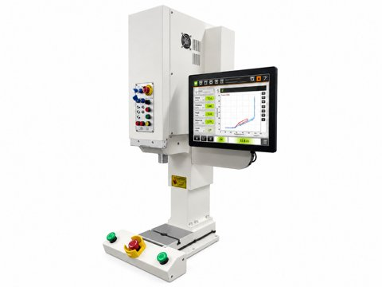

# 🧩 AutomaticPressFitMachine_v0.0.1_260930.aasx

[← 장비 페이지](../README.md) · [⤓ AASX 다운로드](../AASX/AutomaticPressFitMachine_v0.0.1_260930.aasx) · 5.2 MB

> 🤖 AASX 파일을 열어 자동으로 만든 열람 페이지입니다. 직접 고치지 말고 AASX를 다시 올리세요.

| 항목 | 내용 |
|---|---|
| AAS idShort | `AutomaticPressFitMachineAAS` |
| AAS id | https://www.smart-factory.kr/ids/aas/AutomaticPressFitMachineAAS/1/0 |
| 자산 종류 (assetKind) | Type |
| globalAssetId | https://www.smart-factory.kr/ids/asset/AutomaticPressFitMachineType/1/0 |
| 설명 | 서보 모터와 볼스크류를 이용해 베어링·부싱·핀을 압입 조립하는 자동압입기 Type 자산의 AAS 참조모델입니다. |
| 서브모델 | 7개 |
| 전체 요소 | 198개 |

## 서브모델 한눈에 보기

| # | 서브모델 | 요소 수 | semanticId |
|:-:|---|--:|---|
| 1 | [Nameplate](#sm-1) | 23 | https://admin-shell.io/idta/nameplate/3/0/Nameplate |
| 2 | [HandoverDocumentation](#sm-2) | 26 | 0173-1#01-AHF578#003 |
| 3 | [TechnicalData](#sm-3) | 53 | 0173-1#01-AHX837#002 |
| 4 | [OperationalData](#sm-4) | 32 | https://www.smart-factory.kr/ids/sm/AutomaticPressFitMachineAAS/OperationalData/1/0 |
| 5 | [ProcessParameters](#sm-5) | 25 | https://admin-shell-io/idta/SubmodelTemplate/ProcessParameters/1/0 |
| 6 | [FunctionalSafety](#sm-6) | 17 | https://admin-shell.io/idta/iec62683/1/0/FunctionalSafety |
| 7 | [TimeSeries](#sm-7) | 22 | https://admin-shell.io/idta/TimeSeries/1/1 |

## 서브모델 상세

각 서브모델 이름을 누르면 펼쳐집니다. **굵은 글씨**는 하위 요소가 있는 묶음입니다.

<b>1. Nameplate</b> — 요소 23개

> 자동압입기의 디지털 명판 서브모델입니다.

semanticId: `https://admin-shell.io/idta/nameplate/3/0/Nameplate`

| idShort | 종류 | 값 | semanticId |
|---|---|---|---|
| URIOfTheProduct | 속성 | https://www.smart-factory.kr/ids/product/AutomaticPressFitMachine/EX-SVP-50 | 0112/2///61987#ABN590#002 |
| ManufacturerName | 다국어&nbsp;속성 | 예시제조사 주식회사 | 0112/2///61987#ABA565#009 |
| ManufacturerProductDesignation | 다국어&nbsp;속성 | 서보 자동압입기 | 0112/2///61987#ABA567#009 |
| ManufacturerProductFamily | 다국어&nbsp;속성 | 자동압입기 | 0112/2///61987#ABP464#002 |
| ManufacturerProductType | 속성 | EX-SVP-50 | 0112/2///61987#ABA300#008 |
| OrderCodeOfManufacturer | 속성 | EX-SVP-50 | 0112/2///61987#ABA950#008 |
| ProductArticleNumberOfManufacturer | 속성 | ART-EX-SVP-50 | 0112/2///61987#ABA581#007 |
| SerialNumber | 속성 | PF-SN-2026-0001 | 0112/2///61987#ABA951#009 |
| YearOfConstruction | 속성 | 2026 | 0112/2///61987#ABP000#002 |
| DateOfManufacture | 속성 | 2026-06-18 | 0112/2///61987#ABB757#007 |
| HardwareVersion | 속성 | 1.0 | 0112/2///61987#ABA926#008 |
| FirmwareVersion | 속성 | 1.0.0 | 0112/2///61987#ABA302#006 |
| SoftwareVersion | 속성 | 1.0.0 | 0112/2///61987#ABA601#008 |
| **AddressInformation** | 묶음&nbsp;(4) |  | https://admin-shell.io/zvei/nameplate/1/0/ContactInformations/Address… |
| &nbsp;&nbsp;&nbsp;└ Street | 다국어&nbsp;속성 | 123 Assembly Technology Road | 0173-1#02-AAO128#002 |
| &nbsp;&nbsp;&nbsp;└ Zipcode | 다국어&nbsp;속성 | 13493 | 0173-1#02-AAO129#002 |
| &nbsp;&nbsp;&nbsp;└ CityTown | 다국어&nbsp;속성 | Seongnam | 0173-1#02-AAO132#002 |
| &nbsp;&nbsp;&nbsp;└ NationalCode | 다국어&nbsp;속성 | KR | 0173-1#02-AAO134#002 |
| **Markings** | 목록&nbsp;(1) |  | 0112/2///61360_7#AAS006#001 |
| &nbsp;&nbsp;&nbsp;└ **** | 묶음&nbsp;(3) |  | 0112/2///61360_7#AAS009#001 |
| &nbsp;&nbsp;&nbsp;&nbsp;&nbsp;&nbsp;└ MarkingName | 속성 | CE | 0112/2///61987#ABA231#009 |
| &nbsp;&nbsp;&nbsp;&nbsp;&nbsp;&nbsp;└ MarkingFile | 파일 | file:///aasx/files/documents/examples/PF-MARKING-EXAMPLE.txt | 0112/2///61987#ABO100#002 |
| &nbsp;&nbsp;&nbsp;&nbsp;&nbsp;&nbsp;└ MarkingAdditionalText | 속성 | EXAMPLE ONLY: MD 2006/42/EC; EN ISO 16092. Illustrative reference-model marking… | 0112/2///61987#ABB146#007 |

<b>2. HandoverDocumentation</b> — 요소 26개

> 자동압입기의 인계 문서 서브모델입니다.

semanticId: `0173-1#01-AHF578#003`

| idShort | 종류 | 값 | semanticId |
|---|---|---|---|
| **Documents** | 목록&nbsp;(1) |  | 0173-1#02-ABI500#003 |
| &nbsp;&nbsp;&nbsp;└ **** | 묶음&nbsp;(3) |  | 0173-1#02-ABI500#003/0173-1#01-AHF579#003 |
| &nbsp;&nbsp;&nbsp;&nbsp;&nbsp;&nbsp;└ **DocumentIds** | 목록&nbsp;(1) |  | 0173-1#02-ABI501#003 |
| &nbsp;&nbsp;&nbsp;&nbsp;&nbsp;&nbsp;&nbsp;&nbsp;&nbsp;└ **** | 묶음&nbsp;(3) |  | 0173-1#02-ABI501#003/0173-1#01-AHF580#003 |
| &nbsp;&nbsp;&nbsp;&nbsp;&nbsp;&nbsp;&nbsp;&nbsp;&nbsp;&nbsp;&nbsp;&nbsp;└ DocumentDomainId | 속성 | AutomaticPressFitMachine | 0173-1#02-ABH994#003 |
| &nbsp;&nbsp;&nbsp;&nbsp;&nbsp;&nbsp;&nbsp;&nbsp;&nbsp;&nbsp;&nbsp;&nbsp;└ DocumentIdentifier | 속성 | PF-OM-001 | 0173-1#02-AAO099#004 |
| &nbsp;&nbsp;&nbsp;&nbsp;&nbsp;&nbsp;&nbsp;&nbsp;&nbsp;&nbsp;&nbsp;&nbsp;└ DocumentIsPrimary | 속성 | true | 0173-1#02-ABH995#003 |
| &nbsp;&nbsp;&nbsp;&nbsp;&nbsp;&nbsp;└ **DocumentVersions** | 목록&nbsp;(1) |  | 0173-1#02-ABI503#003 |
| &nbsp;&nbsp;&nbsp;&nbsp;&nbsp;&nbsp;&nbsp;&nbsp;&nbsp;└ **** | 묶음&nbsp;(10) |  | 0173-1#02-ABI503#003/0173-1#01-AHF582#003 |
| &nbsp;&nbsp;&nbsp;&nbsp;&nbsp;&nbsp;&nbsp;&nbsp;&nbsp;&nbsp;&nbsp;&nbsp;└ **Language** | 목록&nbsp;(1) |  | 0173-1#02-AAN468#008 |
| &nbsp;&nbsp;&nbsp;&nbsp;&nbsp;&nbsp;&nbsp;&nbsp;&nbsp;&nbsp;&nbsp;&nbsp;&nbsp;&nbsp;&nbsp;└  | 속성 | ko-KR | 0173-1#02-AAN468#008 |
| &nbsp;&nbsp;&nbsp;&nbsp;&nbsp;&nbsp;&nbsp;&nbsp;&nbsp;&nbsp;&nbsp;&nbsp;└ Version | 속성 | 1.0 | 0173-1#02-AAP003#005 |
| &nbsp;&nbsp;&nbsp;&nbsp;&nbsp;&nbsp;&nbsp;&nbsp;&nbsp;&nbsp;&nbsp;&nbsp;└ StatusSetDate | 속성 | 2026-06-18 | 0173-1#02-ABI000#003 |
| &nbsp;&nbsp;&nbsp;&nbsp;&nbsp;&nbsp;&nbsp;&nbsp;&nbsp;&nbsp;&nbsp;&nbsp;└ Title | 다국어&nbsp;속성 | 자동압입기 운영 매뉴얼 | 0173-1#02-ABG940#003 |
| &nbsp;&nbsp;&nbsp;&nbsp;&nbsp;&nbsp;&nbsp;&nbsp;&nbsp;&nbsp;&nbsp;&nbsp;└ Description | 다국어&nbsp;속성 | 서보 압입기의 운전, 레시피 설정, 안전 및 정상 정지 절차 예시 문서 | 0173-1#02-AAN466#004 |
| &nbsp;&nbsp;&nbsp;&nbsp;&nbsp;&nbsp;&nbsp;&nbsp;&nbsp;&nbsp;&nbsp;&nbsp;└ KeyWords | 다국어&nbsp;속성 | 자동압입기, 서보 프레스, 압입 레시피 | 0173-1#02-ABH999#003 |
| &nbsp;&nbsp;&nbsp;&nbsp;&nbsp;&nbsp;&nbsp;&nbsp;&nbsp;&nbsp;&nbsp;&nbsp;└ OrganizationOfficialName | 속성 | Manufacturer Co., Ltd. | 0173-1#02-ABI004#003 |
| &nbsp;&nbsp;&nbsp;&nbsp;&nbsp;&nbsp;&nbsp;&nbsp;&nbsp;&nbsp;&nbsp;&nbsp;└ **DigitalFiles** | 목록&nbsp;(1) |  | 0173-1#02-ABK126#002 |
| &nbsp;&nbsp;&nbsp;&nbsp;&nbsp;&nbsp;&nbsp;&nbsp;&nbsp;&nbsp;&nbsp;&nbsp;&nbsp;&nbsp;&nbsp;└  | 파일 | file:///aasx/files/documents/examples/PF-OM-001.txt | 0173-1#02-ABK126#002 |
| &nbsp;&nbsp;&nbsp;&nbsp;&nbsp;&nbsp;&nbsp;&nbsp;&nbsp;&nbsp;&nbsp;&nbsp;└ StatusValue | 속성 | Released | 0173-1#02-ABI001#003 |
| &nbsp;&nbsp;&nbsp;&nbsp;&nbsp;&nbsp;&nbsp;&nbsp;&nbsp;&nbsp;&nbsp;&nbsp;└ OrganizationShortName | 속성 | Manufacturer | https://api.eclass-cdp.com/0173-1-02-ABI002-003 |
| &nbsp;&nbsp;&nbsp;&nbsp;&nbsp;&nbsp;└ **DocumentClassifications** | 목록&nbsp;(1) |  | 0173-1#02-ABI502#003 |
| &nbsp;&nbsp;&nbsp;&nbsp;&nbsp;&nbsp;&nbsp;&nbsp;&nbsp;└ **** | 묶음&nbsp;(3) |  | 0173-1#02-ABI502#003/0173-1#01-AHF581#003 |
| &nbsp;&nbsp;&nbsp;&nbsp;&nbsp;&nbsp;&nbsp;&nbsp;&nbsp;&nbsp;&nbsp;&nbsp;└ ClassId | 속성 | 03-02 | 0173-1#02-ABH996#003 |
| &nbsp;&nbsp;&nbsp;&nbsp;&nbsp;&nbsp;&nbsp;&nbsp;&nbsp;&nbsp;&nbsp;&nbsp;└ ClassName | 다국어&nbsp;속성 | 운전 | 0173-1#02-ABJ219#002 |
| &nbsp;&nbsp;&nbsp;&nbsp;&nbsp;&nbsp;&nbsp;&nbsp;&nbsp;&nbsp;&nbsp;&nbsp;└ ClassificationSystem | 속성 | VDI 2770 Blatt 1:2020 | 0173-1#02-ABH997#003 |

<b>3. TechnicalData</b> — 요소 53개

> 자동압입기의 기술 데이터 서브모델입니다.

semanticId: `0173-1#01-AHX837#002`

| idShort | 종류 | 값 | semanticId |
|---|---|---|---|
| **GeneralInformation** | 묶음&nbsp;(6) |  | 0173-1#02-ABK161#002/0173-1#01-AHX838#002 |
| &nbsp;&nbsp;&nbsp;└ ManufacturerName | 속성 | Manufacturer Co., Ltd. | 0173-1#02-AAO677#004 |
| &nbsp;&nbsp;&nbsp;└ CompanyLogo | 파일 | file:///aasx/files/images/company_logo.png | 0173-1#02-ABI776#002 |
| &nbsp;&nbsp;&nbsp;└ ManufacturerProductDesignation | 다국어&nbsp;속성 | 서보 자동압입기 | 0173-1#02-AAW338#003 |
| &nbsp;&nbsp;&nbsp;└ ManufacturerArticleNumber | 속성 | ART-EX-SVP-50 | 0173-1#02-AAO676#005 |
| &nbsp;&nbsp;&nbsp;└ ManufacturerOrderCode | 속성 | EX-SVP-50 | 0173-1#02-AAO227#004 |
| &nbsp;&nbsp;&nbsp;└ **ProductImages** | 목록&nbsp;(1) |  | 0173-1#02-ABM220#001 |
| &nbsp;&nbsp;&nbsp;&nbsp;&nbsp;&nbsp;└ **** | 묶음&nbsp;(2) |  | 0173-1#02-ABM220#001/0173-1#01-AHY911#001 |
| &nbsp;&nbsp;&nbsp;&nbsp;&nbsp;&nbsp;&nbsp;&nbsp;&nbsp;└ ImageFile | 파일 | file:///aasx/files/images/EX_SVP50_ProductImage.png | 0173-1#02-ABK291#002 |
| &nbsp;&nbsp;&nbsp;&nbsp;&nbsp;&nbsp;&nbsp;&nbsp;&nbsp;└ ImageNote | 다국어&nbsp;속성 | 서보 자동압입기 외관 | 0173-1#02-ABL423#001 |
| **ProductClassifications** | 목록&nbsp;(1) |  | 0173-1#02-ABK162#002 |
| &nbsp;&nbsp;&nbsp;└ **** | 묶음&nbsp;(6) |  | 0173-1#02-ABK162#002/0173-1#01-AHX839#002 |
| &nbsp;&nbsp;&nbsp;&nbsp;&nbsp;&nbsp;└ ClassificationSystem | 속성 | ECLASS | 0173-1#02-ABL424#001 |
| &nbsp;&nbsp;&nbsp;&nbsp;&nbsp;&nbsp;└ ClassificationSystemVersion | 속성 | 16.0 | 0173-1#02-AAR710#003 |
| &nbsp;&nbsp;&nbsp;&nbsp;&nbsp;&nbsp;└ ProductClassId | 속성 | 0173-1#01-ACK202#019 | 0173-1#02-ABG776#003 |
| &nbsp;&nbsp;&nbsp;&nbsp;&nbsp;&nbsp;└ ProductClassCodedName | 속성 | 36-65-02-05 | 0173-1#02-ABK128#002 |
| &nbsp;&nbsp;&nbsp;&nbsp;&nbsp;&nbsp;└ ProductClassName | 다국어&nbsp;속성 | 압입 스테이션 | 0173-1#02-ABK273#002 |
| &nbsp;&nbsp;&nbsp;&nbsp;&nbsp;&nbsp;└ ClassificationSystemUrl | 속성 | https://eclass.eu | https://admin-shell.io/IDTA/TechnicalData/ProductClassifications/Prod… |
| **TechnicalPropertyAreas** | 목록&nbsp;(4) |  | 0173-1#02-ABK163#002 |
| &nbsp;&nbsp;&nbsp;└ **** | 묶음&nbsp;(1) |  | 0173-1#02-ABL358#002/0173-1#01-AHX773#002 |
| &nbsp;&nbsp;&nbsp;&nbsp;&nbsp;&nbsp;└ **PressingSystem** | 묶음&nbsp;(1) |  | https://www.smart-factory.kr/ids/cd/PressingSystem/1/0 |
| &nbsp;&nbsp;&nbsp;&nbsp;&nbsp;&nbsp;&nbsp;&nbsp;&nbsp;└ **PressPerformanceSpecifications** | 묶음&nbsp;(4) |  | https://www.smart-factory.kr/ids/cd/PressPerformanceSpecifications/1/0 |
| &nbsp;&nbsp;&nbsp;&nbsp;&nbsp;&nbsp;&nbsp;&nbsp;&nbsp;&nbsp;&nbsp;&nbsp;└ NominalForce | 속성 | 50 | https://www.smart-factory.kr/ids/cd/NominalForce/1/0 |
| &nbsp;&nbsp;&nbsp;&nbsp;&nbsp;&nbsp;&nbsp;&nbsp;&nbsp;&nbsp;&nbsp;&nbsp;└ ForceMeasurementAccuracy | 속성 | ±0.5 %F.S. | https://www.smart-factory.kr/ids/cd/ForceMeasurementAccuracy/1/0 |
| &nbsp;&nbsp;&nbsp;&nbsp;&nbsp;&nbsp;&nbsp;&nbsp;&nbsp;&nbsp;&nbsp;&nbsp;└ ForceRepeatability | 속성 | ±0.5 % | https://www.smart-factory.kr/ids/cd/ForceRepeatability/1/0 |
| &nbsp;&nbsp;&nbsp;&nbsp;&nbsp;&nbsp;&nbsp;&nbsp;&nbsp;&nbsp;&nbsp;&nbsp;└ RamSpeedRange | 범위 | 0.1 ~ 500 | https://www.smart-factory.kr/ids/cd/RamSpeedRange/1/0 |
| &nbsp;&nbsp;&nbsp;└ **** | 묶음&nbsp;(1) |  | 0173-1#02-ABL358#002/0173-1#01-AHX773#002 |
| &nbsp;&nbsp;&nbsp;&nbsp;&nbsp;&nbsp;└ **FrameAndPositioningSystem** | 묶음&nbsp;(1) |  | https://www.smart-factory.kr/ids/cd/FrameAndPositioningSystem/1/0 |
| &nbsp;&nbsp;&nbsp;&nbsp;&nbsp;&nbsp;&nbsp;&nbsp;&nbsp;└ **DimensionsAndAccuracySpecifications** | 묶음&nbsp;(9) |  | https://www.smart-factory.kr/ids/cd/DimensionsAndAccuracySpecificatio… |
| &nbsp;&nbsp;&nbsp;&nbsp;&nbsp;&nbsp;&nbsp;&nbsp;&nbsp;&nbsp;&nbsp;&nbsp;└ Stroke | 속성 | 200 | https://www.smart-factory.kr/ids/cd/Stroke/1/0 |
| &nbsp;&nbsp;&nbsp;&nbsp;&nbsp;&nbsp;&nbsp;&nbsp;&nbsp;&nbsp;&nbsp;&nbsp;└ PositionAccuracy | 속성 | ±0.01 mm | https://www.smart-factory.kr/ids/cd/PositionAccuracy/1/0 |
| &nbsp;&nbsp;&nbsp;&nbsp;&nbsp;&nbsp;&nbsp;&nbsp;&nbsp;&nbsp;&nbsp;&nbsp;└ DisplacementResolution | 속성 | 0.001 | https://www.smart-factory.kr/ids/cd/DisplacementResolution/1/0 |
| &nbsp;&nbsp;&nbsp;&nbsp;&nbsp;&nbsp;&nbsp;&nbsp;&nbsp;&nbsp;&nbsp;&nbsp;└ Daylight | 속성 | 400 | https://www.smart-factory.kr/ids/cd/Daylight/1/0 |
| &nbsp;&nbsp;&nbsp;&nbsp;&nbsp;&nbsp;&nbsp;&nbsp;&nbsp;&nbsp;&nbsp;&nbsp;└ Throat | 속성 | 300 | https://www.smart-factory.kr/ids/cd/Throat/1/0 |
| &nbsp;&nbsp;&nbsp;&nbsp;&nbsp;&nbsp;&nbsp;&nbsp;&nbsp;&nbsp;&nbsp;&nbsp;└ Length | 속성 | 900 | 0173-1#02-ABE774#002 |
| &nbsp;&nbsp;&nbsp;&nbsp;&nbsp;&nbsp;&nbsp;&nbsp;&nbsp;&nbsp;&nbsp;&nbsp;└ Width | 속성 | 750 | 0173-1#02-AAG933#004 |
| &nbsp;&nbsp;&nbsp;&nbsp;&nbsp;&nbsp;&nbsp;&nbsp;&nbsp;&nbsp;&nbsp;&nbsp;└ Height | 속성 | 2100 | 0173-1#02-BAE355#006 |
| &nbsp;&nbsp;&nbsp;&nbsp;&nbsp;&nbsp;&nbsp;&nbsp;&nbsp;&nbsp;&nbsp;&nbsp;└ DeadWeight | 속성 | 850 | 0173-1#02-ABD800#002 |
| &nbsp;&nbsp;&nbsp;└ **** | 묶음&nbsp;(1) |  | 0173-1#02-ABL358#002/0173-1#01-AHX773#002 |
| &nbsp;&nbsp;&nbsp;&nbsp;&nbsp;&nbsp;└ **ServoMotorSystem** | 묶음&nbsp;(1) |  | https://www.smart-factory.kr/ids/cd/ServoMotorSystem/1/0 |
| &nbsp;&nbsp;&nbsp;&nbsp;&nbsp;&nbsp;&nbsp;&nbsp;&nbsp;└ **DriveAndSensorSpecifications** | 묶음&nbsp;(5) |  | https://www.smart-factory.kr/ids/cd/DriveAndSensorSpecifications/1/0 |
| &nbsp;&nbsp;&nbsp;&nbsp;&nbsp;&nbsp;&nbsp;&nbsp;&nbsp;&nbsp;&nbsp;&nbsp;└ DriveType | 속성 | AC Servo + Ball Screw | https://www.smart-factory.kr/ids/cd/DriveType/1/0 |
| &nbsp;&nbsp;&nbsp;&nbsp;&nbsp;&nbsp;&nbsp;&nbsp;&nbsp;&nbsp;&nbsp;&nbsp;└ ServoMotorPower | 속성 | 3.5 | https://www.smart-factory.kr/ids/cd/ServoMotorPower/1/0 |
| &nbsp;&nbsp;&nbsp;&nbsp;&nbsp;&nbsp;&nbsp;&nbsp;&nbsp;&nbsp;&nbsp;&nbsp;└ BallScrewLead | 속성 | 10 | https://www.smart-factory.kr/ids/cd/BallScrewLead/1/0 |
| &nbsp;&nbsp;&nbsp;&nbsp;&nbsp;&nbsp;&nbsp;&nbsp;&nbsp;&nbsp;&nbsp;&nbsp;└ LoadCellCapacity | 속성 | 50 | https://www.smart-factory.kr/ids/cd/LoadCellCapacity/1/0 |
| &nbsp;&nbsp;&nbsp;&nbsp;&nbsp;&nbsp;&nbsp;&nbsp;&nbsp;&nbsp;&nbsp;&nbsp;└ DataSamplingRate | 속성 | 1000 | https://www.smart-factory.kr/ids/cd/DataSamplingRate/1/0 |
| &nbsp;&nbsp;&nbsp;└ **** | 묶음&nbsp;(1) |  | 0173-1#02-ABL358#002/0173-1#01-AHX773#002 |
| &nbsp;&nbsp;&nbsp;&nbsp;&nbsp;&nbsp;└ **ElectricalAndEnvironmentalSystem** | 묶음&nbsp;(1) |  | https://www.smart-factory.kr/ids/cd/ElectricalAndEnvironmentalSystem/… |
| &nbsp;&nbsp;&nbsp;&nbsp;&nbsp;&nbsp;&nbsp;&nbsp;&nbsp;└ **ElectricalAndEnvironmentalSpecifications** | 묶음&nbsp;(4) |  | https://www.smart-factory.kr/ids/cd/ElectricalAndEnvironmentalSpecifi… |
| &nbsp;&nbsp;&nbsp;&nbsp;&nbsp;&nbsp;&nbsp;&nbsp;&nbsp;&nbsp;&nbsp;&nbsp;└ RatedVoltage | 속성 | 380 | 0173-1#02-ABM190#001 |
| &nbsp;&nbsp;&nbsp;&nbsp;&nbsp;&nbsp;&nbsp;&nbsp;&nbsp;&nbsp;&nbsp;&nbsp;└ RatedPower | 속성 | 5 | https://www.smart-factory.kr/ids/cd/RatedPower/1/0 |
| &nbsp;&nbsp;&nbsp;&nbsp;&nbsp;&nbsp;&nbsp;&nbsp;&nbsp;&nbsp;&nbsp;&nbsp;└ SupplyFrequency | 속성 | 50/60 Hz | https://www.smart-factory.kr/ids/cd/SupplyFrequency/1/0 |
| &nbsp;&nbsp;&nbsp;&nbsp;&nbsp;&nbsp;&nbsp;&nbsp;&nbsp;&nbsp;&nbsp;&nbsp;└ AmbientTemperatureRange | 범위 | 5 ~ 40 | https://www.smart-factory.kr/ids/cd/AmbientTemperatureRange/1/0 |

<b>4. OperationalData</b> — 요소 32개

> 자동압입기의 운영 데이터 서브모델입니다.

semanticId: `https://www.smart-factory.kr/ids/sm/AutomaticPressFitMachineAAS/OperationalData/1/0`

| idShort | 종류 | 값 | semanticId |
|---|---|---|---|
| **DeviceOperationSystem** | 묶음&nbsp;(1) |  | https://www.smart-factory.kr/ids/cd/DeviceOperationSystem/1/0 |
| &nbsp;&nbsp;&nbsp;└ **DeviceOperationMonitoring** | 묶음&nbsp;(5) |  | https://www.smart-factory.kr/ids/cd/DeviceOperationMonitoring/1/0 |
| &nbsp;&nbsp;&nbsp;&nbsp;&nbsp;&nbsp;└ PressOperationState | 속성 | Run | https://www.smart-factory.kr/ids/cd/PressOperationState/1/0 |
| &nbsp;&nbsp;&nbsp;&nbsp;&nbsp;&nbsp;└ PressOperationMode | 속성 | Auto | https://www.smart-factory.kr/ids/cd/PressOperationMode/1/0 |
| &nbsp;&nbsp;&nbsp;&nbsp;&nbsp;&nbsp;└ StrokePhase | 속성 | Pressing | https://www.smart-factory.kr/ids/cd/StrokePhase/1/0 |
| &nbsp;&nbsp;&nbsp;&nbsp;&nbsp;&nbsp;└ ServoPowerStatus | 속성 | ServoOn | https://www.smart-factory.kr/ids/cd/ServoPowerStatus/1/0 |
| &nbsp;&nbsp;&nbsp;&nbsp;&nbsp;&nbsp;└ CurrentRecipeId | 속성 | PF-RCP-012 | https://www.smart-factory.kr/ids/cd/CurrentRecipeId/1/0 |
| **PressFittingProcessSystem** | 묶음&nbsp;(1) |  | https://www.smart-factory.kr/ids/cd/PressFittingProcessSystem/1/0 |
| &nbsp;&nbsp;&nbsp;└ **PressFittingProcessMonitoring** | 묶음&nbsp;(10) |  | https://www.smart-factory.kr/ids/cd/PressFittingProcessMonitoring/1/0 |
| &nbsp;&nbsp;&nbsp;&nbsp;&nbsp;&nbsp;└ MeasuredPressForce | 속성 | 30.4 | https://www.smart-factory.kr/ids/cd/MeasuredPressForce/1/0 |
| &nbsp;&nbsp;&nbsp;&nbsp;&nbsp;&nbsp;└ MeasuredRamPosition | 속성 | 24.998 | https://www.smart-factory.kr/ids/cd/MeasuredRamPosition/1/0 |
| &nbsp;&nbsp;&nbsp;&nbsp;&nbsp;&nbsp;└ MeasuredRamSpeed | 속성 | 12 | https://www.smart-factory.kr/ids/cd/MeasuredRamSpeed/1/0 |
| &nbsp;&nbsp;&nbsp;&nbsp;&nbsp;&nbsp;└ LastCycleResult | 속성 | PASS | https://www.smart-factory.kr/ids/cd/LastCycleResult/1/0 |
| &nbsp;&nbsp;&nbsp;&nbsp;&nbsp;&nbsp;└ MeasuredCycleTime | 속성 | 3.8 | https://www.smart-factory.kr/ids/cd/MeasuredCycleTime/1/0 |
| &nbsp;&nbsp;&nbsp;&nbsp;&nbsp;&nbsp;└ LastCyclePeakForce | 속성 | 30.8 | https://www.smart-factory.kr/ids/cd/LastCyclePeakForce/1/0 |
| &nbsp;&nbsp;&nbsp;&nbsp;&nbsp;&nbsp;└ LastCycleFinalPosition | 속성 | 25.002 | https://www.smart-factory.kr/ids/cd/LastCycleFinalPosition/1/0 |
| &nbsp;&nbsp;&nbsp;&nbsp;&nbsp;&nbsp;└ LastCycleCurveArea | 속성 | 412 | https://www.smart-factory.kr/ids/cd/LastCycleCurveArea/1/0 |
| &nbsp;&nbsp;&nbsp;&nbsp;&nbsp;&nbsp;└ ForceWindowJudgement | 속성 | PASS | https://www.smart-factory.kr/ids/cd/ForceWindowJudgement/1/0 |
| &nbsp;&nbsp;&nbsp;&nbsp;&nbsp;&nbsp;└ PositionWindowJudgement | 속성 | PASS | https://www.smart-factory.kr/ids/cd/PositionWindowJudgement/1/0 |
| **ProtectionAndSafetySystem** | 묶음&nbsp;(1) |  | https://www.smart-factory.kr/ids/cd/ProtectionAndSafetySystem/1/0 |
| &nbsp;&nbsp;&nbsp;└ **ProtectionAndSafetyStateMonitoring** | 묶음&nbsp;(4) |  | https://www.smart-factory.kr/ids/cd/ProtectionAndSafetyStateMonitorin… |
| &nbsp;&nbsp;&nbsp;&nbsp;&nbsp;&nbsp;└ PressAlarmCode | 속성 | E-FORCE-OVER | 0173-1#02-ABI766#002 |
| &nbsp;&nbsp;&nbsp;&nbsp;&nbsp;&nbsp;└ PressAlarmText | 다국어&nbsp;속성 | 압입력 상한 윈도우 초과: 부품 경사삽입 의심 | https://www.smart-factory.kr/ids/cd/PressAlarmText/1/0 |
| &nbsp;&nbsp;&nbsp;&nbsp;&nbsp;&nbsp;└ PressAlarmSeverity | 속성 | Critical | https://www.smart-factory.kr/ids/cd/PressAlarmSeverity/1/0 |
| &nbsp;&nbsp;&nbsp;&nbsp;&nbsp;&nbsp;└ LastAlarmTimestamp | 속성 | 2026-06-18T13:42:11Z | https://www.smart-factory.kr/ids/cd/LastAlarmTimestamp/1/0 |
| **MaintenanceAndCounterSystem** | 묶음&nbsp;(1) |  | https://www.smart-factory.kr/ids/cd/MaintenanceAndCounterSystem/1/0 |
| &nbsp;&nbsp;&nbsp;└ **MaintenanceAndCounterMonitoring** | 묶음&nbsp;(5) |  | https://www.smart-factory.kr/ids/cd/MaintenanceAndCounterMonitoring/1… |
| &nbsp;&nbsp;&nbsp;&nbsp;&nbsp;&nbsp;└ CumulativeOperatingHours | 속성 | 9800 | https://www.smart-factory.kr/ids/cd/CumulativeOperatingHours/1/0 |
| &nbsp;&nbsp;&nbsp;&nbsp;&nbsp;&nbsp;└ CumulativePressCount | 속성 | 3450000 | https://www.smart-factory.kr/ids/cd/CumulativePressCount/1/0 |
| &nbsp;&nbsp;&nbsp;&nbsp;&nbsp;&nbsp;└ CumulativePassCount | 속성 | 3438600 | https://www.smart-factory.kr/ids/cd/CumulativePassCount/1/0 |
| &nbsp;&nbsp;&nbsp;&nbsp;&nbsp;&nbsp;└ CumulativeFailCount | 속성 | 11400 | https://www.smart-factory.kr/ids/cd/CumulativeFailCount/1/0 |
| &nbsp;&nbsp;&nbsp;&nbsp;&nbsp;&nbsp;└ MaintenanceCycleCount | 속성 | 14 | https://www.smart-factory.kr/ids/cd/MaintenanceCycleCount/1/0 |

<b>5. ProcessParameters</b> — 요소 25개

> 자동압입기의 공정 파라미터 타입 서브모델입니다.

semanticId: `https://admin-shell-io/idta/SubmodelTemplate/ProcessParameters/1/0`

| idShort | 종류 | 값 | semanticId |
|---|---|---|---|
| **Processes** | 묶음&nbsp;(1) |  | https://admin-shell.io/idta/ProcessParameters/Processes/1/0 |
| &nbsp;&nbsp;&nbsp;└ **Process__00__** | 묶음&nbsp;(8) |  | https://admin-shell.io/idta/ProcessParameters/Process/1/0 |
| &nbsp;&nbsp;&nbsp;&nbsp;&nbsp;&nbsp;└ ProcessId | 속성 | PF-PROC-001 | https://admin-shell.io/idta/ProcessParameters/ProcessId/1/0 |
| &nbsp;&nbsp;&nbsp;&nbsp;&nbsp;&nbsp;└ ProcessName | 속성 | Press-fit Assembly | https://admin-shell.io/idta/ProcessParameters/ProcessName/1/0 |
| &nbsp;&nbsp;&nbsp;&nbsp;&nbsp;&nbsp;└ ProcessDescription | 다국어&nbsp;속성 | 베어링/부싱을 하우징에 힘-변위 모니터링으로 압입 조립 | https://admin-shell.io/idta/ProcessParameters/ProcessDescription/1/0 |
| &nbsp;&nbsp;&nbsp;&nbsp;&nbsp;&nbsp;└ PlannedProcessTime | 속성 | PT4S | https://admin-shell.io/idta/ProcessParameters/PlannedProcessTime/1/0 |
| &nbsp;&nbsp;&nbsp;&nbsp;&nbsp;&nbsp;└ **ProductParameters** | 묶음&nbsp;(3) |  | https://admin-shell.io/idta/ProcessParameters/ProductParameters/1/0 |
| &nbsp;&nbsp;&nbsp;&nbsp;&nbsp;&nbsp;&nbsp;&nbsp;&nbsp;└ PartName | 속성 | Ball bearing 6204 | https://www.smart-factory.kr/ids/cd/PartName/1/0 |
| &nbsp;&nbsp;&nbsp;&nbsp;&nbsp;&nbsp;&nbsp;&nbsp;&nbsp;└ HousingBore | 속성 | Ø47.000 mm (H7) | https://www.smart-factory.kr/ids/cd/HousingBore/1/0 |
| &nbsp;&nbsp;&nbsp;&nbsp;&nbsp;&nbsp;&nbsp;&nbsp;&nbsp;└ InterferenceFit | 범위 | 0.015 ~ 0.035 | https://www.smart-factory.kr/ids/cd/InterferenceFit/1/0 |
| &nbsp;&nbsp;&nbsp;&nbsp;&nbsp;&nbsp;└ **ProcessParameters** | 묶음&nbsp;(8) |  | https://admin-shell.io/idta/ProcessParameters/ProcessParameters/1/0 |
| &nbsp;&nbsp;&nbsp;&nbsp;&nbsp;&nbsp;&nbsp;&nbsp;&nbsp;└ TargetPressForce | 속성 | 30.0 | https://www.smart-factory.kr/ids/cd/TargetPressForce/1/0 |
| &nbsp;&nbsp;&nbsp;&nbsp;&nbsp;&nbsp;&nbsp;&nbsp;&nbsp;└ TargetFinalPosition | 속성 | 25.000 | https://www.smart-factory.kr/ids/cd/TargetFinalPosition/1/0 |
| &nbsp;&nbsp;&nbsp;&nbsp;&nbsp;&nbsp;&nbsp;&nbsp;&nbsp;└ ForceWindowUpperLimit | 속성 | 31.0 | https://www.smart-factory.kr/ids/cd/ForceWindowUpperLimit/1/0 |
| &nbsp;&nbsp;&nbsp;&nbsp;&nbsp;&nbsp;&nbsp;&nbsp;&nbsp;└ ForceWindowLowerLimit | 속성 | 29.0 | https://www.smart-factory.kr/ids/cd/ForceWindowLowerLimit/1/0 |
| &nbsp;&nbsp;&nbsp;&nbsp;&nbsp;&nbsp;&nbsp;&nbsp;&nbsp;└ PositionWindowUpperLimit | 속성 | 25.020 | https://www.smart-factory.kr/ids/cd/PositionWindowUpperLimit/1/0 |
| &nbsp;&nbsp;&nbsp;&nbsp;&nbsp;&nbsp;&nbsp;&nbsp;&nbsp;└ PositionWindowLowerLimit | 속성 | 24.980 | https://www.smart-factory.kr/ids/cd/PositionWindowLowerLimit/1/0 |
| &nbsp;&nbsp;&nbsp;&nbsp;&nbsp;&nbsp;&nbsp;&nbsp;&nbsp;└ PressSpeedSetpoint | 속성 | 15 | https://www.smart-factory.kr/ids/cd/PressSpeedSetpoint/1/0 |
| &nbsp;&nbsp;&nbsp;&nbsp;&nbsp;&nbsp;&nbsp;&nbsp;&nbsp;└ HoldTime | 속성 | 0.5 | https://www.smart-factory.kr/ids/cd/HoldTime/1/0 |
| &nbsp;&nbsp;&nbsp;&nbsp;&nbsp;&nbsp;└ **ResourceParameters** | 묶음&nbsp;(2) |  | https://admin-shell.io/idta/ProcessParameters/ResourceParameters/1/0 |
| &nbsp;&nbsp;&nbsp;&nbsp;&nbsp;&nbsp;&nbsp;&nbsp;&nbsp;└ ProcessPunchToolId | 속성 | PUNCH-6204-A | https://www.smart-factory.kr/ids/cd/ProcessPunchToolId/1/0 |
| &nbsp;&nbsp;&nbsp;&nbsp;&nbsp;&nbsp;&nbsp;&nbsp;&nbsp;└ WorkNestId | 속성 | NEST-HSG-03 | https://www.smart-factory.kr/ids/cd/WorkNestId/1/0 |
| &nbsp;&nbsp;&nbsp;&nbsp;&nbsp;&nbsp;└ **ProcessBoM** | 묶음&nbsp;(2) |  | https://admin-shell.io/idta/ProcessParameters/ProcessBoM/1/0 |
| &nbsp;&nbsp;&nbsp;&nbsp;&nbsp;&nbsp;&nbsp;&nbsp;&nbsp;└ Bearing | 속성 | Ball bearing 6204 | https://www.smart-factory.kr/ids/cd/Bearing/1/0 |
| &nbsp;&nbsp;&nbsp;&nbsp;&nbsp;&nbsp;&nbsp;&nbsp;&nbsp;└ Housing | 속성 | Aluminum housing AC-001 | https://www.smart-factory.kr/ids/cd/Housing/1/0 |

<b>6. FunctionalSafety</b> — 요소 17개

> 자동압입기의 기능 안전 서브모델입니다.

semanticId: `https://admin-shell.io/idta/iec62683/1/0/FunctionalSafety`

| idShort | 종류 | 값 | semanticId |
|---|---|---|---|
| NumberOfFunctionalSafetySetsOfCharacteristics | 속성 | 1 | 0112/2///62683#ACE005#001 |
| **OperatingConditionsOfFunctionalSafetyCharacteristics** | 묶음&nbsp;(4) |  | 0112/2///62683#ACG057#001 |
| &nbsp;&nbsp;&nbsp;└ TypeOfVoltage | 속성 | AC | 0112/2///61987#ABA969#007 |
| &nbsp;&nbsp;&nbsp;└ RatedVoltage | 속성 | 380 | 0112/2///61987#ABA588#004 |
| &nbsp;&nbsp;&nbsp;└ RatedOperationalCurrent | 속성 | 8000 | https://admin-shell.io/idta/FunctionalSafety/RatedOperationalCurrent/… |
| &nbsp;&nbsp;&nbsp;└ UsefulLifeInTimeInterval | 속성 | 10 | 0112/2///62683#ACE054#001 |
| **SafetyDeviceTypes** | 묶음&nbsp;(3) |  | 0112/2///62683#ACG070#001 |
| &nbsp;&nbsp;&nbsp;└ FunctionalSafetyDeviceType | 속성 | ELECMECEL | 0112/2///62683#ACE071#001 |
| &nbsp;&nbsp;&nbsp;└ **SafetySubsystem** | 묶음&nbsp;(5) |  | 0112/2///62683#ACG065#001 |
| &nbsp;&nbsp;&nbsp;&nbsp;&nbsp;&nbsp;└ SIL | 속성 | SIL3 | 0112/2///62683#ACE051#001 |
| &nbsp;&nbsp;&nbsp;&nbsp;&nbsp;&nbsp;└ PFH | 속성 | 5.0E-8 | 0112/2///62683#ACE052#001 |
| &nbsp;&nbsp;&nbsp;&nbsp;&nbsp;&nbsp;└ ProofTestInterval | 속성 | 1 | 0112/2///62683#ACE058#001 |
| &nbsp;&nbsp;&nbsp;&nbsp;&nbsp;&nbsp;└ PL | 속성 | PLE | 0112/2///62683#ACE060#001 |
| &nbsp;&nbsp;&nbsp;&nbsp;&nbsp;&nbsp;└ Category | 속성 | CAT4 | 0112/2///62683#ACE063#001 |
| &nbsp;&nbsp;&nbsp;└ **ElectromechanicalElement** | 묶음&nbsp;(2) |  | 0112/2///62683#ACG067#001 |
| &nbsp;&nbsp;&nbsp;&nbsp;&nbsp;&nbsp;└ B10D | 속성 | 2000000 | 0112/2///62683#ACE056#001 |
| &nbsp;&nbsp;&nbsp;&nbsp;&nbsp;&nbsp;└ ProofTestInterval | 속성 | 1 | 0112/2///62683#ACE058#001 |

<b>7. TimeSeries</b> — 요소 22개

> 자동압입기의 시계열 데이터 서브모델입니다.

semanticId: `https://admin-shell.io/idta/TimeSeries/1/1`

| idShort | 종류 | 값 | semanticId |
|---|---|---|---|
| **Metadata** | 묶음&nbsp;(3) |  | https://admin-shell.io/idta/TimeSeries/Metadata/1/1 |
| &nbsp;&nbsp;&nbsp;└ Name | 다국어&nbsp;속성 | 압입 force-displacement 곡선 시계열 데이터 | https://admin-shell.io/idta/TimeSeries/Metadata/Name/1/1 |
| &nbsp;&nbsp;&nbsp;└ Description | 다국어&nbsp;속성 | 1사이클 압입력·램 변위·램 속도 시계열 곡선 서명 | https://admin-shell.io/idta/TimeSeries/Metadata/Description/1/1 |
| &nbsp;&nbsp;&nbsp;└ **Record** | 묶음&nbsp;(4) |  | https://admin-shell.io/idta/TimeSeries/Record/1/1 |
| &nbsp;&nbsp;&nbsp;&nbsp;&nbsp;&nbsp;└ Time00 | 속성 | 0 | https://admin-shell.io/idta/TimeSeries/RelativePointInTime/1/1 |
| &nbsp;&nbsp;&nbsp;&nbsp;&nbsp;&nbsp;└ PressForce | 속성 | 18.2 | https://www.smart-factory.kr/ids/cd/PressForce/1/0 |
| &nbsp;&nbsp;&nbsp;&nbsp;&nbsp;&nbsp;└ RamDisplacement | 속성 | 12.500 | https://www.smart-factory.kr/ids/cd/RamDisplacement/1/0 |
| &nbsp;&nbsp;&nbsp;&nbsp;&nbsp;&nbsp;└ RamSpeed | 속성 | 15.0 | https://www.smart-factory.kr/ids/cd/RamSpeed/1/0 |
| **Segments** | 묶음&nbsp;(1) |  | https://admin-shell.io/idta/TimeSeries/Segments/1/1 |
| &nbsp;&nbsp;&nbsp;└ **InternalSegment** | 묶음&nbsp;(7) |  | https://admin-shell.io/idta/TimeSeries/Segments/InternalSegment/1/1 |
| &nbsp;&nbsp;&nbsp;&nbsp;&nbsp;&nbsp;└ Name | 다국어&nbsp;속성 | 압입 사이클 #1의 대표 레코드 1건 | https://admin-shell.io/idta/TimeSeries/Segment/Name/1/1 |
| &nbsp;&nbsp;&nbsp;&nbsp;&nbsp;&nbsp;└ RecordCount | 속성 | 1 | https://admin-shell.io/idta/TimeSeries/Segment/RecordCount/1/1 |
| &nbsp;&nbsp;&nbsp;&nbsp;&nbsp;&nbsp;└ SamplingRate | 속성 | 1000 | https://admin-shell.io/idta/TimeSeries/Segment/SamplingRate/1/1 |
| &nbsp;&nbsp;&nbsp;&nbsp;&nbsp;&nbsp;└ StartTime | 속성 | 2026-06-18T13:42:10.001+09:00 | https://admin-shell.io/idta/TimeSeries/Segment/StartTime/1/1 |
| &nbsp;&nbsp;&nbsp;&nbsp;&nbsp;&nbsp;└ EndTime | 속성 | 2026-06-18T13:42:10.001+09:00 | https://admin-shell.io/idta/TimeSeries/Segment/EndTime/1/1 |
| &nbsp;&nbsp;&nbsp;&nbsp;&nbsp;&nbsp;└ State | 속성 | completed | https://admin-shell.io/idta/TimeSeries/Segment/State/1/1 |
| &nbsp;&nbsp;&nbsp;&nbsp;&nbsp;&nbsp;└ **Records** | 묶음&nbsp;(1) |  | https://admin-shell.io/idta/TimeSeries/Records/1/1 |
| &nbsp;&nbsp;&nbsp;&nbsp;&nbsp;&nbsp;&nbsp;&nbsp;&nbsp;└ **Record** | 묶음&nbsp;(4) |  | https://admin-shell.io/idta/TimeSeries/Record/1/1 |
| &nbsp;&nbsp;&nbsp;&nbsp;&nbsp;&nbsp;&nbsp;&nbsp;&nbsp;&nbsp;&nbsp;&nbsp;└ Time00 | 속성 | 0 | https://admin-shell.io/idta/TimeSeries/RelativePointInTime/1/1 |
| &nbsp;&nbsp;&nbsp;&nbsp;&nbsp;&nbsp;&nbsp;&nbsp;&nbsp;&nbsp;&nbsp;&nbsp;└ PressForce | 속성 | 18.2 | https://www.smart-factory.kr/ids/cd/PressForce/1/0 |
| &nbsp;&nbsp;&nbsp;&nbsp;&nbsp;&nbsp;&nbsp;&nbsp;&nbsp;&nbsp;&nbsp;&nbsp;└ RamDisplacement | 속성 | 12.500 | https://www.smart-factory.kr/ids/cd/RamDisplacement/1/0 |
| &nbsp;&nbsp;&nbsp;&nbsp;&nbsp;&nbsp;&nbsp;&nbsp;&nbsp;&nbsp;&nbsp;&nbsp;└ RamSpeed | 속성 | 15.0 | https://www.smart-factory.kr/ids/cd/RamSpeed/1/0 |

